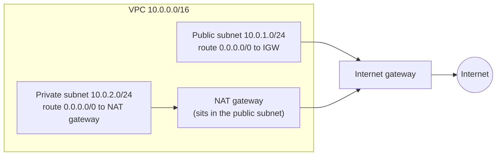
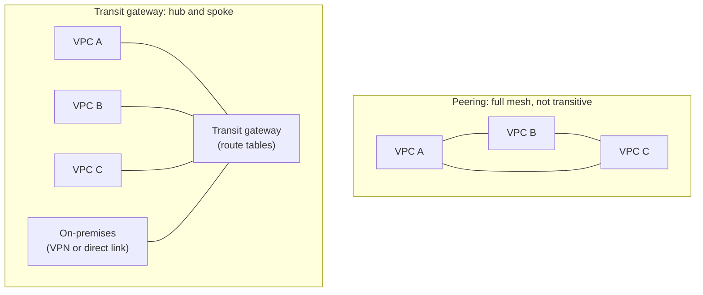
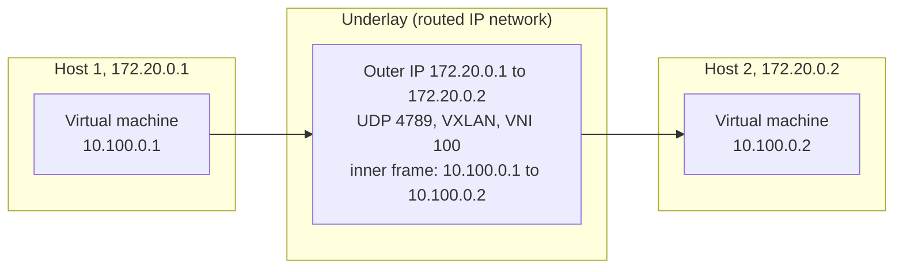
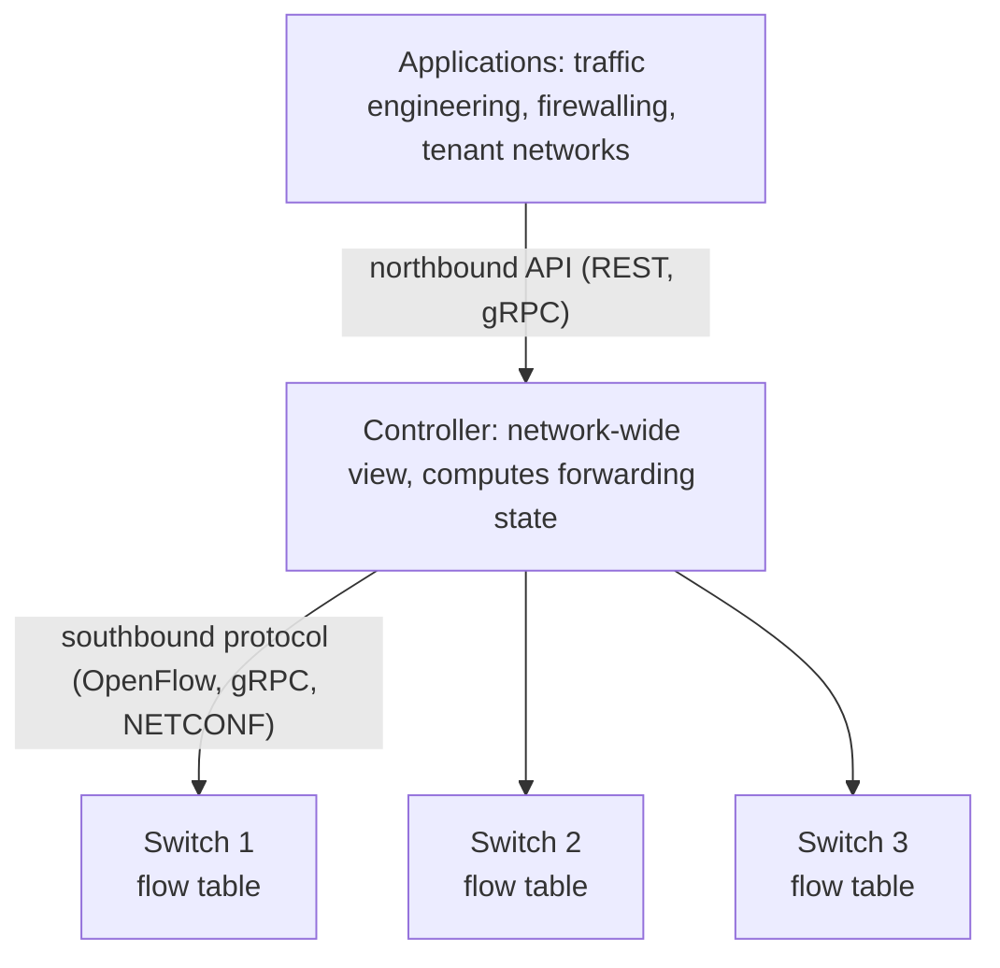
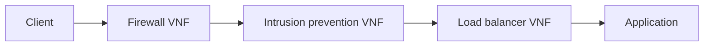

# NET 17: Cloud networking, SDN, NFV, automation and labs

*Part of the [networking plan](00_plan.md) · You need: [NET 02](02_ip_routing_and_layer3.md) (routing tables, NAT), [NET 09](09_network_security_firewalls_ips_dpi.md) (stateful firewalls), [NET 11](11_routing_protocols_and_datacenter_fabrics.md) (BGP, VXLAN, EVPN) and [NET 13](13_load_balancing_proxies_and_anycast.md) (load balancers). Pairs with [NET 16](16_network_foundations_gaps.md) for ACLs.*

Cloud networking looks like a new subject, with its own vocabulary of VPCs, security groups, transit gateways and controllers. It is not. Every cloud network feature is an ordinary mechanism you already know (a routing table, a stateful firewall, a tunnel, a NAT box, a match-action table) wrapped in an API. A weak interview answer lists product names: "a VPC has subnets, route tables, security groups and a NAT gateway". A strong answer says **what each object really is, which one decides which packets, and what breaks when you mix them up**: "a route table picks the next hop by longest prefix, a security group is a stateful allow list attached to the interface, a network ACL is a stateless ordered list on the subnet, and peering is not transitive because routes are never re-advertised through a peer".

The second half of the tutorial is about **how networks are built and tested as software**: the SDN split between controller and switch, network functions that run as virtual machines or containers, automation that you can run twice without breaking anything, and the lab tools you can use to practise without hardware. Every mechanism below has a small lab on a Linux machine, using network namespaces, `nftables`, Open vSwitch, VXLAN, Python and Ansible, so that you can see the behaviour instead of memorising it.

By the end you can:

- describe a VPC as subnets, route tables and gateways, and predict which route a packet takes;
- explain security groups against network ACLs (stateful against stateless, instance against subnet, allow only against allow and deny) and say why a stateless rule set needs ephemeral-port rules;
- explain VPC peering, why it is not transitive, why overlapping addresses block it, and when to use a transit gateway instead;
- explain how a cloud builds a virtual network on a physical one with overlays (VXLAN), and why the inner MTU is smaller;
- explain the SDN split (control plane, data plane, southbound and northbound interfaces), OpenFlow match-action tables, and where P4 fits;
- explain NFV (the ETSI parts, service chaining, why a virtual firewall or NAT is just a function in a namespace) and the performance trade-offs;
- write automation that is **idempotent** and explain changed against ok, check mode, and drift;
- choose between Packet Tracer, GNS3, EVE-NG, containerlab, and namespaces with FRR for a given purpose.

---

## 1. Cloud networking is a software-defined version of what you know

A cloud provider runs a very large physical network, and gives each customer a **virtual network** that behaves like a private data centre. The customer sees addresses, subnets, routes and firewall rules. The provider implements them in **software on the hosts** (a virtual switch and a packet-processing agent on every server, or a smart NIC), with the physical network acting only as a transport for tunnelled packets.

That gives a mapping worth keeping in your head:

| Cloud object | What it really is |
|---|---|
| VPC (virtual private cloud, virtual network) | An isolated address space, with its own route tables and policies, carried over an overlay |
| Subnet | A slice of the VPC range, usually tied to one availability zone, and associated with a route table |
| Route table | An ordered-by-prefix table, longest prefix wins, with next hops that are gateways instead of IP addresses |
| Internet gateway | A horizontally scaled one-to-one NAT between private addresses and public ones |
| NAT gateway | A managed many-to-one source NAT (see [NET 02](02_ip_routing_and_layer3.md)) |
| Security group | A stateful allow list on the network interface (the connection-tracking firewall from [NET 09](09_network_security_firewalls_ips_dpi.md)) |
| Network ACL | A stateless ordered list with allow and deny rules on the subnet boundary |
| Peering, transit gateway | Route exchange between two virtual networks, or a managed router that joins many |
| Load balancer | The proxies and anycast tricks of [NET 13](13_load_balancing_proxies_and_anycast.md) |

The product names differ per provider (AWS VPC, Azure VNet, Google VPC), and some details differ too. This tutorial uses **AWS terms** because they are the most commonly asked in interviews, and says when a detail is provider-specific.

---

## 2. The VPC: addresses, subnets, route tables and gateways

### 2.1 Address planning comes first

A VPC is created with a CIDR block (for example `10.0.0.0/16`), and that block is cut into subnets (for example `10.0.1.0/24` in zone A and `10.0.2.0/24` in zone B). Two facts decide the rest of the design:

- **The ranges you choose now must never overlap with a network you will connect later.** Peering two networks whose primary ranges overlap is refused, and a VPN to an office that also uses `10.0.0.0/16` needs NAT on top. Pick ranges from [RFC 1918](16_network_foundations_gaps.md#4-addresses-you-will-meet-that-are-not-public) space with a company-wide plan, before the first VPC exists.
- **A subnet is public or private only because of its route table.** There is no flag. A subnet is "public" if its route table sends `0.0.0.0/0` to an internet gateway (and the instances have public addresses), and "private" if the default route goes to a NAT gateway or nowhere.

### 2.2 The route table is longest prefix match

Every subnet is associated with one route table. A route table always has a **local** route for the VPC range, which cannot be removed, and you add routes whose next hop is an object: an internet gateway, a NAT gateway, a peering connection, a transit gateway, a VPN, or an endpoint.



The rule is the one from [NET 02](02_ip_routing_and_layer3.md): **the most specific matching prefix wins**, regardless of the order in which routes were added. Here is the behaviour on a Linux namespace with a "peering" route and a more specific route (the same decision a cloud route table makes):

```bash
ip -n cl route add 10.61.0.0/16 via 10.60.1.1 metric 5     # the peering route
ip -n cl route add 10.61.7.0/24 dev c0 metric 5            # a more specific route
for d in 10.60.1.9 10.61.2.2 10.61.7.9 8.8.8.8; do ip -n cl route get $d | head -1; done
```

Fresh result: `10.60.1.9` is local (the subnet's own route), `10.61.2.2` goes via the gateway (the /16), `10.61.7.9` goes directly (the /24 beats the /16 even at the same metric), and `8.8.8.8` falls to the default route. This is why a "mysterious" cloud path is usually a more specific route that someone added months ago.

### 2.3 Internet access: why a private instance can still reach the internet

- An instance in a **public subnet** has a private address and a public address. The internet gateway translates one to the other one-to-one, so inbound connections work too, provided the security group allows them.
- An instance in a **private subnet** has no public address. Its outbound traffic goes to a **NAT gateway** in a public subnet, which rewrites the source to its own public address. **Inbound connections from the internet cannot start**, because there is no mapping until the inside host opens one, which is the property people mean when they call this "private".
- To reach the provider's own services (object storage, for example) without going through the internet at all, you add an **endpoint**. A gateway endpoint adds a route to the service's prefix list. An interface endpoint (PrivateLink) puts a network interface with a private address in your subnet, and the service appears at that address.

The failure modes worth knowing: a private subnet with no NAT route has no internet (including no package updates); a NAT gateway placed in a private subnet does nothing, because it has no route to the internet gateway; and a NAT gateway is **one per zone**, so a design with one NAT for three zones loses internet for the other zones when that zone fails, and pays cross-zone data charges meanwhile.

---

## 3. Security groups against network ACLs

This is the most common cloud-networking question, and the whole answer is three words: **stateful, stateless, scope**.

| | Security group | Network ACL |
|---|---|---|
| Attached to | The network interface (so, the instance) | The subnet boundary |
| State | **Stateful**: replies to an allowed connection are allowed automatically | **Stateless**: request and reply are checked separately |
| Rules | Allow only | Allow and deny |
| Evaluation | All rules together, no order | In ascending rule number, first match wins |
| Default | Deny all inbound, allow all outbound | The default NACL allows everything, a new custom NACL denies everything |

(This table follows the [AWS documentation](https://docs.aws.amazon.com/vpc/latest/userguide/infrastructure-security.html); AWS recommends security groups as the primary control and a NACL as a coarse guardrail, for example to deny a hostile range for a whole subnet.)

### 3.1 Why "stateless" matters in practice

A stateful filter remembers a connection when the first packet is allowed (this is **connection tracking**, `conntrack`, from [NET 09](09_network_security_firewalls_ips_dpi.md)), so replies match the table entry and need no rule. A stateless filter has no memory, so the reply is just another packet that needs its own rule. And the reply from a server does not go to port 443: it goes to the **client's ephemeral port**, a random high number. A NACL that allows inbound 443 but has no outbound rule for the ephemeral range breaks every connection, and the symptom, a timeout with the security group looking correct, is a classic.

The lab reproduces the three cases with `nftables` on a router between a client subnet and a server subnet. The "NACL" rules are written without connection tracking, and the "security group" rule uses it:

```bash
# stateless: only the request direction is allowed
ip saddr 10.60.1.0/24 ip daddr 10.60.2.0/24 tcp dport 443 accept

# stateless, plus the return rule for the client's ephemeral ports
ip saddr 10.60.2.0/24 ip daddr 10.60.1.0/24 tcp sport 443 tcp dport 1024-65535 accept

# stateful: one rule for the request, established replies are allowed by state
ct state established,related accept
ip saddr 10.60.1.0/24 ip daddr 10.60.2.0/24 tcp dport 443 ct state new accept
```

Fresh result from a client connecting to the server on 443:

| Rule set | Result |
|---|---|
| Stateless, request rule only | **Timed out** (the request arrives, the reply is dropped) |
| Stateless, request rule plus ephemeral return rule | Connected |
| Stateful, one rule | Connected |
| Stateful, same rules, port 8443 (no rule allows it) | Timed out |

Two details for an interview. The ephemeral range differs by operating system (Linux commonly uses 32768 to 60999, others 49152 to 65535, and some older systems 1024 to 5000), and a NACL rule must cover every client you serve, so `1024-65535` is the safe entry. And a stateful firewall's table is finite: a security group is not a licence to ignore the connection-tracking limit on a very busy instance (see [NET 06](06_linux_network_stack.md) for conntrack on Linux, and the provider documentation for how tracking limits and untracked flows behave, which is provider-specific).

### 3.2 How to use both

- **Security groups do the real work**, per role. Instead of listing addresses, a rule can name **another security group** as its source ("the web tier's group may reach the database tier's group on 5432"), so the rule follows instances as they scale.
- **Network ACLs are the coarse outer layer**: deny a known bad range for a whole subnet, or keep one subnet away from another as a compliance guardrail. They are the only place to write a **deny**, which is why they appear in incident response.
- When traffic is blocked, check **in order**: route (is there a path?), then NACL in both directions (including ephemeral ports), then the security group on both ends, then the OS firewall inside the instance. Flow logs show accepted and rejected packets with the reason class, and are the first tool to reach for.

---

## 4. Connecting networks: peering, transit gateways, endpoints and hybrid links

### 4.1 Peering

A **peering connection** is a private link between two VPCs. Traffic stays on the provider's backbone. You add a route in each VPC to the other's range, and security groups on both sides allow the traffic. There is no gateway device to fail and no bandwidth bottleneck, because it uses the existing infrastructure.

Two properties decide most designs (see the [AWS peering documentation](https://docs.aws.amazon.com/whitepapers/latest/aws-vpc-connectivity-options/vpc-peering.html)):

- **Peering is not transitive.** If A peers with B and B peers with C, A cannot reach C through B. Routes are never passed on through a peer, and the provider will not forward packets that neither start nor end in the middle VPC. For N networks to talk to each other you need N(N-1)/2 peerings, so peering scales badly past a handful of networks.
- **Primary address ranges must not overlap.** Overlapping ranges make the routing ambiguous, so the connection is refused.

### 4.2 Transit gateway

A **transit gateway** is a managed regional router. Each VPC (and each VPN or direct link) attaches to it, and it has its own route tables, so the topology becomes a **hub and spoke**: N attachments instead of N(N-1)/2 links.



What the hub gives you, and what it costs:

- **Routing control.** Separate route tables on the hub let you **segment**: for example, production and development spokes that can both reach a shared-services spoke but not each other. That is a hub design, not something peering can express.
- **Inspection.** Send traffic through a firewall spoke (a centralised inspection VPC), which is the NFV pattern of section 8.
- **Cost and limits.** There is an hourly charge per attachment and a per-gigabyte processing charge, and a throughput limit per attachment. Peering has no processing charge. The usual rule: **peering for a few high-traffic pairs, a transit gateway for many networks or any need for central control**.
- **Overlapping ranges are still a problem.** A hub cannot route to two spokes that use the same range. The fixes are re-addressing, or NAT at the boundary (a private NAT gateway), which is why the address plan in section 2.1 matters.

### 4.3 Hybrid connectivity

Connecting an office or data centre uses an IPsec **site-to-site VPN** (quick to set up, rides the internet, variable latency, roughly a gigabit per tunnel on common services, from memory) or a **dedicated private link** (Direct Connect, ExpressRoute, Interconnect), which has stable latency and higher bandwidth but takes weeks to provision. Both exchange routes with **BGP** ([NET 11](11_routing_protocols_and_datacenter_fabrics.md)) so that the cloud learns the on-premises prefixes. The standard resilient design is a dedicated link as the primary and a VPN as a backup with a worse BGP preference (a longer AS path, or a lower local preference), which is the floating-route idea of [NET 16](16_network_foundations_gaps.md#5-static-routes-administrative-distance-and-the-floating-route) applied to the cloud.

---

## 5. Load balancers in the cloud

The load balancers of [NET 13](13_load_balancing_proxies_and_anycast.md) appear as managed services in two families, and the distinction is the L4 against L7 distinction from that tutorial:

- **Network (layer 4) load balancer**: balances TCP, UDP and TLS connections by address and port, with very high throughput and low latency, preserves the client's source address in many modes, and can hold a **static address per zone**. Use it for non-HTTP protocols, for static addresses and for extreme connection rates.
- **Application (layer 7) load balancer**: terminates HTTP and HTTPS, routes on host, path, header or query, handles TLS certificates, and can authenticate users and talk gRPC and WebSocket. The client's address arrives in a forwarding header (`X-Forwarded-For`) because the TCP connection to the backend comes from the balancer.

Three interview points: **cross-zone balancing** (whether a balancer in one zone sends to backends in other zones, which affects both evenness and data-transfer charges); **health checks** (a backend marked unhealthy is removed from rotation, and the check path, interval and threshold decide how fast, as in [NET 13](13_load_balancing_proxies_and_anycast.md)); and **where the TLS ends** (at the balancer for visibility and certificate management, or passed through to keep end-to-end encryption). A global service uses anycast or DNS steering on top, as in that tutorial.

---

## 6. Overlays: how a virtual network rides on a physical one

The customer's VPC address `10.0.1.5` means nothing to the physical switches in the provider's data centre. The provider's host software **encapsulates** each virtual packet inside a packet addressed between the two physical hosts, delivers it across the **underlay** (an ordinary routed IP fabric, [NET 11](11_routing_protocols_and_datacenter_fabrics.md)), and removes the wrapper at the destination host. The virtual network is the **overlay**. The identifier in the wrapper (the VNI in VXLAN) keeps one customer's traffic separate from another's, even when both use `10.0.1.5`.



The lab builds exactly this with two namespaces as hosts, a point-to-point VXLAN device on each, and a capture of the underlay link:

```bash
ip -n h1 link add vx100 type vxlan id 100 remote 172.20.0.2 local 172.20.0.1 dstport 4789 dev u1
ip -n h2 link add vx100 type vxlan id 100 remote 172.20.0.1 local 172.20.0.2 dstport 4789 dev u2
ip -n h1 addr add 10.100.0.1/24 dev vx100     # and 10.100.0.2/24 on h2, then bring both up
```

Fresh result: the overlay ping works, and a capture on the underlay link shows outer packets between `172.20.0.1` and `172.20.0.2` decoded as `Virtual eXtensible Local Area Network` with `VNI 100`, with the overlay addresses only inside. The tunnel device reports an **MTU of 1450 on a 1500-byte underlay**, because the outer headers cost about 50 bytes (outer Ethernet is not counted in the IP MTU, so the 50 comes from outer IP 20, UDP 8, VXLAN 8 and the inner Ethernet 14). That 50-byte tax is the root of a very common cloud problem: **a larger packet with the don't-fragment bit set is silently dropped**, so small requests work and large transfers hang, which is the path-MTU black hole from [NET 02](02_ip_routing_and_layer3.md). Cloud providers deal with it by advertising a smaller MTU to the instance, clamping the TCP MSS, or supporting jumbo frames (8500 or 9000 bytes) on the underlay.

Other overlay encapsulations you may be asked about are Geneve (an extensible header, used by modern virtual switches and for service insertion), GRE and NVGRE. The **control plane** that fills the forwarding tables (which host owns which overlay address) is either a central database owned by the provider, or **BGP EVPN** in a data-centre fabric ([NET 11](11_routing_protocols_and_datacenter_fabrics.md)).

---

## 7. Software-defined networking

### 7.1 The idea: separate deciding from forwarding

A traditional router does two jobs in one box. The **control plane** decides (it runs OSPF or BGP, builds the routing table, learns MAC addresses). The **data plane** forwards (it looks up each packet in a table and sends it, at line rate, often in hardware). SDN **separates the two**: the data-plane device keeps only the fast forwarding tables, and a **logically centralised controller** computes them and installs them.



What the separation buys: a **global view** (the controller sees the whole topology, so it can compute a path that no distributed protocol would find), **programmability** (a new policy is software, not a new box), and **vendor-neutral hardware**. What it costs: the controller is a **new failure and scaling concern** (a replicated cluster, and the switches must have a defined behaviour when it is unreachable), and every flow setup that goes to the controller adds latency.

An honest point for interviews: **most real networks did not become pure OpenFlow networks**. The ideas won in different forms. Data-centre overlays use a central control plane to program host virtual switches (the cloud of sections 1 to 6). Wide-area networks use controllers to steer traffic with segment routing (Google's B4 is the well-known published example, from memory). Campus and Wi-Fi networks use a cloud controller to configure access points (the architecture in [WF 07](10_wifi/07_wifi_architectures_mesh_and_services.md)). And traditional routers gained programmable interfaces (NETCONF, gNMI) so that automation can drive them. Knowing that history is better than claiming that every network is now OpenFlow.

### 7.2 OpenFlow: the match-action table

In OpenFlow a switch holds one or more **flow tables**. Each entry has:

- **match fields**: header values to compare (ports, MAC and IP addresses, protocol, ports);
- a **priority**, because several entries can match and the highest priority wins;
- **actions**: output to a port, drop, rewrite a field, send to the controller, or continue to the next table;
- **counters**, so the controller can read how much traffic each entry has carried.

If no entry matches (a **table miss**), the switch follows the table-miss entry, typically "send to the controller" or "drop". In the reactive style the controller sees the first packet of a flow, decides, and installs an entry so later packets never leave the switch. In the proactive style the controller installs everything in advance, which is how production deployments avoid the controller on the fast path.

The lab uses **Open vSwitch with its userspace datapath** (this VM has no kernel module) and plays the controller with a script that adds flows:

```bash
ovs-vsctl add-br sw0 -- set bridge sw0 datapath_type=netdev protocols=OpenFlow13 fail-mode=secure
ovs-ofctl -O OpenFlow13 add-flow sw0 "priority=0,actions=drop"
ovs-ofctl -O OpenFlow13 add-flow sw0 "priority=10,arp,actions=NORMAL"
ovs-ofctl -O OpenFlow13 add-flow sw0 "priority=20,ip,nw_dst=10.50.0.3,actions=output:3"
ovs-ofctl -O OpenFlow13 add-flow sw0 "priority=30,tcp,nw_dst=10.50.0.3,tp_dst=22,actions=drop"
```

Three hosts (namespaces `oa`, `ob`, `oc`) are attached to the bridge on ports 1, 2 and 3. Fresh results:

- With an **empty table** and `fail-mode=secure`, nothing is forwarded: a ping from `oa` to `ob` lost every packet. The switch has no brain of its own, and "no controller, no rules" means a black hole. This is the failure mode to name when asked about controller failure: `secure` fails closed, `standalone` falls back to ordinary learning-switch behaviour.
- After the script adds the flows above, `oa` reaches `ob`.
- The priority-30 rule makes the **same destination behave differently by port**: a TCP connection from `oa` to `oc` on port 22 timed out (dropped by the higher-priority flow), and on port 80 it connected.
- `ovs-ofctl dump-flows` shows **per-flow packet counters**. The drop flow had counted the blocked SYN, the output flow the permitted traffic, and the ARP flow the address resolution. That counter is what makes a flow table observable.

A practical note from running this: on the userspace datapath, TCP only worked after **disabling checksum offload on the veth ports** (`ethtool -K <if> tx off rx off`), while ICMP worked without it. If TCP stalls and ping works in a software-switch lab, suspect offload before you suspect your rules.

What OpenFlow can and cannot do: it matches a **fixed menu of header fields** (about 12 in version 1.0, 41 by version 1.4, per the P4 authors' paper), so a new protocol needs a new version of the standard. That limitation is what P4 was designed to remove.

### 7.3 P4 at a glance

**P4** is a language for describing how a switch **parses packets and what its match-action tables are**, instead of fixing them in the standard. The [original paper](https://ar5iv.arxiv.org/html/1312.1719) states three goals:

- **Reconfigurability**: the way a switch parses and processes packets can be changed after it is deployed.
- **Protocol independence**: the switch is not tied to particular packet formats. The program defines the parser (which headers exist) and the tables (which fields are matched).
- **Target independence**: the program says what to do without naming the hardware, and a compiler maps it to the chip or software target.

P4 describes the data plane, while a **control-plane interface** (P4Runtime, from memory) fills the tables the program defined. So the relationship is: OpenFlow says "here is a fixed table, fill it", and P4 says "here is how to define the table, then fill it". For interviews, three sentences are enough: P4 programs the **parser and the match-action pipeline**; it lets operators add a new header or an in-network function (a custom load balancer, in-band telemetry) without waiting for a chip generation; and it runs on programmable switch ASICs, smart NICs and software switches. Do not claim more unless you have used it.

### 7.4 Modern SDN, as used today

| Where | How the split appears |
|---|---|
| Cloud virtual networks | A central network service computes forwarding state and programs a software switch on every host (Open vSwitch, or a provider's own agent) |
| Data-centre fabrics | BGP EVPN with VXLAN as the control plane ([NET 11](11_routing_protocols_and_datacenter_fabrics.md)), with a controller or automation system for intent and provisioning |
| Wide-area networks | A central traffic-engineering system computes paths, and routers follow them with segment routing, or a controller reconfigures router policy |
| Campus and Wi-Fi | A cloud or on-premises controller configures access points and switches, with the data plane staying local ([WF 07](10_wifi/07_wifi_architectures_mesh_and_services.md)) |
| Intent-based and automation | The operator states the desired outcome, and software produces the device configuration (section 9) |

The summary an interviewer wants: **centralise the decisions that benefit from a global view, keep the packet path distributed and fast, and keep the network working when the controller is down**.

---

## 8. Network function virtualisation (NFV)

### 8.1 What it is

Traditionally a firewall, NAT device, load balancer, session border controller or mobile core was a **dedicated appliance**: purpose-built hardware, one function, a long procurement cycle. NFV moves each **network function** into software that runs on **standard servers** as a virtual machine or a container, so a function can be deployed, scaled, moved and replaced like any other workload.

SDN and NFV are separate ideas that work well together. **SDN** is about how forwarding decisions are made and who makes them. **NFV** is about where network functions run. A virtual firewall (NFV) is reached by traffic steered with SDN, as in the inspection design of section 4.2.

### 8.2 The ETSI architecture, in one table

The standards body that defined NFV ([ETSI GS NFV 006](https://www.etsi.org/deliver/etsi_gs/NFV/001_099/006/04.04.01_60/gs_NFV006v040401p.pdf)) names these parts:

| Part | Job |
|---|---|
| **VNF** (virtualised network function) | The software implementation of the function, described by a VNF descriptor (resources, networking, lifecycle) |
| **NFVI** (NFV infrastructure) | The hardware and the virtualisation layer that present virtual compute, storage and network to VNFs |
| **VIM** (virtualised infrastructure manager) | Controls the NFVI resources, typically within one site (OpenStack or Kubernetes plays this role) |
| **VNFM** (VNF manager) | Lifecycle of individual VNFs: instantiate, configure, scale, heal, terminate |
| **NFVO** (NFV orchestrator) | Lifecycle of whole **network services** made of several VNFs, and coordination across sites and VIMs |

MANO (management and orchestration) is the name for the VIM, VNFM and NFVO together. The modern form of a VNF is the **CNF**, a cloud-native (containerised) function managed by Kubernetes, which is how most new 5G core functions are delivered.

### 8.3 A VNF in a lab: a firewall and NAT function in a namespace

A network function is a forwarding path plus policy, and a Linux namespace with `nftables` is exactly that. The lab puts a "VNF" namespace between a LAN and a WAN, with two rules: a stateful forward policy and a source NAT:

```bash
table ip vnf {
  chain transit {
    type filter hook forward priority 0; policy drop;
    iifname "v0" oifname "v1" accept           # LAN to WAN allowed
    ct state established,related accept        # replies allowed back
  }
  chain nat {
    type nat hook postrouting priority 100;
    oifname "v1" masquerade                    # rewrite the source on the way out
  }
}
```

Fresh result: a client in the LAN namespace connected to a server in the WAN namespace, and **the server saw the client's address as the VNF's WAN address (`203.0.113.1`)**, not the private LAN address, which is the NAT working. A connection started from the WAN side towards the LAN host (with a route present, so the packet does reach the VNF) **timed out**, which is the forward policy dropping it. The same two chains would run unchanged inside a VM or a container, which is the point: the function is software that does not care what it is packaged in.

(One small trap from the lab: `fwd` is a reserved word in `nft`, so a chain named `fwd` is a syntax error, as is a chain named `mark`. Name chains with plain words that are not statements.)

### 8.4 Service chaining

A **service chain** sends traffic through an ordered list of functions, for example firewall, then intrusion prevention, then load balancer, then the application. The steering is an SDN job (policy routes, segment routing headers, or a service-function-chaining header such as NSH, from memory), and the functions can be scaled independently.



### 8.5 The performance problem, and the three answers

A function that handles packets in an ordinary Linux kernel path or a hypervisor's virtual switch pays for interrupts, copies and context switches ([NET 06](06_linux_network_stack.md), [NET 07](07_zero_copy_networking.md)), and cannot match a hardware appliance at tens of gigabits per second. The industry answers with:

- **Kernel bypass in user space** (DPDK, VPP): poll the NIC in a busy loop, use huge pages and batched processing, and skip the kernel stack. The cost is dedicated cores that spin at full load, and that the function must bring its own stack.
- **SR-IOV**: the NIC presents several virtual functions, and each VNF gets one directly, bypassing the hypervisor's switch. The cost is loss of some flexibility (live migration and virtual-switch policy are harder).
- **Offload to a smart NIC or programmable switch**: the data plane runs in hardware and the control plane stays in software. The cost is less flexibility and hardware lock-in.

The trade-off statement to give is: **NFV buys agility and cost on commodity hardware, and costs raw packet performance, which you buy back with kernel bypass, SR-IOV or offload**.

---

## 9. Automation: making changes you can run twice

### 9.1 Why automation, and the one property that matters

Large networks are configured by software because manual changes do not scale, drift from the intended state, and are not reviewed. The property that separates safe automation from dangerous automation is **idempotence**: running the same automation again leaves the system in the same state, and changes **nothing** if it is already correct. Idempotence is what lets you re-run after a failure, run on a schedule to correct drift, and run against a half-built system.

The way to get idempotence is to **declare the desired state and compare with the actual state**, instead of issuing blind commands. "Add this address" fails or duplicates on the second run. "Ensure this address is present" checks first.

### 9.2 A small idempotent builder in Python

This script declares two namespaces and their addresses on a bridge. Each step has the same shape: **check whether it is already true, change it only if not, and report which**.

```python
def ensure(changes, label, exists, create):
    if exists():
        print(f"  ok       {label}")
    else:
        create(); changes.append(label); print(f"  CHANGED  {label}")

# one call per object, for example the address inside a namespace
ensure(changes, f"addr {addr} in {ns}",
       lambda: addr.split("/")[0] in sh("ip", "-n", ns, "-br", "addr", check=False).stdout,
       lambda: sh("ip", "-n", ns, "addr", "add", addr, "dev", "eth0"))
```

Fresh results from three runs of the full script: the **first run** reported `CHANGED` for all seven objects (bridge, two namespaces, two links, two addresses), and the namespaces could then ping each other; the **second run** reported `ok` for all seven and `changes: 0`; after deleting one address by hand to simulate **drift**, the **third run** changed exactly that one object and reported `ok` for the other six. The report of what changed is as important as the change, because it tells a reviewer what the run actually did.

### 9.3 The same thing in Ansible

Ansible is an agentless automation tool: a **playbook** is a list of tasks, each calling a **module**, run over SSH or an API against an **inventory** of hosts. Network devices are reached through network modules (CLI over SSH, NETCONF or REST), and for the lab, the local machine is the target. The concepts from the [Red Hat comparison](https://www.redhat.com/en/blog/ansible-vs.-terraform-demystified) and the [idempotency guide](https://www.golinuxcloud.com/ansible-idempotency/) that matter in interviews are:

- **State-aware modules are idempotent.** `file`, `copy`, `package` and most network-configuration modules compare current and desired state, so a converged system reports `ok`.
- **`command` and `shell` are not.** They run every time and report `changed` every time, unless you add a guard (`creates`, `removes`) or take control of the result with `changed_when`.
- **Check mode** (`--check`) previews changes, and works well for state-aware modules and poorly for `shell`, so it is a preview and **not a proof** of idempotence. The real test is running the playbook twice and reading the recap.

The lab playbook uses a guarded `shell` for namespaces (it prints `created` only when it creates one, and `changed_when` reads that), a `copy` task that writes an `nftables` file, and a task that loads the file **only when the copy reported a change**:

```yaml
- name: namespaces exist
  ansible.builtin.shell: |
    ip netns list | grep -qw {{ item.key }} && echo present || { ip netns add {{ item.key }}; echo created; }
  loop: "{{ ns | dict2items }}"
  register: r
  changed_when: "'created' in r.stdout"

- name: nft ruleset from a template
  ansible.builtin.copy: { dest: /tmp/lab.nft, content: "...", mode: "0644" }
  register: rules

- name: load rules only when the file changed
  ansible.builtin.command: ip netns exec red nft -f /tmp/lab.nft
  when: rules.changed
```

Fresh results: the **first run** ended `ok=4 changed=3` (two namespaces created, the rule file written, the rules loaded), and the **second run** ended `ok=3 changed=0 skipped=1`, with the load task skipped because the file had not changed. That is idempotence, readable in the recap line.

A lesson that this lab produced by accident, and is worth repeating in an interview: the first attempt had a **syntax error in the rule file**. The `copy` task still reported `changed`, the load task failed, and the playbook stopped with `failed=1`. On the next run the file was already in place, so `rules.changed` was false and **the load was skipped, leaving the machine without its rules while the playbook reported success**. Triggering on "the file changed" is not the same as checking "the rules are loaded", so a robust design validates the file before using it (a `validate:` command on `copy`, or `nft -c`), and verifies the **runtime state** at the end. Idempotence on the artefact does not guarantee the state of the system.

### 9.4 Declarative provisioning against configuration management

| | Terraform-style provisioning | Ansible-style configuration |
|---|---|---|
| Model | Declarative: describe the end state of cloud resources, a **plan** shows the difference, an **apply** changes it | Procedural list of tasks, made declarative by idempotent modules |
| State | Keeps a **state file** that records what it created | Checks the live system each time, no state file |
| Best at | Creating and destroying infrastructure (VPCs, subnets, gateways) | Configuring what runs on it (devices, operating systems, services) |
| Drift | A plan reveals it | A run corrects it, or `--check --diff` reveals it |

Commonly both are used: one creates the VPC, the subnets, the route tables and the security groups, and the other configures the devices and servers. The mistake to avoid is making changes by hand to a resource that a tool manages, because the next run either reverts them or fails.

### 9.5 Programmatic interfaces on devices, and rules for safe change

Network devices expose **NETCONF** (XML over SSH, with a candidate configuration, validation and commit or rollback), **RESTCONF** (the same data models over HTTP), and **gNMI** (gRPC, used mainly for streaming telemetry), with **YANG** as the data-modelling language (all from memory, check before quoting). Telemetry that streams from the device replaces polling by SNMP. The habits of a safe automation engineer:

- **Version control** for all inputs, and review before change;
- **Dry run** (plan, `--check --diff`) first, then a **canary** device or one zone, then wider;
- **Validate before and after** (a ping, a route check, a state comparison) and **roll back automatically** when the check fails;
- **Never put secrets in the repository**, use a vault or the provider's secret store;
- Keep the change **small and reversible**, and keep a manual path to get back in when automation breaks the management network.

---

## 10. Labs and simulators: which tool for which job

You can practise networking without hardware, but the tools are different kinds of thing, and an interviewer likes to hear that you know the difference.

- A **simulator** models devices in software. It is lightweight, but it only does what its authors implemented. **Cisco Packet Tracer** is the main example: free for learners, a simplified subset of IOS commands and protocols, and ideal for a certification course. It does not run real operating systems, so behaviour outside its model does not exist.
- An **emulator** runs the **real network operating system image** (as a virtual machine or a container) and connects the instances with virtual links, so the behaviour is genuine, including the bugs. **GNS3**, **EVE-NG** and **containerlab** are the main ones.

| Tool | Runs | Strength | Cost and limit | Pick it for |
|---|---|---|---|---|
| Packet Tracer | Simulated devices | Instant, visual, gentle to teach | Limited features, not the real OS | Learning basics and certification practice |
| GNS3 | Real images (VMs, emulated routers), desktop application | Flexible, free and open source, large community | Heavy for large labs, you supply licensed images | One engineer building a realistic topology on a workstation |
| EVE-NG | Real images on a shared server, browser interface | Multi-user, many nodes with the paid edition | A server to run and a free edition capped in node count (the cited comparison gives 7 nodes, check the current figure) | Team labs and training with shared access |
| containerlab | Containerised network OSes, and VMs wrapped for it | Topology as a **YAML file**, light, fast, scriptable | Needs a Linux host and images that exist as containers | Automation, testing and CI pipelines |
| Namespaces + FRR (this course) | Real Linux kernel networking and real routing daemons | Free, instant, scriptable, shows real packets | No vendor CLI, no hardware features, you build every link | Routing protocol and Linux stack behaviour, tests in CI |

(The GNS3, EVE-NG and containerlab rows follow a [2026 comparison](https://netpilot.io/blog/gns3-vs-eve-ng-vs-containerlab-2026) and the vendors' own documentation; check current limits and licensing before depending on them.)

A decision rule that sounds right in an interview: use a **simulator to learn the concepts**, an **emulator when the vendor's real behaviour matters** (a feature, a bug, a configuration syntax), a **container-based lab when the lab must be created and destroyed by a pipeline**, and **real hardware only for what no software can reproduce** (forwarding performance, optics, PoE, radio behaviour: this VM, for example, has no physical port, so negotiation and power could not be observed here). For Wi-Fi, the same logic applies: see [WF 09](10_wifi/09_wifi_testing.md).

The practical value of the namespace and FRR approach used throughout this course is that a lab is a **script**: it builds the topology, runs the test, prints the result and tears down. That is what turns a lab into a regression test, and it is why the automation of section 9 and the labs belong in the same tutorial.

---

## 11. Common mistakes

- **Overlapping address ranges** across VPCs or with the office network, discovered when peering is refused or a VPN needs NAT. Plan once, centrally.
- **Expecting peering to be transitive**, or expecting a route through a middle network to work. Use a hub, or peer directly.
- **Forgetting the return path**: a NACL without ephemeral ports, or a route in one VPC but not the other, gives a one-way path and a timeout.
- **Testing the wrong layer first**: debugging a security group when the route does not exist. Check route, then NACL, then security group, then the instance firewall, then the application.
- **A NAT gateway in the wrong subnet, or one per region instead of one per zone**: internet access dies with one zone.
- **Ignoring the MTU of the overlay**: small packets work, large transfers hang.
- **Calling every software-driven network "SDN"**, or claiming the controller removes the distributed protocols. Say what is centralised and what is not, and what happens when the controller fails.
- **Running a command-based playbook twice without checking the recap**, then trusting `--check` as proof. The real test is the second run showing `changed=0`.
- **Making manual changes to resources a tool manages.** The next run reverts or breaks them.
- **Treating a simulator as the real thing**: a configuration that works in Packet Tracer can fail on real equipment.

---

## 12. Interview questions

**Q1. What makes a subnet public or private?**
Only its route table. A subnet is public if its default route points to an internet gateway (and its instances have public addresses), and private if the default goes to a NAT gateway or has no default. There is no separate flag.

**Q2. Security group against network ACL?**
A security group is stateful, attached to the interface and allow-only, so replies are automatic. A network ACL is stateless, attached to the subnet, supports allow and deny, and is evaluated in rule-number order, so it needs rules for both directions including the client's ephemeral ports. Use groups as the main control and ACLs as a coarse guardrail or for explicit denies.

**Q3. A client times out connecting to a server on 443 in the same VPC, and the security group allows 443. What do you check?**
Route (is there a path, is the return route there for peered or hybrid traffic), then the network ACLs in **both** directions (a missing outbound ephemeral-port rule gives exactly this symptom, I reproduced it), then the destination's security group and the client's outbound rules, then the host firewall, then whether the service is actually listening. Flow logs tell you whether the packet was accepted or rejected.

**Q4. Why is VPC peering not transitive, and what do you do instead?**
Peering carries only traffic that starts or ends in one of the two peered networks, and routes are not passed on through a peer, so A cannot reach C via B. For a handful of networks, peer each pair that needs to talk. For many, or when you need segmentation or central inspection, use a transit gateway as a hub.

**Q5. Two VPCs use `10.0.0.0/16` and need to connect. Options?**
Re-address one (best, and cheapest if done early), or put a NAT between them so that each side sees translated addresses (works but breaks end-to-end addressing and complicates logging and security rules), or expose only specific services through an endpoint service (PrivateLink) so no network-level routing is needed. The real fix is prevention: a central address plan.

**Q6. Why do cloud overlays reduce the MTU, and what goes wrong?**
The encapsulation adds a header (about 50 bytes for VXLAN over IPv4), so the inner packet must be smaller than the underlay MTU. If an endpoint sends full-size packets with the don't-fragment bit set and ICMP "too big" messages are lost, large packets are silently dropped (a path-MTU black hole): small requests succeed and large transfers hang. Fixes are advertising the right MTU to instances, clamping TCP MSS, allowing ICMP, or using jumbo frames on the underlay.

**Q7. What is SDN, in one minute?**
The control plane (deciding where traffic goes) is separated from the data plane (forwarding it), and a logically central controller computes forwarding state and installs it in switches through a southbound protocol such as OpenFlow, while applications use a northbound API. The benefits are a global view and programmability. The costs are the controller as a scaling and failure concern, so the design must say what the switches do when the controller is unreachable.

**Q8. What does an OpenFlow switch do on a table miss, and when would you choose each behaviour?**
It follows the table-miss entry: send the packet to the controller (reactive control, simple to start, but the controller is on the path of first packets and can be overloaded), or drop it (a closed default, with the controller installing rules proactively). Production designs install flows proactively so that the controller is off the fast path.

**Q9. What does P4 add over OpenFlow?**
OpenFlow matches a fixed set of header fields that standardise slowly. P4 lets the operator define the parser and the match-action tables themselves, so a new protocol or in-network function can be added without a new standard or chip, and the compiler maps the program to the target. A control-plane interface still fills the tables at runtime.

**Q10. SDN against NFV?**
SDN is about who makes forwarding decisions (a central controller programming simple switches). NFV is about where network functions run (in software on standard servers instead of dedicated appliances). They are independent but complementary: SDN steers traffic through virtual functions, such as a firewall chain.

**Q11. Name the ETSI NFV components.**
VNF (the function), NFVI (the infrastructure it runs on), VIM (manages infrastructure resources), VNFM (lifecycle of a VNF) and NFVO (lifecycle of whole network services across VNFs and sites). Together, MANO.

**Q12. Why is a virtual firewall slower than an appliance, and how do you close the gap?**
The kernel path and hypervisor switch cost interrupts, copies and context switches. Close it with kernel-bypass packet processing (DPDK, VPP), SR-IOV so the function owns a NIC virtual function, or offload to a smart NIC or programmable switch. Each trades flexibility, cores or portability for throughput.

**Q13. What is idempotence, and how do you test it?**
Running the automation repeatedly produces the same end state and changes nothing when the state is already correct. Test by running twice and reading the recap: the second run must report `changed=0`. Also test with deliberate drift (change something by hand and confirm one run fixes exactly that), and be careful that `shell` and `command` tasks report changed every time unless guarded.

**Q14. Ansible against Terraform for a network?**
Terraform describes and provisions cloud resources declaratively, with a plan that shows the difference and a state file that tracks what it owns, which is a good fit for VPCs, subnets and gateways. Ansible configures systems and devices by running idempotent tasks against their live state, which is a good fit for device configuration and rolling changes. Many teams use both, and neither should be mixed with manual edits.

**Q15. How would you roll out a change to 500 devices safely?**
Version-controlled change reviewed first, a dry run with a diff, validation tests defined in advance, a canary on a small group, automated checks before and after each batch, automatic rollback on failure, batches growing in size, and a documented out-of-band way back in if the management path is affected.

**Q16. When would you use Packet Tracer, GNS3, EVE-NG, containerlab, or Linux namespaces?**
Packet Tracer for learning concepts. GNS3 for one engineer who needs a realistic vendor topology. EVE-NG when a team shares lab servers. containerlab when the lab must be created from a file and torn down in a pipeline. Namespaces with FRR for fast, scriptable tests of routing and Linux-stack behaviour. Anything about hardware performance or radio needs real equipment.

**Q17. How does a customer's VPC stay isolated from another customer's with the same addresses?**
The provider's host software encapsulates each packet with a virtual-network identifier (such as a VNI) and delivers it between hosts over the underlay, so overlapping private addresses in different tenants never meet in one forwarding table. The mapping from virtual address to physical host comes from a central control plane.

**Q18. A private subnet cannot reach the internet. What do you look for?**
The route table of that subnet has a default route to a NAT gateway; the NAT gateway sits in a **public** subnet whose route table sends the default to an internet gateway; the NAT gateway has a public address; the NACLs allow the traffic and its returns; the security group allows outbound; and DNS resolution works.

---

## 13. Scenarios and design questions

**S1. Design the network for a three-tier application (web, application, database) in one region with high availability.**
*Where to practise:* a pencil diagram, then the route-table lab of section 2 and the stateful rules of section 3.
*Approach:* choose a non-overlapping address plan; three zones; per zone a public subnet (load balancer, NAT gateway) and private subnets for the application and database; route tables per tier; security groups chained by group reference (balancer to web, web to application, application to database), no database route to the internet; a NACL only as a guardrail; one NAT gateway per zone; health checks; flow logs; and a statement of what each failure (an instance, a zone) does.

**S2. Eight teams each have a VPC, plus an office and a data centre. Design the connectivity.**
*Where to practise:* draw the hub and spoke of section 4.2 with its route tables.
*Approach:* peering would need 28 links among the VPCs alone, so use a transit gateway; separate route tables for production, development and shared services; a central inspection spoke; BGP to the office and data centre with a dedicated link as primary and a VPN as backup by a worse preference; a central address plan with a registry; and the cost of attachments and data processing. Say what you do about two teams that already overlap.

**S3. Two VPCs cannot talk although peering is "active" and security groups allow the traffic. Troubleshoot.**
*Where to practise:* build the two-subnet router lab of section 3 and remove one route.
*Approach:* routes in **both** VPCs to the other's range (a one-sided route gives a one-way path); the peering's own configuration; NACLs including ephemeral ports; overlapping ranges; the instance's own firewall; DNS if names are used; then flow logs on both ends to see where the packet disappears.

**S4. Large file transfers between two overlay-connected hosts hang, while small requests and ping work.**
*Where to practise:* the VXLAN lab of section 6, then ping with the don't-fragment option and different sizes.
*Approach:* suspect MTU (overlay overhead against the underlay); find the largest packet that passes with `ping -M do -s <size>`; check that ICMP "fragmentation needed" messages are allowed; set the correct MTU on the instances or clamp MSS; consider jumbo frames on the underlay; confirm with a capture on both sides.

**S5. A team proposes replacing the whole network's routing protocols with an OpenFlow controller. What do you say?**
*Where to practise:* the OVS lab of section 7, and stopping the "controller" to see the fail-closed behaviour.
*Approach:* name the benefits (global view, programmability) and then the risks: the controller as a single point of failure and a scaling bottleneck, the table size of hardware switches, the failure mode of `secure` against `standalone`, convergence under link failure with the controller in the loop, and the loss of a well-tested distributed protocol. Propose keeping the distributed control plane for reachability and using centralisation where a global view pays (traffic engineering, tenant networks), with a staged migration.

**S6. Your firewall team wants to move from appliances to virtual firewalls on commodity servers. What is the plan?**
*Where to practise:* the VNF lab of section 8.3, then measure its throughput.
*Approach:* identify the throughput and latency needs and test a candidate under load before committing; choose the data path (kernel, DPDK, SR-IOV); size cores and NIC queues; design service chaining and the symmetry of paths (state requires both directions through the same instance); define scaling and failover (stateful failover or session loss); automate deployment and configuration; and plan the migration in stages with a rollback.

**S7. Write the automation to create a lab of N namespaces with addresses and rules, and prove it is safe to re-run.**
*Where to practise:* extend the builder of section 9.2 to read the desired state from a YAML or JSON file.
*Approach:* declare the state; for each object check, then change, then report; run twice and require zero changes; introduce drift deliberately and confirm one run repairs only that object; validate generated rule files before loading them; verify the runtime state at the end (do not trust "the file changed"); and add a teardown. Keep it small.

**S8. Pick a lab platform for a team that must test routing-protocol changes on every pull request.**
*Where to practise:* write the topology as a script, and time it from empty to tested.
*Approach:* the lab must be created and destroyed by the pipeline, so choose a container-based or namespace-based approach with a topology file; use real routing daemons or vendor containers where the behaviour matters; keep real-OS VM images for a nightly job; make tests assertions (routes present, pings succeed, convergence under a threshold); and keep hardware tests for what software cannot show.

---

## 14. Strong answers (outlines)

**S1.** Address plan first. Per zone: public subnet (load balancer, NAT), private application and database subnets. Route tables define the tiers, security groups by reference define the allowed flows, and the database has no internet route. Failure story per zone, plus logs.

**S2.** Hub and spoke with a transit gateway and segmented route tables, central inspection, BGP to on-premises with primary and backup paths, central address registry, and a plan for overlap (re-address or NAT). State the cost of attachments.

**S3.** Both routes, then NACLs, then security groups, then the host. One-way routes are the usual cause. Confirm with flow logs, then fix and re-test from both sides.

**S4.** MTU black hole. Find the working size with the don't-fragment ping, allow ICMP, set the MTU or clamp MSS, and consider jumbo frames. Confirm with captures.

**S5.** Controller benefits and risks, fail-closed against fail-standalone, hardware table limits, convergence with the controller in the loop. Recommend hybrid: distributed reachability, centralised where it pays.

**S6.** Measure first, choose the data path, design the chain with path symmetry, plan failover and scaling, automate, migrate in stages.

**S7.** Declared state, check then change then report, two runs and drift test, validation before use, verification of runtime state at the end, and a teardown.

**S8.** Pipeline-created lab from a file, real daemons where behaviour matters, assertions as tests, nightly heavy images, hardware only for what software cannot show.

---

## 15. Cheat sheet

| Topic | Remember |
|---|---|
| Public subnet | Defined only by the route table (default to internet gateway) |
| Private internet access | NAT gateway in a public subnet, one per zone, no inbound from the internet |
| Route table | Longest prefix wins, local route fixed, next hops are gateway objects |
| Security group | Stateful, interface, allow only, may reference another group |
| Network ACL | Stateless, subnet, allow and deny, ordered, needs ephemeral return ports |
| Debug order | Route, NACL (both ways), security group (both ends), host firewall, application |
| Peering | Point to point, not transitive, no overlapping primary ranges, no per-GB processing charge |
| Transit gateway | Managed hub, segmented route tables, central inspection, charges per attachment and GB |
| Hybrid | VPN (fast to set up) or dedicated link (stable), BGP both, backup by worse preference |
| Overlay | Encapsulation (VXLAN over UDP 4789, VNI), underlay is plain IP, MTU about 50 bytes smaller |
| SDN | Control plane central, data plane distributed, northbound API and southbound protocol |
| OpenFlow | Match fields, priority, actions, counters, table miss, `secure` fails closed |
| P4 | Programs the parser and the match-action pipeline, target independent, runtime fills tables |
| NFV | VNF, NFVI, VIM, VNFM, NFVO (MANO), CNF for containers |
| NFV speed | DPDK or VPP (bypass), SR-IOV, smart NIC or switch offload |
| Idempotence | Check, change if needed, report; the second run must show `changed=0` |
| Ansible | Modules are idempotent, `shell` is not (guard it), `--check` is a preview, not proof |
| Terraform against Ansible | Provision resources with state, against configure systems on live state |
| Labs | Packet Tracer simulates, GNS3 and EVE-NG emulate real images, containerlab for pipelines, namespaces and FRR for scripts |

---

## 16. Sources and caveats

Sources used: the [AWS documentation on security groups and network ACLs](https://docs.aws.amazon.com/vpc/latest/userguide/infrastructure-security.html) (scope, state, rule evaluation); the [AWS VPC peering connectivity paper](https://docs.aws.amazon.com/whitepapers/latest/aws-vpc-connectivity-options/vpc-peering.html) (non-transitive, overlapping ranges, peering against a hub); the P4 paper [P4: Programming Protocol-Independent Packet Processors](https://ar5iv.arxiv.org/html/1312.1719) (three goals, relation to OpenFlow); [ETSI GS NFV 006](https://www.etsi.org/deliver/etsi_gs/NFV/001_099/006/04.04.01_60/gs_NFV006v040401p.pdf) (the roles of VNF, NFVI, VIM, VNFM and NFVO); the [idempotency guide](https://www.golinuxcloud.com/ansible-idempotency/) and the [Red Hat comparison of Ansible and Terraform](https://www.redhat.com/en/blog/ansible-vs.-terraform-demystified); the [Ansible check-mode documentation](https://docs.ansible.com/projects/ansible-core/2.14/playbook_guide/playbooks_checkmode.html); and a [2026 emulator comparison](https://netpilot.io/blog/gns3-vs-eve-ng-vs-containerlab-2026). Earlier tutorials NET 02, 03, 06, 09, 11, 13 and 16 are linked where they supply the mechanism.

**Run fresh for this tutorial** on a Linux 6.18 VM (root, network namespaces, no physical NIC, no loadable modules): the route-table longest-prefix lookups; the three firewall cases (stateless without a return rule, stateless with an ephemeral-port return rule, stateful) with `nftables`; the OpenFlow lab on Open vSwitch 3.3.9 with the **userspace** datapath (empty table, installed flows, a port-specific drop, flow counters); the VXLAN overlay with a capture of the underlay and its MTU; the NAT and firewall function in a namespace; the Python idempotent builder (create, repeat, repair drift); and the Ansible playbook (`ansible-core` 2.22) run twice, including the failed first load of a badly written rule file.

**Models, not measurements:** the "VPC" is a router between two namespaces, so it demonstrates the rules and not the cloud's own implementation, scale, quotas, or billing. The "controller" is a shell script adding flows, not a clustered controller. Throughput and latency were not measured anywhere. **From the cited documents, not run:** the AWS behaviours (security groups against NACLs, peering limits, transit gateway features), the P4 goals, the ETSI roles, and the emulator comparison. **From memory, check before quoting:** cloud product limits and prices (tunnel bandwidths, attachment charges, the free-tier node count of EVE-NG, which changes), how a provider's connection tracking treats untracked flows, P4Runtime, NSH, NETCONF, RESTCONF, gNMI and YANG details, the published SDN wide-area example, and the 5G core remark. Azure and Google Cloud use different names and differ in some details (for example, in how security rules and routes are scoped), so verify before quoting a provider-specific fact.

Earlier and later: [NET 16](16_network_foundations_gaps.md), then the [networking plan](00_plan.md), where the networking track ends and the Wi-Fi sub-track is complete.
