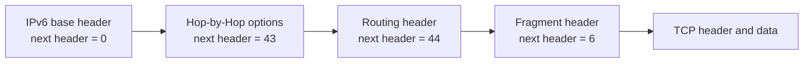
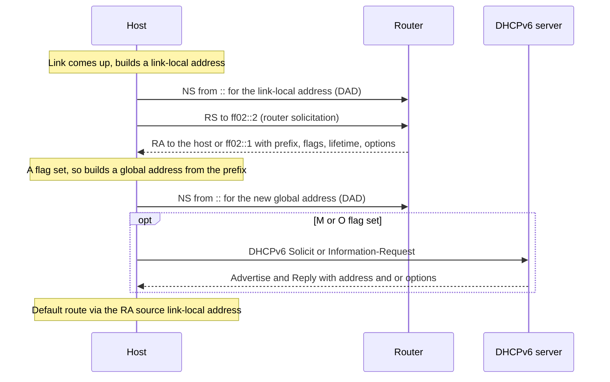
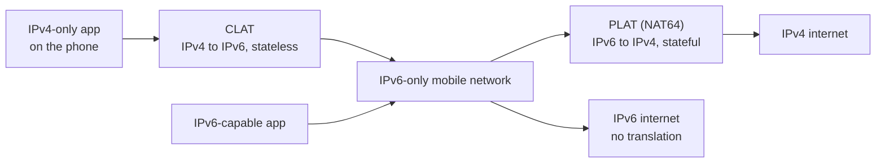

# NET 18: IPv6 in depth

*Part of the [networking plan](00_plan.md) · You need: [NET 01](01_network_models_and_layer2.md) (Ethernet, multicast MAC addresses, ARP and the first look at neighbour discovery), [NET 02](02_ip_routing_and_layer3.md) (IPv4 header, subnets, ICMP, PMTUD) and [NET 09](09_network_security_firewalls_ips_dpi.md) (stateful firewalls). Pairs with [WF 15](10_wifi/15_wifi_multicast_privacy_onboarding_and_interworking.md) for IPv6 over Wi-Fi.*

IPv6 is usually taught as "IPv4 with longer addresses", and that is the weak answer. It is wrong in the places that matter in production. The address length is the least interesting change. What changes your day-to-day work is that **ARP and broadcast are gone** (replaced by multicast neighbour discovery), that **hosts configure themselves from router advertisements** (so the routers, and anyone who can impersonate one, control your hosts), that **routers never fragment** (so a filtered ICMP message becomes a hung connection), that **a host has several addresses at once** (so source selection and logging get harder), and that **IPv4 does not disappear on a schedule** (so you live in dual-stack and translation for years).

A strong answer treats IPv6 as a different set of operational mechanisms on the same network model: "A host builds a link-local address, checks it for duplicates with a multicast solicitation, asks for a router advertisement, builds addresses from the advertised prefix, and uses the flags in that advertisement to decide whether to also ask DHCPv6. If a rogue device sends advertisements, hosts follow it, so access switches filter router advertisements. And because only the source fragments, ICMPv6 'packet too big' must pass everywhere or large transfers hang."

By the end you can:

- explain the IPv6 header, why each IPv4 field was dropped, and how extension headers chain and why they are filtered;
- classify any address (link-local, unique local, global, multicast, solicited-node, special-purpose) and derive the solicited-node group and multicast MAC address of an address;
- walk through neighbour discovery, duplicate address detection and the neighbour cache, and say why every message has hop limit 255;
- explain SLAAC, the M, O, A and L flags, DHCPv6 (stateful, stateless, prefix delegation), and choose between them;
- explain interface identifiers (EUI-64, stable opaque, temporary) and the privacy and operations trade-off;
- explain why subnets are /64, and plan an address allocation;
- explain source and destination address selection and Happy Eyeballs, and use them to explain "slow for some users";
- explain PMTUD and fragmentation in IPv6, and which ICMPv6 messages a firewall must pass;
- explain the layer 2 attacks on IPv6 (rogue advertisements, neighbour cache exhaustion) and the defences (RA guard, DHCPv6 shield, SAVI);
- explain dual stack, NAT64, DNS64, 464XLAT, and the difference between IPv6-only and IPv6-mostly networks;
- explain why IPv6 is hard on Wi-Fi, and what an access point or controller does about it;
- describe SRv6 in one minute.

Everything in this tutorial that could be checked without live IPv6 traffic was run: address arithmetic in Python, and packets built with `scapy` and decoded with `tshark`. The lab VM used for this series has **no IPv6 in its kernel** (opening an IPv6 socket fails with "Address family not supported by protocol"), so the live behaviours (SLAAC, duplicate detection, the neighbour cache, PMTUD, RA guard, translation) are explained from the RFCs and clearly marked as not run. Section 18 lists exactly which is which.

---

## 1. Where IPv6 stands, and what it keeps from IPv4

Adoption is real but uneven. On 23 April 2026, Google's measurement showed **about 50 percent** of users reaching Google over IPv6 for the first time, while APNIC Labs, which weights samples by each economy's internet population, showed about **42 percent** worldwide. The two numbers differ because they measure different populations, so read them as bounds. Country curves differ a lot (large mobile operators that went IPv6-first pull some countries far above the average), and a CDN can hide IPv6 traffic from measurement. For an interview, the useful statement is: **a large share of end users already have IPv6, most of them on mobile and residential access, while enterprise networks and data centres lag**, so you will meet dual-stack, translation, and IPv6-only edges together.

What stays the same matters as much as what changes:

| Same as IPv4 | Different in IPv6 |
|---|---|
| Layered model, routers forward by longest prefix match | 128-bit addresses, 40-byte fixed header |
| TCP, UDP, QUIC, TLS, HTTP work unchanged (with pseudo-header checksums over 128-bit addresses) | No ARP, no broadcast: multicast neighbour discovery |
| BGP, OSPF, IS-IS carry prefixes (new address families or versions) | Hosts autoconfigure from router advertisements (SLAAC) |
| ICMP carries errors and diagnostics | Routers never fragment, so ICMPv6 is required for the protocol to work |
| Firewalls filter by 5-tuple and connection state | Multiple addresses per interface by design, with scopes |
| DNS maps names to addresses | AAAA records, and address selection decides which one is used |

The headline for a staff-level answer: **IPv6 moves work from the network to the host** (address choice, fragmentation, configuration), and so moves failure modes from the router to the host and the middle boxes between.

---

## 2. The header, and why it looks the way it does

The IPv6 base header is a fixed **40 bytes**, always:

| Field | Size | Purpose |
|---|---|---|
| Version | 4 bits | Always 6 |
| Traffic class | 8 bits | DSCP and ECN (see [NET 14](14_queueing_qos_and_traffic_management.md)) |
| Flow label | 20 bits | Lets a source mark packets of one flow for the network, for example for ECMP hashing without parsing the transport header (defined in RFC 6437) |
| Payload length | 16 bits | Bytes after the base header, **including extension headers** |
| Next header | 8 bits | What follows: an extension header or the upper-layer protocol (6 TCP, 17 UDP, 58 ICMPv6) |
| Hop limit | 8 bits | The TTL, decremented by each router; the packet is dropped at zero |
| Source, destination | 128 bits each | Addresses |

Compare it with IPv4 and read what was **removed**, because each removal is a design decision you can defend:

| IPv4 field | Fate in IPv6 | Reason |
|---|---|---|
| Header length (IHL) | Gone | The header is fixed, so routers need not parse a variable length |
| Header checksum | Gone | Link layers and the transport checksum already protect the data, and every router wasted time recomputing it after the TTL change |
| Identification, flags, fragment offset | Moved to an optional Fragment extension header | Only the **source** fragments, so the fast path has no fragmentation logic |
| Options | Moved to extension headers | Routers skip what they do not need to look at |
| Total length | Became payload length | Excludes the header itself |

One consequence is often missed: **the transport checksum now covers a pseudo-header of 128-bit addresses, and for ICMPv6 it is mandatory** (IPv4 ICMP had no pseudo-header). Any code that parses or builds packets, a NAT, a load balancer or a monitoring agent, must include it. The check below builds an ICMPv6 echo, computes the checksum by hand over the pseudo-header, and compares it with the one `scapy` writes:

```python
import struct, ipaddress
from scapy.all import IPv6, ICMPv6EchoRequest

def csum(b):
    if len(b) % 2: b += b"\0"
    s = sum(struct.unpack("!%dH" % (len(b) // 2), b))
    while s >> 16: s = (s & 0xffff) + (s >> 16)
    return (~s) & 0xffff

src, dst = "2001:db8::1", "2001:db8::2"
echo = ICMPv6EchoRequest(id=1, seq=1, data=b"hi")
body = bytes(echo); body = body[:2] + b"\0\0" + body[4:]           # checksum field zeroed
pseudo = (ipaddress.IPv6Address(src).packed + ipaddress.IPv6Address(dst).packed
          + struct.pack("!II", len(body), 58))                      # length, next header 58
mine = csum(pseudo + body)
theirs = int.from_bytes(bytes(IPv6(src=src, dst=dst) / echo)[42:44], "big")
print("match:", mine == theirs)
```

Run for this tutorial, this prints `match: True` (the same value, `0xbbda`, from both). The pseudo-header is **source, destination, upper-layer length, next header**. That is also why a NAT64 must rewrite transport checksums when it translates between families.

### 2.1 Extension headers: a chain, not a list

Optional features live in **extension headers** placed between the base header and the transport header. Each starts with a *next header* field, so the packet is a linked list: the base header's next header names the first extension header, which names the next, and the last names the transport protocol.



The ones to know:

| Header | Next header value | Used for |
|---|---|---|
| Hop-by-Hop options | 0 | Options every router on the path may examine (router alert, for example) |
| Routing | 43 | Source routing; type 4 is the Segment Routing Header (SRv6, section 11) |
| Fragment | 44 | Source fragmentation |
| ESP, AH | 50, 51 | IPsec |
| Destination options | 60 | Options for the final destination (or, before a routing header, for the listed intermediate nodes) |

RFC 8200 recommends this order: hop-by-hop, destination options, routing, fragment, authentication, ESP, destination options again, then the upper-layer header. Receivers must accept any order, but senders should follow the recommended one, and most headers may appear once (destination options up to twice).

The rule that makes IPv6 fast and also hard to filter: **intermediate routers ignore extension headers, except hop-by-hop**, and RFC 8200 relaxed even that: a node examines the hop-by-hop header only if it is configured to. Forwarding hardware that must walk a long chain to find the transport ports (for an ACL, ECMP hashing or a firewall) is slow or gives up, which is why real networks **drop** packets with unusual chains. The check below builds a packet with two extension headers and shows the chain and the payload length:

```python
from scapy.all import IPv6, IPv6ExtHdrHopByHop, IPv6ExtHdrDestOpt, UDP, Raw
pkt = (IPv6(src="2001:db8:1::10", dst="2001:db8:2::20")
       / IPv6ExtHdrHopByHop() / IPv6ExtHdrDestOpt() / UDP(sport=1, dport=2) / Raw(b"y" * 8))
raw = bytes(pkt)
print("base next header:", raw[6])                       # 0 = hop-by-hop follows
print("payload length  :", int.from_bytes(raw[4:6], "big"))  # 8 + 8 + 8 UDP + 8 data
print("fixed header    :", len(bytes(IPv6())))
```

This prints next header 0, payload length 32 (two 8-byte extension headers, 8 bytes of UDP, 8 of data) and a fixed header of 40 bytes. The "all-or-nothing" lesson for interviews: **a firewall that cannot find the transport header in the first fragment cannot filter, so RFC 9099 says to drop such first fragments** (section 8).

### 2.2 The Fragment header

Only the source fragments, and it does so with a Fragment extension header: next header, 13-bit **offset in 8-byte units**, an **M (more fragments) flag**, and a **32-bit identification** (IPv4's was 16 bits, which wrapped quickly on fast links). Every fragment except the last must carry a multiple of 8 bytes. Reassembly keys on source, destination and identification, times out after **60 seconds**, and an overlapping fragment makes the receiver discard the whole packet (a defence against overlap attacks). The first fragment must contain every header up to and including the transport header.

Building one is a good way to see the arithmetic. A 3,000-byte UDP payload with a path MTU of 1,280 becomes three fragments:

```python
from scapy.all import IPv6, UDP, Raw, fragment6, IPv6ExtHdrFragment
big = IPv6(src="2001:db8:1::10", dst="2001:db8:2::20") / UDP(sport=1, dport=2) / Raw(b"z" * 3000)
for f in fragment6(big, 1280):
    h = f[IPv6ExtHdrFragment]
    print("len", len(bytes(f)), "offset", h.offset * 8, "more", h.m)
```

It prints three fragments of 1,280, 1,280 and 592 bytes, at offsets 0, 1,232 and 2,464, with the same identification, the first two having M set and the last not. Read it: each full fragment is 40 (base header) + 8 (fragment header) + **1,232** bytes of data, and 1,232 is a multiple of 8, as required. The upper-layer data is 3,008 bytes (UDP header plus 3,000), so the pieces are 1,232 + 1,232 + 544. `tshark` reassembles the three frames into one UDP datagram, which confirms the fields are valid. The same 1,232 appears elsewhere, which is not a coincidence: it is the largest UDP payload that fits in a 1,280-byte packet with no fragmentation (1,280 - 40 - 8), and it is why DNS operators settled on an EDNS buffer size of 1,232 bytes (from memory) and why QUIC's minimum datagram of 1,200 bytes always fits.

---

## 3. Addresses: types, scopes and how to read them

An IPv6 address is 128 bits, written as eight groups of four hex digits. Two shortening rules: drop leading zeros in a group, and replace **one** run of all-zero groups with `::` (only one, otherwise it is ambiguous). So `2001:0db8:0000:0000:0000:ff00:0042:8329` becomes `2001:db8::ff00:42:8329` (checked with Python's `ipaddress`). Always compare addresses in a normalised form, never as strings, because the same address has many spellings.

### 3.1 The address types you must be able to read

| Prefix | Name | What it is |
|---|---|---|
| `::/128` | Unspecified | "No address yet"; used as the source of duplicate detection probes |
| `::1/128` | Loopback | This host |
| `fe80::/10` | Link-local | Valid on one link only, never routed; **every interface has one**; used by neighbour discovery, routing protocol neighbours and default routes |
| `fc00::/7` (used as `fd00::/8`) | Unique local (ULA) | Private addressing with a random 40-bit global ID, routable inside your sites, not on the internet |
| `2000::/3` | Global unicast | The public internet space; today's allocations come from `2000::/3` |
| `ff00::/8` | Multicast | Replaces broadcast |
| `2001:db8::/32` | Documentation | For examples (as in this tutorial), never routed |
| `64:ff9b::/96` | NAT64 well-known prefix | Embeds an IPv4 address in the low 32 bits (section 9) |
| `::ffff:0:0/96` | IPv4-mapped | An API convention for an IPv4 peer on an IPv6 socket, never on the wire |

Three habits that interviewers look for:

- **Link-local addresses need the interface.** `fe80::1` is meaningless alone, since the same address can exist on every link, so tools use a **zone**: `fe80::1%eth0`, and routing protocols and default routes use link-local next hops (this is also why BGP over IPv6 can run on link-local addresses in a data centre fabric, see [NET 11](11_routing_protocols_and_datacenter_fabrics.md)).
- **There is no "private range" for NAT.** ULA exists for stability and internal use, not as a security boundary. Reachability is decided by routes and firewalls (section 8).
- **Do not use `is_global` as a scope test in code.** Python's `ipaddress` reports `ff02::1:ff00:1` (a link-local multicast address) as `is_global == True`, because that property only checks that the address is not in a special-purpose registry range. Check `is_multicast` and `is_link_local` first, then the scope you care about.

### 3.2 Multicast, scope and the solicited-node group

A multicast address is `ff` + a flags and **scope** nibble + a group. The scope nibble limits how far the packet goes: 1 interface-local, **2 link-local**, 5 site-local, `e` global (from memory). The well-known groups:

| Group | Meaning |
|---|---|
| `ff02::1` | All nodes on the link (the replacement for broadcast) |
| `ff02::2` | All routers on the link |
| `ff02::1:2` | All DHCPv6 relay agents and servers |
| `ff02::1:ff00:0/104` | **Solicited-node** groups |

Because hosts cannot broadcast to ask "who has this address", neighbour discovery uses a **solicited-node multicast address**: the fixed prefix `ff02::1:ff00:0/104` plus the **low 24 bits of the unicast address**. Only hosts whose address ends in the same 24 bits listen to that group, so one question reaches a handful of hosts instead of all of them, and the NIC filters the rest in hardware. The multicast MAC address is `33:33` followed by the **last 32 bits of the IPv6 address**.

```python
import ipaddress as ip

def eui64_iid(mac):
    b = [int(x, 16) for x in mac.split(":")]
    b[0] ^= 2                                   # flip the universal/local bit
    return bytes(b[:3] + [0xff, 0xfe] + b[3:])  # insert ff:fe in the middle

def with_prefix(prefix, iid):
    n = ip.IPv6Network(prefix)
    return ip.IPv6Address(int(n.network_address) | int.from_bytes(iid, "big"))

def solicited_node(addr):
    low24 = int(ip.IPv6Address(addr)) & 0xffffff
    return ip.IPv6Address(0xff0200000000000000000001ff000000 | low24)

def mcast_mac(addr):
    return "33:33:" + ":".join(f"{x:02x}" for x in ip.IPv6Address(addr).packed[-4:])

mac = "00:1a:2b:3c:4d:5e"
gua = with_prefix("2001:db8:1::/64", eui64_iid(mac))
print(gua)                       # 2001:db8:1:0:21a:2bff:fe3c:4d5e
print(solicited_node(gua))       # ff02::1:ff3c:4d5e
print(mcast_mac(solicited_node(gua)))   # 33:33:ff:3c:4d:5e
```

Run for this tutorial, the output matches the comments. Read the first line: the MAC `00:1a:2b:3c:4d:5e` became the interface identifier `021a:2bff:fe3c:4d5e` (the first byte changed from `00` to `02`, which is the universal/local bit flip, and `ff:fe` was inserted in the middle). Section 5.3 explains why you should not build addresses this way in new networks, and the mapping to `33:33:ff:3c:4d:5e` is the same rule [WF 15](10_wifi/15_wifi_multicast_privacy_onboarding_and_interworking.md) uses to explain why IPv6 multicast is expensive on Wi-Fi. A host has **several** addresses (one link-local, one or more global, temporary ones), and for each one it joins a solicited-node group, so a busy host listens to several groups, and the switch or access point must track them (MLD, section 10).

**Anycast** is the same unicast address assigned to several nodes (the nearest answers), used for services such as DNS roots and for the subnet-router anycast address; there is no separate range (from memory, RFC 4291).

### 3.3 Why subnets are /64 and how to plan allocation

Every ordinary subnet is a **/64**: 64 bits of network prefix and 64 bits of interface identifier. RFC 7421 analysed the question and concluded that the benefits of keeping the identifier a fixed 64 bits outweigh the arguments against: uniform design and documentation, no need to size subnets, guaranteed room for any number of interfaces, and compatibility with SLAAC and the many specifications and implementations that assume 64 bits. SLAAC **only works on /64**, so a /80 or /112 on a host-facing LAN breaks autoconfiguration, and a /127 is used only on point-to-point router links (RFC 6164, from memory).

That makes planning a matter of **how many /64 subnets you need and where the bit boundaries fall**:

| Allocation | /64 subnets inside it | Typical use |
|---|---|---|
| /32 | 4 billion | An ISP or very large enterprise |
| /48 | 65,536 | A site, campus or small enterprise |
| /56 | 256 | A large home or small business |
| /60 | 16 | A small home |
| /64 | 1 | A single LAN, a mobile device tethering |

(The /48 and /56 figures are computed in Python: `2**(64-48)` and `2**(64-56)`.) Plan on **nibble boundaries** (multiples of 4 bits) so that a prefix corresponds to a readable hex digit: a /48 per site, then for example one hex digit of the next group for the building or function and the rest for the VLAN, so that `2001:db8:abcd:0100::/64` reads as "site abcd, function 1, VLAN 0". Summarisation then falls out of the address plan instead of being added by hand, and you never run out, so do not conserve addresses; conserve the ability to **summarise** and to **grow**.

---

## 4. Neighbour discovery

Neighbour discovery (NDP, RFC 4861) is a small set of ICMPv6 messages that replaces ARP, router discovery (ICMP router solicitation in IPv4), redirects and part of DHCP. [NET 01](01_network_models_and_layer2.md) introduced it; this section covers what you need for operations and security.

| ICMPv6 type | Message | Purpose |
|---|---|---|
| 133 | Router solicitation (RS) | A host asks routers to send an advertisement now |
| 134 | Router advertisement (RA) | A router announces prefixes, default-router lifetime, flags, MTU, DNS |
| 135 | Neighbour solicitation (NS) | "Who has this address?" or "are you still reachable?" |
| 136 | Neighbour advertisement (NA) | The answer, with flags R (router), S (solicited), O (override) |
| 137 | Redirect | A router tells a host about a better first hop |

Two properties make it work, and both are common interview questions:

- **It is multicast, not broadcast.** An NS for an unknown address goes to the target's solicited-node group, not to everyone, and the answer is unicast.
- **Every NDP message has hop limit 255.** A receiver drops any whose hop limit is not 255. Since every router decrements the hop limit, a packet that arrives with 255 cannot have crossed a router, so it must come from the same link. RFC 4861 says that this makes neighbour discovery "immune to off-link senders". This is a **same-link** guarantee only, which is why section 8 is about attackers who are on the link.

### 4.1 Resolving an address and the neighbour cache

To send to an on-link address, the host sends an NS to the solicited-node group of the target and waits for an NA carrying the target's MAC address. It stores the result in the **neighbour cache**, with a state per entry (the same states appear in `ip -6 neigh` on Linux):

| State | Meaning |
|---|---|
| INCOMPLETE | A solicitation was sent, no answer yet |
| REACHABLE | Recently confirmed (by an NA or by upper-layer progress such as a TCP acknowledgement) |
| STALE | Not confirmed lately; still **usable**, and no probe is sent until traffic goes to it |
| DELAY | Traffic was sent to a STALE entry; wait a short time for upper-layer confirmation before probing |
| PROBE | Unicast solicitations are being sent to verify reachability |

This is **neighbour unreachability detection (NUD)**: a failed neighbour is noticed by the lack of confirmation, not by a timer alone. Default values (from memory, verify in RFC 4861 section 10): reachable time about 30 seconds (randomised), 5 seconds in DELAY, up to 3 multicast solicitations, 1 second between retransmissions. Linux adds a FAILED state when resolution gave up. The operational consequence: **a router or switch that holds a neighbour cache entry for a failed host can blackhole traffic for the length of those timers**, which is the IPv6 counterpart of a stale ARP entry after a failover, and why failover designs (VRRP, MLAG, anycast gateways) send an unsolicited NA on takeover.

### 4.2 Duplicate address detection

Before using any unicast address, a host must check that nobody else has it. **Duplicate address detection (DAD)** sends an NS with these properties: the **source is `::`** (the host has no valid address yet), the **destination is the solicited-node group of the tentative address**, and the **target is the tentative address**. If another node already owns it, it answers (or, if it is also tentative, sends its own probe), and the new host must not use the address. Silence means it is free. The check below builds that probe and the answer and decodes them with `tshark`:

```python
from scapy.all import *
tgt = "fe80::21a:2bff:fe3c:4d5e"
ns = (Ether(dst="33:33:ff:3c:4d:5e", src="02:00:00:00:00:02")
      / IPv6(src="::", dst="ff02::1:ff3c:4d5e", hlim=255) / ICMPv6ND_NS(tgt=tgt))
na = (Ether(dst="33:33:00:00:00:01", src="00:1a:2b:3c:4d:5e")
      / IPv6(src=tgt, dst="ff02::1", hlim=255) / ICMPv6ND_NA(tgt=tgt, R=0, S=0, O=1)
      / ICMPv6NDOptDstLLAddr(lladdr="00:1a:2b:3c:4d:5e"))
wrpcap("dad.pcap", [ns, na])
```

Decoding it (`tshark -r dad.pcap -T fields -e ipv6.src -e ipv6.dst -e icmpv6.type`) gives the probe `:: -> ff02::1:ff3c:4d5e` of type 135, and the defence `fe80::21a:... -> ff02::1` of type 136 with the **S flag clear** (an unsolicited advertisement to all nodes, which is how an existing owner defends its address). Two real-world notes: DAD adds delay at link-up (one second by default), so wireless clients that roam use shortcuts (optimistic DAD, RFC 4429, from memory); and **switches and wireless controllers that drop or delay multicast** make DAD fail silently, which looks like "the address is tentative forever" or "duplicate address" on a healthy network.

---

## 5. Getting an address: SLAAC, DHCPv6 and prefix delegation

### 5.1 The bring-up sequence



The router also sends unsolicited RAs periodically (the RFC 4861 defaults are a maximum interval of 600 seconds and a router lifetime of three times that, 1,800 seconds, from memory), so a host that missed the first one still learns the prefix. Remember the last line of the diagram: **the default route comes from the RA**, with the router's **link-local** address as next hop. DHCPv6 cannot carry a default route, so a network without RAs has no IPv6 gateway, however well DHCPv6 is configured.

### 5.2 What is inside a router advertisement

| Field or option | Meaning |
|---|---|
| Current hop limit | The hop limit hosts should use |
| **M** (managed) flag | "Addresses are available from DHCPv6" |
| **O** (other) flag | "Other configuration (DNS, for example) is available from DHCPv6" |
| Router preference | High, medium or low, to choose between several routers (RFC 4191, from memory) |
| **Router lifetime** | How long this router is a default router; **0 means it is not a default router** (and is how a router retracts itself) |
| Prefix information option | A prefix and length, flags **L** (on-link) and **A** (autonomous: SLAAC may be used), valid and preferred lifetimes; RFC 9762 adds a **P** flag (section 5.5) |
| Source link-layer address, MTU | The router's MAC; the link MTU |
| RDNSS and DNSSL | DNS servers and search list, so hosts get DNS without DHCPv6 (RFC 8106, from memory) |
| PREF64 | The NAT64 prefix (RFC 8781, section 9) |

The flags are the part to master. The router sets them to tell the host **where to get what**, and the host then decides. Four configurations, built and decoded for this tutorial (the flags byte has M as `0x80` and O as `0x40`):

| Configuration | M | O | Prefix A | Flags byte seen in `tshark` | Result |
|---|---|---|---|---|---|
| SLAAC only | 0 | 0 | 1 | `0x00` | Address from the prefix, DNS from RDNSS |
| SLAAC and stateless DHCPv6 | 0 | 1 | 1 | `0x40` | Address from the prefix, **other options** from DHCPv6 |
| Stateful DHCPv6 | 1 | 0 | 0 | `0x80` | Addresses leased from DHCPv6, no SLAAC address |
| Both | 1 | 0 | 1 | `0x80` | A SLAAC address **and** a DHCPv6 address |

```python
from scapy.all import *
rows = {"slaac": (0, 0, 1), "slaac+stateless": (0, 1, 1), "stateful": (1, 0, 0), "both": (1, 0, 1)}
pk = []
for name, (m, o, a) in rows.items():
    pk.append(Ether(dst="33:33:00:00:00:01", src="02:00:00:00:00:01")
              / IPv6(src="fe80::1", dst="ff02::1", hlim=255)
              / ICMPv6ND_RA(M=m, O=o, prf=0, routerlifetime=1800)
              / ICMPv6NDOptPrefixInfo(prefix="2001:db8:1::", prefixlen=64, L=1, A=a)
              / ICMPv6NDOptRDNSS(dns=["2001:db8::53"], lifetime=600))
wrpcap("raflags.pcap", pk)
```

Decoding with `tshark -r raflags.pcap -T fields -e icmpv6.nd.ra.flag -e icmpv6.opt.prefix.flag.a` gave flag bytes `0x00`, `0x40`, `0x80`, `0x80` and the A flag as true, true, false, true, exactly as in the table. The practical rules:

- **The flags are advice, not commands.** A host may ignore them, and implementations differ (some hosts always ask for DHCPv6 once the M flag appears, some never ask). Do not design a network that depends on a particular host obeying them.
- **Clear the A flag** on a prefix to stop SLAAC on it (for DHCPv6-only addressing), and **clear the L flag** to stop hosts treating the prefix as on-link. L is not a security control: a host can still add the route by other means.
- **Some hosts support only DHCPv6 for DNS and others only RDNSS**, so advertise both (an Android detail from memory: historically, Android has not supported stateful DHCPv6 address assignment, which is why SLAAC-only designs matter on campuses and Wi-Fi; verify the current state before relying on it).

### 5.3 Interface identifiers: EUI-64, stable and temporary

SLAAC fills the low 64 bits with an **interface identifier (IID)**, and there are three ways to choose it:

| Method | How | Property |
|---|---|---|
| EUI-64 (original) | From the MAC address, as in section 3.2 | Stable, **leaks the hardware address**, so the host is trackable across networks |
| Stable opaque (RFC 7217) | A hash of the prefix, interface, a secret key and a counter | Stable **within** a network, different on every prefix, so no cross-network tracking |
| Temporary (RFC 8981) | Random, regenerated over time | Short-lived, used for **outgoing** connections |

The EUI-64 construction is the Python helper of section 3.2. RFC 8981 defaults are a **valid lifetime of two days and a preferred lifetime of one day**, with a new temporary address generated shortly before the old one stops being preferred, so an observer cannot link a host's activity for longer than about a day. A modern host therefore has, per prefix: a stable address (for inbound services and DNS), several temporary addresses (one preferred for outgoing connections, older ones still valid so existing connections survive), and a link-local address. The stable-privacy shape was checked with a hash of prefix, interface name, counter and a secret: the same inputs always give the same IID, and a different prefix gives a different IID.

The operational consequences are what interviewers ask about:

- **Logs and ACLs keyed on a client's IP break**, because the same laptop appears from many addresses over a day. Key on the **/64**, on the authenticated identity (802.1X, [WF 04](10_wifi/04_wifi_security.md)) or on DHCPv6 leases, not on the single address.
- **A server should not use a temporary address.** Give servers stable addresses (static, DHCPv6 reservation, or a stable-opaque IID) and publish them in DNS.
- **Stateful DHCPv6 is still chosen for accountability** (a lease log that says which device had which address), at the price of losing SLAAC's statelessness. Many networks run SLAAC for addresses and track clients by **snooping neighbour discovery** on the switch or controller instead.

### 5.4 DHCPv6

DHCPv6 (RFC 8415, from memory) runs over UDP between **client port 546 and server port 547**, with clients sending to the group `ff02::1:2`, and identifies a client by a **DUID** instead of a MAC address. Four message types give the stateful exchange: **Solicit, Advertise, Request, Reply** (a two-message rapid-commit form skips the middle two). Stateless clients (the O flag) send an **Information-Request** to get only options such as DNS. A server hands out **IA_NA** (non-temporary addresses) and **IA_PD** (a delegated prefix).

Three differences from DHCPv4 cause real problems:

- **No default route and no prefix length.** The router comes from the RA and the prefix length comes from the prefix information option (an address from DHCPv6 is treated as on-link only if the RA's L flag says so).
- **Clients are identified by DUID**, which can change when a device is reimaged or when the identifier source changes, so reservations by MAC do not carry over directly.
- **Relays** forward client messages to a server on another link and append the link information, so one server can serve many VLANs, as in IPv4.

A lab-ready configuration for `dnsmasq` as a combined RA and DHCPv6 server is below. It passed `dnsmasq --test` (a syntax check) in the VM; it was **not** run live because the kernel has no IPv6:

```
interface=eth0
bind-interfaces
no-resolv
enable-ra
# SLAAC plus stateless DHCPv6: A=1, O=1, hosts self-configure and ask DHCPv6 for options
dhcp-range=2001:db8:1::, ra-stateless, 64, 1h
dhcp-option=option6:dns-server,[2001:db8::53]
ra-param=eth0, high, 1800
```

For stateful DHCPv6 replace the range with a real pool (`dhcp-range=2001:db8:1::100, 2001:db8:1::1ff, 64, 12h`), which sets the M flag.

### 5.5 Prefix delegation

A home or branch router does not get one /64 but a **prefix** from its upstream, then carves /64 subnets for its own LANs. That is **DHCPv6 prefix delegation (PD)**: the router requests an **IA_PD**, receives for example a /56 or /60 (residential) or /48 (business), and advertises one /64 from it on each LAN. The ISP installs a route for the delegated prefix to the router's address, so there is **no NAT** between the customer's networks and the internet.

RFC 9762 adds the **P flag** in the prefix information option. It tells clients that the network prefers them to **request a delegated prefix through DHCPv6-PD and use addresses from it**, instead of forming a SLAAC address on the shared /64. This solves a rollout problem (hosts need to know before they form SLAAC addresses, since switching later would disrupt applications) and has a limit worth quoting: a network given only a /60 has 16 /64s, so if every client assumed its own prefix, it would run out after about 15 devices. The flag lets the network choose.


---

## 6. Which address is used: selection and Happy Eyeballs

A dual-stack host asks DNS for a name and gets both A and AAAA records, and it has several source addresses of its own. Two algorithms decide what actually happens, and both explain real incidents.

### 6.1 Address selection (RFC 6724)

The host builds a list of candidate destinations and sorts it, then for each destination picks a **source address**. The destination rules, in the order they apply (from memory, RFC 6724 section 6), are roughly: avoid unusable destinations, prefer a destination whose scope matches the source, avoid deprecated addresses, prefer a matching label, **prefer higher precedence from a policy table**, prefer native transport over tunnels, prefer smaller scope, then prefer the longest matching prefix. The default policy table gives native IPv6 a higher precedence than IPv4, which is why dual-stack hosts try IPv6 first. Source selection prefers the same address, an appropriate scope, non-deprecated addresses, and (rule 7) **temporary addresses over stable ones** for outgoing connections.

Operational consequences:

- A host with only a **unique local** address and IPv4 often chooses **IPv4** to reach an internet name, because the default table gives ULA a low precedence (verify per OS). This surprises teams that deploy ULA "for IPv6" and see no IPv6 traffic.
- `getaddrinfo` returns the **sorted** list, so a program that takes only the first result gets one family. Code that loops over all results behaves differently, and a service with a broken AAAA path looks fine to a program that picks IPv4.
- You can change the policy table (`/etc/gai.conf` on Linux glibc, `netsh interface ipv6 show prefixpolicy` on Windows, both from memory), and some outages are "fixed" by preferring IPv4. Treat it as a diagnosis tool and not a fix.

### 6.2 Happy Eyeballs (RFC 8305)

If IPv6 is preferred but **broken** (a path that drops packets, an AAAA record for a host that does not listen on IPv6), a naive client waits for a full TCP timeout and then falls back, giving a long, confusing hang. **Happy Eyeballs version 2** avoids this by racing the families, with these defaults:

| Step | Value |
|---|---|
| DNS | Send the AAAA query first, immediately followed by the A query; do not wait for both |
| Resolution delay | If an A answer arrives first, wait **50 ms** for the AAAA before starting, to keep IPv6 preferred |
| Order | Sort with RFC 6724, then **interleave families**, starting with the family that sorts first |
| Connection attempt delay | **250 ms** between starting attempts when there is no RTT history (minimum 100 ms recommended, never below 10 ms; maximum 2 seconds recommended) |
| Result | The first connection to complete wins; the others are cancelled |

So when IPv6 is broken, a modern browser tries IPv6, starts IPv4 about a quarter of a second later, and the user sees at most a small delay. This has a downside for operators: **Happy Eyeballs hides IPv6 breakage**. A site can run for months with an IPv6 path that drops large packets, and only the users whose IPv4 path is also slow notice. If you test only with a browser, you never see it. Test each family on its own: `curl -6 -v`, `curl -4 -v`, `ping -6`, and a **large** transfer, not only a small request.

---

## 7. MTU, fragmentation and ICMPv6 in practice

IPv6 rests on three rules, all from RFC 8200:

1. **Every link must support at least 1,280 bytes** (and links that cannot must fragment below IP).
2. **Routers never fragment.** Only the source does.
3. **Nodes must accept reassembled packets up to 1,500 bytes**, and should use path MTU discovery to send larger ones.

So how does a source know the size? **Path MTU discovery (PMTUD).** The source sends a packet, and any router that cannot forward it because the next link is too small drops it and returns an **ICMPv6 Packet Too Big** (type 2) carrying the **MTU** of the next link and as much of the original packet as fits. The source lowers its path MTU for that destination and resends smaller (or, for TCP, the stack adjusts the segment size). A built Packet Too Big with an MTU of 1,280 decodes in `tshark` as type 2 with MTU 1280.

The weakness is the one [NET 02](02_ip_routing_and_layer3.md) described for IPv4, made worse: in IPv4, a router may fragment as a fallback, while in IPv6 **there is no fallback**. If any firewall drops the Packet Too Big messages, the sender never learns, and packets above the real MTU vanish forever. The symptom is distinctive: **the TCP handshake succeeds and small requests work, but large responses hang**, often only on one path or one family. The typical causes are tunnels and overlays that reduce the MTU (a VPN, an IPv6-in-IPv4 tunnel, VXLAN as in [NET 17](17_cloud_sdn_automation_and_labs.md), PPPoE at 1,492), together with a "block all ICMP" rule written for IPv4 habits.

The remedies, from the most to the least preferred:

- **Let ICMPv6 Packet Too Big through** every firewall (it is not optional, section 8.3).
- **Clamp TCP MSS** at the tunnel or edge: for a path MTU of 1,500, the IPv6 MSS is 1,500 - 40 - 20 = **1,440** (IPv4 is 1,460); for 1,280, it is 1,220.
- **Advertise a smaller MTU** in the router advertisement's MTU option so hosts never send larger packets on that link.
- **Use packetization-layer PMTUD** (RFC 4821, from memory), where TCP probes with larger segments and treats loss as a size signal, enabled on some stacks as a fallback.
- **Make UDP applications size their own packets**: DNS at 1,232 bytes of payload, and QUIC at about 1,200 bytes, so they never need fragmentation.

**Fragmentation is a last resort in IPv6**, and it is also an attack surface: overlapping fragments, tiny fragments that split the transport header, and fragments that carry the exploit past a filter that only sees the first. That is why RFC 9099's advice is to drop fragments that do not contain the full header chain, and to drop fragmented neighbour discovery messages (section 8).

---

## 8. Security: the link, the extension headers and the firewall

IPv6 does not make a network more or less secure by itself. It moves the trust boundary: on IPv4 an attacker on the link can poison ARP and run a rogue DHCP server, and on IPv6 the equivalents are **rogue router advertisements, neighbour spoofing and rogue DHCPv6**. RFC 9099 ("Operational Security Considerations for IPv6 Networks") is the reference; the points below follow it.

### 8.1 Attacks on the local link

| Attack | What happens | Defence |
|---|---|---|
| **Rogue router advertisement** | A device (an attacker, or a laptop with connection sharing enabled by accident) sends RAs. Hosts add it as a default router or take a wrong prefix, so traffic passes through it (on-path attack) or goes nowhere | **RA guard** on switch ports (and on wireless networks), prefer router preference and lifetimes you control |
| **Neighbour or NA spoofing** | An attacker answers an NS with its own MAC address, the IPv6 version of ARP poisoning, or disrupts DAD by claiming every address | **ND inspection or SAVI** (source address validation binding address, MAC and port), rate limits on NS |
| **Rogue DHCPv6 server** | Hands out the attacker's DNS or addresses | **DHCPv6 shield**: allow server messages only on trusted ports |
| **Neighbour cache exhaustion** | Scanning an unused /64 sends NS for millions of addresses, each creating an INCOMPLETE entry on the router, so real hosts cannot be learned | Rate-limit NS, cap incomplete entries, use small subnets for infrastructure, or an allowlist model |
| **Amplification** | Link-local multicast with a spoofed source address | Ingress filtering, limit multicast replies |

Two limits to quote. **RA guard can be evaded**: an attacker wraps the RA in extension headers or **fragments** it so the switch cannot see that it is an RA, which is why RFC 9099 recommends dropping fragmented neighbour discovery messages, and dropping first fragments that lack the complete header chain (so that guards can see the whole packet). And **hop limit 255 only protects against off-link senders** (section 4): an attacker on the same link sends perfectly valid messages, so the defence has to be at the switch or access point.

### 8.2 Scanning, privacy and the "/64 is too big to scan" myth

A /64 holds about 18 quintillion addresses, so brute-force scanning is not practical, and some teams conclude that obscurity is a defence. It is partly true and mostly misleading. Real addresses are not random: **EUI-64 addresses reveal vendor ranges, DHCPv6 pools are sequential, and people choose `::1`, `::53` or `::100`**. Attackers also learn addresses from DNS, logs, certificate transparency and by listening to multicast on the link. Use obscurity as a minor bonus, not a control. The privacy features of section 5.3 protect users from tracking, not servers from discovery.

### 8.3 Firewalling IPv6

The firewall rule set for IPv6 is the same discipline as IPv4 ([NET 09](09_network_security_firewalls_ips_dpi.md)): stateful, default-deny inbound, allow established and related replies. What is different:

- **There is usually no NAT**, so the stateful firewall is the **only** thing between a host and the internet. "NAT is security" was never true, but on IPv6 there is nothing even accidentally in the way, so a missing inbound rule exposes every host directly. Treat the firewall policy as an equal peer to the IPv4 one, and test inbound reachability from outside.
- **Do not block ICMPv6.** Some types are required for the protocol to work. Pass at least (RFC 4890, from memory): **Packet Too Big (2), Time Exceeded (3), Parameter Problem (4)** through the network; **neighbour discovery (133 to 137)** and **multicast listener messages** on the link; and echo request and reply (128, 129) as policy allows, because they are how people diagnose problems.
- **Handle extension headers.** Enforce the recommended order and repeat counts, and drop packets that do not conform; drop **routing header type 0** (deprecated); treat hop-by-hop options as a denial of service risk on hardware that processes them in software (RFC 8200 made this processing configurable); and be aware that dropping extension headers too aggressively breaks real traffic (fragmentation, IPsec), so filter by measurement.
- **Filter fragments properly.** Drop first fragments without the complete header chain, and fragments of neighbour discovery.
- **Use `inet` tables on Linux.** In `nftables`, one `inet` table applies the same rules to both families (from memory), so a rule written for IPv4 does not leave IPv6 open.
- **Apply BCP 38 source address filtering** at the edge, as for IPv4.

---

## 9. Living with IPv4: dual stack, tunnels, NAT64, DNS64 and 464XLAT

Transition is not one technique but a set, chosen by where the network is going and what cannot change.

| Approach | What it does | When it fits |
|---|---|---|
| **Dual stack** | Every host and router speaks both | The default for enterprises; doubles the policy, monitoring and troubleshooting surface and still needs IPv4 addresses |
| **Tunnels** (6in4, GRE, 6rd) | IPv6 packets inside IPv4 to cross an IPv4-only part of the path | Short-term bridges; 6to4 and Teredo are legacy and should not be relied on (from memory) |
| **NAT64 and DNS64** | An IPv6-only client reaches IPv4-only servers through translation | IPv6-only access networks, mobile |
| **464XLAT** | A client-side translator for IPv4-only apps plus a provider-side NAT64 | Mobile and residential access that is IPv6-only |
| **IPv6-mostly** | Dual-stack segments where capable hosts opt out of IPv4 | Managed corporate networks |

### 9.1 NAT64 and DNS64

**NAT64** (a stateful translator, the "PLAT") sits at the edge of an IPv6-only network. It translates between an IPv6 client and an IPv4 server. The client needs an IPv6 address for the IPv4 server, and **DNS64** supplies it: when a client asks for AAAA and the name has only an A record, the resolver **synthesises** an AAAA record by embedding the IPv4 address in a NAT64 prefix. The well-known prefix is `64:ff9b::/96`, and the IPv4 address sits in the **last 32 bits** (RFC 6052), so `192.0.2.33` becomes `64:ff9b::c000:221`:

```python
import ipaddress as ip

def synth(v4, prefix="64:ff9b::/96"):
    return ip.IPv6Address(int(ip.IPv6Network(prefix).network_address) | int(ip.IPv4Address(v4)))

def extract(v6):
    return ip.IPv4Address(int(ip.IPv6Address(v6)) & 0xffffffff)

aaaa = synth("192.0.2.33")
print(aaaa, "->", extract(aaaa))     # 64:ff9b::c000:221 -> 192.0.2.33
```

Packets to `64:ff9b::c000:221` route to the NAT64 gateway (which advertises the prefix), which maps the flow to an IPv4 source address and port from its pool, keeps the **state**, and rewrites the headers and checksums. The reverse path uses that state, so **a NAT64 is a stateful, many-to-one device with the same scaling limits as a carrier NAT** (port exhaustion, logging for abuse tracing).

What breaks, which interviewers ask about:

- **IPv4 literals.** An app or a configuration file that contains `192.0.2.33` never asks DNS, so DNS64 cannot help; the app needs a local translator (464XLAT, below).
- **IPv4-only peers and inbound.** NAT64 handles IPv6 clients reaching IPv4 servers. IPv4 hosts cannot start connections to IPv6-only hosts, and IPv6-only hosts cannot reach IPv4-only **devices on the local network** (printers, cameras) unless you add a translator for that (the APNIC article lists the options).
- **DNSSEC.** A validating client that sees a synthesised AAAA record cannot validate it, so DNS64 and client-side validation conflict (from memory).
- **How does a host know the prefix?** Originally by querying a special name (RFC 7050). The **PREF64** router advertisement option (type 38, RFC 8781) delivers it in the RA the host already receives. The option carries a prefix length from the set 96, 64, 56, 48, 40 and 32, and a lifetime in 8-second units (at most 65,528 seconds). Its advantages are that the prefix shares the fate of the other network configuration, one packet completes setup, and changing it needs only a new RA.

### 9.2 464XLAT

Many apps still use IPv4 literals or IPv4-only libraries, so an IPv6-only network that relied on DNS64 alone would break them. **464XLAT** (RFC 6877) adds a **CLAT** (customer-side translator) that gives the host or home router a local IPv4 address and translates IPv4 to IPv6 **statelessly** at the client; the provider's **PLAT** (the NAT64) then translates IPv6 to IPv4 statefully. Native IPv6 traffic bypasses translation, and local IPv4 to IPv6 traffic stays local.



CLAT or an equivalent is present in iOS, Android, HarmonyOS, macOS and Linux, and Windows 11 has it in public preview (per the 2026 APNIC article). This is why **mobile networks are IPv6-only with 464XLAT** and cellular operators lead adoption.

### 9.3 IPv6-only against IPv6-mostly

The APNIC article makes a point worth repeating: "IPv6-only" means nothing without a scope. Say "IPv6-only **access network** with IPv4-as-a-service" for the mobile and residential case, and "**IPv6-mostly**" for managed corporate networks.

In an IPv6-mostly network, segments stay dual-stack, but hosts that can run without IPv4 **opt out**. A dual-stack host sends **DHCPv4 option 108** (RFC 8925), which tells the DHCPv4 server it does not need an IPv4 address, and the server answers with option 108 and no lease. The host then runs IPv6-only, using NAT64 and 464XLAT to reach IPv4 destinations, while legacy devices on the same segment still get IPv4. Two rules: **enable option 108 only when a working stateful NAT64 exists**, and know that it is not used on cellular (no DHCPv4 there). The benefits are saving private IPv4 space, easier debugging of IPv6, and migrating host by host.

---

## 10. IPv6 on Wi-Fi

This is where [WF 15](10_wifi/15_wifi_multicast_privacy_onboarding_and_interworking.md) and this tutorial meet, and it is the section most relevant to a Wi-Fi platform engineer's interviews. The problem is simple to state: **IPv6 neighbour discovery is built on link-local multicast, and multicast is the most expensive thing a Wi-Fi network can send.**

- **Multicast on Wi-Fi is slow and unreliable.** It goes at a basic rate (low, so all clients can decode it), has no per-frame acknowledgement and retry, and is delivered **after the DTIM beacon**, so every sleeping client must wake for it ([WF 03](10_wifi/03_wifi_mac.md) for power save). Every router advertisement, every neighbour solicitation for an unknown address and every duplicate address detection probe pays that price.
- **State per address.** Each IPv6 address on a client has its own solicited-node group, and a client may hold a link-local, a stable global and several temporary addresses, so the number of groups the AP or switch must track (through MLD snooping) is several times the number of clients.
- **Battery.** A phone in power save may miss multicast RAs, so the network keeps RA intervals short enough that clients refresh before the router lifetime expires (the 1,800-second default lifetime is far longer than the 200 to 600-second interval) and uses **unicast RAs** in answer to router solicitations.
- **Roaming.** A client that moves between APs in the same VLAN keeps its addresses, but it may send an RS and repeat DAD, and a client that moves across VLANs or subnets must obtain a new prefix and addresses (or stay on its home subnet through a mobility tunnel, [WF 05](10_wifi/05_wifi_roaming_and_radio_management.md)). Fast detection of network attachment (DNAv6, RFC 6059, from memory) lets a host decide quickly whether its configuration is still valid.

What the access point or controller does about it:

| Feature | Mechanism |
|---|---|
| **Multicast to unicast** | Convert group-addressed frames to per-client unicast frames, with acknowledgement, at the client's data rate |
| **ND proxy and NA suppression** | The AP or controller learns client addresses by snooping NS, NA and DHCPv6, then **answers solicitations on behalf of clients**, so the multicast NS never goes over the air |
| **RA throttling and unicast RAs** | Limit how often RAs are sent over the air and send them as unicast to the client that asked |
| **RA guard on the WLAN** | Drop RAs from wireless clients, so a phone with tethering cannot become the default router (the wireless version of the rogue RA of section 8) |
| **Client IP learning** | Learn each client's IPv6 addresses by snooping, so per-client policy, ACLs and visibility work (with temporary addresses, there are many) |
| **MLD snooping** | Forward group traffic only to interested stations |

These are the answers to "why does IPv6 make my Wi-Fi worse?" and "what did your platform do about it?". The WF 15 airtime arithmetic (one multicast frame at 1 Mbit/s costs as much as about 150 modern unicast frames) is the quantitative reason.

---

## 11. IPv6 in the data centre, and SRv6 in one minute

In a data centre fabric ([NET 11](11_routing_protocols_and_datacenter_fabrics.md)), IPv6 shows up in three ways. **BGP carries IPv6 prefixes** as a second address family, and the next hop for an IPv6 route is a **link-local address**, so a fabric can run BGP across **unnumbered links** with no addressing plan per link, and even carry **IPv4 prefixes with an IPv6 next hop** (extended next hop, RFC 5549, from memory). **Loopbacks and servers** get global addresses from a summarisable plan. And some large operators run **IPv6-only underlays and clusters** (for example, container networks with no private IPv4), which pushes translation to the edge.

**Segment routing over IPv6 (SRv6)** uses the IPv6 routing extension header for traffic engineering. The head-end node adds a **Segment Routing Header** (routing type 4, RFC 8754) listing the **segments** (128-bit identifiers that look like IPv6 addresses) the packet must visit. The packet's destination address is always the **active segment**, so ordinary routers forward it by their normal routing table, and **only the node that owns the active segment** processes the header: it decrements **Segments Left** (the one field that changes) and copies the next segment into the destination address. A segment can mean "go to this node", "go over this link" or "run this function" (decapsulate, apply a service), which RFC 8986 calls **network programming**. The benefits are no per-flow state in the core (the path is in the packet) and no MPLS label layer; the costs are header size (a long segment list reduces the MTU and can exceed what hardware can process, so **compression** schemes exist) and security.

The security rule for SRv6 is the one from section 8 applied to source routing: it works only inside a **trusted domain**. The RFC requires that any packet entering the domain with a destination inside the domain's segment space is **dropped at the edge**, and that internal interfaces drop packets for local segments from outside sources, because otherwise an attacker can use source routing to bypass filters, discover topology or exhaust bandwidth. The header is not encrypted, so anyone who can see traffic inside the domain learns the path.

---

## 12. Linux tools and commands (not run in the lab VM)

The VM had no IPv6, so these are from memory. They are the commands to reach for.

| Task | Command |
|---|---|
| Addresses and scopes | `ip -6 addr`, `ip -6 addr show dev eth0 scope link` |
| Routes, and which route a destination uses | `ip -6 route`, `ip -6 route get 2001:db8::1` |
| Neighbour cache and its states | `ip -6 neigh`, `ip -6 monitor neigh` |
| Router advertisement behaviour | `sysctl net.ipv6.conf.eth0.accept_ra` (a **router** with forwarding on needs `accept_ra = 2` to still accept RAs) |
| Address generation mode | `sysctl net.ipv6.conf.eth0.addr_gen_mode` (0 EUI-64, 2 stable privacy, 3 random), `use_tempaddr` (0 off, 1 generate, 2 prefer temporary) |
| Test a family on its own | `ping -6`, `curl -6 -v`, `tracepath -6`, `traceroute -6` |
| Path MTU | `tracepath -6 host`, `ping -6 -M do -s 1232 host` (1232 bytes of ICMP payload plus 48 bytes of headers fills a 1,280-byte packet; 8 for ICMP, 40 for IPv6) |
| Capture IPv6 control traffic | `tcpdump -ni eth0 icmp6`, `tshark -i eth0 -f icmp6 -Y 'icmpv6.type==134'` (RAs only) |
| Sockets | `ss -6 -tnp` |
| Firewall for both families | one `table inet` in `nftables`, plus `meta nfproto ipv6` where a rule is family-specific |
| Send and inspect crafted packets | `scapy`, as in this tutorial |


---

## 13. Common mistakes

1. **Treating IPv6 as IPv4 with longer addresses.** The differences that bite are operational: neighbour discovery, autoconfiguration, multiple addresses, and no router fragmentation.
2. **Blocking ICMPv6 "for security".** Packet Too Big and neighbour discovery are part of the protocol. Large transfers hang and addresses fail duplicate detection.
3. **Subnets other than /64 on host LANs.** SLAAC breaks, and so does anything that assumes a 64-bit identifier. Use /127 only on point-to-point router links.
4. **No RA guard on access ports.** One laptop with connection sharing can become the default router for a floor.
5. **Relying on the A, M and O flags as commands.** Hosts differ. Test with the clients you have, and advertise DNS both ways (RDNSS and DHCPv6).
6. **Forgetting that the default route comes only from the router advertisement.** DHCPv6 cannot carry it.
7. **Keying logs and ACLs on a single client address.** Temporary addresses rotate daily; use the /64, identity, or lease records.
8. **Testing only in a browser.** Happy Eyeballs hides a broken family. Test `-4` and `-6` separately with a large transfer.
9. **Different firewall policies for the two families.** An inbound allow on IPv4 behind NAT may be wide open on IPv6 with no NAT. Use one `inet` rule set and test from outside.
10. **Comparing addresses as strings.** The same address has many spellings; normalise first.
11. **Assuming `::/0` and the default route mean the same on every host.** The RA gives a default router with a lifetime and a preference, and a lifetime of 0 removes it.
12. **Enabling IPv6-mostly option 108 without a working NAT64.** Hosts that opt out of IPv4 then cannot reach IPv4-only destinations.
13. **Assuming IPv6 means no NAT is needed anywhere.** NAT64 exists precisely because IPv4 still does, and some networks still use NPTv6 (prefix translation) for provider independence.

---

## 14. Interview questions

**Q1. Beyond the address size, what is different about IPv6?**
The base header is fixed at 40 bytes with no checksum and no fragmentation fields; options moved to extension headers; **routers never fragment**, only the source does, so path MTU discovery and ICMPv6 are essential; ARP and broadcast are replaced by **multicast neighbour discovery**; hosts **autoconfigure from router advertisements**; every interface has several addresses with scopes; and the default policy is no NAT, so the firewall is the only boundary.

**Q2. Why did IPv6 remove the header checksum, and what replaced it?**
Link layers already have a CRC, the transport protocols have their own checksum, and every router that decremented the TTL had to recompute the IPv4 header checksum, which cost time on the fast path. Integrity of the addresses is protected because the **transport checksum includes a pseudo-header** with the 128-bit addresses, and for ICMPv6 that checksum is mandatory. I computed an ICMPv6 checksum by hand from the pseudo-header (source, destination, length, next header 58) and it matched what `scapy` wrote.

**Q3. How do extension headers work, and why do networks drop them?**
Each header starts with a next-header field, so the packet is a chain from the base header to the transport header. Routers ignore all of them except hop-by-hop (and even that only if configured). The trouble is that a firewall, ACL or ECMP hash that needs the ports has to walk the chain to find them, which is slow and bypassable (fragmenting so that the first fragment lacks the transport header). So operators enforce the recommended order, limit repeats, drop type 0 routing headers, and drop first fragments that do not contain the full chain (RFC 9099). Dropping too much also breaks fragmentation and IPsec, so filter by measurement.

**Q4. Name the IPv6 address types and say when a host uses each.**
Link-local (`fe80::/10`) for neighbour discovery, router next hops and anything on-link; unique local (`fd00::/8`) for stable internal addressing; global unicast (`2000::/3`) for the internet; multicast (`ff00::/8`) for all-nodes, all-routers and solicited-node groups; plus special ones: loopback, unspecified (`::`, source of DAD), documentation (`2001:db8::/32`) and the NAT64 prefix `64:ff9b::/96`. A host holds several at once, and the selection algorithm picks the source and destination.

**Q5. Walk through how a host gets an IPv6 address.**
It builds a link-local address and checks it with DAD (an NS from `::` to the solicited-node group). It sends a router solicitation to `ff02::2`. The router answers with an RA carrying the prefix (with L and A flags and lifetimes), the M and O flags, the router lifetime (so a default route via the router's link-local address), and options such as MTU and RDNSS. If A is set, the host forms a global address (IID from EUI-64, stable-opaque or random) and runs DAD again. If M or O is set it also asks DHCPv6.

**Q6. What do the M, O, A and L flags mean?**
M: addresses are available from stateful DHCPv6. O: other configuration (DNS and so on) is available from DHCPv6. These two are in the RA header. A and L are per prefix: **A** allows SLAAC to form an address from this prefix; **L** says the prefix is on-link, so hosts add a connected route. Combinations: SLAAC only (A set), SLAAC with stateless DHCPv6 (A and O), stateful DHCPv6 (M, A clear). I built the four RA configurations and decoded the flag bytes (`0x00`, `0x40`, `0x80`) to check that. The flags are advice, and hosts differ in how they react.

**Q7. SLAAC or DHCPv6: when would you choose each?**
SLAAC is stateless, needs no server state, scales with the number of routers and is the only option some clients support (Android historically, from memory). DHCPv6 gives accountability (leases and logs), predictable addresses, and options such as vendor-specific data, but needs servers, relays and a DUID model. Many networks run SLAAC for addresses plus RDNSS or stateless DHCPv6 for DNS, and track clients by neighbour-discovery snooping. Use stateful DHCPv6 where compliance needs a lease record, and always provide the default route through RAs.

**Q8. What is duplicate address detection and what is the solicited-node multicast address for?**
Before using an address, the host sends an NS with source `::`, destination the solicited-node group of the tentative address, and the tentative address as target. If someone answers, the address is a duplicate. The solicited-node group is `ff02::1:ff` plus the low 24 bits of the address, so a question about one address reaches only the few hosts sharing those 24 bits, and the NIC can filter the rest. The multicast MAC is `33:33` plus the low 32 bits. I computed it for an example: address ending `3c:4d5e` gives group `ff02::1:ff3c:4d5e` and MAC `33:33:ff:3c:4d:5e`.

**Q9. How is neighbour discovery different from ARP, and why is every message hop limit 255?**
ND uses ICMPv6 and multicast to the solicited-node group instead of a broadcast, it includes reachability tracking (NUD with the states INCOMPLETE, REACHABLE, STALE, DELAY, PROBE), and it also does router discovery and redirects. Hop limit 255 means the packet crossed no router (every router decrements), so it came from the same link: off-link attackers cannot inject ND. It does not stop an attacker already on the link.

**Q10. What are temporary addresses and what do they break?**
Random identifiers (RFC 8981) with, by default, a two-day valid and one-day preferred lifetime, used for outgoing connections so that a host cannot be tracked by a fixed address. They break anything keyed on one client IP (logs, ACLs, rate limits per address, some licensing), and they multiply the addresses a switch or AP must track. Servers should use stable addresses, and clients should be identified by the /64, an authenticated identity, or a lease record.

**Q11. Why are IPv6 subnets /64, and how would you plan an allocation?**
SLAAC needs a 64-bit identifier, and RFC 7421 found the benefits of a fixed boundary (uniform design, no sizing, always enough room, compatibility) outweigh changing it. Plan from the top: a /48 per site gives 65,536 /64s, assign on nibble boundaries so that a prefix reads as a hex digit (site, function, VLAN), keep room to grow, and design for **summarisation** and not for address conservation. Use /127 on point-to-point router links and a /128 for loopbacks.

**Q12. What is DHCPv6 prefix delegation and what is the P flag?**
A customer router requests an IA_PD from the provider, gets for example a /56, and advertises a /64 on each LAN with a route installed at the provider, so there is no NAT. The P flag (RFC 9762) in the prefix information option tells clients that the network prefers them to request a delegated prefix and use addresses from it instead of forming SLAAC addresses on a shared /64. It exists because hosts must know before they form SLAAC addresses, and it lets the network choose, since a small delegation (a /60 has 16 /64s) would run out if every client wanted its own.

**Q13. How do PMTUD and fragmentation work in IPv6, and what happens if ICMPv6 is blocked?**
Routers do not fragment. A router that cannot forward a packet sends Packet Too Big (type 2) with the next link's MTU, and the source reduces its path MTU. Minimum link MTU is 1,280, and nodes must accept 1,500-byte reassembled packets. If a firewall drops Packet Too Big, the source never learns, so packets above the real MTU vanish: the handshake works, small requests work, large transfers hang, often only on one path or family. Fixes are allowing ICMPv6, clamping MSS (1,440 on a 1,500 link), advertising a smaller MTU in the RA, and sizing UDP applications to fit (DNS at 1,232, QUIC near 1,200).

**Q14. Which ICMPv6 messages must a firewall let through?**
Packet Too Big, Time Exceeded and Parameter Problem through the network; neighbour and router discovery (133 to 137) and multicast listener messages on the link; and echo request and reply by policy, since they are how people diagnose problems (RFC 4890, from memory). Blocking all ICMPv6 breaks the protocol.

**Q15. A rogue router advertisement appears on a VLAN. What happens, and how do you defend?**
Hosts add the sender as a default router (or take its prefix) and send traffic through it, giving an on-path attacker or a blackhole; a lifetime of 0 in a forged RA can remove the legitimate router. Defences: **RA guard** on access ports (drop RAs except from router ports), **SAVI** or ND inspection to bind addresses to ports, router preferences and a monitoring alert on unexpected RAs (`icmpv6.type == 134` from a new source). Limits: attackers evade guards with extension headers and fragments, so drop fragmented ND and first fragments without the full header chain; and hop limit 255 does not help against an attacker on the link. Also expect the benign cause: a laptop with connection sharing enabled.

**Q16. Does IPv6 need NAT, and is NAT a security feature?**
IPv6 has enough addresses that NAT is not needed for scale, and end-to-end addressing is the point. NAT was never a firewall; the security came from the stateful filtering that usually accompanies it. On IPv6 the stateful firewall is the only boundary, so it must be written deliberately and tested from outside. Translation still exists for transition (NAT64) and, rarely, for provider-independent addressing (NPTv6).

**Q17. Explain Happy Eyeballs.**
Version 2 (RFC 8305) races address families so that a broken IPv6 path does not stall the user: send AAAA then A queries, wait up to 50 ms for the AAAA if the A answer comes first, sort with RFC 6724, interleave families, and start the next attempt after 250 ms (default, with limits of 100 ms minimum recommended and 2 seconds maximum). The first connection to complete wins. The operational catch is that it **hides** broken IPv6, so test each family separately with a large transfer.

**Q18. Explain NAT64, DNS64 and 464XLAT.**
NAT64 is a stateful translator at the edge of an IPv6-only network that maps IPv6 clients to IPv4 servers. DNS64 makes it usable: for a name with only an A record, it synthesises an AAAA by embedding the IPv4 address in a NAT64 prefix (`64:ff9b::/96`, so `192.0.2.33` becomes `64:ff9b::c000:221`, which I computed). Apps with IPv4 literals bypass DNS, so 464XLAT adds a client-side stateless translator (CLAT) that gives the host an IPv4 address and translates to IPv6, and the provider NAT64 (PLAT) finishes the job. Mobile networks use it. Limits: stateful NAT64 scales like a carrier NAT, IPv4-only peers cannot initiate to IPv6-only hosts, and DNSSEC validation conflicts with synthesis.

**Q19. What is the difference between IPv6-only and IPv6-mostly?**
"IPv6-only" needs a scope. An IPv6-only access network (mobile, some residential) gives IPv4 as a service through 464XLAT. IPv6-mostly is for managed enterprise networks: segments stay dual-stack, but a host sends DHCPv4 option 108 (RFC 8925) to say it does not need IPv4, the server withholds a lease, and the host runs IPv6-only using NAT64. Enable option 108 only with a working NAT64, and it does not apply on cellular. The PREF64 RA option (type 38) tells hosts the NAT64 prefix.

**Q20. Why is IPv6 harder on Wi-Fi, and what does the platform do about it?**
Neighbour discovery and router advertisements are multicast, which on Wi-Fi goes at a low basic rate after the DTIM beacon, with no acknowledgement and a wake-up cost for every sleeping client, and each address adds a solicited-node group to track. Mitigations: multicast-to-unicast conversion, ND proxy or NA suppression (the AP answers from snooped state), RA throttling and unicast RAs, RA guard on the WLAN, MLD snooping, and learning client addresses by snooping so policy works with temporary addresses.

**Q21. What is SRv6, in one minute?**
Traffic engineering by putting a list of segments in an IPv6 routing header (type 4, the SRH). The destination address is the active segment, so ordinary routers forward by their normal tables, only the segment's owner processes the header, decrements Segments Left, and writes the next segment into the destination. Segments can mean nodes, links or functions (network programming). No per-flow state in the core and no label layer, but a longer header, MTU and hardware limits, and a strict trusted-domain rule: drop packets from outside that are addressed to internal segments.

**Q22. Users say the site is slow for some people only, and IPv6 is deployed. What do you check?**
Whether the affected users are on IPv6 (a `curl -6 -v` against the name and `curl -4 -v` side by side), whether the AAAA record points at a host that really listens on IPv6, the path MTU (`ping -6 -M do -s 1232` and larger, and whether Packet Too Big messages are filtered), the dual-stack health checks (does the load balancer monitor the IPv6 path), and the fallback behaviour (Happy Eyeballs adds a quarter of a second, so a consistent extra delay of about that size on affected users is a clue). Capture on the client and look for the retransmitting full-size segments.

---

## 15. Scenarios and design questions

**S1. Design the IPv6 addressing plan for a company with three sites and about 200 VLANs.**
*Where to practise:* write the plan with Python's `ipaddress` (`subnets(new_prefix=64)`) and check summarisation.
*Approach:* get a /48 per site (or a /44 to /40 for the whole company), assign on nibble boundaries (site, function, VLAN), one /64 per VLAN and no smaller, a separate block for infrastructure loopbacks and point-to-point links (/128 and /127), ULA for what must stay internal if you want it (not as a security measure), reserve space for growth, document everything, make routes summarise at every site boundary, and decide the address generation policy per VLAN (SLAAC with RDNSS for clients, static or reserved for servers).

**S2. Users report some sites are slow and some downloads hang, only from one office.**
*Where to practise:* the Packet Too Big and fragmentation builders of sections 2 and 7, plus `curl -6` and `curl -4` side by side.
*Approach:* split by family (does it hang only on IPv6?), find the largest working packet with `ping -6 -M do -s`, check the office's tunnel or VPN MTU, check that Packet Too Big messages reach the servers, clamp MSS at the tunnel, and allow ICMPv6 at the firewall. Mention that Happy Eyeballs hides the problem for users whose IPv4 path is healthy.

**S3. New switches are deployed and some clients lose their default route. A capture shows two sources of router advertisements.**
*Where to practise:* build RAs with `scapy` (router lifetime 0, different preference) and view them with `tshark -Y 'icmpv6.type==134'`.
*Approach:* identify the second source by MAC and port (a laptop with sharing, a misconfigured router, or an attacker), look at its lifetime and preference, enable RA guard on access ports with trusted router ports, bind addresses with SAVI where supported, drop fragmented ND, and add alerting on RAs from unexpected sources.

**S4. Plan the move of one office building to IPv6-mostly.**
*Where to practise:* the NAT64 synthesis in section 9 and the address plan of S1.
*Approach:* inventory what needs IPv4 (printers, cameras, IPv4 literals in applications); deploy a stateful NAT64 and DNS64 with redundancy and logging for abuse tracing; advertise PREF64; enable DHCPv4 option 108 on a pilot VLAN; keep legacy devices on dual-stack addresses; measure with real users; and write the rollback (remove option 108, which returns IPv4 leases).

**S5. Design the access side of a mobile network that is IPv6-only.**
*Where to practise:* the DNS64 and 464XLAT sections; trace the path of an IPv4-literal app.
*Approach:* IPv6-only bearer, 464XLAT with CLAT on handsets and PLAT in the provider core, DNS64 for name-based traffic, PREF64 or well-known prefix, sizing of NAT64 by connections and ports per subscriber, logging for lawful requirements, MTU consideration for the translation (IPv6 overhead is larger), and a plan for IPv4-only servers that must reach subscribers.

**S6. A large auditorium WLAN is slow and clients drop off when idle, with IPv6 enabled.**
*Where to practise:* the airtime arithmetic of [WF 15](10_wifi/15_wifi_multicast_privacy_onboarding_and_interworking.md) with the multicast rates; count solicited-node groups per client.
*Approach:* measure multicast airtime (RAs, NS, mDNS), raise the multicast basic rate where legacy clients allow, enable multicast-to-unicast and ND proxy, limit and unicast RAs, enable MLD snooping, check that the RA interval is shorter than the router lifetime for sleeping clients, and turn on RA guard.

**S7. Write the firewall policy for a dual-stack data centre edge.**
*Where to practise:* a lab with `nftables` `inet` tables on a router namespace (the rules apply to both families), as in [NET 09](09_network_security_firewalls_ips_dpi.md), with IPv6 traffic generated by `scapy` or on a host that has IPv6.
*Approach:* one rule set for both families in an `inet` table, default deny inbound, stateful established and related, explicit allows for required ICMPv6 (Packet Too Big, Time Exceeded, Parameter Problem, neighbour discovery on-link, echo as policy), drop extension header anomalies and incomplete fragments, BCP 38 source filtering, rate-limit neighbour solicitations toward the subnet, and test from outside for every service.

**S8. Roll out IPv6 on a public web service behind a load balancer and CDN.**
*Where to practise:* `curl -6` and `-4`, checking both paths with large responses.
*Approach:* publish AAAA records only when the IPv6 path has equal monitoring and capacity, health-check both families, make logs and rate limits understand IPv6 (a user is a /64, not a single address), watch the share of IPv6 traffic and error rates by family, keep the MTU and MSS consistent through the load balancer, and keep a way to withdraw the AAAA records quickly.

---

## 16. Strong answers (outlines)

**S1 (addressing plan).** Say: (1) a /48 per site and /64 per VLAN; (2) hierarchy on nibble boundaries (site, function, VLAN) so every boundary summarises; (3) separate infrastructure space with /127 and /128; (4) SLAAC with RDNSS for clients, stable addresses for servers; (5) a documented, versioned plan and a check script; (6) the point that you plan for summarisation and growth, not for saving addresses.

**S2 (hangs on large transfers).** (1) Reproduce per family; (2) the symptom pattern (handshake works, small works, large hangs) points to MTU; (3) find the working size with the do-not-fragment ping; (4) the cause is a tunnel or a filter on Packet Too Big, since routers never fragment; (5) fix by allowing ICMPv6, clamping MSS, and advertising the MTU; (6) note that Happy Eyeballs masks it.

**S3 (rogue RA).** (1) Identify the sender (MAC, port) from the capture; (2) explain the effect (default route and prefix hijack, lifetime 0 retraction); (3) RA guard with trusted ports, SAVI, ND rate limits; (4) why the guard can be evaded (extension headers, fragments) and the rule to drop them; (5) hop limit 255 is no defence on the same link; (6) monitor RAs.

**S6 (Wi-Fi and IPv6).** (1) The cost of multicast on Wi-Fi (basic rate, DTIM, no retry, wake-up cost); (2) the per-address groups; (3) multicast-to-unicast, ND proxy, RA throttling, MLD snooping; (4) RA interval against router lifetime for sleeping clients; (5) RA guard and client address learning; (6) measure airtime before and after.

---

## 17. Cheat sheet

| Topic | Remember |
|---|---|
| Base header | 40 bytes fixed: version, traffic class, flow label (20), payload length, next header, hop limit, two addresses |
| Removed from IPv4 | IHL, header checksum, fragmentation fields, options |
| Extension headers | Chain by next header; hop-by-hop 0, routing 43, fragment 44, ESP 50, AH 51, destination options 60 |
| Fragmentation | Source only, Fragment header (8 bytes, 32-bit ID), offset in 8-byte units, 60 s reassembly timeout |
| MTU | Minimum 1,280, must accept 1,500 reassembled; PTB is ICMPv6 type 2; MSS 1,440 on a 1,500 link |
| Fits without fragmenting | 1,280 - 40 - 8 = 1,232 bytes of UDP payload |
| Address types | `::1` loopback, `fe80::/10` link-local, `fd00::/8` ULA, `2000::/3` global, `ff00::/8` multicast, `2001:db8::/32` docs, `64:ff9b::/96` NAT64 |
| Solicited-node | `ff02::1:ff` + low 24 bits; multicast MAC `33:33` + low 32 bits |
| Subnets | /64 for hosts (SLAAC needs it), /127 point to point, /128 loopback, /48 per site |
| ND messages | RS 133, RA 134, NS 135, NA 136, Redirect 137; all hop limit 255 |
| NA flags | R router, S solicited, O override |
| Cache states | INCOMPLETE, REACHABLE, STALE, DELAY, PROBE |
| DAD | NS from `::` to the solicited-node group of the tentative address |
| RA flags | M (DHCPv6 addresses), O (DHCPv6 other config); per prefix A (SLAAC), L (on-link), P (prefer delegation) |
| Default route | Only from the RA, link-local next hop; lifetime 0 = not a router |
| DHCPv6 | UDP 546 client, 547 server, `ff02::1:2`, DUID, Solicit-Advertise-Request-Reply, IA_NA, IA_PD |
| IID types | EUI-64 (leaks MAC), stable opaque (RFC 7217), temporary (RFC 8981: 2 days valid, 1 day preferred) |
| Selection | RFC 6724 sorts; Happy Eyeballs v2: 50 ms resolution delay, 250 ms attempt delay |
| Link attacks | Rogue RA, NA spoofing, rogue DHCPv6, NS flood: RA guard, DHCPv6 shield, SAVI, ND rate limits |
| Never block | Packet Too Big, Time Exceeded, Parameter Problem, ND (on link), MLD (on link) |
| Transition | Dual stack; NAT64 + DNS64 (`64:ff9b::/96`); 464XLAT (CLAT + PLAT); IPv6-mostly (option 108) |
| PREF64 | RA option type 38, prefix lengths 96/64/56/48/40/32, lifetime in 8 s units |
| Wi-Fi | Multicast at basic rate after DTIM; multicast-to-unicast, ND proxy, RA throttling, MLD snooping, RA guard |
| SRv6 | Routing header type 4, Segments Left, active segment is the destination, trusted-domain filtering |

---

## 18. Sources and caveats

Sources used (fetched while writing): the [APNIC post on Google reaching 50 percent IPv6](https://blog.apnic.net/2026/04/28/google-hits-50-ipv6) (the Google and APNIC Labs figures and why they differ); [RFC 8200](https://www.rfc-editor.org/rfc/rfc8200) (header fields, extension header order, fragmentation rules, minimum MTU, hop-by-hop handling); [RFC 9762](https://www.rfc-editor.org/rfc/rfc9762) (the P flag); the [APNIC article on IPv6-only against IPv6-mostly](https://blog.apnic.net/2026/07/07/ipv6-only-vs-ipv6-mostly-appropriate-use-cases/) (scope of the terms, option 108, 464XLAT, client support); [RFC 9099](https://www.rfc-editor.org/rfc/rfc9099) (link attacks and mitigations, extension headers, fragments); [RFC 7421](https://www.rfc-editor.org/rfc/rfc7421) (the 64-bit boundary); [RFC 8981](https://www.rfc-editor.org/rfc/rfc8981) (temporary address lifetimes); [RFC 8305](https://www.rfc-editor.org/rfc/rfc8305) (Happy Eyeballs timers); [RFC 4861](https://www.rfc-editor.org/rfc/rfc4861) (cache states, hop limit 255, NA flags; the fetched excerpt stopped before the constants section); [RFC 8781](https://www.rfc-editor.org/rfc/rfc8781) (the PREF64 option); [RFC 8754](https://www.rfc-editor.org/rfc/rfc8754) (the SRH and its trusted-domain rules); and the [ipSpace deep dive on router advertisements](https://blog.ipspace.net/2012/11/ipv6-router-advertisements-deep-dive/) (the flags and the default route). Earlier tutorials NET 01, 02, 09, 11, 14 and 17 and WF 03, 04, 05 and 15 supply the mechanisms linked in the text.

**Run fresh for this tutorial** on a Linux 6.18 VM with `python3`, `scapy` 2.5.0, `tshark` and `dnsmasq`: the address arithmetic (compression, EUI-64 identifier, solicited-node group and multicast MAC, a stable-privacy-shaped hash, the /48 to /64 counts, NAT64 synthesis and extraction) with Python's `ipaddress`; the packet builders and `tshark` decodes (the 40-byte header, the extension-header chain and payload length, a three-fragment datagram of 1,280, 1,280 and 592 bytes with reassembly, Packet Too Big with MTU 1280, four router advertisement flag combinations, and a duplicate address detection probe and defence); the ICMPv6 checksum computed by hand against `scapy`; and a `dnsmasq --test` syntax check of the RA and DHCPv6 configuration.

**Not run, and why:** this VM's kernel has **no IPv6 support** (opening an IPv6 socket fails with "Address family not supported by protocol", and the per-interface IPv6 settings do not exist), so no live IPv6 traffic was possible. SLAAC and DAD behaviour on a wire, the neighbour cache states and timers, PMTUD and black holes, RA guard and rogue advertisement effects, Happy Eyeballs, address selection, DHCPv6 exchanges, NAT64 and 464XLAT translation, Wi-Fi behaviour, and SRv6 forwarding are all explained from the documents and are **not tested here**. The Python snippets were run; the Linux commands in section 12 were not. `tshark` decoding shows that the packets are well formed, not that any host would react to them as described.

**From memory, check before quoting:** the RFC 4861 timer defaults (reachable time, delay, retransmission, router advertisement intervals); the RFC 6724 rule lists and policy table (including ULA precedence); DHCPv6 ports, DUID and message names (RFC 8415); the Android DHCPv6 limitation; RFC 4890 ICMPv6 filtering advice; RFC 4429 and RFC 6059; the DNS 1,232-byte guidance; the DNSSEC conflict with DNS64; RFC 5549; scope nibble values; routing header type 0 and 6to4 and Teredo status; NPTv6; the `nftables` `inet` behaviour and `sysctl` values; and the `gai.conf` and `netsh` commands. Adoption figures are for April 2026 and move quickly. Vendor behaviour (what a given controller does for ND proxy or RA throttling, and its names for these features) varies; use the mechanisms as the vocabulary and check the product.

Earlier and later: [NET 17](17_cloud_sdn_automation_and_labs.md), then the [networking plan](00_plan.md) for the additions that follow (switch and router internals next).
