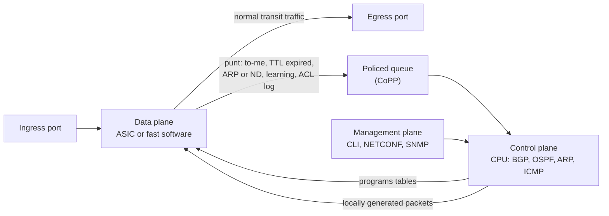
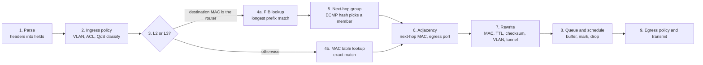
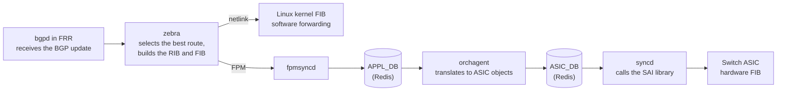

# NET 19: Inside a switch and a router

*Part of the [networking plan](00_plan.md) · You need: [NET 01](01_network_models_and_layer2.md) (MAC learning, VLANs), [NET 02](02_ip_routing_and_layer3.md) (longest prefix match, ARP, TTL), [NET 11](11_routing_protocols_and_datacenter_fabrics.md) (routing protocols, ECMP) and [NET 14](14_queueing_qos_and_traffic_management.md) (queues, ECN). Pairs with [NET 12](12_rdma_roce_and_lossless_fabrics.md) for PFC headroom and [NET 17](17_cloud_sdn_automation_and_labs.md) for P4.*

Most networking knowledge is about what happens **between** devices. Interviews for network-equipment companies (Cisco, Palo Alto Networks, Nvidia networking, and the switch teams at Google, Meta and Microsoft) go **inside** the box: how does a switch forward at 12.8 Tbit/s, why does a full routing table not fit, what does "the route is in the RIB but traffic still drops" mean, why does a 64-port switch with 64 MB of buffer still drop an incast burst? A weak answer is "the ASIC does it in hardware". A strong answer names the **stages** (parse, lookup, rewrite, queue, schedule), the **memories** each stage uses and what limits them (TCAM size and power, SRAM, packet buffer), the **point where hardware hands a packet to software** (the punt path) and why that point is protected, and the **path a route takes from a protocol to a chip** (and why "converged" does not mean "forwarding").

This tutorial builds that picture from first principles and tests what a Linux VM can test: the cost of updating a TCAM-style table, head-of-line blocking against virtual output queues, the dynamic-threshold buffer rule, serialisation delay and PFC headroom arithmetic, the kernel's own routing trie with 20,000 routes, and the rate limit a router puts on its own ICMP errors. Real ASIC behaviour (pipeline depth, buffer sizes, vendor features) is explained from published sources and marked as not run.

By the end you can:

- explain the management, control and data planes, which runs where, and what a **punt** is;
- walk a packet through a forwarding pipeline and name the table consulted at each stage (MAC, FIB, adjacency, ACL, rewrite);
- compare SRAM hash tables, TCAM and algorithmic longest-prefix match, and say why a TCAM is power-hungry and slow to update;
- explain where buffers sit (input, output, shared, virtual output queues), why a plain input queue caps at about 60 percent, and how shared-buffer thresholds and PFC headroom work;
- explain cut-through against store-and-forward, and when a switch falls back from one to the other;
- explain a chassis with line cards and a cell-based fabric, and centralised against distributed forwarding;
- explain control plane protection (CoPP) and why traceroute and monitoring misread a healthy router;
- describe how a BGP route reaches the ASIC (SONiC as the example) and why "converged" is not "programmed";
- read a drop: say at which stage a packet was lost.

---

## 1. Three planes, and where a packet changes plane

Every network device has three jobs, and they run in different places:

| Plane | Job | Typically runs on |
|---|---|---|
| **Data plane** (forwarding plane) | Forwards transit traffic, per packet, at line rate | ASICs, NPUs, or fast software (DPDK, VPP) |
| **Control plane** | Builds the state the data plane uses: routing protocols (OSPF, BGP), the RIB, the FIB, neighbour discovery, BFD, spanning tree | The device CPU (or line card CPUs), as ordinary processes |
| **Management plane** | Configuration and monitoring: CLI, NETCONF, REST, SNMP, telemetry | The device CPU |

The important property is the **speed gap**. The data plane handles hundreds of millions to billions of packets per second. The CPU running the control plane handles perhaps hundreds of thousands. So the design rule of every router and switch is: **the CPU must never be in the path of ordinary traffic**.

A packet changes plane when the data plane cannot or should not handle it by itself. That move is called a **punt**, or the **exception path**, or the **slow path**. The usual reasons:

- the packet is **addressed to the device** (an SSH session, a BGP update, an OSPF hello, an ICMP echo to the router);
- the packet needs **special handling**: an expired TTL (to generate the ICMP time-exceeded reply), IP options, a packet needing fragmentation or an MTU error;
- the data plane has **no answer yet**: the next hop's MAC address is not resolved, a new MAC address must be learned, a flow is new in a flow-table design;
- the packet matches a rule that says **log or copy**: ACL logging, sampling for NetFlow and sFlow (a planned later tutorial covers those).



Two consequences you can use in an interview immediately. First, **the CPU is a shared, small resource that anyone on the network can try to exhaust** (a flood of packets to the router, or a flood of packets that all need a punt), so it is protected by **control plane policing (CoPP)**: each class of punted traffic gets its own rate limit and queue, so a flood of ICMP cannot starve BGP (section 7). Second, **a router can forward traffic perfectly while its control plane is dead**, and the reverse: the control plane can show a healthy session while the hardware table is full or stale. Always ask "which plane is broken?"

---

## 2. The forwarding pipeline

A forwarding ASIC is a **pipeline**: every packet passes the same sequence of stages, each stage is a table lookup or a small action, and a new packet enters every clock cycle, so throughput is the clock rate times the packets per cycle, independent of table size. The stages below are generic. Real chips differ in number and order, and programmable chips (P4, [NET 17](17_cloud_sdn_automation_and_labs.md)) let the operator define them.



The points that matter:

1. **Parse.** The parser extracts fields (MAC addresses, VLAN, IP addresses, ports, tunnel headers) from the first bytes. It is a state machine over the header chain, which is why odd header chains ([NET 18](18_ipv6_in_depth.md): IPv6 extension headers) are expensive or unsupported: the parser has a fixed depth.
2. **Ingress policy.** ACLs, classification into traffic classes, policers, VLAN membership checks. ACLs match many fields at once with wildcards, which is what TCAM is for (section 3).
3. **Is it routed?** A frame addressed to the router's own MAC address is routed; everything else is bridged.
4. **Lookup.** A bridged frame is looked up by **exact match** on (VLAN, destination MAC) in the MAC table. A routed packet is looked up by **longest prefix match** on the destination address in the FIB.
5. **Next-hop group.** The FIB result is not a MAC address. It is a **pointer to a next-hop group**: one or several next hops. With several (ECMP, [NET 11](11_routing_protocols_and_datacenter_fabrics.md)), the chip hashes the flow's fields and picks one member, so all packets of a flow take the same path.
6. **Adjacency.** The chosen next hop points to an **adjacency entry**: the next hop's MAC address, the egress port and VLAN. This is the result of ARP or neighbour discovery.
7. **Rewrite.** The router sets the new source and destination MAC, decrements TTL (and updates the checksum for IPv4), and adds or removes VLAN tags or tunnel headers.
8. **Queue and schedule.** The packet goes into one of the egress port's queues in the **packet buffer**. Marking (ECN), dropping and scheduling happen here, and this is where almost all loss and delay happen (section 4).
9. **Egress.** Final policy and transmission.

**Why the FIB result is a pointer, not an address.** Hardware stores forwarding as **two levels**: prefixes point to next-hop groups, and next hops point to adjacencies. Thousands of prefixes learned from the same BGP neighbour share one next-hop group. When that neighbour fails, the control plane updates **one** next-hop entry and every prefix is fixed at once, instead of rewriting a million FIB entries. This is **prefix-independent convergence** (often called BGP PIC; from memory), and it is the reason that large routers reroute in milliseconds after a link failure, where a naive design would take minutes. A one-level FIB loses that property.

Compare it with the Linux kernel, which is the same pipeline in software ([NET 06](06_linux_network_stack.md)): the FIB lookup returns a next hop; the neighbour table gives the MAC; netfilter and `tc` play the ACL and queueing roles; and the rewrite is `ip_forward`. Section 10 does the arithmetic for why this does not scale to line rate on a CPU.

---

## 3. Lookup memories: hash, TCAM and algorithmic LPM

Each pipeline stage needs a table, and the table's memory technology decides what it can do and what it costs.

| Table | Match type | Typical memory |
|---|---|---|
| MAC table, ARP and neighbour table, host routes | **Exact match** on a key | SRAM with hashing (cuckoo or multiple-hash tables) |
| ACLs, QoS classification | **Ternary**: each bit is 0, 1 or "don't care", with priority | **TCAM** |
| IP routes (FIB) | **Longest prefix match** | TCAM, or SRAM with an algorithmic structure (a trie), or a hybrid |
| Next-hop groups, adjacencies, VLAN, counters | Indexed by number | Plain SRAM |

### 3.1 Why TCAM exists, and what it costs

A **TCAM** (ternary content-addressable memory) compares the search key against **every entry at the same time** and returns the first matching entry, in one cycle. Ternary means that each stored bit can be 0, 1 or X (ignore), which is exactly what a prefix (`10.1.0.0/16`: the first 16 bits matter, the rest are X) and an ACL wildcard need. That makes lookup time **constant, independent of the table size**, which is the property a line-rate pipeline wants.

The costs, from the literature on IP lookup (the IPStash paper compares TCAM and SRAM designs):

- **Power.** Every access compares the whole array, so power grows with size: the paper cites a typical 18 Mbit, 512 K-entry TCAM drawing **up to 15 W** when all entries are searched, which matters because line cards have fixed power budgets.
- **Density.** A TCAM bit needs about **10 to 12 transistors** against 4 to 6 for an SRAM bit, so an SRAM array is roughly twice as dense, and a chip has far fewer TCAM entries than SRAM entries.
- **Update cost.** Because the TCAM returns the **first** match, entries must be stored in priority order. For longest prefix match, that means **sorted by prefix length, longest first**. Inserting a route into the middle means moving entries to make room.

The last one can be demonstrated directly. This model keeps routes in a list sorted by prefix length and counts how many entries move for each insertion (a hardware TCAM does the same shifting, or uses tricks to avoid it):

```python
import random, ipaddress as ip

def insert(tcam, net):
    n = ip.ip_network(net)
    pos = 0
    while pos < len(tcam) and tcam[pos].prefixlen >= n.prefixlen:
        pos += 1
    moved = len(tcam) - pos          # entries that must shift down by one slot
    tcam.insert(pos, n)
    return moved

random.seed(1)
tcam, total = [], 0
for _ in range(20000):
    plen = random.choice([16, 20, 22, 24, 24, 24, 24, 28])
    base = random.getrandbits(plen) << (32 - plen)
    total += insert(tcam, str(ip.ip_network((base, plen))))
print("entries:", len(tcam), "average entry moves per insert:", round(total / 20000))
```

Run for this tutorial, 20,000 random routes gave an average of about **3,400 entry moves per insert**. The workload is random and the distribution is a guess, so read it as the shape (growth with table size, and worst for short prefixes at the top of the table) and not as a vendor number. Real implementations reduce it by leaving free slots between prefix-length groups, by partitioning the table, and by moving entries in the background. The consequence interviewers want you to state: **a route flap storm is also a TCAM-write storm**, and hardware programming rate is a real limit on how fast a router converges.

### 3.2 Algorithmic LPM in SRAM

The alternative is to store the FIB as a **trie** in cheap, dense SRAM and walk it in a few memory reads, each read in a pipeline stage. The Linux kernel does this in software with an LC-trie. Loading 20,000 random IPv4 routes into a namespace and reading `/proc/net/fib_triestat` gave: **19,990 leaves**, an **average depth of 1.55**, a **maximum depth of 4**, and about **2.6 MB** of memory. Four dependent memory reads is a few nanoseconds in software and a few pipeline stages in hardware. The trade-off against TCAM is **memory efficiency and update speed against pipeline complexity**: SRAM-based tables scale to the million-route range cheaply, and incremental updates touch a few nodes.

Real chips mix them: SRAM hash for exact entries and host routes, an algorithmic LPM for the bulk of routes, and TCAM for ACLs and for special cases.

### 3.3 Table limits are design limits

Memory is carved up by **template** (often called a profile or SDM template): the same physical memory can be configured for more MAC entries, more IPv4 routes, or more ACL entries, but not all at once. So a switch has no single "number of routes". It has a **budget shared among MAC, host routes, prefix routes, IPv6 routes (which use wider entries, often counted as 2 to 4 IPv4 entries), ACLs, and next-hop groups**. What happens when a table is full is vendor-specific and important to know: some devices **reject** new entries, some **leave routes in software** (and forward them slowly through the CPU), and some **drop silently**. The incident pattern is "the BGP session is up and the route is in the RIB, but traffic to that prefix is slow or lost", and the check is "was the route actually programmed into hardware?" (section 8).

---

## 4. Buffers: where packets wait, and why it matters

A switch buffers a packet whenever two or more inputs send to the same output at the same time (**congestion**), or when the output is busy. How and where the buffer sits decides throughput, latency and loss, and it is a favourite interview topic.

### 4.1 Where the memory sits

| Architecture | How it works | Problem |
|---|---|---|
| **Input queued** (FIFO per input) | Each input holds packets and sends them across a crossbar when the output is free | **Head-of-line blocking**: a packet waiting for a busy output blocks the packets behind it, even if their outputs are idle |
| **Output queued** | Packets cross the fabric immediately and queue at the output | Needs the fabric and memory to run **N times faster** than a port (when all N inputs target one output), which does not scale |
| **Shared memory** | One buffer pool serves all ports; each output has queues inside it | Memory bandwidth is the limit; used by most single-chip data centre switches because it gives the best use of memory |
| **Virtual output queues (VOQ) with a scheduler** | Each input keeps **a separate queue per output**; a scheduler matches inputs to outputs each cycle | Needs a good matching algorithm and the memory for N times N queues; used in chassis switches and big chips |

**Head-of-line blocking is measurable.** The model below is a 16-port switch where each input has either one FIFO queue (only the first packet may leave) or one queue per output (VOQ). Destinations are uniformly random, and a crude random arbiter grants one packet per output per time slot:

```python
import random
from collections import deque

def run(n, load, voq, slots=20000, seed=1):
    random.seed(seed)
    q = [[deque() for _ in range(n)] for _ in range(n)] if voq else [deque() for _ in range(n)]
    delivered = 0
    for _ in range(slots):
        for i in range(n):                                  # arrivals
            if random.random() < load:
                d = random.randrange(n)
                (q[i][d] if voq else q[i]).append(d)
        busy = set()
        order = list(range(n)); random.shuffle(order)
        for i in order:
            if voq:                                          # any queue whose output is free
                free = [d for d in range(n) if q[i][d] and d not in busy]
                if free:
                    d = random.choice(free); q[i][d].popleft(); busy.add(d); delivered += 1
            elif q[i] and q[i][0] not in busy:               # FIFO: only the head may go
                busy.add(q[i].popleft()); delivered += 1
    return delivered / (n * slots)

for load in (0.5, 0.9, 1.0):
    print(f"offered {load:.1f}  FIFO {run(16, load, False):.2f}   VOQ {run(16, load, True):.2f}")
```

The run gave **0.50 and 0.50** at 50 percent load, **0.60 against 0.90** at 90 percent, and **0.60 against 0.99** at full load. The FIFO switch saturates at about **60 percent** however much traffic is offered, which matches the classic result for input-queued switches with uniform traffic (about 58.6 percent for a large switch; from memory). VOQ removes the blocking, because a packet for a busy output no longer holds up a packet for an idle one, and a real scheduler (iSLIP-style matching; from memory) gets close to 100 percent. The chassis design in section 6 uses exactly this idea.

### 4.2 Shared buffer: who gets how much

In a shared-memory switch the question is how to split one pool among many queues. If one queue may take everything, a single congested port starves the rest. If each queue has a fixed share, memory sits idle while a hot queue drops.

The standard compromise is **dynamic thresholds (DT)**: a queue may grow as long as its length is below **alpha times the free buffer**. As the pool fills, every queue's limit shrinks. With n identical congested queues, the steady state is

```
q = alpha * B / (1 + n * alpha)
```

where B is the pool size. This is the algebra of `q = alpha * (B - n*q)`, solved for q:

```python
B = 1000
for n in (1, 2, 4, 8):
    for alpha in (1, 8):
        q = alpha * B / (1 + n * alpha)
        print(f"{n} congested queues, alpha={alpha}: each holds {q:5.0f} of {B}, free {B - n*q:4.0f}")
```

The table it prints shows the two properties interviewers ask about. A **small alpha keeps more free space** (alpha 1 with 4 queues leaves 20 percent free, a reserve for new bursts), a **large alpha uses more of the pool** (alpha 8 with 4 queues leaves about 3 percent), and **the share per queue falls as more queues congest**, so a high-priority queue can end with very little if many low-priority queues are also full. The paper on flexible buffer management quotes vendors using different alphas (the examples it cites range from 1 to 14), notes there is **no systematic way to choose one**, and shows that DT gives **no guaranteed minimum** and unpredictable behaviour in the first moments of a burst, which is why operators add static reservations for important queues. The takeaway is "a shared buffer is a policy, not just a size".

### 4.3 Headroom, and why lossless fabrics need so much

For a **lossless** class ([NET 12](12_rdma_roce_and_lossless_fabrics.md)), the switch does not drop when a buffer fills. It sends a **PFC pause** to the upstream port. The pause takes time to arrive and be obeyed, and meanwhile data keeps flowing, so the queue must keep reserved space, the **headroom**, to absorb everything still in flight. The standard reasoning: headroom is at least the data on the wire during one round trip (cable length), plus the data sent during the peer's reaction time, plus about one maximum-size packet on each side.

```python
def headroom(rate_g, cable_m, mtu=9216, resp_ns=1000):
    prop_ns = cable_m * 5                    # about 5 ns per metre of fibre
    bytes_per_ns = rate_g / 8
    in_flight = 2 * prop_ns * bytes_per_ns   # on the wire during the round trip
    reaction = resp_ns * bytes_per_ns        # the peer's time to react (assumed 1 microsecond)
    return in_flight + reaction + 2 * mtu

for cable in (3, 100, 2000):
    print(f"100G, {cable:>4} m: about {headroom(100, cable)/1024:.0f} KiB per lossless queue")
```

It prints about **31 KiB at 3 m, 42 KiB at 100 m and 274 KiB at 2 km**. The 1 microsecond reaction time and the 9,216-byte jumbo frame are assumptions that you must replace with the device's real values. The multiplication is the point: headroom is needed **per port per lossless priority**, so a 64-port switch with two lossless classes reserves on the order of 64 x 2 x 42 KiB, about 5 MB, before any shared pool, and **longer cables need more headroom**, which is why long-distance lossless links are hard. This also explains why a switch with a large nominal buffer can still drop: the lossy shared pool is what is left after headroom and reservations.


---

## 5. Cut-through and store-and-forward

A switch can start sending a frame before it has finished receiving it. **Store-and-forward** waits for the whole frame, checks the frame check sequence (FCS), then forwards. **Cut-through** starts as soon as it has read enough of the header to choose the output port (a MAC address needs the first 6 bytes; a routed decision needs more), and streams the rest through.

What it saves is one **serialisation delay per hop**, the time to clock the frame onto the wire at the ingress speed:

```python
for rate_g in (10, 100, 400):
    print(f"{rate_g}G:", "  ".join(f"{size}B = {size*8/rate_g:.0f} ns" for size in (64, 1500, 9000)))
```

It prints, for example, 1,500 bytes = **1,200 ns at 10G**, **120 ns at 100G** and **30 ns at 400G**, and 9,000 bytes = 7,200 ns at 10G. So at 10G, store-and-forward costs about 1.2 microseconds per hop for a full frame, which is several microseconds over a five-hop path and matters for high-frequency trading and tightly synchronised workloads. At 100G and above the same cost is small, and **queueing delay** (waiting behind other packets) is a far bigger source of latency than the forwarding mode.

The rules for when a cut-through switch cannot cut through:

- **Speed mismatch.** If the output port is faster than the input, the switch would run out of bits mid-frame (an underrun), so it must buffer enough of the frame first. Going from a faster input to a slower output works, but most of the frame still has to be buffered.
- **Congestion.** If the output is busy with another frame, the new frame waits in the buffer, so it is effectively stored anyway.
- **Policy features that need the whole frame**, such as some checks on the payload.

The cost of cut-through is **error propagation**: the switch has not seen the FCS yet when it begins forwarding, so it cannot drop a corrupted frame. It forwards the damaged frame and relies on the next hop's FCS check to discard it (some designs mark the frame as bad on the way out). A single failing link can therefore push garbage through many switches, each counting it as received traffic. **Fragment-free** is a middle option (buffer the first 64 bytes, so runts are filtered) and **adaptive** switching changes mode depending on observed error rate. Modern data centre switches are cut-through by default for latency and fall back to store-and-forward when the rules above force it.

---

## 6. Chassis, line cards and the fabric

A **fixed-form** switch is one chip (or a few) in a box, all ports on one pipeline. A **modular chassis** has many **line cards**, each with its own forwarding chips and ports, connected by **fabric cards** (also called switch fabric modules), under one or two **supervisor** (route processor) cards that run the control plane. The same ideas also appear in a single data centre building as a spine-leaf network, which is a chassis stretched across racks.

Three design decisions to explain:

**Centralised against distributed forwarding.** In a centralised design one FIB on the supervisor makes every lookup; it is simple and does not scale. In a **distributed** design, the control plane computes the FIB once and **copies it to every line card**, so each card looks up and forwards its own traffic. A packet is looked up on the **ingress** card, which decides the egress card and port, then crosses the fabric, and the egress card does the rewrite (next-hop MAC, VLAN, tunnel headers).

**Crossing the fabric.** Some systems add an internal header to the Ethernet frame and send it across the fabric as is. Others (the Broadcom Jericho and Ramon family is the published example) **cut packets into fixed-size cells**, spray them across all fabric links, and reassemble them on the egress card. Cells give good load balancing (no single large flow can overload one fabric link) and a predictable unit for scheduling.

**Scheduling with credits.** Section 4 said VOQs need a scheduler. In the credit-based version, the ingress card holds packets in a **virtual output queue per egress port**, and sends a **request for credit** to the egress card. The egress card grants credit when its port can accept the data, so a packet crosses the fabric **only when there is room waiting for it**. The egress buffer never overflows from fabric traffic, and the congestion is held at the ingress where there is deep memory. This is the design behind "deep-buffer" routers.

**Fixed-form against chassis against disaggregated.** Single-chip boxes with shared buffers and ECN dominate data centres and AI clusters (leaf and spine switches with a Clos topology, [NET 11](11_routing_protocols_and_datacenter_fabrics.md)), and rely on end-to-end congestion control (DCQCN, ECN, PFC, [NET 12](12_rdma_roce_and_lossless_fabrics.md)). Chassis routers with VOQ and deep buffers dominate service provider and large edge roles, where bursts are large and loss is expensive. **Disaggregated** designs rebuild a chassis out of separate boxes (leaf boxes as line cards, spine boxes as fabric cards, with a cell-based fabric between them), so a whole network behaves like one big router with a central or coordinated control plane. Know the three and the reason each exists: scale and simplicity (fixed), burst tolerance and loss avoidance (chassis), and scale without a vendor chassis (disaggregated).

---

## 7. The punt path and control plane protection

Section 1 listed what gets punted. The punt path is **narrow on purpose**: a small queue, a modest bus to the CPU, and a CPU running a general-purpose operating system. Two things follow:

1. **Punted traffic can be a denial-of-service attack on the router**, and often is: a flood to the router's address, a scan that hits unresolved neighbours (each unresolved address triggers a punt and an ARP or neighbour solicitation), a stream of TTL-1 packets. The defence is **control plane policing (CoPP)**: classify the punted traffic (routing protocol, management, ARP and ND, ICMP, everything else) and give each class its **own rate limit and queue**, so that an ICMP flood cannot push out BGP keepalives. Related protections are rate-limiting ACL logging, limiting the number of unresolved neighbour entries, and moving time-critical protocols (BFD) into hardware.
2. **The router limits its own error messages**, and this changes what you measure. Generating an ICMP time-exceeded reply is a punt, so routers rate-limit it.

The second point can be run on Linux, which does the same thing. Three network namespaces (client, router, server) are connected in a line. The client sends **30 packets with TTL 1** (so the router must drop each and generate an ICMP time-exceeded reply) 20 ms apart, once with the default settings and once with the ICMP rate limit removed:

```bash
set -e
for n in c r s; do ip netns add $n; done
ip link add vc type veth peer name rc; ip link add vs type veth peer name rs
ip link set vc netns c; ip link set rc netns r; ip link set rs netns r; ip link set vs netns s
ip -n c addr add 10.0.1.2/24 dev vc; ip -n r addr add 10.0.1.1/24 dev rc
ip -n r addr add 10.0.2.1/24 dev rs; ip -n s addr add 10.0.2.2/24 dev vs
for x in c r s; do ip -n $x link set lo up; done
ip -n c link set vc up; ip -n r link set rc up; ip -n r link set rs up; ip -n s link set vs up
ip -n c route add default via 10.0.1.1; ip -n s route add default via 10.0.2.1
ip netns exec r sysctl -qw net.ipv4.ip_forward=1
cat > /tmp/ttl1.py <<'EOF'
import warnings; warnings.filterwarnings("ignore")
from scapy.all import IP, ICMP, sr, conf
conf.verb = 0
pk = [IP(dst="10.0.2.2", ttl=1) / ICMP(id=1, seq=i) for i in range(30)]
ans, _ = sr(pk, inter=0.02, timeout=2)
print("ICMP time-exceeded replies for 30 TTL=1 packets:", len(ans))
EOF
ip netns exec r sysctl net.ipv4.icmp_ratelimit net.ipv4.icmp_ratemask
ip netns exec c python3 -W ignore /tmp/ttl1.py 2>&1 | grep -i replies
ip netns exec r sysctl -qw net.ipv4.icmp_ratelimit=0
ip netns exec c python3 -W ignore /tmp/ttl1.py 2>&1 | grep -i replies
for n in c r s; do ip netns del $n; done
```

Run for this tutorial, the defaults were `icmp_ratelimit = 1000` (milliseconds) and `icmp_ratemask = 6168` (the bits for destination unreachable, source quench, time exceeded and parameter problem: 8 + 16 + 2048 + 4096), and **only 6 of 30 packets got an answer**. With the limit set to 0, **all 30** did. The kernel's token bucket allows a burst of six and then about one per second (from memory), which matches. The router **forwarded** and **dropped** every packet correctly; it declined to tell you about all of them.

This is the reason behind two classic mistakes in monitoring:

- **`traceroute` and `mtr` show "loss" at an intermediate hop** that does not exist in the data path. The hop's control plane is rate-limiting ICMP, while transit traffic through it is fine. The rule to state: **loss at a hop that does not continue to later hops is ICMP rate limiting, not packet loss**. Real loss shows up at that hop **and all hops after it**.
- **Round-trip time to a router's own address is a poor measure of forwarding latency**, because replies come from a slow, busy, rate-limited CPU, while transit packets go through the ASIC. Measure through the device, between hosts, not to it.

---

## 8. From a BGP update to the ASIC

A route has a long way to go before it forwards a packet, and "the route is in the table" can be true at any of several tables. SONiC, an open source network operating system used in data centres, publishes the path, and it is a good generic model (from the Cisco SONiC architecture documentation):



Read it as a series of hand-offs, each with its own state, its own delay and its own way to fail:

1. **The protocol** (bgpd) learns the route and runs best-path selection.
2. **The RIB manager** (zebra) combines routes from all sources and picks the winner by administrative distance and metric ([NET 02](02_ip_routing_and_layer3.md)), producing the FIB.
3. **The FIB goes two ways**: into the kernel (so the CPU can forward and the device can reach destinations itself) and, through a forwarding plane manager (FPM) channel, to **fpmsyncd**, which writes it into the application database.
4. **orchagent** reads the application database and turns routes, next hops and neighbours into **hardware-agnostic ASIC objects** (a next-hop group, a route entry pointing to it).
5. **syncd** reads those objects and calls the **Switch Abstraction Interface (SAI)**, the vendor library that programs the actual chip. SAI is what lets one network OS run on different ASICs.

The interview points that come out of this:

- **"Converged" does not mean "forwarding".** The control plane can converge in milliseconds while the hardware is still being programmed, and large tables take real time to program (TCAM shifting, section 3, and the software hand-offs above). Convergence time for a failure is **detection + control plane recomputation + hardware programming**, and the third part is often the largest for big tables. It is why the next-hop-group indirection of section 2 matters.
- **Debug by layer.** Is the route in the protocol's table? In the RIB and FIB? In the kernel? In the application database? In the ASIC database? Actually in the chip (a counter on the entry, a `trace` of the lookup)? Each layer has a command, and the answer to "route present but no traffic" is usually found by walking down the layers until the answer changes.
- **Restarts need a plan.** When the control plane restarts, the hardware tables are still valid and traffic still flows, if the software does not clear them. **Graceful restart** and non-stop forwarding rely on that separation, and the reverse failure is a **stale** hardware table that keeps forwarding to a next hop whose control plane state is gone.
- **Make-before-break.** Updates should add the new next hop before removing the old, or traffic drops during the swap.

---

## 9. Reading a drop: which stage lost the packet?

Every drop happens at one of a small number of places, and the counters are named after the stage. The habit that separates strong answers from weak ones is **conservation**: packets in must equal packets out plus drops, and each drop has a reason.

| Stage | Drop reason | What it means |
|---|---|---|
| Port | FCS or CRC error, runt, giant, symbol error | Physical problem or MTU mismatch ([NET 01](01_network_models_and_layer2.md)) |
| Ingress policy | ACL deny, VLAN not allowed, port security, storm control | A rule did it (and so can be undone) |
| Lookup | No route, no ARP (unresolved adjacency), TTL expired, MTU exceeded with DF set | Routing or neighbour state; also where the **punt** begins |
| Queue | Tail drop, WRED or ECN-mark-then-drop, buffer threshold exceeded, PFC headroom exceeded | **Congestion**: the only drops that are about load |
| Fabric | Credit timeout, cell loss, VOQ overflow | Internal; usually a hardware or configuration fault |
| CPU | CoPP drop, punt queue overflow | Control plane protection working (or overloaded) |

Two rules that follow. **Congestion drops are queue drops**, so a drop with an ACL, route or ARP reason is not congestion, however busy the link looks. And **queue drops sit on the egress port of the congested output**, not on the ingress where the traffic arrives, so the port with the drop counter is the one that is **too slow for what it is offered**, which often has an idle ingress. On Linux, the same layers are `ip -s link` (port), `nft` counters (policy), `ip route get` and `ip neigh` (lookup), `tc -s qdisc` (queue) and `nstat` (protocol-level reasons).

---

## 10. Why software forwarding does not reach line rate

[NET 06](06_linux_network_stack.md) and [NET 07](07_zero_copy_networking.md) covered the Linux stack. The inside-the-box view explains why it is not used for the fast path. At 100 Gbit/s the worst case is minimum-size frames (64 bytes plus 20 bytes of preamble and gap, 84 bytes on the wire):

```python
for rate_g in (10, 100, 400):
    pps = rate_g * 1e9 / (84 * 8)
    print(f"{rate_g}G: {pps/1e6:7.1f} Mpps, {1e9/pps:5.2f} ns per packet")
```

It prints **14.9 Mpps (67 ns)** at 10G, **148.8 Mpps (6.7 ns)** at 100G and **595 Mpps (1.7 ns)** at 400G. At 6.7 ns per packet there is room for **about 20 cycles of a 3 GHz core per packet**, and one cache miss to main memory costs several times that. A software router reaches line rate only by spreading across many cores, batching packets, polling instead of taking interrupts, avoiding copies and keeping tables in cache (DPDK, VPP, XDP and AF_XDP, [NET 07](07_zero_copy_networking.md)), and even then it needs several cores for 100G of small packets. A pipeline ASIC gives a **fixed latency per packet and the same rate for all packet sizes and table sizes**, which is the property software cannot offer. SmartNICs and programmable switches ([NET 17](17_cloud_sdn_automation_and_labs.md)) sit between the two.

---

## 11. Common mistakes

1. **"The ASIC does it in hardware" as an explanation.** Name the stages, the tables and the memory.
2. **Treating the RIB as the forwarding table.** A route can be in the RIB and absent from hardware.
3. **Blaming a hop in traceroute that shows loss only at that hop.** It is ICMP rate limiting.
4. **Pinging the router and calling it latency.** The reply comes from the CPU path.
5. **Counting total buffer as burst tolerance.** Headroom and reservations come out first, and the shared pool is split by thresholds.
6. **Assuming cut-through is always on.** Speed mismatch and congestion fall back to store-and-forward.
7. **Ignoring that a table can fill.** Routes, MACs, ACL entries and next-hop groups share a budget.
8. **Forgetting update cost.** Programming time and TCAM shifts are part of convergence.
9. **Putting a rate-limit-free punt path in a design.** Without CoPP any flood to the router becomes a control plane outage.
10. **Looking for congestion drops on the ingress port.** They are at the congested egress queue.

---

## 12. Interview questions

**Q1. What are the control, data and management planes, and what is a punt?**
The data plane forwards transit packets at line rate in an ASIC, NPU or fast software. The control plane builds the state it uses (routing protocols, RIB, FIB, neighbour tables) on the CPU. The management plane is configuration and monitoring. A punt is when the data plane hands a packet to the CPU: packets for the router itself, TTL expiry, IP options, unresolved ARP, learning events, ACL logging. The CPU is small, so punted traffic is policed (CoPP).

**Q2. Walk a routed packet through a switch ASIC.**
Parse the headers, apply ingress policy (VLAN, ACL, classification), see that the destination MAC is the router's own, do a longest-prefix lookup in the FIB, which gives a next-hop group, hash the flow to pick a member for ECMP, read the adjacency for the next-hop MAC and egress port, rewrite MACs and TTL (and checksum), enqueue in the egress port's queue where marking, dropping and scheduling happen, then transmit.

**Q3. Why does a FIB entry point to a next-hop group instead of holding the MAC?**
So that many prefixes share one next-hop entry. When a neighbour fails or its MAC changes, the control plane updates one entry and every prefix is fixed at once, instead of rewriting a million routes. This is what makes large routers reroute in milliseconds (BGP PIC).

**Q4. TCAM against SRAM: what are they used for and what are the trade-offs?**
TCAM compares the key with all entries in parallel and supports "don't care" bits, so lookup is constant time and it fits ACLs and prefixes. It costs power (an 18 Mbit part can draw about 15 W), has lower density (10 to 12 transistors per bit against 4 to 6), and needs entries in priority order, so inserting a route moves entries (about 3,400 moves per insert in my 20,000-route model). SRAM with hashing suits exact-match tables (MAC, ARP), and SRAM with a trie gives LPM cheaply and updates incrementally. Real chips mix them.

**Q5. What happens when a hardware table is full?**
It depends on the device: new entries may be rejected, left in software (forwarded slowly by the CPU, often causing high latency and CPU load), or the packets dropped. The symptom is "route present in the RIB but traffic slow or lost". Check whether the entry is programmed in hardware, the table utilisation, and the template that divides memory among MAC, routes and ACLs.

**Q6. What is head-of-line blocking and how do VOQs fix it?**
With one FIFO per input, a packet waiting for a busy output blocks the packets behind it that could go to idle outputs, so throughput saturates at about 60 percent (58.6 percent for large switches; I measured 0.60 for 16 ports with uniform traffic). With a virtual output queue per output at each input and a scheduler that matches inputs to outputs, no packet blocks another, and throughput approaches 100 percent (0.99 in the same model).

**Q7. How is buffer shared among queues, and what is a dynamic threshold?**
Shared-memory switches let each queue grow while it is below alpha times the free buffer, so limits shrink as the pool fills. With n identical congested queues each holds alpha x B / (1 + n x alpha). A small alpha leaves free space for new bursts, a large one uses the pool but starves latecomers. Dynamic thresholds give no guaranteed minimum, so operators add static reservations for critical queues. It is a policy more than a size.

**Q8. What is headroom, and why does it matter for lossless Ethernet?**
When a lossless queue crosses its threshold the switch sends a PFC pause, and data keeps arriving during the round trip and the peer's reaction time. Headroom reserves enough buffer for that: roughly the data on the wire in a round trip, plus reaction time, plus about two maximum-size packets. It grows with link speed and cable length (about 31 KiB at 3 m and 274 KiB at 2 km for 100G with my assumptions) and is needed per port and per lossless priority, so it eats the buffer.

**Q9. Cut-through against store-and-forward?**
Cut-through starts sending after reading the header, saving one serialisation delay per hop (1.2 microseconds for 1,500 bytes at 10G, 120 ns at 100G). It cannot be used when the output is faster than the input or already busy, and it forwards corrupted frames because the FCS has not been checked, so the damage spreads until a store-and-forward device or the receiver discards it.

**Q10. Why is queueing a bigger latency source than the forwarding mode?**
Serialisation delay at 100G is 120 ns for 1,500 bytes, but a queue holding 1 MB in front of a 100G port adds 80 microseconds. So at modern speeds, buffer occupancy dominates latency, which is why ECN and active queue management ([NET 14](14_queueing_qos_and_traffic_management.md)) matter more than cut-through.

**Q11. Centralised against distributed forwarding in a chassis?**
Centralised: the supervisor holds the one FIB and does every lookup, simple but a bottleneck. Distributed: the control plane copies the FIB to each line card, which forwards its own traffic; the packet is looked up on ingress, crosses the fabric, and is rewritten on egress. The fabric may carry an internal header, or cut packets into cells that are sprayed across fabric links and reassembled.

**Q12. How does a credit-based VOQ fabric avoid egress overflow?**
Ingress cards hold packets in a virtual output queue per egress port and request credit from the egress card. The egress card grants credit when it can accept data, so a packet crosses the fabric only when there is room. Congestion stays in the ingress buffers, which are deep, and the egress never overflows from fabric traffic.

**Q13. What is CoPP and why is it needed?**
Control plane policing rate-limits and prioritises traffic punted to the CPU by class (routing protocols, management, ARP and ND, ICMP, other), so that a flood in one class (a scan, an ICMP flood, TTL-1 packets) cannot starve critical protocols. Without it, anyone who can send packets to the router can take down its control plane.

**Q14. A traceroute shows 60 percent loss at hop 4 but the destination is fine. Is there a problem?**
No. If later hops show no loss, hop 4's control plane is rate-limiting the ICMP replies it generates. I reproduced the mechanism: with the default Linux rate limit, 6 of 30 TTL-1 packets were answered, and with the limit removed all 30. Real forwarding loss would appear at that hop and every hop after it. Measure through the device with end-to-end tests.

**Q15. A BGP session is up and the route is in the RIB, but traffic to it fails. What do you check?**
Walk down the layers: best path selected, in the RIB, installed in the FIB, in the kernel, in the application and ASIC databases (on SONiC), and programmed in the chip. Check the hardware table utilisation and errors in programming. Check the next hop: is the adjacency (ARP or ND) resolved, since an unresolved next hop gives a punt or a drop. Check the egress for ACLs and for the queue counters.

**Q16. What does convergence time consist of?**
Failure detection (BFD or link signal), control plane recomputation and advertisement, and hardware programming. With large tables, programming is often the longest part. Next-hop-group indirection and prefix-independent convergence cut it by making one update repair many prefixes.

**Q17. How does a route get from BGP to the ASIC in SONiC?**
bgpd learns it, zebra selects it and builds the FIB, which goes to the kernel by netlink and to fpmsyncd by the forwarding plane manager interface; fpmsyncd writes the application database; orchagent turns entries into ASIC objects in the ASIC database; syncd reads those and programs the chip through the SAI library. Each hand-off is a place for delay or failure.

**Q18. Why can a software router not forward 100G of small packets on one core?**
At 148.8 Mpps there are 6.7 ns per packet, about 20 cycles of a 3 GHz core, and a cache miss costs more. Software needs many cores, batching, polling, no copies and cache-resident tables (DPDK, VPP, AF_XDP), and still gives variable latency. An ASIC pipeline gives constant latency and the same rate for any packet or table size.

---

## 13. Scenarios and design questions

**S1. Traffic to a few prefixes is slow, the routes are in the RIB, and the CPU on the router is high.**
*Where to practise:* the Linux FIB trie lab (load routes into a namespace and read `/proc/net/fib_triestat`), and the TCAM model of section 3.
*Approach:* suspect hardware table exhaustion with routes falling back to software forwarding; check programmed against installed route counts, table utilisation by template, and the punt counters; reduce the table (summarise, filter, use a different template) and make sure monitoring alerts on utilisation before it is full.

**S2. After a link failure, traffic takes two minutes to recover although BGP converged in a few seconds.**
*Where to practise:* the SONiC chain of section 8 on paper, and the next-hop group idea of section 2.
*Approach:* separate detection, control plane convergence and hardware programming; check whether hardware programming is slow (large table, many updates), whether the FIB uses next-hop groups (prefix-independent convergence), whether make-before-break is used, and whether BFD is used for detection.

**S3. An incast burst from 32 servers to one drops packets although the switch has 64 MB of buffer.**
*Where to practise:* the dynamic-threshold and headroom calculations of section 4.
*Approach:* the usable buffer is the shared pool after headroom and reservations, split by thresholds among the congested queues; compute the burst (32 senders by window) against one port's share; look at the queue drop counters on the egress port; fix with ECN and sender-side limits, a larger alpha for that class, more buffer for the queue, or a topology that spreads the receivers.

**S4. Design the CoPP policy for a new router.**
*Where to practise:* the ICMP rate-limit lab, and `nftables` with `limit` rules on the input chain of a router namespace.
*Approach:* classify punted traffic (routing protocols, BFD, management, ARP and ND, ICMP and TTL-expiry, DHCP relay, everything else), give each a rate and queue sized to its legitimate peak (not to zero), protect routing protocols most, keep the default class small, log and count drops, and test with a flood of each class while a BGP session is watched.

**S5. Users see hop 3 "dropping" 80 percent in `mtr` but the application works.**
*Where to practise:* the TTL-1 lab of section 7.
*Approach:* explain ICMP rate limiting, check that later hops show no loss, then measure end to end with a data flow (iperf, a TCP transfer) to prove forwarding is healthy.

**S6. A top-of-rack switch drops packets and the counters show queue drops on an uplink, while the server ports look idle.**
*Where to practise:* the VOQ and FIFO models.
*Approach:* queue drops are at the congested egress (the uplink, which is too slow for what is offered, which means oversubscription or imbalanced ECMP), so check the ECMP hashing for polarisation, the oversubscription ratio, and ECN marking; do not look at the ingress ports.

**S7. Choose between a fixed-form switch and a chassis for a new aggregation layer.**
*Where to practise:* write the comparison on paper with burst tolerance, port density, power, failure domain and cost.
*Approach:* fixed-form: lower cost and power, shared shallow buffer, simple, relies on end-to-end congestion control, and scales by adding boxes; chassis: deep VOQ buffers, high density in one failure domain, a supervisor to protect, a larger blast radius per box; decide by traffic (bursty, loss-intolerant against smooth and end-to-end controlled) and operations (many small boxes against few big ones).

---

## 14. Strong answers (outlines)

**S1 (slow with routes in RIB).** (1) Separate "installed" from "programmed"; (2) the three table-full behaviours; (3) check punt rate and CPU; (4) check template and utilisation; (5) fix by reducing tables or reallocating memory; (6) alert before the limit.

**S2 (slow recovery).** (1) Break time into detection, control plane, programming; (2) show which dominates with timestamps at each layer; (3) next-hop groups for prefix-independent convergence; (4) BFD for detection; (5) make-before-break and graceful restart.

**S3 (incast with large buffer).** (1) Usable buffer is less than total (headroom, reservations); (2) thresholds split the pool; (3) compute burst against the port's share; (4) fix with ECN, thresholds, topology or senders.

**S4 (CoPP).** (1) Classes; (2) per-class rate and queue sized to legitimate peaks; (3) protect routing and management first; (4) count, log and alert; (5) test under flood.

---

## 15. Cheat sheet

| Topic | Remember |
|---|---|
| Planes | Data (ASIC, line rate), control (CPU, protocols), management (CLI, NETCONF); a punt moves a packet from data to CPU |
| Punts | To-me traffic, TTL expiry, options, unresolved ARP and ND, learning, ACL log; policed by CoPP |
| Pipeline | Parse, ingress policy, L2 or L3, lookup, next-hop group (ECMP hash), adjacency, rewrite, queue, egress |
| FIB shape | Prefix points to next-hop group, which points to adjacency; shared groups give prefix-independent convergence |
| SRAM hash | Exact match: MAC, ARP, host routes |
| TCAM | Ternary, parallel, constant time, first match wins, high power, low density, ordered updates |
| Algorithmic LPM | Trie in SRAM; few memory reads; cheap updates (Linux LC-trie: depth 1.6 average, 2.6 MB for 20,000 routes) |
| Table budget | Templates share memory among MAC, routes, IPv6, ACLs, next-hop groups |
| Input FIFO | Head-of-line blocking, about 60 percent throughput |
| VOQ | Queue per output at each input, scheduler matches; near 100 percent |
| Shared buffer | Dynamic threshold q = alpha x B / (1 + n x alpha); no guaranteed minimum |
| Headroom | Round-trip data + reaction time + 2 MTU, per port per lossless priority |
| Cut-through | Saves one serialisation per hop; falls back on speed mismatch and congestion; forwards bad frames |
| Serialisation | 1,500 B: 1,200 ns at 10G, 120 ns at 100G, 30 ns at 400G |
| Chassis | Line cards, fabric cards, supervisors; distributed FIB; cells and credits |
| CoPP | Per-class rate limits and queues for punted traffic |
| ICMP rate limit | Linux default 1,000 ms with burst of 6; makes traceroute hops look lossy |
| Route to chip (SONiC) | bgpd, zebra, fpmsyncd, APPL_DB, orchagent, ASIC_DB, syncd, SAI, ASIC |
| Software limit | 148.8 Mpps at 100G, 6.7 ns per packet |
| Drop reading | Packets in = out + drops; congestion drops are egress queue drops |

---

## 16. Sources and caveats

Sources used (fetched while writing): the [APNIC article on centralised and distributed router and AI fabric architectures](https://blog.apnic.net/2026/02/03/centralized-or-distributed-understanding-modern-router-and-ai-fabric-architectures/) (centralised against distributed FIB, line cards and fabric cards, cells, credit-based scheduling); the [ipSpace article on management, control and data planes](https://blog.ipspace.net/2013/08/management-control-and-data-planes-in/) (the planes, what runs where, punting, CoPP); the paper [FB: A Flexible Buffer Management Scheme for Data Center Switches](https://arxiv.org/pdf/2105.10553) (dynamic thresholds, alpha values in use, lack of guarantees); the [IPStash paper](https://www.cecs.uci.edu/~papers/micro03/pdf/kaxiras-IPStash.pdf) (TCAM power, density and update cost); the [Wikipedia article on cut-through switching](https://en.wikipedia.org/wiki/Cut-through_switching) (fallback rules, error propagation, fragment-free, adaptive); and the [Cisco SONiC architecture documentation](https://developer.cisco.com/docs/sonic/sonic-architecture/) (containers, databases, the route programming flow). The Juniper article on packet buffer architecture could not be fetched (it redirected), so nothing is taken from it. Earlier tutorials NET 01, 02, 06, 07, 11, 12, 14, 17 and 18 are linked where they supply the mechanism.

**Run fresh for this tutorial** on a Linux 6.18 VM (root, namespaces, no physical NIC, no loadable modules): the TCAM insertion-cost model (20,000 random routes); the head-of-line blocking against VOQ model (16 ports, uniform traffic, random arbiter); the dynamic-threshold formula; the serialisation delay, PFC headroom and packets-per-second arithmetic; the Linux routing trie with 20,000 routes (`/proc/net/fib_triestat`); and the ICMP rate-limit lab with three namespaces and `scapy` (6 of 30 replies at the default, 30 of 30 with the limit removed).

**Models, not measurements:** the TCAM and VOQ programs are simple models of the idea, not of any chip. The route distribution, the random arbiter, the 1 microsecond PFC reaction time and the 9,216-byte frame are assumptions. No latency, throughput or buffer figure was measured on switching hardware. **From the cited documents, not run:** the TCAM power and density figures, the SONiC flow, the cell-based fabric and credit scheduling, the alpha values, cut-through fallback rules. **From memory, check before quoting:** the 58.6 percent input-queue limit and iSLIP, BGP PIC and next-hop-group behaviour, table templates and table-full behaviour per vendor, the PFC headroom formula's exact terms, the kernel ICMP token bucket details, CoPP class designs, and what any particular chip does at each pipeline stage. Vendor chips differ in stage order, buffer architecture and feature names, so use the generic vocabulary and verify against the product.

Earlier and later: [NET 18](18_ipv6_in_depth.md), then the [networking plan](00_plan.md) for the additions that follow (a Wi-Fi interview bank next).
