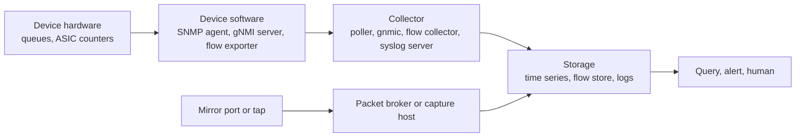
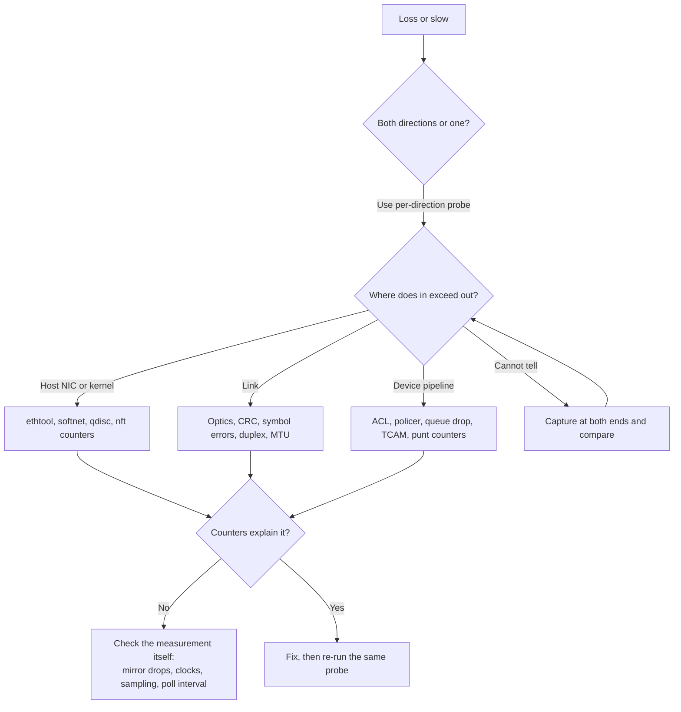

# NET 20: Observability, time and troubleshooting craft

*Part of the [networking plan](00_plan.md) · You need: [NET 03](03_tcp_udp_and_transport.md) (retransmissions, RTT), [NET 06](06_linux_network_stack.md) (where packets wait in a host), [NET 14](14_queueing_qos_and_traffic_management.md) (queues, drops) and [NET 19](19_inside_a_switch_and_router.md) (punts, counters, reading a drop)*

Every networking interview eventually asks some form of "how would you know?" A weak answer names tools: "I would run `tcpdump` and check SNMP." A strong answer starts from the question being asked and picks the signal that can answer it: **a counter** for "is the link busy", **an event** for "when did it change", **a flow record** for "who is using it", **a packet** for "what exactly happened", **a probe** for "what would a user see", and **a timestamp you can trust** for "which side was first". Then it says what each signal **cannot** show, because every tool in this tutorial has a blind spot and most bad troubleshooting is a blind spot mistaken for evidence.

This tutorial covers the signals (SNMP, syslog, streaming telemetry with gNMI, NetFlow, IPFIX and sFlow, port mirroring and taps, capture filters, active probes, host counters), then **time** (NTP, PTP, SyncE, and why asymmetry is the error you cannot see), and finally a **method** that turns the signals into a diagnosis. The lab VM ran a real `snmpd`, a real `ptp4l` pair, `iperf3`, `tshark` and `nftables`, so most numbers below are measured. Section 17 lists what was run and what was not.

**By the end you can:**

- choose the right signal for a question, and name its blind spot;
- explain why SNMP counters need 64 bits at high speed and how a poll interval hides a burst;
- read and decode a syslog priority, and say why UDP syslog is a weak audit trail;
- describe gNMI subscriptions (stream, poll, once; sample against on-change) and where streaming telemetry stops being enough;
- compare NetFlow, IPFIX and sFlow, explain templates and why a lost template makes records unreadable, and estimate how accurate a sampled flow is;
- choose between SPAN, ERSPAN and a tap, and write a capture filter that does not silently miss IPv6;
- measure loss **per direction** with a TWAMP-style probe, and localise loss to a hop with counters;
- derive the NTP and PTP offset formula, and show that a fixed path asymmetry is invisible to both;
- explain boundary and transparent clocks, hardware timestamps, and what SyncE adds;
- run a structured troubleshooting method and answer incident questions in order.

---

## 1. What question are you asking?

Observability for a network is not one tool. It is a set of signals with different cost, resolution and blind spots. Match the signal to the question:

| Question | Best signal | What it cannot tell you |
|---|---|---|
| Is the link busy? Are there errors? | **Counters** (SNMP, streaming telemetry) | Bursts shorter than the sampling interval; who caused it |
| When did something change? | **Events and logs** (syslog, traps, on-change telemetry) | Anything the device did not think worth logging; ordering across devices without synced clocks |
| Who is using the bandwidth? Where is the DDoS aimed? | **Flow records** (NetFlow, IPFIX, sFlow) | Payload; drops; queueing delay; small flows when sampled |
| What exactly was on the wire? | **Packet capture** (mirror, tap, host `tcpdump`) | Anything the capture point did not see; volume (you cannot capture everything) |
| What would a user experience right now? | **Active probes** (ping, TWAMP, synthetic HTTP) | Why; paths other than the one probed |
| Which event came first? How long did it take one way? | **Synchronised time** (NTP, PTP, hardware timestamps) | Nothing, if the clocks are wrong, so check them first |

Two ideas run through the whole tutorial.

**Resolution.** A counter polled every 60 seconds tells you the average over 60 seconds. A burst of 5 ms that fills a buffer and drops packets leaves almost no trace in that average. Before trusting a graph, ask what interval produced each point.

**Where the signal is taken.** A capture on the sender's host shows what the sender intended. A capture at the receiver shows what survived. The difference between them is the answer to "where was the packet lost", and you can only take that difference if you capture at both ends (section 6).



Every arrow can lose or delay data: a collector that drops UDP exports, a time series store that discards points, a mirror port that is oversubscribed. When a graph shows nothing, ask whether the network was quiet or the pipeline was broken.

---

## 2. SNMP: still everywhere, and its counters are a trap

**SNMP** (Simple Network Management Protocol) is a polling protocol. A manager sends `GET`, `GETNEXT` or `GETBULK` requests for **OIDs** (object identifiers, positions in a tree defined by **MIBs**), and the device's agent answers. Devices can also push **traps** and **informs** (a trap with an acknowledgement) on events such as link down. Versions 1 and 2c authenticate with a plain-text "community" string; **version 3** adds authentication and encryption and should be the only one used outside a lab.

SNMP persists because nearly every device speaks it. Its weaknesses are the interview content:

- **Polling load.** The device does the work for every request, so cost grows with pollers, interfaces and frequency. Tens of thousands of interfaces polled every 30 seconds can drive a small CPU hard.
- **Coarse time.** Typical intervals are 30 to 300 seconds, and the timestamp is applied by the collector when the answer arrives, not when the counter was read.
- **Counters, not rates.** The device returns a running total. The rate is the difference between two polls divided by the time between them.
- **Vendor MIBs.** The standard MIBs (IF-MIB, for example) are common; most useful detail is in vendor-specific ones.

### 2.1 Counter width and wrap

The classic interface counter `ifInOctets` (OID `1.3.6.1.2.1.2.2.1.10`) is **32 bits**, so it wraps to zero after 4,294,967,296 bytes. At low speed that takes hours. At 10 Gbit/s it takes seconds:

```python
import subprocess, time, math
OID = {"in32": "1.3.6.1.2.1.2.2.1.10.1", "in64": "1.3.6.1.2.1.31.1.1.1.6.1", "up": "1.3.6.1.2.1.1.3.0"}

def snmp(*oids):
    out = subprocess.run(["snmpget", "-v2c", "-c", "lab", "-On", "-Oqvt", "127.0.0.1:1161", *oids],
                         capture_output=True, text=True).stdout.split("\n")
    return [int(x.split("(")[-1].strip(")")) if "(" in x else int(x) for x in out if x]

def sample():
    u, a, b = snmp(OID["up"], OID["in32"], OID["in64"])
    return u / 100, a, b             # sysUpTime is in hundredths of a second

def rate(prev, cur, bits=32):
    dt = cur[0] - prev[0]
    d = (cur[1] - prev[1]) % 2**bits  # modular difference handles one wrap, hides two
    return d * 8 / dt / 1e6

if __name__ == "__main__":
    s0 = sample()
    subprocess.run("iperf3 -s -1 -p 5201 >/dev/null 2>&1 &", shell=True); time.sleep(0.5)
    subprocess.run(["iperf3", "-c", "127.0.0.1", "-t", "3", "-n", "0"], capture_output=True)
    s1 = sample()
    d32 = (s1[1] - s0[1]) % 2**32; d64 = s1[2] - s0[2]
    print(f"interval {s1[0]-s0[0]:.2f} s, 32-bit delta {d32}, 64-bit delta {d64}, equal: {d32 == d64 % 2**32}")
    print(f"rate from 64-bit counter: {d64*8/(s1[0]-s0[0])/1e6:.0f} Mbit/s")
    for gbps in (1, 10, 100):
        print(f"{gbps:3d} Gbit/s: a 32-bit octet counter wraps every {2**32*8/(gbps*1e9):6.1f} s")
```

Run against a real `snmpd` while `iperf3` pushed loopback traffic:

| Measurement | Value |
|---|---|
| Interval (from `sysUpTime`) | 3.51 s |
| 64-bit counter delta | 4,691,825,749 bytes (about 10.7 Gbit/s) |
| 32-bit counter delta (mod 2^32) | 396,858,453 bytes, equal to the 64-bit delta modulo 2^32 |
| 32-bit wrap time at 1 / 10 / 100 Gbit/s | 34.4 s / 3.4 s / 0.3 s |

Loopback throughput varies from run to run (a later run of the same script gave 2.4 Gbit/s and no wrap), so treat these as one run's figures. In the run above the 32-bit counter wrapped **once** and the modular difference still gave the right answer. If the poll interval were 7 seconds at that rate it would have wrapped twice, and the modular difference would be wrong by 4.29 GB **with no error and no sign of it**. That is the point to make aloud: a wrap is detectable once, invisible twice. The fix is the 64-bit counters in the `ifXTable` (`ifHCInOctets`, OID `1.3.6.1.2.1.31.1.1.1.6`), which any interface over 100 Mbit/s should use, plus the **`sysUpTime`** check: if uptime went backwards or the counter dropped by an amount that is not a plausible wrap, the device rebooted or the counter reset, and that interval's rate must be discarded.

### 2.2 What a poll interval hides

A link averaging 20 percent over a minute can be 100 percent for 50 ms, ten times a minute, and drop packets every time. SNMP will show 20 percent. Short bursts need either **queue-depth or drop counters from the hardware** (section 4), or a very short interval on a few interfaces under investigation, not on everything.

---

## 3. Syslog and events

**Syslog** carries messages from devices to a collector. The first field is the **priority** (PRI), a single number: `facility * 8 + severity`. Facility is the source category (kernel, auth, local0 to local7 for vendor use) and severity runs from 0 (emergency) to 7 (debug):

```python
FAC = ["kern","user","mail","daemon","auth","syslog","lpr","news","uucp","cron","authpriv","ftp","ntp","audit","alert","clock"] + [f"local{i}" for i in range(8)]
SEV = ["emerg","alert","crit","err","warning","notice","info","debug"]
def pri(n): return FAC[n // 8], SEV[n % 8]
for n in (13, 34, 165, 189, 191):
    print(f"<{n}> -> facility {pri(n)[0]}, severity {pri(n)[1]}")
print("local7.notice =", FAC.index("local7")*8 + SEV.index("notice"))
```

This printed `<189>` as facility `local7`, severity `notice` (and `<34>` as `auth` and `crit`). A header such as `<189>` on a switch message is therefore routine; `<34>` is not.

What to know beyond the byte:

- **Format.** The older BSD style (RFC 3164) is loosely structured; **RFC 5424** adds a version, a timestamp with time zone, hostname, application, message ID and **structured data**. Many devices still emit the older form.
- **Transport.** Classic syslog is **UDP**, so messages are lost silently under load, and during an incident (when the device is busiest and the network is worst) is when loss is likeliest. TCP and TLS transports exist (RFC 5425 for TLS). For anything audit-grade, use a reliable transport and treat the device's local log as the source of truth.
- **Time.** The timestamp is the device's clock. If two devices disagree by a second, merged logs show the effect before the cause. This is the first practical reason for section 9.
- **Rate.** Devices rate-limit logging, and a log message is a **punt** to the CPU (NET 19). A flapping link can produce thousands of messages and slow the device down.

A good pattern is to use logs for **what changed and when**, and metrics for **how much**. Link flaps, BGP session resets and configuration changes belong in the log; utilisation does not.

---

## 4. Streaming telemetry: gNMI and what it fixes

**Streaming telemetry** replaces polling with a subscription: the collector says what it wants, and the device **pushes** it at a chosen interval or when it changes. The common form is **gNMI** (gRPC Network Management Interface) over gRPC and TLS, with data described by **YANG** models, ideally the vendor-neutral **OpenConfig** ones.

The gNMI service has four operations: `Capabilities` (what models does the device support), `Get`, `Set` and **`Subscribe`**. A subscription names **paths** (such as an interface's counters) and a mode:

| Mode | Behaviour |
|---|---|
| `STREAM` with `SAMPLE` | Device sends the value every sample interval, whether or not it changed |
| `STREAM` with `ON_CHANGE` | Device sends only when the value changes (for state such as an interface being up or down) |
| `STREAM` with `TARGET_DEFINED` | Device picks the right mode per path |
| `POLL` | Collector asks for the current values when it wants them, on the same stream |
| `ONCE` | One snapshot, then the stream ends |

(From the gNMI specification, from memory: there are also options to suppress unchanged samples and to send a periodic heartbeat for on-change paths, so silence can be told apart from a dead stream.)

**Dial-in** means the collector connects to the device (gNMI itself). **Dial-out** means the device connects to the collector, which suits devices behind NAT or firewalls and removes the need for the collector to know every device address. Several vendors support dial-out with their own wire formats.

What streaming fixes, compared with SNMP:

- **Timestamps come from the source device**, not from when the collector received the answer, so the series is more accurate.
- **Load is lower**: one stream can serve many consumers, with no per-poll request.
- **Intervals can be seconds**, and on-change data arrives at once, so a link flap is an event, not a gap between polls.
- **A real data model** (YANG) instead of per-vendor OIDs, in principle.

What it does not fix, and what interviews probe:

- **Support is uneven.** Models, paths and performance vary by vendor, OS version and platform, and older or access-layer gear may never support it, so most networks run both for years.
- **Models are not identical.** Even with OpenConfig, vendors implement subsets and extend them, and no standard maps every MIB metric to a model path.
- **Seconds are still coarse.** A microburst lasting milliseconds is invisible at one-second sampling. Detecting it needs **hardware queue-depth, watermark and drop counters**, or in-band telemetry such as INT, where packets carry per-hop metadata (outline only here).
- **Pipeline cost moves, not vanishes.** A collector (for example `gnmic`), a message bus and a time series database must absorb the rate, with **cardinality** (series count: interfaces times counters times devices) as the usual limit.

> Not run here: the lab VM has no gNMI server or `gnmic`. This section is from the gNMI specification (from memory) and from the [Kentik comparison of SNMP and streaming telemetry](https://www.kentik.com/kentipedia/snmp-vs-streaming-telemetry/), which I fetched.

---

## 5. Flow telemetry: NetFlow, IPFIX and sFlow

Counters say how much; flows say **who**. A **flow** is a set of packets sharing a key, usually the 5-tuple (source and destination address, ports, protocol), with totals: packets, bytes, start and end time. Flow records answer "which host is saturating this link", "where is the DDoS aimed", "who talks to whom", and feed capacity planning and billing.

Three families:

| | **NetFlow v5 / v9, IPFIX** | **sFlow** |
|---|---|---|
| Method | The device keeps a **flow cache**, tracks every flow (or a sample of packets into the cache), and exports a record when a flow ends or times out | The device **samples 1 packet in N** and sends the packet header plus interface counters; no per-flow state |
| Device cost | CPU and memory for the cache; a spoofed-source flood can make every packet a flow | Low; no flow table |
| Delay | Records wait for a timeout (seconds to minutes) before export | Samples are sent as soon as they are taken |
| Format | v5 fixed fields; v9 and **IPFIX** (the IETF standard, "NetFlow v10") use **templates** | Fixed sFlow datagrams |
| Strength | Exact totals for tracked flows, standard extensible fields (IPFIX) | Cheap, scales to very high speed, fast, includes counter samples |
| Weakness | Cost, delay; sampled NetFlow loses small flows too | Estimates only; small flows are poorly measured |

(NetFlow originated at Cisco in 1996; sFlow came from a multi-vendor group in 2003. Kentik reports that aggregate accuracy of NetFlow and sFlow was essentially the same in their experience, with differences in cost and per-host detail for small flows.)

### 5.1 Templates: how IPFIX describes its records

IPFIX records are **self-describing through templates**. An exporter first sends a **template set** that says "template 256 has these fields, in this order and size", using standard **information element** numbers from the IANA registry (8 is `sourceIPv4Address`, 12 `destinationIPv4Address`, 7 and 11 the ports, 4 the protocol, 1 `octetDeltaCount`, 2 `packetDeltaCount`, 152 and 153 the start and end times in milliseconds). Later **data sets** with set ID 256 carry records with exactly those fields. The message header is 16 bytes: version 10, length, export time, a **sequence number** (the count of data records sent before this message) and an observation domain ID. The default collector port is UDP 4739.

This script builds an exporter by hand: one message with template and data, and a second with data only:

```python
import socket, struct, time, ipaddress

def msg(seq, sets, domain=1):
    body = b"".join(sets)
    return struct.pack("!HHIII", 10, 16 + len(body), int(time.time()), seq, domain) + body

# Template set (set id 2): template 256, nine fields (IANA information element ids)
FIELDS = [(8, 4), (12, 4), (7, 2), (11, 2), (4, 1), (1, 8), (2, 8), (152, 8), (153, 8)]
t = struct.pack("!HH", 256, len(FIELDS)) + b"".join(struct.pack("!HH", i, n) for i, n in FIELDS)
tset = struct.pack("!HH", 2, 4 + len(t)) + t

def rec(src, dst, sp, dp, proto, octets, pkts, t0, t1):
    return (ipaddress.IPv4Address(src).packed + ipaddress.IPv4Address(dst).packed +
            struct.pack("!HHBQQQQ", sp, dp, proto, octets, pkts, t0, t1))

now = int(time.time() * 1000)
recs = [rec("10.0.0.1", "10.0.1.9", 40000, 443, 6, 1_500_000, 1100, now - 30000, now - 1000),
        rec("10.0.0.2", "10.0.1.9", 51000, 53, 17, 180, 2, now - 500, now - 400)]
dset = struct.pack("!HH", 256, 4 + sum(map(len, recs))) + b"".join(recs)

s = socket.socket(socket.AF_INET, socket.SOCK_DGRAM)
s.sendto(msg(0, [tset, dset]), ("127.0.0.1", 4739))        # template and data together
s.sendto(msg(2, [dset]), ("127.0.0.1", 4739))              # later message: data only, seq counts records sent
```

Captured on loopback and decoded with `tshark`, the **whole capture** decoded both messages: sequence 0 and 2, template 256 in the first, two flows each time (a TCP flow of 1,500,000 bytes and 1,100 packets to port 443, and a UDP flow of 180 bytes to port 53). The second message was then cut out into a **capture of its own**, and `tshark` reported `Data (90 bytes), no template found`: the records were present but **unreadable**, because the template had been in a message the decoder never saw.

That is a real operational failure, and a good interview answer. Over UDP, an exporter must **resend templates periodically** and when it restarts. A collector that restarts, or a capture that starts mid-stream, cannot decode data until the next template arrives, so flow graphs show a gap that looks like "no traffic". The sequence number also lets a collector detect **missing messages**: a jump in the count means export packets were lost.

### 5.2 How accurate is a sampled flow?

With 1-in-N sampling, a flow of `P` packets is expected to give `P/N` samples, and the estimate is the sample count times N. The estimate is good for large flows and poor for small ones. This simulation draws 400 trials per row:

```python
import random, math
random.seed(7)

def trial(pkts, N):
    """Sample each packet independently with p = 1/N; estimate the flow's packet count as samples * N."""
    p = 1 / N
    s = sum(random.random() < p for _ in range(pkts))
    return s * N

for N in (100, 1000):
    print(f"1-in-{N}")
    for pkts in (100, 1_000, 10_000, 100_000):
        est = [trial(pkts, N) for _ in range(400)]
        mean = sum(est) / len(est)
        sd = math.sqrt(sum((e - mean) ** 2 for e in est) / len(est))
        c = pkts / N                                   # expected samples
        rule = 196 * math.sqrt(1 / c) if c >= 1 else float("inf")
        seen = sum(e > 0 for e in est) / len(est)
        print(f"  flow of {pkts:6d} pkts: expected samples {c:7.1f}, seen in {seen:5.0%} of runs, "
              f"std error {100*sd/pkts:6.1f}%, 95% rule (196/sqrt(c)) {rule:6.1f}%")
```

| Sampling | Flow size | Expected samples | Seen at all | Std error |
|---|---|---|---|---|
| 1-in-100 | 100 packets | 1 | 63% of runs | 102% |
| 1-in-100 | 1,000 | 10 | 100% | 31% |
| 1-in-100 | 10,000 | 100 | 100% | 9.7% |
| 1-in-100 | 100,000 | 1,000 | 100% | 3.1% |
| 1-in-1000 | 100 | 0.1 | 8% | 280% |
| 1-in-1000 | 10,000 | 10 | 100% | 31% |
| 1-in-1000 | 100,000 | 100 | 100% | 9.5% |

The standard error is about `100 / sqrt(c)` percent, where `c` is the number of samples; the sFlow rule of thumb quoted as `196 / sqrt(c)` percent is the 95 percent bound, about twice that. Three consequences:

- **Elephants are measured well; mice are not.** Sampling finds the top talkers and a DDoS, and misses short flows (a 100-packet flow at 1-in-1000 appears in 8 percent of runs).
- **Accuracy depends on the flow, not the link.** Choose the sampling rate from the smallest flow you care about.
- **Do not use sampled flow data to prove something did not happen.** Absence of a flow in samples is weak evidence.

Flows also **cannot see drops, latency or queueing**, and they carry no payload. For those, use counters, probes and captures.

---

## 6. Packet visibility: mirrors, taps and capture craft

When counters and flows are not enough, you capture packets. The questions are **where** and **how**.

### 6.1 Getting a copy of the traffic

- **SPAN** (switch port analyzer, also called port mirroring): the switch copies traffic from a port or VLAN to a monitor port. It is cheap and built in, but the copy is **lowest priority and unreliable**: if the monitor port is oversubscribed (mirroring a full-duplex 10G link to one 10G port) the switch drops mirrored packets **silently**, and the capture then shows loss that did not happen on the network. Check the monitor port's own counters.
- **RSPAN and ERSPAN**: carry the mirrored traffic to a remote analyzer, over a VLAN (RSPAN) or in **GRE** (ERSPAN, IP protocol 47). ERSPAN type III can add a hardware timestamp and device identity (from memory). Encapsulation adds bytes, so check the MTU.
- **Network tap**: a passive optical or electrical device in the link that copies both directions to monitor ports. It is **faithful** (no oversubscription at the tap, and it passes errors a switch might drop) and does not depend on switch configuration, but it needs physical access and a short outage to insert. A **packet broker** aggregates, filters and load-balances many taps and mirrors to the tools.
- **Host capture**: `tcpdump` on the sending or receiving host. Quick to get, but see the caveats below.

A rule that avoids many wrong conclusions: **capture at both ends of the suspect segment and compare**. The packet count difference is the loss. In the lab, a router with a deliberate fault (section 8) was captured on its ingress and egress interfaces during 100 pings:

| Capture point | ICMP echo requests seen |
|---|---|
| Router ingress (`r0`) | 100 |
| Router egress (`r1`) | 88 |

The 12 missing packets were lost **inside the router**, between the two captures. A single capture at either end could not show that.

### 6.2 Capture filters are compiled, and they have blind spots

`tcpdump` and `libpcap` turn a capture filter into a **BPF** program that runs in the kernel, so unwanted packets are never copied to user space. This is why capture filters (`tcpdump` syntax, BPF) differ from **display filters** (`tshark` and Wireshark, applied after capture, a different and richer language). Use capture filters to limit volume and display filters to analyse.

The compiler shows what a filter really does. `tcpdump -d "tcp[tcpflags] & tcp-syn != 0 and dst port 443"` printed 13 instructions, and the first two are:

```
(000) ldh      [12]
(001) jeq      #0x800           jt 2  jf 12
```

Load the EtherType; if it is not `0x800` (IPv4), jump to instruction 12, which is `ret #0` (**reject**). So a filter written this way **silently drops every IPv6 packet**, and a capture of "all SYNs to 443" misses IPv6 clients. Tested on a pcap holding one IPv4 SYN, one IPv6 SYN and one IPv6 ACK:

| Filter | Packets matched |
|---|---|
| `tcp[tcpflags] & tcp-syn != 0 and dst port 443` | 1 (the IPv4 SYN only) |
| `(ip and tcp[tcpflags] & tcp-syn != 0 and dst port 443) or (ip6 and ip6[6] = 6 and ip6[53] & 2 != 0 and dst port 443)` | 2 (both SYNs) |
| `tcp dst port 443` (then filter flags afterwards in `tshark` with `tcp.flags.syn==1 && tcp.flags.ack==0`) | 3 captured, 2 after the display filter |

The IPv6 form reads the next-header byte (`ip6[6] = 6`, TCP) and the flags byte at offset 53 (40 bytes of header plus 13), so it is only correct when there are **no extension headers**. That fragility is the lesson: **capture broadly with a simple filter and narrow with display filters afterwards**, unless volume forces you to filter in the kernel, and when a capture is missing traffic, test the filter.

Other capture-craft points that interviews like:

- **Snap length.** `-s` sets how many bytes per packet to keep; headers only (96 to 128 bytes) is enough for most protocol work and cuts disk use greatly. Truncated packets fail checksum verification in the analyzer, which is expected.
- **Ring buffers.** `-C` (file size), `-W` (file count) and `-G` (rotation time) keep a rolling window, so you can capture continuously and stop after the event. Capturing for an intermittent problem without this fills the disk.
- **Kernel drops.** `tcpdump` prints "packets dropped by kernel" at exit. A non-zero value means the capture is incomplete (the capture process could not keep up), so a "missing" packet may be a capture artefact. Raise the buffer (`-B`), use a faster path, or capture on a dedicated machine.
- **Host captures show host reality.** On a receiving host, a capture normally sits **after receive offloads** such as GRO, so you can see "packets" larger than the MTU (from memory, not run here); on a sender, it sits **before segmentation offload** and before the NIC, so it shows what the stack handed down, not what went on the wire. Retransmission analysis from a host capture is still valid; timing at microsecond scale is not.
- **Time.** Packet timestamps come from the capturing machine's clock (or the NIC's, with hardware timestamping). Comparing two captures on two machines needs synchronised clocks (section 9), or you will get negative one-way delays.

---

## 7. Active measurement: what would a user see?

Passive signals describe the network. **Active probes** send test traffic and measure what happens to it, which is closer to what a user experiences and works when you have no access to the middle of the path.

- **Ping and traceroute** are the first tools and have well-known limits. Replies come from the CPU of each device (a punt, NET 19), so a hop showing loss in traceroute while the path beyond it is clean is **ICMP rate limiting**, not real loss. Measure end to end. `mtr` repeats traceroute and shows per-hop loss over time, with the same caution. Load-balanced paths (ECMP) mean successive probes can take different routes.
- **IP SLA** (Cisco's term; other vendors have equivalents) makes the **device itself** send probes (ICMP, UDP, HTTP, DNS) on a schedule and report delay, jitter and loss. It gives continuous measurement from inside the network without a separate host, and can trigger alerts or routing changes.
- **TWAMP** (Two-Way Active Measurement Protocol, RFC 5357) is the standard form: a **sender** transmits numbered, timestamped test packets to a **reflector**, which timestamps and returns them. The value over ping is that the reflector can report **what it received**, so the sender can split the result into **forward** and **reverse** loss, and (with synchronised clocks) forward and reverse delay. A simpler variant, TWAMP-light, skips the control protocol.

### 7.1 A TWAMP-style test that finds the direction

Ping cannot tell you which way loss happens. A reflector that returns a **counter of probes received so far** can. This small sender and reflector (a teaching sketch, not TWAMP itself) were run across the faulty router of section 8, which drops about 1 packet in 10 **only toward the destination**:

```python
import socket, struct, sys, time

def reflector(bind, port=9999, total=None):
    s = socket.socket(socket.AF_INET, socket.SOCK_DGRAM); s.bind((bind, port)); got = 0; s.settimeout(3)
    try:
        while True:
            data, peer = s.recvfrom(64); got += 1
            seq, t_tx = struct.unpack("!Id", data[:12])
            # echo: sequence, sender's transmit time, how many probes this reflector has received so far
            s.sendto(struct.pack("!IdI", seq, t_tx, got), peer)
    except socket.timeout:
        pass

def sender(dst, port=9999, n=500, gap=0.002):
    s = socket.socket(socket.AF_INET, socket.SOCK_DGRAM); s.settimeout(0.05)
    back, last_got, rtts = 0, 0, []
    for seq in range(n):
        s.sendto(struct.pack("!Id", seq, time.time()) + b"\0" * 20, (dst, port))
        try:
            data, _ = s.recvfrom(64)
            _, t_tx, last_got = struct.unpack("!IdI", data[:16]); back += 1; rtts.append(time.time() - t_tx)
        except socket.timeout:
            pass
        time.sleep(gap)
    fwd_lost = n - last_got                     # the reflector's own counter, from the last reply we saw
    rev_lost = last_got - back                  # reflected probes that did not make it back
    print(f"sent {n}, reflector saw >= {last_got}, replies {back}")
    print(f"forward loss {fwd_lost/n:.1%} (uses reflector counter), reverse loss {rev_lost/max(last_got,1):.1%}, "
          f"median rtt {sorted(rtts)[len(rtts)//2]*1e6:.0f} us")

if __name__ == "__main__":
    reflector(sys.argv[2]) if sys.argv[1] == "r" else sender(sys.argv[2])
```

The result:

```
sent 500, reflector saw >= 448, replies 448
forward loss 10.4% (uses reflector counter), reverse loss 0.0%, median rtt 155 us
```

Ping would have said "about 10 percent loss". This says **forward only**, which already tells you to look at the path toward the destination. The fault is random, so figures vary (a second run gave 9.8 percent forward, 0.0 percent reverse). One approximation to state: the sender learns the reflector's count from the **last reply it received**, so if the final probes are lost it underestimates the forward loss. Real TWAMP reports sequence numbers per packet instead.

### 7.2 Traffic generators and their traps

`iperf3` measures achievable TCP or UDP throughput between two hosts. The traps (see also [WF 09](10_wifi/09_wifi_testing.md) for the Wi-Fi version): one stream often cannot fill a fast link (per-flow limits, a single CPU core), so use `-P`; direction matters (`-R`); the **endpoints** can be the bottleneck (CPU, a slow disk, a virtual switch); and one run is a sample, so repeat. For packet rate rather than bandwidth, use the Linux **`pktgen`** kernel module or a software generator such as **TRex**, which can replay and scale traffic patterns at tens of millions of packets per second on suitable hardware (outline only; neither was run here). Remember that **a traffic generator can be the fault**: a generator that sends in one direction only, or at a rate the host cannot sustain, produces results that real bidirectional traffic does not.

---

## 8. Counters at every layer, and finding where a packet disappeared

A packet that is sent and never arrives was dropped **somewhere**. The method is to read counters at each point along the path and find the first place where "in" is greater than "out".

| Where | Counter | What a non-zero value means |
|---|---|---|
| Host NIC | `ethtool -S`, `ip -s link` (`rx_errors`, `rx_dropped`, `tx_dropped`) | Hardware or driver drops; ring buffer full; bad frames (CRC) |
| Host kernel queues | `/proc/net/softnet_stat`, `nstat`, `tc -s qdisc` | Backlog overflow (softirq could not keep up); qdisc drops |
| Host firewall | `nft list ruleset` with counters, `conntrack -S` | A rule dropped it; the connection table was full |
| Host TCP | `nstat` (`TcpRetransSegs`), `ss -ti` (`retrans`, `rtt`, `cwnd`) | Loss or delay as TCP sees it |
| Switch or router port | Interface counters (in and out errors, discards, CRC), queue drops | Congestion drops (discards) or physical errors (CRC, symbol errors) |
| Switch or router CPU path | Punt and CoPP counters (NET 19) | Control-plane traffic dropped |
| Probe or flow records | Loss reported by TWAMP, retransmits in flow exports | End-to-end view |

The most common mistake is to look at **interface error counters, find zero, and conclude nothing was lost**. Errors count malformed frames and hardware failures. A packet dropped by a **firewall rule, a queue, a policer, an ACL or the routing pipeline** is not an interface error.

### 8.1 A lab: three namespaces, one fault, four counters

The topology is `la` (a host), `lr` (a router that forwards) and `lb` (a host), joined by two veth pairs:

```bash
set -e
for n in la lr lb; do ip netns add $n; done
ip link add a0 type veth peer name r0; ip link set a0 netns la; ip link set r0 netns lr
ip link add r1 type veth peer name b0; ip link set r1 netns lr; ip link set b0 netns lb
ip -n la addr add 10.30.1.1/24 dev a0; ip -n lr addr add 10.30.1.2/24 dev r0
ip -n lr addr add 10.30.2.2/24 dev r1; ip -n lb addr add 10.30.2.1/24 dev b0
for p in "la a0" "lr r0" "lr r1" "lb b0"; do set -- $p; ip -n $1 link set $2 up; ip -n $1 link set lo up; done
ip -n la route add 10.30.2.0/24 via 10.30.1.2; ip -n lb route add 10.30.1.0/24 via 10.30.2.2
ip netns exec lr sysctl -qw net.ipv4.ip_forward=1
```

The fault is a rule in the router's forward path that drops about 1 packet in 10 headed to `lb`, with named counters so we can see both outcomes:

```
table inet f {
  counter drops { }
  counter passed { }
  chain c1 {
    type filter hook forward priority 0; policy accept;
    ip daddr 10.30.2.1 numgen random mod 10 == 0 counter name "drops" drop
    ip daddr 10.30.2.1 counter name "passed"
  }
}
```

This is loaded with `ip netns exec lr nft -f fault.nft`. A helper prints each interface's packet, error and drop counters:

```bash
for p in "la a0" "lr r0" "lr r1" "lb b0"; do set -- $p; printf "%s/%s " $1 $2
  ip -n $1 -s -j link show $2 | python3 -c "
import json,sys; j=json.load(sys.stdin)[0]['stats64']
print('rx',j['rx']['packets'],'err',j['rx']['errors'],'drop',j['rx']['dropped'],'| tx',j['tx']['packets'],'err',j['tx']['errors'],'drop',j['tx']['dropped'])"
done
```

First 100 pings with no fault gave 0 percent loss and **101** packets on every interface (100 echoes plus one ARP exchange). After loading the fault, 300 more pings from `la` to `lb` gave **269 received, 10.3 percent loss**, and the counters (cumulative) read:

| Interface | rx packets | tx packets | errors | drops |
|---|---|---|---|---|
| `la/a0` (sender) | 370 | **401** | 0 | 0 |
| `lr/r0` (router in) | **401** | 370 | 0 | 0 |
| `lr/r1` (router out) | 370 | **370** | 0 | 0 |
| `lb/b0` (receiver) | 370 | 370 | 0 | 0 |

Read it as a diagram. The sender transmitted 401 and the router received all 401: the first link is clean. The router **transmitted** only 370 on the second interface: **31 packets went in and never came out**. The router's own counter says `drops` = 31 and `passed` = 269 (the 300 pings, split), and 31 is exactly the gap. Meanwhile **every interface shows zero errors and zero drops**. The loss is inside the router's forwarding logic, not on any wire, and only the "in minus out" comparison and the rule counter reveal it.

The replies were not lost (receiver tx 370 equals sender rx 370), which agrees with the TWAMP-style test above: forward loss only. The same technique works on a real switch: compare ingress and egress counters, then ask which stage between them (ACL, policer, queue, TCAM miss, punt) can drop, and read that stage's counter.

### 8.2 What TCP says about the path

On the host, `ss -ti` shows what TCP itself measured for each connection: the congestion control in use (`bbr` in this VM), `rtt` with its variance, `cwnd`, `mss`, `retrans`, bytes sent and acknowledged, and for BBR the estimated bandwidth. `nstat` shows system-wide TCP counters such as `TcpRetransSegs`. Retransmissions are the **symptom** of loss or delay, with the cause elsewhere: a rising `retrans` count with a clean local NIC points at the network, a rising count with NIC drops points at the host. TCP's view is also what the **application** experiences, which makes it a good first look before packet captures.

---

## 9. Time: why it matters, how it is kept, and the error you cannot see

Time shows up in networking wherever **two machines must agree on when something happened**: merging logs, measuring **one-way delay** (forward and reverse, which round-trip tests cannot separate), packet timestamps from two capture points, scheduled transmission (time-sensitive networking), cellular base stations (phase alignment), financial timestamping rules, and distributed databases that order transactions by clock (Google's Spanner uses bounded-uncertainty clocks, from memory). The needed accuracy ranges from **seconds** (log correlation, certificate validity) to **microseconds** (one-way delay, industrial control) to **nanoseconds** (radio, trading).

### 9.1 How a clock is compared: four timestamps

Both NTP and PTP estimate a clock's error with the same exchange. The client sends a request at its time `t0`; the server receives it at its time `t1`, replies at `t2`; the client receives the reply at `t3`. Then:

- **round-trip delay** = `(t3 − t0) − (t2 − t1)`: total time on the wire, excluding the server's processing;
- **offset** (client clock minus server clock) = half the sum of the two one-way differences: `((t0 − t1) + (t3 − t2)) / 2`.

The offset formula **assumes the forward and reverse delays are equal**. If they are not, the error equals **half the asymmetry**, and the round-trip delay does not change, so the asymmetry is invisible. This script simulates the exchange:

```python
def stamps(true_offset, d_fwd, d_rev, t0=1000.0):
    """Client clock = server clock + true_offset. Times in microseconds. Returns t0..t3 and the error-free answer."""
    t1 = t0 - true_offset + d_fwd          # server receive (server clock)
    t2 = t1 + 1                            # server transmit, 1 us later
    t3 = t2 + true_offset + d_rev          # client receive (client clock)
    return t0, t1, t2, t3

def estimate(t0, t1, t2, t3, correction=0.0):
    """Client minus server offset and round-trip delay, as NTP and PTP compute them.
    `correction` is the residence time a transparent clock reports for the forward leg."""
    t1 = t1 - correction                   # remove time the packet spent queueing inside the network
    offset = ((t0 - t1) + (t3 - t2)) / 2
    delay = (t3 - t0) - (t2 - t1)
    return offset, delay

for name, off, f, r in [("symmetric 50/50", 0, 50, 50), ("asymmetric 80/20", 0, 80, 20), ("asymmetric 80/20, true offset 500", 500, 80, 20)]:
    o, d = estimate(*stamps(off, f, r))
    print(f"{name:36s} estimated offset {o:6.1f} us (true {off}), error {o-off:6.1f}, delay {d:5.1f}")

print()
for q in (0, 300):
    t = stamps(0, 50 + q, 50)                   # a queue delays only the forward direction
    o, _ = estimate(*t)
    oc, _ = estimate(*t, correction=q)          # transparent clock reports the queueing it caused
    print(f"queue {q:3d} us forward only: error {o:6.1f} us uncorrected, {oc:6.1f} us with correction field")
```

Output:

| Case | Estimated offset | Error | Round-trip delay |
|---|---|---|---|
| Symmetric 50 us each way, true offset 0 | 0.0 | 0.0 | 100 |
| Forward 80, reverse 20, true offset 0 | -30.0 | **-30.0** | **100** |
| Same asymmetry, true offset 500 us | 470.0 | -30.0 | 100 |
| 300 us queue in the forward direction only, no correction | | **-150.0** | 400 |
| Same, with the queueing reported and subtracted (transparent clock) | | **0.0** | |

Two points matter for an interview. First, a **fixed** asymmetry (80 against 20) has the same round-trip delay as a symmetric path, so nothing in the measurement warns you; a 60 us difference between directions becomes a 30 us time error permanently. Second, a **queue** is a variable asymmetry (traffic in one direction is busy), and it is exactly the error that PTP's network support is designed to remove.

### 9.2 NTP

**NTP** (Network Time Protocol, version 4 in RFC 5905) synchronises clocks over ordinary IP, typically to **milliseconds**, using **software timestamps** taken in the host's network stack. Its strengths are that it is universal and tolerant of any network. How it works in practice:

- A hierarchy of **strata**: stratum 0 is a reference clock (GPS, atomic), stratum 1 servers are attached to it, and each hop down adds a stratum.
- A client asks **several servers** and uses selection and clustering algorithms to discard **falsetickers** (servers whose answers do not agree with the majority) and combine the rest. Never configure a single server.
- The client **slews** its clock gradually (frequency adjustment) rather than stepping it, because a time jump breaks software that measures intervals. Large errors at start-up are stepped.
- Daemons: **chrony** (common on modern Linux, better on unstable networks and virtual machines) and `ntpd`. `chronyc tracking` shows offset and frequency error. (Not run here: the VM's clock is the host's.)
- **Security.** Plain NTP is spoofable; **NTS** (RFC 8915) adds authentication. **Leap seconds** are handled by stepping or by **smearing** (spreading the second over hours), and mixing smeared and non-smeared servers makes clocks disagree by up to a second (from memory).

The accuracy limit is the **software timestamp** plus **path asymmetry** from queues: tens of microseconds on a quiet LAN, milliseconds across the internet.

### 9.3 PTP

**PTP** (Precision Time Protocol, IEEE 1588) reaches **sub-microsecond to nanosecond** accuracy by fixing the two things that limit NTP: timestamping and queueing.

- **Hardware timestamping.** The NIC or PHY records the instant a packet crosses the wire, not when the CPU handled it. Linux exposes the NIC's clock as a **PTP hardware clock** (`/dev/ptp0`); `ethtool -T eth0` lists the timestamping capabilities, and `phc2sys` copies time between the NIC clock and the system clock. A Meinberg article reports that accuracy depends mainly on hardware timestamping, not on the protocol: software timestamps limit both protocols to roughly a millisecond (a few microseconds is possible only with high message rates and a quiet network), while hardware timestamps give tens of nanoseconds to under a microsecond.
- **Message exchange.** A **grandmaster** sends `Sync` (and `Follow_Up` with the exact transmit time in two-step mode) and answers `Delay_Req` with `Delay_Resp`. The slave runs the four-timestamp calculation above.
- **Best Master Clock Algorithm (BMCA).** Every clock announces its quality (clock class, accuracy, priority), and all clocks independently elect the same grandmaster. If it fails, another is chosen.
- **Boundary and transparent clocks.** A plain switch adds **variable queueing delay**, which is the asymmetry error of section 9.1. A **boundary clock** terminates PTP on each port and re-originates it, acting as a slave upstream and a master downstream, so each hop is a short, quiet link. A **transparent clock** forwards PTP messages but measures how long each spent inside it (**residence time**) and adds it to a **correction field**, so the slave subtracts it (the last row of the table above). Without either, accuracy degrades with every switch on the path.
- **Profiles** adapt PTP to uses: telecom (ITU-T G.8275.1 and .2), power, broadcast media (SMPTE ST 2059), audio (AES67), and time-sensitive networking (802.1AS, "gPTP") (from memory).

> A PTP lab on real hardware needs NICs with timestamping. The VM has none, so this run measures the **software-timestamp case only**, and (important) both ends were on the **same kernel clock**, so it measures timestamp noise, not how well two separate clocks were synchronised.

Two `ptp4l` instances, one as grandmaster and one as client, were run in separate network namespaces over a veth pair with `time_stamping software`. They elected the grandmaster, the client calibrated, and then reported (in nanoseconds) a path delay of about **1,900 to 2,300 ns** and an **rms offset with a median of about 310 ns** (range 262 to 2,340, over 12 settled one-second reports). The path delay is the kernel's cost of carrying a packet through two namespaces and a veth pair. A second run with a 4-stream `iperf3` load in one direction **did not** show a clear change in rms (means of about 1,100 ns idle and 1,000 ns loaded, dominated by start-up and outliers), so I draw no conclusion about queueing from the lab; section 9.1 is where the queue effect is shown, deterministically.

### 9.4 SyncE, GPS and the rest

- **SyncE** (Synchronous Ethernet, ITU-T G.8261 and G.8262, from memory) distributes **frequency** over the Ethernet **physical layer**: each node recovers the clock from the incoming bit stream and uses it to clock its transmitter. It carries no time of day and is immune to packet delay variation, so it is used with PTP: SyncE gives a stable frequency, PTP gives the phase and time.
- **GPS and GNSS receivers** with **PPS** (pulse per second) outputs are the usual source of the grandmaster's time. Their antennas, cable delays and the risk of jamming or spoofing are real operational concerns, and sites often keep a holdover oscillator (rubidium or a good crystal) to ride out outages.
- **Debugging time.** Check offset and **jitter**, not only that the daemon is running; check the **grandmaster identity** (a rogue or misconfigured clock can win the BMCA), the **path** for non-PTP-aware hops, **asymmetric cables or fibre lengths** (the fixed asymmetry error), and whether the NIC is really using hardware timestamps.

---

## 10. A method for troubleshooting

The signals above are only useful with a method. Ivan Pepelnjak's troubleshooting guidelines (cited in section 17) and the method in [WF 16](10_wifi/16_wifi_interview_bank_and_troubleshooting.md) agree on the structure:

1. **Define the problem precisely.** What is expected, what is observed, **when** it started (a recent change? a pattern by time of day?), whether it is continuous or intermittent, and **how many** objects are affected out of the total. Compare a failing object with a working one.
2. **Classify the traffic.** Data, control or management plane? IPv4 or IPv6? Unicast or multicast? TCP, UDP or ICMP? Which direction?
3. **Narrow the scope by splitting the path.** For overlays (VXLAN, tunnels), check the **underlay** first, then the overlay. Take a measurement at the middle and see which half contains the fault, then repeat. Establish the **direction** of loss.
4. **Work bottom-up and top-down.** Bottom-up: admin and link state, optics and light levels, hardware programming, then software state. Top-down: capture how the system actually behaves and challenge assumptions.
5. **Form a hypothesis, then test it.** Test the **most probable** cause first, but do cheap checks before costly ones. Look for something **present that is out of place** rather than missing data, which has many explanations.
6. **Change one thing at a time**, and record each step and its result.
7. **Verify the fix** with the same measurement that showed the problem. An unexplained recovery will recur.
8. **Keep a baseline.** Without knowing what "normal" looks like, normal anomalies are mistaken for the cause.

For the very common "traffic is lost" case, the decision flow is:



The box at the bottom left matters. When no counter explains the symptom, suspect **the measurement**: an oversubscribed mirror port, an unsynchronised clock, a poll interval that averages away the event, a sampling rate that cannot see small flows, a filter that excludes IPv6.

---

## 11. Observability at scale and alert design

At a fleet scale (tens of thousands of devices) the engineering problem is the **pipeline**:

- **Cardinality.** Series count is devices times interfaces times counters times labels. A time series database fails on cardinality before it fails on data rate, so decide which counters are collected everywhere and which only on demand.
- **Resolution against retention.** Keep seconds-level data for hours, minutes-level for weeks and hourly rollups for years. Alert on the short window and capacity-plan on the long one.
- **Sampling and aggregation at the edge.** Aggregate on the device or a nearby collector; export deltas; compress. Streaming telemetry makes volume a design decision, not a given.
- **Reliability of the pipeline.** Monitor the monitoring: collector lag, dropped exports, missing templates, gaps. A silent gap is more dangerous than a red graph.

For alerts, three rules hold up well:

- **Alert on symptoms users feel** (loss, latency, error rate, a probe failing) and use device causes (a port at 90 percent, a flapping link) as context. A cause that does not hurt anyone is a ticket, not a page.
- **Set thresholds from a baseline**, not from round numbers, and use **duration** (a condition held for N minutes) to avoid paging on a one-sample spike.
- **Page on actionable, deduplicated events.** One link failing can produce a hundred alarms across a topology; correlate (the upstream failure explains the downstream ones) or the real one is buried.

The network equivalents of the usual golden signals are **utilisation, loss (errors and drops), latency and jitter, and reachability**, measured per path and per class of traffic.

---

## 12. Common mistakes

1. **Trusting an average.** A 60-second poll, a daily graph or a mean RTT hides bursts, outages and tails. Ask for the interval and for the percentile.
2. **Reading zero errors as zero loss.** Interface errors do not include ACL, queue, policer or firewall drops.
3. **A single capture point.** One capture cannot locate loss; two can.
4. **Trusting a mirror.** An oversubscribed SPAN silently drops and makes the network look lossy.
5. **A capture filter with a hole.** The IPv4-only SYN filter missed every IPv6 SYN.
6. **Assuming 32-bit counters.** Two wraps in a poll interval give a wrong rate with no error.
7. **Merging logs from unsynchronised clocks**, so effects appear before causes.
8. **Concluding from a sampled flow that something did not happen.**
9. **Forgetting that NTP and PTP cannot see fixed asymmetry**, and treating a small offset as proof the clocks agree.
10. **Hop-by-hop traceroute loss taken at face value** instead of an end-to-end test.
11. **Changing several things at once**, so the fix cannot be attributed.
12. **Skipping the baseline and the direction.** "Loss" is not a diagnosis until you know which direction and compared to what.

---

## 13. Interview questions

**Q1. What is the difference between SNMP polling and streaming telemetry?**
SNMP is pull: the manager asks every 30 to 300 seconds, the device does work per request, and the timestamp is applied when the answer arrives. Streaming telemetry (gNMI) is push: the collector subscribes once, the device sends samples at an interval or on change, with source timestamps, over gRPC and TLS, using YANG models. Streaming is lighter per consumer and finer-grained, but support is uneven, so networks run both, and neither shows millisecond bursts without hardware queue counters.

**Q2. Why do interface counters need 64 bits?**
A 32-bit octet counter wraps after about 4.29 GB, which is 3.4 seconds at 10 Gbit/s. A modular difference handles one wrap per poll interval but gives a silently wrong rate after two. The `ifHC` counters are 64-bit and do not wrap in practice. Also check `sysUpTime` for resets.

**Q3. Link utilisation graphs look fine but users complain of drops. Why?**
Averaged over the poll interval, a short burst looks small, yet it can fill a buffer and drop packets. Look at hardware queue drop or watermark counters, shorten the interval on that port, or use telemetry that exports queue depth.

**Q4. Compare NetFlow, IPFIX and sFlow.**
NetFlow and IPFIX track flows in a cache on the device and export records at flow end or timeout (exact for tracked flows, costs memory and CPU, delayed). IPFIX is the IETF standard with templates and extensible fields. sFlow samples 1 in N packets and exports headers and counters with no flow state: cheap, fast, an estimate. Both give "who", neither gives drops or latency.

**Q5. Why can IPFIX data be unreadable even though the packets arrive?**
Records are described by a template sent earlier. A collector that missed or lost the template, restarted, or joined a capture mid-stream cannot decode the data sets until the template is resent. Exporters resend templates periodically for that reason. The sequence number shows lost messages.

**Q6. How accurate is 1-in-1000 sampling for a flow?**
The standard error is about 100 divided by the square root of the number of samples. A 10,000-packet flow gives 10 samples, about 30 percent error; a 100,000-packet flow gives about 10 percent. A 100-packet flow is seen in under 10 percent of runs. So it finds elephants and DDoS well, and cannot be used to prove a small flow was absent.

**Q7. SPAN, ERSPAN or a tap?**
SPAN is built in and cheap, but mirrored traffic is lowest priority, can be dropped silently when the monitor port is oversubscribed, and depends on switch config. ERSPAN carries the mirror over GRE to a remote analyzer. A tap copies the link in hardware, is faithful and independent of the switch, and needs physical access. For forensics or loss proof, use a tap; for a quick look, SPAN, after checking the monitor port's counters.

**Q8. Your capture filter for SYNs to port 443 misses IPv6. Why?**
The compiled BPF checks that the EtherType is IPv4 and rejects everything else. IPv6 needs its own clause, with offsets that assume no extension headers. A safer habit is to capture with a broad filter and use display filters afterwards.

**Q9. Where do you capture to find where a packet was lost?**
At both ends of the suspect segment and compare. In the lab, 100 pings were seen as 100 at a router's ingress and 88 at its egress, which placed the loss inside the router. Check kernel drops on the capture and the mirror's own counters first so you know the capture is complete.

**Q10. Ping shows 10 percent loss. How do you tell the direction?**
Use a probe where the far end reports what it received: TWAMP, or an equivalent. Forward loss is sent minus the reflector's count; reverse loss is reflected minus received. In the lab the result was 10.4 percent forward and 0 percent reverse, matching a fault on the forward path only.

**Q11. Traceroute shows 40 percent loss at hop 5 and clean hops after it. Real?**
No. Hop 5 rate-limits the ICMP it generates (a punt), and real loss would continue downstream. Measure end to end, and use `mtr` over time for the pattern.

**Q12. A router shows zero interface errors and zero drops, but traffic is lost. Where?**
Anywhere that drops without counting as an interface error: an ACL or firewall rule, a policer, a queue, a routing or TCAM miss, or the punt path. Compare in and out counters at each stage. In the lab, the router's receive interface counted 401 packets and the transmit interface 370, with zero errors, and a named rule counter showed the 31 dropped.

**Q13. How does NTP estimate a clock's offset, and what is its main weakness?**
Four timestamps: client send, server receive, server send, client receive. Delay is total time minus server processing; offset is half the sum of the two one-way differences. It assumes equal forward and reverse delays. A path asymmetry produces an error of half the asymmetry, and the round-trip delay does not change, so it is undetectable. Software timestamps limit accuracy to about a millisecond.

**Q14. How does PTP get nanosecond-level accuracy?**
Hardware timestamps at the NIC or PHY instead of in software, and on-path support that removes queueing variation: boundary clocks re-originate time at each hop, transparent clocks add residence time to a correction field that the slave subtracts. Without them accuracy degrades per hop.

**Q15. Boundary clock or transparent clock?**
A boundary clock terminates PTP and acts as slave upstream and master downstream: it isolates each hop and gives the downstream a clean master, but needs a full PTP stack and servo in each device. A transparent clock only measures and corrects for its own residence time, so it is simpler and adds no servo noise, but errors from link asymmetry accumulate along the path. Telecom profiles often use boundary clocks.

**Q16. What does SyncE give that PTP does not?**
Frequency distribution through the Ethernet physical layer, independent of packet delay variation. It carries no time of day, so it is paired with PTP, which provides the phase and time.

**Q17. Why does time matter for one-way delay?**
Round-trip time needs one clock, but one-way delay needs two, and their offset shows up directly as error (a 2 ms offset gives a 2 ms error, or a negative delay). That is why TWAMP forward and reverse delay requires synchronised, ideally PTP, clocks.

**Q18. Logs from two routers show the effect before the cause. What do you check?**
Clock sync on both devices (NTP offset, time zone, timestamp format), then whether one device logs when the event was **queued** and the other when it was **processed**. Fix time first; correlated logs depend on it.

**Q19. How would you debug a flapping link?**
Start with the log for flap timestamps and pattern, then physical-layer counters: CRC, symbol errors, optics receive and transmit power, FEC counters, cable or transceiver changes. Check both ends (one side may see errors the other does not), then speed and duplex negotiation, and recent changes. Swap components one at a time.

**Q20. What would you alert on for a network?**
Symptoms users feel: probe loss and latency per path, error and discard rates on important links, BGP or link adjacency loss, with duration thresholds from a baseline and correlation so one root cause pages once. Treat utilisation near capacity as a capacity-planning signal unless it is causing loss.

---

## 14. Scenarios and design questions

**S1. Users report video calls stutter at about 3 pm each day. The link graphs look flat.**
*Where to practise:* the poll interval lab in section 2 and the counters table in section 8.
*Approach:* a time pattern suggests load or a periodic job. Flat 5-minute graphs can hide bursts, so shorten the interval on the suspect link and read queue drop counters. Use flow records for the time window to find the sources (a backup, an update). Run a probe (TWAMP or a synthetic call) to confirm delay and jitter in the window, then decide between QoS (NET 14), scheduling the job, or capacity.

**S2. Sporadic 10 percent loss between two data centres.**
*Where to practise:* the three-namespace lab of section 8.
*Approach:* establish direction with a probe that reports per-direction loss, define the failing set (all flows or some, which suggests ECMP and one bad path), then split the path and compare in and out counters. If a link is the suspect, check CRC and optics on both ends; if a device, check queue and ACL counters between its ports. Verify by re-running the same probe.

**S3. After a router restart, flow graphs show a gap of several minutes, then recover.**
*Where to practise:* the IPFIX template test in section 5.
*Approach:* suspect templates. After a restart the exporter and collector must exchange templates, and data sets are unreadable until the template arrives; check the template refresh interval, collector logs ("no template") and sequence numbers for lost messages.

**S4. Two switches' logs disagree about which port failed first.**
*Where to practise:* the offset simulation of section 9.1 and `chronyc tracking` on a host.
*Approach:* compare clock offsets; confirm both use the same NTP sources and time zone settings; check that log timestamps use the same precision. If milliseconds matter (BFD, link-down propagation), plan PTP or a hardware-timestamped event feed rather than relying on NTP.

**S5. Design the observability for a 500-switch data centre fabric.**
*Where to practise:* sections 4, 5 and 11.
*Approach:* ask what questions are required (capacity, loss, who talks to whom, change tracking, latency). Streaming telemetry for counters and state with a short interval for key metrics, on-change for link and BGP state; sFlow or IPFIX sampling for traffic matrix and top talkers at a rate chosen from the smallest flow of interest; syslog over TCP/TLS for events; a probe mesh (TWAMP or synthetic) between racks for end-to-end loss and latency; PTP or NTP with monitoring for time. Plan collectors, a message bus and storage for cardinality; retention tiers; alerts on symptoms with correlation. Cover failure: what is monitored if the monitoring network fails (out-of-band path).

**S6. A capture shows a lot of retransmissions at the server, none at the client.**
*Where to practise:* section 6 (capture points) and section 8.2.
*Approach:* ask where each capture was taken and whether clocks and filters are comparable. Retransmits seen only at the sender with the receiver seeing the original packets suggest the **ACKs** are being lost or delayed on the reverse path, not the data; check reverse-direction loss with a per-direction probe. Check that the receiver's capture is not before offload and that the mirror did not drop.

**S7. A latency-sensitive trading or radio application needs time within 1 microsecond across a network.**
*Where to practise:* section 9.
*Approach:* NTP cannot do it. Use PTP with hardware timestamping NICs, boundary or transparent clocks on every switch in the path, a GPS-disciplined grandmaster with a holdover oscillator and redundancy, SyncE if frequency stability is needed, and cable or fibre length calibration for asymmetry. Monitor offset and path delay continuously and alarm on grandmaster changes.

---

## 15. Strong answers (outlines)

**S1 (3 pm stutter).** (1) Treat the graph's interval as the first suspect; (2) shorten the interval and read queue drops; (3) find the sources with flows for that window; (4) confirm the user effect with a probe; (5) choose QoS, scheduling or capacity; (6) leave an alert on the symptom.

**S2 (sporadic loss).** (1) Per-direction probe; (2) which flows, to test for one ECMP path; (3) split the path and compare in and out counters; (4) look at physical errors, then queues, then ACLs; (5) change one thing; (6) re-run the same probe.

**S3 (flow gap).** (1) Templates and their refresh; (2) collector errors; (3) sequence numbers for lost exports; (4) fix by shortening the refresh interval, collector redundancy and monitoring the pipeline.

**S4 (log disagreement).** (1) Compare clock offsets and time zones; (2) confirm sources; (3) decide the accuracy needed; (4) NTP monitoring now, PTP if sub-millisecond is required.

**S5 (500-switch fabric).** (1) Questions first; (2) the right signal per question; (3) pipeline sizing and retention; (4) alert design; (5) out-of-band path and monitoring of the monitor.

---

## 16. Cheat sheet

| Topic | Remember |
|---|---|
| Signals | Counters (how much), logs (when), flows (who), packets (what), probes (user view), time (order) |
| Poll interval | Counters give averages; seconds-long bursts need hardware queue counters |
| 32-bit counter wrap | 34 s at 1G, 3.4 s at 10G, 0.3 s at 100G; use 64-bit; check `sysUpTime` |
| Syslog PRI | facility x 8 + severity; `<189>` is local7.notice; UDP is lossy |
| gNMI | Capabilities, Get, Set, Subscribe (stream sample or on-change, poll, once); dial-in or dial-out |
| Flows | NetFlow and IPFIX track flows with templates; sFlow samples 1 in N |
| Sampling error | About 100 / sqrt(samples) percent; elephants yes, mice no |
| IPFIX | UDP 4739; template set id 2, data sets 256 and up; lost template means unreadable data |
| Mirrors | SPAN can drop silently; ERSPAN uses GRE; taps are faithful |
| Capture filters | Compiled BPF; IPv4-only filters miss IPv6; use display filters to narrow |
| Find the hop | Compare in and out counters at each stage; capture at both ends |
| Zero errors | Does not mean zero loss; ACLs, queues and policers are not errors |
| Direction | TWAMP-style probe splits forward and reverse loss |
| NTP offset | Half the sum of the one-way differences; error = half the asymmetry |
| Fixed asymmetry | Invisible in round-trip delay |
| NTP vs PTP | Milliseconds with software timestamps vs sub-microsecond with hardware timestamps and on-path support |
| Boundary vs transparent | Boundary re-originates time per hop; transparent adds residence time to a correction field |
| SyncE | Frequency over the physical layer, no time of day |
| Method | Define, classify, split, bottom-up and top-down, hypothesise, one change, verify, baseline |

---

## 17. Sources and caveats

**Fetched and read while writing:** the [Kentik comparison of SNMP and streaming telemetry](https://www.kentik.com/kentipedia/snmp-vs-streaming-telemetry/) (polling intervals, scaling, data models, source timestamps, limits); the [Kentik article on NetFlow, sFlow and IPFIX](https://www.kentik.com/blog/accurate-visibility-with-netflow-sflow-and-ipfix/) (flow cache against sampling, delay, accuracy); Ivan Pepelnjak's [network troubleshooting guidelines](https://blog.ipspace.net/2018/10/network-troubleshooting-guidelines/) (the method in section 10); and the [Meinberg article on NTP against PTP](https://blog.meinbergglobal.com/2013/11/22/ntp-vs-ptp-network-timing-smackdown) (a 2013 vendor blog, so the accuracy figures are the author's and depend on deployment). Located by search but **not read in full**: Juniper's gNMI subscription page, a Cisco Nexus packet-drop troubleshooting guide, and several interview-style troubleshooting guides.

**Run fresh for this tutorial** (Linux 6.18 VM, `snmpd`, `ptp4l`, `iperf3`, `tshark` 4.2.2, `tcpdump`, `nftables`, Python): the SNMP counter lab against a real `snmpd` (32-bit against 64-bit deltas, wrap times); the syslog priority decode; the hand-built IPFIX export decoded by `tshark`, including the no-template case; the sampling simulation (400 trials per row); the IPv4-only against two-family BPF filters on a crafted pcap and the compiled BPF listing; the three-namespace loss lab (ping, interface counters, rule counters, captures at the router's ingress and egress, the TWAMP-style test); the offset and asymmetry simulation; and a two-instance `ptp4l` run with software timestamps.

**Not run, and why:** no gNMI server or `gnmic` (section 4 is from the specification and the Kentik article); no ERSPAN or tap (no switch); no hardware timestamping NIC, so PTP accuracy beyond software timestamps is cited, not measured; the `ptp4l` pair shared one kernel clock, so it measured timestamp noise and not real synchronisation, and the loaded run was inconclusive; no `chronyd` run; `pktgen` and TRex were not run; SyncE, boundary and transparent clock behaviour on hardware are from the standards as I remember them. The TWAMP-style test is a teaching sketch, not RFC 5357.

**From memory, check before quoting:** gNMI subscription options (heartbeat, suppress redundant); ERSPAN type III fields; IPFIX template-refresh defaults; GRO effects on host captures; NTS and leap-smear details; PTP profile numbers (G.8275, ST 2059, 802.1AS); SyncE recommendation numbers; flow-cache timeout defaults; Spanner's clock design.

Earlier and later: [NET 19](19_inside_a_switch_and_router.md) and [NET 15](15_networking_interview_question_bank.md); the [networking plan](00_plan.md) has NET 21 (container and Kubernetes networking) next.
