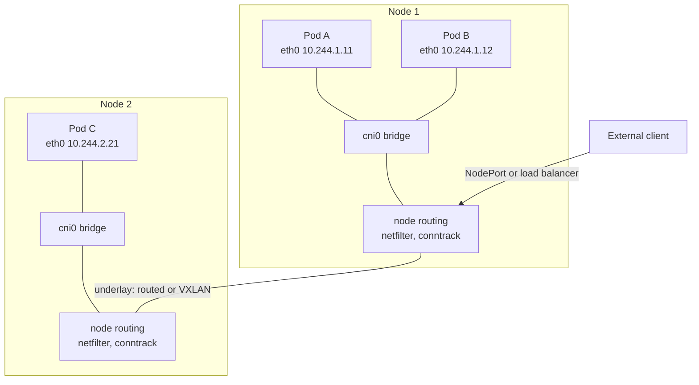
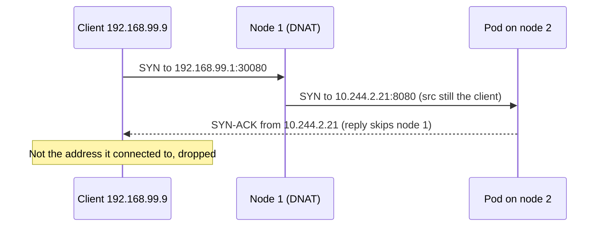
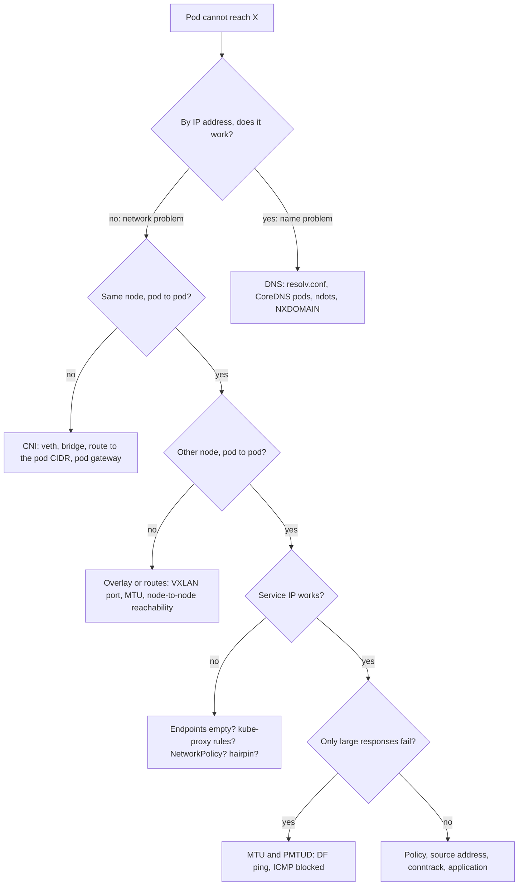

# NET 21: Container and Kubernetes networking

*Part of the [networking plan](00_plan.md) · You need: [NET 02](02_ip_routing_and_layer3.md) (routing, ARP, NAT), [NET 06](06_linux_network_stack.md) (netfilter, conntrack, namespaces), [NET 13](13_load_balancing_proxies_and_anycast.md) (load balancing, DSR) and [NET 17](17_cloud_sdn_automation_and_labs.md) (overlays, VXLAN)*

Kubernetes networking questions are really Linux networking questions in disguise. A weak answer recites the object names: "a Service has a ClusterIP and kube-proxy load-balances to pods". A strong answer says what the **packet** does: the ClusterIP is on no interface, a netfilter rule in the first hook rewrites the destination to a pod, conntrack remembers the rewrite so the reply can be undone, and if the chosen pod is on another node the packet crosses an overlay that has 50 bytes less room than the pod thinks it has. Then it says what breaks when any of those assumptions fails: a pod calling a Service that selects itself, a NodePort whose reply bypasses the node that rewrote it, a firewall that eats the ICMP that tells TCP about the smaller MTU, a resolver that makes four queries for every external name.

This tutorial builds a small "cluster" from Linux namespaces (two nodes, three pods, an external client) and **reproduces each of those failures** on it. Then it covers the pieces that need a real cluster to demonstrate (CNI plugins, kube-proxy, eBPF, service meshes) in outline, clearly marked. Section 17 lists what was run and what was not.

**By the end you can:**

- state the Kubernetes network model's rules and the four traffic problems it creates;
- explain what a pod network is in Linux terms (namespace, veth, bridge) and what a CNI plugin does;
- compare routed, overlay and cloud-native pod networks, and show the encapsulation overhead;
- reproduce and fix the MTU black hole;
- explain a ClusterIP as a rewrite rule plus conntrack, show how a linear rule chain scales against a map, and say what changes with IPVS or eBPF;
- explain the hairpin problem and why both a bridge flag and a source rewrite are needed;
- explain NodePort and `externalTrafficPolicy` through the source-address problem;
- explain how `ndots:5` multiplies DNS queries and how to reduce them;
- describe NetworkPolicy semantics, enforcement, and the default-deny gotchas;
- debug "a pod cannot connect" in a fixed order.

---

## 1. The model in one page

Kubernetes does not implement networking. It states **rules** that any implementation (a CNI plugin) must satisfy:

1. Every pod gets **its own IP address**, and containers in a pod share it (and talk over `localhost`).
2. Any pod can reach any other pod **without NAT**, wherever they are in the cluster, and sees the same addresses the peer sees.
3. Agents on a node (the kubelet) can reach all pods on that node.

On top of that, a **Service** gives a stable virtual IP and DNS name in front of a changing set of pods, and an **Ingress** or **Gateway** brings external traffic in. These rules create four traffic problems, and nearly every question maps to one of them:

| Problem | Mechanism | Where it breaks |
|---|---|---|
| Container to container (same pod) | Shared network namespace, `localhost` | Port clashes between containers in a pod |
| Pod to pod | veth, bridge, routes or an overlay | MTU, missing routes, policy |
| Pod to Service | Destination rewrite (DNAT) plus conntrack | Hairpin, conntrack limits, rule scale, DNS |
| External to Service | NodePort, load balancer, Ingress | Source address, extra hops, health checks |



Everything in the diagram is ordinary Linux. A pod is a **network namespace**. Its `eth0` is one end of a **veth pair** whose other end is on the node. The node connects veth ends with a **bridge** (or routes each one), and the node's routing table, netfilter rules and conntrack table do the rest.

---

## 2. A pod network from scratch

### 2.1 What the runtime and the CNI plugin do

When the kubelet starts a pod, the container runtime creates a **network namespace** (held open by a small "pause" container in most setups, from memory) and calls a **CNI plugin** (Container Network Interface). The CNI contract is small: the runtime runs a plugin binary with a JSON configuration and an operation, `ADD` (set up networking for this namespace), `DEL`, `CHECK` or `VERSION`, and the plugin returns the result (the interface, the IP, the routes). Plugins can be **chained**, and a separate **IPAM** plugin hands out addresses from a node's pod CIDR (from the CNI specification, from memory). What a plugin does on `ADD` is exactly what the script below does by hand:

1. create a veth pair, one end inside the pod namespace (named `eth0`), the other on the node;
2. attach the node end to a bridge or add a route for it;
3. assign the pod an address from the node's range, and add a default route;
4. make the **other nodes** able to reach that range (routes, BGP, or an overlay).

### 2.2 The lab cluster

Two nodes (`n1`, `n2`) joined by an underlay link, each with a bridge named `cni0` that has the pod gateway address and a pod CIDR (`10.244.1.0/24` and `10.244.2.0/24`), and three pods:

```bash
set -e
# two "nodes" (n1, n2), an underlay link between them, and pods on bridges (the cni0 role)
for n in n1 n2 ext; do ip netns add $n; ip -n $n link set lo up; done
ip link add u1 type veth peer name u2; ip link set u1 netns n1; ip link set u2 netns n2
ip -n n1 addr add 192.168.0.1/24 dev u1; ip -n n2 addr add 192.168.0.2/24 dev u2
ip -n n1 link set u1 up; ip -n n2 link set u2 up
for i in 1 2; do ip netns exec n$i sysctl -qw net.ipv4.ip_forward=1; ip -n n$i link add cni0 type bridge
  ip -n n$i addr add 10.244.$i.1/24 dev cni0; ip -n n$i link set cni0 up; done
pod() {  # pod <node> <name> <ip>: namespace, veth pair, one end on the node's bridge
  ip netns add $2; ip -n $2 link set lo up
  ip link add v$2 type veth peer name eth0 netns $2
  ip link set v$2 netns $1; ip -n $1 link set v$2 master cni0 up
  ip -n $2 addr add $3/24 dev eth0; ip -n $2 link set eth0 up; ip -n $2 route add default via ${3%.*}.1
}
pod n1 p11 10.244.1.11; pod n1 p12 10.244.1.12; pod n2 p21 10.244.2.21
```

Same-node traffic first. Two pods on one bridge:

```bash
ip netns exec p11 ping -q -c 3 10.244.1.12 | tail -2 | head -1
ip netns exec n1 bridge fdb show br cni0 | grep -v permanent | head -4
ip netns exec n1 conntrack -L 2>&1 | head -3
ip netns exec p11 ping -q -c 2 -W 1 10.244.2.21 | tail -2 | head -1
```

The pings succeeded (3 of 3). The bridge's forwarding table learned the two pod MACs on the two veth ports (`vp11`, `vp12`), so same-node traffic is a **pure layer 2 lookup**. The conntrack table was empty (0 flow entries), which means **same-node pod traffic involves no NAT and no connection tracking** in this setup. The last ping, to the pod on the other node, failed with 100 percent loss: nothing yet tells `n1` how to reach `10.244.2.0/24`. That is the next section.

> One real-world detail: with `net.bridge.bridge-nf-call-iptables=1` (the VM has `br_netfilter` loaded, and Kubernetes setups normally require it) frames crossing a bridge **do** traverse the iptables and nftables hooks. This is why Service rules apply to pod traffic on a bridge, and why it matters in section 6.

---

## 3. Pod to pod across nodes: routed, overlay, cloud-native

Three designs, with different trade-offs:

| Design | How packets cross the underlay | Examples | Strengths | Costs |
|---|---|---|---|---|
| **Routed** (native) | Pod IPs are routed on the underlay: each node advertises its pod CIDR (static routes or BGP) | Calico in BGP mode, Cilium native routing | No encapsulation, full MTU, underlay can see and filter pod traffic | The underlay must route pod ranges (BGP peering, route limits) |
| **Overlay** | Pod packets are encapsulated (VXLAN, Geneve, IP-in-IP) in node-to-node packets | Flannel VXLAN, Calico VXLAN or IP-in-IP, Cilium tunnel mode | Works on any IP underlay with no cooperation | Encapsulation overhead (MTU, CPU), opaque to underlay tools |
| **Cloud-native** | Pods get real addresses from the cloud network | AWS VPC CNI, GKE and Azure native modes | Pod IPs are first-class, no overlay | Address exhaustion, per-instance interface and address limits (from memory) |

### 3.1 Routed

The simplest working design: one route per remote pod CIDR, pointing at the other node.

```bash
ip -n n1 route add 10.244.2.0/24 via 192.168.0.2
ip -n n2 route add 10.244.1.0/24 via 192.168.0.1
```

```bash
ip netns exec p11 ping -c 2 10.244.2.21 | sed -n 2,3p
ip netns exec n1 tcpdump -i u1 -nn -c 2 icmp -w routed.pcap >/dev/null 2>&1 & sleep 0.5
ip netns exec p11 ping -q -c 1 10.244.2.21 >/dev/null; wait
tshark -r routed.pcap -T fields -e ip.src -e ip.dst -e ip.ttl -e frame.len 2>/dev/null
```

The ping now works with **TTL 62** (64 minus two routing hops: the node bridge gateway and the other node). A capture on the underlay link shows the **pod addresses themselves** (`10.244.1.11` to `10.244.2.21`) in 98-byte frames. That is the whole benefit and the whole cost of routed mode: the underlay carries and can filter pod traffic natively, so the underlay must be configured to route it.

### 3.2 Overlay with VXLAN

For an overlay, replace the routes with a VXLAN device. A CNI agent (Flannel, for example) programs the neighbour and forwarding entries statically, so there is no flooding or learning:

```bash
set -e
ip -n n1 route del 10.244.2.0/24; ip -n n2 route del 10.244.1.0/24
# each node gets a vxlan device (VNI 1, UDP 4789); neighbour and FDB entries are static, as a CNI agent programs them
for i in 1 2; do
  ip -n n$i link add vx type vxlan id 1 dev u$i local 192.168.0.$i dstport 4789 nolearning
  ip -n n$i addr add 10.244.$i.0/32 dev vx; ip -n n$i link set vx up
done
mac1=$(ip -n n1 -j link show vx | python3 -c "import json,sys;print(json.load(sys.stdin)[0]['address'])")
mac2=$(ip -n n2 -j link show vx | python3 -c "import json,sys;print(json.load(sys.stdin)[0]['address'])")
ip -n n1 route add 10.244.2.0/24 via 10.244.2.0 dev vx onlink
ip -n n1 neigh replace 10.244.2.0 lladdr $mac2 dev vx nud permanent
ip netns exec n1 bridge fdb add $mac2 dev vx dst 192.168.0.2 self permanent
ip -n n2 route add 10.244.1.0/24 via 10.244.1.0 dev vx onlink
ip -n n2 neigh replace 10.244.1.0 lladdr $mac1 dev vx nud permanent
ip netns exec n2 bridge fdb add $mac1 dev vx dst 192.168.0.1 self permanent
```

```bash
ip netns exec n1 ip -d link show vx | grep -E "mtu|vxlan id" | sed 's/  */ /g' | cut -c1-120
ip netns exec p11 ping -c 2 10.244.2.21 | sed -n 2,3p
ip netns exec n1 tcpdump -i u1 -nn -c 2 -w vx.pcap udp port 4789 >/dev/null 2>&1 & sleep 0.5
ip netns exec p11 ping -q -c 1 10.244.2.21 >/dev/null; wait
tshark -r vx.pcap -T fields -e ip.src -e ip.dst -e udp.dstport -e vxlan.vni -e frame.len 2>/dev/null | head -2
```

Pod to pod works again. The capture on the underlay now shows what an overlay looks like from outside: **outer** addresses `192.168.0.1` to `192.168.0.2`, **UDP port 4789**, **VNI 1**, and the frame is **148 bytes**, against 98 for the same ping in routed mode, so the encapsulation costs exactly **50 bytes** (outer Ethernet 14, IP 20, UDP 8, VXLAN 8). The inner packet (the pod addresses) is carried untouched inside. The kernel also gave the `vx` device an **MTU of 1450** by itself, 50 below the underlay's 1500, and that number is the setup for the next section.

An overlay's operational costs: encapsulation CPU (mitigated by NIC offload for UDP tunnels), harder debugging (underlay tools see only node-to-node UDP, so a capture needs to be decoded as shown, and flows are hashed on the **outer UDP source port** for ECMP, which the kernel derives from the inner flow), and the MTU.

---

## 4. MTU: the overlay's hidden tax, and the black hole

The pods in this lab still have **MTU 1500** on `eth0`, but the path between nodes can carry only **1450**-byte inner packets. Whether that works depends entirely on **path MTU discovery** (PMTUD), the ICMP "fragmentation needed" mechanism from NET 03.

Three DF (don't fragment) pings with different sizes, from a pod across the overlay:

```bash
for s in 1472 1422 1423; do printf "payload %s (IP packet %s): " $s $((s+28))
  ip netns exec p11 ping -M do -c 1 -W 1 -s $s 10.244.2.21 2>&1 | grep -E "bytes from|too long|Frag" | head -1 | cut -c1-90; done
```

| Payload | IP packet size | Result |
|---|---|---|
| 1472 | 1500 | `From 10.244.1.1 ... Frag needed and DF set (mtu = 1450)`: the node (the pod's gateway) returned an ICMP error |
| 1422 | 1450 | Reply received |
| 1423 | 1451 | `local error: message too long, mtu=1450` (the pod had cached the smaller MTU from the first ICMP) |

That is PMTUD **working**: the sender learns 1450, caches it for about ten minutes (the route showed `mtu 1450`, `expires 583sec`), and TCP shrinks its segments. The failure mode is what happens when the ICMP never arrives. A firewall or security group that drops "destination unreachable" is common. Reproducing it: a 300 KB download from a pod across the overlay, with ICMP unreachable dropped on the node that would send it (the data flows from the server back to the client, so the router that generates the ICMP is the server's node, `n2`):

```bash
head -c 300000 /dev/urandom > big.bin; echo hi > small.txt
waitport() { until ip netns exec $1 ss -ltn | grep -q ":$2 "; do sleep 0.3; done; }   # Python's server does a reverse DNS lookup at start-up, so wait for the port, not a fixed sleep
ip netns exec p21 python3 -m http.server 8080 --bind 10.244.2.21 >/dev/null 2>&1 &
waitport p21 8080
cat > blockicmp.nft <<'NFT'
table inet blk {
  chain o {
    type filter hook output priority 0; policy accept;
    icmp type destination-unreachable counter drop
  }
  chain f {
    type filter hook forward priority 0; policy accept;
    icmp type destination-unreachable counter drop
  }
}
NFT
ip netns exec n2 nft -f blockicmp.nft
ip netns exec p12 curl -s -o /dev/null --max-time 5 -w "large: ok=%{http_code} size=%{size_download} time=%{time_total}s\n" http://10.244.2.21:8080/big.bin
ip netns exec p12 curl -s -o /dev/null --max-time 5 -w "small: ok=%{http_code} size=%{size_download}\n" http://10.244.2.21:8080/small.txt
ip netns exec n2 nft list ruleset | grep -E "packets"
```

The large download **stalled for the full 5 seconds** and delivered 0 bytes (`ok=200 size=0`, curl exit code 28, a timeout). The small file worked. The ICMP drop counter on `n2` showed **8 packets**, the errors that never reached the server. This is the classic "it works for small requests and hangs on large ones" report, and the mechanism is: the TCP handshake and small packets fit, the first full-size segment is silently dropped at the overlay, the ICMP that would have shrunk it is dropped by a firewall, and TCP keeps retransmitting the same oversized segment.

To test fix 1, lower the MTU inside both pods to 1450 and repeat the large download with the ICMP still blocked:

```bash
for p in p12 p21; do ip -n $p link set eth0 mtu 1450; done
ip netns exec p12 curl -s -o /dev/null --max-time 5 -w "large: ok=%{http_code} size=%{size_download} time=%{time_total}s\n" http://10.244.2.21:8080/big.bin
ip netns exec n2 nft delete table inet blk
for p in p12 p21; do ip -n $p link set eth0 mtu 1500; done
```

Fixes, in order of preference:

1. **Set the pod MTU correctly** (underlay MTU minus the overlay overhead): both pods at 1450 and the same download took **1.5 ms** and completed even with ICMP still blocked. Most CNI plugins compute and set this; check it with `ip link` inside a pod.
2. **Clamp TCP MSS** at the node (an iptables or nftables rule that rewrites the MSS option on SYNs, `tcp option maxseg size set rt mtu`) so TCP never builds oversized segments. It fixes TCP but not UDP.
3. **Raise the underlay MTU** (jumbo frames, for example 9000) so the overlay still carries 1500 inside. Best, when the whole path can be changed.
4. **Do not block** ICMP "fragmentation needed" (type 3, code 4) anywhere on the path.

Other overlays and tunnels change the number: Geneve adds an option area so its overhead varies (about 50 bytes or more), IP-in-IP adds 20, and WireGuard or IPsec in the CNI add more (figures from memory, check the CNI's documentation). The interview point is the **method**: underlay MTU minus overhead is the pod MTU, and a symptom that is "small works, large hangs" is an MTU or PMTUD problem until shown otherwise.

---

## 5. Services: a virtual IP is a rewrite rule plus conntrack

A ClusterIP (for example `10.96.0.10`) is **not assigned to any interface on any node**. It exists only as a match in a rewrite rule. On a typical cluster, `kube-proxy` on every node watches Services and **EndpointSlices** (the list of ready pod IPs and ports behind a Service) and programs the node's packet filter so that traffic to the virtual IP has its destination rewritten to one pod (**DNAT**). **conntrack** records the rewrite so the reply is translated back on the way out, and so every later packet of the same connection goes to the same pod.

Here is a Service built the same way, with two backends (a pod on each node), using a random choice per new connection. First the two backends and the rule:

```bash
cat > who.py <<'EOF'
import http.server, sys
NAME = sys.argv[1]
class H(http.server.BaseHTTPRequestHandler):
    def do_GET(self):
        body = f"pod={NAME} client={self.client_address[0]}\n".encode()
        self.send_response(200); self.send_header("Content-Length", str(len(body))); self.end_headers(); self.wfile.write(body)
    def log_message(self, *a): pass
http.server.ThreadingHTTPServer(("0.0.0.0", 8080), H).serve_forever()
EOF
pkill -f "http.server 8080"
for p in p12 p21; do (ip netns exec $p python3 who.py $p > /dev/null 2>&1 &); done; waitport p12 8080; waitport p21 8080
cat > svc.nft <<'EOF'
table ip kube {
  chain svc {
    type nat hook prerouting priority -100; policy accept;
    ip daddr 10.96.0.10 tcp dport 80 dnat to numgen random mod 2 map { 0 : 10.244.1.12 . 8080, 1 : 10.244.2.21 . 8080 }
  }
}
EOF
ip netns exec n1 nft -f svc.nft
```

```bash
for ns in n1 n2 p11 p12 p21; do printf "$ns: "; ip netns exec $ns ip -4 addr | grep -c "10.96.0.10"; done | tr '\n' ' '; echo
for i in $(seq 200); do ip netns exec p11 curl -s --max-time 2 http://10.96.0.10:80/; done | sed 's/ client=.*//' | sort | uniq -c
ip netns exec p11 curl -s http://10.96.0.10:80/ >/dev/null; ip netns exec n1 conntrack -L -p tcp 2>/dev/null | head -1 | cut -c1-170
```

Results:

- **No namespace has the address.** The count of `10.96.0.10` in every namespace's address list was 0.
- **The split.** 200 requests produced **94 to `p12` and 106 to `p21`** (110 and 90 on a second run), a random, per-connection choice. Random selection is what kube-proxy's iptables mode does too (a chain of rules with probabilities 1/N, 1/(N-1), and so on, which makes the overall split uniform).
- **The conntrack entry** for one connection: original direction `src=10.244.1.11 dst=10.96.0.10 dport=80`, reply direction `src=10.244.2.21 sport=8080 dst=10.244.1.11`. The first tuple is what the client thinks it is talking to; the second is what the network actually did. The reply is un-rewritten because conntrack finds this entry.

Because the rewrite happens in the node's `prerouting` hook, the pod's own node does the work, **before routing**: after the rewrite, the packet is routed to a pod IP like any other (here over the overlay if the backend is on the other node). This is why Services work for any CNI that provides pod to pod reachability.

### 5.1 How kube-proxy modes differ

| Mode | Mechanism | Scaling | Status (from the Kubernetes documentation I fetched) |
|---|---|---|---|
| **iptables** | One chain per Service, a few rules per endpoint; the top-level chain has one rule per Service IP and port, checked **in order** | Lookup is linear in the number of Services; an update is linear in the total number of Services even after the 1.26 and 1.28 improvements, so `minSyncPeriod` (default 1 s) batches changes | Long-time default; the page lists it as the default and the nftables article says it will stay the default after nftables is GA |
| **IPVS** | Kernel L4 load balancer: a hash table of virtual services with schedulers (round robin, least connection, source hash, Maglev hash and others) | Constant-time lookup | **Deprecated since v1.35**, slated to be disabled by default in v1.40 and removed in v1.43; the documentation says its API was a poor fit for Services. The module is not in this VM, so **not run** |
| **nftables** | The same design with sets and maps: **one rule** does a verdict-map lookup on address, protocol and port | Roughly constant lookup; updates cost in proportion to the **changed** Services, not the total | Alpha in 1.29, beta in 1.31, expected GA in 1.33 per the February 2025 article; needs kernel 5.13 or newer and `nft` 1.0.0 or newer; opt-in |
| **eBPF** (Cilium replacing kube-proxy) | Service lookup in a BPF hash map, at the socket layer or in the datapath | Constant | Can rewrite at `connect()` so the packet never needs DNAT (outline only, not run) |

The nftables article's own comparison supports the benchmark below: at 5,000 and 10,000 Services its median latency was about the iptables **best-case** latency, and the iptables rule count is "roughly proportional to the number of Services plus the total number of endpoints".

**How much does the shape matter?** The lab compared a **linear chain** (one rule per Service, the iptables shape) with a **single map lookup** (a hash from address and port to backend). The matching Service was the last entry in the chain, as a worst case. The client opened 300 TCP connections and recorded the connect time, with two runs per size (the VM is noisy, so ranges are given):

| Services in the table | Linear chain, median connect | One map lookup, median connect |
|---|---|---|
| 0 | 12 to 18 us | 20 to 34 us |
| 4,000 | 42 to 56 us | 12 to 30 us |
| 10,000 | 92 to 173 us | 11 to 37 us |
| 20,000 | 230 to 270 us | 26 to 29 us |

The linear chain grew by roughly an order of magnitude and the map stayed flat. Two things to say with the number: it is the cost of **new connections only**, since packets of an established connection are translated by the conntrack entry and skip the rule scan, so a cluster with long-lived connections hides the problem while one with many short connections shows it; and rule **update** time (rewriting thousands of rules whenever endpoints change) is the other cost in the iptables mode, which this benchmark did not measure.

The script that generated the rule sets and the connection timer:

```python
# ruleN.py
import sys
n, mode = int(sys.argv[1]), sys.argv[2]
print("table ip kube {")
if mode == "map":                      # one hash lookup: (address . port) -> backend
    print("  map svc { type ipv4_addr . inet_service : ipv4_addr . inet_service; elements = {")
    items = [f"10.200.{i//250}.{i%250+1} . 80 : 10.244.1.12 . 8080" for i in range(n)] + ["10.96.0.10 . 80 : 10.244.1.12 . 8080"]
    print("    " + ",\n    ".join(items)); print("  }")
    print("  }")
    print("  chain pre { type nat hook prerouting priority -100; policy accept;")
    print("    dnat ip to ip daddr . tcp dport map @svc")
    print("  }")
else:                                  # one rule per service, evaluated in order (the iptables kube-proxy shape)
    print("  chain pre { type nat hook prerouting priority -100; policy accept;")
    for i in range(n):
        print(f"    ip daddr 10.200.{i//250}.{i%250+1} tcp dport 80 dnat to 10.244.1.12:8080")
    print("    ip daddr 10.96.0.10 tcp dport 80 dnat to 10.244.1.12:8080")
    print("  }")
print("}")
```

The timer, a backend that accepts and closes (a proper listen backlog, since Python's HTTP server has a backlog of 5 that adds one-second retransmission delays under this load), and the loop that ran each size twice:

```python
# connbench.py
import socket, time, statistics
lat = []
for _ in range(300):
    s = socket.socket(); t = time.perf_counter()
    try: s.connect(("10.96.0.10", 80))
    except OSError: pass
    lat.append((time.perf_counter() - t) * 1e6); s.close()
lat.sort(); print(f"median {statistics.median(lat):7.0f} us   p95 {lat[int(len(lat)*.95)]:7.0f} us")
```

```python
# sink.py
import socket
s = socket.socket(); s.setsockopt(socket.SOL_SOCKET, socket.SO_REUSEADDR, 1); s.bind(("0.0.0.0", 8080)); s.listen(4096)
while True:
    c, _ = s.accept(); c.close()
```

```bash
pkill -f who.py; (ip netns exec p12 python3 sink.py >/dev/null 2>&1 &); sleep 0.5
for mode in rules map; do for n in 0 4000 10000 20000; do
  ip netns exec n1 nft flush ruleset; python3 ruleN.py $n $mode > r.nft; ip netns exec n1 nft -f r.nft
  printf "%-5s N=%5d  " $mode $n; ip netns exec p11 python3 connbench.py
done; done
pkill -f sink.py; for p in p12 p21; do (ip netns exec $p python3 who.py $p >/dev/null 2>&1 &); done; waitport p12 8080; waitport p21 8080
ip netns exec n1 nft flush ruleset; ip netns exec n1 nft -f svc.nft
```

### 5.2 conntrack is part of the data path

Because Service traffic depends on conntrack, **conntrack limits are Service limits**. The VM's table maximum was `nf_conntrack_max = 262144` entries (`/proc/sys/net/netfilter/nf_conntrack_max`). A node handling many short connections, or a burst of UDP, can fill the table, and then **new connections are dropped** (the kernel log says "table full, dropping packet"). The signals: `conntrack -S` (drops and insert failures), `conntrack -C` (the count) against the maximum, and the symptom of random connection failures that clear if you wait. Common remedies are raising the limit (memory cost), shortening timeouts for entries that do not need to linger, and bypassing conntrack for traffic that needs no translation. A known UDP problem, from memory: concurrent DNS queries from one pod (A and AAAA over the same source port) can race at conntrack insertion and one gets dropped, producing 5-second DNS timeouts, one reason **NodeLocal DNSCache** (a per-node DNS cache that talks to pods over a link-local address without conntrack) is popular.

---

## 6. The hairpin problem

What happens when a pod calls a Service and the random choice picks **itself**? The packet goes out from the pod to the node gateway, is rewritten to the pod's own IP, and must come back down the **same** veth port it arrived from, with the pod's own address as its source. Two things stand in the way: a bridge by default does **not** send a frame back out the port it came in on, and a pod that receives a packet whose source is its own address will not treat it as a connection from a peer.

In the lab, `p12` is a backend of the Service and calls it 60 times:

```bash
t() { for i in $(seq 60); do ip netns exec p12 curl -s --max-time 1 http://10.96.0.10:80/ || echo FAIL; done 2>&1 | sed 's/ client=.*//' | sort | uniq -c | tr '\n' ' '; echo; }
t
cat > hairpin.nft <<'EOF'
table ip kubenat {
  chain post {
    type nat hook postrouting priority 100; policy accept;
    ct status dnat ip saddr 10.244.1.12 ip daddr 10.244.1.12 counter masquerade
  }
}
EOF
ip netns exec n1 nft -f hairpin.nft; t
ip netns exec n1 bridge link set dev vp12 hairpin on; t
ip netns exec n1 nft delete table ip kubenat; t        # flag on, source rewrite removed
```

| Configuration | Result of 60 calls from the backend pod |
|---|---|
| Nothing special | 25 to 31 failed, the rest served by the other pod: **every pick of itself fails** |
| Source rewrite (masquerade) only | 27 to 29 failed: **not fixed** |
| Bridge port `hairpin on` plus source rewrite | 0 failed: about half served by itself, half by the other pod (27 and 33, then 30 and 30): **fixed** |
| Bridge port `hairpin on`, **without** the source rewrite (rule deleted) | about half failed: not fixed |

So **both** are required: the bridge port flag (what the CNI bridge plugin's `hairpinMode` option sets) lets the frame return to the port, and the source rewrite (kube-proxy's masquerade for hairpin traffic) gives the packet a source address the pod will accept. With both, the backend sees the caller as the **node's bridge address** (`client=10.244.1.1`, on 22 of 40 calls in a check run, the ones that picked itself), so application logs show the gateway, not the pod, for self-calls. Notice also that the masquerade rule's counter stayed at 0 until the hairpin flag was on: with `bridge-nf-call-iptables`, whether the frame reaches the IP hooks depends on the bridge's own forwarding decision, an example of how bridge and netfilter interact.

If an interviewer says "a pod can reach every Service except ones that include itself", this is the answer.

---

## 7. Traffic from outside: NodePort, LoadBalancer, Ingress and the source-address problem

A ClusterIP is reachable only inside the cluster. Traffic from outside enters through one of four doors, and each one is a layer on top of the previous:

| Door | What it adds | Where the load balancing happens |
|---|---|---|
| **NodePort** | The same Service rule, also matched on **every node's address** and a port from 30000 to 32767 | In kube-proxy rules on whichever node the client picked |
| **LoadBalancer** | A cloud or on-premises load balancer (a cloud API call, or MetalLB, or BGP announcements) that sends to the NodePorts, or in some clouds directly to pods | In the external load balancer first, then again in kube-proxy |
| **Ingress** | An L7 proxy (NGINX, Envoy, HAProxy) running as pods, configured from `Ingress` objects: host and path routing, TLS termination | The proxy picks the pod; the proxy itself is reached through a LoadBalancer or NodePort |
| **Gateway API** | The successor to Ingress: separate objects for the infrastructure (`Gateway`), the routes (`HTTPRoute`, `GRPCRoute`) and ownership roles | Same as Ingress, with a richer and more portable model |

The interesting part is not the objects. It is a **packet-level problem** that every NodePort creates: the client sent its packet to **node 1**, but node 1's rule may choose a pod on **node 2**. The reply must return through node 1, or the client will not accept it. The lab reproduces this. An external client `ext` reaches node `n1` on `192.168.99.1:30080`, and `n2` is also reachable from `ext` (as a different router would make it):

```bash
ip link add e1 type veth peer name d1; ip link set e1 netns ext; ip link set d1 netns n1
ip link add e2 type veth peer name d2; ip link set e2 netns ext; ip link set d2 netns n2
ip -n ext addr add 192.168.99.9/24 dev e1; ip -n n1 addr add 192.168.99.1/24 dev d1
ip -n ext addr add 192.168.98.9/24 dev e2; ip -n n2 addr add 192.168.98.2/24 dev d2
for x in "ext e1" "n1 d1" "ext e2" "n2 d2"; do set -- $x; ip -n $1 link set $2 up; done
ip -n n2 route add 192.168.99.0/24 via 192.168.98.9
cat > nodeport.nft <<'EOF'
table ip np {
  chain pre {
    type nat hook prerouting priority -100; policy accept;
    ip daddr 192.168.99.1 tcp dport 30080 dnat to numgen random mod 2 map { 0 : 10.244.1.12 . 8080, 1 : 10.244.2.21 . 8080 }
  }
}
EOF
ip netns exec n1 nft -f nodeport.nft
t() { for i in $(seq 60); do ip netns exec ext curl -s --max-time 1 http://192.168.99.1:30080/ || echo FAIL; done 2>&1 | sort | uniq -c; }
t
```

The `192.168.98.x` link and the route on `n2` stand in for "the network has a path from node 2 back to the client", which is the normal case (a datacentre or cloud network routes between any two addresses). Without it, the failure would be a different one (no route).

**Case A: DNAT only.** Roughly half of the 60 requests failed (25 to 29 across runs). Only the pod on the **same node** (`p12`) answered, with `client=192.168.99.9`, the true client address. The requests that the rule sent to the pod on node 2 were rewritten and delivered, the backend answered, and the answer went **directly** from node 2 to the client, with the pod's address (`10.244.2.21`) as its source. The client had opened a connection to `192.168.99.1:30080` and received a packet from `10.244.2.21`. It has no such connection, so it drops the packet.



**Case B: add a source rewrite (masquerade) on the traffic that leaves for another node.** Now node 1 rewrites the **source** to its own overlay address too, so node 2's pod replies **to node 1**, node 1's conntrack undoes both rewrites, and the client sees an answer from the address it called:

```bash
cat > npmasq.nft <<'EOF'
table ip npsnat {
  chain post {
    type nat hook postrouting priority 100; policy accept;
    ct status dnat oifname "vx" counter masquerade
  }
}
EOF
ip netns exec n1 nft -f npmasq.nft
t
```

All 60 requests succeeded, split about evenly (33 and 27 in one run, 26 and 34 in another): those served by `p12` showed `client=192.168.99.9`, those by `p21` showed `client=10.244.1.0` (node 1's overlay address). That is the price. For pods on **other** nodes, the backend sees **the node**, not the client. Access logs, rate limiting by client address, geo lookups, and allow-lists in the application all see the wrong address.

**Case C: do not leave the node.** Kubernetes lets a Service choose: `externalTrafficPolicy: Cluster` (the default; case B) or `Local`. With `Local`, a node sends external traffic **only to pods on that node**. No second hop means no source rewrite is needed, so the client address is preserved:

```bash
ip netns exec n1 nft delete table ip np; ip netns exec n1 nft delete table ip npsnat
cat > nplocal.nft <<'EOF'
table ip np {
  chain pre {
    type nat hook prerouting priority -100; policy accept;
    ip daddr 192.168.99.1 tcp dport 30080 dnat to 10.244.1.12:8080
  }
}
EOF
ip netns exec n1 nft -f nplocal.nft
t
```

All 60 went to `p12` with `client=192.168.99.9`.

| `externalTrafficPolicy` | Source address the pod sees | Distribution | Failure behaviour |
|---|---|---|---|
| `Cluster` (default) | The **node** for traffic that crossed nodes (client lost) | Spread over all pods, though an extra hop is added | A node with no local pod still works |
| `Local` | The **client** (kept) | Only to local pods, so it can be **uneven** (a node with 3 pods and a node with 1 pod get equal traffic from a load balancer) | A node with no local pod must **fail its health check** so the external load balancer stops sending to it |

The documentation describes that health check: with `Local`, kube-proxy serves an HTTP health endpoint on each node (`${NODE_IP}:10256/healthz` is what the page shows) that returns 200 only if the node has a ready local endpoint, and a cloud load balancer polls it. `internalTrafficPolicy: Local` is the same idea for in-cluster callers, and a request from a node with no local endpoint is **dropped**, not forwarded.

Other ways to keep the client address, mentioned so you can name them: a **PROXY protocol** header added by the external load balancer; an `X-Forwarded-For` header at an L7 proxy (trustworthy only from a proxy you control); or a load balancer that **sends straight to pod IPs** (cloud integrations that route to the pod network, or a CNI that makes pods routable) so there is no NodePort hop. NET 13 covered DSR, which is how large load balancers avoid the reply having to return through them.

A node address is also a **single point**: a client that targets one node's NodePort depends on that node. That is why LoadBalancer exists: something outside the cluster health-checks the nodes and presents one stable address.

---

## 8. DNS: the Service name is a search-path game

Pods find Services by name, and the name resolves through **CoreDNS**, a DNS server that runs as pods and answers `<service>.<namespace>.svc.cluster.local` from the Kubernetes API. The kubelet writes a `resolv.conf` into every pod that looks like this:

```
search default.svc.cluster.local svc.cluster.local cluster.local
nameserver 10.96.0.10
options ndots:5
```

`ndots:5` means: a name with **fewer than five dots** is treated as relative and tried against each `search` suffix **before** being tried as given. `web` and `web.default` work because of this. The cost is that an **external** name such as `api.example.com` (two dots) is tried as `api.example.com.default.svc.cluster.local`, then `...svc.cluster.local`, then `...cluster.local`, and only then as `api.example.com`. Three queries that can never succeed, for every lookup.

The lab has a small DNS server in a pod (dnsmasq standing in for CoreDNS: it answers from a fixed table, and returns NXDOMAIN for anything under `cluster.local`, as CoreDNS does), and a client pod `p13` with that `resolv.conf`:

```bash
pod n1 dns 10.244.1.53; pod n1 p13 10.244.1.13     # the pod helper from section 2.2
mkdir -p /etc/netns/p13
printf 'search default.svc.cluster.local svc.cluster.local cluster.local\nnameserver 10.244.1.53\noptions ndots:5\n' > /etc/netns/p13/resolv.conf
(ip netns exec dns dnsmasq --no-daemon --no-resolv --no-hosts --log-queries --log-facility=$PWD/dns.log \
  --listen-address=10.244.1.53 --bind-interfaces --local=/cluster.local/ \
  --host-record=api.example.com,203.0.113.7 --host-record=web.default.svc.cluster.local,10.96.0.80 >/dev/null 2>&1 &)
sleep 1
q() { : > dns.log; ip netns exec p13 getent ahostsv4 "$1" > /dev/null; sleep 0.3
      echo "$1 -> $(grep -c 'query\[' dns.log) queries:"; grep -o 'query\[A\] [^ ]*' dns.log | sed 's/^/    /'; }
q api.example.com; q web.default; q api.example.com.
```

| Name looked up | Queries sent | Notes |
|---|---|---|
| `api.example.com` | **4** | three NXDOMAIN under `cluster.local`, then the real one |
| `web.default` | 2 | the first suffix tried does not match (`web.default.default.svc...`), the second does |
| `api.example.com.` (trailing dot) | **1** | an absolute name skips the search list |

Then lower the setting, which is what the Kubernetes `dnsConfig` field on a pod does:

```bash
sed -i 's/ndots:5/ndots:1/' /etc/netns/p13/resolv.conf
q api.example.com; q web.default.svc.cluster.local
```

With `ndots:1`, `api.example.com` took **1** query, and the fully qualified `web.default.svc.cluster.local` also took 1. The cost moves, though. A name with no dots (`web`) still took 1 query (the search list is tried first), but a two-label name such as `web.default` has one dot, which is not below the limit, so it is tried **as given** first; in this lab that took **4** queries (the as-given attempt twice, because this stand-in server answers REFUSED rather than NXDOMAIN and the resolver retries, then two search-list attempts). So lowering `ndots` helps external names and hurts short in-cluster names written as `service.namespace`. Pick the fix by how the application is written: end external names with a dot, set `ndots` low in `dnsConfig` and write in-cluster names fully, or run a node-local DNS cache.

On a dual-stack cluster every lookup is **two** queries per name (A and AAAA) and the multiplication doubles (this lab has no IPv6 kernel, so the test above is A only; the doubling is from the resolver's documented behaviour, from memory).

Three more DNS facts that come up in interviews, **from memory and the Kubernetes documentation, not run here**:

- **DNS over UDP and conntrack.** The two queries (A and AAAA) leave the same socket at the same moment to the same destination. When the destination is a **Service IP** that gets DNAT, two packets can race to create the conntrack entry and one is dropped, so the application sees a **5 second stall** (the resolver's default timeout) on some lookups. The common fixes are **NodeLocal DNSCache** (a caching agent on each node, reached on a link-local address, which also upgrades its upstream connection to CoreDNS to TCP and skips conntrack for pod to cache traffic), or `single-request-reopen` in `resolv.conf` options. Kernels with the conntrack insertion race fixed make it rarer.
- **CoreDNS is a Service like any other.** If its pods are slow, every service is slow; scale it with cluster size (the cluster-proportional autoscaler is the usual way) and watch its cache hit rate.
- **Headless Services** (`clusterIP: None`) have no virtual IP: DNS returns the **pod addresses** directly. That is how StatefulSets give each pod a stable name, and how clients that do their own load balancing (gRPC with a resolver, database drivers) bypass kube-proxy.

---

## 9. NetworkPolicy: allow rules, enforced by the CNI

By default every pod can reach every other pod (that is the model's flat network). A **NetworkPolicy** selects pods by label and limits what can reach them (ingress), or what they can reach (egress). The semantics are worth stating exactly:

- Pods are **default allow** until a policy **selects** them for that direction. After one policy selects a pod for ingress, **only** the traffic that some policy allows is permitted.
- Policies are **additive allow lists**. There is no deny rule and no ordering; the union of all selecting policies is what is allowed. (Cilium and Calico add their own CRDs with deny rules and ordering; plain Kubernetes NetworkPolicy does not.)
- Return traffic of an allowed connection is allowed automatically (the policy is about who may **start** a connection).
- **The API server accepts a NetworkPolicy even if nothing enforces it.** Enforcement is the **CNI plugin's** job. A cluster with a plugin that does not implement NetworkPolicy (the basic bridge plugin, or flannel without an add-on) will silently ignore it. "We created the policy and traffic still flows" is a classic first question.

What enforcement looks like in Linux terms is a firewall rule on each pod's veth. The lab uses a bridge-family nftables rule on `n1` that says: to `p12` port 8080, accept only from `p11`'s address, drop everything else:

```bash
cat > netpol.nft <<'EOF'
table bridge np {
  chain fw {
    type filter hook forward priority 0; policy accept;
    oifname "vp12" ether type ip ip saddr 10.244.1.11 tcp dport 8080 counter accept
    oifname "vp12" counter drop
  }
}
EOF
c() { for p in p11 p13; do ip netns exec $p curl -s -o /dev/null -w "$p %{http_code}\n" --max-time 1 http://10.244.1.12:8080/; done; }
c
ip netns exec n1 nft -f netpol.nft
c
ip netns exec p11 ping -c 1 -W 1 10.244.1.12 | tail -2
ip netns exec n1 nft list chain bridge np fw
```

Before the rule both pods got `200`. After it, `p11` still got `200` and `p13` got `000` (no response in the timeout, curl's code for a failed connection). A `ping` from `p11` also failed, because the rule allowed TCP 8080 only. The counters show how many packets were accepted and how many dropped.

This rule is **stateless**, a limitation of the bridge family in this kernel (`ct state` did not work there), so return packets from `p12` are not filtered by it (the rule matches traffic **to** `vp12`). Real enforcers are stateful.

How real CNIs differ is interview material:

| Approach | How it enforces | Notes |
|---|---|---|
| **Calico** (iptables or nftables dataplane) | Per-pod chains matched on the pod's veth, address sets (ipsets) per label selector | Mature, handles large policy sets; rule count grows with policies and pods; also has an eBPF dataplane |
| **Cilium** (eBPF) | Programs on the pod's veth or at the socket; policy is on **identities** (a number per label set) looked up in a BPF map | Policy lookup does not grow with pod count; supports L7 rules (HTTP method and path) and FQDN rules; needs a recent kernel |
| **Cloud-provider CNIs** | Often security groups on the pod's network interface, or an add-on agent | Depends on the provider |

Gotchas that cause outages (from memory and the documentation; not run):

- **Default-deny egress breaks DNS.** If you deny all egress for a namespace, the pods can no longer ask CoreDNS, and **everything** looks broken by name but works by IP. Always allow UDP and TCP 53 to the DNS pods in the same policy.
- **Kubelet health probes** come from the node. Some CNIs allow node-to-pod traffic regardless; others need an explicit allow, or a default-deny kills your readiness checks.
- **Policies act on pod IPs after Service translation.** A policy allows or denies the **pod** address and port, not the Service's virtual IP.
- **Selecting with the wrong labels** (a typo) means the policy selects nothing: it neither protects the pod nor breaks it, which is why a test that proves the **deny** is part of rolling out a policy.

---

## 10. eBPF datapaths and service meshes: the outline

These two topics cannot be run here (no CNI plugins, no Cilium, no sidecars, and a VM kernel with limited modules), so this section is an outline of the ideas with the claims labelled. Take the figures as unverified.

**Replacing kube-proxy with eBPF (Cilium style).** The packet-level rewrite in section 5 has a cost: per-packet NAT, conntrack entries, and rule updates. An eBPF datapath can do a different job:

- Look the Service up in a **BPF hash map** (constant time).
- For connections made by a local pod, rewrite the destination in the **`connect()` socket call** itself, so that the application already holds a connection to the pod's IP. No per-packet DNAT and no conntrack entry for the rewrite are needed, and the pod sees the real peer. (This is what "socket-level load balancing" means.)
- Attach policy to **identities**, as in section 9.
- Observe flows with little overhead (Hubble in Cilium's case).

What to say in an interview: the benefit is constant-time lookup and fewer moving parts per packet; the cost is a **kernel version requirement**, a more complex thing to debug (you read BPF maps and `bpftool` output, not `iptables -L`), and each of the earlier pitfalls (MTU, hairpin, external source address) still exists in some form.

**Service meshes.** A mesh adds a **proxy next to every pod** (a sidecar, usually Envoy) that handles the pod's inbound and outbound traffic. Redirection into the proxy uses iptables rules in the pod's namespace (or eBPF). The mesh gives you: **mutual TLS** between pods with identity from certificates, retries, timeouts and circuit breaking, traffic splitting for canaries, and uniform metrics and traces. The costs are real: an **extra hop and two extra TCP connections** per call, CPU and memory per pod, a larger failure surface, and a new set of configuration. Newer designs (Istio's ambient mode, and Cilium's mesh features) move the work to per-node proxies or the kernel to cut the per-pod cost.

The numbers that circulate (a sidecar using on the order of 128 MB per pod and adding 5 to 10 percent latency for one mesh, about 10 MB and 2 to 3 percent for another, under 1 percent for eBPF) came from one article I read and could **not** verify; do not quote them. A better interview answer is the structure: sidecar cost grows with the number of pods, per-node designs grow with nodes, and kernel designs grow with neither but give less L7 power.

---

## 11. Debugging "a pod cannot connect": an order that works

The mistake to avoid is guessing a layer. A fixed order narrows the failure quickly, and each step has one command from the table below.



| Question | Linux command | Kubernetes command (from documentation, not run here) |
|---|---|---|
| Does the name resolve, and how many queries? | `getent ahosts name`, capture UDP 53 | `kubectl exec pod -- nslookup name`; look at `/etc/resolv.conf` in the pod |
| Are there ready backends? | read the rule's destination set | `kubectl get endpointslices -l kubernetes.io/service-name=svc` |
| Is the pod's interface up with an address and a route? | `ip -n pod addr; ip -n pod route` | `kubectl exec pod -- ip a` (if the image has it), or `kubectl debug` with an ephemeral container |
| Does node-to-pod work? | `ip netns exec node ping podip` | `kubectl debug node/NAME` |
| Is traffic reaching the node, rewritten, and replied to? | `tcpdump -ni any host X`, `conntrack -L -d X`, `nft list ruleset` | `iptables-save` or `nft list ruleset` on the node |
| Is it MTU? | `ping -M do -s 1472` and `-s 1422` | the same from a debug pod |
| Is policy dropping it? | counters on the policy rules, CNI's flow logs | `kubectl get networkpolicy`; Cilium: `hubble observe`; Calico: policy logs |

Three more practices make this faster. **Capture on both sides of the suspect hop** (the pod's veth and the node's uplink) and compare, as NET 20 describes: a packet seen on one and not the other is a drop between them. **Change one thing** and re-run the same test. **Know the baseline**: before an incident, record the pod CIDR per node, the overlay type and MTU, the kube-proxy mode and the CNI.

The lab version of the loss-localisation step, for a pod-to-pod flow from `p11` to `p21`: capture on each hop of node 1's path at the same time and see where the packets are still present. Two echo requests and two replies make four packets at each point they pass:

```bash
for x in vp11:icmp vx:icmp "u1:udp port 4789"; do
  ( n=$(timeout 4 ip netns exec n1 tcpdump -ni ${x%%:*} -l -c 4 "${x#*:}" 2>/dev/null | grep -c ' IP '); echo "n1 ${x%%:*}: $n packets seen" ) &
done; sleep 1
ip netns exec p11 ping -c 2 -W 1 10.244.2.21 > /dev/null; wait
```

All three points saw 4 packets (the pod's port, the overlay device before encapsulation, and the underlay port after it, where the filter is the VXLAN UDP port). If a rule dropped the traffic on the node, the first would show packets and the later ones none, which is the "packet seen on one and not the other" test described above.

---

## 12. Common mistakes

- **Treating a Service IP as a host.** It answers nothing by itself: it is a rewrite rule. `ping` to a ClusterIP fails on most clusters because the rule matches TCP or UDP ports, not ICMP (in the lab the ping got "host unreachable" while `curl` to the same address worked), so "the Service is down" is a wrong conclusion.
- **Ignoring MTU on an overlay.** Small requests work, large responses stall. The fix is the pod MTU (or jumbo frames in the underlay), not the application.
- **Blocking ICMP** "for security" and then wondering why large transfers hang. Fragmentation-needed messages must pass.
- **Expecting the client address behind a NodePort or LoadBalancer.** The default `Cluster` policy hides it; choose `Local`, PROXY protocol or a header, and understand the trade-off.
- **Not knowing which component enforces NetworkPolicy.** The API accepts it either way.
- **Default-deny egress without allowing DNS.**
- **Using `ndots:5` with chatty external calls.** Four queries per lookup, and a 5-second stall when UDP loses one.
- **Assuming a Service balances by load.** It is a random or hash choice per **connection**; a few long-lived connections (HTTP/2, gRPC) pin to one pod, so balance at L7 or with a headless Service and a client-side balancer.
- **Forgetting conntrack limits.** A node with `nf_conntrack_max=262144` (the lab VM's value) and a busy NAT workload fills the table; new connections are then dropped, and the kernel log says "table full".
- **Using the node IP as a pod's identity** in firewall rules. Pods move; node addresses are shared by many pods through SNAT.

---

## 13. Interview questions

**Q1. State the Kubernetes network model.**
Every pod gets its own IP; any pod can reach any other pod **without NAT**; node agents can reach all pods on their node; and the address a pod sees for itself is the one others see. Services and policy are built on top of that flat pod network. The model says nothing about how it is implemented, which is why there are many CNI plugins.

**Q2. What does a CNI plugin do?**
The runtime creates the pod's network namespace, then calls the plugin with `ADD` and a JSON configuration. The plugin creates a veth pair, puts one end in the pod, attaches the other to a bridge or routes to it, assigns an address (through an IPAM plugin), installs routes, and returns the result. `DEL` reverses it, `CHECK` validates, `VERSION` reports supported versions. Anything beyond that (overlay setup, policy) is the plugin's own agent.

**Q3. Compare routed, overlay and cloud-native pod networking.**
Routed: each node's pod CIDR is a route (static or BGP); no encapsulation, no MTU loss (the lab's frames were 98 bytes, not 148), but the underlay must carry the routes. Overlay: VXLAN or similar tunnels between nodes; works on any L3 underlay, but costs 50 bytes per packet and a CPU or NIC-offload dependency. Cloud-native: pods get addresses from the VPC itself (an elastic network interface or an alias range), so cloud routing and firewalls see pods directly, limited by per-instance address counts.

**Q4. Why is the pod MTU 1450 on VXLAN, and what breaks if it is wrong?**
VXLAN adds an outer Ethernet header (14), IP (20), UDP (8) and VXLAN (8): 50 bytes less, so a 1500-byte underlay gives 1450 for the pod. The lab measured 148-byte outer frames for 98-byte inner frames. If the pod uses 1500, large packets need fragmentation or are dropped, and when the ICMP "fragmentation needed" is blocked, the connection **stalls**: the lab's 300 KB download hung for 5 seconds with curl exit 28, while small requests worked.

**Q5. What is a ClusterIP, physically?**
Nothing. It is on no interface; it is the destination match of a rewrite rule that every node programs. The first netfilter hook (prerouting for forwarded packets, output for local ones) rewrites it to a pod address and port, conntrack records the mapping, and later packets of that connection and the reply use the recorded entry.

**Q6. How does load balancing work at that rewrite?**
For a **new** connection the rule picks a backend, either with a random statistic (iptables mode chains rules with probabilities such as 1/3, 1/2, 1) or a hash or random map (nftables, IPVS schedulers). After that, conntrack pins the connection. So balance is per **connection**, not per request.

**Q7. iptables, IPVS, nftables and eBPF in kube-proxy: when does each matter?**
iptables: the default; a chain checked linearly, so lookup and full updates grow with the number of Services. In the lab, a 4,000-rule chain visibly slowed new connections while a map did not. IPVS: constant-time lookup with real schedulers, but deprecated in the documentation I fetched, and not run here. nftables: the same model with a verdict map, so lookup is constant and an update changes only the affected entries; needs kernel 5.13 or newer. eBPF: replaces kube-proxy and can rewrite at `connect()`.

**Q8. A pod calls a Service and sometimes the call fails; the Service has two pods and one of them is the caller. Why?**
Hairpin. When the rule picks the caller itself, the rewritten packet must go back out the port it came in on, and the bridge will not do that unless hairpin mode is on, and the source must also be rewritten to the node's address so the pod will accept the reply. The lab's four cases showed both are needed. About half of the calls failed, exactly the share that chose itself.

**Q9. Why does a NodePort lose the client address?**
Because the node that receives the packet may DNAT to a pod on another node, and then must also **rewrite the source** to itself so the reply returns through it. The backend sees the node. `externalTrafficPolicy: Local` avoids the second hop and keeps the client address, at the price of uneven spreading and the need for a health check so that nodes without a local pod are removed.

**Q10. What happens without the source rewrite in that case?**
The reply goes from the pod directly to the client with the pod's address as its source. The client has a connection to the node's address, not the pod's, and drops the packet. The lab measured about half of the requests failing (25 to 29 of 60).

**Q11. How does NetworkPolicy get enforced?**
By the CNI plugin or an add-on, not by the API server. Calico programs iptables or nftables rules and address sets per pod interface; Cilium uses eBPF programs and identity numbers. If the plugin does not support it, policies are accepted and ignored.

**Q12. What are the semantics of multiple policies?**
They are additive allow lists. A pod with no policy selecting it is open; once any ingress policy selects it, only traffic that some policy allows is permitted. There is no deny action in the core API. A policy cannot override another one to block.

**Q13. A team applies default-deny egress and all calls fail by name but work by IP. Why?**
DNS is also egress. The pods can no longer reach CoreDNS on port 53. The fix is a policy allowing UDP and TCP 53 to the DNS pods (usually in `kube-system`) for every namespace that has default-deny egress.

**Q14. What does `ndots:5` do and what does it cost?**
A name with fewer than five dots is tried against each search suffix first. For `api.example.com` that is three failed queries then the real one: the lab saw 4 queries, versus 1 with a trailing dot or `ndots:1`. It doubles again on dual-stack (A and AAAA). Fix: fully qualified names with a trailing dot, a lower `ndots` through `dnsConfig`, and a node-local cache.

**Q15. DNS lookups sometimes take exactly 5 seconds. What is a likely cause?**
A UDP race in conntrack when the A and AAAA queries from one socket go through a DNAT to a Service IP at the same instant; one packet is dropped and the resolver waits its 5 second timeout. Mitigations: NodeLocal DNSCache, `single-request-reopen`, or a kernel with the insertion race fixed. (From memory; verify the details for your kernel version.)

**Q16. What is a headless Service?**
A Service with `clusterIP: None`: no virtual IP, no rewrite. DNS returns the pod addresses (one record per ready pod), so the client sees real endpoints. Used for StatefulSets and for clients that balance themselves.

**Q17. How do you expose a Service externally, and what are the trade-offs between NodePort, LoadBalancer, Ingress and Gateway API?**
NodePort opens a port on every node (simple, but nodes are exposed and clients must pick a node). LoadBalancer adds an external load balancer that health-checks the nodes and gives one address. Ingress and Gateway API add L7 routing, TLS termination and host and path rules in a proxy; Gateway API splits roles and is more expressive. A mature setup uses an L4 load balancer in front of an L7 proxy, with `Local` traffic policy or PROXY protocol to keep the client address.

**Q18. Large responses hang between pods on different nodes but small ones work. Steps?**
Suspect MTU. Test with DF pings of 1472 and 1422 bytes from the pod; compare with the node. Check the pod MTU against the overlay (1450), and check whether ICMP type 3 code 4 reaches the sender (capture, and check firewall drop counters). Fix the pod MTU through the CNI configuration, or set the underlay to jumbo frames, and allow the ICMP. Re-run the large download.

**Q19. Why can a Service balance badly even though the algorithm is random?**
Balance is per connection. A client with one long-lived HTTP/2 or gRPC connection sticks to one pod. A few heavy clients and many light ones also skew the load. Solutions are L7 load balancing (a proxy or mesh that balances requests), client-side balancing with a headless Service, or connection limits and periodic reconnects.

**Q20. What is the difference between a sidecar mesh and an eBPF datapath?**
A sidecar mesh puts an L7 proxy in each pod: rich features (mTLS, retries, request routing) with a per-pod resource cost and an extra hop. An eBPF datapath works in the kernel at L3 and L4 (and some L7 in the datapath): lower overhead, identity-based policy, but fewer L7 features and a kernel version requirement. Many clusters use both: eBPF for the base network, a mesh only where L7 features are required.

---

## 14. Scenarios and design questions

**S1. A pod can reach another pod by IP but not through the Service name.**
*Where to practise:* sections 5 and 8 (the rule with its backends; the DNS query counts), and the debugging order in section 11.
*Approach:* split the name from the address. Resolve the name from inside the pod and look at `resolv.conf`. If DNS returns the ClusterIP, call the ClusterIP; if that fails, read the Service's endpoints (empty means no ready pod matched the selector or the readiness check is failing), then the rules on the node. If the pod is itself a backend, think hairpin.

**S2. File downloads between two services hang after a few kilobytes; short API calls work. It started after the cluster moved to a new network.**
*Where to practise:* section 4 (the DF ping test and the black-hole lab).
*Approach:* it is MTU until proven otherwise. The new network may have smaller MTU, or a security device now drops ICMP. Capture for ICMP type 3 code 4, measure the largest DF packet that passes between nodes, and set the pod MTU to that minus the overlay overhead. Allow ICMP through the new firewall.

**S3. Users see random 5-second delays in a service that calls others by name.**
*Where to practise:* section 8 (query counting).
*Approach:* count DNS queries per call; the multiplication from `ndots:5` and AAAA, plus the UDP race, explain 5-second waits. Check CoreDNS pod health and latency, then fix with trailing dots or `dnsConfig`, NodeLocal DNSCache, and by reducing pointless external lookups.

**S4. The application's access log shows the same internal address for every external client.**
*Where to practise:* section 7 (cases B and C).
*Approach:* the Service uses `externalTrafficPolicy: Cluster`, so the node's address replaced the client's. Options: `Local` with a health-checked load balancer (and watch the uneven spread), PROXY protocol or X-Forwarded-For at the L4 or L7 entry point, or a load balancer that sends directly to pod IPs.

**S5. Choose a CNI for a 2,000-node on-premises cluster with a network team that runs BGP.**
*Where to practise:* sections 3, 5 and 9, and NET 11 for BGP.
*Approach:* ask about the underlay: if it can carry pod routes (BGP to the top-of-rack switches), a **routed** design (Calico BGP mode or Cilium with native routing) avoids the 50 byte tax and makes pod addresses visible to the existing network and firewalls. Weigh kube-proxy replacement with eBPF against nftables mode (rule scale at thousands of Services), and policy enforcement needs (L7, FQDN). Plan the address space (a /24 per node means 2,000 /24s, about 500,000 addresses, so a /13 or larger), the number of routes the switches must hold, and upgrade and debugging skills in the team.

**S6. After a default-deny policy was applied, a whole namespace stopped working, including health checks.**
*Where to practise:* section 9.
*Approach:* list what the pods depend on: DNS, kubelet probes from the node, calls to other namespaces, the metrics scraper, the mesh control plane. Roll back or add allows in this order: DNS egress, probe sources, the application's own dependencies. Test the **deny** and the **allow** in a staging namespace before the real one, and use the CNI's flow logs to see what is dropped.

**S7. Under load, a service sees intermittent connection resets; node dmesg shows "nf_conntrack: table full".**
*Where to practise:* section 5.2 (the limit and the counters).
*Approach:* count conntrack entries against `nf_conntrack_max`; find the source of many short connections (a client without keep-alive, a scanner, DNS over UDP); raise the limit with attention to memory and the hash size, shorten timeouts for the offending protocol, reduce the churn with connection reuse, or move the hot path off conntrack (eBPF service load balancing, node-local DNS). If many connections to one external address use SNAT, also check for source port exhaustion on the node.

---

## 15. Strong answers (outlines)

**S1 (name versus address).** (1) Separate name resolution from the network path; (2) read the pod's `resolv.conf` and resolve the name; (3) call the ClusterIP, then a backend pod IP; (4) check endpoints; (5) check rules on the node and policy; (6) consider hairpin when the caller is a backend.

**S2 (hanging downloads).** (1) Small works, large fails: MTU; (2) DF ping at 1472 and 1422; (3) look for ICMP type 3 code 4 and for a firewall dropping it; (4) fix the MTU at its source and allow ICMP; (5) re-run the large transfer.

**S3 (5 second delays).** (1) Count queries per lookup; (2) show the `ndots` multiplication; (3) check CoreDNS health; (4) apply trailing dots, `dnsConfig`, a node-local cache; (5) alert on DNS latency.

**S4 (client address).** (1) Explain that a node rewrote the source to return the reply through itself; (2) choose `Local`, PROXY protocol, a forwarded header, or direct-to-pod load balancing; (3) state the cost of each (spread, trust, proxy support); (4) verify with a request from a known client.

**S5 (CNI choice).** (1) Underlay capabilities first; (2) routed versus overlay; (3) kube-proxy replacement and policy needs; (4) address plan and route scale; (5) team skills and upgrade path; (6) a rollback plan.

**S6 (default-deny outage).** (1) List dependencies; (2) restore DNS, probes, then application flows; (3) test both deny and allow; (4) use flow logs; (5) roll out per namespace.

**S7 (conntrack full).** (1) Measure usage; (2) find the churn source; (3) reduce churn; (4) raise limits with memory in mind; (5) bypass conntrack for hot paths.

---

## 16. Cheat sheet

| Topic | One line to remember |
|---|---|
| Pod network | namespace, veth pair, bridge or route, an address, a default route; the CNI does it on `ADD` |
| Overlay | VXLAN +50 bytes, so pod MTU 1450 on a 1500 underlay; frame 148 vs 98 bytes in the lab |
| Black hole | Small works, large hangs: ICMP type 3 code 4 is blocked; fix the MTU, allow the ICMP |
| ClusterIP | On no interface; a DNAT rule, remembered by conntrack; balance is per connection |
| kube-proxy modes | iptables: linear chain. nftables: verdict map. IPVS: deprecated. eBPF: socket-level rewrite |
| Hairpin | Needs the bridge `hairpin on` **and** a source rewrite; failing share equals the self-pick share |
| NodePort | Port 30000 to 32767 on every node; `Cluster` loses the client address, `Local` keeps it |
| LoadBalancer | External balancer health-checks nodes and sends to NodePorts or pods |
| DNS | `ndots:5` makes 4 queries for an external name; trailing dot or `ndots:1` makes 1 |
| NetworkPolicy | Additive allow lists; enforced by the CNI; default-deny egress needs DNS allowed |
| Debug order | By IP or by name; same node; other node; Service; large only; policy; app |
| Quick tests | `ping -M do -s 1472`, `tcpdump -ni any`, `conntrack -L`, `nft list ruleset`, `getent ahosts` |

---

## 17. Sources and caveats

**Run fresh in this VM** (a namespace model of a cluster; Linux 6.18, nftables, `tshark` and `tcpdump`, Python 3, `dnsmasq`):

- The two-node, three-pod cluster with a bridge per node (section 2), same-node and cross-node behaviour, the routed design (TTL, frame sizes) and the VXLAN overlay (auto MTU 1450, 148 versus 98 byte frames).
- The MTU tests: DF pings at 1472, 1422 and 1423, and the black-hole lab (ICMP blocked on the second node, a 200 KB download that stalled until curl's timeout, the drop counter, the fix with pod MTU 1450).
- A Service rewrite with a random map over two backends, and its conntrack entry.
- The linear-chain versus map benchmark (new-connection time against rule count; **noisy**, so ranges are reported, and only **new** connections were measured).
- The hairpin cases, the NodePort cases A, B and C, the DNS query counts for `ndots:5` and `ndots:1`, and the bridge-family policy rule with its counters.

**Fetched and read** (check the pages for current versions before quoting): the Kubernetes documentation on Virtual IPs and Service Proxies (iptables default; IPVS deprecated since v1.35; nftables mode; session affinity default of 10800 seconds; traffic policies; the node health check port), the Kubernetes blog on the nftables kube-proxy (alpha in 1.29, expected GA in 1.33, kernel 5.13 and `nft` 1.0.0 or newer, the verdict map and O(n) versus constant lookup), and two articles on Kubernetes networking (the freeCodeCamp piece on ClusterIP to Cilium, and a CloudNativeNow article on packets inside a cluster). The two articles are secondary sources; the mesh overhead figures in them are **not verified** and are not used as facts.

**From memory** (check before quoting): the CNI specification operations and plugin structure; Calico, Cilium and cloud CNI details; the DNS UDP conntrack race, NodeLocal DNSCache and `single-request-reopen`; the Gateway API model; mesh designs and ambient mode; the conntrack default limit on other kernels; the exact `kubectl` commands in section 11.

**Not run, and why:** IPVS (the module is not available in this VM); real CNI plugins, kube-proxy, CoreDNS, Cilium, eBPF programs and service meshes (no container runtime or cluster in the VM); IPv6 and dual stack (no IPv6 in this kernel); hardware offload and real NICs. In the lab, nftables rules **stand in for** kube-proxy's rules and `dnsmasq` for CoreDNS, so the behaviour shown is that of Linux, which is the point, but not a claim about any specific distribution's rule layout. The bridge-family policy rule is **stateless**, unlike real enforcers. The benchmark measured only new connections; established connections skip the NAT rules through conntrack, which is known behaviour that was not measured here.

Earlier and later: [NET 20](20_observability_time_and_troubleshooting_craft.md) and [NET 15](15_networking_interview_question_bank.md); the [networking plan](00_plan.md) has NET 22 (Ethernet at speed and link layer fundamentals) next.
