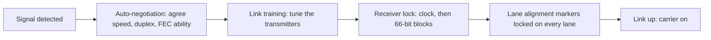
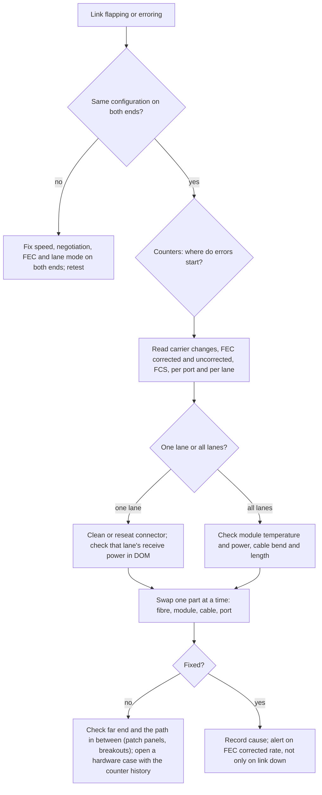

# NET 22: Ethernet at speed and link layer fundamentals

*Part of the [networking plan](00_plan.md) · You need: [NET 01](01_network_models_and_layer2.md) (frames, MAC addresses, switching), [NET 12](12_rdma_roce_and_lossless_fabrics.md) (pause and lossless links) and [NET 19](19_inside_a_switch_and_router.md) (ports, SerDes and forwarding inside a device)*

Most engineers know Ethernet as a frame with two MAC addresses and an EtherType. That is the top of the story. A weak answer to "what happens when a 400G port degrades?" is "the link goes down" or "packets drop". A strong answer follows the bits down: the frame is protected by a CRC that **detects** damage; the port runs a forward error correction code that **repairs** most of it before the CRC ever sees it; the lanes use four-level signalling (PAM4) that gives up noise margin to double the bit rate, which is exactly why that repair code is mandatory; and the link is brought up by a negotiation and a training phase that can fail in ways that look like a flapping port. Once you can say that, the counters (`FCS errors`, `symbol errors`, `corrected codewords`, `carrier changes`) stop being a list and become a diagnosis.

This tutorial covers the layer below the switch features. It uses Python models for the coding and signalling (CRC, Hamming, Reed-Solomon, ALOHA, PAM4, the scrambler), and small Linux labs for the parts a virtual machine can show (frame sizes, MTU mismatch, link flaps, `ethtool`). **There is no physical NIC, optic or cable in the lab VM**, so everything about real hardware (auto-negotiation on a wire, link training, optics, FEC counters, MACsec in the kernel) comes from documents and is labelled. Section 16 lists what was run and what was not.

**By the end you can:**

- say what is on the wire for every frame and work out line rate and packet rate from it;
- explain what a CRC guarantees, what it does not, and why it is not a security check;
- explain how an error-correcting code works, why Reed-Solomon corrects **symbols** and not bits, and read a pre-FEC error rate against the cliff behind it;
- explain why PAM4 exists, what it costs, and how 25G, 50G, 100G and 400G port speeds are built from lanes;
- describe how a link comes up (auto-negotiation, link training, block and lane lock) and what each failure looks like;
- choose between DAC, AOC and optics, and explain breakout;
- diagnose a flapping or error-ridden link with an ordered method;
- explain what MACsec protects, how it is framed, and how it differs from IPsec.

---

## 1. The frame on the wire, and what it costs

An Ethernet frame as a host sees it is a destination MAC, a source MAC, an EtherType and a payload. On the wire, three more things surround it:

| Piece | Bytes | Purpose |
|---|---|---|
| Preamble and start frame delimiter | 8 | Lets the receiver lock its clock and find the first bit (a legacy of shared media, kept at every speed) |
| Frame: MACs, EtherType, payload | 14 + 46 to 1500 | What software sees |
| Frame check sequence (FCS) | 4 | A CRC-32 over the frame |
| Inter-frame gap | 12 | Idle time that lets the receiver finish and the sender start fresh |

So every frame costs **20 bytes of overhead that are not part of the "frame size"**: 8 before and 12 after. A "64-byte frame" means the 64 bytes from destination MAC through FCS. The minimum payload is 46 bytes (the host pads a shorter one), and the largest standard frame is 1518 bytes, which carries the usual 1500-byte MTU (the MTU counts the **payload**, not the headers).

This overhead decides packet rates. The script below prints the efficiency and the packets per second a port must handle at line rate:

```python
# frames.py
import warnings; warnings.filterwarnings("ignore")
PRE_SFD, IFG, FCS = 8, 12, 4
def pps(rate_bps, frame):            # frame = destination MAC through FCS inclusive (what people call "64 bytes")
    return rate_bps / ((frame + PRE_SFD + IFG) * 8)
print("frame bytes (with FCS)   efficiency   10G pps      25G pps      100G pps      400G pps")
for f in (64, 128, 512, 1518, 9018):
    eff = f / (f + PRE_SFD + IFG)
    row = [pps(r * 1e9, f) / 1e6 for r in (10, 25, 100, 400)]
    print(f"   {f:5d}                 {eff*100:5.1f}%     " + "   ".join(f"{x:9.2f} M" for x in row))
print("\nat 64 bytes a 10G port must handle one frame every", round(1e9 / pps(10e9, 64), 1), "ns;  at 400G, every", round(1e9 / pps(400e9, 64), 2), "ns")
print("time to put 1518 bytes on a 10G wire:", round((1518 + 20) * 8 / 10e9 * 1e6, 3), "us;  9018 bytes:", round((9018 + 20) * 8 / 10e9 * 1e6, 3), "us")

from scapy.all import Ether, ARP, IP, UDP, Raw, Dot1Q
arp = Ether() / ARP()
print("\nan ARP request built by the host:", len(bytes(arp)), "bytes (header + payload, no FCS)")
print("the NIC pads it to", 64 - FCS, "bytes and appends the 4-byte FCS: the wire frame is 64 bytes")
tagged = Ether() / Dot1Q(vlan=10) / IP() / UDP() / Raw(b"x" * 18)
print("a VLAN tag adds 4 bytes:", len(bytes(Ether() / IP() / UDP() / Raw(b"x" * 18))), "->", len(bytes(tagged)))
print("MTU 1500 means the IP packet, so the largest untagged frame is", 1500 + 14 + 4, "with FCS; one VLAN tag makes it", 1500 + 14 + 4 + 4)
```

The lines to carry from the output: a 64-byte frame is only **76.2 percent efficient**, so a 10G port at 64 bytes carries 7.62 Gbit/s of frames and **14.88 million frames per second**, one every **67.2 ns**; a 1518-byte frame is 98.7 percent efficient; a jumbo frame (9018 bytes) is 99.8 percent. At 400G with 64-byte frames a port must accept a frame every **1.68 ns**, which is why line-rate small-packet forwarding is a design constraint for NICs, switches and firewalls (see NET 19), and why interview questions about "packets per second" start with the 20-byte overhead.

**What a host capture cannot show.** The kernel hands the NIC a frame without padding and without FCS, and the NIC adds both. A capture on the host therefore shows an ARP request as 42 bytes while the wire carries 64. The same is true in reverse: a bad-FCS frame is usually dropped by the NIC and **never reaches** `tcpdump`. The lab below sends one ARP frame across a virtual link and captures it:

```bash
ip link add c0 type veth peer name c1; ip link set c0 up; ip link set c1 up
timeout 3 tcpdump -ni c1 -e -c 1 2>/dev/null > cap.txt &
sleep 1
python3 - <<'PY'
import warnings; warnings.filterwarnings("ignore")
from scapy.all import Ether, ARP, sendp
sendp(Ether(dst="ff:ff:ff:ff:ff:ff", src="02:00:00:00:00:aa") / ARP(psrc="10.0.0.1", pdst="10.0.0.2"), iface="c0", verbose=False)
PY
wait; cut -c1-120 cap.txt; ip link del c0
```

The capture reported `length 42`: no padding and no FCS, because a virtual link has no wire. This matters when you compare a capture's byte counts with a switch's port counters: the switch counts the 64.

**Jumbo frames and the one-sided MTU.** Raising the MTU to 9000 raises efficiency slightly and cuts packet rate by 6, but both ends of the link, and every device between them on the path, must agree. The classic failure is one end at 9000 and the other at 1500. The lab sets exactly that and pings with growing sizes (`-M do` forbids fragmentation):

```bash
ip netns add ma; ip netns add mb
ip link add va type veth peer name vb; ip link set va netns ma; ip link set vb netns mb
ip -n ma addr add 10.9.0.1/24 dev va; ip -n mb addr add 10.9.0.2/24 dev vb
ip -n ma link set va up; ip -n mb link set vb up
ip -n ma link set va mtu 9000          # a jumbo-configured end
ip -n mb link set vb mtu 1500          # a standard end
for s in 1472 2000 4000 8972; do
  before=$(ip netns exec mb cat /sys/class/net/vb/statistics/rx_dropped)
  printf "payload %5s from the jumbo side: " $s
  ip netns exec ma ping -c 2 -W 1 -M do -s $s 10.9.0.2 2>&1 | grep -E "transmitted" | sed 's/, time.*//' | tr '\n' ' '
  after=$(ip netns exec mb cat /sys/class/net/vb/statistics/rx_dropped); echo "  receiver rx_dropped +$((after - before))"
done
ip netns del ma; ip netns del mb
```

A 1472-byte payload (a full 1500-byte packet) passed. Every larger size was lost, and the receiver's `rx_dropped` counter rose each time. Nothing says "MTU mismatch": small pings, DNS and the TCP handshake all work, while large transfers hang, which looks like an application problem. The giveaway is that **the failure starts exactly at the smaller MTU**, and the fix is to make the MTU agree on every hop (and clamp TCP MSS where it cannot). NET 21 showed the same shape with an overlay.

---

## 2. Detecting damage: the CRC

The FCS is a **cyclic redundancy check**: the frame is treated as a long binary polynomial and divided by a fixed 32-bit generator polynomial; the remainder is the FCS. Division is done with XOR, which is why it is cheap in hardware (a shift register with a few XOR gates, running at line rate). The receiver does the same division **over the frame plus the FCS**; a good frame always leaves the same constant remainder, so the check is a comparison with one number.

```python
# crc_basic.py
import zlib, struct, random
POLY = 0xEDB88320                                   # the CRC-32 Ethernet uses (reflected form)
def crc32_bitwise(data):
    crc = 0xFFFFFFFF
    for byte in data:
        crc ^= byte
        for _ in range(8):
            crc = (crc >> 1) ^ (POLY if crc & 1 else 0)
    return crc ^ 0xFFFFFFFF
frame = bytes(random.Random(1).randrange(256) for _ in range(60))
assert crc32_bitwise(frame) == zlib.crc32(frame)
print("hand-written CRC-32 matches the library:", hex(zlib.crc32(frame)))

# the receiver runs the CRC over frame + FCS and compares with a constant
fcs = struct.pack("<I", zlib.crc32(frame))
print("residue over a good frame + FCS :", hex(zlib.crc32(frame + fcs)))
bad = bytearray(frame + fcs); bad[10] ^= 0x04
print("residue after one flipped bit   :", hex(zlib.crc32(bytes(bad))))

# what it is guaranteed to catch: every single-bit error and every burst up to 32 bits
n = len(frame) * 8; base = int.from_bytes(frame, "little")
flip = lambda mask, at: zlib.crc32(((base ^ (mask << at)).to_bytes(len(frame), "little"))) != zlib.crc32(frame)
print("single-bit errors detected:", sum(flip(1, i) for i in range(n)), "of", n)
tried = caught = 0
for start in range(0, n - 32, 5):
    for length in (2, 8, 17, 31, 32):
        mask = (1 << (length - 1)) | 1             # a burst whose first and last bits are wrong
        tried += 1; caught += flip(mask, start)
print(f"bursts up to 32 bits: {caught} of {tried} detected")
```

The good-frame residue is `0x2144df1c` for **every** frame, which is why hardware can check with a constant. All 480 single-bit errors and all 450 sampled bursts (up to 32 bits long) were detected. That is the theory in action: a CRC with a degree-32 generator **always** catches a burst of 32 bits or fewer, and every single-bit error. What is left is a **probability**: damage that is long and patterned like a multiple of the generator escapes, with probability about 2 to the power of minus 32 (roughly one in four billion) for random corruption. The second script measures the same law on an 8-bit CRC, where it is large enough to see, and then shows what a CRC cannot do:

```python
# crc_limits.py
import zlib, random
def crc8(data, poly=0x07):
    crc = 0
    for byte in data:
        crc ^= byte
        for _ in range(8):
            crc = ((crc << 1) ^ poly) & 0xFF if crc & 0x80 else (crc << 1) & 0xFF
    return crc
rng = random.Random(7); target = crc8(b"12345678"); trials = 400000
hits = sum(crc8(bytes(rng.randrange(256) for _ in range(8))) == target for _ in range(trials))
print(f"8-bit CRC: random garbage accepted {hits} of {trials}  (2^-8 predicts {trials / 256:.0f})")

# a CRC is linear, so it detects accidents but is no defence against an attacker
msg = b"pay 100 to alice, thanks "; delta = bytes(a ^ b for a, b in zip(b"pay 100 to alice, thanks ", b"pay 999 to mallory.thanks"[:25]))
new = bytes(a ^ b for a, b in zip(msg, delta))
zeros = bytes(len(msg))
patched = zlib.crc32(msg) ^ zlib.crc32(delta) ^ zlib.crc32(zeros)   # needs only the old CRC and the bits being changed
print("changed message:", new, "\nattacker's patched CRC is valid:", patched == zlib.crc32(new))
```

Random garbage was accepted 1527 times in 400,000 (the law predicts 1562): about **1 in 2 to the power of the width**, so for a 32-bit CRC roughly 1 in 4.3 billion. The second half is the interview point. **A CRC is linear**: the CRC of an XOR is the XOR of the CRCs. So an attacker who flips any bits can compute the matching change to the check value **without knowing the rest of the message**, and the patched value is valid. The CRC detects accidents (noise, a bad optic); it provides no authenticity. Integrity against an adversary needs a keyed construction such as the GCM authentication in MACsec (section 14).

Two practical notes on where FCS errors come from and who counts them (both from general knowledge, so check your platform): a **store-and-forward** switch receives the whole frame, checks the FCS and drops a bad one, counting an FCS or CRC error on the **ingress** port, so the port that counts errors is the one *after* the damaged hop. A **cut-through** switch starts forwarding before the FCS arrives, so a bad frame can be passed on (and is typically discarded or flagged downstream); in a cut-through fabric, counters at one hop can describe damage that happened one hop earlier, which is why you locate the first port that counts errors, not the last.

---

## 3. Correcting damage: forward error correction

A CRC says "this is wrong". Forward error correction (FEC) says "this was wrong, and here is the right value", using extra bits sent with the data. The price is overhead, a small delay, and a **cliff**: the code corrects up to a limit and fails abruptly beyond it.

**The idea in one small code.** Hamming(7,4) sends 4 data bits with 3 parity bits. Each parity bit covers a different subset of positions, so a single flipped bit produces a distinct pattern of failed checks (the **syndrome**), and the syndrome *names the position*:

```python
# fec_hamming.py
import itertools
G = [[1,0,0,0,1,1,0],[0,1,0,0,1,0,1],[0,0,1,0,0,1,1],[0,0,0,1,1,1,1]]   # 4 data bits + 3 parity bits
H = [[1,1,0,1,1,0,0],[1,0,1,1,0,1,0],[0,1,1,1,0,0,1]]
enc = lambda d: [sum(d[i] * G[i][j] for i in range(4)) % 2 for j in range(7)]
def dec(r):
    s = [sum(H[i][j] * r[j] for j in range(7)) % 2 for i in range(3)]   # the syndrome
    if any(s):                                                          # it equals the column of the flipped bit
        r = r[:]; r[[list(c) for c in zip(*H)].index(s)] ^= 1
    return r[:4]
one = two = 0
for d in itertools.product([0, 1], repeat=4):
    c = enc(list(d))
    for i in range(7):
        r = c[:]; r[i] ^= 1; one += dec(r) == list(d)
    for i, j in itertools.combinations(range(7), 2):
        r = c[:]; r[i] ^= 1; r[j] ^= 1; two += dec(r) == list(d)
print(f"Hamming(7,4) corrects {one} of {16*7} single-bit errors and {two} of {16*21} double-bit errors")
```

All 112 single-bit errors were corrected and **none** of the 336 double-bit errors (a second error makes the syndrome point at the wrong place, and the "correction" adds a third error). That is the whole design space in miniature: a code has a correction capacity, and beyond it the result is wrong, not "a bit worse". (Data-centre Ethernet reuses this exact family: the concatenated inner code in the newer 200G-per-lane work is a Hamming(128,120) code, from the Signal Integrity Journal article I read.)

**What Ethernet uses: Reed-Solomon.** Reed-Solomon works on **symbols** (groups of bits), not single bits. Ethernet's codes use 10-bit symbols. RS(528,514) takes 514 symbols and adds 14 parity symbols, and can correct up to **7 symbols**, because correcting a symbol costs two parity symbols (one to find it, one to fix it) and 14 / 2 = 7. RS(544,514) adds 30 parity symbols and corrects **15**. The bit count inside a bad symbol does not matter: ten wrong bits in one symbol cost the same as one. That makes Reed-Solomon good against **bursts** (a burst of many bits touches few symbols) and a bad match for errors scattered one bit per symbol. The lab uses a real Reed-Solomon implementation with the same shape (10-bit symbols, 14 parity symbols):

```python
# rs.py
import random, reedsolo
# RS over 10-bit symbols (GF(2^10)), shortened to 514 data + 14 parity = 528 symbols: the 100G "KR4" code shape
rs = reedsolo.RSCodec(14, nsize=1023, c_exp=10)
rng = random.Random(5)
data = [rng.randrange(1024) for _ in range(514)]
cw = rs.encode(data); print("codeword symbols:", len(cw), " parity symbols:", len(cw) - 514, " corrects up to", 14 // 2, "symbols")

def try_decode(cw, hit):
    bad = list(cw)
    for pos, flip in hit: bad[pos] ^= flip
    try:
        out = rs.decode(bad)[0]; return list(out) == data
    except reedsolo.ReedSolomonError:
        return False

def trial(kind, n_symbols, runs=200):
    ok = 0
    for _ in range(runs):
        if kind == "random": pos = rng.sample(range(len(cw)), n_symbols)
        else: s = rng.randrange(len(cw) - n_symbols); pos = range(s, s + n_symbols)
        ok += try_decode(cw, [(p, rng.randrange(1, 1024)) for p in pos])
    return ok

print("\nsymbols hit      scattered   one burst (adjacent symbols)   (corrected of 200)")
for n in (1, 5, 7, 8, 9):
    print(f"   {n:2d}            {trial('random', n):4d}        {trial('burst', n):4d}")

# bits versus symbols: 70 flipped bits is fine if they sit in 7 symbols, fatal if spread over 70
one = [(p, 1023) for p in range(100, 107)]                         # all 10 bits of 7 symbols = 70 bit errors
many = [(p, 1 << rng.randrange(10)) for p in rng.sample(range(528), 70)]   # 70 symbols with one bit each
print("\n70 bit errors packed into 7 symbols  -> corrected:", try_decode(cw, one))
print("70 bit errors, one in each of 70 symbols -> corrected:", try_decode(cw, many))
```

Up to 7 damaged symbols were corrected every time, wherever they were; at 8 and 9, **none** were (the cliff, with no partial credit). And the symbol point is explicit: 70 flipped bits inside 7 symbols were corrected, while 70 flipped bits spread over 70 symbols were not. (`reedsolo` is a general library; it shows the mathematics of the code, not the exact encoder in a NIC.)

**The cliff, quantified.** What matters operationally is the **pre-FEC bit error rate** (the error rate on the wire, before correction) and the chance that a codeword has more errors than the code can fix. Assuming independent random bit errors:

```python
# fec_table.py
from scipy.stats import binom
codes = {"RS(528,514), corrects 7": (528, 514, 7), "RS(544,514), corrects 15": (544, 514, 15)}
print("pre-FEC BER   P(codeword uncorrectable): " + "   ".join(codes))
for ber in (1e-6, 1e-5, 1e-4, 2.4e-4, 5e-4, 1e-3):
    ps = 1 - (1 - ber) ** 10                          # a 10-bit symbol is bad if any of its bits is bad
    print(f"  {ber:7.1e}      " + "        ".join(f"{binom.sf(t, n, ps):9.2e}" for n, k, t in codes.values()))
codewords_per_s = 400e9 * (544 / 514) * (257 / 256) / 10 / 544      # rough: line rate over bits per codeword, 400G on RS(544,514)
print(f"\ncodewords per second on a 400G link, about {codewords_per_s:,.0f}")
for ber in (1e-5, 1e-4, 2.4e-4, 5e-4):
    ps = 1 - (1 - ber) ** 10
    print(f"  pre-FEC BER {ber:7.1e}: one uncorrectable codeword every {1 / (binom.sf(15, 544, ps) * codewords_per_s):10.3g} s")
```

Read the second table, which is the point of the section. On a 400G link (about 78 million codewords a second) with the stronger code, a pre-FEC error rate of **1e-4** gives an uncorrectable codeword about once in **9 billion seconds (roughly three centuries)**, while **5e-4** gives one **every half second**. A factor of five in pre-FEC error rate moves the link from "never" to "constantly". That is why a link can show a stable, large number of *corrected* errors for months and then fall off a cliff when a connector gets dirty or a cable ages. The standards place their limits on the pre-FEC rate for this reason: the documents I read give a pre-FEC target of about **2.4e-4** for the optical medium (and 1e-5 for the chip-to-module interface) in the 100G-per-lane generation, with a post-FEC target of 1e-13 (a frame loss ratio of 6.2e-11); treat those figures as "from the proposals I read" and check the current standard before quoting a threshold. The model assumes independent errors; real channels have bursts and correlated errors (which the standards handle by interleaving codewords), so the lab table is the shape, not a prediction for a given cable.

What FEC costs: **bandwidth** (RS(544,514) carries 514 symbols of data in 544, a rate of about 94.5 percent, so the line runs about 5.8 percent faster than the data rate) and **latency** (the article I read gives about 55 ns for the stronger code with interleaving, and about 10 ns more for the inner Hamming code). For most traffic 55 ns is invisible; for a low-latency trading or HPC fabric it is a design input, which is why some short links run with FEC reduced or off where the channel allows it (from memory: the NRZ generations at 25G and 100G made FEC optional for short, clean links, while PAM4 links cannot do without it).

---

## 4. Sharing a medium: ALOHA, CSMA/CD and the 64-byte minimum

Early Ethernet shared one coaxial cable, so the first problem was **who may talk**. Two ideas matter because they explain features that are still in every frame.

**ALOHA** lets stations send whenever they have data and retry after a random delay when the frame collides. **Slotted ALOHA** lets them start only at slot boundaries, halving the vulnerable window. The classic results are that throughput peaks at about 18.4 percent of capacity for pure ALOHA and 36.8 percent for slotted, and **falls** when more load is offered, because collisions waste the medium. The simulation below checks both against the formulas:

```python
# aloha.py
import random, math
rng = random.Random(11)
def pure(G, T=200000.0):                     # frames of length 1, Poisson arrivals at rate G per frame time
    t = 0.0; arr = []
    while t < T:
        t += rng.expovariate(G); arr.append(t)
    ok = sum(1 for i, a in enumerate(arr)
             if (i == 0 or a - arr[i-1] >= 1) and (i == len(arr)-1 or arr[i+1] - a >= 1))
    return ok / T
def slotted(G, slots=200000):
    ok = 0
    for _ in range(slots):
        n = 0; L = math.exp(-G); p = 1.0
        while True:                           # Poisson sample for the number of frames starting in this slot
            p *= rng.random()
            if p <= L: break
            n += 1
        ok += (n == 1)
    return ok / slots
print("offered load G   pure ALOHA S (theory G*e^-2G)   slotted S (theory G*e^-G)")
for G in (0.1, 0.5, 1.0, 2.0):
    print(f"   {G:4.1f}            {pure(G):5.3f}   ({G*math.exp(-2*G):5.3f})            {slotted(G):5.3f}   ({G*math.exp(-G):5.3f})")
print("\nCSMA/CD: the minimum frame must outlast the round trip of the longest collision domain")
print("10 Mbit/s, 512 bit times =", round(512 / 10e6 * 1e6, 1), "us; at 2/3 c (2e8 m/s) the one-way reach limit is about", round(512 / 10e6 / 2 * 2e8), "m (the standard says 2500 m, leaving room for repeater and electronics delay)")
print("at 1 Gbit/s the same 64 bytes last only", 512 / 1e9 * 1e9, "ns, so half-duplex gigabit needed carrier extension to 512 bytes; full duplex has no collisions")
```

The simulated and theoretical columns agree (0.184 and 0.368 at the peaks), and at a load of 2.0 pure ALOHA delivers only 0.036: more demand, less goodput. **CSMA/CD** (carrier sense with collision detection) improves on this by listening before sending and stopping when a collision is heard. For a sender to *notice* a collision it must still be transmitting when the other station's signal arrives, so a frame must last at least the round-trip time of the longest cable: **512 bit times** (51.2 microseconds at 10 Mbit/s). That is the origin of the **64-byte minimum frame** and the 46-byte minimum payload.

Why it still matters although collisions are gone: switched, full-duplex links have **no collisions and no CSMA/CD** (each direction is its own wire), yet the 64-byte minimum, the preamble and the inter-frame gap all survive so that the same frame works on every speed and on a switch port facing an old hub. A candidate who says "half duplex" in 2026 should be able to say that it exists only for compatibility, and that **a duplex mismatch** (section 6) is a real operational fault caused by exactly this history.

---

## 5. From bits to signals: lanes, line coding, NRZ and PAM4

A port does not send frame bytes directly. Between the MAC and the wire sit several layers (the **PCS**, **PMA** and **PMD** in IEEE terms), and a modern port is several **lanes** in parallel, each driven by a **SerDes** (a serialiser/deserialiser that turns parallel data into a fast bit stream and back).

**Line coding** has two jobs: give the receiver enough transitions to recover the clock, and keep the signal balanced. Old links (1000BASE-X) used 8b/10b: 10 line bits for 8 data bits, a 25 percent overhead, with strict guarantees. 10G and beyond use **64b/66b**: a 2-bit header (`01` for a block of data, `10` for a block containing control information such as start and end of frame; `00` and `11` are invalid) in front of every 64 bits, an overhead of 3.125 percent of the payload, and a transition guaranteed in every header. The 64-bit payload is **scrambled** with a self-synchronising scrambler (polynomial x^58 + x^39 + 1) so that long runs of zeros or ones, which a receiver cannot track, do not occur:

```python
# scrambler.py
import itertools
def scramble(bits, state=None):
    s = [0]*58 if state is None else state[:]; out = []
    for b in bits:
        o = b ^ s[57] ^ s[38]; out.append(o); s = [o] + s[:-1]
    return out
def descramble(bits):
    s = [0]*58; out = []
    for r in bits:
        out.append(r ^ s[57] ^ s[38]); s = [r] + s[:-1]
    return out
data = [0]*2000                                        # worst case: a long run of zeros
seed = [1,0,1,1,0,0,1,0,1,1] * 5 + [1,0,1,1,0,1,0,0]   # any non-zero start state
tx = scramble(data, seed)
longest = max(len(list(g)) for k, g in itertools.groupby(tx))
print("zeros in, scrambled out: ones fraction", round(sum(tx)/len(tx), 3), " longest run", longest)
rx = tx[:]; rx[1000] ^= 1                              # one error on the wire
out = descramble(rx)
print("one bit error on the wire became", sum(out[60:]), "bit errors after descrambling at positions", [i for i,v in enumerate(out) if v and i>=60])
```

2000 zeros in, a balanced stream out (50.6 percent ones, longest run 9). The price is **error multiplication**: one bit error on the wire became **three** after descrambling (at the error and at 39 and 58 bits later, the taps of the polynomial). That is a small but real reason why error rates quoted at different points in the stack differ, and why FEC sits **below** the scrambling in some designs and above in others; do not compare BER numbers without saying where they were measured.

**NRZ and PAM4.** NRZ (non-return-to-zero) uses two voltage levels, one bit per symbol. **PAM4** (four-level pulse amplitude modulation) uses four levels, **two bits per symbol**, so the same bit rate needs **half the symbol rate** and half the bandwidth: a 56G NRZ lane needs a 28 GHz channel, a 56G PAM4 lane (28 GBd) needs 14 GHz, and channel loss grows steeply with frequency. The cost is noise margin: with the same total swing, the four levels are three times closer together, each eye is one third the height of an NRZ eye, and the signal-to-noise ratio drops by about **9.5 dB** (20 times log10 of 3). PAM4 uses **Gray coding** (adjacent levels differ in one bit) so that the most likely mistake, picking a neighbouring level, causes one bit error and not two. The simulation compares the two at identical noise:

```python
# phy_levels.py
import numpy as np, math
rng = np.random.default_rng(3)

# ---- 1. NRZ against PAM4 at the same peak-to-peak swing and the same noise ----
N = 2_000_000
def ber_nrz(sigma):
    bits = rng.integers(0, 2, N); tx = bits * 2.0 - 1.0              # levels -1, +1  (swing 2)
    rx = tx + rng.normal(0, sigma, N); return np.mean((rx > 0) != bits)
def ber_pam4(sigma):
    b = rng.integers(0, 2, (N, 2))
    gray = {(0,0): -3, (0,1): -1, (1,1): 1, (1,0): 3}               # Gray: neighbours differ in one bit
    tx = np.array([gray[(a, c)] for a, c in b[:200000]]) / 3.0      # same swing: levels -1, -1/3, 1/3, 1
    n = len(tx); rx = tx + rng.normal(0, sigma, n)
    thr = np.array([-2/3, 0, 2/3]); lvl = np.digitize(rx, thr)       # 0..3
    inv = {0: (0,0), 1: (0,1), 2: (1,1), 3: (1,0)}
    dec = np.array([inv[i] for i in lvl]); return np.mean(dec != b[:n])
print("noise sigma   NRZ bit error rate   PAM4 bit error rate")
for s in (0.20, 0.25, 0.30, 0.35):
    print(f"   {s:4.2f}        {ber_nrz(s):10.2e}          {ber_pam4(s):10.2e}")
print("ideal level-spacing penalty: 20*log10(3) =", round(20*math.log10(3), 2), "dB")

# ---- 2. line rate arithmetic: why 25G is 25.78125 and 50G PAM4 lanes run at 26.5625 GBd ----
print("\n25G NRZ lane:", 25 * 66/64, "GBd  (64b/66b)")
print("100G as 4 x 25G with RS(528,514):", 100 * (257/256) * (528/514) / 4, "Gb/s per lane")
print("50G PAM4 lane with RS(544,514):", 50 * (257/256) * (544/514), "Gb/s ->", 50 * (257/256) * (544/514) / 2, "GBd (2 bits per symbol)")
print("100G PAM4 lane:", 100 * (257/256) * (544/514) / 2, "GBd")
print("8b/10b overhead:", 1 - 8/10, " 64b/66b overhead:", 1 - 64/66)
```

At the same noise, NRZ makes almost no errors (0 at sigma 0.20, 3 in a hundred thousand at 0.25) while PAM4 makes **3.6 errors per hundred bits at 0.20**: PAM4 at this swing is *always* running at a pre-FEC error rate that only the FEC of section 3 can make acceptable. That is the single most useful sentence about 50G, 100G and 400G lanes: **PAM4 trades noise margin for bandwidth, and FEC pays the bill.** (The simulation uses a clean Gaussian noise model with no inter-symbol interference or equalisation, so only the relative gap is meaningful; real receivers use equalisers to close part of it.)

The second half of the output explains the odd lane numbers. A 25G lane is 25.78125 GBd (25 times 66/64), a 50G PAM4 lane is **26.5625 GBd** (the data rate, plus the 257/256 transcoding overhead, plus the RS(544,514) overhead, divided by two bits per symbol; the transcoding detail is from memory) and a 100G PAM4 lane is **53.125 GBd**. With lane counts, the port speeds follow: the standards I read (a Wikipedia summary of 802.3bs, 802.3ck, 802.3df and later) list **200G as 4 x 50G PAM4 or 2 x 100G PAM4, 400G as 8 x 50G or 4 x 100G PAM4, 800G as 8 x 100G PAM4**, and 802.3dj in development for 200G per lane at 106.25 GBd, all with RS(544,514) in the main configurations. So "400G" is not one thing: 8 lanes at 26.5625 GBd and 4 lanes at 53.125 GBd are different electrical and optical interfaces that carry the same Ethernet frames, and mixing them needs a gearbox in the module or the cable.

**Lane striping and alignment.** A frame stream is spread over the lanes in blocks, and the lanes arrive with different delays (skew). The PCS inserts periodic **alignment markers** on each lane so the receiver can find block boundaries and re-order and de-skew the lanes (this detail is from memory; check the standard for the marker interval before quoting it). A link is therefore not "up" when light is seen, but when **every lane** has block lock and the alignment markers are locked: a single bad lane keeps a 4-lane port down or makes it fall back to a lower speed.

---

## 6. Bringing a link up: negotiation, training and lock

A link comes up in stages, and a failure at each stage looks different. For a copper or backplane port the order is:



**Auto-negotiation.** Each end sends a burst of pulses (a **fast link pulse**, FLP) that carries a 16-bit **base page**: a selector, a list of abilities (speeds and duplex modes, pause support), a remote-fault bit and an acknowledgement. From the description I read: an FLP burst is 17 clock pulses spaced 125 microseconds apart, a data pulse between two clock pulses encodes a 1, and bursts repeat every 16 ms. Both ends then apply the same **priority resolution**: the highest speed both support wins, and at equal speed full duplex beats half. Auto-negotiation is mandatory for 1000BASE-T and 10GBASE-T. For backplane and copper-cable ports at 10G to 800G a related procedure (IEEE clause 73) runs first, on one lane only, at a slow rate (156.25 Mbit/s in the 112G white paper I read), and **also agrees the FEC type**; other lanes stay off until it finishes.

```python
# autoneg.py
PRIORITY = ["1000FD", "1000HD", "100FD", "100HD", "10FD", "10HD"]           # highest first (a copper list, simplified)
def negotiate(a, b):
    both = [m for m in PRIORITY if m in a and m in b]
    return both[0] if both else None
print("A offers everything, B offers up to 100 full :", negotiate(PRIORITY, ["100FD", "100HD", "10FD", "10HD"]))
print("A offers 1000 only, B offers 100 only        :", negotiate(["1000FD", "1000HD"], ["100FD", "100HD"]))
# parallel detection: the negotiating end can sense the speed of a forced partner but not its duplex, so it assumes half
forced_speed, forced_duplex = "100", "FD"
a = forced_speed + "HD"; b = forced_speed + forced_duplex
print(f"A negotiates, B forced to {b}: A settles on {a}, B runs {b}  ->", "duplex mismatch" if a != b else "match")
```

The two cases show the outcomes of negotiation: the best common mode (`100FD`), or **no common mode** and no link. The third line is the famous failure. If one end is **forced** to a speed and duplex with negotiation off, it sends no pulses; the other end sees a signal, detects the speed (**parallel detection**) but cannot learn the duplex, and falls back to **half**. The link comes up, the two ends disagree, and the symptoms (from the description I read) are **late collisions on the half-duplex end and FCS errors on the full-duplex end**, with throughput that "works reliably only at a very low rate". It is the standard "the link is up but slow" scenario, and the fix is to configure **both ends the same way** (both negotiate, or both forced).

**Link training.** After the ends agree on a mode, the transmitters must be tuned to the actual cable. Each transmitter has a small adjustable filter (a **feed-forward equaliser**, 5 taps in the 112G description) that pre-shapes the signal to cancel the cable's distortion. In **link training** the receiver measures the quality of what it receives (using a known test pattern) and sends **requests back to the transmitter**: "raise tap -1 by one step". The requests travel in a training frame with a marker, a control field and a status field, and the protocol changes one coefficient by one step per frame, which is why training can take noticeable time. Training starts in NRZ and ends in the mode used for traffic (PAM4 with Gray coding at 50G and above). From the white paper I read: for 112G the protocol is in IEEE clause 162, the equalisers in the **receiver** are the receiver's private business and are not part of the protocol, and a failed training shows up as lost lock and restarts.

**Why this matters operationally.** Auto-negotiation and training can **succeed on a marginal link** and leave it with little margin, so it comes up and then flaps or accumulates errors (section 9). The settings that must match are the ones the negotiation cannot always fix: when negotiation is **off**, speed, lane mode and **FEC type** must be set by hand on both ends. One operations guide I read states the concrete case: on 25G and 100G ports with auto-negotiation off, FEC left on `auto` will not bring the link up, and FEC must be set to match the neighbour (off, RS or BaseR). "Link will not come up after we disabled negotiation to fix a flap" is a very common ticket.

---

## 7. Media: DAC, AOC, optics, form factors and breakout

What carries the lanes depends on distance, power and cost:

| Medium | What it is | Reach (typical) | Notes |
|---|---|---|---|
| **DAC** (direct attach copper) | Passive twin-axial cable with module ends | a few metres, shrinking as the lane rate rises | Cheapest, no power, lowest latency; the electrical lane drives the cable directly, so training and equalisation matter and bend radius and cable quality count |
| **ACC / AEC** (active copper) | Copper with a retimer or amplifier in the ends | somewhat longer than passive | Used where DAC is just too short (from memory) |
| **AOC** (active optical cable) | Fibre permanently attached to optical ends | tens of metres (100 m at most for the multimode kind) | Light and thin, no connector to clean, but the length is fixed and the cable is a single replaceable unit |
| **Pluggable optics** | A module with lasers or VCSELs, with a fibre connector | 100 m to tens of kilometres by type | Flexible (change the fibre without changing the module) but dust and connector cleanliness become the number one fault |

The reach figures in the table are indicative and from memory. The standards give exact optical reach by name, and the summary I read gives these (the letters are a code you can read): **SR and VR** are multimode fibre, **70 to 100 m** on OM3 or OM4 for SR (VR is the shorter, 30 to 50 m, variant); **DR** is single-mode fibre to **500 m**; **FR** is single-mode to **2 km**; **LR** is single-mode to **10 km**; **ER** is single-mode to **40 km**. The number after the letters is the number of fibre pairs or wavelengths (400GBASE-DR4 is four fibre pairs of 100G each; 400GBASE-FR4 is one pair carrying four wavelengths; 400GBASE-SR8 is eight lanes over multimode).

**Form factors** are the physical module sizes, and the number of lanes decides the speed: **SFP28** is one lane (25G); **QSFP28** is four lanes of 25G (100G); **QSFP56** is four lanes of 50G PAM4 (200G); **QSFP-DD** and **OSFP** are eight lanes (400G with 50G lanes, 800G with 100G lanes). A QSFP-DD cage accepts a QSFP28 module, so older optics can plug into a newer port (the compatibility facts are from memory; check the platform).

**Breakout** splits one high-speed port into several lower-speed ports **by lane**. A 400G port with four 100G lanes can be broken out to four 100G ports (a 4x100G breakout cable or a DR4 optic into four separate DR1 ports). What this means: each far-end port is an **independent link** with its own negotiation, training and error counters; the lane speed on both sides must match (a 100G lane port cannot be broken out into 25G ports); and a platform may take away the neighbouring port numbers. Breakout is how a spine port serves several smaller switches, and the common mistake is to forget that the FEC mode and lane mode must also match on every far-end port.

**Optical power and the DOM.** Pluggable modules report **digital optical monitoring** (DOM, or DDM): temperature, supply voltage, laser bias current and **transmit and receive optical power** per lane, plus alarm and warning thresholds. One vendor guide I read gives rules of thumb for short-range optics: transmit power about 0.6 to 1.0 mW and receive power above 0.05 mW, with readings reliable to about 10 percent; a reading of exactly zero means monitoring is unsupported or there is no signal. Use them as symptoms: a **receive power that is low on one lane** points at a dirty connector, a bent or damaged fibre, or a failing laser at the far end, and a module running **hot** (high temperature, high bias) is ageing.

---

## 8. Observing a link: what Linux shows and what it cannot

`ethtool` is the Linux view of a port. On a physical NIC it reports speed, duplex, negotiation, supported link modes and FEC modes, and the module's EEPROM and DOM data. A virtual interface answers the same commands with made-up values, which is a useful warning in itself:

```bash
ip link add a0 type veth peer name a1; ip link set a0 up; ip link set a1 up
ethtool a0 | grep -E "Speed|Duplex|Auto-negotiation|Port|Link detected|Supported FEC"
ethtool --show-fec a0 2>&1 | head -2
ethtool -m a0 2>&1 | head -2
ethtool -S a0 | head -3
ip link del a0
```

The virtual port claims **10000 Mb/s, full duplex, twisted pair, negotiation off, link detected**, a speed and medium it does not have; and `--show-fec` and `-m` (module EEPROM) fail with "operation not supported", because there is no PHY or module. On a real port the same commands are how you read the state of a link:

| Command | Shows |
|---|---|
| `ethtool eth0` | Negotiated speed and duplex, whether negotiation is on, supported and advertised modes, link detected |
| `ethtool --show-fec eth0` and `--set-fec eth0 encoding rs` | The FEC modes supported and active (`off`, `rs`, `baser`, `llrs`, `auto`); forces one when negotiation cannot |
| `ethtool -m eth0` | The module's decoded EEPROM: vendor, part, compliance code, and the DOM values and thresholds above |
| `ethtool -S eth0` | Driver and hardware counters; names differ by vendor (CRC or FCS errors, symbol or PCS errors, FEC corrected and uncorrected codewords, pause frames, per-queue drops). `--all-groups` asks for the standard groups (`eth-mac`, `eth-phy`, `eth-ctrl`, `rmon`) where the driver implements them |
| `ethtool -a eth0` | Pause (flow control) settings; see NET 12 and NET 14 |
| `ip -s link show eth0` and `/sys/class/net/eth0/` | Kernel counters, and `carrier`, `carrier_up_count`, `carrier_down_count` (how often the link went up and down) |

The option names and meanings are from the `ethtool` manual page I read; the counters' *names* vary so much by NIC that you must read the vendor documentation for the port in front of you. The kernel's own link counters, which are generic, can be exercised on a virtual link. The lab below flaps one end of a link five times while a small watcher script counts carrier-down events on the other end:

```bash
ip link add a0 type veth peer name a1; ip link set a0 up; ip link set a1 up
rd() { for f in carrier carrier_up_count carrier_down_count operstate; do printf "%s=%s " $f $(cat /sys/class/net/$1/$f); done; echo; }
echo "healthy:"; rd a0
cat > flapwatch.py <<'PYEOF'
import time, sys
def read(dev, name): return int(open(f"/sys/class/net/{dev}/{name}").read())
def watch(dev, seconds=3, interval=0.5, limit=3):
    last = read(dev, "carrier_down_count"); t0 = time.time(); total = 0
    while time.time() - t0 < seconds:
        time.sleep(interval); now = read(dev, "carrier_down_count"); total += now - last; last = now
    return ("FLAPPING" if total >= limit else "stable"), total
print(watch(sys.argv[1]))
PYEOF
python3 flapwatch.py a0 &               # watch for three seconds
sleep 0.3
for i in 1 2 3 4 5; do ip link set a1 down; sleep 0.05; ip link set a1 up; sleep 0.05; done
wait
echo "after five flaps of the far end:"; rd a0
ip link set a1 down; echo "far end held down:"; ip -br link show a0; rd a0
ip link set a1 up; ip link del a0
```

Five brief flaps at the far end raised `carrier_up_count` and `carrier_down_count` on the near end from 1 to 6 each, and the watcher reported `FLAPPING` with 5 events. A link that is **held** down shows `NO-CARRIER` and the operational state `lowerlayerdown`. The counters are the evidence you want in a ticket: they give a number and a time, where "it blinked" does not. This is also how a monitoring agent alerts on flaps: count `carrier_down_count` over a window instead of sampling the state, because a flap shorter than the poll interval leaves the state `up` both times you look.

**Reading error counters.** Three layers of counters answer three different questions, and mixing them is a common mistake.

| Counter family | What it counts | What a rising value means |
|---|---|---|
| Carrier or link-state changes | Link up and down transitions | Physical instability, power events, a flapping module or a negotiation loop |
| FEC corrected (symbols or codewords) | Errors the FEC repaired | The **margin** is shrinking, but traffic is not yet damaged; watch the rate over time |
| FEC uncorrected, symbol errors with FEC off, PCS or code errors | Damage the FEC could not repair | Frames are about to be, or are being, lost |
| FCS or CRC errors (and runts, giants, jabbers) | Frames that arrived with a bad CRC or the wrong size | Damage that got past the lower layers; the frame is dropped at this port |

One operations guide I read adds two practical points: with FEC enabled, the generic error counters count **only errors the FEC did not correct**, so a clean `Errors` line on an FEC link does not mean a clean wire (read the FEC-specific counters), and old counts can persist from earlier link transitions, so "is it still incrementing" is the question, not "is it non-zero".

---

## 9. Flapping links and error-ridden links: an order that works

There are two common complaints with different shapes. A **flapping** link goes up and down. An **erroring** link stays up but loses frames or runs slowly. They share causes, and the method is the same: go from the cheapest, most likely check to the most disruptive.



Points that make the method work:

- **Check both ends against each other before anything physical.** Mismatched speed, FEC or lane mode, or negotiation on one side only, is cheaper to fix than any cable swap and explains many "new link will not stay up" cases.
- **Find where the errors start.** In a store-and-forward network the first port that counts errors is the first bad hop. A single lane out of four having poor receive power is a connector or a laser on that lane, not a cable fault.
- **Change one part at a time**, in the order fibre or patch cable, module, then port, so that the swap that fixes it names the cause.
- **Clean before replacing.** Dust on an optical connector is the most common cause of a degraded optic (from experience and the vendor guides), and the cleaning is a minute of work.
- **Alert on the margin.** A link with a corrected-error rate that has been climbing for a week is about to fail; the link-down alarm is the last signal, not the first.
- **Why flaps are expensive.** A carrier loss tells routing protocols the neighbour is gone (NET 11): sessions reset, routes withdraw, traffic reconverges, and then it all happens again on the next flap. Devices therefore apply a **debounce** or **hold timer** to link-down events and dampen repeated flaps, and fast failure detection (BFD) trades speed for stability; a flapping physical link is better taken out of service until fixed than left to cause repeated reconvergence.

---

## 10. MACsec: encryption on the link

**MACsec** (IEEE 802.1AE) encrypts and authenticates Ethernet frames **hop by hop** at layer 2. It protects everything above the MAC addresses (ARP, DHCP, IP, anything), which is its advantage over IPsec (layer 3) and TLS (application): those do not cover ARP or DHCP. From the Red Hat article I read, the pieces are:

- A **secure channel** per sender, identified by a secure channel identifier (SCI); **secure associations** inside it hold the keys, numbered, so keys can be rolled over without dropping traffic.
- A **SecTAG** after the MAC addresses (EtherType `0x88E5`), with flags, an association number, a **packet number** (replay protection) and optionally the SCI.
- The payload is encrypted (optional: integrity-only is allowed) and an **integrity check value** (ICV, 16 bytes) is appended; the cipher is GCM-AES.
- Keys come from **MKA** (MACsec Key Agreement, in IEEE 802.1X-2010), which authenticates the peers and distributes keys; on Linux `wpa_supplicant` implements it.

The lab uses scapy's MACsec implementation to build a protected frame and test the properties. **The Linux kernel MACsec driver is not available in this VM** (creating a `macsec` device fails with "Unknown device type"), so this is a model of the frame format and the cryptography, not a test of the kernel path:

```python
# macsec_model.py
import os, warnings; warnings.filterwarnings("ignore")
from scapy.all import Ether, IP, UDP, Raw
from scapy.contrib.macsec import MACsec, MACsecSA
key = os.urandom(16)                                   # the SAK, a 128-bit AES key
sa = MACsecSA(sci=b"\x02\x00\x00\x00\x00\x01\x00\x01", an=0, pn=1, key=key, icvlen=16, encrypt=True, send_sci=True)
plain = Ether(src="02:00:00:00:00:01", dst="02:00:00:00:00:02") / IP(src="10.0.0.1", dst="10.0.0.2") / UDP(sport=1, dport=2) / Raw(b"secret payload")
enc = Ether(bytes(sa.encrypt(sa.encap(plain))))        # encap adds the SecTAG, encrypt seals the payload and appends the ICV
raw = bytes(enc)
print("plain frame:", len(bytes(plain)), "bytes;  MACsec frame:", len(raw), "bytes  (adds", len(raw) - len(bytes(plain)), ")")
print("EtherType on the wire:", hex(int.from_bytes(raw[12:14], "big")), " SecTAG TCI/AN byte:", hex(raw[14]), " packet number:", int.from_bytes(raw[16:20], "big"))
print("plaintext visible on the wire:", b"secret payload" in raw)
back = sa.decap(sa.decrypt(enc))
print("receiver recovers:", bytes(back[Raw]))
tam = bytearray(raw); tam[-20] ^= 1                    # flip one bit inside the protected data
try:
    sa.decrypt(Ether(bytes(tam))); print("tampered frame accepted")
except Exception as e:
    print("tampered frame rejected:", type(e).__name__)
hdr = bytearray(raw); hdr[5] ^= 1                      # flip one bit in the destination MAC, which is authenticated but not encrypted
try:
    sa.decrypt(Ether(bytes(hdr))); print("changed destination MAC accepted")
except Exception as e:
    print("changed destination MAC rejected:", type(e).__name__)
```

The protected frame is **32 bytes larger** than the plain one (a 16-byte SecTAG: EtherType 2, flags and association number 1, short length 1, packet number 4, SCI 8; plus the 16-byte ICV; without the SCI the overhead is 24 bytes; the original EtherType stays inside the encrypted part). The EtherType on the wire is `0x88e5`, the plaintext does not appear in the frame, the receiver recovers it, and both a flipped payload bit and a flipped bit in the (unencrypted) destination MAC address are **rejected by the integrity check**. That second case is the contrast with the CRC of section 2: the ICV covers the MAC addresses and the tag, and is keyed, so it provides **authenticity**, not only error detection.

What to say about MACsec in an interview:

- **Hop by hop, not end to end.** A MACsec frame is decrypted and re-encrypted at every switch that participates, so every device in the path sees the plaintext: it protects the **wire** (a leased circuit, a data-centre link, a building run), not the path through a switch you do not trust. Use IPsec or TLS where you need end-to-end protection across routers.
- **It runs at line rate**, because it is built into the MAC or PHY hardware of the port, which software IPsec at 400G cannot match without offload. The cost is the extra 24 to 32 bytes per frame (the MTU or the largest frame must allow for it) and a hardware requirement on both ends.
- **Packet numbers wrap fast at high speeds.** The standard packet number is 32 bits; at 400G with 64-byte frames (about 595 million frames a second, from section 1) it wraps in roughly 7 seconds (4.29 billion divided by 595 million), so keys must be rotated very often. The **extended packet number** (XPN) mode, with a 64-bit counter, exists for exactly this reason (from memory; check the standard and the platform's cipher list).
- **Key management is the real work.** MKA needs an authentication method (a pre-shared connectivity association key or 802.1X with a RADIUS server) on every link, and the operational failure is a key mismatch or an expired key that brings an entire link down.
- **Linux configuration** (documented, not run here): create the device on the interface with `ip link add link eth0 macsec0 type macsec encrypt on`, add the transmit and receive channels and keys with `ip macsec add`, then bring up and address `macsec0`. Traffic sent through `macsec0` is protected; traffic sent through `eth0` directly is not.
- **Limits.** It protects one LAN (a routed hop ends it), it does not stop an attacker who is already on the far side of the protected hop, and ARP spoofing or redirects that push traffic out of an unprotected interface are not stopped by it.

---

## 11. Common mistakes

- **Forgetting the 20 bytes.** Line-rate and packet-rate figures that ignore preamble and gap overstate the 64-byte packet rate by about 31 percent (84 bytes are on the wire, not 64).
- **Treating the MTU as the frame size.** The MTU is the payload; the frame is 18 bytes larger (22 with a VLAN tag), and an overlay or MACsec adds more.
- **Reading a capture as the wire.** A host capture shows no padding and no FCS, and drops bad frames before you can see them.
- **Using a CRC as a security check.** It is linear, and an attacker can patch it.
- **Comparing BER numbers without saying where.** Pre-FEC, post-FEC, pre-scrambler and post-descrambler error rates differ (the scrambler alone multiplied a single error by three).
- **Assuming "no errors" on an FEC link.** The generic counters hide corrected errors; read the FEC counters and watch the rate.
- **Forcing one end.** One end negotiating and the other forced leads to duplex mismatch on copper and to FEC or lane mismatches on high-speed ports.
- **Turning negotiation off to fix a flap** without setting FEC and speed by hand on both ends.
- **Replacing hardware before cleaning the connector** or comparing configuration on both ends.
- **Mixed MTU on a path.** Small packets pass, large ones disappear, and nothing logs a reason.
- **Expecting MACsec to protect across routers** or to be end to end.

---

## 12. Interview questions

**Q1. How many frames per second does a 10G port carry at 64 bytes, and why?**
14.88 million. Each frame occupies 64 bytes plus 8 of preamble and start delimiter and 12 of inter-frame gap, 84 bytes or 672 bits, so a frame every 67.2 ns. At 100G it is 148.8 million, one every 6.7 ns.

**Q2. Why is the minimum Ethernet frame 64 bytes?**
For CSMA/CD: a sender must still be transmitting when a collision signal returns from the farthest station, so a frame must last at least a round trip, 512 bit times (51.2 microseconds at 10 Mbit/s). Collisions are gone on switched full-duplex links, but the minimum survives for compatibility.

**Q3. What does a CRC guarantee, and what does it not?**
It guarantees detection of every single-bit error and every burst up to its width (32 bits for Ethernet), and detects other damage with a probability of all but about 2 to the minus 32. It does not provide authenticity: it is linear, so an attacker who changes bits can compute the matching CRC change without knowing the message (the lab did it). Authentication needs a keyed check such as the GCM tag in MACsec.

**Q4. What is the difference between the FCS and FEC?**
The FCS detects and the frame is dropped; FEC adds redundancy so the receiver repairs errors without a retransmission. Ethernet uses both: FEC below, repairing most damage at the physical layer, and the FCS above, catching what FEC missed. FCS counters therefore rise only after FEC has failed.

**Q5. Why does Ethernet's FEC correct symbols, and what do "7" and "15" mean?**
Reed-Solomon works on multi-bit symbols (10 bits here), so a burst that damages many adjacent bits touches few symbols. RS(528,514) has 14 parity symbols and corrects 7 symbols; RS(544,514) has 30 and corrects 15. The lab corrected 7 and failed at 8 every time, and corrected 70 bit errors packed into 7 symbols but not 70 spread across 70.

**Q6. What is pre-FEC BER, and why is it the number that matters?**
The error rate on the wire before correction. The uncorrectable-codeword probability depends steeply on it: in the model, 1e-4 gives one failure in about three centuries on a 400G link, and 5e-4 gives one every half second. So a link can run for months with a large but steady count of corrected errors and then fail abruptly when margin shrinks; the corrected rate is the early warning.

**Q7. Why did the industry move to PAM4, and what did it cost?**
To double the bit rate per lane without doubling the channel bandwidth (loss grows steeply with frequency): two bits per symbol at half the symbol rate. The cost is about 9.5 dB of signal-to-noise ratio because the eyes are one third as tall, which is why PAM4 links always run with FEC. Gray coding keeps a neighbour-level mistake to one bit error.

**Q8. Why are lane rates 25.78125 and 26.5625 GBd and not 25 and 50?**
They include coding and FEC overhead. 25G times 66/64 for 64b/66b gives 25.78125. A 50G PAM4 lane times 257/256 (the 256b/257b transcoding used at these speeds) and 544/514 for the FEC gives 53.125 Gb/s, which at two bits per symbol is 26.5625 GBd; a 100G lane is 53.125 GBd.

**Q9. What does link training do, and how does it relate to auto-negotiation?**
Auto-negotiation agrees the mode (speed, FEC) over a slow single-lane exchange. Link training then tunes each transmitter's equaliser taps, step by step, through requests sent back from the receiver using a test pattern, so the link meets its error target on that specific cable. Training can succeed marginally, leaving a link that flaps later.

**Q10. A link is up but slow, with late collisions on one end and FCS errors on the other. What is it?**
A duplex mismatch: one end negotiates and the other is forced to full duplex, so the negotiating end sees the speed by parallel detection and assumes half duplex. Configure both ends the same way.

**Q11. After disabling negotiation to stop a 100G link flapping, it will not come up at all. Why?**
With negotiation off, the FEC mode is no longer agreed; leaving it on `auto` does not bring up 25G and 100G ports in the vendor guide I read, and it must be set to match the neighbour (RS, BaseR or off) along with speed and lane mode.

**Q12. DAC, AOC or optics for a 3 metre, a 30 metre and a 500 metre run?**
3 m: passive DAC (cheapest, no power, lowest latency). 30 m: an AOC or short-reach multimode optics (SR). 500 m: single-mode DR optics. At higher lane speeds the passive copper reach shrinks, so the 3 m case may need an active copper cable at 800G. Cleaning and connector counts matter more as distance and the number of patch panels grow.

**Q13. What is breakout, and what must match?**
Splitting one port into several by lane, such as a 400G port into four 100G links. Each far-end port is an independent link with its own negotiation, training, FEC and counters; the lane speed and modulation must match on both sides.

**Q14. A port shows rising FCS errors on one side only. Where do you look?**
At the receiving side's port, which counts them, and at the damage between the two ends: connector, fibre, module and the far transmitter. FCS errors mean damage that FEC did not repair (or FEC is off): check the FEC counters, the DOM receive power per lane, and clean and swap one part at a time.

**Q15. The FEC corrected-errors counter rises steadily on a link with no traffic loss. Do you care?**
Yes, as a trend. It means margin is being used. Track the rate; a step change or a steady climb predicts failure, and the fix (cleaning, replacing a module) is far cheaper before the cliff than after.

**Q16. A jumbo-frame rollout was done on the servers but not on one switch, and large transfers hang. Why?**
A path MTU mismatch: frames larger than the smaller MTU are dropped (the lab dropped everything above 1500 bytes at the receiver and counted `rx_dropped`), while small packets, DNS and the TCP handshake work. Make the MTU consistent on every hop, or clamp the MSS.

**Q17. Why can counters in a cut-through fabric mislead?**
A cut-through switch forwards before the FCS arrives, so a frame damaged on the first hop can be forwarded and counted as an error on a later port. Find the first port that counts errors, not the last.

**Q18. Why does `tcpdump` not show bad-FCS frames or the padding?**
The NIC verifies and strips the FCS and drops bad frames before the stack, and adds padding and FCS on transmit; the capture shows what the host sees (an ARP request is 42 bytes in the capture and 64 on the wire).

**Q19. MACsec or IPsec between two data centres on a leased layer 2 circuit?**
MACsec encrypts at line rate in hardware and also protects ARP and DHCP, but is hop by hop, so every device on the circuit that terminates MACsec sees the plaintext and the circuit must be a single L2 domain. IPsec works across routers and the internet and is end to end, but costs CPU or offload. On a carrier's L2 circuit that you do not trust, MACsec between your own edge devices is the natural fit; across routed paths, IPsec.

**Q20. Why does MACsec need extended packet numbers at 400G?**
The 32-bit packet number wraps in about 7 seconds at 595 million frames a second, and a key must never reuse a packet number, so the key would have to change constantly. A 64-bit extended packet number removes the problem.

---

## 13. Scenarios and design questions

**S1. A new 400G link between two vendors' switches comes up at 100G on some ports and will not come up on others.**
*Where to practise:* sections 5 and 6 (lanes, FEC, negotiation) and `ethtool --show-fec` on a real port.
*Approach:* compare, on both ends, the speed, lane mode (8x50G against 4x100G), negotiation and FEC type; a 400G port built from 4 lanes cannot talk to one built from 8. Check that the module and cable compliance codes match what the port expects and that firmware supports the combination. Negotiate where supported, and force all parameters identically where not.

**S2. One 100G DAC port shows rising CRC errors while its neighbours are clean.**
*Where to practise:* the counter table in section 8 and the order in section 9.
*Approach:* read the FEC corrected and uncorrected counters to see whether the margin or the damage is the problem; compare with the neighbour port; reseat and inspect the cable (bend radius, damage); swap the cable, then the module end, then the port; check the far end's transmit settings. Record the counter history in the ticket.

**S3. After a jumbo-frame rollout, one application's large transfers stall while small requests work.**
*Where to practise:* the one-sided MTU lab in section 1.
*Approach:* find the smallest MTU on the path (do-not-fragment pings at chosen sizes, hop by hop), look for `rx_dropped` or giant-frame counters on the ports where large frames die, and make the MTU consistent. Check overlays and MACsec that reduce the usable payload.

**S4. Spec a firewall appliance for 100G with 64-byte line rate.**
*Where to practise:* section 1 (the packet rate table) and NET 19.
*Approach:* 148.8 million packets per second means 6.7 ns per packet in total. Spread over, say, 16 cores with receive-side scaling, each core handles about 9.3 million packets a second, roughly 107 ns or about 320 cycles at 3 GHz per packet, including the NIC queue, the connection lookup and the policy. State assumptions (average packet size is larger in real traffic, which is why the figure to size for is usually a mix, but a flood of small packets is the stress case), and discuss offload and the memory bandwidth for the connection table.

**S5. Choose cabling for a GPU cluster: servers to leaf 3 m, leaf to spine 40 to 400 m.**
*Where to practise:* section 7 and (later) the AI cluster fabric tutorial.
*Approach:* server to leaf within a rack: passive DAC, or active copper if the lane speed demands it, for cost, power and latency. Row-scale: AOC or SR multimode to about 100 m. Longer: single-mode DR (500 m). Consider the fibre plant the building already has, connector count, breakout needs, power and cooling of optics, and a spare policy. Add FEC and error monitoring in the design.

**S6. Link flaps cause BGP session resets.**
*Where to practise:* section 9 and NET 11 (BFD and timers).
*Approach:* fix the physical cause with the method of section 9; in the meantime reduce harm with link debounce or hold timers, dampening and by taking the link out of service; compare BFD timers against the flap duration; understand that making routing slower hides a bad link and delays recovery for everyone.

**S7. The security team wants encryption on a leased layer 2 circuit between two sites.**
*Where to practise:* section 10.
*Approach:* ask whether the circuit is point to point and the equipment supports MACsec at the line rate (it must be in the port hardware at 100G and above), plan MKA key management (pre-shared keys or 802.1X), account for the 24 to 32 byte overhead in the MTU, and plan key roll-over and monitoring of key state. If the path crosses routers or the circuit is shared, use IPsec.

---

## 14. Strong answers (outlines)

**S1 (400G comes up at 100G).** (1) Compare speed, lane mode, negotiation and FEC on both ends; (2) check module and cable compliance codes and firmware; (3) force identical settings if negotiation cannot; (4) retest and read the per-lane state.

**S2 (CRC on one port).** (1) FEC counters tell margin from damage; (2) compare with neighbours; (3) swap one part at a time, cleaning first; (4) check the far end; (5) keep the counter history.

**S3 (jumbo stall).** (1) Smallest MTU on the path by DF pings; (2) drop counters where large frames die; (3) make MTU consistent, or clamp MSS; (4) account for overlays and MACsec.

**S4 (firewall spec).** (1) 148.8 Mpps and 6.7 ns; (2) per-core budget after spreading across cores; (3) which functions fit that budget and which need offload; (4) real traffic mix against the stress case.

**S5 (cluster cabling).** (1) DAC in rack; (2) AOC or SR at row scale; (3) DR single-mode beyond; (4) connectors, power, spares; (5) monitoring.

**S6 (BGP resets).** (1) Treat the cause as physical; (2) debounce and dampen as a stop-gap; (3) remove the link from service; (4) never tune routing to hide a bad link.

**S7 (encrypt the circuit).** (1) Point-to-point L2 and hardware support; (2) keys with MKA; (3) MTU for the overhead; (4) rotation and monitoring; (5) IPsec if it crosses routers.

---

## 15. Cheat sheet

| Topic | One line to remember |
|---|---|
| Per-frame overhead | 8 preamble and delimiter plus 12 gap: 20 bytes; 64-byte frames are 76.2 percent efficient |
| 64-byte line rate | 10G: 14.88 Mpps (67.2 ns). 100G: 148.8 Mpps (6.7 ns). 400G: 595 Mpps (1.68 ns) |
| MTU against frame | MTU 1500 is the payload; frame 1518 (1522 tagged); host captures omit padding and FCS |
| CRC | Detects all single bits and bursts up to 32; about 2^-32 miss rate; linear, so no authenticity |
| FEC | RS(528,514) corrects 7 symbols; RS(544,514) corrects 15; symbols, not bits; a cliff, not a slope |
| Pre-FEC BER | The early warning; 5x worse can move a link from never failing to failing every second |
| PAM4 | 2 bits per symbol, half the baud, about 9.5 dB worse noise margin, so FEC is mandatory |
| Lane rates | 25.78125 GBd (25G NRZ), 26.5625 (50G PAM4), 53.125 (100G PAM4) |
| Link up | Signal, auto-negotiation (speed, FEC), training, block lock, lane alignment |
| Duplex mismatch | One end forced full, other negotiates: half; late collisions and FCS errors |
| Media | DAC: a few metres. AOC: tens of metres. SR 100 m, DR 500 m, FR 2 km, LR 10 km |
| Breakout | Lane regrouping; each far port is independent; lane speed and FEC must match |
| Flaps | Compare both ends, find the first erroring port, clean, swap one part at a time; alert on FEC trend |
| MACsec | L2, hop by hop, GCM-AES with ICV, SecTAG, +24 to 32 bytes, MKA keys, XPN at high speed |
| Commands | `ethtool`, `--show-fec`, `-m`, `-S`, `ip -s link`, `/sys/class/net/<if>/carrier_down_count` |

---

## 16. Sources and caveats

**Run fresh in this VM** (Python 3 with `scapy`, `scipy`, `numpy`, `reedsolo`; Linux 6.18; `ethtool` 6.7; `tcpdump`; network namespaces and veth):

- The frame size and packet-rate table, the host-capture size demonstration, and the one-sided MTU lab.
- The CRC-32 residue, single-bit and burst detection, the 8-bit CRC acceptance rate and the linearity patch.
- Hamming(7,4), a real Reed-Solomon code with 10-bit symbols and 14 parity symbols (burst against scattered errors, bits against symbols), and the binomial uncorrectable-codeword model.
- The ALOHA and slotted ALOHA simulation, the NRZ against PAM4 noise comparison with the line-rate arithmetic, the 64b/66b scrambler and its error multiplication, the priority-resolution model, the `ethtool` output of a virtual port, the carrier-change counters under flapping, and a scapy MACsec frame with tamper tests.

**Fetched and read** (check the pages for current versions before quoting): the Signal Integrity Journal article on 200G-per-lane FEC (RS(544,514), pre-FEC and post-FEC targets, latency figures); the Synopsys article on NRZ to PAM4 (half the baud rate, the 9.5 dB SNR penalty, Gray coding); an IEEE presentation on RS(544,514) performance; the Ostinato article on Ethernet packet size and throughput (the 20-byte overhead); the Wikipedia pages on autonegotiation (FLP timing, base page, parallel detection, duplex mismatch symptoms), 64b/66b encoding and Terabit Ethernet (speeds, lanes, reaches, amendments); the Teledyne LeCroy white paper on 112G link training; the NVIDIA Cumulus Linux Layer 1 troubleshooting guide (counters, FEC and negotiation interplay, DOM rules of thumb); the `ethtool` manual page; and the Red Hat article on MACsec.

**From memory** (check before quoting): lane alignment marker mechanics; form-factor lane counts and compatibility; DAC, ACC and AOC reach figures and trade-offs (the NVIDIA pages I fetched did not state them); cut-through error propagation; link debounce behaviour; the XPN cipher suite and its use; the exact FEC applicability at each speed; CSMA/CD reach figures.

**Not run, and why:** auto-negotiation, link training, FEC counters, optics and DOM on real hardware (there is no physical NIC, module or cable in the VM; the `ethtool` output shown is from a virtual interface); the kernel MACsec driver (`ip link add ... type macsec` fails here), so the MACsec test models the frame format and cryptography with scapy; PAM4 on a real channel (the simulation uses Gaussian noise without inter-symbol interference or equalisation); real-world error patterns (the FEC table assumes independent bit errors). The Reed-Solomon library shows the mathematics of the code, not the exact encoder in any NIC.

Earlier and later: [NET 21](21_container_and_kubernetes_networking.md) and [NET 15](15_networking_interview_question_bank.md); the [networking plan](00_plan.md) has NET 23 (AI cluster fabrics) next.
