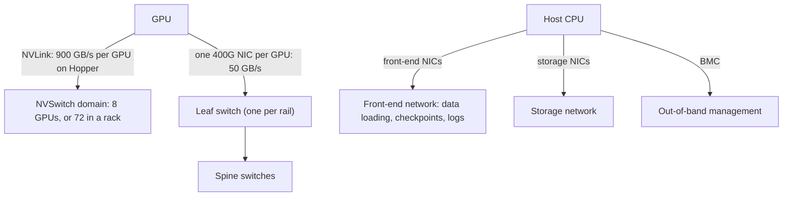

# NET 23: AI cluster fabrics: sizing, rails, collectives, routing and failures

*Part of the [networking plan](00_plan.md) · You need: [NET 11](11_routing_protocols_and_datacenter_fabrics.md) (Clos, ECMP), [NET 12](12_rdma_roce_and_lossless_fabrics.md) (RDMA, PFC, ECN, DCQCN) and [NET 22](22_ethernet_at_speed_and_link_layer_fundamentals.md) (links, FEC, flaps)*

A network for a training cluster is not a bigger data-centre network. It carries a handful of enormous flows, all active in the same few milliseconds, and the job stops when the slowest one finishes. Every earlier tutorial gave you a piece: Clos sizing, ECMP, RDMA, PFC and ECN, link errors. This one puts the pieces together and asks the question an interviewer asks at Staff level: "design the network for 16,000 GPUs, and tell me what breaks first".

A weak answer names a topology and a speed: "fat tree, 400G, RoCE". A strong answer starts from the **traffic**: which parallelism strategy puts which bytes on which layer, how much bandwidth each layer must supply, how the topology and the job scheduler cooperate so that most traffic never reaches the spine, how the routing copes with flows that do not average out, and what the failure rate of 16,000 GPUs does to the plan. The numbers in this tutorial come from small models you can run, and from published designs (NVIDIA's SuperPOD reference architecture and Meta's papers) that the final section lists.

By the end you can:

- draw the bandwidth hierarchy of a GPU cluster (NVLink domain, NIC, leaf, spine) and say why parallelism is mapped to it;
- estimate the bytes per step that data, tensor and pipeline parallelism put on the wire;
- explain algorithm bandwidth and bus bandwidth, and read an `nccl-tests` result against the hardware peak;
- explain ring, tree and hierarchical all-reduce, and why a node with eight NICs must use all eight;
- size a Clos fabric from the switch radix, and explain the rail-optimised variant;
- explain why ECMP fails for collectives, how routing evolved at Meta, and what adaptive routing and spraying change;
- compare InfiniBand, RoCE and Ultra Ethernet, and say what SHARP does;
- explain what failures cost at scale, and why checkpointing and restart speed belong in a network design;
- answer the standard interview questions and scenarios.

Section 15 lists what was run, what was fetched and what is from memory.

---

## 1. The bandwidth hierarchy

A GPU cluster has several networks, and treating them as one is the first mistake.



- **Scale-up** is the NVLink domain. From the NVIDIA page I read, fourth-generation NVLink (Hopper) gives **900 GB/s per GPU over 18 links**, with an NVLink Switch domain of 8 GPUs; fifth generation (Blackwell) doubles that to 1,800 GB/s and extends the switch domain to **72 GPUs (NVL72)**, quoted at 130 TB/s aggregate. These links are inside a server or a rack, lossless and short.
- **Scale-out** is the **compute fabric**: InfiniBand or Ethernet (RoCE), with typically **one 400G NIC per GPU** (50 GB/s each direction). Meta's published H100 nodes have eight 400G backend NICs, two per PCIe switch (from a secondary summary of their design); NVIDIA's SuperPOD reference also separates **four networks**: compute InfiniBand, storage InfiniBand, in-band management Ethernet and out-of-band management.
- **Front-end and storage** carry training data in and checkpoints out. They are ordinary data-centre traffic; the compute fabric is deliberately kept away from them so that a checkpoint cannot disturb a collective.

The ratio is the design fact: inside the node a GPU can move data **about 9 times faster** than over its NIC (450 GB/s per direction over NVLink against 50 GB/s per direction over a 400G NIC). Everything that follows, in particular which parallelism goes where, is a response to that gap.

---

## 2. What training puts on the network

Large models do not fit, or train too slowly, on one GPU, so the work is split along several axes at once. Each axis has a different traffic pattern.

| Parallelism | What is split | Collective on the wire | Frequency | Where it runs |
|---|---|---|---|---|
| **Data parallel (DP)** | The batch; every group holds a model copy | All-reduce of the gradients | Once per step | Across nodes, over the fabric |
| **Tensor parallel (TP)** | Each layer's matrices | All-reduce (or all-gather and reduce-scatter) of activations, several per layer | Many times per layer, on the critical path | Inside the NVLink domain |
| **Pipeline parallel (PP)** | Groups of layers | Point-to-point send of activations, and of gradients on the way back | Per micro-batch | Across nodes, small and steady |
| **Expert parallel (EP, mixture of experts)** | The experts | **All-to-all** of tokens | Per layer | Across nodes, hardest on the fabric |

A model of the bytes per GPU shows the pattern. The numbers are for a 70-billion-parameter dense transformer in bf16 with 80 layers, hidden size 8192, sequence length 4096 and micro-batch 1. The model sizes are assumptions; the formulas are the textbook ones (a ring all-reduce moves `2 (n-1)/n` of the buffer per GPU):

```python
# parallel_traffic.py
# Bytes each GPU puts on the wire per training step, by parallelism type. Model: a dense transformer.
# All formulas are the standard textbook ones; the model sizes are assumptions chosen as round numbers.
def per_step(params_b, layers, hidden, seq, micro_batch, tp, pp, dp, bytes_per=2):
    P = params_b * 1e9
    grads = P / (tp * pp) * bytes_per                              # gradient shard held by one GPU
    dp_ar = 2 * (dp - 1) / dp * grads                              # ring all-reduce of the gradients
    act = micro_batch * seq * hidden * bytes_per                   # one activation tensor
    layers_here = layers / pp
    tp_ar = 2 * (tp - 1) / tp * act * 2 * layers_here * 2          # 2 all-reduces per layer forward, 2 backward
    pp_send = act * 2                                              # forward activation + backward gradient per micro-batch
    return dp_ar, tp_ar, pp_send

cfg = dict(params_b=70, layers=80, hidden=8192, seq=4096, micro_batch=1)
print("70B-parameter model, bf16, 80 layers, hidden 8192, sequence 4096, micro-batch 1")
print("tp pp  dp   gradient all-reduce/step   tensor-parallel/micro-batch   pipeline send/micro-batch")
for tp, pp, dp in ((8, 1, 64), (8, 4, 16), (1, 1, 512)):
    a, b, c = per_step(**cfg, tp=tp, pp=pp, dp=dp)
    print(f"{tp:2d} {pp:2d} {dp:3d}   {a / 1e9:20.1f} GB   {b / 1e9:22.1f} GB   {c / 1e6:16.0f} MB")
print()
nv, nic = 450, 50        # GB/s per direction per GPU over NVLink, over one 400 Gb/s NIC
a, b, c = per_step(**cfg, tp=8, pp=1, dp=64)
print(f"with TP=8 inside one node: tensor-parallel {b / 1e9:.1f} GB/micro-batch at {nv} GB/s = {b / 1e9 / nv * 1e3:.0f} ms;"
      f" the same bytes on a NIC would take {b / 1e9 / nic * 1e3:.0f} ms ({nv / nic:.0f}x slower)")
print(f"gradient all-reduce {a / 1e9:.1f} GB per GPU; each GPU reduces its own shard over its own NIC (its rail), so all 8 NICs in a node are busy at once: {a / 1e9 / nic * 1e3:.0f} ms at line rate")
print("so tensor parallelism stays inside the NVLink domain, data parallelism crosses the fabric, and mixture-of-experts adds all-to-all across it")
```

Reading the output:

- **Tensor parallelism is the heaviest and most latency-sensitive.** With TP=8 it moves 37.6 GB per micro-batch per GPU: 84 ms on NVLink, but about 750 ms if it had to cross a NIC, nine times longer. That is the whole argument for keeping TP **inside one NVLink domain** and why the NVL72 rack design exists (it widens the domain).
- **Data parallelism is the fabric's job.** With TP=8 and no pipeline, each GPU all-reduces 34.5 GB of gradients per step, about 0.7 s at the NIC's line rate. Training frameworks overlap that with the backward pass, so what matters is whether the fabric **keeps up**, not the raw figure. Adding pipeline stages (TP=8, PP=4) cuts the gradient volume per GPU to 8.2 GB, because each GPU holds a quarter of the layers.
- **Pipeline traffic is small** (134 MB per micro-batch) but latency-sensitive, and runs between neighbouring stages, which the scheduler can place close together.
- **Pure data parallelism (TP=1) is the worst case for the network**: 279.5 GB per GPU per step, because every GPU holds the whole model's gradient.
- **Mixture of experts adds all-to-all**, which is not a ring: every rank sends a different slice to **every other rank**, so it creates one flow per peer and stresses the bisection. The model above does not count it; section 3 shows its volume.

The rule an interviewer wants to hear: **the parallelism layout is chosen to fit the network, and the network is built to fit the parallelism.** TP inside the node, DP and PP across the fabric, and job placement so that DP groups sit under the same leaf where possible.

---

## 3. Collectives and how to read their numbers

The collective library (NCCL on NVIDIA GPUs, RCCL on AMD) turns "all-reduce this buffer" into point-to-point transfers. Three facts carry most interview questions.

**Traffic.** A ring all-reduce of an S-byte buffer over n ranks has each rank send `2 (n-1)/n` times S: nearly 2S regardless of n. An all-to-all has each rank send `(n-1)/n` times S, but spread over n-1 peers. The model below runs a real ring algorithm on arrays, checks the result against the sum, and counts the bytes each rank sent:

```python
# collectives.py
import numpy as np, math
rng = np.random.default_rng(1)

def ring_allreduce(bufs):
    """Ring reduce-scatter then all-gather. Returns (result per rank, bytes sent per rank)."""
    n, size = len(bufs), bufs[0].size
    chunks = [np.array_split(b.copy(), n) for b in bufs]
    sent = [0] * n
    for step in range(n - 1):                                   # reduce-scatter
        msgs = [(r, (r - step) % n, chunks[r][(r - step) % n].copy()) for r in range(n)]
        for r, c, data in msgs:
            chunks[(r + 1) % n][c] += data
            sent[r] += data.nbytes
    for step in range(n - 1):                                   # all-gather
        msgs = [(r, (r + 1 - step) % n, chunks[r][(r + 1 - step) % n].copy()) for r in range(n)]
        for r, c, data in msgs:
            chunks[(r + 1) % n][c] = data
            sent[r] += data.nbytes
    return [np.concatenate(c) for c in chunks], sent

for n in (4, 8, 16):
    bufs = [rng.integers(0, 100, 1 << 12).astype(np.float64) for _ in range(n)]
    out, sent = ring_allreduce(bufs)
    ok = all(np.array_equal(o, sum(bufs)) for o in out)
    S = bufs[0].nbytes
    print(f"ring n={n:2d}: result correct {ok}; bytes sent per rank {sent[0]} = {sent[0] / S:.4f} x buffer; 2(n-1)/n = {2 * (n - 1) / n:.4f}")

# alltoall: every rank sends a distinct 1/n slice to every other rank
n, S = 16, 1 << 20
print(f"\nalltoall n={n}: bytes sent per rank = {S * (n - 1) // n} = {(n - 1) / n:.4f} x buffer, to {n - 1} peers (one flow per peer, not one neighbour)")

# NCCL-tests style bandwidths for one measured time
def bus(kind, n):
    return {"allreduce": 2 * (n - 1) / n, "allgather": (n - 1) / n, "reducescatter": (n - 1) / n, "broadcast": 1, "alltoall": (n - 1) / n}[kind]
S, t, n = 2**30, 0.045, 64
algbw = S / t / 1e9
print(f"\na 1 GiB allreduce on {n} ranks taking 45 ms: algbw {algbw:.1f} GB/s, busbw {algbw * bus('allreduce', n):.1f} GB/s (94% of a 50 GB/s link; busbw is the number to compare with the hardware peak)")

# alpha-beta cost: one ring that leaves each node through a single NIC, against the 8-rail hierarchical form
def flat_ring(g, S, bw, a):  return 2 * (g - 1) * (a + S / g / bw)
def hier(nodes, per, S, nv_bw, nic_bw, a_nv, a_net):
    t = (per - 1) * (a_nv + S / per / nv_bw)                    # intra-node reduce-scatter
    t += 2 * (nodes - 1) * (a_net + S / per / nodes / nic_bw)   # each of 'per' rails reduces S/per across nodes
    t += (per - 1) * (a_nv + S / per / nv_bw)                   # intra-node all-gather
    return t
S = 2 * 10**9                                                   # 2 GB of gradients per GPU (assumption)
print("\nassumptions: NVLink 450 GB/s per direction (900 GB/s total), NIC 50 GB/s, 1 us NVLink step, 5 us network step")
print("  GPUs   one ring, 1 NIC/node    hierarchical (8 per node)   ratio")
for nodes in (4, 16, 64, 256):
    g = nodes * 8
    f = flat_ring(g, S, 50e9, 5e-6)
    h = hier(nodes, 8, S, 450e9, 50e9, 1e-6, 5e-6)
    print(f"{g:6d}   {f * 1e3:12.1f} ms        {h * 1e3:12.1f} ms          {f / h:5.2f}x")
print("a synchronous ring steps at the speed of its slowest hop, so one NIC per node paces the whole ring; the hierarchical form spreads the inter-node phase over all 8 NICs, each carrying 1/8 of the data")
```

- The ring moved **1.5, 1.75 and 1.875 times the buffer** per rank for 4, 8 and 16 ranks, exactly `2 (n-1)/n`, and the result matched the sum every time. The model is the algorithm, not a NIC, but it is the arithmetic NCCL's ring uses.
- An all-to-all over 16 ranks sent 0.9375 of the buffer per rank to 15 different peers. The **byte count is lower** than all-reduce; the problem is that it creates **n-1 simultaneous flows per rank**, so every rank talks to every other and the traffic crosses the spine regardless of placement.

**Algorithm bandwidth and bus bandwidth.** The `nccl-tests` documentation I read defines `algbw = S / t`, and `busbw = algbw × factor`, with a factor that depends on the collective: `2(n-1)/n` for all-reduce, `(n-1)/n` for all-gather, reduce-scatter and all-to-all, and 1 for broadcast. The reason: the algorithm bandwidth falls as the rank count grows even on perfect hardware, whereas **bus bandwidth is comparable with the hardware's peak and independent of the rank count**. The model's example: a 1 GiB all-reduce over 64 ranks in 45 ms is 23.9 GB/s algorithm bandwidth and 47.0 GB/s bus bandwidth, which is 94 percent of a 50 GB/s NIC. When someone quotes "NCCL gets 47 GB/s", this is the number, and it is a statement about **link utilisation**, not about how fast one all-reduce ran.

**Ring, tree and hierarchical.** The ring is bandwidth-optimal but has `2(n-1)` steps, so its latency grows linearly with the rank count. NVIDIA's NCCL 2.4 article (the one I read) describes the **double binary tree**: two trees built so that every rank is an interior node in one and a leaf in the other, each carrying half the data, with latency that grows **logarithmically**, and reports up to **180 times lower latency than rings at 24,576 GPUs** on the Summit system (its figure, a latency measurement for small messages). Trees win for small and medium messages, rings for large ones, and NCCL chooses by size and topology (NET 12 section 10 has the cost model for the crossover).

The last part of the model shows the practical point. With one ring leaving each node through a single NIC, the ring's speed is set by that one 50 GB/s link; a **hierarchical** all-reduce reduces inside the node over NVLink first, runs the inter-node phase as **eight parallel reductions, one per rail**, each carrying one eighth of the data, then redistributes inside the node. In the model it is about **4.7 to 5.1 times faster** across 32 to 2,048 GPUs (not the full 8 times, because the intra-node phases and the per-step latency cost time). The consequence for design: **a node's NICs must all be used**, so the fabric must give every NIC its own path, which is the idea behind the rail-optimised topology.

---

## 4. Topology and sizing

### 4.1 Radix arithmetic

A switch chip has a fixed number of ports, the **radix**. A non-blocking two-tier leaf-spine network built from radix-k switches connects `k²/2` endpoints; a three-tier fat tree connects `k³/4`. The model computes the switch and cable counts:

```python
# fabric_size.py
def clos(radix, tiers):
    """Largest non-blocking Clos built from identical radix-port switches (hosts counted as one port each)."""
    if tiers == 2:
        leaves, spines = radix, radix // 2
        hosts = leaves * (radix // 2)
        switches = leaves + spines
        links = leaves * (radix // 2)                     # leaf-to-spine cables
    else:
        pods, hosts = radix, radix ** 3 // 4
        switches = 5 * radix * radix // 4
        links = 2 * (radix ** 3 // 4)                     # leaf-agg plus agg-spine cables
    return hosts, switches, links

print("radix  tiers   endpoints  switches  switch-to-switch cables  (non-blocking)")
for radix in (32, 64, 128):
    for tiers in (2, 3):
        h, s, l = clos(radix, tiers)
        print(f"{radix:5d}  {tiers:5d}  {h:10,d}  {s:8,d}  {l:12,d}")

# A rail-optimised SuperPOD-style compute fabric: 32 nodes per scalable unit (SU), 8 NICs per node,
# one leaf per rail per SU, 64-port leaves split 32 down / 32 up, 64-port spines (assumed).
def rail_fabric(su, nodes_per_su=32, rails=8, radix=64):
    leaves = su * rails
    uplinks = leaves * (radix // 2)
    spines = -(-uplinks // radix)                         # ceiling division
    return leaves, spines, uplinks
print()
print("SUs  leaves  spines  leaf-spine cables   (published table: 8/4/256, 16/8/512, 24/16/768, 32/16/1024)")
for su in (1, 2, 3, 4):
    print(f"{su:3d}  {rail_fabric(su)[0]:6d}  {rail_fabric(su)[1]:6d}  {rail_fabric(su)[2]:12d}")
print("note: the 3-SU row needs 12 spines by this formula; the published design uses 16 (the page I read does not say why: spare ports, growth or a symmetry rule)")

# how far does a 2-tier rail design go at radix 64?
leaves_max = 64                                            # a spine has 64 ports, one cable to each leaf
su_max = leaves_max // 8
nodes_max = su_max * 32
print(f"\n2-tier ceiling at radix 64: {leaves_max} leaves = {su_max} SUs = {nodes_max} nodes = {nodes_max * 8} GPUs; a third tier is needed beyond that")
# cost of oversubscription
for down, up in ((32, 32), (48, 16)):
    print(f"leaf {down} down / {up} up: oversubscription {down / up:.1f}:1, per-NIC share of cross-leaf bandwidth {400 * up / down:.0f} Gb/s")
```

What the first table says:

- **Radix is the lever.** At radix 64, two tiers reach **2,048 endpoints with 96 switches**; three tiers reach **65,536 endpoints with 5,120 switches and 131,072 switch-to-switch cables**. At radix 128 two tiers already reach 8,192 endpoints. Doubling the radix quadruples the two-tier reach, which is why every generation of switch silicon (and each doubling of port count) moves the "when do I need a third tier" line.
- **Each tier costs optics.** Every switch-to-switch cable is two optical transceivers at the bandwidths of this tutorial, so the cable column is also a cost and power column, and each cable is a link that can flap (NET 22). Going from two to three tiers multiplies the optics by far more than the endpoint count.
- **Endpoints are NICs, not servers.** With one NIC per GPU, "2,048 endpoints" is 2,048 GPUs: the 2-tier ceiling at radix 64 is **256 eight-GPU nodes**.

### 4.2 Rail-optimised design

In a **rail-optimised** fabric, GPU *i* of every node connects (through its own NIC) to the **same leaf switch**, the leaf of rail *i*. The eight GPUs of a node therefore reach eight different leaves.

```mermaid
flowchart TB
    subgraph Spines
        S1["Spine 1"]
        S2["Spine 2"]
    end
    subgraph Leaves
        L0["Leaf, rail 0"]
        L1["Leaf, rail 1"]
        L2["Leaf, rail 2"]
    end
    subgraph NodeA["Node A"]
        A0["GPU 0"]
        A1["GPU 1"]
        A2["GPU 2"]
    end
    subgraph NodeB["Node B"]
        B0["GPU 0"]
        B1["GPU 1"]
        B2["GPU 2"]
    end
    A0 --> L0
    B0 --> L0
    A1 --> L1
    B1 --> L1
    A2 --> L2
    B2 --> L2
    L0 --> S1
    L0 --> S2
    L1 --> S1
    L1 --> S2
    L2 --> S1
    L2 --> S2
```



(Three rails are drawn; a real node has eight.) From the NVIDIA H100 SuperPOD page I read: each group of **32 nodes** (a scalable unit, SU) is rail-aligned, traffic on a rail is **one hop** from the other 31 nodes in the unit, and traffic between rails or between units goes through the spine layer.

Why this is the right shape:

- The dominant traffic (the data-parallel all-reduce, which in a hierarchical collective runs **GPU i with GPU i of other nodes**) uses only rail *i*, and stays **under one leaf**: no spine, no ECMP, no collision.
- Traffic between **different** rails is not lost: it can first move over NVLink inside the node to the GPU on the right rail, then cross the fabric (NCCL does this; the feature is called PXN, from memory), so even cross-rail traffic can avoid the spine.
- The model's second table reproduces the SuperPOD page's compute-fabric figures: **1 SU = 8 leaves, 4 spines, 256 leaf-to-spine cables**; 2 SUs = 16, 8, 512; 3 SUs = 24, 16, 768; 4 SUs = 32, 16, 1,024. It assumes 64-port leaves split 32 down and 32 up (from memory: 64 ports of 400G on the NDR InfiniBand switch). Three rows match exactly; for 3 SUs the formula gives 12 spines and the page gives 16, a difference the page does not explain, so ask what a design is doing before assuming a formula.
- With radix-64 switches the two-tier rail design stops at **8 SUs: 256 nodes, 2,048 GPUs**. More than that needs a third tier, which is where oversubscription (next) and placement become central.

### 4.3 Oversubscription is a decision about traffic

A non-blocking fabric is expensive, so large designs often oversubscribe the upper tiers and rely on placement to keep traffic local. The last lines of the model show what it costs: a leaf with 32 down and 32 up ports is 1:1 and gives each NIC 400 Gb/s of cross-leaf bandwidth, while 48 down and 16 up is 3:1 and gives each NIC **133 Gb/s**, a third.

Meta's published design (the engineering article and a secondary summary I read) is a worked example. Their H100 clusters are built from **pods of 3,072 GPUs** (a non-blocking domain at the leaf and aggregation tiers, with leaf-to-aggregation links **2:1 undersubscribed**, meaning twice the uplink capacity as server capacity) and several pods joined by an upper tier **oversubscribed 7:1**. Their summary of the lesson: match the network design to the training workload's traffic and **coordinate job placement with routing**; the scheduler learns the GPU positions in the logical topology and assigns ranks to minimise the traffic crossing the oversubscribed layer. A cluster whose oversubscribed layer carries only the occasional cross-pod job is cheap; the same fabric with a scheduler that scatters jobs is slow.

---

## 5. Routing and load balancing: where collectives hurt

### 5.1 Why hashing fails, in the real kernel

ECMP picks a path from a hash of the packet's header fields (NET 11 section 8). RoCEv2 carries every queue pair in UDP, and the **UDP source port is the entropy** the switches hash on. The next lab uses the Linux kernel's own multipath routing, with four uplinks between a "leaf" and a "spine" namespace and the hash policy set to include layer-4 ports, and counts the packets that leave on each uplink:

```bash
# entropy.sh : real kernel ECMP over four uplinks, with one and with many UDP source ports
ip netns add leaf; ip netns add spine
for i in 0 1 2 3; do
  ip link add u$i netns leaf type veth peer name d$i netns spine
  ip -n leaf addr add 10.1.$i.1/30 dev u$i; ip -n spine addr add 10.1.$i.2/30 dev d$i
  ip -n leaf link set u$i up; ip -n spine link set d$i up
done
ip -n spine addr add 10.9.9.9/32 dev lo; ip -n spine link set lo up
ip netns exec leaf sysctl -qw net.ipv4.fib_multipath_hash_policy=1       # hash on the layer-4 ports too
ip -n leaf route add 10.9.9.9/32 $(for i in 0 1 2 3; do printf "nexthop via 10.1.$i.2 dev u$i "; done)
ip -n leaf neigh show >/dev/null
cat > send.py <<'PYEOF'
import socket, sys
nports = int(sys.argv[1]); total = 4000
socks = []
for k in range(nports):
    s = socket.socket(socket.AF_INET, socket.SOCK_DGRAM); s.bind(("0.0.0.0", 40000 + k)); socks.append(s)
for n in range(total):
    socks[n % nports].sendto(b"x" * 64, ("10.9.9.9", 4791))
PYEOF
tx() { for i in 0 1 2 3; do ip netns exec leaf cat /sys/class/net/u$i/statistics/tx_packets; done | tr '\n' ' '; }
for p in 1 4 64; do
  before=($(tx)); ip netns exec leaf python3 send.py $p; after=($(tx))
  line=""; for i in 0 1 2 3; do line="$line $(( ${after[$i]} - ${before[$i]} ))"; done
  echo "$p UDP source port(s): packets per uplink =$line"
done
ip netns del leaf; ip netns del spine
```

```
1 UDP source port(s): packets per uplink = 4001 0 0 0
4 UDP source port(s): packets per uplink = 2000 2001 0 0
64 UDP source port(s): packets per uplink = 1061 1249 1002 690
```

(The extra packet in each row is one ARP request.) One flow, one path: all 4,000 packets used one uplink and three uplinks idle, however many packets there were. Four flows used only two of the four uplinks, because they hashed in pairs onto the same ones. Sixty-four flows came much closer to even but still ranged from 690 to 1,249 packets, 25 percent above the fair share on the worst link and 31 percent below on the best. That is the real kernel's hash, deterministic for these ports, and it is the whole problem in miniature: **collective traffic has few flows, and few flows do not average**.

How bad is it at the scale of a rail leaf? The model puts 32 equal line-rate flows on a leaf with 32 uplinks and reports the time of the slowest flow:

```python
# reroute_sim.py
import random
random.seed(11)
def busiest(uplinks, flows, trials=20000):
    tot = 0
    for _ in range(trials):
        load = [0] * uplinks
        for _ in range(flows):
            load[random.randrange(uplinks)] += 1
        tot += max(load)
    return tot / trials

# A rail leaf: 32 uplinks, 32 line-rate flows (one per node on the rail), all at the same time.
U, F = 32, 32
print(f"{U} uplinks, {F} equal flows. Time of the slowest flow, 1.0 = one flow alone on a link:")
r_ok, r_fail = busiest(U, F), busiest(U - 1, F)
print(f"  perfect spreading                : {F / U:.2f}")
print(f"  random hash (ECMP)               : {r_ok:.2f}")
print(f"  one uplink down, perfect spread  : {F / (U - 1):.2f}")
print(f"  one uplink down, random re-hash  : {r_fail:.2f}")
print(f"  one uplink down, one flow moved onto a neighbour (what a pinned path does): 2.00")
print(f"losing 1 of {U} uplinks costs {1 / U:.0%} of capacity; the random hash already costs {r_ok:.1f}x before any failure, so the hash, not the failure, is the main loss")
```

```
32 uplinks, 32 equal flows. Time of the slowest flow, 1.0 = one flow alone on a link:
  perfect spreading                : 1.00
  random hash (ECMP)               : 3.53
  one uplink down, perfect spread  : 1.03
  one uplink down, random re-hash  : 3.58
  one uplink down, one flow moved onto a neighbour (what a pinned path does): 2.00
losing 1 of 32 uplinks costs 3% of capacity; the random hash already costs 3.5x before any failure, so the hash, not the failure, is the main loss
```

The slowest of 32 randomly placed flows ends up sharing its link with, on average, 2.5 others, so the step takes **3.5 times as long as it should**. The collective waits for the slowest flow, so the **maximum** matters, not the average, and the maximum is what random hashing makes large. A link failure on top of that costs little extra for random hashing (it was already bad) but a lot for a **pinned** design, where the flow that lost its path lands on a neighbour and runs at half speed: this is the pattern behind "one flapping link slows the whole job".

(NET 12 section 9 has the same effect for 8 uplinks and the effect of more queue pairs; this lab adds the real-kernel hash and the failure case.)

### 5.2 How Meta's routing evolved

The engineering article on Meta's RoCE training network (which I read) gives a sequence worth knowing, because each step is a standard interview answer:

1. **Baseline ECMP** hashing the five-tuple performed poorly, because AI traffic has **low flow entropy**.
2. **Path pinning** (route by destination "slice" so each rack's uplinks are used evenly) worked only when racks were fully allocated to one job and no links had failed; with partial rack allocation it caused uneven uplink use and **degraded training by more than 30 percent**.
3. A short-term fix **doubled RTSW uplink bandwidth** (to 1:2 undersubscription relative to the downlinks), which worked and cost twice the capacity.
4. **Enhanced ECMP with queue-pair scaling**: switches hash on the RoCE destination queue-pair field as well, and the collective library spreads messages **round-robin across more queue pairs** per connection. This improved all-reduce performance by **up to 40 percent** over baseline ECMP, but hashing stays probabilistic and the QP count needs tuning per workload.

The lesson is the one from the lab: more flows help, per-flow hashing never reaches 1.0, and every fix that depends on a **perfect** placement breaks when a job is fragmented or a link fails. The real fixes change the mechanism:

| Mechanism | What it does | What it needs |
|---|---|---|
| **Topology-aware scheduling** | Keeps each job's heavy traffic under one leaf or pod | A scheduler that knows the fabric, and unfragmented capacity |
| **QP scaling** | More flows per connection, so hashing averages better | Library and switch support; tuning; partial gain |
| **Adaptive routing** | The switch picks the **least-loaded** uplink per packet or flowlet, using local or fabric-wide congestion information (InfiniBand switches do this; NVIDIA Spectrum-X does it for Ethernet) | Packets can arrive out of order, so the NIC must accept that |
| **Packet spraying** | The sender varies the entropy (the UDP source port) per packet so every packet takes a different path | Receiver places data out of order; fast loss detection |
| **Centralised path assignment** | A controller or the library assigns paths from topology knowledge | Fragile across failures |

**Out-of-order delivery is the pivot.** Go-back-N RDMA (NET 12 section 4) assumes in-order arrival, and ECMP's per-flow stickiness exists to provide it. Moving to per-packet load balancing means moving off both: the transport has to **tolerate reordering**. Ultra Ethernet's design (the arXiv paper I read) does exactly this: its default bulk mode is **reliable unordered delivery (RUD)**, each packet can take a different path by changing an **entropy value carried in the UDP source port**, and the receiver tracks arrivals with cumulative and selective acknowledgements and a 64-bit SACK bitmap, with a bound on how far out of order it must track. It still offers a reliable-ordered mode (go-back-N, one path per flowlet), which is less efficient.

---

## 6. Congestion control and lossless in AI fabrics

NET 12 explained the mechanisms: PFC as the backstop, ECN and DCQCN as the plan. Real AI fabrics bend that picture, and three data points are worth quoting.

- **Meta dropped DCQCN at 400G.** In their write-up they report that tuning DCQCN for 400G did not work (with default settings and doubled ECN thresholds performance dropped, and firmware changes added bugs and reduced visibility), so for 400G deployments they run **PFC alone** and instead use **receiver-driven traffic admission**: the collective library and the RoCE transport coordinate so that the receiver sends clear-to-send packets that limit how much data is in flight, and those packets get high-priority queuing so they are not starved. They report over a year of stable operation and, in four years of production AI traffic, **no persistent PFC pauses** from the spine to the leaf switches.
- **Ultra Ethernet is designed for lossy networks.** From the paper I read: congestion control is **sender-based (NSCC, using ECN marks and round-trip time to adjust a window)** with an optional **receiver-credit scheme (RCCC)** that handles incast well, and PFC is not required; two optional link-layer features, **link-level retry (LLR)** and **credit-based flow control (CBFC)**, handle link errors and lossless operation without PFC.
- **InfiniBand is lossless by construction**, using credit-based flow control at the link layer (from memory), so it avoids the PFC problems of Ethernet (pause storms, deadlock) by design, at the cost of a separate fabric and ecosystem.

The takeaway is not that DCQCN is wrong. It is that **the collective pattern is predictable**: because all senders and receivers are known, the library can pace transmissions at the endpoints and keep the fabric from congesting, instead of reacting to congestion after it forms. The network design problem becomes "make sure the upper tier has enough bandwidth that endpoint pacing is enough" and the congestion-control problem becomes a co-design of **library, NIC and switch**.

---

## 7. InfiniBand, RoCE and Ultra Ethernet; SHARP

| | InfiniBand | RoCEv2 on Ethernet | Ultra Ethernet (UEC 1.0) |
|---|---|---|---|
| Link layer | Credit-based, lossless by design | Ethernet, PFC for lossless | Ethernet, optional LLR and CBFC |
| Routing | Subnet manager programs forwarding; **adaptive routing** in the switches | ECMP; vendor adaptive routing on some chips | **Packet spraying** in the transport, switches stay Ethernet |
| Transport | Reliable connection, in-order | Reliable connection, go-back-N | RUD default, ROD optional; connectionless contexts |
| Management | Subnet manager, UFM | Standard Ethernet tooling | Standard Ethernet tooling |
| Strength | Mature, tight latency, in-network compute | One fabric technology, multi-vendor, familiar operations | Designed for AI scale and multipath from the start |

Meta built **two 24,576-GPU clusters in parallel, one on RoCE and one on InfiniBand** (400 Gb/s endpoints, Arista 7800 and Wedge400 and Minipack2 switches against NVIDIA Quantum-2) and tuned both to similar performance; Llama 3 trained on both, and the largest model on the RoCE cluster. The InfiniBand cluster aimed at full bisection bandwidth, the RoCE cluster at faster deployment. The honest interview answer to "InfiniBand or Ethernet" is therefore about **ecosystem, operations and procurement**, not that one cannot do the job.

**SHARP.** NVIDIA's Scalable Hierarchical Aggregation and Reduction Protocol puts the reduction **inside the switches**. In the NVIDIA article I read: switch ASICs aggregate gradients as they pass, so the data traversing the network is **reduced by half**; the generations are SHARPv1 (100 Gb/s, small MPI reductions), SHARPv2 (200 Gb/s, large reductions for AI, one workload at a time) and SHARPv3 (400 Gb/s Quantum-2, **multi-tenant**); and the quoted results include **2 times all-reduce bandwidth on SHARPv2**, which translated to 17 percent higher BERT training performance in an MLPerf round (NVIDIA's claim). The arithmetic behind "half": in a ring, each endpoint sends `2 (n-1)/n` times S, close to 2S. With an in-network reduction tree, each endpoint sends S **once**, up to the switch, and receives S **once**, the result, back. The per-endpoint send volume halves, and the latency is a few switch hops rather than `n` steps. Limits: it needs InfiniBand switches with the feature, support in the collective library, and aggregation resources on the switches that are shared between jobs.

---

## 8. The edges: NICs, PCIe and GPUDirect

The fabric starts at the NIC, and the NIC's placement matters.

- **GPUDirect RDMA** lets the NIC read and write **GPU memory directly** over PCIe, with no copy through host memory (from memory; the idea is the same as NET 07's zero-copy, with the GPU as the memory). It works best when the NIC and the GPU share a **PCIe switch**, so the data does not cross the CPU's root complex. That is why high-end nodes pair each GPU with its own NIC, and Meta's description puts **two NICs per PCIe switch** with each GPU having one backend NIC.
- **NUMA and PCIe topology are part of the network design.** A NIC attached to the wrong CPU socket, or a GPU and NIC separated by the CPU interconnect, can halve the effective rate. `nvidia-smi topo -m` prints the GPU and NIC distances (from memory); NCCL reads the same topology to build rings.
- **DPUs and SmartNICs** take over infrastructure work (virtual switching, encryption, storage protocols, the isolation between tenants) so the host and GPUs do not. In an AI cluster this appears as the **front-end and storage** side more than the compute fabric.
- **The four networks stay separate** (section 1) so that a checkpoint to storage cannot slow a collective, and a management problem cannot take the training network down.

---

## 9. Failures and operations

At this scale **failure is the normal state**. The published Llama 3 pre-training run (the report as covered by the press article I read) used **16,384 H100 GPUs for 54 days** and had **466 interruptions, 419 of them unexpected**; the root causes were mostly GPUs and their memory, with network cables and adapters among the "other" causes, and the team reported over 90 percent effective training time with only three incidents needing manual intervention. Meta's own training-infrastructure article makes the same points: GPUs drop off the PCIe bus, cable faults make servers unreachable, failures are most common early in a server's life, and **failure likelihood rises with GPU count**, so spare capacity is kept to restart quickly.

The model turns those numbers into a design tool. It calibrates the failure rate from the published run and asks what happens as the cluster grows, and how the checkpoint interval changes the fraction of time spent on useful work (**goodput**):

```python
# failure_model.py
import math, random
random.seed(7)
# calibration from the published Llama 3 figures: 16,384 GPUs, 54 days, 419 unexpected interruptions
N0, days, unexpected = 16384, 54, 419
mtbf0_h = days * 24 / unexpected
unit_h = mtbf0_h * N0                    # implied mean time between failures of one GPU's share of the system
print(f"job interruption every {mtbf0_h:.2f} h on {N0} GPUs; implied per-GPU-share MTBF {unit_h:,.0f} h ({unit_h / 8760:.1f} years)")
print("\nJob MTBF if the per-GPU-share rate stays the same (all other things equal):")
for n in (1024, 16384, 100_000):
    print(f"  {n:7,d} GPUs: one interruption every {unit_h / n:7.2f} h")

def goodput(M, C, R, tau, work=2000.0, trials=200):
    """Fraction of wall time spent on useful work. M mean time to failure, C checkpoint write, R restart, tau checkpoint interval (hours)."""
    tot_wall = 0.0
    for _ in range(trials):
        done, wall = 0.0, 0.0
        while done < work:
            seg = min(tau, work - done)
            fail_in = random.expovariate(1 / M)
            if fail_in >= seg + C:           # segment and its checkpoint finish
                wall += seg + C; done += seg
            else:                            # failure: lose the segment, pay the restart
                wall += fail_in + R
        tot_wall += wall
    return work / (tot_wall / trials)

C, R = 0.01, 0.05                            # 36 s to write a checkpoint, 3 min to restart (assumptions)
for n, extra in ((16384, (2.0, 8.0)), (100_000, (1.0,))):
    M = unit_h / n
    daly = math.sqrt(2 * C * M)
    print(f"\n{n:,d} GPUs, MTBF {M:.2f} h, checkpoint {C * 3600:.0f} s, restart {R * 60:.0f} min; Young/Daly interval sqrt(2*C*M) = {daly * 60:.0f} min")
    for tau in sorted((0.05, 0.5, daly) + extra):
        print(f"   interval {tau * 60:6.0f} min  -> goodput {goodput(M, C, R, tau):.1%}")
M = unit_h / 100_000
for C2, R2 in ((0.01, 0.05), (0.002, 0.02)):
    best = max(goodput(M, C2, R2, math.sqrt(2 * C2 * M)) for _ in range(1))
    print(f"100,000 GPUs, checkpoint {C2 * 3600:.0f} s, restart {R2 * 60:.0f} min, interval at the Young/Daly optimum: goodput {best:.1%}")
```

```
job interruption every 3.09 h on 16384 GPUs; implied per-GPU-share MTBF 50,677 h (5.8 years)

Job MTBF if the per-GPU-share rate stays the same (all other things equal):
    1,024 GPUs: one interruption every   49.49 h
   16,384 GPUs: one interruption every    3.09 h
  100,000 GPUs: one interruption every    0.51 h

16,384 GPUs, MTBF 3.09 h, checkpoint 36 s, restart 3 min; Young/Daly interval sqrt(2*C*M) = 15 min
   interval      3 min  -> goodput 81.2%
   interval     15 min  -> goodput 90.7%
   interval     30 min  -> goodput 88.8%
   interval    120 min  -> goodput 69.6%
   interval    480 min  -> goodput 20.7%

100,000 GPUs, MTBF 0.51 h, checkpoint 36 s, restart 3 min; Young/Daly interval sqrt(2*C*M) = 6 min
   interval      3 min  -> goodput 71.4%
   interval      6 min  -> goodput 74.1%
   interval     30 min  -> goodput 51.7%
   interval     60 min  -> goodput 28.4%
100,000 GPUs, checkpoint 36 s, restart 3 min, interval at the Young/Daly optimum: goodput 74.1%
100,000 GPUs, checkpoint 7 s, restart 1 min, interval at the Young/Daly optimum: goodput 87.9%
```

Reading it:

- **The job's mean time between failures falls in proportion to the GPU count**: with the rate implied by the Llama 3 figures (about one interruption per GPU-share every 50,000 hours), a 1,024-GPU job sees one interruption every two days, a 16,384-GPU job every **3.1 hours**, and a 100,000-GPU job every **half an hour**. (This assumes the per-GPU rate stays the same; it is a scaling argument, not a prediction for any particular cluster.)
- **There is an optimum checkpoint interval**, the Young/Daly value `sqrt(2 × checkpoint cost × MTBF)`: 15 minutes at 16,384 GPUs and 6 minutes at 100,000. At 16,384 GPUs, goodput was about **91 percent at the optimum** (the same ballpark as the published ">90 percent", which is a consistency check on the model, not a validation, since the checkpoint and restart costs were assumed), 81 percent with checkpoints every 3 minutes (too much checkpoint cost), 70 percent every 2 hours and **21 percent every 8 hours**. At 100,000 GPUs the best case drops to about 74 percent.
- **Faster checkpoints and restarts move the whole curve**: cutting the checkpoint to 7 seconds and the restart to 1 minute lifted the 100,000-GPU optimum from about 74 percent to about 88 percent. This is why Meta's write-up spends effort on checkpointing "in hundreds of milliseconds" and on faster re-initialisation of process groups, and why a network engineer should know that **restart time after a fabric event is a design metric**.

What a network engineer owns in this picture:

- **Detect a bad link before the job does.** A degraded optic (NET 22: rising corrected-FEC rate) causes retransmissions, collisions with rerouted flows and, finally, a link-down that kills a step. The job sees only "the step got slower". Alert on corrected-error rate, on per-link utilisation imbalance and on **per-rank collective times**, because a slow subset of GPUs slows the whole job.
- **Know what a failed link does to routing** (section 5): with ECMP the displaced flows rehash and collide; with adaptive routing they spread; with pinned paths they double up.
- **Health-check before scheduling.** Run bandwidth tests between nodes (`nccl-tests`, `ib_write_bw`, from memory) on new or repaired nodes before they rejoin a job, and cordon nodes whose NIC, cable or GPU is suspect.
- **Keep spare capacity** in the fabric and the node pool, because a synchronous job cannot run on 15,999 of 16,000 GPUs unless the framework was built for elastic membership.
- **Placement is a network feature.** A scheduler that knows the topology keeps jobs inside a pod; one that fills holes anywhere makes the oversubscribed layer the bottleneck (section 4.3).

---

## 10. Common mistakes

- **Designing the fabric before knowing the parallelism.** The traffic per layer follows from TP, PP, DP and EP choices; ask for them first.
- **Quoting NIC speed as collective speed.** Compare `busbw` with the link peak, not `algbw`.
- **Assuming ECMP averages out.** Few flows at line rate defeat it; plan for the slowest flow, not the mean.
- **Using one NIC per node for the whole ring.** All eight rails must carry the inter-node phase.
- **Counting only the spine for oversubscription.** Placement decides how much traffic reaches an oversubscribed layer; fragmentation turns a fine design into a slow one.
- **Ignoring all-to-all.** Mixture-of-experts traffic touches every pair and cannot be kept under a leaf.
- **Treating a link failure as a capacity loss.** Losing 3 percent of uplinks can cost far more than 3 percent of speed, depending on how flows are rerouted.
- **Tuning the network and not the restart path.** Goodput at scale depends on checkpoint and restart time as much as on bandwidth.
- **Mixing the compute fabric with storage or management traffic.**
- **Forgetting PCIe and NUMA placement** of the NIC relative to the GPU.

---

## 11. Interview questions

**Q1. Why is a training network different from a normal data-centre network?**
Few, huge, long-lived flows, all active in the same moments (synchronous steps), where the **slowest flow** sets the job's speed. Hashing does not average, loss and pause are catastrophic (go-back-N, pause storms), and a single failure stalls the whole job.

**Q2. Which parallelism strategies put traffic on the fabric, and which stay inside the node?**
Tensor parallelism (many all-reduces per layer on the critical path) stays inside the NVLink domain. Data parallelism (a gradient all-reduce per step) and pipeline parallelism (small point-to-point sends between stages) cross the fabric. Expert parallelism adds all-to-all across it. In the model, TP moved 37.6 GB per micro-batch, 84 ms on NVLink and about 750 ms over a NIC.

**Q3. What do algbw and busbw mean?**
`algbw = size / time`; `busbw = algbw × a collective-specific factor` (2(n-1)/n for all-reduce). Busbw is independent of the rank count and comparable with the hardware peak, so it measures link utilisation. A 1 GiB all-reduce in 45 ms on 64 ranks is 23.9 GB/s algbw, 47.0 GB/s busbw, 94 percent of a 50 GB/s NIC.

**Q4. Why is ring all-reduce bandwidth-optimal and what is its weakness?**
Each rank sends `2(n-1)/n` of the buffer, nearly 2S for any n, which is the minimum; the weakness is `2(n-1)` sequential steps, so latency grows linearly. Trees (NCCL's double binary tree) have logarithmic latency and win for small and medium messages; NVIDIA reports up to 180 times lower latency than rings at 24,576 GPUs.

**Q5. Why must a node with eight NICs use all of them in a collective?**
A synchronous ring runs at its slowest hop; one NIC per node paces the ring at 50 GB/s. A hierarchical all-reduce reduces inside the node over NVLink and runs eight inter-node reductions in parallel, one per rail, each with one eighth of the data. The model gave a 4.7 to 5.1 times speed-up.

**Q6. How many endpoints can a non-blocking two-tier network of radix-64 switches connect, and three tiers?**
`k²/2 = 2,048` endpoints with 96 switches; `k³/4 = 65,536` with 5,120 switches and 131,072 switch-to-switch cables. Each doubling of radix quadruples the two-tier reach.

**Q7. What is a rail-optimised topology and what does it buy?**
GPU i of every node attaches through its own NIC to the same leaf (rail i). The data-parallel all-reduce, which pairs GPU i with GPU i of other nodes, stays on one leaf: one hop, no spine, no ECMP. Cross-rail traffic can first move over NVLink to the right rail. In the SuperPOD design a 32-node unit has one leaf per rail.

**Q8. Reproduce the SuperPOD sizing for one scalable unit.**
32 nodes with 8 NICs: 8 leaves (one per rail), each with 32 downlinks to nodes and 32 uplinks, so 256 leaf-to-spine cables; 64-port spines give 4 spines (256 / 64). The same formula gives 12 spines for three units where the published design uses 16, so state that the formula is a model.

**Q9. What happens to a 3:1 oversubscribed leaf?**
Each NIC's share of cross-leaf bandwidth drops from 400 Gb/s to about 133 Gb/s. That is acceptable only if placement keeps nearly all traffic under the leaf; a fragmented placement makes the uplinks the bottleneck.

**Q10. Why does ECMP perform badly for collectives, and how bad?**
The hash has little entropy (few flows), and the collective waits for the slowest flow. With 32 equal flows on 32 uplinks the slowest flow took about 3.5 times as long as perfect spreading; in the real kernel one source port used one of four uplinks for all its packets and 64 ports still ranged from 690 to 1,249 packets per link.

**Q11. How did Meta's routing evolve?**
ECMP (poor, low entropy), then path pinning (good with whole-rack allocation, over 30 percent worse with partial racks or failures), then doubling uplink capacity (works, doubles cost), then enhanced ECMP with queue-pair scaling (up to 40 percent better all-reduce), together with a topology-aware scheduler.

**Q12. What do adaptive routing and packet spraying need from the endpoint?**
Out-of-order tolerance. Per-flow hashing keeps packets in order and go-back-N RDMA depends on it; per-packet balancing reorders them, so the NIC must place data out of order and track completion with selective acknowledgements. Ultra Ethernet's RUD mode and bounded reorder window are an example.

**Q13. Why did Meta drop DCQCN at 400G, and what replaced it?**
Tuning it for 400G did not work (performance dropped with doubled ECN thresholds and firmware changes added bugs and hid visibility). They run PFC alone and rely on receiver-driven admission: the library and transport coordinate clear-to-send packets that limit in-flight data. Collective traffic is predictable, so endpoint pacing can substitute for reactive congestion control, provided the upper tier has enough bandwidth.

**Q14. What does SHARP do and what is the arithmetic?**
It reduces in the switches. In a ring each endpoint sends about 2S; with an in-network tree each sends S once and receives S once, halving the send volume and replacing `n` steps with a few switch hops. Reported: 2 times all-reduce bandwidth on SHARPv2 and 17 percent faster BERT training in MLPerf. It needs InfiniBand switches with the feature and library support.

**Q15. InfiniBand or Ethernet for a new cluster?**
Both work at 24,576 GPUs: Meta tuned a RoCE and an InfiniBand cluster to similar performance. InfiniBand: lossless by design, adaptive routing, SHARP, mature management, single-vendor ecosystem. Ethernet: one fabric technology, multi-vendor, familiar operations, but you must engineer lossless behaviour, load balancing and monitoring. The decision is mostly operational and commercial; say what you would measure.

**Q16. What is Ultra Ethernet trying to fix?**
The mismatch between AI traffic and RoCEv2: in-order, go-back-N, per-flow hashing, PFC. UET offers reliable unordered delivery with packet spraying, sender and receiver congestion control and optional link-level retry and credit-based flow control, designed for networks that are not lossless.

**Q17. How does failure scale with cluster size, and what do you do about it?**
The job's mean time between failures falls in proportion to the GPU count: with the rate implied by Llama 3, 3.1 hours at 16,384 GPUs and about half an hour at 100,000. Checkpoint at the Young/Daly interval, make checkpoints and restarts fast, keep spares, health-check nodes, and detect degrading links before they fail.

**Q18. Checkpoint every 8 hours or every 15 minutes at 16,384 GPUs?**
In the model, goodput is about 91 percent at 15 minutes and 21 percent at 8 hours, because with a failure every 3 hours most of each 8-hour interval is lost. The optimum is `sqrt(2 × checkpoint cost × MTBF)`; too-frequent checkpoints also cost goodput (81 percent at 3 minutes).

**Q19. A job runs 15 percent slower after a link failure that cost 3 percent of uplinks. Why?**
The displaced flows rehash or double up, and the collective waits for the slowest. With pinned paths the displaced flow runs at half speed (2.0 in the model); with random hashing the maximum was already 3.5 times perfect. Look at per-link utilisation and per-rank collective times, restore the link, and consider adaptive routing.

**Q20. Why do NIC and GPU placement on PCIe matter?**
GPUDirect RDMA moves data between NIC and GPU memory over PCIe; a shared PCIe switch avoids crossing the CPU. Mismatched NUMA placement or a missing GPU-NIC pairing cuts bandwidth. Check the topology (`nvidia-smi topo -m`) and what NCCL detects.

---

## 12. Scenarios and design questions

**S1. Design the network for 2,048 GPUs and for 16,000 GPUs.**
*Where to practise:* section 4 and the `fabric_size.py` model.
*Approach:* ask for the parallelism layout and the NIC per GPU. 2,048 GPUs: a two-tier rail-optimised fabric with radix-64 switches (8 units of 32 nodes), non-blocking, one leaf per rail per unit. 16,000 GPUs: a third tier is unavoidable (the 2-tier ceiling is 2,048); decide the oversubscription of the upper tier from how much traffic placement keeps local (pods of about 3,000 GPUs non-blocking, an oversubscribed top, as in the Meta example), and plan optics, power and cables per tier.

**S2. An all-reduce benchmark reaches 28 GB/s busbw on 400G NICs. Is that a problem?**
*Where to practise:* section 3.
*Approach:* compare with the peak, 50 GB/s: 56 percent. Check that all NICs are used (a hierarchical or multi-ring layout), the number of channels, PCIe and NUMA placement, link speed and FEC state (NET 22), then routing collisions (per-link utilisation) and congestion counters (NET 12 section 11).

**S3. Training slows by 30 percent after a partial rack was allocated to a job.**
*Where to practise:* section 5.2.
*Approach:* this is the path-pinning failure mode Meta described: uneven uplink use under fragmented placement. Look at per-uplink utilisation, fix placement (whole racks or pods), and move off pinning toward QP scaling or adaptive routing.

**S4. Choose between adaptive routing and QP scaling.**
*Where to practise:* section 5.
*Approach:* QP scaling needs no switch feature and gave up to 40 percent in Meta's case, but it is probabilistic and per-workload. Adaptive routing and spraying reach near-ideal spreading and survive failures, but require out-of-order-tolerant NICs and compatible switches. If the hardware supports it, prefer the second; if not, use QP scaling with placement.

**S5. A mixture-of-experts model is added to a fabric designed for dense training.**
*Where to practise:* section 3 (all-to-all) and the parallelism table.
*Approach:* all-to-all makes n-1 simultaneous flows per rank, cannot be kept under a leaf, and stresses the bisection. Measure its busbw, check upper-tier headroom, keep expert groups within a pod if possible, and consider adaptive routing.

**S6. Estimate how often a 50,000-GPU job will be interrupted and set the checkpoint policy.**
*Where to practise:* section 9 and `failure_model.py`.
*Approach:* scale the per-GPU rate from a published run (3.1 hours at 16,384 GPUs gives about 1 hour at 50,000), compute the Young/Daly interval from the checkpoint cost, state the assumption, then reduce the checkpoint and restart cost, keep spares and detect degrading hardware early.

**S7. InfiniBand fabric, SHARP enabled, a second tenant starts a job and the first slows.**
*Where to practise:* section 7.
*Approach:* SHARP aggregation resources on the switches are shared. Check which SHARP generation and licence the fabric has (multi-tenant support arrived with SHARPv3), resource limits per job, and whether the second job's tree overlaps the first's switches. Fall back to the non-SHARP path for one of them if needed.

---

## 13. Strong answers (outlines)

**S1 (2,048 and 16,000 GPUs).** (1) Parallelism and NIC per GPU; (2) rail-optimised two-tier at radix 64 up to 2,048; (3) third tier beyond, with pods and an oversubscribed top set by placement; (4) optics, power, cables per tier; (5) routing and failure plan.

**S2 (28 GB/s busbw).** (1) Peak 50 GB/s; (2) all NICs and channels in use; (3) PCIe and link state; (4) routing collisions; (5) congestion counters.

**S3 (slow after partial rack).** (1) Pinned paths plus fragmentation; (2) per-uplink utilisation; (3) placement fix; (4) QP scaling or adaptive routing.

**S4 (adaptive routing against QP scaling).** (1) QP scaling: cheap, partial, tuned; (2) adaptive: strong, needs hardware; (3) pick by hardware and operational maturity.

**S5 (mixture of experts).** (1) All-to-all pattern; (2) bisection and upper tier; (3) placement; (4) adaptive routing.

**S6 (50,000 GPUs).** (1) Scale the failure rate; (2) Young/Daly; (3) cheaper checkpoints and restarts; (4) spares and early detection.

**S7 (SHARP tenants).** (1) Shared aggregation resources; (2) generation and limits; (3) overlap; (4) fallback.

---

## 14. Cheat sheet

| Topic | One line to remember |
|---|---|
| Hierarchy | NVLink 900 GB/s per GPU (Hopper), 1,800 (Blackwell, NVL72 domain); NIC 50 GB/s; NVLink about 9x per direction |
| Parallelism | TP inside the NVLink domain; DP and PP across the fabric; EP all-to-all across it |
| Ring all-reduce | `2(n-1)/n` of the buffer per rank; `2(n-1)` steps |
| Tree | Logarithmic latency; double binary tree; up to 180x lower latency than rings at 24,576 GPUs (NVIDIA) |
| algbw and busbw | `busbw = algbw × 2(n-1)/n` for all-reduce; compare busbw with the peak |
| Clos sizing | Two tiers `k²/2`, three tiers `k³/4`; radix 64: 2,048 and 65,536 endpoints |
| Rail-optimised | GPU i of every node on leaf i; DP traffic stays on one leaf; 32 nodes per unit, 8 leaves, 4 spines, 256 cables |
| Oversubscription | 3:1 gives a NIC about a third of its cross-leaf bandwidth; placement decides if it matters |
| ECMP | Few flows do not average; 32 flows on 32 links: slowest 3.5x; one flow uses one link |
| Meta routing | ECMP, then pinning (over 30 percent worse when fragmented), then QP scaling (up to 40 percent better) |
| Load balancing | Adaptive routing and spraying need out-of-order tolerance (Ultra Ethernet RUD) |
| Congestion | Meta: PFC plus receiver-driven admission at 400G; UEC: sender and receiver control, optional LLR and CBFC |
| SHARP | In-switch reduction; halves send volume; SHARPv3 multi-tenant |
| Failures | MTBF scales as 1/GPUs; Llama 3: 16,384 GPUs, 54 days, 466 interruptions; optimum interval `sqrt(2·C·M)` |
| Goodput | 91 percent at the optimum, 21 percent with 8-hour checkpoints (model); faster checkpoint and restart lift it |

---

## 15. Sources and caveats

**Run fresh in this VM** (Python 3 with `numpy`; Linux 6.18; network namespaces and veth):

- The traffic-per-parallelism model, a real ring all-reduce on arrays with byte counting, the algbw and busbw arithmetic, and the single-ring against eight-rail time model.
- The Clos sizing and rail-fabric table.
- The kernel multipath lab with one, four and 64 UDP source ports on four uplinks.
- The slowest-flow Monte Carlo (random hash, failure, pinned path) and the checkpoint goodput Monte Carlo calibrated to the Llama 3 figures.

**Fetched and read** (check the pages for current versions before quoting): the NVIDIA DGX SuperPOD H100 reference architecture page on network fabrics (four networks, 32-node units, rail alignment, the leaf and spine table); the NVIDIA NVLink page (per-GPU bandwidth, NVL72); the NVIDIA `nccl-tests` performance document (algbw, busbw and the factors); the NVIDIA NCCL 2.4 article (double binary tree, 180 times); the NVIDIA article on SHARP (generations, claims); the Meta engineering article on its RoCE network for distributed training (routing evolution, DCQCN, receiver-driven admission); Meta's articles on its GenAI infrastructure and large-scale training (two 24,576-GPU clusters, failure causes, spare capacity); a secondary summary of Meta's H100 clusters (pod size, oversubscription, NIC counts); a press article on the Llama 3 run (54 days, 16,384 GPUs, 466 interruptions); and the arXiv paper on Ultra Ethernet's design (UET, delivery modes, spraying, congestion control, LLR, CBFC). Note that the press article's component percentages did not add up to the stated total, so only its headline numbers are used.

**From memory** (check before quoting): 64 ports of 400G on the NDR InfiniBand switch; eight 400G NICs per DGX H100 node; NCCL's PXN (routing cross-rail traffic over NVLink); InfiniBand's credit-based link layer and the InfiniBand column of the comparison table (subnet manager, UFM); GPUDirect RDMA placement behaviour and `nvidia-smi topo -m`; `ib_write_bw`; the Young/Daly formula.

**Not run, and why:** NCCL, GPUs, InfiniBand or RoCE hardware, switches with adaptive routing, SHARP, Ultra Ethernet, or a real fabric at any scale (the VM has none of these); every timing is a model with stated assumptions (5 microsecond network step, 50 GB/s NIC, 450 GB/s per NVLink direction, 36-second checkpoints and 3-minute restarts), so treat the ratios as shapes, not predictions. The failure model scales an observed rate by GPU count and assumes independent exponential failures; real failures are correlated (shared power, a bad batch of optics) and early-life heavy. The SuperPOD table formula reproduces three of four published rows.

Earlier and later: [NET 22](22_ethernet_at_speed_and_link_layer_fundamentals.md), [NET 12](12_rdma_roce_and_lossless_fabrics.md) and [NET 11](11_routing_protocols_and_datacenter_fabrics.md); the [networking plan](00_plan.md) has WF 17 (WLAN design and capacity) next.
