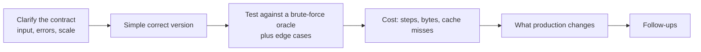
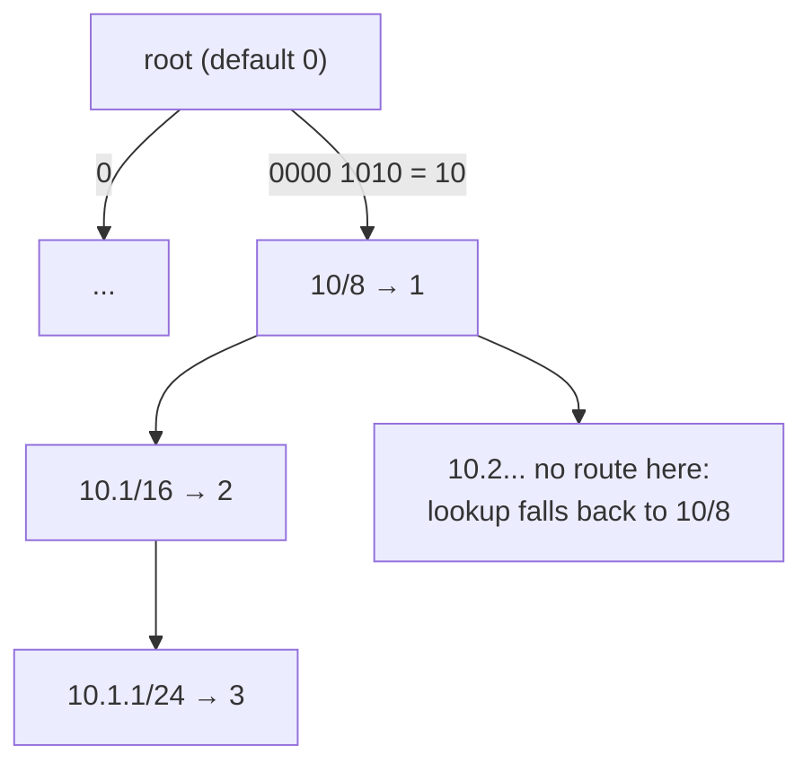
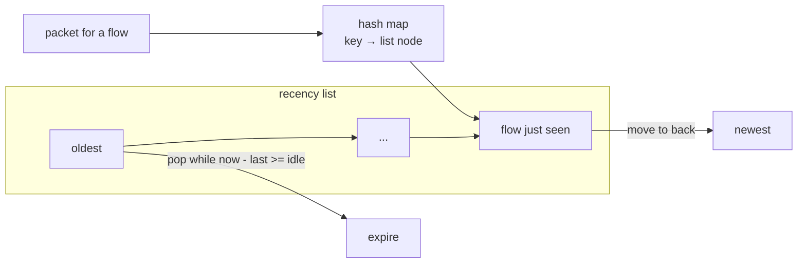

# NET 24: Networking coding drills: checksums, parsers, LPM, rate limiters, ECMP, best path and flow tables

*Part of the [networking plan](00_plan.md) · You need: [NET 02](02_ip_routing_and_layer3.md) (IP and its header), [NET 06](06_linux_network_stack.md) (where these functions live in a stack), [NET 11](11_routing_protocols_and_datacenter_fabrics.md) (BGP, ECMP), [NET 14](14_queueing_qos_and_traffic_management.md) (policing and shaping) and [NET 19](19_inside_a_switch_and_router.md) (FIB and lookup)*

Networking interviews for systems roles often include a short coding problem that is not an algorithm puzzle: "parse this packet", "write the checksum", "implement a routing table lookup", "rate-limit this stream", "pick a next hop", "track flows and expire them". A weak answer writes code that works on the example the interviewer gave and stops. A strong answer does five things before and after the code: it **states the interface and the edge cases** (what is the input, in what byte order, what if it is truncated), **writes the simple correct version**, **names the complexity and the memory layout**, **tests against a brute-force version** instead of one example, and **says what production would change** (RCU for the table, hardware offload for the checksum, a timing wheel for the flows).

This tutorial has seven drills, each small enough to write in an interview and tested here: the Internet checksum with incremental update, a bounds-checked packet parser, a longest-prefix-match trie, a token bucket in integers, ECMP hashing with its failure behaviour, best-path selection from an update stream, and a flow table with expiry. Each drill ends with the follow-up questions that come next. The code is C and C++ you can compile and run; the drills are checked against `scapy` where a reference exists and against a brute-force version where it does not.

**By the end you can:**

- name the habits that make networking code correct: read bytes and never cast, check bounds before every read, keep integers wide enough, and test against an plainly correct oracle;
- write and explain the Internet checksum, including odd lengths, why byte order does not matter, and the incremental update used when a router decrements the TTL;
- write a packet parser that cannot read past the buffer on any input, and say how it treats VLAN tags, IP options, fragments and truncated captures;
- implement longest-prefix match with a trie, give its cost in steps and bytes, and describe the faster structures real stacks use;
- write a token bucket that does not drift, overflow or refill on a clock that steps back, and relate it to policing and shaping;
- hash flows to next hops, explain what moves when a next hop fails, and show hash polarisation and its fix;
- implement BGP-style best-path selection incrementally, and explain why MED makes a pairwise comparator wrong;
- build a flow table with idle timeout and bounded size using a hash map and a recency list, and say when a timing wheel replaces the list.

Section 16 lists what was run, what was fetched and what is from memory.

---

## 1. What a networking coding round is testing

The problems look small and the grading is not about the size. An interviewer who asks for a packet parser or a rate limiter is watching for the habits of someone who has shipped network code:

| Habit | What it looks like in the answer |
|---|---|
| **Ask for the contract** | "Is the buffer a whole Ethernet frame or starts at IP? Can it be truncated? Do I return an error code or throw? Is the table updated while lookups run?" |
| **Bytes, not structs** | Fields are read with shifts from a byte pointer. No `*(struct iphdr *)p` cast |
| **Bounds before reads** | Every read is preceded by a length check, and lengths from the packet are checked against the buffer |
| **Integer care** | A 16-bit sum can overflow; `rate * elapsed` can overflow after an idle hour; signed shifts are undefined |
| **A simple oracle** | A brute-force version and a loop that compares the two on random input |
| **Complexity and layout** | "Lookup is at most 32 steps; each node is 12 bytes in a flat array, so 100 bytes per prefix on random routes" |
| **What production changes** | RCU, per-CPU state, batching, hardware offload |

The method for any of them is the same loop:



Say the loop out loud at the start. It buys time, and it shows the interviewer the order you work in.

---

## 2. Habits that carry across every drill

**Read bytes, never cast.** Network headers are big-endian and packed, and a buffer has no alignment guarantee. `*(uint16_t *)p` is undefined behaviour when `p` is not 2-byte aligned (it can fault on some CPUs) and breaks the strict aliasing rules, and the bytes would be in the wrong order on a little-endian machine anyway. Build values from bytes: `p[0] << 8 | p[1]`. A compiler turns this into a single load and a byte swap where that is legal, so it costs nothing.

**Check the length before the read, and check the packet's own lengths against the buffer.** The IP header says how long the packet is; the capture says how many bytes you have. The two disagree for a truncated capture (header says more) and for Ethernet padding (buffer says more: a minimum-size frame is padded to 60 bytes before the FCS). Trust neither blindly: the header length decides where the payload ends, and the buffer length decides whether you may read.

**Keep integers wide, and know the range.** A sum of 16-bit words fits in 32 bits until 65,537 words; `bytes * 1e9` overflows 64 bits above about 18 GB; `rate * dt` overflows after a long idle unless you cap `dt`. Use unsigned types for bit work, because shifting a signed value is undefined.

**Test against an oracle, not an example.** One worked example passes a wrong solution as often as a right one. A brute-force version, a few hundred thousand random inputs, and the edge cases (empty, one byte, odd length, maximum length, all ones, all zeros) find the bugs. Where a reference exists (the kernel, `scapy`), compare to it too.

**Run it under sanitizers.** `-fsanitize=address,undefined` turns an out-of-bounds read or a signed overflow into an error at the line. The drills below were all compiled this way.

---

## 3. Drill 1: the Internet checksum

**Problem.** Compute the 16-bit checksum of a buffer (RFC 1071), as used by IPv4 headers, ICMP, UDP and TCP. Then update it after one 16-bit word changes, as a router does when it decrements the TTL.

**Ask first:** is the length always even (no: handle odd), is the checksum field zeroed in the input (yes, for computing; for verifying, include it and expect zero), what byte order is the result in (the value is the same sum read as big-endian words).

**The idea.** Add all 16-bit words as big-endian numbers in a wider integer, fold the carries back into the low 16 bits (the "end-around carry" of one's complement), then invert. An odd final byte is the high byte of a word padded with a zero byte on the right. To verify, sum everything including the checksum field: the folded sum is `0xffff`, so the inverted result is zero. For an incremental update when a word changes from `m` to `m'`, RFC 1624 equation 3 gives `HC' = ~(~HC + ~m + m')` in one's complement arithmetic. Its predecessor (RFC 1141) could produce `0xffff` where a recompute gives `0x0000`; equation 3 fixes that corner.

```c
// cksum.c: Internet checksum (RFC 1071) and incremental update (RFC 1624)
#include <stdint.h>
#include <stddef.h>
#include <stdio.h>
#include <string.h>
#include <assert.h>

// One's complement sum of 16-bit words in network order, folded, then inverted.
uint16_t inet_cksum(const void *data, size_t len) {
    const uint8_t *p = data;
    uint32_t sum = 0;                         // 32 bits hold 65,537 words before carry loss
    while (len > 1) { sum += (uint32_t)p[0] << 8 | p[1]; p += 2; len -= 2; }
    if (len) sum += (uint32_t)p[0] << 8;      // odd byte is padded with a zero byte on the right
    while (sum >> 16) sum = (sum & 0xffff) + (sum >> 16);
    return (uint16_t)~sum;
}

// RFC 1624 eqn 3: HC' = ~(~HC + ~m + m'), when one 16-bit word changes from m to m2.
uint16_t cksum_update(uint16_t hc, uint16_t m, uint16_t m2) {
    uint32_t sum = (uint16_t)~hc + (uint16_t)~m + m2;
    while (sum >> 16) sum = (sum & 0xffff) + (sum >> 16);
    return (uint16_t)~sum;
}

#ifndef NO_MAIN
int main(void) {
    // IPv4 header from a well-known worked example, checksum field zeroed
    uint8_t h[20] = {0x45,0,0,0x73,0,0,0x40,0,0x40,0x11,0,0,0xc0,0xa8,0,1,0xc0,0xa8,0,0xc7};
    uint16_t c = inet_cksum(h, 20);
    printf("header checksum: 0x%04x\n", c);
    h[10] = c >> 8; h[11] = c & 0xff;
    printf("verify (sum including the checksum, expect 0): 0x%04x\n", inet_cksum(h, 20));
    // decrement TTL (word 4 is TTL<<8|protocol) and update incrementally
    uint16_t old = h[8] << 8 | h[9];
    h[8]--; uint16_t nw = h[8] << 8 | h[9];
    uint16_t inc = cksum_update(c, old, nw);
    h[10] = h[11] = 0;
    printf("TTL-1: incremental 0x%04x, full recompute 0x%04x\n", inc, inet_cksum(h, 20));
    // odd length: the last byte is the high byte of a padded word
    uint8_t odd[3] = {0x01, 0x02, 0x03};
    printf("odd length 3 bytes: 0x%04x (same as the 4 bytes 01 02 03 00: 0x%04x)\n",
           inet_cksum(odd, 3), inet_cksum((uint8_t[]){1,2,3,0}, 4));
    return 0;
}
#endif
```

```text
header checksum: 0xb861
verify (sum including the checksum, expect 0): 0x0000
TTL-1: incremental 0xb961, full recompute 0xb961
odd length 3 bytes: 0xfbfd (same as the 4 bytes 01 02 03 00: 0xfbfd)
```

Reading it:

- **The header checksum for the well-known example is `0xb861`**, and summing the header with that checksum in place gives zero, which is the receiver's check.
- **The TTL decrement shows the incremental form**: `0xb961` from the update and `0xb961` from a full recompute. Decrementing the TTL by one lowers the TTL word by `0x0100`, so the checksum rises by `0x0100`. That is why routers do it in two instructions.
- **The odd-length rule** gives the same answer as padding with a zero byte.

One example agrees with itself. The stronger check is many random inputs against an independent implementation, and the incremental form against a full recompute over every kind of word, including the all-zero and all-ones cases that break naive versions:

```c
// inc.c: 2 million random incremental updates against a full recompute
#define NO_MAIN
#include "cksum.c"
#include <stdlib.h>
int main(void){ srand(7); long bad=0, n=0;
 for (int t=0;t<2000000;t++){ uint8_t b[20]; for(int i=0;i<20;i++) b[i]=(t%5==0)?0xff*(rand()&1):rand();
  b[10]=b[11]=0; uint16_t c=inet_cksum(b,20); int w=rand()%10; if(w==5) w=4;
  uint16_t m=b[2*w]<<8|b[2*w+1], m2=(t%7==0)?0:rand(); b[2*w]=m2>>8; b[2*w+1]=m2;
  n++; if (cksum_update(c,m,m2)!=inet_cksum(b,20)) bad++; }
 printf("%ld random updates, %ld mismatches\n", n, bad); return 0; }
```

```text
2000000 random updates, 0 mismatches
```

The same function was also compared with `scapy`'s `checksum` over 307 buffers (lengths 0, 1, 2, 3, 19, 20, 21, 64, 1499 and 1500 bytes, plus all-ones and all-zeros): all 307 agree.

**Cost and production.** One pass, 2 bytes per add; real implementations add 8 bytes at a time with add-with-carry, and the NIC usually does it (checksum offload, which is why a capture on the sender can show "bad" checksums for packets that are fine on the wire: the NIC fills the field after the capture point). The sum is byte-order independent as a whole (RFC 1071), so a little-endian machine can add native words and swap once at the end. **Follow-ups:** pseudo-header for TCP and UDP; why a UDP checksum of zero means "none" in IPv4 and a computed zero is sent as `0xffff`; what the checksum cannot catch (swapped words, errors that cancel), which is why links also have a CRC (NET 22).

---

## 4. Drill 2: a packet parser that cannot overread

**Problem.** Given a buffer, parse Ethernet, up to two VLAN tags, IPv4 and the TCP or UDP ports. Never read outside the buffer, whatever the bytes are.

**Ask first:** does the buffer start at Ethernet or IP; may it be truncated (a capture with a snap length); what does the caller need (the 5-tuple, the VLAN IDs); is "not IPv4" an error (no: stop and report the EtherType).

**The idea.** Walk forward with an offset, and **before every read check `len >= off + need`**. Then check that each length field inside the packet is consistent with the layer below: the IP header length is at least 20 bytes, the total length is at least the header length, the TCP data offset is at least 20 and fits inside the IP payload. Use the IP total length, not the buffer length, to find where the packet ends. A non-first fragment has no L4 header, so it has no ports.

```c
// parse.c: bounds-checked Ethernet / VLAN / IPv4 / TCP-UDP parser
#include <stdint.h>
#include <stddef.h>
#include <stdio.h>
#include <string.h>

enum { P_OK = 0, P_SHORT = -1, P_BAD_IP = -2, P_BAD_L4 = -3 };

struct info { uint16_t ethertype, vlan[2]; int nvlan; uint8_t proto; uint32_t src, dst;
              uint16_t sport, dport, ip_total; int frag; };

static inline uint16_t rd16(const uint8_t *p) { return (uint16_t)(p[0] << 8 | p[1]); }
static inline uint32_t rd32(const uint8_t *p) { return (uint32_t)rd16(p) << 16 | rd16(p + 2); }

int parse(const uint8_t *pkt, size_t len, struct info *o) {
    memset(o, 0, sizeof *o);
    size_t off = 12;
    if (len < off + 2) return P_SHORT;
    uint16_t et = rd16(pkt + off); off += 2;
    while ((et == 0x8100 || et == 0x88a8) && o->nvlan < 2) {      // up to two tags (QinQ)
        if (len < off + 4) return P_SHORT;
        o->vlan[o->nvlan++] = rd16(pkt + off) & 0x0fff;            // VID is the low 12 bits
        et = rd16(pkt + off + 2); off += 4;
    }
    o->ethertype = et;
    if (et != 0x0800) return P_OK;                                 // not IPv4: stop, not an error
    if (len < off + 20) return P_SHORT;
    const uint8_t *ip = pkt + off;
    size_t ihl = (size_t)(ip[0] & 0x0f) * 4;
    if ((ip[0] >> 4) != 4 || ihl < 20) return P_BAD_IP;
    o->ip_total = rd16(ip + 2);
    if (o->ip_total < ihl) return P_BAD_IP;
    if (off + o->ip_total > len) return P_SHORT;                    // captured less than the IP header claims
    o->proto = ip[9]; o->src = rd32(ip + 12); o->dst = rd32(ip + 16);
    uint16_t fo = rd16(ip + 6);
    o->frag = (fo & 0x3fff) != 0;                                  // MF flag or offset != 0
    if ((fo & 0x1fff) != 0) return P_OK;                           // not the first fragment: no L4 header here
    size_t l4 = off + ihl, avail = off + o->ip_total - l4;         // bytes the IP header says exist
    if (o->proto == 17) { if (avail < 8) return P_BAD_L4; }
    else if (o->proto == 6) {
        if (avail < 20) return P_BAD_L4;
        size_t doff = (size_t)(pkt[l4 + 12] >> 4) * 4;
        if (doff < 20 || doff > avail) return P_BAD_L4;
    } else return P_OK;
    o->sport = rd16(pkt + l4); o->dport = rd16(pkt + l4 + 2);
    return P_OK;
}

#ifndef NO_MAIN
#include <stdlib.h>
int main(void) {
    uint8_t p[] = { 1,2,3,4,5,6, 6,5,4,3,2,1, 0x81,0x00, 0x00,0x64, 0x08,0x00,   // eth + VLAN 100
        0x45,0, 0,40, 0,0, 0x40,0, 64,6, 0,0, 10,0,0,1, 10,0,0,2,              // IPv4, total 40, TCP
        0x30,0x39, 0,80, 0,0,0,1, 0,0,0,0, 0x50,0x02, 0xff,0xff, 0,0, 0,0 };    // TCP SYN, 20 bytes
    struct info o; int r = parse(p, sizeof p, &o);
    printf("full packet: r=%d vlan=%d(%u) proto=%u %u.%u.%u.%u:%u -> %u.%u.%u.%u:%u\n", r, o.nvlan, o.vlan[0], o.proto,
           o.src>>24, o.src>>16&255, o.src>>8&255, o.src&255, o.sport, o.dst>>24, o.dst>>16&255, o.dst>>8&255, o.dst&255, o.dport);
    uint8_t m[sizeof p]; int r1, r2, r3;
    memcpy(m, p, sizeof p); m[18] = 0x44; r1 = parse(m, sizeof m, &o);               // IHL 4 words = 16 bytes
    memcpy(m, p, sizeof p); m[21] = 10;   r2 = parse(m, sizeof m, &o);               // total length 10 < header
    memcpy(m, p, sizeof p); m[50] = 0x10; r3 = parse(m, sizeof m, &o);               // TCP data offset 4 words
    printf("bad IHL: %d, total length below header: %d, bad TCP offset: %d\n", r1, r2, r3);
    int ok = 0, shortc = 0, bad = 0;                                            // every prefix: no crash, no overread
    for (size_t n = 0; n <= sizeof p; n++) { uint8_t *c = malloc(n ? n : 1); memcpy(c, p, n);
        int rr = parse(c, n, &o); ok += rr == P_OK; shortc += rr == P_SHORT; bad += rr < P_SHORT; free(c); }
    printf("all %zu prefixes: ok=%d short=%d malformed=%d\n", sizeof p + 1, ok, shortc, bad);
    srand(3); long fz = 0, fok = 0;                                             // random garbage, with a plausible start
    for (int t = 0; t < 200000; t++) {
        size_t n = rand() % 80; uint8_t *c = malloc(n ? n : 1);
        for (size_t i = 0; i < n; i++) c[i] = rand();
        if (n > 14 && t % 2) { c[12] = 8; c[13] = 0; c[14] = 0x45 | (rand() & 3); }
        fok += parse(c, n, &o) == P_OK; fz++; free(c); }
    printf("fuzz: %ld inputs parsed without a fault (%ld accepted)\n", fz, fok);
    return 0; }
#endif
```

```text
full packet: r=0 vlan=1(100) proto=6 10.0.0.1:12345 -> 10.0.0.2:80
bad IHL: -2, total length below header: -2, bad TCP offset: -3
all 59 prefixes: ok=1 short=58 malformed=0
fuzz: 200000 inputs parsed without a fault (83801 accepted)
```

Reading it:

- **The full packet** parses to the right 5-tuple through a VLAN tag.
- **The three mutations** each hit their own check (a short IHL, a total length below the header, a TCP offset of 4 words): the first two return the bad-IP code and the third the bad-L4 code, so a caller can count them by cause.
- **Every prefix of the packet** was parsed from a buffer of exactly that size (allocated with `malloc` so AddressSanitizer sees the edge): 58 are "short", one is complete, none faults. A parser that reads first and checks later fails this loop immediately.
- **The fuzz loop** feeds 200,000 random buffers, half of them shaped to look like IPv4 to get past the first check; none faults under the sanitizers.

A cross-check against `scapy` is the independent reference: 400 packets built by `scapy` (zero to two VLAN tags, with and without IP options, TCP with and without options, UDP, ICMP, and fragments with the more-fragments flag or a non-zero offset) were parsed by this code and every field matched.

**Cost and production.** One pass, constant work per layer, no allocation. Real parsers also handle IPv6 extension headers (a chain with a length at each step, so the same bounds discipline applies), GRE or VXLAN encapsulation (a second parse at an inner offset), and they validate the IP header checksum when the stack has not offloaded it. **Follow-ups:** why Ethernet padding makes `len > ip_total` legal; what the parser should do with a fragment (ports are unknown, so an ECMP hash on a fragmented flow can split the flow across paths: see drill 5); how to fuzz it (libFuzzer or AFL with the sanitizers on).

---

## 5. Drill 3: longest-prefix match

**Problem.** Store IPv4 prefixes with next hops. For an address, return the next hop of the **longest** prefix that matches it.

**Ask first:** how many prefixes (a few hundred in a host, a million in an Internet router), how often does it change versus how often is it read (reads dominate by orders of magnitude), is a default route present, may the table change during lookups.

**The idea.** A **binary trie**: one level per address bit, a node per prefix bit. Insert walks the prefix bits and stores the next hop at the last node. Lookup walks the address bits and **remembers the last node that held a route**; when the path ends, that remembered value is the longest match. The root holds the `/0` default route.



```cpp
// lpm.cpp: longest-prefix match with a binary trie in a flat array
#include <cstdint>
#include <cstdio>
#include <cstdlib>
#include <vector>
#include <random>
using namespace std;

struct Node { int32_t child[2] = {-1, -1}; int32_t nh = -1; };   // 12 bytes; indices, not pointers

struct Trie {
    vector<Node> n{Node{}};                                       // node 0 is the root (the /0 prefix)
    void insert(uint32_t pfx, int len, int nh) {                  // pfx has its host bits zero
        int cur = 0;
        for (int i = 0; i < len; i++) {
            int b = pfx >> (31 - i) & 1;
            if (n[cur].child[b] < 0) { n[cur].child[b] = (int)n.size(); n.emplace_back(); }  // may move storage
            cur = n[cur].child[b];
        }
        n[cur].nh = nh;
    }
    int lookup(uint32_t a, int *steps = nullptr) const {          // remember the last node that held a route
        int cur = 0, best = n[0].nh, s = 0;
        for (int i = 0; i < 32; i++) {
            cur = n[cur].child[a >> (31 - i) & 1];
            if (cur < 0) break;
            s++; if (n[cur].nh >= 0) best = n[cur].nh;
        }
        if (steps) *steps = s;
        return best;
    }
};

struct Route { uint32_t pfx; int len, nh; };
int brute(const vector<Route> &rs, uint32_t a) {                  // the plainly correct version
    int best = -1, bl = -1;
    for (auto &r : rs) {
        uint32_t mask = r.len ? ~0u << (32 - r.len) : 0;
        if ((a & mask) == r.pfx && r.len > bl) { bl = r.len; best = r.nh; }
    }
    return best;
}

int main() {
    mt19937 g(11); Trie t; vector<Route> rs;
    auto add = [&](uint32_t p, int l, int nh) {                   // later insert of the same prefix replaces
        uint32_t m = l ? ~0u << (32 - l) : 0; p &= m;
        for (auto &r : rs) if (r.pfx == p && r.len == l) { r.nh = nh; t.insert(p, l, nh); return; }
        rs.push_back({p, l, nh}); t.insert(p, l, nh);
    };
    add(0, 0, 0); add(0x0a000000, 8, 1); add(0x0a010000, 16, 2); add(0x0a010100, 24, 3);   // default, 10/8, 10.1/16, 10.1.1/24
    printf("10.1.1.9 -> %d, 10.1.2.9 -> %d, 10.2.0.1 -> %d, 11.0.0.1 -> %d\n",
           t.lookup(0x0a010109), t.lookup(0x0a010209), t.lookup(0x0a020001), t.lookup(0x0b000001));
    for (int i = 0; i < 20000; i++) add(g(), 8 + g() % 25, 1 + g() % 64);    // lengths 8..32, many nested
    long bad = 0; for (int i = 0; i < 200000; i++) { uint32_t a = (i & 1) ? g() : rs[g() % rs.size()].pfx | (g() & 0xff); bad += t.lookup(a) != brute(rs, a); }
    printf("%zu prefixes, 200000 lookups vs brute force: %ld mismatches\n", rs.size(), bad);
    long tot = 0; int mx = 0; for (int i = 0; i < 100000; i++) { int s; t.lookup(g(), &s); tot += s; mx = max(mx, s); }
    printf("nodes %zu, %.1f bytes per prefix, avg steps %.1f, max %d\n", t.n.size(), (double)t.n.size() * sizeof(Node) / rs.size(), tot / 1e5, mx);
    return 0;
}
```

```text
10.1.1.9 -> 3, 10.1.2.9 -> 2, 10.2.0.1 -> 1, 11.0.0.1 -> 0
18509 prefixes, 200000 lookups vs brute force: 0 mismatches
nodes 154323, 100.1 bytes per prefix, avg steps 14.2, max 30
```

Reading it:

- **The four hand cases** show the fallback: `10.1.1.9` takes the `/24` (next hop 3), `10.1.2.9` falls back to the `/16` (2), `10.2.0.1` to the `/8` (1), and `11.0.0.1` to the default (0).
- **Against a brute-force scan** over 18,509 prefixes (lengths 8 to 32, heavily nested, inserted and replaced at random) the trie agrees on all 200,000 lookups, half of them addresses chosen inside known prefixes so the long matches are exercised.
- **Memory layout is a decision.** Nodes are 12 bytes in one `vector`, children are 32-bit indices, not pointers, so a node is a third of a pointer-based one, the whole structure is one block, and a copy of the table is a copy of an array. On this random table the trie takes about 100 bytes per prefix (154,323 nodes for 18,509 prefixes), because a long prefix with no neighbours costs a chain of single-child nodes.
- **Steps are not the same as cache misses.** The worst case is 32 steps; random addresses average 14 because most fall off the trie early. Each step is a dependent load, so on a table that does not fit in cache the cost is steps times memory latency, which is why the production structures below shrink the step count.

**What production uses (the follow-ups).**

- **Multibit tries** consume 4 or 8 bits per step: a stride of 8 gives at most 4 steps for IPv4 at the cost of 256-way nodes, and prefix lengths that are not multiples of the stride are expanded (a `/10` becomes four `/12` entries, for a stride of 4).
- **DIR-24-8** (used by DPDK's FIB library, per its documentation) splits the address: a table indexed by the top 24 bits (2^24 entries) answers most lookups in one memory access, and a second-level group of 256 entries indexed by the last 8 bits handles the longer prefixes. The documentation gives entry sizes of 1, 2, 4 or 8 bytes, so the first table is 16 MiB to 128 MiB depending on the width; it trades memory for lookup speed.
- **Path-compressed and level-compressed tries** (the Linux IPv4 FIB is an LC-trie, from memory) skip single-child chains, which removes most of the 100 bytes per prefix seen here.
- **Hardware** uses TCAM, which matches every entry at once with a mask and takes the longest by entry order or priority (NET 19).
- **Updates during lookups:** the usual answers are RCU (readers never block; a writer publishes a new node and frees the old one after a grace period), or a double-buffered table swapped atomically, and for the flat array above an update that appends nodes must not move the storage under a reader: this implementation is single-threaded for that reason.

---

## 6. Drill 4: a token bucket in integers

**Problem.** Limit a stream to `rate` bytes per second with bursts up to `burst` bytes. `allow(bytes, now)` returns true if the packet conforms.

**Ask first:** is it policing (drop or mark non-conforming) or shaping (delay it: that needs a queue, NET 14); what is the clock (monotonic nanoseconds); how large can `rate` and `burst` be.

**The idea.** The bucket holds up to `burst` tokens (bytes), refills continuously at `rate`, and a packet needs tokens equal to its size. Three details separate a working answer from a correct one:

1. **Do not round the refill.** Computing `tokens += rate * dt / 1e9` in whole bytes loses the fraction on every call; at 1 byte per second with a call every millisecond it adds zero forever. Store tokens in units of 1/10^9 byte (bytes times 10^9), so no refill is ever thrown away.
2. **Cap `dt` before multiplying.** After a long idle the bucket is full anyway, so `dt` need not exceed the time to fill it; capping it keeps `dt * rate` from overflowing 64 bits (an hour at 100 Gbit/s would).
3. **A clock that steps backwards refills nothing**, and does not move `last` back.

```cpp
// bucket.cpp: token bucket in integers, no drift, no overflow
#include <cstdint>
#include <cstdio>
#include <algorithm>
using namespace std;
typedef unsigned long long u64;

struct TokenBucket {
    u64 rate, burst;          // bytes per second, bytes
    u64 tokens = 0;           // stored in units of 1/1e9 byte: bytes * 1e9, so no rounding is ever thrown away
    u64 last = 0;             // ns
    TokenBucket(u64 rate_Bps, u64 burst_bytes, u64 now_ns) : rate(rate_Bps), burst(burst_bytes), tokens(burst_bytes * 1000000000ull), last(now_ns) {}
    bool allow(u64 bytes, u64 now) {
        if (now > last) {                                      // a clock that steps back refills nothing
            u64 dt = now - last;
            u64 full = burst * 1000000000ull / rate + 1;       // ns after which the bucket is certainly full
            dt = min(dt, full);                                // so dt * rate cannot overflow after a long idle
            tokens = min(burst * 1000000000ull, tokens + dt * rate);
            last = now;
        }
        if (tokens < bytes * 1000000000ull) return false;      // all or nothing: a packet is not split
        tokens -= bytes * 1000000000ull;
        return true;
    }
};

int main() {
    // 10 Mbit/s = 1,250,000 B/s, burst 3000 B. Offer 1500 B packets every 0.5 ms (24 Mbit/s offered) for 2 s.
    TokenBucket b(1250000, 3000, 0); u64 acc = 0, sent = 0;
    for (u64 t = 0; t < 2000000000ull; t += 500000) { sent += 1500; acc += b.allow(1500, t) ? 1500 : 0; }
    printf("offered %llu B, accepted %llu B; bound rate*T+burst = %llu B\n", sent, acc, 1250000ull * 2 + 3000);
    // a long idle must not overflow: 1 hour idle at 100 Gbit/s (12.5 GB/s), burst 1 MB
    TokenBucket big(12500000000ull, 1000000, 0);
    big.allow(1000000, 0);                                      // drain it
    bool a1 = big.allow(1000000, 3600ull * 1000000000ull);      // after an hour the bucket is exactly full, one burst passes
    bool a2 = big.allow(1, 3600ull * 1000000000ull);            // and then it is empty at the same instant
    printf("100G idle 1 h: burst passes %d, next byte at the same instant %d\n", a1, a2);
    // clock steps backwards
    TokenBucket c(1000, 1000, 5000000000ull); c.allow(1000, 5000000000ull);
    printf("clock steps back: %d (no refill); 1 s later it is full again: %d\n", c.allow(1, 4000000000ull), c.allow(1000, 6000000000ull));
    // the drift an integer-bytes refill would have: 1 B/s refilled every 1 ms
    TokenBucket d(1, 10, 0); d.allow(10, 0); u64 got = 0; for (u64 t = 1; t <= 10000; t++) got += d.allow(1, t * 1000000ull);
    printf("1 B/s offered a byte every 1 ms for 10 s: accepted %llu (10 expected; truncating to whole bytes each call gives 0)\n", got);
    return 0;
}
```

```text
offered 6000000 B, accepted 2502000 B; bound rate*T+burst = 2503000 B
100G idle 1 h: burst passes 1, next byte at the same instant 0
clock steps back: 0 (no refill); 1 s later it is full again: 1
1 B/s offered a byte every 1 ms for 10 s: accepted 10 (10 expected; truncating to whole bytes each call gives 0)
```

Reading it:

- **Conformance:** offered 24 Mbit/s for 2 seconds against a 10 Mbit/s limit with a 3,000-byte burst, the bucket accepts 2,502,000 bytes. The bound is `rate * T + burst` = 2,503,000, and 1,500-byte packets reach 2,502,000 of it: never above the bound, within one packet of it.
- **The idle hour at 100 Gbit/s** neither overflows nor leaks: the full burst passes, and the next byte at the same instant does not.
- **A clock stepping back** refills nothing, and a second later the bucket is full.
- **The drift case:** 1 byte per second with a byte offered every millisecond for 10 seconds accepts exactly 10 bytes, and a whole-byte refill would accept none.

**Limits and production.** The scaling by 10^9 overflows once `burst` exceeds about 9 GB (the sum of stored tokens and a refill reaches 2 * burst * 10^9 against 1.8 * 10^19): fine for packets, not for a data-volume quota, where you would scale differently. A **GCRA** (generic cell rate algorithm) states the same limit with a single timestamp, the theoretical arrival time, instead of a token count: two fields fewer, the same conformance. **Policing** drops or marks the excess and needs no queue; **shaping** holds it in a queue and releases it at the rate, which adds delay and needs buffer (NET 14). In a multi-core data plane the bucket is usually **per core or per queue** with the rate divided, because one shared atomic bucket is a contention point. **Follow-ups:** a two-rate three-color marker (a committed and a peak bucket); a distributed limiter (a central counter with local leases, accepting some over-admission); the leaky bucket as a meter (same conformance, different picture).

---

## 7. Drill 5: ECMP hashing, failure and polarisation

**Problem.** Pick one of `N` equal-cost next hops for a flow so that all packets of a flow take the same path. Then: what happens when a next hop dies, and why do two switches in series sometimes use only part of their links?

**Ask first:** which fields (the 5-tuple), whether the reverse direction must hash the same (some middleboxes need it), whether flows must survive a next-hop change (they cannot: reordering and resets), and what is hashed for fragments (no ports).

**The idea.** Hash the 5-tuple with a function that mixes every input bit into every output bit, and take the result modulo `N`. Three properties to test: **uniform** spread, **symmetric** when the application needs it (sort the endpoints before hashing), and **stable** under a change of `N`. Plain modulo is not stable. **Rendezvous (highest-random-weight) hashing** scores every (flow, next hop) pair and picks the highest score, so removing a next hop moves only the flows that were on it.

```cpp
// ecmp.cpp: flow hashing, remap cost on failure, and polarisation
#include <cstdint>
#include <cstdio>
#include <vector>
#include <random>
#include <algorithm>
using namespace std;
typedef uint64_t u64;

struct Flow { uint32_t src, dst; uint16_t sp, dp; uint8_t proto; };

static inline u64 mix(u64 x) {                                   // splitmix64 finaliser: every input bit moves every output bit
    x += 0x9e3779b97f4a7c15ull; x = (x ^ x >> 30) * 0xbf58476d1ce4e5b9ull; x = (x ^ x >> 27) * 0x94d049bb133111ebull; return x ^ x >> 31;
}
u64 hash5(const Flow &f, u64 seed) {
    return mix(seed ^ mix((u64)f.src << 32 | f.dst) ^ mix((u64)f.sp << 24 | (u64)f.dp << 8 | f.proto));
}
Flow sym(Flow f) { if (f.src > f.dst || (f.src == f.dst && f.sp > f.dp)) { swap(f.src, f.dst); swap(f.sp, f.dp); } return f; }  // same hash both ways

int modulo_pick(const Flow &f, int n, u64 seed) { return (int)(hash5(f, seed) % n); }
int hrw_pick(const Flow &f, const vector<int> &hops, u64 seed) {  // rendezvous: highest score wins, ties impossible in practice
    int best = -1; u64 bs = 0;
    for (int h : hops) { u64 s = mix(hash5(f, seed) ^ mix(h + 1)); if (best < 0 || s > bs) { bs = s; best = h; } }
    return best;
}

int main() {
    mt19937_64 g(21); vector<Flow> fl(100000);
    for (auto &f : fl) f = {(uint32_t)g(), (uint32_t)g(), (uint16_t)g(), (uint16_t)g(), 6};
    { Flow a = {1, 2, 1000, 80, 6}, b = {2, 1, 80, 1000, 6}; printf("reply direction: plain hashes equal %d, symmetric hashes equal %d\n", hash5(a, 5) == hash5(b, 5), hash5(sym(a), 5) == hash5(sym(b), 5)); }
    vector<int> cnt(8); for (auto &f : fl) cnt[modulo_pick(f, 8, 1)]++;
    printf("spread over 8 next hops (100000 flows): min %d max %d (ideal 12500)\n", *min_element(cnt.begin(), cnt.end()), *max_element(cnt.begin(), cnt.end()));
    long mod_moved = 0, hrw_moved = 0, hrw_on_dead = 0; vector<int> all8 = {0,1,2,3,4,5,6,7}, no7 = {0,1,2,3,4,5,6};
    for (auto &f : fl) {
        mod_moved += modulo_pick(f, 8, 1) != modulo_pick(f, 7, 1);
        int a = hrw_pick(f, all8, 1), b = hrw_pick(f, no7, 1); hrw_moved += a != b; hrw_on_dead += a == 7;
    }
    printf("one of 8 next hops dies: hash %% N moves %.1f%% of flows, rendezvous moves %.1f%% (the dead hop carried %.1f%%)\n",
           mod_moved / 1000.0, hrw_moved / 1000.0, hrw_on_dead / 1000.0);
    for (int same = 1; same >= 0; same--) {                       // two stages of 4 next hops each
        vector<vector<int>> m(4, vector<int>(4));
        for (auto &f : fl) m[modulo_pick(f, 4, 99)][modulo_pick(f, 4, same ? 99 : 7)]++;
        printf("stage 2 loads when the stage-2 seed is %s: ", same ? "the SAME as stage 1" : "different");
        for (int s1 = 0; s1 < 4; s1++) { printf("[after S1 hop %d:", s1); for (int s2 = 0; s2 < 4; s2++) printf(" %d", m[s1][s2]); printf("] "); }
        printf("\n");
    }
    return 0;
}
```

```text
reply direction: plain hashes equal 0, symmetric hashes equal 1
spread over 8 next hops (100000 flows): min 12350 max 12655 (ideal 12500)
one of 8 next hops dies: hash % N moves 87.6% of flows, rendezvous moves 12.4% (the dead hop carried 12.4%)
stage 2 loads when the stage-2 seed is the SAME as stage 1: [after S1 hop 0: 25113 0 0 0] [after S1 hop 1: 0 24972 0 0] [after S1 hop 2: 0 0 25120 0] [after S1 hop 3: 0 0 0 24795]
stage 2 loads when the stage-2 seed is different: [after S1 hop 0: 6297 6293 6215 6308] [after S1 hop 1: 6432 6159 6119 6262] [after S1 hop 2: 6273 6327 6180 6340] [after S1 hop 3: 6201 6152 6301 6141]
```

Reading it:

- **Symmetry:** the plain hash of a flow and its reply differ; sorting the endpoints first makes them equal.
- **Spread:** over 8 next hops, 100,000 flows land between 12,350 and 12,655 against an ideal 12,500, which is within about 1.2 percent.
- **Failure:** with `hash % N`, losing one of 8 next hops moves 87.6 percent of all flows (a flow stays only when `x mod 8 == x mod 7`, about 1 in 8), and with rendezvous hashing it moves 12.4 percent, which is exactly the share the dead hop carried. A modulo-based switch turns one link failure into a path change for nearly every flow, which means reordering and resets everywhere.
- **Polarisation:** when stage 2 uses the same hash and seed as stage 1, every flow that stage 1 sent to hop 0 has the same hash modulo 4 at stage 2, so each first-stage hop feeds **exactly one** second-stage hop (25,113 flows to one, zero to the other three). With a different seed per stage the spread over the second stage is even again (about 6,200 per cell). The fix in real networks is a per-switch seed or a different set of hashed fields, which is the point of NET 11's hash polarisation section.

**Production.** Switches hash in hardware with a configurable seed and field set, and use **resilient or consistent hashing** (a fixed table of buckets mapped to next hops, so a failure remaps only the failed hop's buckets) rather than the modulo shown to fail here. Load balancers use **Maglev**-style tables (from memory) for the same reason. **Follow-ups:** elephant flows defeat any flow-level hash (flowlets or per-packet spraying in AI fabrics, NET 23); fragments have no ports, so hash the 3-tuple for them, or the flow splits; weighted next hops (give each hop more entries in the bucket table).

---

## 8. Drill 6: best path from an update stream

**Problem.** A router receives route announcements and withdrawals for prefixes from several peers. Keep the best path per prefix, and report when it changes.

**Ask first:** which attributes (local preference, AS-path length, origin, MED, eBGP over iBGP, IGP cost, router ID), whether MED is compared across neighbours, and whether updates arrive in any order. The usual decision order is: highest local preference, shortest AS path, lowest origin, lowest MED (among paths from the same neighbouring AS), eBGP over iBGP, lowest IGP cost to the next hop, lowest router ID.

**The trap.** If you write the comparison as a pairwise `better(a, b)` that compares MED only when both paths come from the same neighbouring AS, **the relation is not transitive**. Take path A (AS 100, MED 10, IGP cost 50), B (AS 100, MED 20, IGP 10) and C (AS 200, IGP 30): A beats B on MED, B beats C on IGP cost, and C beats A on IGP cost. A cycle has no best element, so the winner depends on the order you compare in. This is the root of the MED-related persistent route oscillation described in RFC 3345. The fix is to **make the comparison a function of the whole set**: first discard every path that loses on MED to a path from the same neighbouring AS (with the earlier tie-break fields equal), and only then compare the survivors by a plain lexicographic key.

```cpp
// bestpath.cpp: BGP-style best path from a stream of updates, and why MED breaks a naive comparator
#include <cstdint>
#include <cstdio>
#include <map>
#include <vector>
#include <random>
#include <algorithm>
using namespace std;

struct Path { int peer, nbr_as, local_pref, as_len, origin, med, ebgp, igp_cost, router_id; };   // origin: 0 IGP < 1 EGP < 2 incomplete

// Steps 1-4, 6-8 of the usual decision process, as a tuple compared lexicographically (smaller is better).
auto key(const Path &p) { return make_tuple(-p.local_pref, p.as_len, p.origin, 0, -p.ebgp, p.igp_cost, p.router_id); }

// Wrong on purpose: compares MED pairwise, but only when both paths come from the same neighbour AS.
bool naive_better(const Path &a, const Path &b) {
    if (a.local_pref != b.local_pref) return a.local_pref > b.local_pref;
    if (a.as_len != b.as_len) return a.as_len < b.as_len;
    if (a.origin != b.origin) return a.origin < b.origin;
    if (a.nbr_as == b.nbr_as && a.med != b.med) return a.med < b.med;
    if (a.ebgp != b.ebgp) return a.ebgp > b.ebgp;
    if (a.igp_cost != b.igp_cost) return a.igp_cost < b.igp_cost;
    return a.router_id < b.router_id;
}

// Right: first drop every path that loses on MED to a path from the same neighbour AS (and ties through step 3), then compare the rest.
Path pick(const vector<Path> &keep) {
    // group by (local_pref, as_len, origin, neighbour AS); inside a group only the lowest MED survives
    vector<Path> out;
    for (auto &p : keep) {
        bool beaten = false;
        for (auto &q : keep)
            if (q.nbr_as == p.nbr_as && make_tuple(q.local_pref, q.as_len, q.origin) == make_tuple(p.local_pref, p.as_len, p.origin) && q.med < p.med) beaten = true;
        if (!beaten) out.push_back(p);
    }
    return *min_element(out.begin(), out.end(), [](const Path &a, const Path &b) { return key(a) < key(b); });
}


// Reference: the decision process written as successive elimination, a different shape from pick()
template <class F> void keep_best(vector<Path> &v, F f) { auto b = f(*min_element(v.begin(), v.end(), [&](const Path &x, const Path &y) { return f(x) < f(y); })); vector<Path> o; for (auto &p : v) if (f(p) == b) o.push_back(p); v = o; }
int ref_pick(vector<Path> v) {
    keep_best(v, [](const Path &p) { return -p.local_pref; }); keep_best(v, [](const Path &p) { return p.as_len; }); keep_best(v, [](const Path &p) { return p.origin; });
    vector<Path> o; for (auto &p : v) { bool lose = false; for (auto &q : v) lose |= q.nbr_as == p.nbr_as && q.med < p.med; if (!lose) o.push_back(p); } v = o;
    keep_best(v, [](const Path &p) { return -p.ebgp; }); keep_best(v, [](const Path &p) { return p.igp_cost; }); keep_best(v, [](const Path &p) { return p.router_id; });
    return v[0].peer;
}

struct Rib {                                                        // per prefix: candidates by peer, and the current best
    map<int, map<int, Path>> cand; map<int, int> best_peer;       // prefix -> (peer -> path); prefix -> peer of the best
    int changes = 0;
    void update(int prefix, const Path &p) { cand[prefix][p.peer] = p; recompute(prefix); }
    void withdraw(int prefix, int peer) { cand[prefix].erase(peer); recompute(prefix); }
    void recompute(int prefix) {
        auto &c = cand[prefix]; int nb = -1;
        if (!c.empty()) { vector<Path> v; for (auto &kv : c) v.push_back(kv.second); nb = pick(v).peer; }
        auto it = best_peer.find(prefix); int old = it == best_peer.end() ? -1 : it->second;
        if (nb != old) { changes++; if (nb < 0) best_peer.erase(prefix); else best_peer[prefix] = nb; }
    }
};

int main() {
    // three paths: A and B from AS 100 (MED 10 and 20), C from AS 200; all equal up to MED, decided by IGP cost / router id afterwards
    Path A{1, 100, 100, 2, 0, 10, 1, 50, 1}, B{2, 100, 100, 2, 0, 20, 1, 10, 2}, C{3, 200, 100, 2, 0, 0, 1, 30, 3};
    printf("naive pairwise: A<B %d, B<C %d, C<A %d   (a cycle: the winner depends on the order you compare in)\n", naive_better(A, B), naive_better(B, C), naive_better(C, A));
    vector<Path> v = {A, B, C}; int wins[2] = {0, 0};
    for (int perm = 0; perm < 6; perm++) { vector<Path> w = v; auto best = w[0]; for (auto &p : w) if (naive_better(p, best)) best = p; wins[best.peer == 1]++; next_permutation(v.begin(), v.end(), [](const Path &x, const Path &y) { return x.peer < y.peer; }); }
    printf("naive best over the 6 arrival orders: peer 1 wins %d times, someone else %d times\n", wins[1], wins[0]);
    printf("grouped by neighbour AS first: best is peer %d every time\n", pick({A, B, C}).peer);
    mt19937 g(4); Rib rib; long mism = 0, events = 0;
    for (int i = 0; i < 20000; i++) {                               // random stream; check against a from-scratch pick after every event
        int pre = g() % 20;
        if (g() % 4 == 0 && !rib.cand[pre].empty()) rib.withdraw(pre, rib.cand[pre].begin()->first);
        else { int peer = g() % 6; rib.update(pre, {peer, (int)(100 * (g() % 3 + 1)), (int)(100 + 100 * (g() % 2)), (int)(1 + g() % 3), (int)(g() % 2), (int)(g() % 5) * 10, (int)(g() % 2), (int)(g() % 40), peer}); }
        events++;
        vector<Path> all; for (auto &kv : rib.cand[pre]) all.push_back(kv.second);
        int want = all.empty() ? -1 : ref_pick(all); if (!all.empty()) mism += pick(all).peer != want; auto it = rib.best_peer.find(pre); int have = it == rib.best_peer.end() ? -1 : it->second;
        mism += want != have;
        vector<Path> sh = all; shuffle(sh.begin(), sh.end(), g); if (!sh.empty() && pick(sh).peer != want) mism++;   // arrival order must not matter
    }
    printf("%ld events, %ld mismatches (stream vs from-scratch, and shuffled arrival order); best path changed %d times\n", events, mism, rib.changes);
    return 0;
}
```

```text
naive pairwise: A<B 1, B<C 1, C<A 1   (a cycle: the winner depends on the order you compare in)
naive best over the 6 arrival orders: peer 1 wins 2 times, someone else 4 times
grouped by neighbour AS first: best is peer 3 every time
20000 events, 0 mismatches (stream vs from-scratch, and shuffled arrival order); best path changed 5811 times
```

Reading it:

- **The cycle is real:** `A<B`, `B<C` and `C<A` are all true, and the naive linear scan crowns peer 1 for 2 of the 6 arrival orders and someone else for the other 4.
- **The grouped version** returns peer 3 (path C: A and B are in the same AS, B loses to A on MED, then C beats A on IGP cost) for every order.
- **The stream test** applies 20,000 random announcements and withdrawals, recomputes after each, and compares with a second implementation written as successive elimination (filter by local preference, then AS-path length, and so on), a different shape from the first. There are no mismatches, and shuffling the arrival order never changes the answer. Router IDs are unique per peer in the test, because two paths that tie on every field would make the result depend on arrival order in any implementation.

**Cost and production.** Recomputing a prefix is linear in its candidate count, which is small (a handful of paths); the cost that matters is the **number of prefixes and updates** (a full Internet table is on the order of a million prefixes, from memory, and a reset replays all of them), so real implementations keep the best path cached and recompute only the affected prefix, which is what this `Rib` does. When the best path is **withdrawn** you must have kept the other candidates, which is why the structure stores every candidate and not just the winner. **Follow-ups:** `always-compare-med` and deterministic-MED vendor options (from memory: they exist to make this order-independent), route reflection and why partial views cause the oscillation, multipath (install several equal paths for ECMP, drill 5), and graceful restart.

---

## 9. Drill 7: a flow table with timeout and a size limit

**Problem.** Track flows by 5-tuple: create on the first packet, update on later ones, delete after an idle timeout, and never exceed a capacity (evict the oldest when full). All operations O(1).

**Ask first:** one timeout or per-protocol timeouts (a TCP connection in `ESTABLISHED` lives far longer than a UDP flow), what to do when full (evict, or refuse new flows: a firewall under SYN flood has to choose), and whether many cores share the table.

**The idea.** A **hash map** from key to entry for the lookup, and a **doubly linked list in recency order** for the expiry. Every packet moves its flow's node to the back of the list (`splice` is O(1) and does not invalidate iterators). With one timeout for all flows, the list is already sorted by expiry time, so expiring is "pop from the front while the front is older than the timeout", and eviction when full is the same operation. No scan, no timer per flow.



```cpp
// flowtable.cpp: flow table with idle timeout and bounded size: hash map + recency list
#include <cstdint>
#include <cstdio>
#include <list>
#include <unordered_map>
#include <vector>
#include <random>
using namespace std;
typedef uint64_t u64;

struct Key { uint32_t a, b; uint16_t pa, pb; uint8_t proto;
    bool operator==(const Key &o) const { return a == o.a && b == o.b && pa == o.pa && pb == o.pb && proto == o.proto; } };
struct KH { size_t operator()(const Key &k) const { u64 x = ((u64)k.a << 32 | k.b) ^ ((u64)k.pa << 24 | (u64)k.pb << 8 | k.proto) * 0x9e3779b97f4a7c15ull; x ^= x >> 29; x *= 0xbf58476d1ce4e5b9ull; return x ^ x >> 32; } };

struct FlowTable {
    struct Ent { Key k; u64 last; u64 pkts; };
    u64 idle; size_t cap; list<Ent> lru;                            // front = least recently seen, back = most recent
    unordered_map<Key, list<Ent>::iterator, KH> map;
    u64 expired = 0, evicted = 0;
    FlowTable(u64 idle_ns, size_t capacity) : idle(idle_ns), cap(capacity) {}
    void expire(u64 now) {                                          // one timeout for every flow: the list is already in expiry order
        while (!lru.empty() && now - lru.front().last >= idle) { map.erase(lru.front().k); lru.pop_front(); expired++; }
    }
    bool packet(const Key &k, u64 now) {                            // returns true if the flow already existed
        expire(now);
        auto it = map.find(k);
        if (it != map.end()) { it->second->last = now; it->second->pkts++; lru.splice(lru.end(), lru, it->second); return true; }   // O(1) move to back
        if (map.size() >= cap) { map.erase(lru.front().k); lru.pop_front(); evicted++; }                                           // full: drop the oldest
        lru.push_back({k, now, 1}); map[k] = prev(lru.end());
        return false;
    }
};

struct Model {                                                      // brute force: scan everything
    vector<pair<Key, u64>> v; u64 idle; size_t cap;
    bool packet(const Key &k, u64 now) {
        vector<pair<Key, u64>> keep; for (auto &e : v) if (now - e.second < idle) keep.push_back(e); v = keep;
        for (auto &e : v) if (e.first == k) { e.second = now; return true; }
        if (v.size() >= cap) { size_t o = 0; for (size_t i = 1; i < v.size(); i++) if (v[i].second < v[o].second) o = i; v.erase(v.begin() + o); }
        v.push_back({k, now}); return false;
    }
};

int main() {
    mt19937_64 g(9); FlowTable t(1000, 50); Model m{{}, 1000, 50}; long mism = 0, hits = 0, n = 200000; u64 now = 0;
    for (long i = 0; i < n; i++) {
        now += 1 + g() % 20;                                        // time moves forward (equal stamps would make eviction order ambiguous)
        Key k{(uint32_t)(g() % 80), 7, 1000, 80, 6};               // 80 possible flows, capacity 50: both limits are exercised
        bool a = t.packet(k, now), b = m.packet(k, now); mism += a != b; hits += a;
    }
    printf("%ld packets: %ld mismatches vs brute force, %.1f%% hit, %llu expired, %llu evicted, %zu live\n", n, mism, 100.0 * hits / n,
           (unsigned long long)t.expired, (unsigned long long)t.evicted, t.map.size());
    FlowTable q(1000, 1000000); for (u64 i = 0; i < 200000; i++) q.packet({(uint32_t)i, 7, 1, 2, 17}, i);   // 200000 new flows, one per ns
    size_t before = q.map.size(); q.packet({1, 2, 3, 4, 5}, 200000 + 500);                  // 500 ns later: nothing is 1000 ns old yet except the oldest
    size_t mid = q.map.size(); q.packet({1, 2, 3, 4, 6}, 200000 + 5000);                    // 5000 ns later: everything has been idle too long
    printf("200000 flows: live %zu; one packet later live %zu; after a long silence live %zu (expired %llu)\n", before, mid, q.map.size(), (unsigned long long)q.expired);
    return 0;
}
```

```text
200000 packets: 0 mismatches vs brute force, 62.3% hit, 2369 expired, 72972 evicted, 50 live
200000 flows: live 1000; one packet later live 500; after a long silence live 1 (expired 200001)
```

Reading it:

- **Against a brute-force model** that scans everything on each packet, 200,000 random packets over 80 possible flows with a capacity of 50 give no mismatches, while exercising both limits: 2,369 expiries and 72,972 evictions, with exactly 50 live at the end. (Timestamps strictly increase in the test: with equal stamps "the oldest" is ambiguous and the two implementations may break the tie differently.)
- **The expiry sweep is lazy and amortised:** each flow is inserted once and removed once, so the total expiry work is proportional to the number of flows, not to the number of packets times the table size. After 200,000 flows arriving one per nanosecond with a 1,000 ns timeout only the last 1,000 are live, and a long silence followed by one packet leaves one.
- **Where the clock matters:** expiry runs on packet arrival here. A real table also needs a timer (or a periodic sweep) to expire flows when no packet arrives, or idle flows hold memory until the next packet.

**Cost and production.** Per flow: the key and counters, the list node (two pointers), and the hash map node plus its bucket slot, so a naive node-based design costs a few hundred bytes per flow and a 10-million-flow table is gigabytes; production tables use open addressing in one array and intrusive links (the list pointers live inside the entry). With **different timeouts per state** the list is no longer sorted by expiry, and the usual answers are one list per timeout class or a **timing wheel** (buckets indexed by expiry time, O(1) insert and per-tick expiry). Linux `conntrack` keeps per-state timeouts on timers, from memory. Multi-core designs shard the table by the flow hash so each core owns a shard, with receive-side scaling steering a flow to one core (NET 06). **Follow-ups:** SYN-flood handling (do not create state for the first SYN: SYN cookies; or keep half-open flows in a small separate table with a short timeout), counters and export, and symmetric lookup so both directions of a connection find the same entry (drill 5's `sym`).

---

## 10. The follow-ups, in one place

| Drill | The follow-up that comes next | One-line answer |
|---|---|---|
| Checksum | The TCP pseudo-header | Source and destination address, protocol and TCP length are added to the sum, so the segment is bound to its addresses |
| Checksum | Why does the NIC change my checksum | Offload: the stack leaves a partial sum and the NIC completes it after the capture point |
| Parser | IPv6 | Fixed 40-byte header plus a chain of extension headers: each has a next-header and a length, so keep walking with bounds checks |
| Parser | Tunnels | Parse the outer headers, then restart the same parser at the inner offset |
| LPM | Faster | Fewer dependent loads: multibit stride, DIR-24-8, compressed tries, or TCAM in hardware |
| LPM | Concurrent updates | RCU or double buffering, readers never lock |
| Token bucket | Distributed limit | Per-node buckets with a share of the rate, plus a coordinator that reassigns shares |
| ECMP | Elephant flows | Flowlet switching or per-packet spraying, with reordering handled at the receiver |
| Best path | Oscillation | Compare MED within a neighbouring AS first, use deterministic MED, reduce partial views |
| Flow table | Per-state timeouts | A list per timeout class or a timing wheel |

---

## 11. Common mistakes

- **Casting a byte buffer to a header struct.** Alignment faults, aliasing undefined behaviour, wrong byte order, and padding or bitfield layout differences between compilers.
- **Reading, then checking.** The parser that reads `ip[0]` before checking `len > 14`, or trusts the IHL before checking the buffer is that long.
- **Using the buffer length where the IP total length belongs** (or the reverse), which breaks on Ethernet padding and on truncated captures.
- **Forgetting the odd last byte** in a checksum, or adding it as the low byte of its word instead of the high byte.
- **Signed shifts and signed sums** in bit code: use unsigned types.
- **Whole-byte refill and unbounded `dt`** in a rate limiter, producing drift and overflow.
- **Hashing with `%` over a changing `N`** and calling it stable.
- **A pairwise comparator for a rule that is not transitive,** so the result depends on iteration order.
- **A scan for expiry** (loop over all flows on each packet) instead of an ordered list or a wheel.
- **Testing with one example,** and shipping a loop that is wrong on length 0, length 1 or the maximum.

---

## 12. Interview questions

**Q1. Walk through the Internet checksum.**
Add the packet as big-endian 16-bit words in a 32-bit accumulator, add a trailing odd byte as a high byte padded with zero, fold the carries back into the low 16 bits, and invert. To verify, include the checksum field and expect a folded sum of `0xffff`, which inverts to zero.

**Q2. Why can you sum with native words and swap once?**
One's complement addition is commutative and associative, and the carry can be deferred, so the sum of byte-swapped words is the byte-swap of the sum (RFC 1071). That lets a little-endian machine add native 32- or 64-bit words and fix the byte order once at the end.

**Q3. How does a router update the checksum after decrementing the TTL, and why did RFC 1624 replace RFC 1141?**
`HC' = ~(~HC + ~m + m')` for the changed word, two or three adds instead of a pass over the header. RFC 1141's form could give `0xffff` where a recompute gives `0x0000` (a "negative zero"), and an IP header checksum cannot validly be `0xffff`; equation 3 of RFC 1624 does not have that case. The test above compares it with a full recompute over two million random updates, including all-zero and all-ones words.

**Q4. What does the checksum not catch?**
Reordered 16-bit words, and pairs of errors that cancel (one word up, another down by the same amount). It is cheap protection against corruption in routers and memory, not against a determined change and not a replacement for the link CRC (NET 22) or for a cryptographic check.

**Q5. A capture on the sending host shows "bad checksum" for outgoing packets. Is the network broken?**
Usually not: checksum offload leaves the field partial and the NIC completes it after the capture point. Capture on another host, or turn offload off with `ethtool -K` to check.

**Q6. What do you check before reading each field in a parser?**
That the buffer holds enough bytes for it: `len >= off + need`. Then that every length the packet states (IHL, total length, TCP data offset) is at least its minimum and fits inside the layer below. Reads come only after both.

**Q7. Why not cast the buffer to `struct iphdr *`?**
The pointer may be unaligned (undefined behaviour, a fault on some architectures), the cast violates strict aliasing, the fields are big-endian, and bitfield or padding layout is compiler-dependent. Read bytes and shift; the compiler emits an efficient load.

**Q8. The buffer is longer than the IP total length. Is that a bug?**
No. Ethernet pads short frames to the 60-byte minimum before the FCS, so the buffer can have trailing padding that is not part of the IP packet. The IP total length decides where the packet ends, and the buffer length decides what you may read. The reverse (total length larger than the buffer) means a truncated capture.

**Q9. What is different about fragments?**
Only the first fragment has the transport header, so ports exist only there. Later fragments have a non-zero offset and no L4 header. An ECMP hash that includes ports would hash fragments differently from the first one and split a flow across paths, so devices hash the 3-tuple for fragments or reassemble first.

**Q10. How would you implement a routing table lookup, and how fast is it?**
A binary trie that remembers the last route on the path. At most 32 steps for IPv4, 14 on average on random addresses in the test here, about 100 bytes per prefix on random routes in a flat array. To go faster, reduce dependent loads: multibit strides, DIR-24-8 (a table indexed by the top 24 bits plus 256-entry second-level groups), compressed tries, or TCAM in hardware.

**Q11. How do you update the table while packets are being forwarded?**
Readers must never block. Publish new nodes with RCU and free the old ones after a grace period, or build a new table and swap a pointer. Appending to a flat array can move it under a reader, so either preallocate or use the swap.

**Q12. Token bucket, leaky bucket and GCRA: how do they differ?**
Token bucket and the leaky bucket used as a meter admit the same traffic: a rate and a burst. GCRA expresses it with one timestamp (the theoretical arrival time of the next conforming packet) and a tolerance, so it needs less state. As a shaper, the leaky bucket is a queue that drains at the rate, which adds delay.

**Q13. Where do token bucket implementations go wrong?**
Dropping the fraction of a refill (drift), overflowing `rate * dt` after a long idle, letting a clock that steps back add tokens or move `last` backwards, and splitting a packet instead of treating it as all-or-nothing.

**Q14. Policing versus shaping?**
Policing drops or marks non-conforming packets immediately and needs no queue, so it can create loss and bursts at the receiver. Shaping delays them in a queue until they conform, which smooths the traffic and costs buffer and latency (NET 14).

**Q15. What goes into an ECMP hash, and what are its failure modes?**
The 5-tuple (and sometimes a label or tunnel entropy). Failure modes: unbalanced fields give polarisation or skew, fragments have no ports, an elephant flow cannot be split, and the same hash and seed at consecutive stages use only part of the links (the test shows 25,113 flows to one second-stage hop and zero to three others). Use a per-switch seed or different fields at each stage.

**Q16. What happens to flows when one next hop of eight fails?**
With `hash % N` about 7 of 8 flows (87.6 percent in the test) change path, because `x mod 8` and `x mod 7` agree only about 1 in 8 times. With rendezvous or resilient hashing only the failed hop's share (12.4 percent) moves. Switches implement the second as a table of hash buckets so a failure rewrites only that hop's buckets.

**Q17. Describe BGP best-path selection, and the trap in implementing it.**
Local preference, AS-path length, origin, MED (only between paths from the same neighbouring AS), eBGP over iBGP, IGP cost, router ID. Because MED is skipped across neighbours, a pairwise comparison can cycle (A beats B on MED, B beats C on IGP cost, C beats A on IGP cost), so the answer depends on iteration order. Remove the paths that lose on MED within a neighbouring AS first, then compare the rest with an ordinary key. The cycle is the mechanism behind the oscillation of RFC 3345.

**Q18. What does the RIB have to store to handle a withdrawal?**
Every candidate path per prefix, not just the winner, because when the best path is withdrawn the next best must be chosen from what remains.

**Q19. Design a flow table with idle timeout. Why a list and a map?**
The map gives O(1) lookup of the flow; the recency list gives O(1) "move to newest" and "pop oldest". With one timeout the list is in expiry order, so expiry and eviction are both "pop from the front". With several timeouts use a list per timeout class or a timing wheel.

**Q20. How do you test this kind of code?**
Write an plainly correct brute-force version and compare on random input, with edge cases forced (empty, one byte, odd length, maximum, all ones, all zeros, equal timestamps). Compare to a reference where one exists (`scapy`, the kernel). Run under AddressSanitizer and UBSan, feed every prefix of a valid input, and fuzz. Mutate the solution on purpose (drop the odd-byte case, remove a bounds check) and confirm a test fails.

---

## 13. Scenarios and design questions

**S1. "Write a function that parses an IPv4 packet and returns the 5-tuple."**
*Where to practise:* drill 2, and LeetCode 468 *Validate IP Address* and 393 *UTF-8 Validation* for the same style of byte-level validation (problem numbers from memory: check them).
*Approach:* clarify the contract (starting layer, truncation, error reporting), check each length before each read, use the IP total length for the end, handle IHL greater than 5 and fragments, and test every prefix of a valid packet and random bytes.

**S2. "Implement a routing table."**
*Where to practise:* drill 3, LeetCode 208 *Implement Trie (Prefix Tree)* for the data structure, and the DPDK FIB documentation for the production layout.
*Approach:* binary trie with last-route memory, complexity in steps and bytes, brute-force oracle, then the faster structures and the update problem (RCU or swap).

**S3. "Rate-limit a stream or an API."**
*Where to practise:* drill 4, LeetCode 359 *Logger Rate Limiter* (a simpler windowed variant, from memory), and the Linux `tbf` and `police` code paths named in NET 14.
*Approach:* token bucket in integers, with the drift, overflow and clock cases, then policing versus shaping, then per-core or distributed buckets.

**S4. "Spread flows over next hops and survive a failure."**
*Where to practise:* drill 5 and the hash polarisation section of NET 11.
*Approach:* a good mixing hash over the 5-tuple, uniform spread, then compare modulo with rendezvous or a bucket table on a failure, then polarisation across stages and the fix.

**S5. "Pick the best route from incoming updates."**
*Where to practise:* drill 6, RFC 4271's decision process and RFC 3345.
*Approach:* the attribute order, keep all candidates per prefix, the MED non-transitivity and how to remove it, test against a differently-shaped implementation and shuffled order.

**S6. "Build connection tracking for a firewall with 10 million flows."**
*Where to practise:* drill 7, LeetCode 146 *LRU Cache* (the same map-plus-list structure), and the conntrack sections of NET 06 and NET 09.
*Approach:* map plus recency list, one timeout versus per-state timeouts (list per class or wheel), memory per flow and why node-based containers do not scale to 10 million, sharding by flow hash, flood behaviour.

**S7. "Your checksum code is wrong for some packets in production. How do you find out?"**
*Where to practise:* drill 1 and the NIC offload discussion in NET 06.
*Approach:* check the lengths that fail (odd, zero, very large), compare with a reference over random buffers, check that you are not including the checksum field when computing, check byte order on the display side, and rule out offload by capturing on the receiver.

---

## 14. Strong answers (outlines)

**S1 (parser).** (1) Contract; (2) offset walk with a check before each read; (3) layer-consistency checks; (4) IP total length for the end; (5) fragments and options; (6) prefix and fuzz testing under sanitizers.

**S2 (routing table).** (1) Trie with last-route memory; (2) the default route at the root; (3) steps and bytes; (4) oracle test; (5) faster structures; (6) concurrent updates.

**S3 (rate limiter).** (1) Rate and burst; (2) refill without rounding; (3) cap `dt`; (4) clock steps; (5) policing or shaping; (6) per-core buckets.

**S4 (ECMP).** (1) Hash choice and fields; (2) uniformity and symmetry; (3) failure remap cost; (4) polarisation; (5) elephants and fragments.

**S5 (best path).** (1) Decision order; (2) MED trap; (3) candidate set; (4) incremental recompute; (5) differential test.

**S6 (conntrack).** (1) Map and recency list; (2) expiry and eviction; (3) per-state timeouts; (4) memory; (5) sharding; (6) floods.

**S7 (checksum bug).** (1) Reproduce with a failing input; (2) compare with a reference; (3) boundary lengths; (4) byte order and the checksum field; (5) offload.

---

## 15. Cheat sheet

| Topic | One line to remember |
|---|---|
| Method | Contract, simple version, brute-force oracle, cost, production changes |
| Bytes | Shift from a byte pointer; never cast; unsigned for bit work |
| Bounds | Check `len >= off + need` before every read; use the packet's own lengths for the layer end |
| Checksum | Sum big-endian words, fold carries, invert; odd byte padded on the right; verify gives zero |
| Incremental checksum | `HC' = ~(~HC + ~m + m')` (RFC 1624 eqn 3) |
| LPM | Trie, remember the last route; at most 32 steps; flat array of indices; faster means fewer dependent loads |
| Token bucket | Store bytes times 1e9; cap `dt`; ignore time going backwards; all or nothing |
| ECMP | Mix the 5-tuple; sort endpoints for symmetry; modulo moves 7/8 on a failure, rendezvous moves 1/8 |
| Polarisation | Same hash and seed at every stage uses part of the links; vary the seed |
| Best path | Local pref, AS-path, origin, MED within a neighbouring AS, eBGP, IGP cost, router ID; remove MED losers first |
| Flow table | Map plus recency list, O(1) everything; per-state timeouts need lists per class or a timing wheel |
| Testing | Oracle, random input, every prefix, sanitizers, mutation |

---

## 16. Sources and caveats

**Run fresh in this VM** (gcc and g++ 13.3 with `-fsanitize=address,undefined`; `scapy` 2.5.0 for the references): every program shown, with the outputs copied from a replay of the final text. Also run: the checksum against `scapy` on 307 buffers (all agree) and the incremental update on two million random cases (no mismatches); the parser against 400 `scapy`-built packets covering VLAN, QinQ, IP options, TCP options, UDP, ICMP and fragments (no mismatches), every prefix of a valid packet and 200,000 random buffers; the trie against a brute-force scan; the token bucket's conformance, idle, clock and drift cases; the hashing, failure and polarisation measurements; best-path selection against a second implementation and shuffled orders; and the flow table against a brute-force model.

**Fetched and read** (check the pages before quoting): RFC 1624 (equation 3, and the 0x0000 versus 0xffff problem with RFC 1141's equation); RFC 3345 (MED comparison only between paths from the same neighbouring AS, the resulting order dependence and the persistent oscillation); the DPDK FIB library page (DIR24_8: 2^24-entry first table, 256-entry second-level groups, entry sizes of 1, 2, 4 or 8 bytes, a memory-for-speed trade-off, no byte totals given).

**From memory** (check before quoting): RFC 1071's byte-order independence and deferred carries; the decision-process order for BGP; the Linux IPv4 FIB being an LC-trie; Linux conntrack's per-state timeouts and timers; Maglev-style consistent hashing; the size of a full Internet routing table; checksum offload behaviour in captures; UDP checksum zero handling; the LeetCode problem numbers and titles in section 13; the kernel paths named in the scenarios.

**Not run, and why:** no real router, switch, NIC or kernel forwarding path was used (the VM has no such hardware), so the cost figures are counts of steps and bytes in these data structures and not measured throughput. The trie's 100 bytes per prefix and 14 average steps are for a random prefix set, and a real table is far more clustered. The ECMP and flow-table tests use synthetic flows. The best-path code covers the attributes listed, not communities, aggregation, add-path or multipath. The token bucket is single-threaded and the trie and flow table are not thread-safe: the concurrency discussion is design, not tested code.

Earlier and later: [NET 02](02_ip_routing_and_layer3.md), [NET 06](06_linux_network_stack.md), [NET 11](11_routing_protocols_and_datacenter_fabrics.md), [NET 14](14_queueing_qos_and_traffic_management.md), [NET 15](15_networking_interview_question_bank.md) and [NET 19](19_inside_a_switch_and_router.md); the [networking plan](00_plan.md) has NET 25 (WAN and service provider networking) next.
