# 04 — UML and modelling

> Prerequisite: `03`. This is notation, not theory — the goal is to be
> able to whiteboard (or type into a shared doc) a class diagram fast enough
> that it helps you think, rather than becoming its own 15-minute detour.
> This file uses the term OCP (Open/Closed Principle) informally in a couple
> of places before SOLID gets its full treatment in `05` — where you see it
> here, it just means "the design absorbs a new type without editing
> existing classes"; the formal principle and its LSP/DIP siblings come next.

## How much UML you actually need

Real machine-coding interviews do not grade UML purity. Nobody will dock you
for a slightly nonstandard arrow. What they're watching for is whether you
can externalise a design — classes, their responsibilities, and how they
relate — before you start typing implementation code. A rough class diagram
that takes 3 minutes and communicates the shape of the solution beats a
textbook-perfect one that takes 15. Learn the notation below to fluency, then
use the minimum of it that gets the idea across.

## The class box

Three compartments: class name, attributes, methods. Visibility markers:
`+` public, `-` private, `#` protected, `~` package/default (rare in C++
context, skip it).

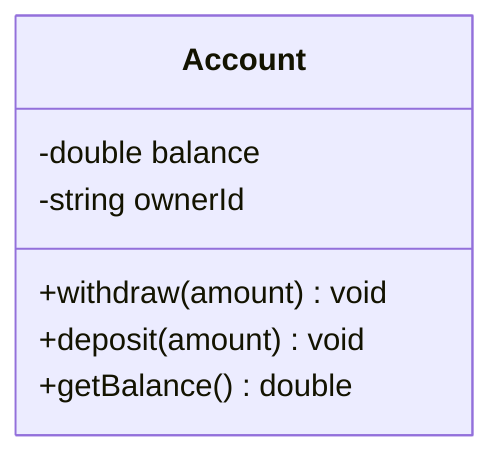

In a live interview you will rarely write full method signatures — `Account`
with `-balance`, `-ownerId`, and the two or three key methods is enough. Skip
trivial getters/setters entirely unless they matter to the discussion.

## Relationships — the part that actually gets tested

This is the notation interviewers listen for by name. Know all six.

### Association

**Two classes interact but neither owns the other's lifetime.** A `Teacher`
teaches many `Student`s; neither's lifetime depends on the other.

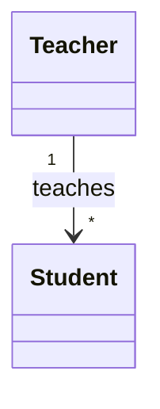

### Aggregation (hollow diamond) — "has-a", weak ownership

**A whole/part relationship where the part can outlive the whole.** A
`Department` has `Professor`s, but a `Professor` still exists if the
department is dissolved (they transfer elsewhere).

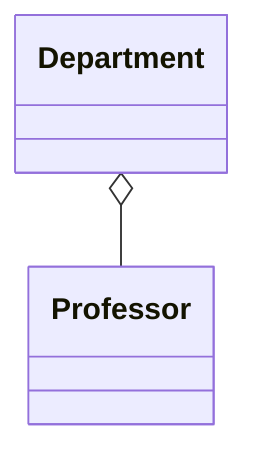

### Composition (filled diamond) — "has-a", strong ownership

**A whole/part relationship where the part's lifetime is bound to the
whole's.** A `House` has `Room`s; destroy the `House`, the `Room`s cease to
exist as entities. This is the UML name for what C++ gives you automatically
via a member (not a pointer) or a `unique_ptr` owned exclusively by the
containing object — the destructor chain enforces it.

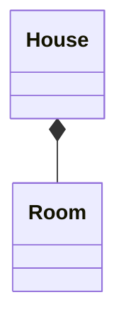

**The interview-relevant distinction**: composition is aggregation with a
lifetime guarantee. If you're unsure which to draw, ask "does the part make
sense, or get cleaned up correctly, if the whole is destroyed first?" — if
no, it's composition.

### Inheritance (hollow triangle, solid line) — "is-a"

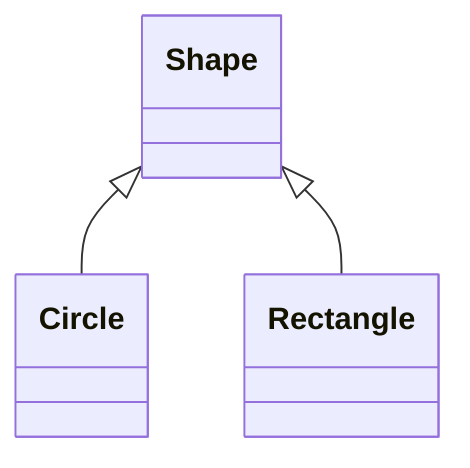

### Realization / interface implementation (hollow triangle, dashed line)

**A class implements an abstract interface** — in C++ terms, publicly
inherits from a pure abstract class (all pure virtual, no state).

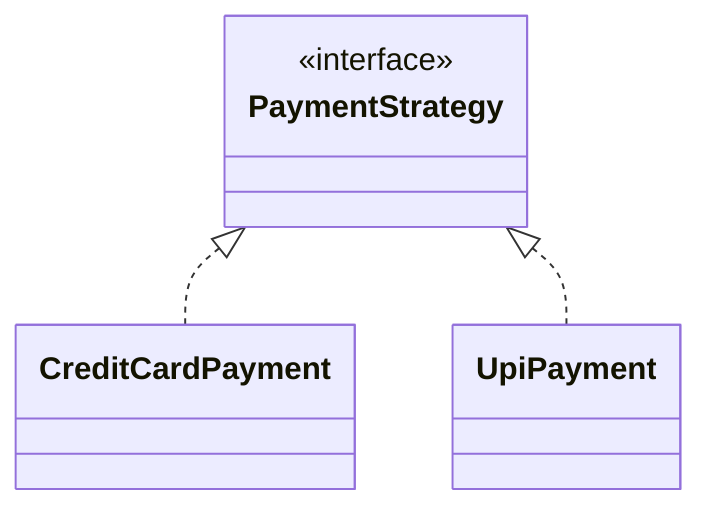

### Dependency (dashed arrow) — "uses"

**A class uses another, typically as a parameter or local variable, without
holding a reference as a member.** The weakest, most transient relationship.

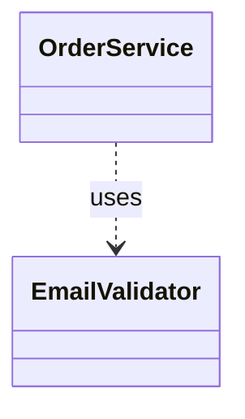

## Putting it together — a worked mini-example

A tiny slice of a parking-lot design (full version in
`01_machine_coding_problems/02_parking_lot.md`), to show all six
relationship types read together:

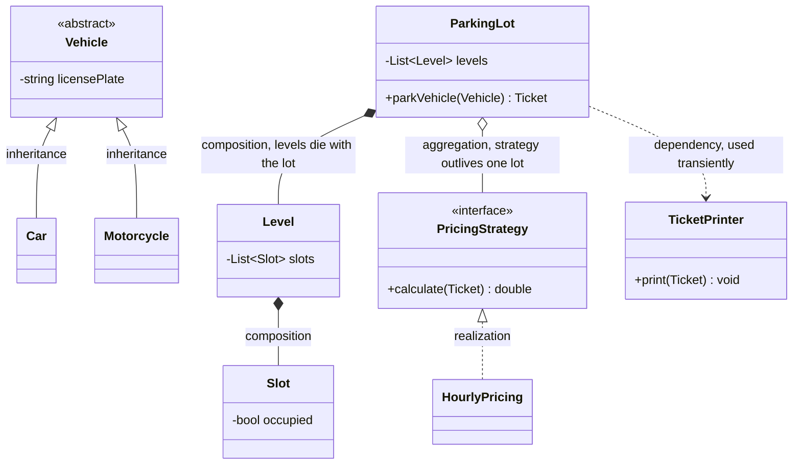

Reading this diagram out loud is itself good interview practice: "the lot
owns its levels and destroys them with it — composition. It depends on a
pricing strategy it doesn't own — aggregation, because the same strategy
object could be shared across lots. Vehicles are a true is-a hierarchy.
Pricing is behind an interface so we can add strategies without touching
`ParkingLot` — that's OCP from `05`, expressed as realization here."

## Sequence diagrams — when to reach for them

Class diagrams show *structure*. Sequence diagrams show *behaviour over
time* — the order of calls across objects for one scenario. Use one when a
flow has enough steps, or enough concurrency, that words alone get
ambiguous (a checkout flow, an elevator dispatch decision, a retry/backoff
path).

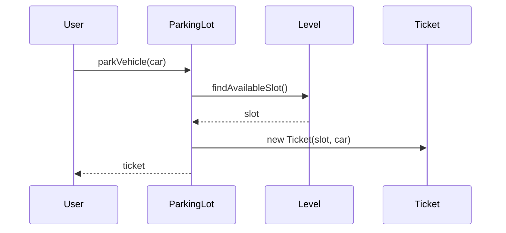

Notation: solid arrow `->>` is a synchronous call, dashed arrow `-->>` is a
return. Activation bars (the vertical rectangles most tools draw
automatically) show which object is "on the stack" at each point — useful
for spotting where a design has an object doing too much (an activation bar
that spans the whole diagram is a God-object smell, visually).

## Use case diagrams — for Step 1 of the machine coding framework

**Actors and the use cases they perform**, drawn as stick figures connected
to ovals. Their entire value is forcing you to enumerate scope *before*
you've committed to any classes — this is the diagram equivalent of Step 1
("clarify") in `16_machine_coding_framework.md`, and worth sketching
mentally (or literally, if there's time) even when you don't draw it
formally.

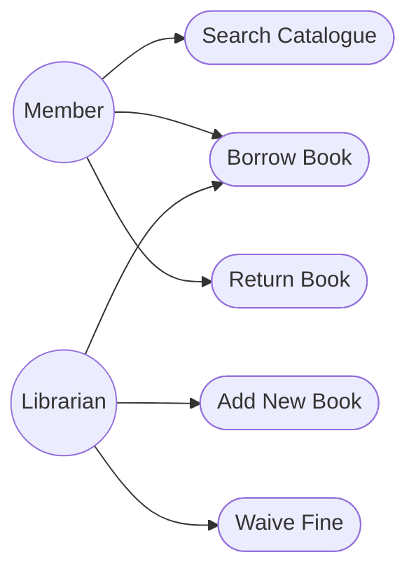

(Mermaid has no native use-case diagram type; a `flowchart` with actors as
nodes and use cases as rounded nodes, as above, communicates the same
information and renders everywhere Mermaid does — don't lose time hunting
for pixel-perfect UML notation live.)

**Interview value**: use cases become your candidate method list (Step 2)
almost directly — "Borrow Book" becomes `Library::borrowBook(Member,
BookCopy)`. If you can't name the use cases crisply, you haven't finished
clarifying, regardless of how confident the class diagram looks.

## State diagrams — for anything with a lifecycle

**States as boxes, transitions as labelled arrows**, showing every state an
object can be in and exactly what triggers each move between them. Draw one
whenever a problem's core entity has a lifecycle with more than two states —
this is the diagram that should precede any State pattern implementation
(`00_foundations/09_design_patterns_behavioral.md`), because it's much
easier to spot a missing transition on a diagram than in code.

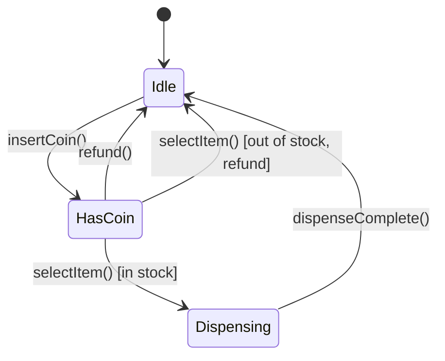

This is worth drawing **before** writing a single `VendingMachineState`
subclass — it's how you catch, at design time rather than mid-implementation,
a transition the requirements imply but you hadn't coded a path for (in the
diagram above: what happens on `selectItem()` when out of stock is an
explicit branch, not an afterthought).

## Activity diagrams — for a *process*, not a single object's states

Easy to confuse with a state diagram at a glance (both use boxes and
arrows), so it's worth being precise about the difference: a **state
diagram** shows every state **one object** can be in and what triggers
each transition. An **activity diagram** shows the **steps of a
process** — more like a flowchart — including decision branches and,
importantly, **parallel paths** that a state diagram has no notation for
at all.

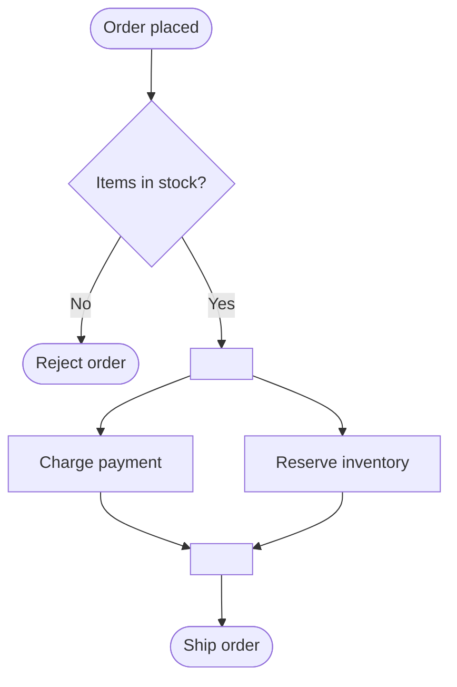

(Mermaid has no dedicated activity-diagram type either, same situation as
use case diagrams earlier in this file — a `flowchart` with a fork/join
shape communicates the same thing and renders everywhere.) The diamond is
a **decision point** (a branch based on a condition); the two arrows
leaving the unlabeled `Fork` node represent **parallel activities**
(charging payment and reserving inventory can happen at the same time,
independent of each other) that both complete before `Join` continues —
notation a state diagram simply doesn't have.

**When to reach for this over a state diagram**: when the thing you're
modeling is a **workflow with steps and branches** (an order-processing
pipeline, an approval flow, a CI build with parallel test stages) rather
than **one entity's lifecycle** (a vending machine, an order's own status
field). `10_lld/01_machine_coding_problems/16_food_delivery_system.md` and `10_lld/01_machine_coding_problems/24_ota_update_manager.md`'s
state diagrams are correctly state diagrams — they model one entity's
lifecycle. If you were instead asked to diagram *how a new order flows
through validation, payment, and fulfillment as a process*, an activity
diagram is the more precise tool, and naming the distinction correctly
("that's actually an activity diagram, not a state diagram, because it's
a process with parallel steps, not one object's lifecycle") is a small
but real signal of UML fluency.

## How to whiteboard this live, fast

1. **Nouns from the requirements become candidate classes.** Read the prompt,
   underline nouns, cross out the ones that are just attributes of another
   noun (a "license plate" is an attribute of `Vehicle`, not its own class).
2. **Verbs become candidate methods**, attached to whichever noun most
   naturally owns them.
3. **Draw boxes and relationships before writing any method bodies.** This
   is the step candidates skip under time pressure, and it's the step that
   prevents a redesign at minute 30.
4. **Mark the one or two extension points explicitly** (which interface will
   absorb "add a new payment type" or "add a new vehicle type" without
   touching existing classes) — say it out loud even before the interviewer
   asks. That's the OCP signal from `05`, demonstrated rather than recited.
5. Don't chase full method signatures or every getter at the diagram stage —
   that's what the implementation step is for.

## Interview angles

**"Draw me the class diagram before you code."** Expected in most senior
rounds now, even if not asked explicitly — volunteer it. Spend 3-5 minutes,
say the relationships out loud as you draw them (this doubles as narrating
your reasoning, which is graded separately from the diagram itself).

**"Why aggregation and not composition here?"** Answer with the lifetime
question: does the part outlive the whole in any real scenario? If the
interviewer disagrees with your answer, that's useful signal about a
requirement you misunderstood — treat it as a clarifying question, not a
correction to concede silently.

## Exercises

1. Draw the full class diagram (all six relationship types you can
   justify) for a **Library Management System**: `Library`, `Book`,
   `BookCopy`, `Member`, `Loan`, `Librarian`, a `FineCalculationStrategy`.
   Decide composition vs aggregation for every has-a and be ready to defend
   each choice in one sentence.
2. Draw a sequence diagram for "a member borrows a book that has zero
   available copies" — include the point where the flow diverges (waitlist?
   rejection?) and label it.
3. Take a design you've built at work (a driver, a service, anything with
   more than two collaborating classes) and reverse-engineer its class
   diagram. You'll likely find at least one relationship that's actually
   tighter coupling than the code needed — that's the exercise's real value.
4. Draw the use case diagram for a **Vending Machine** (actors: Customer,
   Technician) before reading `01_machine_coding_problems/06_vending_machine.md`,
   then draw its full state diagram (Idle, HasCoin, Dispensing, OutOfStock,
   at minimum) — including the branch for "selected item is out of stock."
   Compare both against the worked solution afterward.
5. Draw an activity diagram (not a state diagram — practice telling them
   apart) for "a user checks out a shopping cart": validate items in
   stock, then **in parallel** charge payment and reserve inventory, then
   join and confirm the order. Then, separately, draw a state diagram for
   a single `Order`'s lifecycle (`PLACED → PAID → SHIPPED → DELIVERED`,
   say) — write one sentence on why the first needed a flowchart-style
   diagram and the second needed a state diagram, not the other way
   around.
