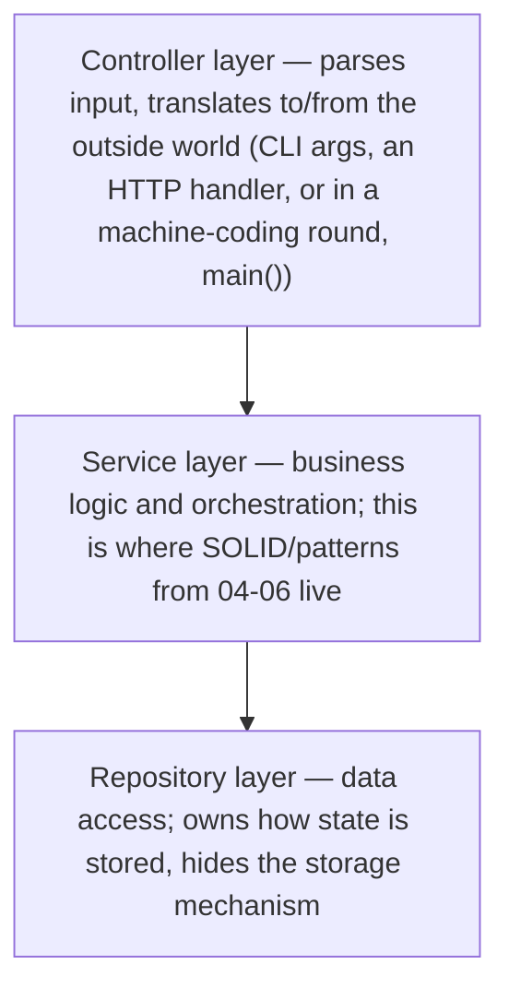

# 14 — Application architecture: layers, events, and error strategy

> Prerequisite: `03`-`05`. Everything so far designed a handful of
> classes for one bounded problem. This file is about the layer above
> that — how you organise a whole machine-coding solution (or a real
> service) into modules with a clear boundary, so a 45-minute solution
> doesn't collapse into one file where `main()`, business logic, and
> "persistence" are all tangled together. This is also where the "write
> the `main()` driver last" step of the framework
> (`16_machine_coding_framework.md`) gets its structural justification.

## Layered architecture — Controller / Service / Repository

**The shape**: three layers, each depending only on the one below it,
never sideways or upward.



```cpp
// Repository: owns storage, exposes domain-shaped operations, hides the
// mechanism (a map today, a real database later — callers never know).
class UserRepository {
public:
    virtual std::optional<User> findById(const std::string& id) = 0;
    virtual void save(const User&) = 0;
    virtual ~UserRepository() = default;
};
class InMemoryUserRepository : public UserRepository { /* std::unordered_map underneath */ };

// Service: business logic, depends on the Repository *interface* (DIP,
// 05_solid_principles.md), knows nothing about how storage actually works.
class UserService {
public:
    explicit UserService(std::shared_ptr<UserRepository> repo) : repo_(std::move(repo)) {}
    void registerUser(const std::string& id, const std::string& name) {
        if (repo_->findById(id)) throw std::invalid_argument("user already exists");
        repo_->save(User{id, name});
    }
private:
    std::shared_ptr<UserRepository> repo_;
};

// Controller: the thin layer talking to the outside world — in a
// machine-coding round, this is usually just main().
int main() {
    auto repo = std::make_shared<InMemoryUserRepository>();
    UserService service(repo);
    service.registerUser("u1", "Alice");
}
```

**Why this is worth doing even in a 45-minute round where "the database" is
just a `std::unordered_map`**: it's the direct, structural reason the LLD
problems in this program keep coming back to DIP and constructor injection
— `UserService` is unit-testable with a fake repository *because* it never
touches storage directly, and the interviewer's "how would you test this?"
(a near-universal follow-up) has an immediate, concrete answer if you built
it this way from the start. Building all three layers together, tangled,
means retrofitting this separation under time pressure when asked instead
of already having it.

**How much of this to actually build live**: for most of the problems in
`01_machine_coding_problems/`, the "Repository" layer is trivial (an
in-memory map inside the main domain class) and doesn't need its own
class — don't over-engineer three layers for a problem with no real
persistence question. Reach for the full three-layer split when the
problem statement has genuine persistence concerns (Movie Ticket Booking,
Library Management) or explicitly asks "how would this connect to a real
database?"

## Three named patterns hiding in plain sight above

Worth pointing out explicitly, because interviewers sometimes name these
patterns directly ("have you used the Repository pattern?") and the
vocabulary is worth having even though you've already been using the
ideas throughout this program:

- **Repository pattern** — is exactly `UserRepository` above: an
  interface that hides *how* data is stored (a map today, a real
  database tomorrow) behind domain-shaped methods (`findById`, `save`)
  instead of leaking storage details (SQL, file paths) into business
  logic. Every "in-memory map inside the main domain class" in this
  program's machine-coding problems (`ParkingLot`'s `levels_`, `Library`'s
  `catalogue_`) is an informal, inlined Repository — promoting it to its
  own class is exactly the "reach for the full split" moment described
  above.
- **Dependency Injection** — is the mechanism, not a separate idea: every
  constructor in this program that takes a `std::unique_ptr<SomeInterface>`
  or `std::shared_ptr<SomeInterface>` parameter rather than constructing
  its own concrete dependency internally is using dependency injection —
  the dependency is handed in ("injected") from outside rather than
  created inside. It's the concrete technique that satisfies DIP
  (`00_foundations/05_solid_principles.md`), not a different principle.
  A **DI container/framework** (which automatically wires up and injects
  dependencies based on configuration, common in larger frameworks) is a
  further step past what this program builds by hand — worth knowing the
  term exists, not needed for any problem here.
- **MVC (Model-View-Controller)** — a specific, older naming of the same
  layering idea as Controller/Service/Repository above, from UI-heavy
  contexts: **Model** (the domain data and rules — your `Service` +
  `Repository` combined), **View** (rendering/presentation — mostly absent
  from this program's console-driven problems), **Controller** (routes
  input to the right Model operations — the same role `main()` or an API
  handler plays here). If an interviewer says "MVC" instead of "layered
  architecture," they're pointing at the same separation-of-concerns idea
  with older, UI-centric terminology.

## Event-driven architecture — an in-memory event bus

**Problem**: multiple, decoupled parts of a system need to react to
something happening, without the part that caused it knowing who's
listening — this is Observer (`09_design_patterns_behavioral.md`) scaled up
from "one subject, some observers" to "many event *types*, many
subscribers per type, routed through one central bus."

```cpp
#include <functional>
#include <unordered_map>
#include <vector>
#include <any>
#include <typeindex>

class EventBus {
public:
    template <typename Event>
    void subscribe(std::function<void(const Event&)> handler) {
        auto& handlers = handlers_[std::type_index(typeid(Event))];
        handlers.push_back([handler](const std::any& e) {
            handler(std::any_cast<const Event&>(e));
        });
    }

    template <typename Event>
    void publish(const Event& event) {
        auto it = handlers_.find(std::type_index(typeid(Event)));
        if (it == handlers_.end()) return;
        for (auto& handler : it->second) handler(event);
    }

private:
    std::unordered_map<std::type_index, std::vector<std::function<void(const std::any&)>>> handlers_;
};

// usage
struct OrderPlaced { std::string orderId; double amount; };

EventBus bus;
bus.subscribe<OrderPlaced>([](const OrderPlaced& e) { /* send confirmation email */ });
bus.subscribe<OrderPlaced>([](const OrderPlaced& e) { /* update inventory */ });
bus.publish(OrderPlaced{"o1", 49.99});   // both handlers fire, publisher knows neither
```

**Type erasure, applied**: this `EventBus` is a direct, practical
application of `06_cpp_design_idioms.md`'s Type Erasure idiom —
`std::any` holds an arbitrary event type, and `std::type_index` is the key
that lets the bus route to the right handlers without every event type
sharing a common base class. Naming this connection explicitly ("this is
type erasure, the same technique behind `std::function`") is a strong,
specific signal if the bus itself comes up as a design.

**When to reach for a full event bus vs. plain Observer**: plain Observer
(`09`) when there's one clear subject and a fixed, small set of observer
types. An event bus when there are **multiple unrelated event types** and
**multiple unrelated subscriber concerns**, and you want publishers and
subscribers to not need compile-time knowledge of each other's existence
at all — this is the shape behind the Message Queue/Pub-Sub problem
(`10_lld/01_machine_coding_problems/08_message_queue_pubsub.md`), scaled further to cross-process/cross-
thread delivery with its own queueing and consumer-group semantics.

## Exception handling strategy

**Catch by `const&`, always**: `catch (const std::exception& e)`, never by
value (which slices — the exact object-slicing problem from
`03_oop_fundamentals.md`, applied to exceptions: a derived exception type
caught by base value loses its derived-specific data) and never by pointer
(who owns/frees it becomes ambiguous).

**Design a custom exception hierarchy, not one flat exception type**, so
callers can catch at the granularity they need:

```cpp
class VendingMachineError : public std::runtime_error {
public:
    explicit VendingMachineError(const std::string& msg) : std::runtime_error(msg) {}
};
class OutOfStockError : public VendingMachineError {
public:
    explicit OutOfStockError(const std::string& code)
        : VendingMachineError("out of stock: " + code) {}
};
class InsufficientFundsError : public VendingMachineError {
public:
    using VendingMachineError::VendingMachineError;
};

// caller can catch narrowly...
try { machine.selectProduct("A1"); }
catch (const OutOfStockError& e) { /* offer a refund UI */ }
// ...or broadly, and still get every subtype
catch (const VendingMachineError& e) { /* generic failure handling */ }
```

**`noexcept`**: mark a function `noexcept` when it genuinely cannot throw
(or when throwing from it is unrecoverable and you're fine with
`std::terminate`) — `10_lld/02_systems_lld/01_raii_and_modern_oop.md` already covered
the concrete payoff (`std::vector` only uses `noexcept` move constructors
during reallocation, silently falling back to copies otherwise), which is
the single most common `noexcept`-related interview question.

## The Result pattern — `std::optional` and `std::expected`

Already covered in depth, with working code, in
`10_lld/02_systems_lld/01_raii_and_modern_oop.md`'s "Error handling without exceptions"
section (a hand-rolled `Result<T, E>` shaped exactly like C++23's
`std::expected`) — read that section for the full treatment, including the
honest tradeoff between exceptions and result types. The LLD-specific
addition worth stating here: **use `std::optional<T>` for "absence is a
normal, expected outcome"** (a cache miss, a not-found lookup — exactly how
`10_lld/01_machine_coding_problems/05_lru_cache.md`'s `get()` and `10_lld/01_machine_coding_problems/02_parking_lot.md`'s `parkVehicle()` are
written already), and **reserve exceptions (or `std::expected`/`Result<T,E>`
if avoiding exceptions entirely) for "this is a genuine error the caller
must explicitly handle or propagate,"** where a bare `nullopt` would hide
*why* the operation failed. The `ExactSplit`/`PercentSplit` validation in
`10_lld/01_machine_coding_problems/04_splitwise_expense_sharing.md` — throwing on an inconsistent split — is
the "genuine error" case; a cache miss is the "expected absence" case. This
is the same distinction `10_lld/01_machine_coding_problems/02_parking_lot.md` already drew explicitly
("expected failure vs. exceptional error") — this file generalizes it into
a named, reusable rule.

## Interview angles

**"How would you structure this so it's testable and could plug into a
real database later?"** Controller/Service/Repository, with the Service
depending on a Repository *interface* — a direct, rehearsed answer that
also demonstrates DIP concretely.

**"How would multiple unrelated parts of the system react to this
happening?"** Observer for one subject/few observer types; an event bus
(type-erasure-based, as above) for many unrelated event types and
subscribers.

**"Would you use an exception or return an optional/error code here?"**
Apply the expected-absence-vs-genuine-error rule above, and give the
specific example you're being asked about, not the general rule alone.

## Exercises

1. Refactor any solution from `01_machine_coding_problems/` (Parking Lot is
   a good candidate) into an explicit Controller/Service/Repository split,
   even though its current "repository" is just an in-memory structure —
   confirm the Service layer becomes unit-testable with a fake repository
   with zero changes to its own logic.
2. Implement the `EventBus` above, subscribe two unrelated handlers to two
   unrelated event types, and confirm publishing one event type never
   invokes handlers subscribed to the other.
3. Design (declarations only, not full implementations) a three-level
   exception hierarchy for the Parking Lot problem
   (`ParkingLotError` → `LotFullError`, `InvalidTicketError`) and rewrite
   `parkVehicle`'s `nullopt`-on-full behaviour as a thrown
   `LotFullError` instead — then write one sentence on which approach
   (optional vs. exception) you'd actually keep, and why, applying this
   file's expected-absence-vs-genuine-error rule.
