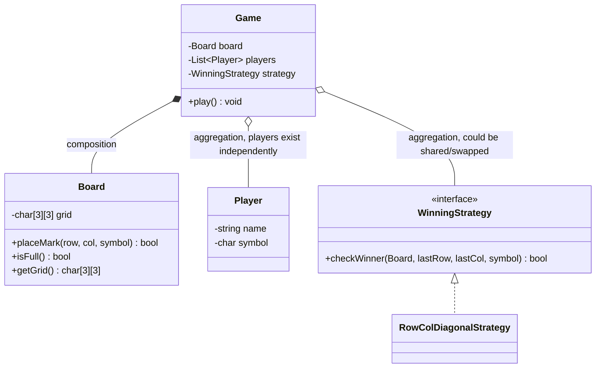

# 01 — Tic-Tac-Toe

> Difficulty: foundational. Purpose: learn the framework
> (`00_foundations/16`) end to end on the simplest possible domain before
> the entity count grows. If you're doing your first machine-coding problem
> ever, do this one first regardless of what's "commonly asked" — the goal
> here is procedure, not problem familiarity.

## Step 1 — Clarify

Assumed answers if not told otherwise (say these out loud in a real round):

- Standard 3x3 board, two players, X goes first.
- Win = 3 in a row, horizontal/vertical/diagonal. Draw if board fills with no
  winner.
- Single process, no persistence, no networking — a console/API-level
  simulation, not a UI.
- **Deliberately deferred, stated explicitly**: N×N boards and >2 players.
  Both are realistic live extensions — design for them without building them
  now (see "Extensions").

## Step 2 — Entities

| Entity | Responsibility |
| --- | --- |
| `Board` | Owns the grid, knows if a cell is empty, places a mark |
| `Player` | Symbol + identity |
| `WinningStrategy` | Given a board and a move, decides if that move won the game |
| `Game` | Orchestrates turns, owns players and the board, asks the strategy after each move |

The open question from Step 2 of the framework — fixed set or growing set?
— applies to **win-checking logic**: "3 in a row" today, but N-in-a-row on
an N×N board is a very plausible live follow-up. That alone justifies making
`WinningStrategy` an interface now rather than a hardcoded method, even
though there's only one implementation at the start — this is the one
Strategy in this problem, and it's there specifically because the
requirement is already hinting it'll grow, not out of habit.

## Step 3 — Class diagram



## Step 4-5 — Interfaces and core implementation

```cpp
#include <array>
#include <vector>
#include <memory>
#include <stdexcept>
#include <iostream>

class Board {
public:
    static constexpr int SIZE = 3;

    bool placeMark(int row, int col, char symbol) {
        if (row < 0 || row >= SIZE || col < 0 || col >= SIZE) return false;
        if (grid_[row][col] != '\0') return false;   // occupied
        grid_[row][col] = symbol;
        ++filled_;
        return true;
    }
    bool isFull() const { return filled_ == SIZE * SIZE; }
    char at(int row, int col) const { return grid_[row][col]; }

private:
    std::array<std::array<char, SIZE>, SIZE> grid_{};
    int filled_ = 0;
};

struct Player {
    std::string name;
    char symbol;
};

class WinningStrategy {
public:
    virtual bool checkWinner(const Board& b, int lastRow, int lastCol, char symbol) const = 0;
    virtual ~WinningStrategy() = default;
};

// Checks only the row, column and (if applicable) diagonals through the
// last move — O(N) instead of rescanning the whole board every turn.
class RowColDiagonalStrategy : public WinningStrategy {
public:
    bool checkWinner(const Board& b, int lastRow, int lastCol, char symbol) const override {
        bool rowWin = true, colWin = true;
        for (int i = 0; i < Board::SIZE; ++i) {
            if (b.at(lastRow, i) != symbol) rowWin = false;
            if (b.at(i, lastCol) != symbol) colWin = false;
        }
        if (rowWin || colWin) return true;

        if (lastRow == lastCol) {
            bool diagWin = true;
            for (int i = 0; i < Board::SIZE; ++i)
                if (b.at(i, i) != symbol) diagWin = false;
            if (diagWin) return true;
        }
        if (lastRow + lastCol == Board::SIZE - 1) {
            bool antiDiagWin = true;
            for (int i = 0; i < Board::SIZE; ++i)
                if (b.at(i, Board::SIZE - 1 - i) != symbol) antiDiagWin = false;
            if (antiDiagWin) return true;
        }
        return false;
    }
};

class Game {
public:
    Game(std::vector<Player> players, std::unique_ptr<WinningStrategy> strategy)
        : players_(std::move(players)), strategy_(std::move(strategy)) {}

    // Returns: player name of winner, "DRAW", or "" if game continues.
    std::string makeMove(int playerIdx, int row, int col) {
        const Player& p = players_[playerIdx];
        if (!board_.placeMark(row, col, p.symbol))
            throw std::invalid_argument("illegal move");

        if (strategy_->checkWinner(board_, row, col, p.symbol)) return p.name;
        if (board_.isFull()) return "DRAW";
        return "";
    }

private:
    Board board_;
    std::vector<Player> players_;
    std::unique_ptr<WinningStrategy> strategy_;
};
```

**Why check-only-the-affected-lines instead of scanning the whole board**:
this is the kind of small efficiency choice worth narrating unprompted —
"I'm checking only the row/column/diagonal through the last move, so this
is O(N) per move instead of O(N²) rescanning the board" is a cheap,
concrete signal that you think about complexity by default, not only when
asked.

## Step 6 — Edge cases handled

- Move on an occupied cell → rejected, `placeMark` returns `false`.
- Move out of bounds → rejected the same way.
- Board full with no winner → `"DRAW"`.
- (Left as a documented gap, correctly, for a 45-minute round): no check
  that it's the correct player's turn — mention it explicitly rather than
  silently omitting it: "I'd add a `currentPlayerIdx_` tracked by `Game`
  and validate `playerIdx` matches it before accepting a move; skipping for
  time."

## Extensions (what a live follow-up usually asks)

**"Make it work for an N×N board, K-in-a-row to win."** This is exactly why
`WinningStrategy` was made an interface in Step 2. Add `KInARowStrategy`
implementing the interface with a configurable `K` and `N`; `Game` and
`Board` need `SIZE` parameterized (a constructor argument instead of a
`static constexpr`) but their structure doesn't change. Zero edits to
`Game`'s orchestration logic — this is the OCP payoff, made concrete.

**"Support more than 2 players."** `Game` already stores `players_` as a
`vector`, and `makeMove` already takes an index rather than assuming
"player 1 or 2" — this was a deliberate design choice, not luck, to absorb
exactly this extension. State that explicitly if asked.

**"Add a computer opponent."** A new implementer of a `MoveStrategy`
interface (not built above, but the same shape as `WinningStrategy`) that
computes a move given the board state — minimax for a strong version, random
legal move for a weak one. Good to mention as the next Strategy you'd add
even without implementing it.

## Interview framing to reuse

"I made win-checking a Strategy up front because K-in-a-row on an N×N board
is a very standard follow-up to this exact problem, and I wanted that change
to be additive." Saying this proactively, before being asked, is a stronger
signal than answering it well when prompted — it shows you anticipated the
extension rather than got lucky when it was requested.

## Exercises

1. Implement the code above from scratch, without looking, in under 25
   minutes. Then diff against this file.
2. Implement the N×N, K-in-a-row extension. Confirm `Game`'s orchestration
   method didn't change.
3. Add a `MoveStrategy` interface and a random-legal-move computer player
   implementing it, without modifying `Game`'s public API beyond accepting
   moves from either a human or computer `Player` uniformly.
