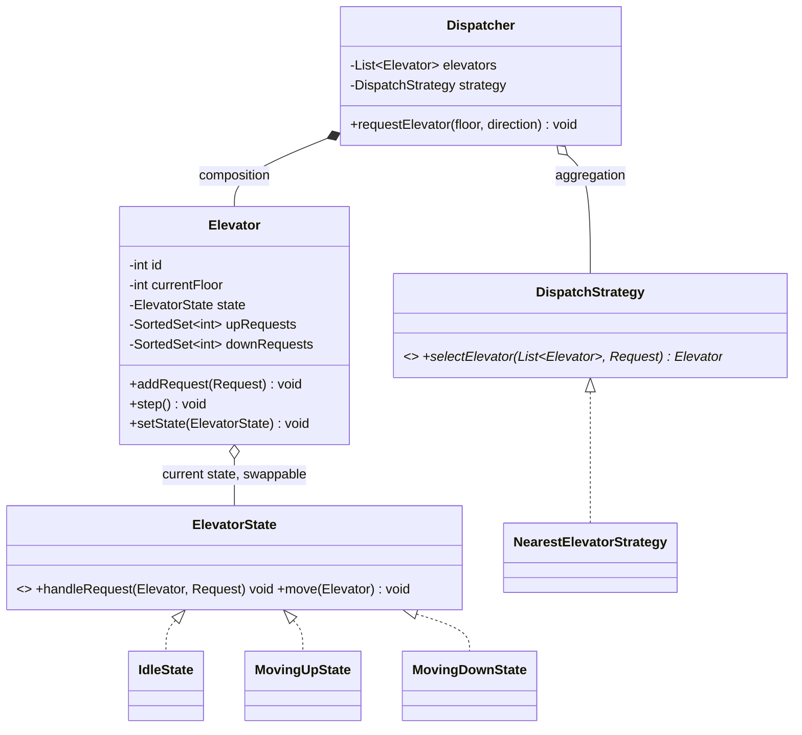

# 03 — Elevator System

> Difficulty: intermediate. This is the problem most likely to expose a
> shallow understanding of State (`00_foundations/09`) — a design that just
> tracks direction as a bare enum on the elevator, with dispatch logic
> scattered across `if`s, will visibly struggle the moment a follow-up asks
> for multiple elevators.

## Step 1 — Clarify

Assumed answers:

- A building with N floors and M elevators. A `Controller`/`Dispatcher`
  assigns each request to one elevator.
- Requests come in two forms: an **external** call ("floor 5, going up") and
  an **internal** request ("elevator 2, go to floor 8" from inside the car).
- Scheduling: use the **LOOK/SCAN algorithm** — an elevator continues in its
  current direction, serving requests along the way, and only reverses when
  no further requests exist in that direction. State this by name; it's the
  standard real-world algorithm and naming it correctly is a strong,
  specific signal.
- **Deferred, stated explicitly**: weight limits, door-obstruction sensors,
  express/service elevators. Realistic follow-ups, not built into the base
  design.

## Step 2 — Entities

| Entity | Responsibility |
| --- | --- |
| `ElevatorState` (interface) → `IdleState`, `MovingUpState`, `MovingDownState` | What the elevator does with a new request given its current motion |
| `Elevator` | Owns its state, current floor, and its pending-request queue; delegates behaviour to its state |
| `Request` | Origin floor, target floor (internal) or just origin+direction (external) |
| `Dispatcher`/`Controller` | Owns all elevators; picks the best elevator for a new external request |
| `DispatchStrategy` (interface) | The algorithm the dispatcher uses to choose an elevator — **growing set**, interface |

This is the problem where State earns its place for real, not just as a
vocabulary exercise: the elevator's *own* behaviour (which requests it
accepts next, whether it continues or reverses) changes as a direct
consequence of its own motion — textbook State, not Strategy, using the
disambiguation table from `00_foundations/09`.

## Step 3 — Class diagram



## Step 4-5 — Interfaces and core implementation

```cpp
#include <set>
#include <vector>
#include <memory>
#include <limits>
#include <cmath>

enum class Direction { UP, DOWN, IDLE };

class Elevator;   // fwd decl

class ElevatorState {
public:
    virtual void addRequest(Elevator&, int floor) = 0;
    virtual void step(Elevator&) = 0;          // advance one floor / process arrival
    virtual Direction direction() const = 0;
    virtual ~ElevatorState() = default;
};

class Elevator {
public:
    explicit Elevator(int id) : id_(id) {}

    void addRequest(int floor) { state_->addRequest(*this, floor); }
    void step() { state_->step(*this); }
    void setState(std::unique_ptr<ElevatorState> s) { state_ = std::move(s); }
    Direction direction() const { return state_->direction(); }

    int id_;
    int currentFloor_ = 0;
    std::set<int> upRequests_;     // sorted ascending: next stop going up = *begin()
    std::set<int> downRequests_;   // sorted ascending: next stop going down = *rbegin()
    std::unique_ptr<ElevatorState> state_;
};

class IdleState : public ElevatorState {
public:
    void addRequest(Elevator& e, int floor) override {
        if (floor > e.currentFloor_) { e.upRequests_.insert(floor); e.setState(std::make_unique<MovingUpStateFwd>()); }
        else if (floor < e.currentFloor_) { e.downRequests_.insert(floor); e.setState(std::make_unique<MovingDownStateFwd>()); }
        // floor == currentFloor_: doors open, no state change needed
    }
    void step(Elevator&) override { /* nothing to do while idle */ }
    Direction direction() const override { return Direction::IDLE; }

private:
    // Forward-declared factory helpers resolved below to keep this listing linear;
    // in real code these classes are simply declared before IdleState.
    using MovingUpStateFwd = class MovingUpState;
    using MovingDownStateFwd = class MovingDownState;
};

class MovingUpState : public ElevatorState {
public:
    void addRequest(Elevator& e, int floor) override {
        if (floor >= e.currentFloor_) e.upRequests_.insert(floor);
        else e.downRequests_.insert(floor);   // served after the current up-sweep completes
    }
    void step(Elevator& e) override {
        if (e.upRequests_.empty()) {
            if (!e.downRequests_.empty()) e.setState(std::make_unique<MovingDownState>());
            else e.setState(std::make_unique<IdleState>());
            return;
        }
        int next = *e.upRequests_.begin();
        e.currentFloor_ = (e.currentFloor_ < next) ? e.currentFloor_ + 1 : e.currentFloor_;
        if (e.currentFloor_ == next) e.upRequests_.erase(e.upRequests_.begin());   // arrived, doors open
    }
    Direction direction() const override { return Direction::UP; }
};

class MovingDownState : public ElevatorState {
public:
    void addRequest(Elevator& e, int floor) override {
        if (floor <= e.currentFloor_) e.downRequests_.insert(floor);
        else e.upRequests_.insert(floor);
    }
    void step(Elevator& e) override {
        if (e.downRequests_.empty()) {
            if (!e.upRequests_.empty()) e.setState(std::make_unique<MovingUpState>());
            else e.setState(std::make_unique<IdleState>());
            return;
        }
        int next = *e.downRequests_.rbegin();
        e.currentFloor_ = (e.currentFloor_ > next) ? e.currentFloor_ - 1 : e.currentFloor_;
        if (e.currentFloor_ == next) e.downRequests_.erase(std::prev(e.downRequests_.end()));
    }
    Direction direction() const override { return Direction::DOWN; }
};

class DispatchStrategy {
public:
    virtual Elevator* selectElevator(std::vector<std::unique_ptr<Elevator>>& elevators, int floor, Direction dir) = 0;
    virtual ~DispatchStrategy() = default;
};
class NearestElevatorStrategy : public DispatchStrategy {
public:
    Elevator* selectElevator(std::vector<std::unique_ptr<Elevator>>& elevators, int floor, Direction) override {
        Elevator* best = nullptr;
        int bestDist = std::numeric_limits<int>::max();
        for (auto& e : elevators) {
            // prefer idle elevators, or ones already moving toward `floor` in a
            // compatible direction; simplified here to nearest-by-distance for brevity
            int dist = std::abs(e->currentFloor_ - floor);
            if (dist < bestDist) { bestDist = dist; best = e.get(); }
        }
        return best;
    }
};

class Dispatcher {
public:
    Dispatcher(int numElevators, std::unique_ptr<DispatchStrategy> strategy)
        : strategy_(std::move(strategy)) {
        for (int i = 0; i < numElevators; ++i) {
            auto e = std::make_unique<Elevator>(i);
            e->setState(std::make_unique<IdleState>());
            elevators_.push_back(std::move(e));
        }
    }

    void requestElevator(int floor, Direction dir) {
        Elevator* chosen = strategy_->selectElevator(elevators_, floor, dir);
        if (chosen) chosen->addRequest(floor);
    }
    void tick() { for (auto& e : elevators_) e->step(); }   // advance simulation by one unit

private:
    std::vector<std::unique_ptr<Elevator>> elevators_;
    std::unique_ptr<DispatchStrategy> strategy_;
};
```

Note on the `IdleState` listing above: it's written with forward-reference
aliases only to keep this file's code blocks readable top-to-bottom without
forward declarations scattered awkwardly; in an actual implementation you'd
simply declare `MovingUpState` and `MovingDownState` (or their declarations)
before `IdleState`, or put all three in a header with a single forward
declaration block. Mention this kind of ordering constraint if it comes up —
it's a real, ordinary C++ concern, not a design flaw.

## Step 6 — Edge cases handled

- An elevator moving up receives a request *below* its current floor → routed
  to `downRequests_`, served after the current up-sweep finishes rather than
  reversing immediately (this is the actual LOOK algorithm behaviour, and
  it's worth stating explicitly: "I chose not to reverse immediately because
  that would starve the passengers already being served upward").
- A request for the floor the elevator is already on while idle → no state
  transition, doors just open (handled by the equality branch, doing
  nothing, in `IdleState`).

## Extensions (what a live follow-up usually asks)

**"Multiple elevators — how do you pick the best one?"** Already structured
for this via `DispatchStrategy` — the naive `NearestElevatorStrategy` shown
is intentionally simple; a stronger follow-up implementation scores each
elevator by direction-compatibility first (an elevator already moving up
and below the requested floor is a much better match than an idle one
further away) and distance second. Say this is the natural next
`DispatchStrategy` implementation, which is exactly why it's behind an
interface already.

**"What if two floor requests arrive for the same elevator at the same
time from different threads?"** `upRequests_`/`downRequests_` are
`std::set`s mutated from `addRequest` — concurrent calls race. Fix: a mutex
per `Elevator` (not one global lock across the `Dispatcher`, for the same
scoping reason as the Parking Lot problem) guarding its request sets.

**"Add a maximum weight/capacity check."** A `capacity_` field on `Elevator`
plus a check in `addRequest` (or better, in a would-be `WeightSensor`
collaborator that rejects boarding, kept separate from scheduling logic —
SRP) — additive, no change to the State classes' core motion logic.

## Interview framing to reuse

"I modelled the elevator's motion as State rather than Strategy because the
elevator switches its own behaviour as a side effect of arriving at floors —
nobody from outside is choosing 'now use MovingDownState,' the elevator
transitions itself. That's the State/Strategy distinction." This sentence,
said unprompted while narrating your class diagram, pre-empts the most
common follow-up question on this exact problem.

## Exercises

1. Implement the above from scratch, in order (states first, then
   dispatcher), in 40-50 minutes.
2. Implement a `DirectionAwareStrategy` that prefers an elevator already
   moving toward the requested floor in a compatible direction over a
   nearer idle one — write a test with 3 elevators confirming it picks
   differently than `NearestElevatorStrategy` would.
3. Add per-elevator locking for the concurrency extension and write a test
   spawning multiple threads calling `addRequest` on the same elevator
   concurrently, asserting no request is lost.
