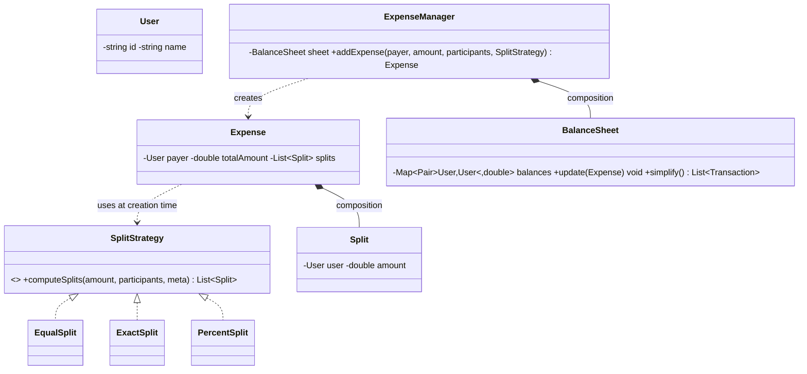

# 04 — Splitwise / Expense Sharing

> Difficulty: intermediate, with a genuine algorithms component at the end
> (debt simplification) that distinguishes this from a pure OOD exercise —
> a good problem for signalling both design and algorithmic strength in one
> round.

## Step 1 — Clarify

Assumed answers:

- Users belong to one or more groups (or can split ad hoc, no group).
- An expense has a payer, a total amount, and a split among participants —
  three split types: **Equal**, **Exact** (explicit amounts per person,
  must sum to total), **Percent** (must sum to 100).
- The system tracks a running balance between every pair of users ("A owes
  B $30"), and can produce a simplified settlement (minimum number of
  transactions to settle all debts).
- **Deferred, explicitly**: currency conversion, group-level settle-up UI
  flows, payment gateway integration — out of scope for the LLD, name them
  as boundaries.

## Step 2 — Entities

| Entity | Responsibility |
| --- | --- |
| `User` | Identity |
| `Expense` | Payer, amount, participants, which `SplitStrategy` was used |
| `SplitStrategy` (interface) → `EqualSplit`, `ExactSplit`, `PercentSplit` | Computes each participant's share — **growing set**, interface |
| `Split` | One participant's computed share of one expense |
| `BalanceSheet` | The pairwise ledger: who owes whom, how much |
| `ExpenseManager` | Orchestrates adding an expense, updating the ledger, triggering simplification |
| `DebtSimplifier` | The graph algorithm that minimizes settlement transactions |

`SplitStrategy` is the clearest Strategy in this whole problem set — three
genuinely interchangeable algorithms for the same computation, chosen by the
caller when an expense is created, never switched internally. Contrast with
`ElevatorState` from the previous problem, which switches itself — good
paired exercise for the Strategy/State distinction from `00_foundations/09`.

## Step 3 — Class diagram



## Step 4-5 — Interfaces and core implementation

```cpp
#include <vector>
#include <map>
#include <memory>
#include <stdexcept>
#include <cmath>
#include <queue>

struct User {
    std::string id;
    std::string name;
    bool operator<(const User& o) const { return id < o.id; }   // for use as a map key
};

struct Split { User user; double amount; };

class SplitStrategy {
public:
    // `meta` carries strategy-specific input: exact amounts, or percentages,
    // ignored by EqualSplit.
    virtual std::vector<Split> computeSplits(
        double totalAmount,
        const std::vector<User>& participants,
        const std::map<std::string, double>& meta) const = 0;
    virtual ~SplitStrategy() = default;
};

class EqualSplit : public SplitStrategy {
public:
    std::vector<Split> computeSplits(double total, const std::vector<User>& ps,
                                      const std::map<std::string, double>&) const override {
        std::vector<Split> result;
        double share = total / ps.size();
        for (auto& u : ps) result.push_back({u, share});
        return result;
    }
};

class ExactSplit : public SplitStrategy {
public:
    std::vector<Split> computeSplits(double total, const std::vector<User>& ps,
                                      const std::map<std::string, double>& meta) const override {
        std::vector<Split> result;
        double sum = 0;
        for (auto& u : ps) {
            double amt = meta.at(u.id);
            result.push_back({u, amt});
            sum += amt;
        }
        if (std::abs(sum - total) > 0.01) throw std::invalid_argument("exact splits must sum to total");
        return result;
    }
};

class PercentSplit : public SplitStrategy {
public:
    std::vector<Split> computeSplits(double total, const std::vector<User>& ps,
                                      const std::map<std::string, double>& meta) const override {
        std::vector<Split> result;
        double pctSum = 0;
        for (auto& u : ps) pctSum += meta.at(u.id);
        if (std::abs(pctSum - 100.0) > 0.01) throw std::invalid_argument("percentages must sum to 100");
        for (auto& u : ps) result.push_back({u, total * meta.at(u.id) / 100.0});
        return result;
    }
};

struct Expense {
    User payer;
    double totalAmount;
    std::vector<Split> splits;
};

// Pairwise ledger. balances_[A][B] = amount A owes B (can be negative,
// meaning B owes A) — kept normalized to one direction by convention below.
class BalanceSheet {
public:
    void update(const Expense& e) {
        for (auto& s : e.splits) {
            if (s.user.id == e.payer.id) continue;   // payer doesn't owe themselves
            adjust(s.user.id, e.payer.id, s.amount);  // s.user owes payer s.amount
        }
    }

    // Minimum-transaction settlement across the whole group.
    // Net each user's total position, then greedily match the largest
    // creditor with the largest debtor repeatedly — a well-known
    // near-optimal heuristic for this problem (optimal minimum-transaction
    // settlement is NP-hard in general; greedy-by-extremes is the standard
    // interview-level answer and is provably optimal for the common case of
    // splitting a single total pool, which is the framing worth stating).
    struct Transaction { std::string from, to; double amount; };
    std::vector<Transaction> simplify() const {
        std::map<std::string, double> net;   // positive = owed money, negative = owes money
        for (auto& [a, inner] : balances_)
            for (auto& [b, amt] : inner) {
                net[a] -= amt;
                net[b] += amt;
            }

        using Entry = std::pair<std::string, double>;
        std::vector<Entry> creditors, debtors;
        for (auto& [id, amt] : net) {
            if (amt > 0.01) creditors.push_back({id, amt});
            else if (amt < -0.01) debtors.push_back({id, -amt});
        }

        std::vector<Transaction> txns;
        size_t i = 0, j = 0;
        while (i < debtors.size() && j < creditors.size()) {
            double amt = std::min(debtors[i].second, creditors[j].second);
            txns.push_back({debtors[i].first, creditors[j].first, amt});
            debtors[i].second -= amt;
            creditors[j].second -= amt;
            if (debtors[i].second < 0.01) ++i;
            if (creditors[j].second < 0.01) ++j;
        }
        return txns;
    }

private:
    void adjust(const std::string& debtor, const std::string& creditor, double amount) {
        balances_[debtor][creditor] += amount;
    }
    std::map<std::string, std::map<std::string, double>> balances_;
};

class ExpenseManager {
public:
    Expense addExpense(const User& payer, double amount, const std::vector<User>& participants,
                        const SplitStrategy& strategy, const std::map<std::string, double>& meta = {}) {
        Expense e{payer, amount, strategy.computeSplits(amount, participants, meta)};
        sheet_.update(e);
        return e;
    }
    std::vector<BalanceSheet::Transaction> settleUp() const { return sheet_.simplify(); }

private:
    BalanceSheet sheet_;
};
```

**Why greedy-largest-creditor-largest-debtor for simplification, and why
saying "this is a heuristic" matters**: true minimum-transaction settlement
across an arbitrary debt graph is NP-hard in general (it's equivalent to a
partition-style problem), but the greedy approach shown is the standard,
expected interview answer, runs in `O(n log n)`, and is optimal for the very
common real case where debts arise from a shared pool being split (which is
exactly what an expense-splitting app produces). Stating the caveat
precisely — rather than either overclaiming optimality or not knowing the
complexity class — is exactly the kind of algorithmic honesty that reads as
Staff-level in a round that's testing both OOD and algorithms.

## Step 6 — Edge cases handled

- `ExactSplit`/`PercentSplit` validate their inputs sum correctly and throw
  otherwise — don't silently accept an inconsistent split.
- A payer included in their own expense's participant list nets to zero
  automatically (they'd owe themselves, skipped explicitly in `update`).
- Floating-point comparisons use an epsilon (`0.01`) rather than exact
  equality — worth a one-line callout if asked, since exact `double`
  equality after division is a real bug class.

## Extensions (what a live follow-up usually asks)

**"Add group-scoped balances (only settle within a group, not across the
whole user base)."** A `Group` entity owning its own `BalanceSheet` instead
of one global sheet — `ExpenseManager` becomes group-aware, but
`SplitStrategy` and `Expense` don't change at all, since they were never
coupled to group membership to begin with.

**"Support multiple currencies."** A `Money` value type (amount + currency
code) replacing the bare `double` everywhere, plus a `CurrencyConverter`
collaborator injected where conversion is needed (DIP again) — a real,
nontrivial change, worth being honest that it touches most of the code
shown, and saying so rather than hand-waving it as trivial.

**"How would you make `addExpense` safe under concurrent calls?"** The
`balances_` map in `BalanceSheet` is mutated by `update()` — concurrent
expense creation for overlapping users races. A single mutex guarding
`BalanceSheet` is a reasonable, simple first answer for this workload (unlike
Parking Lot/Elevator, expense creation isn't a tight hot loop, so
coarse-grained locking is a defensible tradeoff to state explicitly rather
than reflexively reaching for finer-grained locking everywhere).

## Interview framing to reuse

"I kept `SplitStrategy` completely unaware of the `BalanceSheet`, and the
`BalanceSheet` completely unaware of how a split was computed — that
separation is why adding group scoping later only touches
`ExpenseManager`/`BalanceSheet`, not the split logic at all." A precise
sentence about *why* a boundary you drew pays off later is more convincing
than just drawing it.

## Exercises

1. Implement the above from scratch in 45 minutes, then write a test with 4
   users, 3 expenses of mixed split types, and confirm `settleUp()` produces
   the minimum number of transactions by hand-checking a small case.
2. Add `Group` and make balances group-scoped, confirming `SplitStrategy`
   implementations require zero changes.
3. Replace `double` with a `Money{amount, currency}` value type and identify,
   by grep, every call site that needs to change — this is the exercise that
   makes the "real, nontrivial change" claim above concrete rather than
   asserted.
