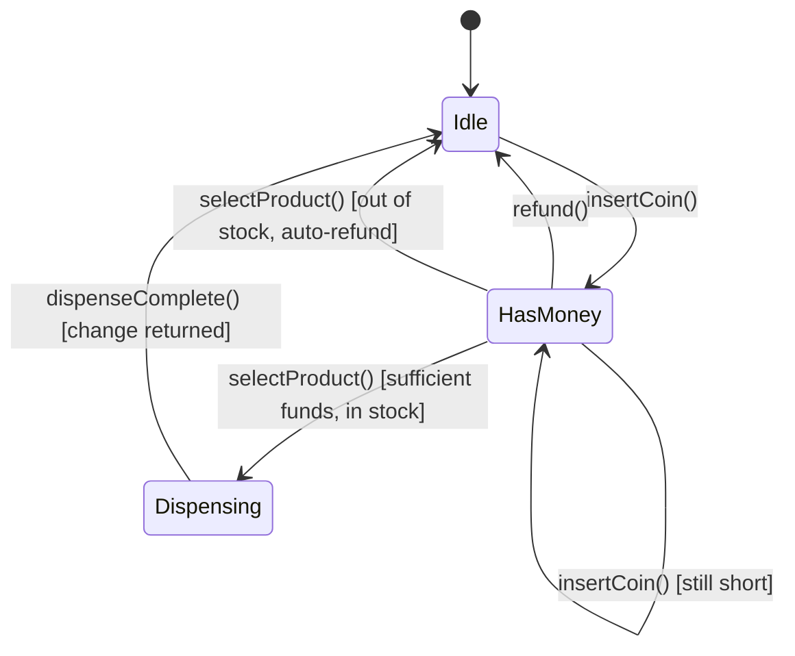
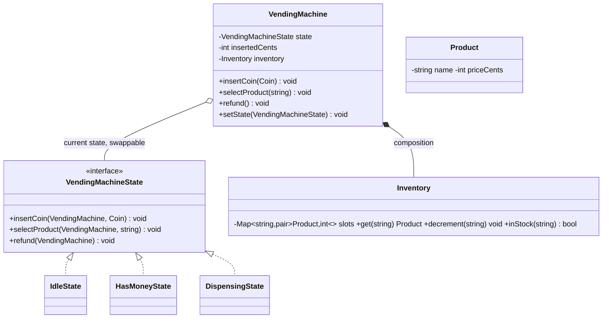

# 06 — Vending Machine

> Difficulty: foundational-to-intermediate. This is the canonical State
> pattern problem — `00_foundations/09_design_patterns_behavioral.md`
> sketched a 2-method version of this to teach the pattern; this file is
> the full worked version with real requirements, a state diagram, and
> live extensions. Do the state-diagram exercise in
> `00_foundations/04_uml_and_modeling.md` before reading the solution below.

## Step 1 — Clarify

Assumed answers:

- Machine stocks multiple products, each with a price and a quantity.
- Accepts coins of fixed denominations, tracks the inserted total.
- Customer selects a product; if inserted amount covers the price, the
  machine dispenses and returns change; if insufficient, it prompts for
  more; if the product is out of stock, it refunds immediately.
- A customer can request a refund of inserted coins before selecting.
- **Deferred, explicitly**: card payment, multi-currency, a
  maintenance/restock mode for a technician — realistic follow-ups, not in
  the base design.

## Step 2 — Entities

| Entity | Responsibility |
| --- | --- |
| `VendingMachineState` (interface) → `IdleState`, `HasMoneyState`, `DispensingState`, `OutOfStockState` | What happens to each customer action given the machine's current state |
| `VendingMachine` | Owns the current state, the inventory, and the amount inserted; delegates every action to its state |
| `Product` | Name, price |
| `Inventory` | Maps product slot → `Product` + quantity, decremented on dispense |
| `Coin` (enum) | Denomination |

This is a stronger State example than the vending-machine sketch in `09`
because the machine's behaviour for the *same* action (`selectProduct`)
genuinely differs by state — in `IdleState` it's invalid (no money
inserted), in `HasMoneyState` it either dispenses or asks for more, in
`OutOfStockState` a selection made before the machine noticed stock ran out
should refund. The state diagram (draw it before coding, per
`00_foundations/04`) is:



## Step 3 — Class diagram



## Step 4-5 — Interfaces and core implementation

```cpp
#include <map>
#include <memory>
#include <stdexcept>
#include <iostream>

enum class Coin { NICKEL = 5, DIME = 10, QUARTER = 25, DOLLAR = 100 };

struct Product { std::string name; int priceCents; };

class Inventory {
public:
    void addSlot(const std::string& code, Product p, int qty) { slots_[code] = {p, qty}; }
    bool inStock(const std::string& code) const {
        auto it = slots_.find(code);
        return it != slots_.end() && it->second.second > 0;
    }
    const Product& product(const std::string& code) const { return slots_.at(code).first; }
    void decrement(const std::string& code) { --slots_.at(code).second; }
private:
    std::map<std::string, std::pair<Product, int>> slots_;
};

class VendingMachine;   // fwd decl

class VendingMachineState {
public:
    virtual void insertCoin(VendingMachine&, Coin) = 0;
    virtual void selectProduct(VendingMachine&, const std::string& code) = 0;
    virtual void refund(VendingMachine&) = 0;
    virtual ~VendingMachineState() = default;
};

class VendingMachine {
public:
    explicit VendingMachine(Inventory inv);

    void insertCoin(Coin c) { state_->insertCoin(*this, c); }
    void selectProduct(const std::string& code) { state_->selectProduct(*this, code); }
    void refund() { state_->refund(*this); }
    void setState(std::unique_ptr<VendingMachineState> s) { state_ = std::move(s); }

    int insertedCents_ = 0;
    Inventory inventory_;
    std::unique_ptr<VendingMachineState> state_;
};

class IdleState : public VendingMachineState {
public:
    void insertCoin(VendingMachine& m, Coin c) override;   // -> HasMoneyState, defined below
    void selectProduct(VendingMachine&, const std::string&) override {
        throw std::logic_error("insert coins first");
    }
    void refund(VendingMachine&) override { /* nothing inserted, no-op */ }
};

class HasMoneyState : public VendingMachineState {
public:
    void insertCoin(VendingMachine& m, Coin c) override {
        m.insertedCents_ += static_cast<int>(c);   // stays in HasMoneyState
    }
    void selectProduct(VendingMachine& m, const std::string& code) override;
    void refund(VendingMachine& m) override;
};

class DispensingState : public VendingMachineState {
public:
    void insertCoin(VendingMachine&, Coin) override {
        throw std::logic_error("machine is dispensing, please wait");
    }
    void selectProduct(VendingMachine&, const std::string&) override {
        throw std::logic_error("machine is dispensing, please wait");
    }
    void refund(VendingMachine&) override {
        throw std::logic_error("too late to refund, dispensing in progress");
    }
    void dispense(VendingMachine& m, const std::string& code) {
        int change = m.insertedCents_ - m.inventory_.product(code).priceCents;
        m.inventory_.decrement(code);
        m.insertedCents_ = 0;
        std::cout << "Dispensing " << code << ", change: " << change << " cents\n";
        m.setState(std::make_unique<IdleState>());
    }
};

// Out-of-line definitions to resolve the forward-reference cycle between states.
void IdleState::insertCoin(VendingMachine& m, Coin c) {
    m.insertedCents_ += static_cast<int>(c);
    m.setState(std::make_unique<HasMoneyState>());
}
void HasMoneyState::selectProduct(VendingMachine& m, const std::string& code) {
    if (!m.inventory_.inStock(code)) {
        refund(m);   // auto-refund and return to Idle: the explicit "out of stock" branch
        return;
    }
    int price = m.inventory_.product(code).priceCents;
    if (m.insertedCents_ < price) {
        return;   // stays in HasMoneyState, prompting for more (not shown: a getRemaining() query)
    }
    auto dispensing = std::make_unique<DispensingState>();
    DispensingState* raw = dispensing.get();
    m.setState(std::move(dispensing));
    raw->dispense(m, code);
}
void HasMoneyState::refund(VendingMachine& m) {
    std::cout << "Refunding " << m.insertedCents_ << " cents\n";
    m.insertedCents_ = 0;
    m.setState(std::make_unique<IdleState>());
}

VendingMachine::VendingMachine(Inventory inv)
    : inventory_(std::move(inv)), state_(std::make_unique<IdleState>()) {}
```

**Why `DispensingState` is a real state and not just a code path inside
`HasMoneyState`**: it exists specifically to reject `insertCoin`/
`selectProduct`/`refund` calls that arrive *while* dispensing is in
progress — mechanically representable in this single-threaded sketch mostly
as documentation, but it becomes load-bearing the moment you add
concurrency (a second customer's coin insertion arriving mid-dispense must
be rejected or queued, not silently merged into the in-progress
transaction) — naming this is a good unprompted detail.

## Step 6 — Edge cases handled

- Selecting with insufficient funds → stays in `HasMoneyState`, no
  dispense, no error (a real machine just keeps waiting for more coins) —
  distinct from selecting an out-of-stock item, which auto-refunds
  immediately rather than waiting.
- Selecting an out-of-stock product → explicit branch, refunds immediately,
  rather than silently doing nothing (a real UX bug class if missed).
- Actions attempted during `DispensingState` → explicitly rejected rather
  than silently ignored or, worse, silently corrupting `insertedCents_`.

## Extensions (what a live follow-up usually asks)

**"Add a maintenance/technician mode to restock."** A `MaintenanceState`
that rejects all customer actions and exposes restock operations instead —
additive, and a good test of whether your `VendingMachineState` interface
was scoped to customer actions only (if it was, this is clean; if you'd
jammed restocking directly into `VendingMachine`, it's now a bigger
change — a good moment to notice and name the difference).

**"Support paying by card as well as coins."** `insertCoin(Coin)` becomes
one of two entry points into the same "add funds" flow — a `PaymentMethod`
Strategy (`00_foundations/09`) with `CoinPayment`/`CardPayment`
implementations, both ultimately calling something like
`addFunds(int cents)` on the state. Note this combines State (the
machine's lifecycle) with Strategy (how funds get added) — a realistic
example of two patterns composing, not competing.

**"Make it thread-safe for multiple simultaneous customers... wait, can a
vending machine even serve multiple customers at once?"** Good instinct to
flag this yourself: physically, no — a single machine dispenses to one
person at a time, so the right model is a **mutex around the whole state
transition** (Monitor Object, `00_foundations/10`), not fine-grained
per-field locking — there's no real parallel work to preserve here, so
coarse-grained is the *correct* choice, not a shortcut. Saying why the
coarse-grained lock is right here (rather than reflexively arguing for
fine-grained, as you might for Parking Lot) shows judgment, not just
recall of "always use a smaller lock."

## Interview framing to reuse

"Out-of-stock and insufficient-funds both happen during `selectProduct`,
but they need different responses — one refunds immediately, one waits for
more coins — so I drew the state diagram first specifically to make sure I
had a distinct transition for each, rather than discovering the missing
branch mid-implementation." This directly demonstrates the payoff of
`00_foundations/04`'s advice to state-diagram lifecycle-heavy problems
before coding.

## Exercises

1. Implement the above from scratch, state diagram first, in 40-45 minutes.
2. Add `MaintenanceState` with a `restock(code, qty)` operation, confirming
   customer-facing states need zero changes.
3. Add the `PaymentMethod` Strategy for card payments, and write one test
   per payment method confirming both converge on the same `HasMoneyState`
   transition.
4. Add the coarse-grained lock for thread-safety and justify in one
   sentence, out loud, why it's coarse-grained here specifically — contrast
   with the per-`Level` reasoning in `02_parking_lot.md`.
