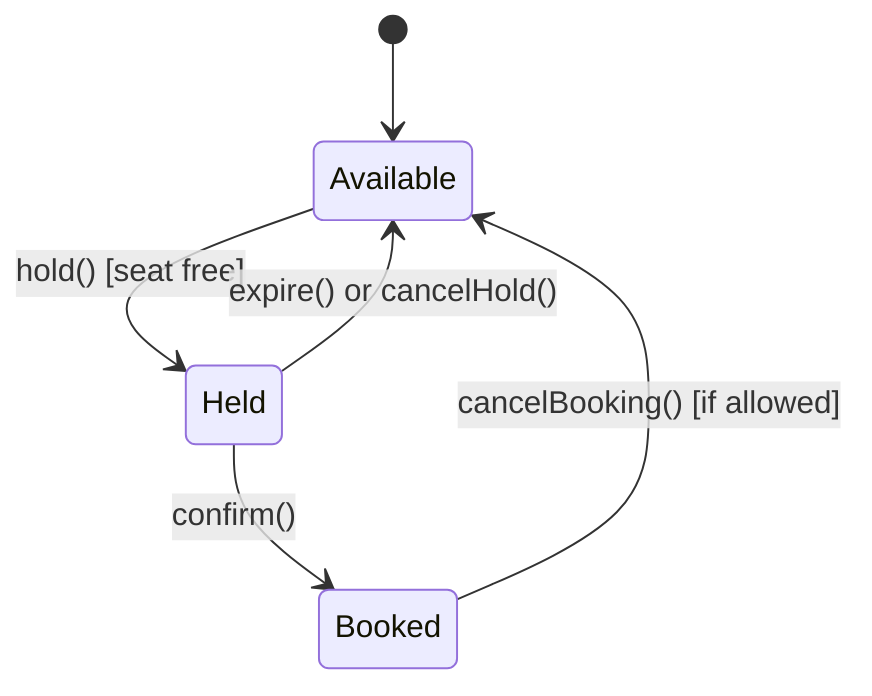
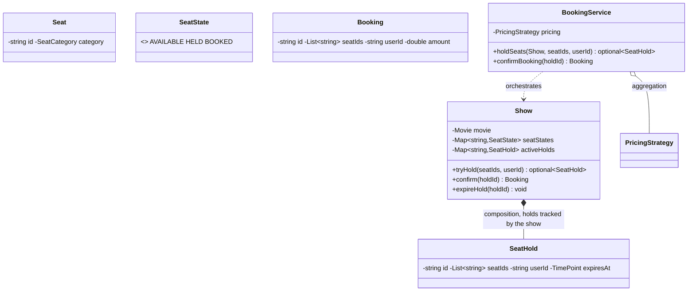

# 07 — Movie Ticket Booking (BookMyShow-style)

> Difficulty: intermediate-to-advanced. The OOD here (Theatre → Show →
> Seat) is straightforward by this point in the problem set — the actual
> difficulty, and what this problem is really testing, is **concurrency
> under contention**: many users trying to book overlapping seats for the
> same show at once, with a hold-then-confirm flow that can expire.
> Prerequisite: `00_foundations/10_concurrency_for_lld.md`.

## Step 1 — Clarify

Assumed answers:

- A `Theatre` has `Screen`s; each `Screen` runs `Show`s (a movie at a
  specific time); each `Show` has a fixed `Seat` layout with per-seat
  pricing tiers.
- Booking is two-phase: a user **holds** seats (temporarily reserved,
  visible as unavailable to others) for a short TTL, then **confirms**
  (converts the hold to a real booking, typically after payment succeeds)
  or the hold **expires** and seats become available again.
- Two users must never both successfully hold or confirm the same seat for
  the same show — this is the core correctness property the whole design
  serves.
- **Deferred, explicitly**: real payment gateway integration (simulate
  success/failure), seat recommendations, multi-city search — out of scope
  for the LLD.

## Step 2 — Entities

| Entity | Responsibility |
| --- | --- |
| `Seat` | Identity (row/col), category (Silver/Gold/Premium) |
| `Show` | A movie on a screen at a time; owns per-seat state (`AVAILABLE`/`HELD`/`BOOKED`) |
| `SeatHold` | A temporary reservation: which seats, which user, an expiry timestamp |
| `Booking` | A confirmed reservation: which seats, which user, amount paid |
| `BookingService` | Orchestrates hold → confirm/expire, the only place concurrency is handled |
| `PricingStrategy` | Price per seat category, possibly time-of-day/demand-based — **growing set**, interface |

The interesting design decision is entirely in `Show`'s per-seat state
machine and `BookingService`'s concurrency control — there's a real,
small State machine per seat (`AVAILABLE → HELD → BOOKED`, or
`HELD → AVAILABLE` on expiry), worth a state diagram per
`00_foundations/04_uml_and_modeling.md` before implementing.



## Step 3 — Class diagram



## Step 4-5 — Interfaces and core implementation

```cpp
#include <unordered_map>
#include <vector>
#include <mutex>
#include <chrono>
#include <optional>
#include <memory>
#include <algorithm>

enum class SeatCategory { SILVER, GOLD, PREMIUM };
enum class SeatState { AVAILABLE, HELD, BOOKED };
using Clock = std::chrono::steady_clock;

struct Seat { std::string id; SeatCategory category; };

struct SeatHold {
    std::string id;
    std::vector<std::string> seatIds;
    std::string userId;
    Clock::time_point expiresAt;
};

struct Booking {
    std::string id;
    std::vector<std::string> seatIds;
    std::string userId;
    double amount;
};

class PricingStrategy {
public:
    virtual double priceFor(SeatCategory) const = 0;
    virtual ~PricingStrategy() = default;
};
class StandardPricing : public PricingStrategy {
public:
    double priceFor(SeatCategory c) const override {
        switch (c) {
            case SeatCategory::SILVER: return 150;
            case SeatCategory::GOLD: return 250;
            case SeatCategory::PREMIUM: return 400;
        }
        return 0;
    }
};

// The concurrency-critical class. Every method that touches shared seat
// state takes the lock — Monitor Object pattern, 00_foundations/10.
class Show {
public:
    Show(std::string id, std::vector<Seat> seats)
        : id_(std::move(id)) {
        for (auto& s : seats) {
            seats_[s.id] = s;
            states_[s.id] = SeatState::AVAILABLE;
        }
    }

    // Atomically checks ALL requested seats are AVAILABLE and, only if so,
    // holds all of them — a partial hold (some seats held, some not) would
    // be a correctness bug, so this must be all-or-nothing under one lock.
    std::optional<SeatHold> tryHold(const std::vector<std::string>& seatIds,
                                     const std::string& userId,
                                     std::chrono::seconds ttl = std::chrono::seconds(300)) {
        std::lock_guard<std::mutex> lock(mu_);
        for (auto& id : seatIds) {
            if (states_.at(id) != SeatState::AVAILABLE) return std::nullopt;   // fail fast, hold nothing
        }
        for (auto& id : seatIds) states_[id] = SeatState::HELD;

        SeatHold hold{generateHoldId(), seatIds, userId, Clock::now() + ttl};
        holds_[hold.id] = hold;
        return hold;
    }

    std::optional<Booking> confirm(const std::string& holdId, double amount) {
        std::lock_guard<std::mutex> lock(mu_);
        auto it = holds_.find(holdId);
        if (it == holds_.end()) return std::nullopt;              // expired or invalid
        if (Clock::now() > it->second.expiresAt) {
            releaseHoldLocked(it);                                 // lazily expire on access
            return std::nullopt;
        }
        for (auto& id : it->second.seatIds) states_[id] = SeatState::BOOKED;
        Booking booking{generateBookingId(), it->second.seatIds, it->second.userId, amount};
        holds_.erase(it);
        return booking;
    }

    // Called by a background sweep, or lazily from confirm()/tryHold() —
    // see "Extensions" for the tradeoff between the two.
    void expireStaleHolds() {
        std::lock_guard<std::mutex> lock(mu_);
        auto now = Clock::now();
        for (auto it = holds_.begin(); it != holds_.end(); ) {
            if (now > it->second.expiresAt) it = releaseHoldLocked(it);
            else ++it;
        }
    }

private:
    using HoldMap = std::unordered_map<std::string, SeatHold>;
    HoldMap::iterator releaseHoldLocked(HoldMap::iterator it) {
        for (auto& id : it->second.seatIds) states_[id] = SeatState::AVAILABLE;
        return holds_.erase(it);
    }
    std::string generateHoldId();
    std::string generateBookingId();

    std::string id_;
    std::mutex mu_;
    std::unordered_map<std::string, Seat> seats_;
    std::unordered_map<std::string, SeatState> states_;
    std::unordered_map<std::string, SeatHold> holds_;
};
```

**Why `tryHold` checks every seat before holding any** (rather than holding
seats one at a time as it checks them): holding seat A, then discovering
seat B is unavailable, would leave seat A incorrectly held with no booking
in progress — the whole operation must be atomic across all requested
seats, which is exactly why it happens under one lock acquisition, not one
lock per seat. This is the same "identify the actual invariant" discipline
from `00_foundations/10` — the invariant here spans the *entire requested
seat set*, not each seat independently.

## Step 6 — Edge cases handled

- Partial availability (2 of 3 requested seats free) → the whole hold
  fails, nothing is held — never a partial success.
- Confirming an already-expired hold → treated as if the hold never
  existed (`nullopt`), with the seats released back to `AVAILABLE` as a
  side effect (lazy expiry).
- Two users racing for the same seat → the lock inside `tryHold` serializes
  them; the second to arrive sees `SeatState::HELD` and fails cleanly.

## Extensions (what a live follow-up usually asks)

**"Lazy expiry vs. a background sweep thread — which would you use?"** Both
are shown/named above. **Lazy** (check-and-release inside `confirm`/`tryHold`)
is simpler, has no extra thread, but a seat held by an abandoned session
stays falsely unavailable until someone else happens to touch it. **Background
sweep** (a thread periodically calling `expireStaleHolds()` on every
`Show`) reclaims seats promptly but adds a thread and its own scheduling
concern — this is exactly the Task Scheduler pattern from
`10_task_scheduler_cron.md`, worth naming as the natural implementation if
asked to build it out. State the tradeoff and pick one rather than
building both unless asked — real systems (this program's Splitwise
problem flagged a similar TTL-cleanup tradeoff) often run both: lazy
expiry for correctness on the hot path, background sweep for prompt
reclamation.

**"What if `confirm` is called for a hold this exact instant it's
expiring?"** The `Clock::now() > it->second.expiresAt` check happens
*inside* the same lock as the state mutation, so there's no race window
between checking expiry and confirming — either the whole `confirm` call
sees it as still valid and completes, or sees it as expired and fails; there's
no interleaving where both a confirm and an expiry partially apply. Stating
this explicitly (why the check-then-act is safe here) is a strong, precise
answer to a plausible "what about this exact race" follow-up.

**"Optimistic vs. pessimistic locking — which is this?"** This design is
**pessimistic** (the lock is held for the duration of the check-and-mutate,
blocking other threads from even attempting during that window) — the
right default for a resource this contended (many users, same popular
show, same in-demand seats) where a failed optimistic attempt would mean
redoing real work. An **optimistic** alternative (read seat states without
a lock, attempt a compare-and-swap-style update, retry on conflict) is
worth naming as the alternative and *why* it's worse here specifically:
under high contention for the same few seats, optimistic retries would
frequently collide and redo work, whereas pessimistic locking serializes
cleanly — say this reasoning, not just the vocabulary.

**"Scale this to be distributed across multiple servers."** The in-memory
`std::mutex` no longer suffices once `Show` state must be shared across
processes — this becomes a distributed-locking problem (a Redis-backed
lock or `SETNX`-style hold, or a database row-level lock with a TTL
column). Naming this transition point explicitly is the bridge to this
program's HLD track, worth a sentence even without full detail.

## Interview framing to reuse

"I made `tryHold` check every requested seat under a single lock
acquisition before holding any of them, specifically to keep the operation
atomic across the whole seat set — a design that held seats one at a time
could leave a partial hold if a later seat turned out to be unavailable."
Precise, unprompted reasoning about *why* the lock scope is what it is, not
just that a lock exists.

## Exercises

1. Implement the above from scratch in 50-60 minutes (this is a longer
   problem than most in the set — budget accordingly), then write a stress
   test: many threads concurrently calling `tryHold` for overlapping seat
   sets on the same `Show`, asserting no seat is ever held by two holds
   simultaneously.
2. Implement `expireStaleHolds()` as a background sweep using a
   `std::jthread` with cooperative cancellation
   (`00_foundations/11_threads_futures_and_concurrency_patterns.md`),
   running every few seconds, and confirm an abandoned hold is reclaimed
   without any `confirm`/`tryHold` call touching it.
3. Write the `BookingService` orchestration layer wrapping `Show` and
   `PricingStrategy`, and unit test it with a fake clock (inject a
   `Clock::time_point` "now" provider instead of calling
   `Clock::now()` directly) so hold-expiry tests don't need real
   `sleep()` calls — cross-reference `00_foundations/15_testing_gtest_and_gmock.md`'s
   testability discussion for why this injection matters.
