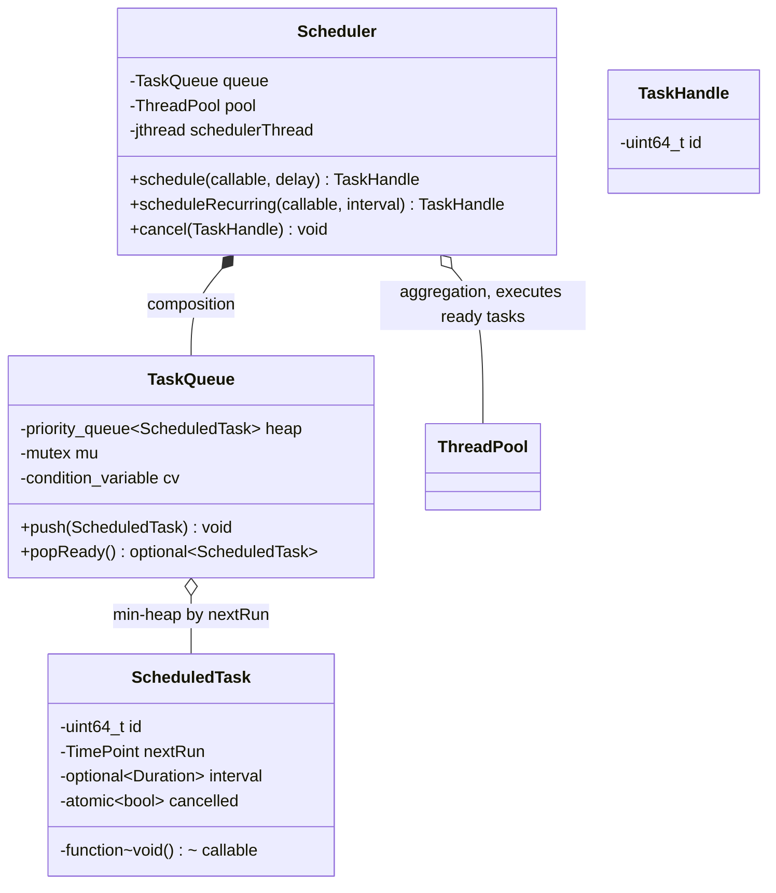

# 10 — Task Scheduler / Cron Engine

> Difficulty: advanced, and a good capstone for the whole problem set — it
> composes a priority queue, a thread pool, condition-variable-based
> waiting, and (for the recurring-task extension) the Strategy pattern, all
> in one design. Prerequisite: `00_foundations/10_concurrency_for_lld.md`,
> `00_foundations/11_threads_futures_and_concurrency_patterns.md`,
> `10_lld/02_systems_lld/03_thread_safe_primitives.md` (Thread Pool).

## Step 1 — Clarify

Assumed answers:

- Schedule a task to run **once at a specific future time**, or **once
  after a delay**, or **repeatedly on an interval** (a basic cron-like
  capability, not full cron expression parsing — say this scope explicitly;
  parsing `* * * * *`-style expressions is a separate, well-bounded
  sub-problem worth naming but not building unless asked).
- Tasks execute on a bounded pool of worker threads, not one thread per
  task (direct application of `00_foundations/11`'s Thread Pool guidance).
- Supports **cancellation** of a scheduled-but-not-yet-run task.
- **Deferred, explicitly**: persistence across restarts, distributed
  scheduling across multiple machines (a much larger problem —
  `11_hld/03_systems_domain/03_edge_to_cloud_fleet_management.md`'s rollout/orchestration
  material is the relevant HLD-scale analogue if asked to extend this way).

## Step 2 — Entities

| Entity | Responsibility |
| --- | --- |
| `ScheduledTask` | A task's callable, its next-run time, and (if recurring) its interval |
| `TaskQueue` | A thread-safe **min-heap ordered by next-run time** — the core data structure |
| `SchedulerThread` | The single thread that waits for the next task's time and hands ready tasks to the pool |
| `ThreadPool` | Executes ready tasks — reused directly from `10_lld/02_systems_lld/03_thread_safe_primitives.md`, not rebuilt |
| `TaskHandle` | Returned on scheduling, used for cancellation |

**Why exactly one scheduler thread, not one thread per pending task
sleeping until its time**: a thread per pending task doesn't scale (the
same argument against a thread-per-request design from
`00_foundations/11`) and, worse, offers no way to react to a *newly
scheduled* task that should run **sooner** than whatever the single waiting
thread was already sleeping until — a single scheduler thread waiting on a
`condition_variable` with a timeout, woken early whenever a new task is
scheduled, solves both problems at once. This is the core design insight
worth stating before writing any code.

## Step 3 — Class diagram



## Step 4-5 — Interfaces and core implementation

```cpp
#include <queue>
#include <vector>
#include <functional>
#include <mutex>
#include <condition_variable>
#include <thread>
#include <atomic>
#include <chrono>
#include <memory>
#include <optional>

using Clock = std::chrono::steady_clock;

struct ScheduledTask {
    uint64_t id;
    std::function<void()> callable;
    Clock::time_point nextRun;
    std::optional<std::chrono::milliseconds> interval;   // nullopt = one-shot
    std::shared_ptr<std::atomic<bool>> cancelled;

    // Min-heap by nextRun: std::priority_queue is a max-heap by default,
    // so this comparator is inverted (">") to get the earliest time on top.
    bool operator<(const ScheduledTask& other) const { return nextRun > other.nextRun; }
};

struct TaskHandle { uint64_t id; std::shared_ptr<std::atomic<bool>> cancelled; };

class TaskQueue {
public:
    void push(ScheduledTask task) {
        std::lock_guard<std::mutex> lock(mu_);
        heap_.push(std::move(task));
        cv_.notify_one();   // wake the scheduler thread — it may need to wait less time now
    }

    // Blocks until either a task is ready to run, or (if the heap is empty
    // or the earliest task isn't due yet) until woken by push() or until
    // `stopToken` requests stop.
    std::optional<ScheduledTask> waitForReady(std::stop_token stopToken) {
        std::unique_lock<std::mutex> lock(mu_);
        while (!stopToken.stop_requested()) {
            if (heap_.empty()) {
                cv_.wait(lock, stopToken, [this] { return !heap_.empty(); });
                continue;
            }
            auto next = heap_.top().nextRun;
            if (Clock::now() >= next) {
                ScheduledTask task = std::move(const_cast<ScheduledTask&>(heap_.top()));
                heap_.pop();
                return task;
            }
            cv_.wait_until(lock, next);   // sleep exactly until the earliest task is due,
                                            // or until notify_one() wakes us early for a new,
                                            // sooner-due task pushed in the meantime
        }
        return std::nullopt;
    }

private:
    std::mutex mu_;
    std::condition_variable_any cv_;   // _any: needed to wait with a std::stop_token
    std::priority_queue<ScheduledTask> heap_;
};

class Scheduler {
public:
    explicit Scheduler(size_t poolSize) : pool_(poolSize) {
        schedulerThread_ = std::jthread([this](std::stop_token token) { run(token); });
    }

    TaskHandle schedule(std::function<void()> callable, std::chrono::milliseconds delay) {
        return scheduleInternal(std::move(callable), delay, std::nullopt);
    }
    TaskHandle scheduleRecurring(std::function<void()> callable, std::chrono::milliseconds interval) {
        return scheduleInternal(std::move(callable), interval, interval);
    }
    void cancel(const TaskHandle& handle) { handle.cancelled->store(true); }

private:
    TaskHandle scheduleInternal(std::function<void()> callable, std::chrono::milliseconds delay,
                                 std::optional<std::chrono::milliseconds> interval) {
        auto cancelled = std::make_shared<std::atomic<bool>>(false);
        uint64_t id = nextId_++;
        queue_.push(ScheduledTask{id, callable, Clock::now() + delay, interval, cancelled});
        return TaskHandle{id, cancelled};
    }

    void run(std::stop_token token) {
        while (auto task = queue_.waitForReady(token)) {
            if (task->cancelled->load()) continue;   // skip cancelled tasks without executing

            auto callable = task->callable;
            pool_.submit([callable] { callable(); });   // hand off to the pool, don't run inline —
                                                           // a slow task must never delay the next
                                                           // task's dispatch

            if (task->interval) {
                // reschedule the next occurrence — a fresh ScheduledTask
                // with an updated nextRun, same cancellation flag so
                // cancel() stops all future occurrences too
                queue_.push(ScheduledTask{task->id, task->callable,
                                           Clock::now() + *task->interval,
                                           task->interval, task->cancelled});
            }
        }
    }

    TaskQueue queue_;
    ThreadPool pool_;              // reused from 10_lld/02_systems_lld/03_thread_safe_primitives.md
    std::jthread schedulerThread_;
    std::atomic<uint64_t> nextId_{0};
};
```

**Why `waitForReady` uses `wait_until(lock, next)` rather than computing a
duration and calling `wait_for`**: `wait_until` with an absolute time point
is immune to the "recompute a relative duration after doing other work"
class of bugs, and — more importantly here — it composes correctly with
`notify_one()`: if a new, sooner task is pushed while the scheduler thread
is sleeping, the `notify_one()` in `push()` wakes it immediately, the loop
re-checks `heap_.top()`, and it recomputes a new (shorter) `wait_until`
target. This early-wake behaviour is *why* a single condition-variable-
based scheduler thread, rather than a naive polling loop, correctly
handles "a task scheduled for 1 second from now arrives while the thread
was about to sleep for 10 seconds."

**Why cancellation is a `shared_ptr<atomic<bool>>` checked at execution
time, not a queue removal**: removing an arbitrary element from a
`std::priority_queue` isn't a supported O(log n) operation (the STL heap
adapter doesn't expose arbitrary erasure) — rather than fighting the
container, mark-as-cancelled-and-skip-at-dispatch-time is the standard,
simpler answer, and it's also correct for a task that's *already* been
handed to the thread pool by the time `cancel()` is called (a real
in-flight task can't be un-executed, only prevented from being resubmitted
if recurring) — worth stating this boundary honestly if asked "can you
cancel a task that's already running?"

## Step 6 — Edge cases handled

- A task scheduled for a time already in the past (`delay` of zero or
  negative) → `Clock::now() >= next` is immediately true, it's picked up on
  the scheduler thread's very next loop iteration.
- A cancelled recurring task → skipped at each dispatch check, and since
  the cancellation flag is shared across every rescheduled occurrence
  (same `shared_ptr`), cancelling once stops all future occurrences, not
  just the next one.
- The scheduler thread never runs a task's actual work inline — it only
  ever calls `pool_.submit()`, so one slow task cannot delay the dispatch
  of the next due task, only its own execution.

## Extensions (what a live follow-up usually asks)

**"What if the recurring task's own execution takes longer than its
interval?"** As written, occurrences can queue up back-to-back once
execution time exceeds the interval (each reschedule is relative to
`Clock::now()` at *dispatch* time, not a fixed cadence, so this actually
self-corrects somewhat — but worth naming the two real policies explicitly:
**fixed-rate** (next run is always `previousScheduledTime + interval`,
catching up if behind) vs. **fixed-delay** (next run is always
`completionTime + interval`, as effectively implemented above, never
catching up). State which one you built and that the other is a valid,
different choice depending on the use case (a health-check probe usually
wants fixed-delay; a billing-cycle job usually wants fixed-rate).

**"Parse actual cron expressions (`0 */2 * * *`)."** A separate,
well-bounded sub-problem: a `CronExpression` parser/evaluator that computes
"next run time after now" given the five-field syntax — pluggable in place
of the simple `interval` field without touching `TaskQueue` or `Scheduler`'s
core dispatch loop, since both only ever need "what's the next run time,"
regardless of how it's computed.

**"What if the scheduler process crashes — do tasks survive?"** No,
everything here is in-memory. A durable version needs to persist scheduled
tasks (a database row per task, a write-ahead log) and reload/re-schedule
on startup — name this boundary the same way
`07_movie_ticket_booking.md` named the distributed-locking boundary,
without attempting a full solution unless asked to extend into it.

## Interview framing to reuse

"I used one scheduler thread waiting on a condition variable with
`wait_until`, rather than a thread per task or a polling loop, specifically
so a newly-scheduled task that's due sooner than whatever the thread was
already sleeping for wakes it early — that's the `notify_one()` in `push()`
composing with `wait_until` in the wait loop." This is the single
design decision this whole problem is testing; say it before being asked.

## Exercises

1. Implement the above from scratch in 50-60 minutes (composes several
   previously-built pieces — budget time to wire them together, not just
   write new code), then write a test scheduling five one-shot tasks at
   different delays and confirm they execute in the correct order within a
   reasonable tolerance.
2. Implement and test cancellation: schedule a recurring task, let it fire
   twice, cancel it, and confirm it never fires a third time.
3. Implement the fixed-rate variant as an alternative to this file's
   fixed-delay default, and write a test that distinguishes the two: a task
   whose execution takes longer than its interval should show the two
   policies producing different actual run timestamps.
4. Swap in `10_lld/02_systems_lld/03_thread_safe_primitives.md`'s actual `ThreadPool`
   implementation (rather than a stub) and run a stress test: schedule
   1,000 tasks with randomized short delays and confirm every one executes
   exactly once, with no task lost and no task run twice.
