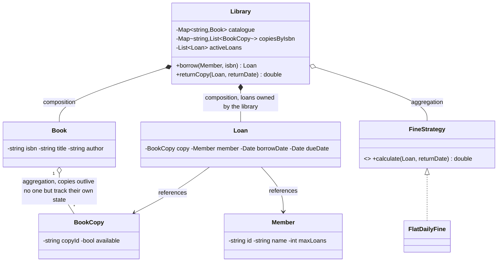

# 11 — Library Management System

> Difficulty: foundational. The most-asked problem after Parking Lot and
> Elevator — pure OOD with no concurrency requirement by default, which
> makes it a common first-round screen. The interesting design decision is
> `Book` vs `BookCopy`: a library owns many physical copies of the same
> title, and conflating the two is the single most common mistake on this
> problem.

## Step 1 — Clarify

Assumed answers:

- A `Library` holds `Book` titles; each title may have multiple physical
  `BookCopy` instances (a library owns 3 copies of "Clean Code").
- `Member`s can borrow and return copies. A `Loan` records who has which
  copy and when it's due.
- Overdue loans accrue a fine, computed by a pluggable strategy (flat
  per-day, capped, tiered).
- A member has a borrowing limit (max concurrent loans).
- **Deferred, explicitly**: reservations/holds on fully-checked-out titles,
  inter-branch transfers, a full catalogue search engine — realistic
  follow-ups, not the base design. Also deferred, per this roadmap's scope
  note: an actual database schema for the catalogue — a different skill
  (normalization, indexing), belongs with the HLD/data-layer track.

## Step 2 — Entities

| Entity | Responsibility |
| --- | --- |
| `Book` | Title-level metadata (ISBN, author, title) — **not** a physical object |
| `BookCopy` | One physical copy of a `Book`; tracks its own availability |
| `Member` | Identity, current loan count |
| `Loan` | Which copy, which member, borrow date, due date |
| `FineStrategy` | Computes a fine given a loan and a return date — **growing set**, interface |
| `Library` | Orchestrates borrow/return, owns the catalogue and active loans |

**Why `Book` and `BookCopy` are two classes, not one**: this is the exact
composition/aggregation distinction from `00_foundations/04_uml_and_modeling.md`
made concrete — a `Book` (title) aggregates many `BookCopy` instances, and
critically, **availability is a property of the copy, not the title**. A
library with 3 copies of a title, 2 checked out, has that title "available"
— a design that puts an `available` flag on `Book` directly cannot express
this at all. Getting this distinction right in the first two minutes is
the single strongest signal on this problem.

## Step 3 — Class diagram



## Step 4-5 — Interfaces and core implementation

```cpp
#include <chrono>
#include <map>
#include <memory>
#include <optional>
#include <stdexcept>
#include <string>
#include <vector>

using Date = std::chrono::system_clock::time_point;
using Days = std::chrono::duration<int, std::ratio<86400>>;

struct Book { std::string isbn, title, author; };

class BookCopy {
public:
    explicit BookCopy(std::string copyId) : copyId_(std::move(copyId)) {}
    bool isAvailable() const { return available_; }
    void markBorrowed() { available_ = false; }
    void markReturned() { available_ = true; }
    const std::string& copyId() const { return copyId_; }
private:
    std::string copyId_;
    bool available_ = true;
};

struct Member {
    std::string id, name;
    int maxLoans = 5;
};

struct Loan {
    BookCopy* copy;
    Member* member;
    Date borrowDate;
    Date dueDate;
};

class FineStrategy {
public:
    virtual double calculate(const Loan& loan, Date returnDate) const = 0;
    virtual ~FineStrategy() = default;
};

class FlatDailyFine : public FineStrategy {
public:
    explicit FlatDailyFine(double perDay) : perDay_(perDay) {}
    double calculate(const Loan& loan, Date returnDate) const override {
        if (returnDate <= loan.dueDate) return 0.0;
        auto overdueDays = std::chrono::duration_cast<Days>(returnDate - loan.dueDate).count();
        return overdueDays * perDay_;
    }
private:
    double perDay_;
};

class Library {
public:
    explicit Library(std::unique_ptr<FineStrategy> fineStrategy) : fineStrategy_(std::move(fineStrategy)) {}

    void addBook(Book book, int copies) {
        std::string isbn = book.isbn;
        catalogue_[isbn] = std::move(book);
        for (int i = 0; i < copies; ++i)
            copiesByIsbn_[isbn].push_back(std::make_unique<BookCopy>(isbn + "-" + std::to_string(i)));
    }

    std::optional<Loan> borrow(Member& member, const std::string& isbn, Date now) {
        int currentLoans = 0;
        for (auto& loan : activeLoans_) if (loan.member == &member) ++currentLoans;
        if (currentLoans >= member.maxLoans) return std::nullopt;   // limit reached

        auto it = copiesByIsbn_.find(isbn);
        if (it == copiesByIsbn_.end()) return std::nullopt;
        for (auto& copy : it->second) {
            if (copy->isAvailable()) {
                copy->markBorrowed();
                Loan loan{copy.get(), &member, now, now + Days(14)};
                activeLoans_.push_back(loan);
                return loan;
            }
        }
        return std::nullopt;   // no available copy
    }

    double returnCopy(const Loan& loan, Date returnDate) {
        loan.copy->markReturned();
        double fine = fineStrategy_->calculate(loan, returnDate);
        std::erase_if(activeLoans_, [&](const Loan& l) { return l.copy == loan.copy && l.member == loan.member; });
        return fine;
    }

private:
    std::map<std::string, Book> catalogue_;
    std::map<std::string, std::vector<std::unique_ptr<BookCopy>>> copiesByIsbn_;
    std::vector<Loan> activeLoans_;
    std::unique_ptr<FineStrategy> fineStrategy_;
};
```

**Why `borrow` scans for the first available copy rather than the caller
picking one**: the member doesn't care *which* physical copy they get —
copies of the same title are interchangeable from the borrower's
perspective, only the count of available ones matters. This is exactly why
`available` living on `BookCopy` (not `Book`) is correct: the `Library`
still needs to iterate copies to find one, but the *caller's* API stays
title-level (`borrow(member, isbn)`), which is the interface a real library
system actually needs.

## Step 6 — Edge cases handled

- Member at their loan limit → `borrow` returns `nullopt` before even
  checking the catalogue, cheap fail-fast.
- All copies of a title checked out → `nullopt`, same "expected failure"
  pattern as `02_parking_lot.md`'s full-lot case.
- Returning on or before the due date → zero fine, `FlatDailyFine`'s
  early-return handles this explicitly rather than computing a negative
  number of days.

## Extensions (what a live follow-up usually asks)

**"Add reservations — a member can hold a spot when all copies are out."**
A `ReservationQueue` per ISBN (FIFO), consulted in `returnCopy` — when a
copy is returned and a reservation exists, it's handed to the front of the
queue instead of becoming generally available. This is additive to
`Library`, doesn't touch `Book`/`BookCopy`/`Loan` at all.

**"Support renewing a loan."** `Library::renew(Loan&)` extending
`dueDate` by another period, with a business rule worth naming explicitly
(no renewal if someone else has a reservation on that title) — a good spot
to show you're thinking about fairness, not just the mechanics.

**"Tiered fines — first 3 days at $0.50, then $2/day after."** A new
`FineStrategy` implementation (`TieredFine`) — zero changes to `Library`
or the interface, the exact OCP payoff this pattern exists for.

**"Make `borrow` thread-safe for a multi-branch kiosk system."** The
check-then-mark sequence in `borrow` (find an available copy, then mark it
borrowed) is a race if two members request the same title's last copy
simultaneously — a mutex around `Library` (coarse-grained is defensible
here: borrow/return isn't a hot path the way Parking Lot's slot assignment
is) fixes it, per `00_foundations/10_concurrency_for_lld.md`.

## Interview framing to reuse

"I split `Book` and `BookCopy` specifically because availability is a
per-copy property, not a per-title one — a design that puts an `available`
flag directly on `Book` can't represent 'title available, but only because
one of three copies happens to be in.'" This is the sentence that
distinguishes a strong answer from a mediocre one on this exact problem.

## Exercises

1. Implement the above from scratch in 35-40 minutes, then add the
   reservation-queue extension and write a test: two members race for the
   last copy of a title, the second reserves, the first returns their
   (different) copy, and the reservation is honoured on the next return of
   *that* title.
2. Add `TieredFine` and confirm `Library` needs zero changes.
3. Add the thread-safety extension and write a stress test racing many
   members for a single-copy title, asserting exactly one succeeds.
