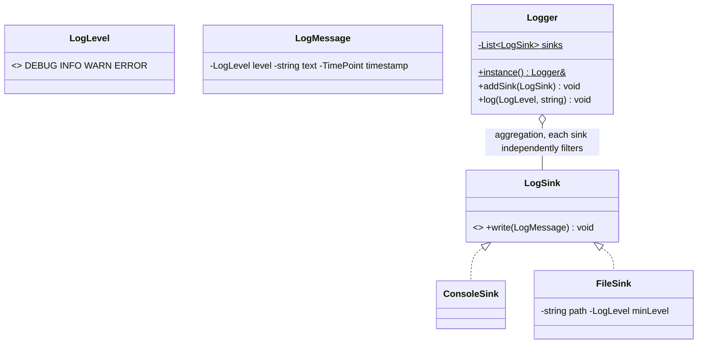

# 12 — Logger Framework

> Difficulty: intermediate. The most pattern-dense small problem in the
> set — Singleton (for once, actually justified), Chain of Responsibility,
> and Strategy all show up naturally, which makes it a good "how many
> patterns can you correctly justify in one design" checkpoint.

## Step 1 — Clarify

Assumed answers:

- Log levels: `DEBUG < INFO < WARN < ERROR`. A logger configured at level
  `WARN` suppresses `DEBUG`/`INFO` messages.
- Multiple **sinks** simultaneously — console and file at minimum, each
  independently configurable (a sink can have its own minimum level).
- A single, globally-accessible logger instance per process (this is the
  Singleton-is-actually-justified case flagged in
  `00_foundations/07_design_patterns_creational.md`: a log file handle is
  a genuine single physical resource — two independent `Logger` instances
  writing to the same file without coordination is a real correctness bug,
  not just an inconvenience).
- **Deferred, explicitly**: log rotation, structured/JSON logging, async
  batched writes — realistic follow-ups, not the base design.

## Step 2 — Entities

| Entity | Responsibility |
| --- | --- |
| `LogLevel` (enum) | DEBUG/INFO/WARN/ERROR, ordered |
| `LogMessage` | Level, text, timestamp |
| `LogSink` (interface) | Writes a message somewhere — **growing set**, interface |
| `ConsoleSink`, `FileSink` | Concrete sinks |
| `Logger` | Owns registered sinks, routes messages that pass the level filter — the Singleton |

There's no Chain of Responsibility class here despite the pattern being
"naturally present" — worth explaining why: **the level filter is exactly
what Chain of Responsibility formalizes** (each potential handler — each
level — either processes the message or passes it along), but it's simple
enough (a single ordered comparison) that implementing it as an explicit
chain of handler objects would be the pattern-itis this whole track warns
against (`10_lld/00_plan.md`). State this
explicitly if you're tempted to build a `DebugHandler`/`InfoHandler`
chain: "a numeric level comparison is Chain of Responsibility's *effect*
without its *machinery* — I'd only introduce the actual pattern if
handlers needed real per-level *behaviour* beyond pass/suppress."

## Step 3 — Class diagram



## Step 4-5 — Interfaces and core implementation

```cpp
#include <chrono>
#include <fstream>
#include <iostream>
#include <memory>
#include <mutex>
#include <string>
#include <vector>

enum class LogLevel { DEBUG, INFO, WARN, ERROR };

struct LogMessage {
    LogLevel level;
    std::string text;
    std::chrono::system_clock::time_point timestamp;
};

class LogSink {
public:
    virtual void write(const LogMessage& msg) = 0;
    virtual ~LogSink() = default;
};

class ConsoleSink : public LogSink {
public:
    explicit ConsoleSink(LogLevel minLevel = LogLevel::DEBUG) : minLevel_(minLevel) {}
    void write(const LogMessage& msg) override {
        if (msg.level < minLevel_) return;
        std::cout << format(msg) << "\n";
    }
private:
    LogLevel minLevel_;
    static std::string format(const LogMessage& msg);
};

class FileSink : public LogSink {
public:
    FileSink(std::string path, LogLevel minLevel = LogLevel::WARN)
        : minLevel_(minLevel), file_(path, std::ios::app) {}
    void write(const LogMessage& msg) override {
        if (msg.level < minLevel_) return;
        std::lock_guard<std::mutex> lock(mu_);   // one FileSink, one file handle -- protect the write
        file_ << format(msg) << "\n";
        file_.flush();
    }
private:
    LogLevel minLevel_;
    std::mutex mu_;
    std::ofstream file_;
    static std::string format(const LogMessage& msg);
};

// Meyers' Singleton, exactly per 00_foundations/07 -- thread-safe
// initialization guaranteed by the standard since C++11, no manual locking.
class Logger {
public:
    static Logger& instance() {
        static Logger inst;
        return inst;
    }
    Logger(const Logger&) = delete;
    Logger& operator=(const Logger&) = delete;

    void addSink(std::unique_ptr<LogSink> sink) {
        std::lock_guard<std::mutex> lock(mu_);
        sinks_.push_back(std::move(sink));
    }

    void log(LogLevel level, const std::string& text) {
        LogMessage msg{level, text, std::chrono::system_clock::now()};
        std::vector<LogSink*> sinksCopy;
        {
            std::lock_guard<std::mutex> lock(mu_);
            for (auto& s : sinks_) sinksCopy.push_back(s.get());
        }
        // dispatch outside the lock -- same reasoning as Topic::publish in
        // 08_message_queue_pubsub.md: a slow sink shouldn't block addSink()
        // or another thread's concurrent log() call from registering.
        for (auto* sink : sinksCopy) sink->write(msg);
    }

private:
    Logger() = default;
    std::mutex mu_;
    std::vector<std::unique_ptr<LogSink>> sinks_;
};

#define LOG_INFO(msg) Logger::instance().log(LogLevel::INFO, msg)
#define LOG_WARN(msg) Logger::instance().log(LogLevel::WARN, msg)
```

**Why `log()` copies the sink pointer list under the lock and dispatches
outside it**: identical reasoning to `08_message_queue_pubsub.md`'s
`Topic::publish` — a `FileSink::write` call is comparatively slow (disk
I/O), and holding `Logger`'s own mutex for the duration would serialize
every other thread's `log()` call behind however long that write takes.
Copying the (small, cheap-to-copy) pointer list and releasing the lock
before dispatching keeps `Logger`'s own bookkeeping fast even when a sink
is slow.

## Step 6 — Edge cases handled

- Per-sink minimum level, independent of any global level — a `WARN`-only
  `FileSink` alongside a `DEBUG`-level `ConsoleSink` both receive every
  call to `log()`, each deciding independently whether to actually write.
- `FileSink` guards its own file handle with its own mutex — necessary
  because multiple threads calling `Logger::log()` concurrently can reach
  the same `FileSink::write()` concurrently once the global lock is
  released for dispatch.

## Extensions (what a live follow-up usually asks)

**"Make logging asynchronous so `log()` never blocks the caller on I/O."**
`Logger::log()` pushes onto a `BoundedBlockingQueue<LogMessage>`
(`00_foundations/10_concurrency_for_lld.md`) instead of dispatching
inline; a dedicated background thread pulls from the queue and calls each
sink's `write()`. This is the Producer-Consumer pattern applied here
directly — worth naming unprompted.

**"Add structured (JSON) logging as an option."** A `LogFormatter`
interface (Strategy) that each sink can be configured with, replacing the
hardcoded `format()` helper — `PlainTextFormatter` vs `JsonFormatter`,
selected per sink at construction. Additive, doesn't touch `Logger`.

**"Why Singleton here specifically, when you warned against it
elsewhere?"** Say the justification precisely: a log file is a genuine
single physical resource, and two independent `Logger` instances writing
to the same file path without coordinating would be a real correctness
bug (interleaved partial writes), not merely an inconvenience — this is
exactly the "single physical resource constraint" carve-out
`00_foundations/07` names as the legitimate use of Singleton, as opposed
to reaching for it out of habit.

## Interview framing to reuse

"I didn't build an explicit Chain-of-Responsibility handler chain for the
level filter — a numeric comparison already gets the pass-or-suppress
effect, and adding handler objects here would be complexity without a
matching requirement. I would introduce it if a level needed real
behaviour beyond suppression, like ERROR also triggering a page." Naming a
pattern you *didn't* use, and why, is a stronger signal than only naming
the ones you did.

## Exercises

1. Implement the above from scratch in 30-35 minutes, then write a test
   confirming a `WARN`-level `FileSink` never receives `DEBUG`/`INFO`
   messages while a `DEBUG`-level `ConsoleSink` receives everything.
2. Add the async logging extension with a background consumer thread, and
   write a test confirming `log()` returns quickly even when a sink is
   artificially slowed down (a `SlowTestSink` that sleeps in `write()`).
3. Add `JsonFormatter` alongside a `PlainTextFormatter`, configure one sink
   with each, and confirm both receive identical `LogMessage`s but produce
   different output.
