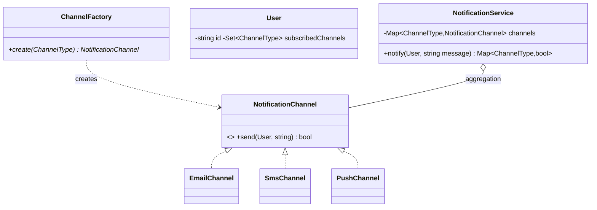

# 13 — Notification System (Email / SMS / Push)

> Difficulty: foundational. A short, clean problem, usually given as a
> 30-minute warm-up before a harder second problem. The value here is
> composing two patterns that are individually simple (Factory Method,
> Observer) cleanly, and handling partial failure honestly.

## Step 1 — Clarify

Assumed answers:

- A user can be notified via one or more channels: Email, SMS, Push.
- A `NotificationService` sends a notification to a user across all of
  their **subscribed** channels — a user with Email and Push enabled gets
  both when a notification fires, not a single arbitrarily-chosen one.
- Sending is per-channel independent — if SMS delivery fails, Email should
  still be attempted, not aborted.
- **Deferred, explicitly**: retry/backoff on failure, delivery receipts,
  rate limiting per user (cross-reference `09_rate_limiter_library.md` if
  asked to add it) — realistic follow-ups, not the base design.

## Step 2 — Entities

| Entity | Responsibility |
| --- | --- |
| `NotificationChannel` (interface) | `send(user, message)` — **growing set**, interface |
| `EmailChannel`, `SmsChannel`, `PushChannel` | Concrete channels |
| `ChannelFactory` | Creates the right channel implementation from a type — Factory Method |
| `User` | Identity + which channels they're subscribed to |
| `NotificationService` | Fans a notification out across a user's subscribed channels |

The Observer angle here is at the *design* level rather than a literal
`Observer` class: `NotificationService` is the subject, each channel send
is conceptually "notifying an observer of an event" — but because the set
of channels for a *given send* is user-specific (not a global subscriber
list), this is implemented as an explicit fan-out loop rather than a
formal `Observer` registration mechanism. Worth stating this distinction
if asked "isn't this Observer?": structurally similar, but the subscriber
list is per-user data, not a subject's member list, so a literal Observer
implementation would be the wrong shape here.

## Step 3 — Class diagram



## Step 4-5 — Interfaces and core implementation

```cpp
#include <map>
#include <memory>
#include <set>
#include <stdexcept>
#include <string>

enum class ChannelType { EMAIL, SMS, PUSH };

class NotificationChannel {
public:
    virtual bool send(const std::string& userId, const std::string& message) = 0;
    virtual ~NotificationChannel() = default;
};

class EmailChannel : public NotificationChannel {
public:
    bool send(const std::string& userId, const std::string& message) override {
        // real implementation calls an email provider's API; simulate success here
        return true;
    }
};
class SmsChannel : public NotificationChannel {
public:
    bool send(const std::string&, const std::string&) override { return true; }
};
class PushChannel : public NotificationChannel {
public:
    bool send(const std::string&, const std::string&) override { return true; }
};

class ChannelFactory {
public:
    static std::unique_ptr<NotificationChannel> create(ChannelType type) {
        switch (type) {
            case ChannelType::EMAIL: return std::make_unique<EmailChannel>();
            case ChannelType::SMS:   return std::make_unique<SmsChannel>();
            case ChannelType::PUSH:  return std::make_unique<PushChannel>();
        }
        throw std::invalid_argument("unknown channel type");
    }
};

struct User {
    std::string id;
    std::set<ChannelType> subscribedChannels;
};

class NotificationService {
public:
    void registerChannel(ChannelType type, std::unique_ptr<NotificationChannel> channel) {
        channels_[type] = std::move(channel);
    }

    // Returns per-channel success, so a caller can see partial failure
    // rather than a single bool that hides which channel failed.
    std::map<ChannelType, bool> notify(const User& user, const std::string& message) {
        std::map<ChannelType, bool> results;
        for (ChannelType type : user.subscribedChannels) {
            auto it = channels_.find(type);
            if (it == channels_.end()) { results[type] = false; continue; }
            results[type] = it->second->send(user.id, message);   // one channel's
                                                                     // failure doesn't
                                                                     // stop the others
        }
        return results;
    }

private:
    std::map<ChannelType, std::unique_ptr<NotificationChannel>> channels_;
};
```

**Why `notify` returns a per-channel result map instead of a single
bool**: a single bool ("did it work?") is ambiguous the moment a user has
more than one channel — "worked" could mean all succeeded, one succeeded,
or something in between, and the caller has no way to know which channel
needs a retry. Returning the breakdown is a small design choice with an
outsized effect on how honestly the system reports partial failure —
worth pointing out unprompted, since a design that silently collapses
partial failure into a single boolean is a common, real bug source.

## Step 6 — Edge cases handled

- A user subscribed to a channel that isn't registered in the service
  (e.g. Push subscribed but no `PushChannel` registered) → recorded as a
  failure for that channel, doesn't throw, doesn't block other channels.
- One channel's `send` failing doesn't prevent attempting the rest — the
  loop always visits every subscribed channel.

## Extensions (what a live follow-up usually asks)

**"Add a template/personalization layer — the same event produces
different message text per channel (SMS needs to be short, Email can be
long)."** A `MessageTemplate` per channel type, or a
`NotificationContent` object holding channel-specific renderings, passed
into `notify` instead of a bare string — additive to the signature, no
change to the channel interface itself.

**"Retry failed sends with backoff."** Wrap each `channel->send(...)`
call in a small retry loop (or better, hand it to
`10_task_scheduler_cron.md`'s `Scheduler` as a delayed retry task if the
first attempt fails) — naming the Task Scheduler cross-reference
explicitly is a good "I know how these pieces compose" signal.

**"Rate-limit notifications per user so they don't get spammed."** Direct
application of `09_rate_limiter_library.md`'s `RateLimiter`, keyed by
user id, checked before the fan-out loop in `notify` — a `false` from
`tryAcquire` short-circuits the whole notification, not per-channel.

## Interview framing to reuse

"I return a map of per-channel results instead of a single bool, because
collapsing partial failure into one boolean would hide exactly the
information a caller needs to decide whether to retry a specific
channel." A precise, unprompted justification for a design choice that's
easy to get wrong by not thinking about it at all.

## Exercises

1. Implement the above from scratch in 25-30 minutes, then write a test
   with a user subscribed to Email and SMS where the SMS channel is a
   test double that fails, confirming Email still succeeds and the result
   map reflects both outcomes correctly.
2. Add the rate-limiting extension using `09_rate_limiter_library.md`'s
   `RateLimiter`, and write a test confirming a user who exceeds their
   quota gets zero channel sends attempted, not partial ones.
3. Add a new `ChannelType::WEBHOOK` end to end (enum value, concrete
   class, factory case) and time how long it takes — this is the OCP
   litmus test for this design.
