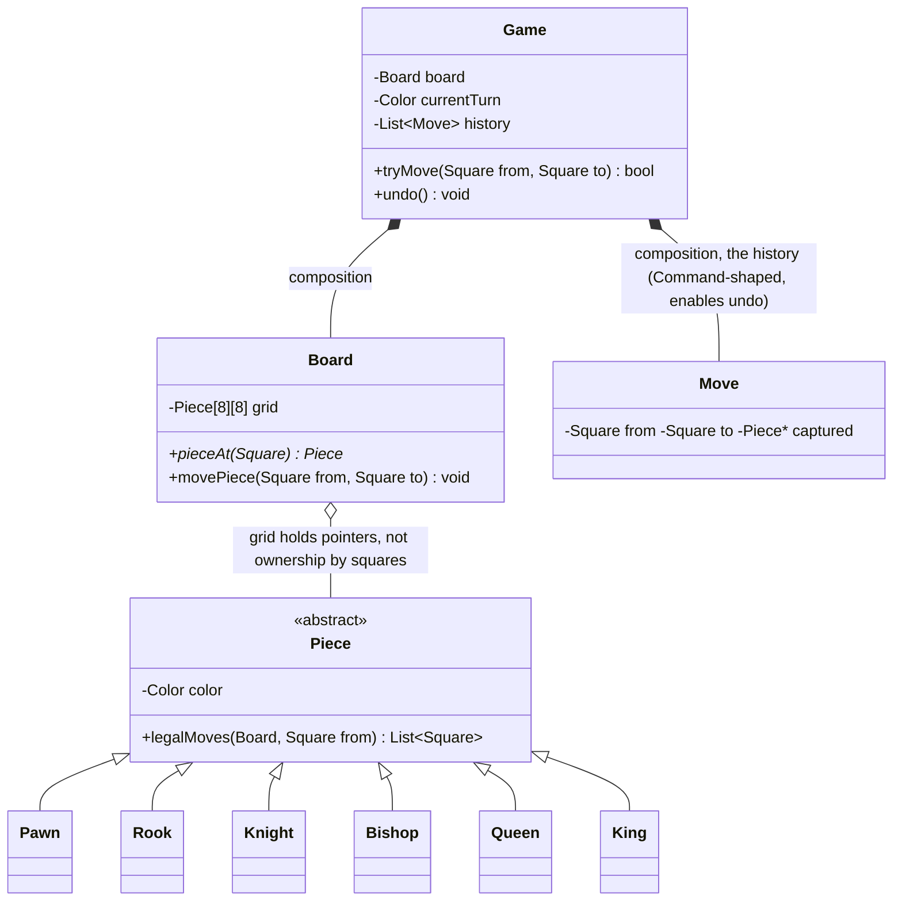

# 14 — Chess

> Difficulty: intermediate. Optional — same core learning objective (pure
> OOP, Strategy for varying behaviour per type) as Tic-Tac-Toe; build this
> one for extra reps or because an interviewer specifically asked for it,
> not because it's required to progress through the roadmap. Full chess
> rules (check, checkmate, castling, en passant, promotion, stalemate) are
> a much bigger problem than any 45-60 minute round actually wants — scope
> aggressively and say so.

## Step 1 — Clarify

Assumed answers, and this scoping conversation *is* Step 1 on this
problem more than on any other in the set:

- Standard 8x8 board, standard piece set, standard movement rules per
  piece type.
- A move is legal if: it matches the piece's movement pattern, the path is
  unobstructed (for sliding pieces), and the destination isn't occupied by
  the mover's own piece.
- Turn order alternates White/Black; only the player to move can move.
- Supports undo of the last move.
- **Deferred, explicitly, stated out loud before writing any code**: check/
  checkmate/stalemate detection, castling, en passant, pawn promotion,
  draw by repetition. Say precisely: "I'll implement legal-move-generation
  and making/undoing moves for all six piece types; check detection is a
  layer on top I can sketch the approach for but won't fully implement in
  the time available." This is the single most important sentence on this
  problem — it converts an impossible scope into a demonstrable one.

## Step 2 — Entities

| Entity | Responsibility |
| --- | --- |
| `Piece` (abstract) → `Pawn`, `Rook`, `Knight`, `Bishop`, `Queen`, `King` | Colour + **movement rule** per concrete type |
| `Board` | 8x8 grid of squares, each holding at most one piece |
| `Move` | From-square, to-square, captured piece (if any) — a Command object |
| `Game` | Turn order, move history (for undo), delegates legality checks to pieces |

**Why movement rules live on `Piece` subclasses (Strategy-shaped
polymorphism) rather than one giant `isLegalMove(piece, from, to)`
function with a switch on piece type**: this is the exact OCP argument
from `00_foundations/05_solid_principles.md` — a `Rook::legalMoves`
override and a `Bishop::legalMoves` override are independent, and adding
a chess variant's custom piece later (a "Wizard" in a fantasy-chess
variant, say) means one new subclass, zero edits to `Board` or `Game`.

## Step 3 — Class diagram



## Step 4-5 — Interfaces and core implementation

```cpp
#include <memory>
#include <optional>
#include <vector>

enum class Color { WHITE, BLACK };
struct Square { int row, col; bool operator==(const Square&) const = default; };

class Piece {
public:
    explicit Piece(Color color) : color_(color) {}
    Color color() const { return color_; }
    // Pseudo-legal moves: matches the piece's pattern and doesn't land on
    // its own piece. Does NOT check whether the move leaves the mover's
    // own king in check -- that's the deferred "check" layer from Step 1.
    virtual std::vector<Square> legalMoves(class Board& board, Square from) const = 0;
    virtual ~Piece() = default;
protected:
    Color color_;
};

class Rook : public Piece {
public:
    using Piece::Piece;
    std::vector<Square> legalMoves(Board& board, Square from) const override;
    // implementation: slide in the 4 orthogonal directions, stopping at
    // the first occupied square (include it only if it's an enemy piece)
};
// TODO in a real solution: Bishop (diagonals), Knight (fixed L-offsets,
// no path-blocking check needed), Queen (rook+bishop combined), King (one
// step any direction), Pawn (forward move + diagonal capture, the one
// piece whose movement and capture patterns differ -- worth naming that
// asymmetry explicitly if asked why Pawn's legalMoves is the most complex).

class Board {
public:
    Board() { setupStandardPosition(); }

    Piece* pieceAt(Square s) const { return grid_[s.row][s.col].get(); }

    // Applies a move unconditionally (legality is Game's job to check
    // first) and returns the captured piece, if any, so the caller can
    // restore it on undo.
    std::unique_ptr<Piece> movePiece(Square from, Square to) {
        auto captured = std::move(grid_[to.row][to.col]);
        grid_[to.row][to.col] = std::move(grid_[from.row][from.col]);
        return captured;
    }
    void placePiece(Square s, std::unique_ptr<Piece> piece) { grid_[s.row][s.col] = std::move(piece); }

private:
    void setupStandardPosition();
    std::unique_ptr<Piece> grid_[8][8];
};

struct Move {
    Square from, to;
    std::unique_ptr<Piece> captured;   // owned here so undo can restore it
};

class Game {
public:
    Game() = default;

    bool tryMove(Square from, Square to) {
        Piece* piece = board_.pieceAt(from);
        if (!piece || piece->color() != currentTurn_) return false;

        auto legal = piece->legalMoves(board_, from);
        bool isLegal = false;
        for (auto& sq : legal) if (sq == to) { isLegal = true; break; }
        if (!isLegal) return false;

        auto captured = board_.movePiece(from, to);
        history_.push_back(Move{from, to, std::move(captured)});
        currentTurn_ = (currentTurn_ == Color::WHITE) ? Color::BLACK : Color::WHITE;
        return true;
    }

    void undo() {
        if (history_.empty()) return;
        Move last = std::move(history_.back());
        history_.pop_back();
        auto moved = board_.movePiece(last.to, last.from);   // move the piece back
        board_.placePiece(last.to, std::move(last.captured)); // restore whatever was captured (may be nullptr)
        currentTurn_ = (currentTurn_ == Color::WHITE) ? Color::BLACK : Color::WHITE;
    }

private:
    Board board_;
    Color currentTurn_ = Color::WHITE;
    std::vector<Move> history_;
};
```

**Why `Move` owns the captured piece (`std::unique_ptr<Piece> captured`)
rather than just recording that a capture happened**: undo needs to
*restore* the captured piece to the board exactly as it was, not merely
know one existed — this is the Command pattern's "store what's needed to
reverse the operation" principle from `00_foundations/09_design_patterns_behavioral.md`,
applied concretely: `movePiece` transfers ownership of whatever was at the
destination square to the `Move` record, and `undo` hands it right back.

## Step 6 — Edge cases handled

- Attempting to move the opponent's piece, or moving from an empty square
  → `tryMove` returns `false` immediately via the `piece->color() !=
  currentTurn_` / null-piece check.
- A move not in the piece's legal-move list → rejected before touching
  the board at all.
- Undo restores both the moved piece's original square and any captured
  piece — the board state after `undo()` is bit-for-bit what it was before
  the move, not an approximation.

## Extensions (what a live follow-up usually asks, and how to answer honestly)

**"Does this handle check/checkmate?"** No — name the approach rather than
attempting it live: after generating a pseudo-legal move, simulate it,
check whether the mover's own king is under attack in the resulting
position (by generating every opposing piece's legal moves and checking
if any target the king's square), and reject the move if so; checkmate is
"no legal move exists that gets the king out of check." This is real,
non-trivial complexity (naively, O(legal moves × opposing pieces ×
opposing legal moves) per move) — say the shape of the algorithm and its
cost, don't pretend it's simple.

**"Castling / en passant / promotion?"** Each is a special-cased legal
move with its own preconditions (castling: neither piece has moved, path
clear, king not passing through check; en passant: only legal
immediately after a specific opposing pawn's double-step). Name them as
known special cases requiring extra state (has this king/rook moved yet,
what was the last move) rather than attempting to implement any live.

**"Add a `Command`-based move history you can serialize (PGN-style) and
replay."** `Move` is already Command-shaped — a `toAlgebraicNotation()`
method and a `Game::replay(vector<Move>)` are both additive, no
architectural change.

## Interview framing to reuse

"I'm scoping this to legal-move generation, making moves, and undo —
check/checkmate detection is a real algorithm I can describe but won't
fully implement given the time, since it's genuinely a second problem
layered on top of this one." Say this before writing a line of code, not
as an apology at the end when time runs out.

## Exercises

1. Implement `Board`, `Game`, and at minimum `Rook` and `Knight` fully
   (the two simplest movement patterns — sliding-with-blocking and
   fixed-offset-no-blocking respectively) in 40-45 minutes, plus undo.
2. Implement `Pawn`, and specifically get its asymmetric move/capture
   rule right (moves straight, captures diagonally) — write a test that
   would catch the classic bug of allowing a pawn to capture straight
   ahead.
3. Sketch (pseudocode, not full implementation) the check-detection
   algorithm described above, and estimate its cost in terms of the
   quantities that determine it (number of opposing pieces, average legal
   moves per piece).
