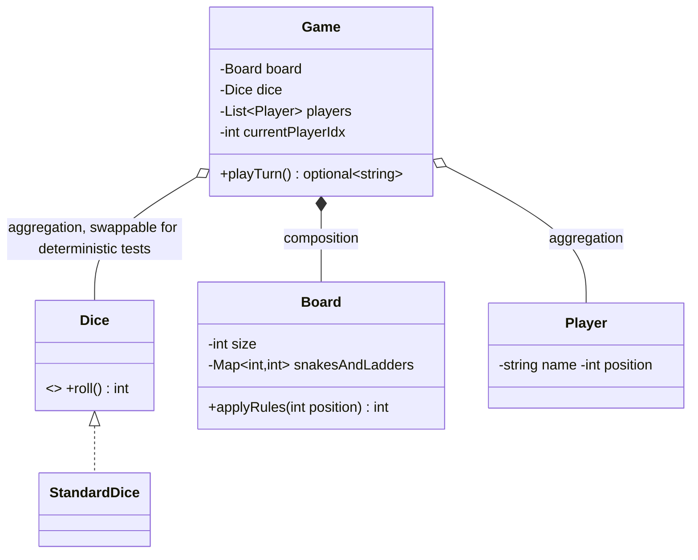

# 15 — Snake and Ladder

> Difficulty: foundational, and a good "can you resist over-engineering"
> checkpoint — the honest design here is small, and padding it with
> patterns it doesn't need is exactly the pattern-itis this track warns
> about (`00_foundations/17_more_principles_and_antipatterns.md`). Often
> given as a quick warm-up problem before something harder.

## Step 1 — Clarify

Assumed answers:

- Standard 100-square board, 2+ players, single die, roll-and-move.
- A fixed set of snakes (head → tail, moves you backward) and ladders
  (bottom → top, moves you forward) placed on the board.
- Landing exactly on square 100 wins; overshooting stays in place (a
  common house rule; the alternative — bounce back — is worth naming as a
  configurable variant, not building both).
- **Deferred, explicitly**: multiple dice, "roll again on a 6," a
  configurable board size — realistic variants, not the base design.

## Step 2 — Entities

| Entity | Responsibility |
| --- | --- |
| `Board` | Square count, and the snake/ladder mapping (from-square → to-square) |
| `Dice` | Produces a roll — **interface**, because "which random source" is a genuine, if small, variation point (a real die vs. a seeded RNG for reproducible tests) |
| `Player` | Identity, current position |
| `Game` | Turn order, applies a roll, checks snake/ladder, checks win |

**Why this problem doesn't need Strategy for the snake/ladder rule
itself**: a snake and a ladder are the *same mechanic* — "landing on
square X moves you to square Y" — just with Y less than X for a snake and
greater for a ladder. One `Map<int,int>` on `Board` represents both
without needing a `Snake`/`Ladder` class hierarchy at all. This is the
answer worth giving if an interviewer probes "wouldn't Strategy or
inheritance fit here" — naming *why not* is the actual signal on a
problem this size, more than the code itself.

## Step 3 — Class diagram



## Step 4-5 — Interfaces and core implementation

```cpp
#include <map>
#include <memory>
#include <optional>
#include <random>
#include <string>
#include <vector>

class Dice {
public:
    virtual int roll() = 0;
    virtual ~Dice() = default;
};
class StandardDice : public Dice {
public:
    int roll() override { return dist_(rng_); }
private:
    std::mt19937 rng_{std::random_device{}()};
    std::uniform_int_distribution<int> dist_{1, 6};
};

class Board {
public:
    Board(int size, std::map<int, int> snakesAndLadders)
        : size_(size), snakesAndLadders_(std::move(snakesAndLadders)) {}

    // Applies overshoot rule and snake/ladder resolution; returns the
    // final resting square.
    int applyRules(int position) const {
        if (position > size_) return position - (position - size_);   // stays put on overshoot
                                                                          // (equivalent to returning the pre-move position,
                                                                          // written this way to make the rule explicit)
        auto it = snakesAndLadders_.find(position);
        return it != snakesAndLadders_.end() ? it->second : position;
    }
    int size() const { return size_; }

private:
    int size_;
    std::map<int, int> snakesAndLadders_;   // one map for both: from -> to
};

struct Player { std::string name; int position = 0; };

class Game {
public:
    Game(Board board, std::unique_ptr<Dice> dice, std::vector<Player> players)
        : board_(std::move(board)), dice_(std::move(dice)), players_(std::move(players)) {}

    // Returns the winner's name if this turn wins the game, else nullopt.
    std::optional<std::string> playTurn() {
        Player& player = players_[currentPlayerIdx_];
        int roll = dice_->roll();
        int target = player.position + roll;

        if (target > board_.size()) {
            // overshoot: stay in place, turn passes without moving
        } else {
            player.position = board_.applyRules(target);
        }

        currentPlayerIdx_ = (currentPlayerIdx_ + 1) % players_.size();

        if (player.position == board_.size()) return player.name;
        return std::nullopt;
    }

private:
    Board board_;
    std::unique_ptr<Dice> dice_;
    std::vector<Player> players_;
    size_t currentPlayerIdx_ = 0;
};
```

**Why `Dice` is an interface for a problem this simple**: not for OCP
against a hypothetical future requirement — for **testability**, the DIP
payoff from `00_foundations/05_solid_principles.md`. A `Game` built
against a real `StandardDice` is untestable (you can't assert "player
lands on a snake's head" without controlling the roll); injecting a
`FixedDice` test double that returns a scripted sequence makes every rule
(snake, ladder, overshoot, win) independently, deterministically testable.
This is the one abstraction on this problem that earns its place — say so
explicitly if asked why everything else stayed concrete.

## Step 6 — Edge cases handled

- Overshooting square 100 → the player doesn't move at all this turn,
  handled by the early `target > board_.size()` branch before any
  position update.
- Landing exactly on a snake's head or a ladder's bottom → resolved via
  the single `snakesAndLadders_` lookup in `applyRules`, uniformly for
  both.
- Landing exactly on square 100 → win, checked once at the end of
  `playTurn` regardless of how the player got there (direct roll or via a
  ladder).

## Extensions (what a live follow-up usually asks)

**"Roll again on a 6."** A small change to `playTurn`'s loop structure
(don't advance `currentPlayerIdx_` if the roll was 6) — genuinely small,
good to point out it doesn't require touching `Board` or `Dice` at all.

**"Support a configurable board size and snake/ladder set loaded from a
file/config."** Already supported by construction — `Board`'s constructor
already takes `size` and the map as parameters; "loading from a file" is
purely a parsing concern outside this class, not a design change.

**"Make multiple concurrent games run on separate threads share a dice
pool for fairness auditing."** A stretch extension mostly useful to show
you'd recognise it as a real concurrency question — probably not worth
building live, but naming that `Dice` would need thread-safety
(`std::mt19937` is not thread-safe to share; each thread needs its own
instance or a synchronized one) is a good one-sentence answer.

## Interview framing to reuse

"I made `Dice` an interface specifically so I can inject a scripted
sequence in tests — that's the only abstraction I added beyond the
concrete entities the problem obviously needs, because introducing more
here would be complexity without a matching requirement." A precise,
minimal design is the actual signal on a problem this size — say so.

## Exercises

1. Implement the above from scratch in 20-25 minutes, then write a
   `FixedDice` test double returning a scripted roll sequence and use it
   to write deterministic tests for: landing on a snake, landing on a
   ladder, overshooting, and winning.
2. Add the "roll again on 6" extension and write a test confirming the
   turn doesn't pass to the next player after a 6.
3. Time how long the whole exercise takes versus Parking Lot or Elevator
   — the gap is the point: not every problem in a real loop is meant to
   take the full 45 minutes, and recognising a small problem as small
   (rather than inflating it with unnecessary structure) is itself a
   skill worth practicing.
