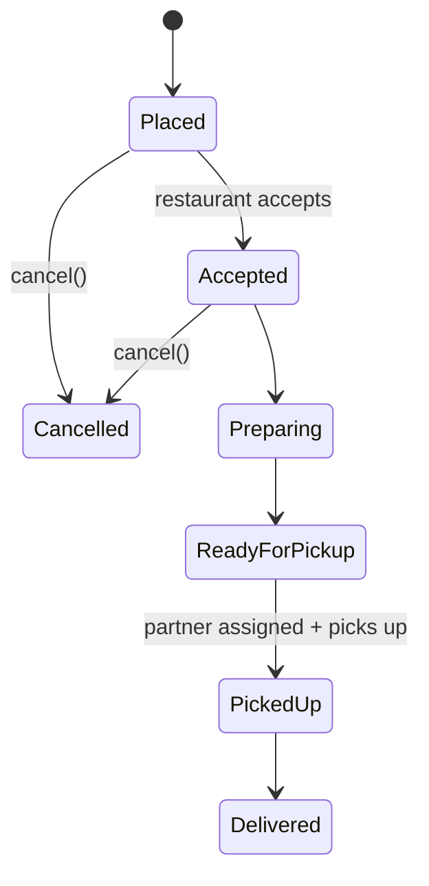
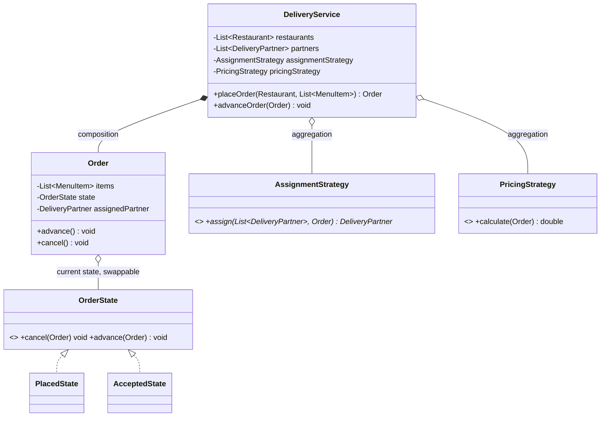

# 16 — Food Delivery System (Zomato/Swiggy-style)

> Difficulty: intermediate-to-advanced. The widest-scope problem in the
> set — restaurants, orders, and delivery partners are three genuinely
> different lifecycles that all need to interact, which makes scoping
> (Step 1) harder than usual and the most important part of this
> particular problem.

## Step 1 — Clarify

Assumed answers:

- A `Restaurant` has a `Menu` of `MenuItem`s. A `Customer` places an
  `Order` against one restaurant (single-restaurant orders only — say this
  boundary explicitly, multi-restaurant cart-splitting is a real, larger
  feature).
- An order has a lifecycle: `PLACED → ACCEPTED → PREPARING → READY_FOR_PICKUP
  → PICKED_UP → DELIVERED` (or `CANCELLED` from most states).
- Once `READY_FOR_PICKUP`, a `DeliveryPartner` is **assigned** by some
  strategy (nearest available, at minimum).
- Pricing: item costs + a delivery fee, computed by a pluggable strategy
  (distance-based at minimum).
- **Deferred, explicitly**: real-time GPS tracking, payment processing,
  ratings/reviews, promotional discounts — realistic follow-ups, not the
  base design. A **database schema** for the menu/order catalogue is
  explicitly out of scope here too, per this roadmap's scope note — that's
  an HLD/data-layer question.

## Step 2 — Entities

| Entity | Responsibility |
| --- | --- |
| `MenuItem` | Name, price |
| `Restaurant` | Menu, accepts/rejects orders |
| `Order` | Line items, current `OrderState`, assigned partner |
| `OrderState` (interface) | Valid transitions from the current state — **State pattern**, the core of this design |
| `DeliveryPartner` | Identity, availability, location |
| `AssignmentStrategy` | Picks a partner for a ready order — **growing set**, interface |
| `PricingStrategy` | Computes total cost — **growing set**, interface |
| `DeliveryService` | Orchestrates the whole flow |

**Why `Order`'s lifecycle is State, not a bare enum with a switch
elsewhere**: six states with different valid next-transitions from each
(you can cancel from `PLACED` but not from `DELIVERED`) is exactly the
shape `00_foundations/09_design_patterns_behavioral.md`'s State section
describes — each state knows which transitions are legal *from itself*,
which is where the validation logic naturally belongs rather than in one
large `Order::transitionTo(newState)` method with a matrix of allowed
transitions hardcoded as conditionals.

## Step 3 — Class diagram





## Step 4-5 — Interfaces and core implementation

```cpp
#include <memory>
#include <optional>
#include <stdexcept>
#include <string>
#include <vector>

struct MenuItem { std::string name; double price; };

class Order;   // fwd decl

class OrderState {
public:
    virtual void advance(Order&) = 0;
    virtual void cancel(Order&) = 0;
    virtual std::string name() const = 0;
    virtual ~OrderState() = default;
};

struct DeliveryPartner {
    std::string id;
    bool available = true;
    double distanceToRestaurant = 0;   // simplified: precomputed for this order
};

class Order {
public:
    explicit Order(std::vector<MenuItem> items) : items_(std::move(items)) {}

    void advance() { state_->advance(*this); }
    void cancel() { state_->cancel(*this); }
    void setState(std::unique_ptr<OrderState> s) { state_ = std::move(s); }
    void assignPartner(DeliveryPartner* p) { partner_ = p; }

    const std::vector<MenuItem>& items() const { return items_; }
    std::string stateName() const { return state_->name(); }

private:
    std::vector<MenuItem> items_;
    std::unique_ptr<OrderState> state_;
    DeliveryPartner* partner_ = nullptr;
};

// Each concrete state only implements the transitions legal from itself --
// DeliveredState, for instance, would make cancel() a no-op or throw,
// never silently succeed.
class PlacedState : public OrderState {
public:
    void advance(Order& o) override;   // -> AcceptedState
    void cancel(Order& o) override;    // -> CancelledState
    std::string name() const override { return "PLACED"; }
};
class AcceptedState : public OrderState {
public:
    void advance(Order& o) override;   // -> PreparingState
    void cancel(Order& o) override;    // -> CancelledState (still allowed)
    std::string name() const override { return "ACCEPTED"; }
};
// ... PreparingState, ReadyForPickupState, PickedUpState, DeliveredState,
// CancelledState follow the same shape; ReadyForPickupState::advance is
// where partner assignment actually happens (see DeliveryService below).

class AssignmentStrategy {
public:
    virtual DeliveryPartner* assign(std::vector<DeliveryPartner*>& partners) = 0;
    virtual ~AssignmentStrategy() = default;
};
class NearestAvailableStrategy : public AssignmentStrategy {
public:
    DeliveryPartner* assign(std::vector<DeliveryPartner*>& partners) override {
        DeliveryPartner* best = nullptr;
        for (auto* p : partners) {
            if (!p->available) continue;
            if (!best || p->distanceToRestaurant < best->distanceToRestaurant) best = p;
        }
        return best;
    }
};

class PricingStrategy {
public:
    virtual double calculate(const Order& order) const = 0;
    virtual ~PricingStrategy() = default;
};
class DistanceBasedPricing : public PricingStrategy {
public:
    double calculate(const Order& order) const override {
        double itemTotal = 0;
        for (auto& item : order.items()) itemTotal += item.price;
        return itemTotal + 40.0;   // flat delivery fee, simplified
    }
};

class DeliveryService {
public:
    DeliveryService(std::unique_ptr<AssignmentStrategy> assignment, std::unique_ptr<PricingStrategy> pricing)
        : assignmentStrategy_(std::move(assignment)), pricingStrategy_(std::move(pricing)) {}

    Order placeOrder(std::vector<MenuItem> items) {
        Order order(std::move(items));
        order.setState(std::make_unique<PlacedState>());
        return order;
    }

    void assignPartner(Order& order) {
        std::vector<DeliveryPartner*> available;
        for (auto& p : partners_) if (p.available) available.push_back(&p);
        if (DeliveryPartner* chosen = assignmentStrategy_->assign(available)) {
            chosen->available = false;
            order.assignPartner(chosen);
        }
    }

private:
    std::vector<DeliveryPartner> partners_;
    std::unique_ptr<AssignmentStrategy> assignmentStrategy_;
    std::unique_ptr<PricingStrategy> pricingStrategy_;
};
```

**Why partner assignment is a method on `DeliveryService`, not something
`ReadyForPickupState::advance` does directly**: a state class knows how to
transition *itself*, but "search every partner for the nearest available
one" is a cross-cutting query over data (`partners_`) that a single
`Order` doesn't own and shouldn't need a reference to — keeping
`DeliveryService` as the place that owns the partner pool and injects the
result into `Order` (via `assignPartner`) keeps `OrderState` implementations
small and keeps `Order` from needing to know about the whole partner
fleet. This separation-of-concerns choice is worth stating if asked "why
isn't this inside the state class."

## Step 6 — Edge cases handled

- `cancel()` is only legal from states before pickup — a concrete
  `PickedUpState`/`DeliveredState` would make `cancel()` throw or no-op
  rather than silently succeeding, preventing "cancelling" an order
  already in the customer's hands.
- No available delivery partner when assignment is attempted →
  `assignPartner` returns `nullptr` from the strategy, `Order` stays
  unassigned rather than crashing; a real system would retry or alert
  ops, worth naming as the next step.

## Extensions (what a live follow-up usually asks)

**"A restaurant can reject an order (out of an item, too busy)."**
`PlacedState::advance` branches into either `AcceptedState` or a new
`RejectedState` depending on the restaurant's response — additive to the
state machine, no change to `DeliveryService`'s orchestration shape.

**"Make partner assignment thread-safe — multiple orders reaching
ReadyForPickup simultaneously shouldn't double-assign the same partner."**
The check-then-mark sequence in `assignPartner` (find available, then set
`available = false`) is the exact same race shape as
`02_parking_lot.md`'s slot assignment — a mutex around the partner pool,
or `std::atomic<bool>` per partner with compare-and-swap, per
`00_foundations/10_concurrency_for_lld.md`.

**"Add order tracking notifications to the customer at each state
transition."** Direct application of `13_notification_system.md`'s
`NotificationService`, invoked from each state's `advance()` — a good
moment to demonstrate you can compose two problems from this set rather
than treating each as isolated.

## Interview framing to reuse

"I kept partner assignment as a `DeliveryService` responsibility rather
than something the `ReadyForPickupState` does directly, because searching
the whole partner fleet is a cross-cutting query that a single `Order`
shouldn't need visibility into — the state only needs to know assignment
happened, not how." A precise reason for where a piece of logic lives,
not just that it works.

## Exercises

1. Implement the full `OrderState` hierarchy (all six states) plus
   `DeliveryService` in 50-55 minutes (this is one of the larger problems
   in the set — budget accordingly), then write a test confirming
   `cancel()` succeeds from `PLACED` but is rejected from `PICKED_UP`.
2. Add the restaurant-rejection extension and confirm the state diagram
   (draw it first, per `00_foundations/04_uml_and_modeling.md`) gains
   exactly one new state and one new transition.
3. Add the thread-safety fix for partner assignment and write a stress
   test racing multiple orders for a small pool of available partners,
   asserting no partner is ever assigned twice.
