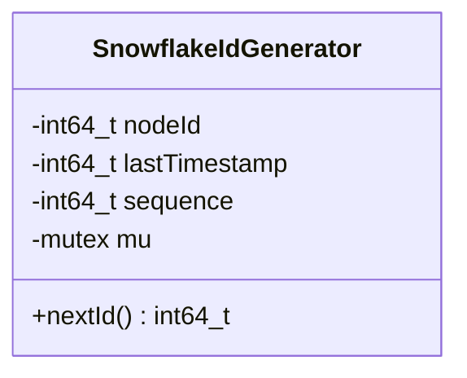

# 18 — Distributed ID Generator (Snowflake-style)

> Difficulty: intermediate. The best "no GoF pattern needed" example in
> the whole problem set — this is a bit-packing and clock-handling
> problem, and reaching for a design pattern here would be a pattern-itis
> tell. What's actually tested is careful handling of the one genuinely
> hard case: the system clock moving backward.

## Step 1 — Clarify

Assumed answers:

- Generate a 64-bit, roughly time-sortable, globally unique ID with no
  central coordinator per request (each generator node produces IDs
  independently, in parallel, with no network round trip per ID —
  otherwise you're back to a distributed-lock problem, not this one).
- Twitter Snowflake's classic layout: 1 unused sign bit + 41 bits
  timestamp (milliseconds since a custom epoch) + 10 bits machine/node ID
  + 12 bits per-millisecond sequence number.
- Multiple threads on the same node can request IDs concurrently.
- **Deferred, explicitly**: coordinating machine-ID assignment across a
  real fleet (a config/registry problem — cross-reference
  `11_hld/03_systems_domain/03_edge_to_cloud_fleet_management.md` if asked to extend this
  way) — this file assumes the machine ID is handed to the generator at
  construction, already assigned.

## Step 2 — The bit layout, and why it guarantees uniqueness without coordination

```
  63           62                                    22        12         0
  +---+-------------------------------------------+----------+----------+
  | 0 |     41-bit timestamp (ms since epoch)      | 10-bit   | 12-bit   |
  |   |                                             | node ID  | sequence|
  +---+-------------------------------------------+----------+----------+
```

**Why this guarantees uniqueness with zero coordination between nodes**:
two different nodes generating IDs at the exact same millisecond can never
collide, because their 10-bit node ID segments differ (assigned uniquely
per node, out of band). A single node generating multiple IDs within the
same millisecond can't collide either, because the 12-bit sequence number
increments per ID within that millisecond (up to 4096 IDs/ms/node before
it must wait for the next millisecond). **The whole scheme's correctness
rests on two external guarantees that are worth naming explicitly**: node
IDs are assigned uniquely (a real, if deferred, coordination problem), and
the system clock doesn't move backward in a way that produces a timestamp
already used (the hard case this problem is actually testing — Step 4-5
below).

## Step 3 — Class diagram



One class — naming a full class diagram with multiple collaborators here
would itself be a small tell that the scope has drifted; say so if it
comes up.

## Step 4-5 — Interfaces and core implementation

```cpp
#include <chrono>
#include <mutex>
#include <stdexcept>
#include <thread>

class SnowflakeIdGenerator {
public:
    explicit SnowflakeIdGenerator(int64_t nodeId) : nodeId_(nodeId) {
        if (nodeId < 0 || nodeId > MAX_NODE_ID) throw std::invalid_argument("node id out of range");
    }

    int64_t nextId() {
        std::lock_guard<std::mutex> lock(mu_);
        int64_t timestamp = currentMillis();

        if (timestamp < lastTimestamp_) {
            // The hard case: the system clock moved backward (NTP
            // adjustment, VM migration, manual clock change). Generating
            // an ID now with this timestamp risks reusing a value already
            // handed out. The only safe options: block until the clock
            // catches back up, or reject outright. Blocking is usually
            // preferred for availability; say both and pick one.
            waitUntil(lastTimestamp_);
            timestamp = lastTimestamp_;
        }

        if (timestamp == lastTimestamp_) {
            sequence_ = (sequence_ + 1) & MAX_SEQUENCE;
            if (sequence_ == 0) {
                // Exhausted this millisecond's 4096 IDs -- wait for the next one.
                timestamp = waitForNextMillis(lastTimestamp_);
            }
        } else {
            sequence_ = 0;   // new millisecond: sequence resets
        }

        lastTimestamp_ = timestamp;

        return ((timestamp - EPOCH) << TIMESTAMP_SHIFT)
             | (nodeId_ << NODE_ID_SHIFT)
             | sequence_;
    }

private:
    static constexpr int64_t EPOCH = 1700000000000LL;   // custom epoch, e.g. a fixed 2023 date
    static constexpr int NODE_ID_BITS = 10;
    static constexpr int SEQUENCE_BITS = 12;
    static constexpr int NODE_ID_SHIFT = SEQUENCE_BITS;
    static constexpr int TIMESTAMP_SHIFT = SEQUENCE_BITS + NODE_ID_BITS;
    static constexpr int64_t MAX_NODE_ID = (1LL << NODE_ID_BITS) - 1;
    static constexpr int64_t MAX_SEQUENCE = (1LL << SEQUENCE_BITS) - 1;

    static int64_t currentMillis() {
        return std::chrono::duration_cast<std::chrono::milliseconds>(
            std::chrono::system_clock::now().time_since_epoch()).count();
    }
    static void waitUntil(int64_t targetMillis) {
        while (currentMillis() < targetMillis) std::this_thread::yield();
    }
    static int64_t waitForNextMillis(int64_t lastMillis) {
        int64_t ts = currentMillis();
        while (ts <= lastMillis) ts = currentMillis();
        return ts;
    }

    int64_t nodeId_;
    int64_t lastTimestamp_ = -1;
    int64_t sequence_ = 0;
    std::mutex mu_;
};
```

**Why the whole method is under one mutex rather than using atomics for
`sequence_`**: `lastTimestamp_` and `sequence_` must be updated together,
consistently — an atomic `sequence_` alone can't coordinate with
`lastTimestamp_`'s rollover-on-new-millisecond logic without a
check-then-act race between the two. This is the same "the invariant
spans multiple fields, so it needs a mutex, not just an atomic" reasoning
from `00_foundations/10_concurrency_for_lld.md` — worth naming explicitly
since this problem's whole premise (lock-free-*feeling* ID generation)
tempts candidates toward reaching for atomics where they don't actually
fit.

## Step 6 — Edge cases handled

- **Clock moving backward** (the case this problem exists to test):
  detected by `timestamp < lastTimestamp_`, handled by blocking until the
  clock catches up rather than silently generating a potentially-reused
  ID.
- **Sequence exhaustion within one millisecond** (4097th ID requested in
  the same millisecond): handled by spinning until the clock ticks over,
  rather than overflowing the 12-bit sequence field into the node-ID bits.
- **Node ID out of range**: rejected at construction, not silently
  truncated into the 10-bit field.

## Extensions (what a live follow-up usually asks)

**"What if you can't tolerate blocking on clock skew — you need every
call to return immediately?"** Throw instead of `waitUntil`, pushing the
decision (retry? fail the request?) to the caller — a real
availability-vs-correctness tradeoff worth stating in exactly those
terms, not just "here's the alternate code."

**"How do multiple machines get unique node IDs in the first place?"**
Name it as a real, separate coordination problem: a central registry
(ZooKeeper/etcd-style, or even a simple database row with a unique
constraint) handing out node IDs at startup, or static configuration in a
fleet small enough to manage by hand. This is exactly the boundary this
file deferred in Step 1 — naming the mechanism without building it is the
right-sized answer.

**"Compare this to just using a UUID."** UUIDs need no coordination at
all and are simpler, but aren't time-sortable (a Snowflake ID's high bits
being a timestamp means IDs generated later always sort higher, which
matters for time-ordered storage like a B-tree primary key or an
LSM-tree — cross-reference `11_hld/01_fundamentals/09_storage_engines.md`) and are
128 bits vs. Snowflake's 64, a real storage/index-size difference at
scale. Know both tradeoffs, not just that Snowflake exists.

## Interview framing to reuse

"The whole scheme's uniqueness guarantee rests on two things I'm not
solving here: node IDs are assigned uniquely out of band, and I handle
clock-moving-backward explicitly rather than ignoring it — that clock
case is the part of this problem that's actually hard, the bit-packing
itself is mechanical." Naming the real difficulty precisely, rather than
treating the whole problem as equally hard throughout.

## Exercises

1. Implement `SnowflakeIdGenerator` from scratch in 25-30 minutes, then
   write a test generating 10,000 IDs from a single instance across
   multiple threads and asserting all are unique and monotonically
   non-decreasing.
2. Write a test that simulates clock rollback (inject a fake clock via a
   function pointer or template parameter instead of calling
   `std::chrono::system_clock::now()` directly — the same testability
   pattern from `00_foundations/15_testing_gtest_and_gmock.md`) and
   confirm the generator blocks rather than producing a duplicate ID.
3. Compute, from the bit layout, how many years this scheme can run
   before the 41-bit timestamp field overflows, and how many
   machine-nodes it supports simultaneously — both are simple arithmetic
   from the bit widths, and being able to produce these numbers on the
   spot is a real signal.
