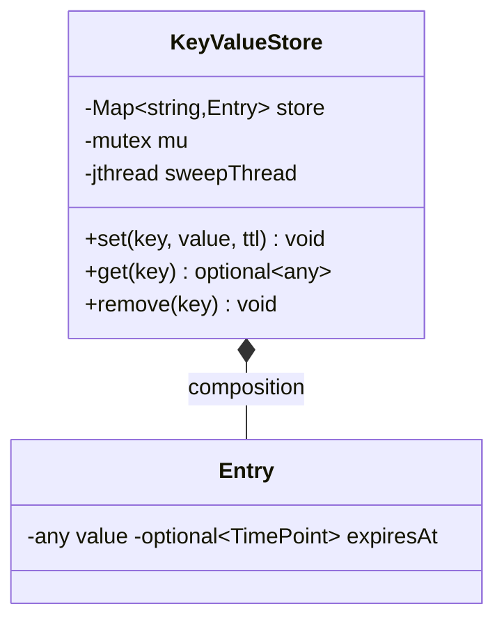

# 19 — In-Memory Key-Value Store with TTL

> Difficulty: intermediate. The "Redis Lite, but the eviction driver is
> time rather than capacity" sibling of `05_lru_cache.md` — the interesting
> design decision is **how** expired entries actually get removed: on
> access (lazy), via a background sweep (active), or both, and the
> tradeoffs between them.

## Step 1 — Clarify

Assumed answers:

- `set(key, value, ttl)` stores a value with an optional expiry;
  `set(key, value)` with no TTL never expires.
- `get(key)` returns the value if present and not expired, else
  "not found" — indistinguishable from a key that was never set, unless
  asked otherwise.
- Multiple threads read/write concurrently.
- **Deferred, explicitly**: persistence, eviction under memory pressure
  (LRU-on-top-of-TTL — name it as the natural combination with
  `05_lru_cache.md` if asked), a full command set (INCR, expire-on-write,
  etc.) — a minimal `get`/`set`/`delete` covers the design.

## Step 2 — Entities

| Entity | Responsibility |
| --- | --- |
| `Entry` | Value + expiry timestamp (or "never expires") |
| `KeyValueStore` | Owns the map, handles lazy expiry on access, runs the optional background sweep |

**The core design decision, stated up front**: expired entries can be
removed two ways, and a real system typically uses **both**:

- **Lazy expiry** — check-and-remove on `get`. Zero background cost, but
  a key that's set-and-forgotten (never read again) stays in memory
  forever after expiring, wasting space.
- **Active expiry** — a background thread periodically scans for expired
  keys and removes them. Reclaims memory even for never-read keys, but
  costs a dedicated thread and periodic scan overhead, and a naive
  full-map scan doesn't scale to millions of keys (real systems, Redis
  included, sample a random subset per sweep rather than scanning
  everything — worth naming if pushed on scale).

## Step 3 — Class diagram



## Step 4-5 — Interfaces and core implementation

```cpp
#include <any>
#include <chrono>
#include <mutex>
#include <optional>
#include <string>
#include <thread>
#include <unordered_map>

using Clock = std::chrono::steady_clock;

struct Entry {
    std::any value;
    std::optional<Clock::time_point> expiresAt;   // nullopt = never expires
};

class KeyValueStore {
public:
    KeyValueStore() {
        sweepThread_ = std::jthread([this](std::stop_token token) { sweepLoop(token); });
    }

    void set(const std::string& key, std::any value, std::optional<std::chrono::milliseconds> ttl = std::nullopt) {
        std::lock_guard<std::mutex> lock(mu_);
        std::optional<Clock::time_point> expiresAt;
        if (ttl) expiresAt = Clock::now() + *ttl;
        store_[key] = Entry{std::move(value), expiresAt};
    }

    std::optional<std::any> get(const std::string& key) {
        std::lock_guard<std::mutex> lock(mu_);
        auto it = store_.find(key);
        if (it == store_.end()) return std::nullopt;

        if (isExpired(it->second)) {
            store_.erase(it);   // lazy expiry: remove on the access that discovers it
            return std::nullopt;
        }
        return it->second.value;
    }

    void remove(const std::string& key) {
        std::lock_guard<std::mutex> lock(mu_);
        store_.erase(key);
    }

private:
    static bool isExpired(const Entry& e) {
        return e.expiresAt.has_value() && Clock::now() >= *e.expiresAt;
    }

    void sweepLoop(std::stop_token token) {
        while (!token.stop_requested()) {
            std::this_thread::sleep_for(std::chrono::seconds(1));   // sweep interval,
                                                                       // tunable per workload
            std::lock_guard<std::mutex> lock(mu_);
            std::erase_if(store_, [](const auto& kv) { return isExpired(kv.second); });
        }
    }

    std::mutex mu_;
    std::unordered_map<std::string, Entry> store_;
    std::jthread sweepThread_;
};
```

**Why `std::any` for the value type here, unlike `05_lru_cache.md`'s
templated `Value`**: a real key-value store typically holds
**heterogeneous** value types under one map (strings, numbers, serialized
objects) rather than one fixed `Value` type across the whole store — this
is the genuine use case for type erasure
(`00_foundations/06_cpp_design_idioms.md`) rather than a template
parameter: the caller doesn't know the value type at the call site the
way `LRUCache<Key, Value>`'s caller does. If the interviewer's stated
requirement is actually "every value is the same type" (a specific
data-type-constrained cache), templating like `LRUCache` is simpler and
preferable — name this as a deliberate choice tied to the stated
requirement, not a default.

**Why the sweep thread takes the same mutex as `get`/`set`**: a coarse-
grained lock here is a defensible, explicit tradeoff (the same one made
in `06_vending_machine.md`'s thread-safety extension) — the sweep runs
infrequently (once a second) and briefly, so it doesn't meaningfully
contend with the hot `get`/`set` path; a finer-grained scheme (e.g.
striped locking per `00_foundations/12_lockfree_and_threadsafe_containers.md`)
is available if profiling actually showed contention, but reaching for it
without that evidence would be premature optimization.

## Step 6 — Edge cases handled

- A key that expired but hasn't been swept yet, accessed via `get` →
  lazy expiry catches it and removes it on that access, so a caller never
  observes a stale value even between sweep intervals.
- A key set with no TTL (`expiresAt = nullopt`) → `isExpired` short-
  circuits to `false` via `has_value()`, never expires until explicitly
  removed.
- The sweep thread and a concurrent `get`/`set` never observe a
  torn/partial map state — both paths take the same mutex.

## Extensions (what a live follow-up usually asks)

**"Combine this with LRU eviction under memory pressure."** Two
independent eviction drivers on the same store: TTL (time-based, this
file) and LRU (capacity-based, `05_lru_cache.md`) — the natural
combination is `05_lru_cache.md`'s `std::list` + `std::unordered_map`
structure, with each `Entry` additionally carrying an optional expiry,
checked lazily on `get` exactly as here, *and* capacity-evicted via the
LRU list on `put` when full. Naming this composition explicitly, rather
than building both from scratch, is the strong answer.

**"Add `expire(key, ttl)` to set a TTL on an already-existing key without
overwriting its value."** A small additive method reading the current
entry, replacing only `expiresAt` — worth noting it needs the same lock
discipline as `set`.

**"What if the sweep needs to scale to millions of keys without scanning
the whole map every second?"** Name Redis's actual approach: sample a
small random subset of keys with a TTL set, check how many are expired,
and repeat the sweep more aggressively if the expired fraction is high —
this bounds sweep cost independent of total key count, at the cost of
not guaranteeing every expired key is removed on any single sweep pass
(lazy expiry remains the backstop for correctness).

## Interview framing to reuse

"I used both lazy and active expiry deliberately — lazy alone leaves
memory used by keys nobody reads again, and active alone means a client
could briefly read a value that's logically expired but not yet swept;
together, lazy expiry on the read path is a correctness backstop, and the
sweep is the memory-reclamation mechanism for keys nobody touches." This
sentence is the whole problem, said precisely.

## Exercises

1. Implement `KeyValueStore` from scratch in 30-35 minutes, then write a
   test using a short TTL (a few milliseconds) confirming a key is
   readable immediately after `set` and returns `nullopt` after the TTL
   elapses, both via direct `get` (lazy path) and by waiting past the
   sweep interval before calling `get` (active path already removed it).
2. Inject a fake clock (function pointer or template parameter, same
   testability technique as `18_distributed_id_generator.md`'s exercise
   2) so TTL tests don't depend on real wall-clock sleeps.
3. Sketch (pseudocode) the combined TTL+LRU structure from the first
   extension, and identify exactly which existing method
   (`LRUCache::get`, `LRUCache::put`, or a new one) needs the TTL check
   added.
