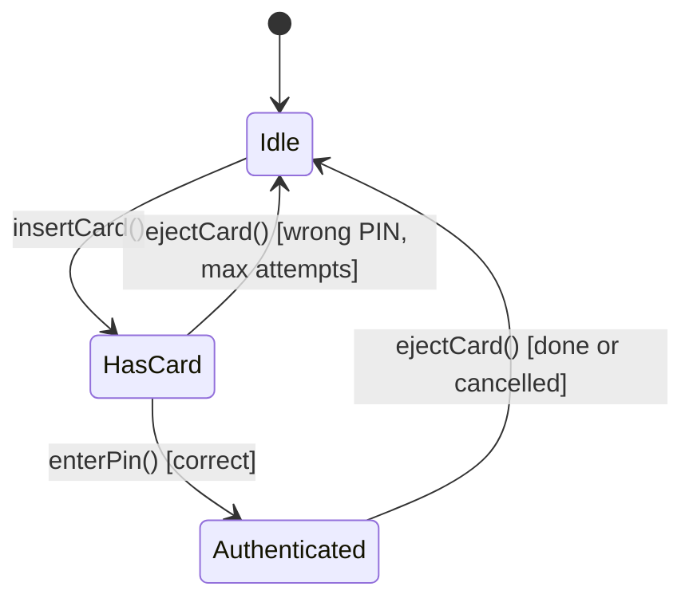
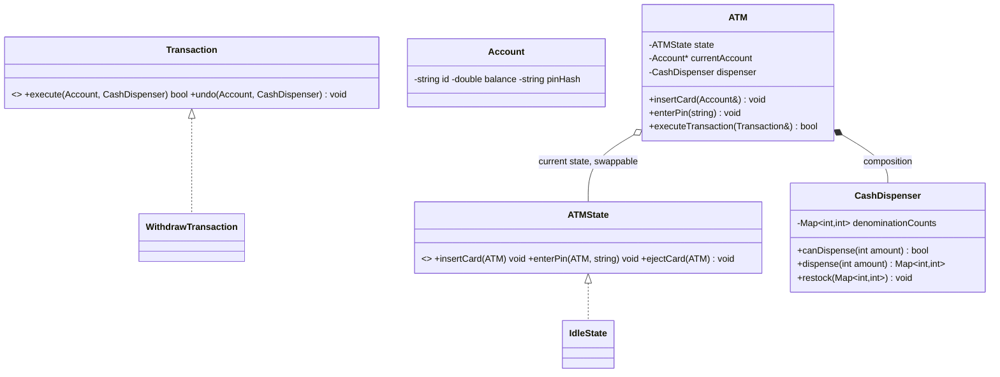

# 20 — ATM Machine

> Difficulty: intermediate. A State-and-Command pairing problem: the
> machine's own UI flow (card inserted → PIN entered → menu → transaction)
> is State, and each individual banking operation (withdraw, deposit,
> check balance) is naturally a Command — giving you undo/rollback for
> free on the operation that actually needs it (a withdrawal that fails
> partway through dispensing cash).

## Step 1 — Clarify

Assumed answers:

- A single ATM, single account session at a time (card in → PIN → one or
  more operations → card out). No support for a second card while one is
  active.
- Operations: check balance, withdraw, deposit. Withdrawal must respect
  both the account balance and the machine's available cash, and dispense
  in a minimal set of denominations.
- PIN entry allows a limited number of attempts before the card is
  retained (a real, common requirement worth stating as an explicit
  assumption).
- **Deferred, explicitly**: multi-bank interoperability (a real ATM talks
  to a card network, not directly to "the" bank), receipt printing,
  contactless/chip protocols — the state machine and cash-dispensing logic
  are the actual design target.

## Step 2 — Entities

| Entity | Responsibility |
| --- | --- |
| `ATMState` (interface) | What the machine does with input given its current state |
| `IdleState`, `HasCardState`, `AuthenticatedState` | Concrete states |
| `Account` | Balance, PIN (hashed in reality; simplified here) |
| `CashDispenser` | Owns the machine's cash inventory by denomination, computes a dispensing plan |
| `Transaction` (interface) → `WithdrawTransaction`, `DepositTransaction`, `BalanceInquiryTransaction` | Each a **Command** |
| `ATM` | Owns current state, current session's account, the dispenser |

**Why withdrawal is a Command, not just a plain method call**: a
withdrawal has a real multi-step sequence with a genuine failure mode
between steps — debit the account, *then* dispense cash; if dispensing
fails partway (a denomination runs out mid-plan, a hardware jam), the
account debit must be reversed. Modelling `WithdrawTransaction` as a
Command (`00_foundations/09_design_patterns_behavioral.md`) with an
`execute()`/`undo()` pair gives you a natural, named place for that
rollback logic, rather than ad hoc try/catch scattered through `ATM`.

## Step 3 — Class diagram





## Step 4-5 — Interfaces and core implementation

```cpp
#include <map>
#include <memory>
#include <stdexcept>
#include <string>

struct Account { std::string id; double balance; std::string pinHash; };

class CashDispenser {
public:
    void restock(std::map<int, int> denominationCounts) { counts_ = std::move(denominationCounts); }

    // Greedy largest-denomination-first plan. Not always optimal for an
    // arbitrary denomination set (a classic algorithms caveat worth
    // knowing: greedy coin change is only guaranteed optimal for
    // "canonical" denomination systems, which most real currencies are)
    // -- good enough here, and worth naming the caveat if pushed.
    bool canDispense(int amount) const {
        auto plan = computePlan(amount);
        return plan.has_value();
    }
    std::map<int, int> dispense(int amount) {
        auto plan = computePlan(amount);
        if (!plan) throw std::runtime_error("cannot dispense requested amount");
        for (auto& [denom, count] : *plan) counts_[denom] -= count;
        return *plan;
    }
    void refund(const std::map<int, int>& plan) {   // undo path
        for (auto& [denom, count] : plan) counts_[denom] += count;
    }

private:
    std::optional<std::map<int, int>> computePlan(int amount) const {
        std::map<int, int> plan;
        auto remaining = amount;
        for (auto it = counts_.rbegin(); it != counts_.rend(); ++it) {
            int denom = it->first, available = it->second;
            int use = std::min(available, remaining / denom);
            if (use > 0) { plan[denom] = use; remaining -= use * denom; }
        }
        return remaining == 0 ? std::optional(plan) : std::nullopt;
    }
    std::map<int, int> counts_;   // denomination -> count, e.g. {2000: 5, 500: 20, 100: 50}
};

class ATM;   // fwd decl

class Transaction {
public:
    virtual bool execute(Account&, CashDispenser&) = 0;
    virtual void undo(Account&, CashDispenser&) = 0;
    virtual ~Transaction() = default;
};

class WithdrawTransaction : public Transaction {
public:
    explicit WithdrawTransaction(double amount) : amount_(amount) {}

    bool execute(Account& acc, CashDispenser& dispenser) override {
        if (acc.balance < amount_) return false;                     // insufficient account funds
        if (!dispenser.canDispense(static_cast<int>(amount_))) return false;  // insufficient machine cash

        acc.balance -= amount_;                                       // debit first...
        try {
            dispensed_ = dispenser.dispense(static_cast<int>(amount_));  // ...then dispense
        } catch (...) {
            acc.balance += amount_;                                   // dispense failed: reverse the debit
            throw;
        }
        return true;
    }
    void undo(Account& acc, CashDispenser& dispenser) override {
        acc.balance += amount_;
        dispenser.refund(dispensed_);
    }

private:
    double amount_;
    std::map<int, int> dispensed_;
};

class ATMState {
public:
    virtual void insertCard(ATM&, Account*) = 0;
    virtual void enterPin(ATM&, const std::string&) = 0;
    virtual void ejectCard(ATM&) = 0;
    virtual ~ATMState() = default;
};
// IdleState, HasCardState (tracks PIN attempt count), AuthenticatedState
// follow the same shape as VendingMachineState in 06_vending_machine.md --
// each only implements the transitions legal from itself.

class ATM {
public:
    // Constructed with a concrete IdleState instance -- the full IdleState/
    // HasCardState/AuthenticatedState implementations are the exercise
    // below, following the exact shape of VendingMachineState.
    explicit ATM(std::unique_ptr<ATMState> initialState) : state_(std::move(initialState)) {}

    bool executeTransaction(Transaction& txn) {
        if (!currentAccount_) throw std::logic_error("no authenticated session");
        return txn.execute(*currentAccount_, dispenser_);
    }
    void setState(std::unique_ptr<ATMState> s) { state_ = std::move(s); }

    Account* currentAccount_ = nullptr;
    CashDispenser dispenser_;
private:
    std::unique_ptr<ATMState> state_;
};
```

**Why `WithdrawTransaction::execute` debits the account *before*
dispensing, then reverses on failure, rather than dispensing first**:
debiting is a simple, always-reversible in-memory operation; dispensing
is the step that can fail partway (hardware). Doing the reversible,
cheap-to-undo step first and the risky step second, with an explicit
reversal on failure, is a general pattern worth naming — the alternative
order (dispense first, then debit) risks handing out cash with no
corresponding debit if the debit step somehow failed after physical cash
already left the machine, which is a strictly worse failure mode.

## Step 6 — Edge cases handled

- Withdrawal amount exceeds account balance → rejected before touching
  the dispenser at all.
- Withdrawal amount exceeds what the dispenser can make change for (even
  with sufficient total cash — e.g. only $100 notes left, $50 requested)
  → `canDispense` returns false via `computePlan` finding no exact-amount
  plan, rejected before any state mutation.
- Dispensing throws mid-operation (simulated hardware fault) → the
  account debit is explicitly reversed in the `catch` block before
  re-throwing, not left inconsistent.

## Extensions (what a live follow-up usually asks)

**"Support a daily withdrawal limit."** A field on `Account` (or a
separate `WithdrawalLimitPolicy` if it needs to vary by account tier —
Strategy, if the requirement is stated as varying; a plain field if not,
per the YAGNI discipline from `00_foundations/17_more_principles_and_antipatterns.md`)
checked in `WithdrawTransaction::execute` alongside the balance check.

**"Make the ATM handle concurrent sessions is wrong — but what actually
needs to be thread-safe here?"** A good instinct-check question: a
*single* ATM is inherently single-session by its physical nature (one
card slot), so the state machine itself doesn't need locking. What *does*
need care is `CashDispenser`'s `counts_` if multiple ATMs share a
backend cash-management system, or if balance updates hit a real shared
database — say precisely what's concurrent and what isn't, rather than
reflexively adding locks everywhere.

**"Add transaction history / a receipt."** `ATM` (or a dedicated
`TransactionLog`) appends each executed `Transaction` (Command objects
are naturally loggable/replayable) — direct reuse of the Command pattern
already in place, no new pattern needed.

## Interview framing to reuse

"I debit the account before dispensing and explicitly reverse the debit
if dispensing throws — doing the reversible step first means the failure
mode is 'no cash dispensed, balance unchanged,' never 'cash dispensed
with no matching debit.'" A precise ordering decision with a stated
reason, not just working code.

## Exercises

1. Implement `CashDispenser`, the full `Transaction` hierarchy, and the
   `ATMState` machine (Idle/HasCard/Authenticated, including a PIN-attempt
   counter that ejects the card after 3 failures) in 45-50 minutes.
2. Write a test that forces `CashDispenser::dispense` to throw
   mid-operation (a test-only subclass or injected failure) and confirm
   the account balance is restored to its pre-withdrawal value.
3. Implement the daily withdrawal limit extension and write a test
   confirming a second withdrawal that would exceed the daily cap is
   rejected even though the account balance alone would cover it.
