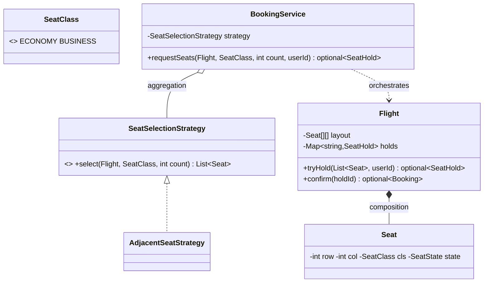

# 21 — Airline / Bus Seat Reservation

> Difficulty: intermediate, concurrency-focused. Structurally the same
> core problem as `07_movie_ticket_booking.md` (hold-then-confirm seat
> concurrency) — this file exists in the roadmap because interviewers
> often ask a *variant* of the seat-locking problem with different surface
> details (a fixed multi-class cabin layout instead of a single-screen
> seat grid, a `PENDING_PAYMENT` timeout instead of a generic hold), and
> recognising "this is the same underlying concurrency problem with a
> different skin" is itself the signal worth demonstrating.

## Step 1 — Clarify

Assumed answers:

- A `Flight` (or `Bus`) has a fixed seat layout, partitioned into classes
  (Economy/Business, or just a flat layout for a bus) with per-class
  pricing.
- Booking is two-phase, same as `07_movie_ticket_booking.md`: **hold**
  (temporary, TTL-bound) then **confirm**. State this parallel explicitly
  if asked — it's the same design, not a coincidence.
- A **group booking** (a family of 4 wants adjacent seats) is a realistic
  ask worth clarifying up front, since it changes the hold operation from
  "N independent seats" to "N seats satisfying an adjacency constraint."
- **Deferred, explicitly**: dynamic pricing by demand, standby/waitlist,
  interline (multi-flight) bookings.

## Step 2 — Entities

| Entity | Responsibility |
| --- | --- |
| `Seat` | Row/column, class, current state (`AVAILABLE`/`HELD`/`BOOKED`) |
| `Flight` | Owns the seat layout, the same hold/confirm concurrency control as `Show` in `07_movie_ticket_booking.md` |
| `SeatSelectionStrategy` | Picks seats given a request (specific seats, or "N adjacent in Economy") — **growing set**, interface |
| `BookingService` | Orchestrates hold → confirm, owns pricing |

**The one genuinely new design element versus `07_movie_ticket_booking.md`**:
`SeatSelectionStrategy` for the **adjacency** requirement. Given "4 seats
together," the algorithm needs to search rows for 4 consecutive
`AVAILABLE` seats in the same class, not just check availability of 4
arbitrary seat IDs — a real search problem, not just a lookup, worth
designing as its own class rather than inlining into `Flight`.

## Step 3 — Class diagram



## Step 4-5 — Interfaces and core implementation

```cpp
#include <mutex>
#include <optional>
#include <string>
#include <unordered_map>
#include <vector>

enum class SeatClass { ECONOMY, BUSINESS };
enum class SeatState { AVAILABLE, HELD, BOOKED };

struct Seat {
    int row, col;
    SeatClass cls;
    SeatState state = SeatState::AVAILABLE;
    std::string id() const { return std::to_string(row) + "-" + std::to_string(col); }
};

class Flight {
public:
    Flight(int rows, int colsPerRow, SeatClass (*classForRow)(int)) {
        for (int r = 0; r < rows; ++r)
            for (int c = 0; c < colsPerRow; ++c)
                layout_.push_back(Seat{r, c, classForRow(r)});
    }

    std::vector<Seat*> seatsByClass(SeatClass cls) {
        std::lock_guard<std::mutex> lock(mu_);
        std::vector<Seat*> result;
        for (auto& s : layout_) if (s.cls == cls) result.push_back(&s);
        return result;
    }

    // Same all-or-nothing atomicity as Show::tryHold in
    // 07_movie_ticket_booking.md: check every requested seat is AVAILABLE
    // before holding any of them.
    bool tryHoldSeats(const std::vector<Seat*>& seats) {
        std::lock_guard<std::mutex> lock(mu_);
        for (auto* s : seats) if (s->state != SeatState::AVAILABLE) return false;
        for (auto* s : seats) s->state = SeatState::HELD;
        return true;
    }

private:
    std::vector<Seat> layout_;
    std::mutex mu_;
};

class SeatSelectionStrategy {
public:
    virtual std::vector<Seat*> select(std::vector<Seat*> candidates, int count) = 0;
    virtual ~SeatSelectionStrategy() = default;
};

// Finds `count` consecutive seats in the same row with no gap -- a real
// search over the candidate list, sorted by (row, col) first.
class AdjacentSeatStrategy : public SeatSelectionStrategy {
public:
    std::vector<Seat*> select(std::vector<Seat*> candidates, int count) override {
        std::sort(candidates.begin(), candidates.end(),
                  [](Seat* a, Seat* b) { return std::tie(a->row, a->col) < std::tie(b->row, b->col); });

        for (size_t i = 0; i + count <= candidates.size(); ++i) {
            bool consecutive = true;
            for (int k = 1; k < count; ++k) {
                if (candidates[i + k]->row != candidates[i]->row
                    || candidates[i + k]->col != candidates[i]->col + k
                    || candidates[i + k]->state != SeatState::AVAILABLE) {
                    consecutive = false;
                    break;
                }
            }
            if (consecutive && candidates[i]->state == SeatState::AVAILABLE) {
                return std::vector<Seat*>(candidates.begin() + i, candidates.begin() + i + count);
            }
        }
        return {};   // no run of `count` adjacent available seats found
    }
};

class BookingService {
public:
    explicit BookingService(std::unique_ptr<SeatSelectionStrategy> strategy) : strategy_(std::move(strategy)) {}

    bool requestSeats(Flight& flight, SeatClass cls, int count) {
        auto candidates = flight.seatsByClass(cls);
        auto chosen = strategy_->select(candidates, count);
        if (chosen.empty()) return false;   // no adjacent block available
        return flight.tryHoldSeats(chosen);  // still needs its own atomicity check --
                                               // another thread could grab one of these
                                               // seats between select() and tryHoldSeats()
    }

private:
    std::unique_ptr<SeatSelectionStrategy> strategy_;
};
```

**Why `select()` (find candidate seats) and `tryHoldSeats()` (atomically
claim them) are two separate steps, and why that's not a race**: `select`
reads seat state without a lock to find a *candidate* block quickly;
`tryHoldSeats` re-validates every seat's state under the lock before
committing. If another thread grabbed one of the candidate seats in
between, `tryHoldSeats` fails cleanly (per its all-or-nothing check) and
the caller can retry `select` — this is deliberately **optimistic** for
the search phase (cheap, lock-free, might find a stale candidate) and
**pessimistic** for the commit phase (locked, always correct), a hybrid
worth naming explicitly if asked to justify it, distinct from
`07_movie_ticket_booking.md`'s fully-pessimistic single-lock design —
that file's tradeoff discussion of pessimistic-vs-optimistic applies here
too, just resolved differently because the search step here is more
expensive (scanning for adjacency) and worth not doing under a lock.

## Step 6 — Edge cases handled

- Requesting more adjacent seats than exist in any single row of the
  requested class → `select` returns an empty vector, `requestSeats`
  fails cleanly without ever calling `tryHoldSeats`.
- A race where two users' `select()` calls both find the same candidate
  block → only one `tryHoldSeats` succeeds (the all-or-nothing check
  catches it), the other returns `false` and the caller retries.

## Extensions (what a live follow-up usually asks)

**"What if no fully-adjacent block exists — offer the closest split
instead?"** A different `SeatSelectionStrategy` implementation (e.g.
`BestEffortSplitStrategy`) — the interface doesn't change, only which
concrete strategy `BookingService` is constructed with, the OCP payoff
made concrete again.

**"Add a window/aisle preference."** Extends `select`'s search criteria
— either a parameter on the interface method or a richer request object
replacing the bare `int count`; a good moment to notice the interface
itself might need to grow, and to discuss that tradeoff (extending an
interface's contract vs. adding a new, more specific one) rather than
silently picking one.

**"Compare the optimistic-search / pessimistic-commit design here to
Movie Ticket Booking's fully pessimistic one — when would you use each?"**
Fully pessimistic (lock for the whole operation) is simpler and right
when the "find candidates" step is cheap (Movie Ticket Booking: the
caller already names specific seat IDs, no search needed). The
hybrid here is worth its extra complexity specifically because adjacency
search is real work you don't want serializing every concurrent request
behind one lock.

## Interview framing to reuse

"Seat selection and seat holding are two separate steps on purpose —
searching for an adjacent block doesn't need a lock, but claiming seats
does, and `tryHoldSeats` re-validates everything under the lock so a
stale candidate from the unlocked search phase can never actually be
booked twice." This is the design decision this problem is testing,
stated precisely.

## Exercises

1. Implement `Flight`, `AdjacentSeatStrategy`, and `BookingService` from
   scratch in 40-45 minutes, then write a test: request 3 adjacent
   Economy seats on a flight where only a 2-seat gap and a 4-seat gap
   exist, confirming the 4-seat gap is found (or the 2-seat gap correctly
   rejected) depending on which row your test data has.
2. Write a concurrency stress test: many threads simultaneously requesting
   overlapping adjacent-seat blocks on a small flight, asserting no seat
   is ever held by two different successful requests.
3. Implement `BestEffortSplitStrategy` from the first extension and
   confirm `BookingService`'s constructor is the only call site that
   changes to switch strategies.
