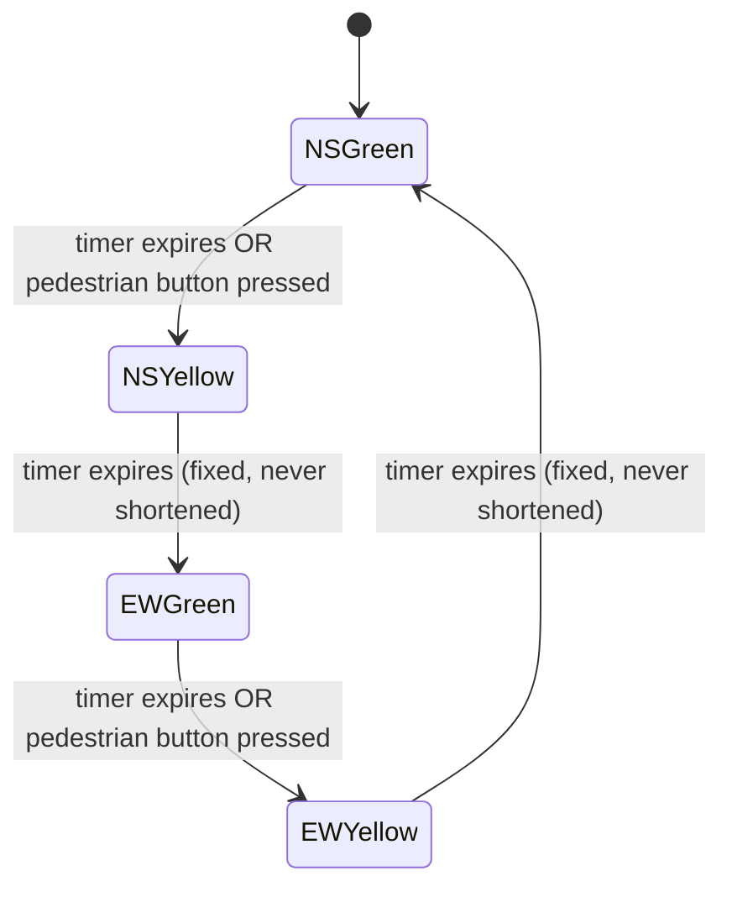
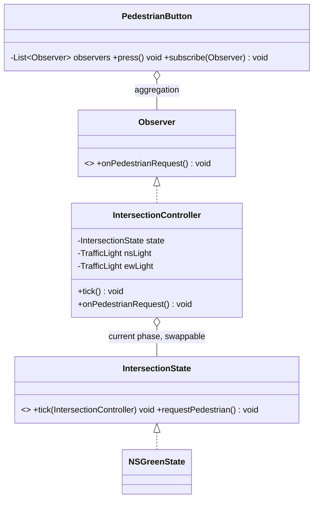

# 22 — Traffic Light Controller (Embedded State Machine)

> Difficulty: intermediate. Tier 4 — an embedded-flavoured LLD problem,
> worth having ready specifically for Nvidia/Cisco/Palo Alto-style loops
> where a software-shaped State problem gets asked with a hardware skin.
> The design is deliberately close to `06_vending_machine.md`'s State
> machine — the differentiator here is the **sensor input** (Observer)
> and the **timing/scheduling** integration, not a new pattern.

## Step 1 — Clarify

Assumed answers:

- A single 4-way intersection, one `TrafficLight` per direction (N/S,
  E/W), coordinated so opposing directions share a phase (N/S green
  together, E/W red together, and vice versa) and never both green.
- Fixed-duration phases by default (green N/S for T seconds, then a
  yellow buffer, then red while E/W runs) — **plus** an optional
  pedestrian-request button that extends or triggers an early transition,
  clarified as an explicit extension, not baseline.
- Runs on a scheduler tick (cross-reference
  `10_task_scheduler_cron.md`'s `Scheduler` directly — this problem is a
  natural consumer of it) rather than a raw sleep loop, since a real
  controller needs to handle pedestrian-button interrupts without
  blocking.
- **Deferred, explicitly**: adaptive timing based on traffic sensors
  (camera/inductive-loop volume data changing phase duration
  dynamically) — name it as the natural next layer, don't build it.

## Step 2 — Entities

| Entity | Responsibility |
| --- | --- |
| `LightColor` (enum) | RED/YELLOW/GREEN |
| `IntersectionState` (interface) | What phase is active and what triggers the next transition — **State pattern** |
| `NSGreenState`, `NSYellowState`, `EWGreenState`, `EWYellowState` | Concrete phases |
| `PedestrianButton` (subject) | Fires an event when pressed — **Observer**, the intersection controller subscribes |
| `IntersectionController` | Owns current state, both light pairs, ticks the state machine forward |

**Why this is State and not a bare enum with a switch**: each phase has a
different valid next-phase and a different duration, exactly the shape
`00_foundations/09_design_patterns_behavioral.md`'s State section
describes — `NSGreenState`'s `tick()` transitions to `NSYellowState` after
its duration elapses (or immediately, if the pedestrian button was
pressed during green, cutting the phase short); `NSYellowState` always
transitions to `EWGreenState` after a fixed, non-cuttable buffer, an
important safety invariant worth stating explicitly ("yellow duration is
never shortened by a pedestrian request — that would be a safety
regression, not just a UX one").

## Step 3 — Class diagram





## Step 4-5 — Interfaces and core implementation

```cpp
#include <chrono>
#include <memory>
#include <vector>

enum class LightColor { RED, YELLOW, GREEN };

class TrafficLight {
public:
    void setColor(LightColor c) { color_ = c; }
    LightColor color() const { return color_; }
private:
    LightColor color_ = LightColor::RED;
};

class IntersectionController;   // fwd decl

class IntersectionState {
public:
    virtual void enter(IntersectionController&) = 0;          // set light colors on entry
    virtual void tick(IntersectionController&, std::chrono::seconds elapsed) = 0;
    virtual void requestPedestrian(IntersectionController&) = 0;
    virtual ~IntersectionState() = default;
};

class NSGreenState : public IntersectionState {
public:
    void enter(IntersectionController& c) override;   // nsLight=GREEN, ewLight=RED
    void tick(IntersectionController& c, std::chrono::seconds elapsed) override {
        if (elapsed >= duration_ || pedestrianRequested_) transitionToYellow(c);
    }
    void requestPedestrian(IntersectionController&) override {
        pedestrianRequested_ = true;   // shortens THIS green phase, never the yellow that follows
    }
private:
    void transitionToYellow(IntersectionController& c);
    std::chrono::seconds duration_{30};
    bool pedestrianRequested_ = false;
};
// NSYellowState, EWGreenState, EWYellowState follow the same shape.
// NSYellowState::requestPedestrian is deliberately a no-op -- the safety
// invariant from Step 2, enforced structurally by simply not acting on
// the request in that state, rather than by a runtime check elsewhere.

class PedestrianObserver {
public:
    virtual void onPedestrianRequest() = 0;
    virtual ~PedestrianObserver() = default;
};

class PedestrianButton {
public:
    void subscribe(PedestrianObserver* obs) { observers_.push_back(obs); }
    void press() { for (auto* obs : observers_) obs->onPedestrianRequest(); }
private:
    std::vector<PedestrianObserver*> observers_;   // raw, non-owning; see
                                                      // 00_foundations/09's weak_ptr
                                                      // note if the controller's
                                                      // lifetime is shorter than the button's
};

class IntersectionController : public PedestrianObserver {
public:
    IntersectionController() { setState(std::make_unique<NSGreenState>()); }

    void tick(std::chrono::seconds elapsed) { state_->tick(*this, elapsed); }
    void onPedestrianRequest() override { state_->requestPedestrian(*this); }
    void setState(std::unique_ptr<IntersectionState> s) { state_ = std::move(s); state_->enter(*this); }

    TrafficLight nsLight, ewLight;
private:
    std::unique_ptr<IntersectionState> state_;
};
```

**Why `requestPedestrian` is a no-op in the yellow states rather than
`IntersectionController` checking "are we in a yellow state" before
forwarding the request**: this is Non-Virtual-Interface-adjacent
reasoning from `00_foundations/06_cpp_design_idioms.md` applied to
State — the safety rule ("yellow is never shortened") is enforced by
*each state deciding for itself* whether a pedestrian request does
anything, rather than by a conditional living in `IntersectionController`
that has to know about every state's rules. If a new phase is added
later, its `requestPedestrian` implementation makes an explicit, local
decision — there's no central conditional to remember to update.

## Step 6 — Edge cases handled

- Pedestrian button pressed during a yellow phase → explicitly ignored by
  that state's `requestPedestrian`, the timer-based transition still
  fires on schedule.
- Pedestrian button pressed multiple times during one green phase →
  `pedestrianRequested_` is a flag, not a counter; a second press changes
  nothing, the phase still ends at the earlier of "timer expires" or "flag
  is set."

## Extensions (what a live follow-up usually asks)

**"Wire this to a real scheduler instead of an external tick loop."**
Direct composition with `10_task_scheduler_cron.md`'s `Scheduler`:
`scheduleRecurring([&controller] { controller.tick(std::chrono::seconds(1)); },
std::chrono::seconds(1))` — naming this connection explicitly is a strong
"I see how these pieces compose" signal.

**"Add adaptive timing from a traffic sensor."** A `TrafficSensor`
(itself Observer-shaped, or polled) feeding into each green state's
`duration_` — this is exactly the deferred item from Step 1, worth
sketching (states could hold a `DurationStrategy` instead of a fixed
`std::chrono::seconds`) without building it live.

**"Handle an all-way flashing-red failure mode (power issue,
maintenance)."** A new `FlashingRedState` that all other states can
transition into on an external `enterMaintenanceMode()` call, and which
transitions back to `NSGreenState` on `exitMaintenanceMode()` — a good
test of whether your state interface can absorb an out-of-band
transition cleanly.

## Interview framing to reuse

"Each state decides for itself whether a pedestrian request does
anything, rather than `IntersectionController` needing a conditional
that knows every state's safety rules — that's what keeps 'yellow is
never shortened' enforced structurally instead of by convention." A
precise, embedded-relevant safety argument, not just pattern vocabulary.

## Exercises

1. Implement all four states and `IntersectionController` in 35-40
   minutes, then write a test confirming a pedestrian request during
   `NSGreenState` shortens that phase but a request during the following
   `NSYellowState` has no effect on yellow's duration.
2. Wire the controller to a real `10_task_scheduler_cron.md` `Scheduler`
   instance and confirm phases advance correctly over several real
   seconds.
3. Implement the `FlashingRedState` maintenance-mode extension and
   confirm every existing state can be interrupted into it without a
   crash or an invalid light combination (both directions green
   simultaneously) ever being observable mid-transition.
