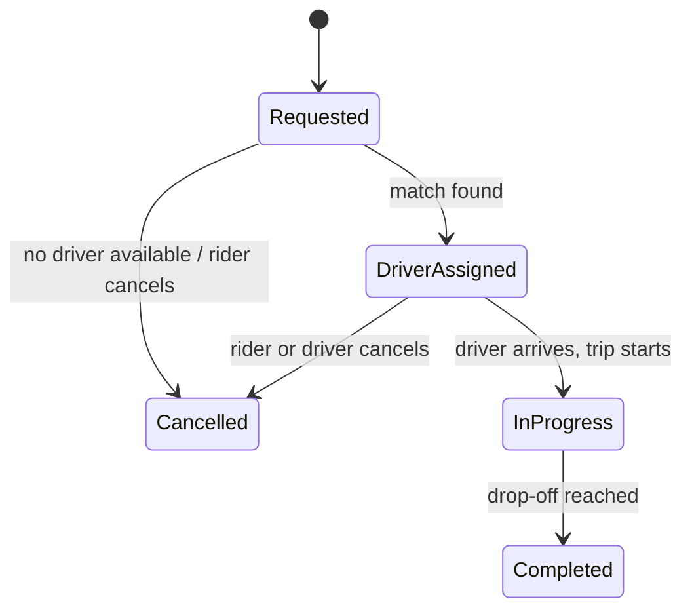
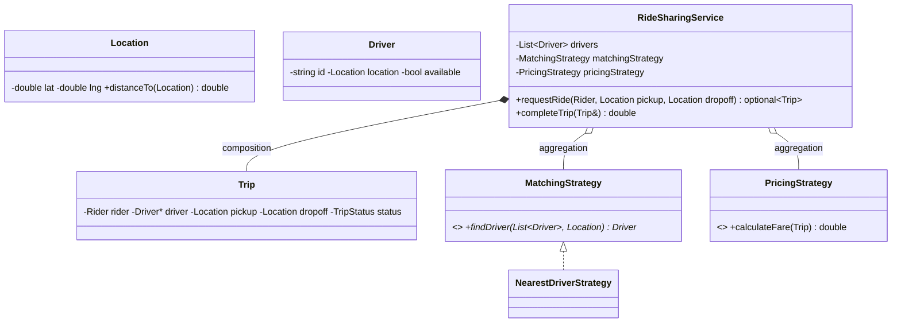

# 26 — Ride-Sharing Service (Uber-style)

> Difficulty: advanced. One of the most frequently asked "big" LLD
> problems, and structurally different from everything else in this set —
> the core design question isn't concurrency-under-contention (Movie
> Ticket Booking, Airline Seat Reservation) or a state machine (Vending
> Machine, OTA Manager), it's **matching**: finding the right driver for a
> rider's request, which is a pluggable algorithm problem wearing a
> ride-sharing costume.

## Step 1 — Clarify

Assumed answers:

- A `Rider` requests a trip from a pickup to a drop-off location. The
  system finds a `Driver` and assigns them.
- Drivers have a location and an availability status; a matched driver
  becomes unavailable until the trip completes.
- Trip lifecycle: `REQUESTED → DRIVER_ASSIGNED → IN_PROGRESS → COMPLETED`
  (or `CANCELLED` from the first two states).
- Pricing: a fare is computed from distance (and optionally time/surge),
  via a pluggable strategy.
- **Deferred, explicitly**: real GPS/routing (distance is a simplified
  straight-line or precomputed value), payment processing, driver
  ratings — realistic follow-ups, not the base design. A live
  location-tracking feed (drivers continuously reporting position) is
  also deferred — this design assumes a snapshot of driver locations
  available at match time.

## Step 2 — Entities

| Entity | Responsibility |
| --- | --- |
| `Location` | Latitude/longitude, with a distance calculation |
| `Driver` | Identity, current location, availability |
| `Rider` | Identity |
| `Trip` | Rider, driver, pickup/drop-off, current `TripStatus` |
| `MatchingStrategy` (interface) | Finds the best available driver for a request — **growing set**, interface |
| `PricingStrategy` (interface) | Computes fare from a completed trip — **growing set**, interface |
| `RideSharingService` | Orchestrates request → match → complete |

**Why `MatchingStrategy` is the one interface this whole problem is
organized around**: "nearest available driver" is the obvious first
implementation, but real systems weigh many factors (driver rating,
estimated arrival time, whether the driver is heading in a compatible
direction, fairness/rotation among idle drivers) — this is a textbook
Strategy situation because the *matching algorithm itself* is exactly the
part expected to change and be A/B-tested in a real product, which is a
strong, concrete justification for the pattern (contrast with reaching
for Strategy reflexively, which `10_lld/00_plan.md`
warns against).

## Step 3 — Class diagram





## Step 4-5 — Interfaces and core implementation

```cpp
#include <cmath>
#include <memory>
#include <mutex>
#include <optional>
#include <string>
#include <vector>

struct Location {
    double lat, lng;
    double distanceTo(const Location& other) const {
        // simplified flat-plane distance -- a real system uses the haversine
        // formula for great-circle distance; the algorithmic shape of the
        // matching problem below is identical either way, so this
        // simplification is a reasonable, statable scoping choice.
        double dx = lat - other.lat, dy = lng - other.lng;
        return std::sqrt(dx * dx + dy * dy);
    }
};

struct Driver {
    std::string id;
    Location location;
    bool available = true;
};

struct Rider { std::string id; };

enum class TripStatus { REQUESTED, DRIVER_ASSIGNED, IN_PROGRESS, COMPLETED, CANCELLED };

struct Trip {
    Rider rider;
    Driver* driver = nullptr;
    Location pickup, dropoff;
    TripStatus status = TripStatus::REQUESTED;
};

class MatchingStrategy {
public:
    virtual Driver* findDriver(std::vector<Driver*>& available, const Location& pickup) = 0;
    virtual ~MatchingStrategy() = default;
};
class NearestDriverStrategy : public MatchingStrategy {
public:
    Driver* findDriver(std::vector<Driver*>& available, const Location& pickup) override {
        Driver* best = nullptr;
        double bestDist = 0;
        for (auto* d : available) {
            double dist = d->location.distanceTo(pickup);
            if (!best || dist < bestDist) { best = d; bestDist = dist; }
        }
        return best;
    }
};

class PricingStrategy {
public:
    virtual double calculateFare(const Trip& trip) const = 0;
    virtual ~PricingStrategy() = default;
};
class DistanceBasedPricing : public PricingStrategy {
public:
    double calculateFare(const Trip& trip) const override {
        double distance = trip.pickup.distanceTo(trip.dropoff);
        return 2.50 + distance * 1.75;   // base fare + per-unit-distance rate
    }
};

class RideSharingService {
public:
    RideSharingService(std::unique_ptr<MatchingStrategy> matching,
                        std::unique_ptr<PricingStrategy> pricing)
        : matching_(std::move(matching)), pricing_(std::move(pricing)) {}

    void registerDriver(Driver driver) {
        std::lock_guard<std::mutex> lock(mu_);
        drivers_.push_back(std::move(driver));
    }

    std::optional<Trip> requestRide(Rider rider, Location pickup, Location dropoff) {
        std::lock_guard<std::mutex> lock(mu_);
        std::vector<Driver*> available;
        for (auto& d : drivers_) if (d.available) available.push_back(&d);

        Driver* chosen = matching_->findDriver(available, pickup);
        if (!chosen) return std::nullopt;   // no driver available right now

        chosen->available = false;   // claimed atomically under mu_ -- same
                                       // check-then-act discipline as every
                                       // other assignment problem in this set
        Trip trip{std::move(rider), chosen, pickup, dropoff, TripStatus::DRIVER_ASSIGNED};
        return trip;
    }

    double completeTrip(Trip& trip) {
        std::lock_guard<std::mutex> lock(mu_);
        trip.status = TripStatus::COMPLETED;
        trip.driver->available = true;   // driver freed up for the next match
        return pricing_->calculateFare(trip);
    }

private:
    std::mutex mu_;
    std::vector<Driver> drivers_;
    std::unique_ptr<MatchingStrategy> matching_;
    std::unique_ptr<PricingStrategy> pricing_;
};
```

**Why `requestRide` finds-and-claims a driver under one lock, the same
pattern as every assignment problem in this set**: identical reasoning to
`02_parking_lot.md`'s slot assignment and `16_food_delivery_system.md`'s
partner assignment — a driver search followed by a separate claim step
would race under concurrent requests (two riders matched to the same
driver). Naming this as "the same shape as the other assignment
problems" — rather than re-deriving it from scratch — is a strong signal
you're generalizing across this problem set rather than memorizing
individual solutions.

## Step 6 — Edge cases handled

- No available driver when a ride is requested → `std::nullopt`, an
  expected outcome (per `10_lld/00_foundations/14_application_architecture_patterns.md`'s
  Result-pattern discussion), not an exception.
- A driver becomes available again exactly when their trip completes,
  under the same lock as the fare calculation — no window where the
  driver is neither "on a trip" nor "available."

## Extensions (what a live follow-up usually asks)

**"Rank candidate drivers by more than just distance — factor in rating
and estimated arrival time."** A new `MatchingStrategy` implementation
(`WeightedScoreStrategy`, say) combining multiple factors into one score
— zero change to `RideSharingService`, the exact OCP payoff this pattern
exists for.

**"Add surge pricing during high demand."** A `SurgePricing` decorator
(`00_foundations/08_design_patterns_structural.md`) wrapping any
`PricingStrategy`, multiplying the base fare by a demand-derived
multiplier — additive, composes with `DistanceBasedPricing` rather than
replacing it.

**"How would driver location updates work in a real system — should
`Driver::location` just be mutated directly by a GPS feed?"** Name the
real concern: concurrent reads (during matching) and writes (from a
location-update stream) to the same `Driver` objects need the same
locking discipline already in place here, but at higher frequency — worth
mentioning that a real system would likely batch/throttle location writes
or use a spatial index (a grid or quadtree keyed by location) rather than
a linear scan over all drivers for matching, which doesn't scale past a
small driver count. Naming the linear-scan limitation honestly, and the
spatial-index fix by name, is a strong "I know this doesn't scale as
written" signal.

## Interview framing to reuse

"I made `MatchingStrategy` the one real extension point in this design,
because the matching algorithm is exactly what a real ride-sharing
product would want to swap and A/B test constantly — everything else
(the trip state machine, driver assignment locking) is comparatively
stable." A justified pattern choice tied to the actual problem, not
reflexive pattern application.

## Exercises

1. Implement the above from scratch in 45-50 minutes, then write a test
   with 3 drivers at different distances from a pickup point, confirming
   `NearestDriverStrategy` picks the closest one.
2. Write a concurrency stress test: many riders simultaneously requesting
   rides against a small pool of drivers, asserting no driver is ever
   assigned to two trips at once.
3. Implement `WeightedScoreStrategy` combining distance and a driver
   rating field (add `double rating` to `Driver`), and confirm swapping
   strategies in `RideSharingService`'s constructor changes matching
   behavior with no other code changes.
4. Sketch (pseudocode, not full implementation) how you'd replace the
   linear scan in `NearestDriverStrategy` with a grid-based spatial index
   (divide the map into fixed-size cells, only scan drivers in nearby
   cells) — identify which method's signature would need to change.
