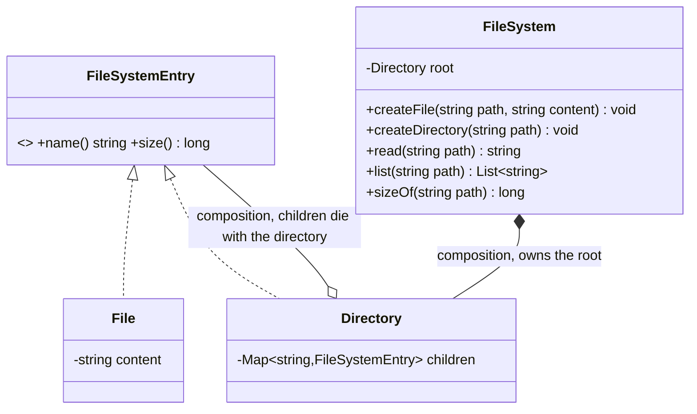

# 27 — In-Memory File System

> Difficulty: intermediate. The cleanest, most direct application of the
> Composite pattern in the entire problem set — a file system is
> *exactly* the "tree of uniform part/whole objects" shape
> `00_foundations/08_design_patterns_structural.md`'s Composite section
> describes, made concrete rather than abstract. Commonly asked in its
> own right, and a good problem to revisit right after reading Composite
> for the first time.

## Step 1 — Clarify

Assumed answers:

- A tree of directories and files, rooted at `/`. Operations: create a
  file, create a directory, write to a file, read a file, list a
  directory's contents, compute a directory's total size (recursively,
  including everything nested inside it).
- Paths are `/`-separated strings (`/home/user/notes.txt`), resolved
  component by component.
- **Deferred, explicitly**: permissions, symbolic links, file
  metadata beyond size (timestamps, owners) — realistic follow-ups, not
  the base design.

## Step 2 — Entities

| Entity | Responsibility |
| --- | --- |
| `FileSystemEntry` (interface) | `size()`, `name()` — the uniform contract both files and directories satisfy |
| `File` | A leaf: holds content, its size is its content's length |
| `Directory` | A composite: holds child entries (files and/or other directories), its size is the sum of its children's sizes |
| `FileSystem` | Owns the root `Directory`, resolves paths to entries |

**This is Composite, named precisely**: `Directory` and `File` both
implement `FileSystemEntry`, and a `Directory`'s `size()` recurses into
its children *without knowing or caring whether each child is a `File`
or another `Directory`* — this uniform treatment of leaf and composite
nodes through one interface is the entire pattern. Worth stating this
explicitly the moment you draw the class diagram: "I'm using Composite
here because directories containing directories containing files is
exactly a recursive tree of parts and wholes treated uniformly."

## Step 3 — Class diagram



## Step 4-5 — Interfaces and core implementation

```cpp
#include <map>
#include <memory>
#include <sstream>
#include <stdexcept>
#include <string>
#include <vector>

class FileSystemEntry {
public:
    explicit FileSystemEntry(std::string name) : name_(std::move(name)) {}
    const std::string& name() const { return name_; }
    virtual long size() const = 0;
    virtual bool isDirectory() const = 0;
    virtual ~FileSystemEntry() = default;
private:
    std::string name_;
};

class File : public FileSystemEntry {
public:
    File(std::string name, std::string content)
        : FileSystemEntry(std::move(name)), content_(std::move(content)) {}

    long size() const override { return static_cast<long>(content_.size()); }
    bool isDirectory() const override { return false; }
    const std::string& content() const { return content_; }
    void write(std::string content) { content_ = std::move(content); }

private:
    std::string content_;
};

class Directory : public FileSystemEntry {
public:
    explicit Directory(std::string name) : FileSystemEntry(std::move(name)) {}

    long size() const override {
        long total = 0;
        for (auto& [name, child] : children_) total += child->size();   // recurses
                                                                            // uniformly through
                                                                            // files AND subdirectories
        return total;
    }
    bool isDirectory() const override { return true; }

    void addChild(std::unique_ptr<FileSystemEntry> entry) {
        children_[entry->name()] = std::move(entry);
    }
    FileSystemEntry* getChild(const std::string& name) const {
        auto it = children_.find(name);
        return it != children_.end() ? it->second.get() : nullptr;
    }
    std::vector<std::string> listNames() const {
        std::vector<std::string> names;
        for (auto& [name, child] : children_) names.push_back(name);
        return names;
    }

private:
    std::map<std::string, std::unique_ptr<FileSystemEntry>> children_;
};

class FileSystem {
public:
    FileSystem() : root_(std::make_unique<Directory>("/")) {}

    void createFile(const std::string& path, const std::string& content) {
        auto [parent, name] = resolveParent(path);
        parent->addChild(std::make_unique<File>(name, content));
    }
    void createDirectory(const std::string& path) {
        auto [parent, name] = resolveParent(path);
        parent->addChild(std::make_unique<Directory>(name));
    }
    std::string read(const std::string& path) const {
        auto* entry = resolve(path);
        if (!entry || entry->isDirectory()) throw std::invalid_argument("not a file: " + path);
        return static_cast<File*>(entry)->content();
    }
    std::vector<std::string> list(const std::string& path) const {
        auto* entry = resolve(path);
        if (!entry || !entry->isDirectory()) throw std::invalid_argument("not a directory: " + path);
        return static_cast<Directory*>(entry)->listNames();
    }
    long sizeOf(const std::string& path) const {
        auto* entry = resolve(path);
        if (!entry) throw std::invalid_argument("no such path: " + path);
        return entry->size();   // works identically whether path is a file or a directory --
    }                            // this uniformity IS the payoff of Composite, made concrete

private:
    // Splits "/a/b/c" into components, walks from root, and either returns
    // the resolved entry (resolve) or the parent directory + final
    // component name, for creation (resolveParent).
    std::vector<std::string> splitPath(const std::string& path) const {
        std::vector<std::string> parts;
        std::stringstream ss(path);
        std::string part;
        while (std::getline(ss, part, '/')) if (!part.empty()) parts.push_back(part);
        return parts;
    }
    FileSystemEntry* resolve(const std::string& path) const {
        auto parts = splitPath(path);
        FileSystemEntry* current = root_.get();
        for (auto& part : parts) {
            if (!current->isDirectory()) return nullptr;
            current = static_cast<Directory*>(current)->getChild(part);
            if (!current) return nullptr;
        }
        return current;
    }
    std::pair<Directory*, std::string> resolveParent(const std::string& path) {
        auto parts = splitPath(path);
        if (parts.empty()) throw std::invalid_argument("invalid path: " + path);
        std::string name = parts.back();
        parts.pop_back();

        Directory* current = root_.get();
        for (auto& part : parts) {
            auto* next = current->getChild(part);
            if (!next || !next->isDirectory()) throw std::invalid_argument("invalid path: " + path);
            current = static_cast<Directory*>(next);
        }
        return {current, name};
    }

    std::unique_ptr<Directory> root_;
};
```

**Why `sizeOf` doesn't need to know or care whether `path` points at a
file or a directory**: this is the line where Composite actually pays
off, made explicit in the comment — `entry->size()` dispatches correctly
either way (a `File`'s `size()` returns its content length; a
`Directory`'s recurses into every child) purely through virtual dispatch,
with zero branching in `FileSystem` itself. If you find yourself writing
`if (entry->isDirectory()) { ... } else { ... }` before calling a shared
operation, that's usually a sign Composite isn't being used correctly —
the whole point is the caller *shouldn't* need to branch.

## Step 6 — Edge cases handled

- Resolving a path through something that isn't a directory (e.g.
  `/file.txt/nested` where `file.txt` is a file) → `resolve` and
  `resolveParent` both check `isDirectory()` before descending further
  and fail cleanly rather than crashing on an invalid cast.
- `sizeOf` on a deeply nested directory correctly sums every file at every
  depth, via the same recursive `size()` call at each level — no special
  casing needed for depth.

## Extensions (what a live follow-up usually asks)

**"Add a `delete(path)` operation."** `Directory` gains a
`removeChild(name)`; `FileSystem::delete_` resolves the parent (reusing
`resolveParent`) and removes the named child — deleting a directory this
way removes its whole subtree for free, since `children_` is a map of
`unique_ptr`s and destroying the `Directory` destroys everything it owns
(the same RAII-cascades-through-ownership idea from
`00_foundations/01_raii_ownership_and_move_semantics.md`, here applying
to a whole tree at once).

**"Add a `find(name)` that searches the whole tree for entries matching a
name."** A recursive traversal, structurally identical to `size()` but
collecting matches instead of summing — a good moment to notice how many
operations on this structure share the same "recurse through children
uniformly" shape.

**"Make this thread-safe for concurrent reads and writes."** A single
mutex around `FileSystem`'s operations is the defensible default (per
`00_foundations/10_concurrency_for_lld.md`'s coarse-vs-fine-grained
discussion) given operations here are typically fast (in-memory) and not
a demonstrated bottleneck; a per-directory lock would be the fine-grained
alternative if profiling showed real contention, mentioned but not
built without that evidence.

## Interview framing to reuse

"`sizeOf` calls `entry->size()` with no branching on whether it's a file
or a directory — that's Composite doing its job: a `Directory`'s `size()`
recurses into its own children the same way a `File`'s returns its
content length, so the caller never needs to know which kind of entry
it's holding." Naming the payoff precisely, with the specific line of
code that demonstrates it, rather than just "I used Composite."

## Exercises

1. Implement the above from scratch in 35-40 minutes, then write a test
   building a small tree (`/docs/notes.txt`, `/docs/archive/old.txt`,
   `/readme.md`) and confirming `sizeOf("/")` equals the sum of all three
   files' content lengths.
2. Implement the `delete(path)` extension and confirm deleting
   `/docs` removes both `notes.txt` and the nested `archive` directory
   (and everything inside it) in one call.
3. Implement the recursive `find(name)` extension and confirm it locates
   a file nested three directories deep.
4. Deliberately write a version of `sizeOf` that branches on
   `isDirectory()` before deciding how to compute size, get it working,
   then refactor it back to the polymorphic one-liner — this contrast is
   the fastest way to feel why Composite's uniform dispatch is actually
   doing work, not just adding indirection.
