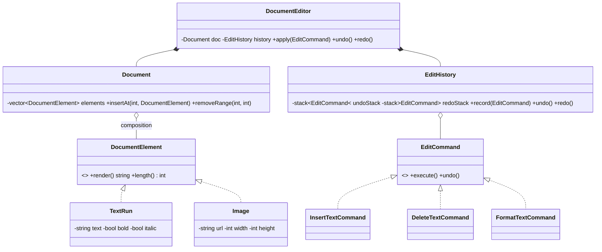

# 28 — Document Editor (Google-Docs-style)

> Difficulty: advanced. Surfaced by cross-checking this roadmap against a
> popular YouTube LLD course — a genuinely distinct teaching angle from
> everything else in this set: the core design question is **how do you
> represent a document as a tree of heterogeneous, nestable content, and
> how do you make every edit to it undoable**, which combines Composite
> and Command in one problem more directly than either pattern's dedicated
> section does alone.

## Step 1 — Clarify

Assumed answers:

- A `Document` contains an ordered sequence of content — plain text runs
  and images, for this design (a real editor adds tables, headers, lists;
  the tree shape below extends to those without a redesign).
- Text can carry formatting (bold, italic) applied to a specific range,
  not just the whole document.
- Every edit (insert text, delete a range, apply formatting) must be
  **undoable and redoable**, in the order performed — this is the
  problem's actual center of gravity, not the content model itself.
- **Deferred, explicitly**: real-time multi-user collaboration (operational
  transform / CRDTs — a genuinely different, much harder problem, worth
  naming as out of scope if asked rather than improvising), rich layout
  (page breaks, columns), spell-check. This design is single-user,
  in-memory, with a real undo/redo stack.

## Step 2 — Entities

| Entity | Responsibility |
| --- | --- |
| `DocumentElement` (interface) | One piece of content — `render()`, `length()` |
| `TextRun` | A leaf: a string of plain text, with formatting flags |
| `Image` | A leaf: a reference (URL/path) and dimensions |
| `Document` | The root — an ordered list of `DocumentElement`s |
| `EditCommand` (interface) | One undoable edit — `execute()`, `undo()` |
| `InsertTextCommand`, `DeleteTextCommand`, `FormatTextCommand` | Concrete edits |
| `EditHistory` | Two stacks (undo/redo) of executed `EditCommand`s |
| `DocumentEditor` | Orchestrates: applies a command, records it, exposes undo/redo |

**Why this is Composite even though the tree here is shallow (one level:
`Document` → `DocumentElement`s, no `DocumentElement` containing other
`DocumentElement`s in this simplified version)**: the interface shape —
a uniform `DocumentElement` that `Document` iterates without caring
whether each one is a `TextRun` or an `Image` — is the actual Composite
contract; a real editor nesting `Paragraph`s and `Table`s inside
`Document` just adds another `DocumentElement` implementation that itself
holds a `std::vector<DocumentElement>`, with zero change to anything that
already iterates a `Document`. `00_foundations/08_design_patterns_structural.md`'s
Composite section and `27_inmemory_file_system.md` both use the deeper,
recursive version of this same shape — worth re-reading either if the
one-level version here feels too thin.

**Why Command, not Memento, for undo/redo here** — a question worth
answering explicitly if asked, since `00_foundations/09_design_patterns_behavioral.md`
already covers Memento as *the* undo/redo pattern: Memento undoes by
restoring a **full saved snapshot** of an object's state, which is simple
but expensive if the object (here, the whole `Document`) is large and
edits are small. Command undoes by **reversing one specific operation**
(`DeleteTextCommand::undo()` re-inserts exactly the text it removed) —
cheaper per edit, and it doubles as a clean audit log of every edit made,
which a document editor's real feature set (version history, "see edit
by X") wants anyway. Memento remains the right choice when an object's
invariants are too tangled to reverse step-by-step (the classic
text-editor-with-arbitrary-internal-state example in file `09`) — naming
*why* this problem picks the other one is the actual signal.

## Step 3 — Class diagram



## Step 4-5 — Interfaces and core implementation

```cpp
#include <memory>
#include <stack>
#include <string>
#include <vector>

class DocumentElement {
public:
    virtual std::string render() const = 0;
    virtual int length() const = 0;
    virtual std::unique_ptr<DocumentElement> clone() const = 0;
    virtual ~DocumentElement() = default;
};

class TextRun : public DocumentElement {
public:
    TextRun(std::string text, bool bold = false, bool italic = false)
        : text_(std::move(text)), bold_(bold), italic_(italic) {}

    std::string render() const override {
        std::string s = text_;
        if (bold_) s = "**" + s + "**";
        if (italic_) s = "_" + s + "_";
        return s;
    }
    int length() const override { return static_cast<int>(text_.size()); }
    std::unique_ptr<DocumentElement> clone() const override {
        return std::make_unique<TextRun>(*this);
    }
    const std::string& text() const { return text_; }
    void setBold(bool b) { bold_ = b; }
    void setItalic(bool i) { italic_ = i; }

private:
    std::string text_;
    bool bold_, italic_;
};

class Image : public DocumentElement {
public:
    Image(std::string url, int w, int h) : url_(std::move(url)), width_(w), height_(h) {}
    std::string render() const override { return "[image: " + url_ + "]"; }
    int length() const override { return 1; }   // an image occupies one "slot," not character-measured
    std::unique_ptr<DocumentElement> clone() const override {
        return std::make_unique<Image>(*this);
    }

private:
    std::string url_;
    int width_, height_;
};

class Document {
public:
    void insertAt(int index, std::unique_ptr<DocumentElement> el) {
        elements_.insert(elements_.begin() + index, std::move(el));
    }
    std::unique_ptr<DocumentElement> removeAt(int index) {
        auto el = std::move(elements_[index]);
        elements_.erase(elements_.begin() + index);
        return el;
    }
    DocumentElement* at(int index) { return elements_[index].get(); }
    int size() const { return static_cast<int>(elements_.size()); }

    std::string render() const {
        std::string out;
        for (auto& el : elements_) out += el->render();
        return out;
    }

private:
    std::vector<std::unique_ptr<DocumentElement>> elements_;
};

class EditCommand {
public:
    virtual void execute() = 0;
    virtual void undo() = 0;
    virtual ~EditCommand() = default;
};

class InsertTextCommand : public EditCommand {
public:
    InsertTextCommand(Document& doc, int index, std::string text)
        : doc_(doc), index_(index), text_(std::move(text)) {}
    void execute() override { doc_.insertAt(index_, std::make_unique<TextRun>(text_)); }
    void undo() override { doc_.removeAt(index_); }

private:
    Document& doc_;
    int index_;
    std::string text_;
};

class DeleteTextCommand : public EditCommand {
public:
    DeleteTextCommand(Document& doc, int index) : doc_(doc), index_(index) {}
    void execute() override { removed_ = doc_.removeAt(index_); }   // save what we removed --
    void undo() override { doc_.insertAt(index_, std::move(removed_)); }   // the whole undo() trick

private:
    Document& doc_;
    int index_;
    std::unique_ptr<DocumentElement> removed_;   // this program's smallest example of a
                                                    // Command remembering just enough state
                                                    // to reverse itself, cheaper than a full
                                                    // Document snapshot would be
};

class EditHistory {
public:
    void record(std::unique_ptr<EditCommand> cmd) {
        cmd->execute();
        undoStack_.push(std::move(cmd));
        while (!redoStack_.empty()) redoStack_.pop();   // a new edit invalidates the redo trail
    }
    bool undo() {
        if (undoStack_.empty()) return false;
        undoStack_.top()->undo();
        redoStack_.push(std::move(undoStack_.top()));
        undoStack_.pop();
        return true;
    }
    bool redo() {
        if (redoStack_.empty()) return false;
        redoStack_.top()->execute();
        undoStack_.push(std::move(redoStack_.top()));
        redoStack_.pop();
        return true;
    }

private:
    std::stack<std::unique_ptr<EditCommand>> undoStack_, redoStack_;
};

class DocumentEditor {
public:
    void apply(std::unique_ptr<EditCommand> cmd) { history_.record(std::move(cmd)); }
    bool undo() { return history_.undo(); }
    bool redo() { return history_.redo(); }
    std::string render() const { return doc_.render(); }
    Document& document() { return doc_; }

private:
    Document doc_;
    EditHistory history_;
};
```

**Why `DeleteTextCommand` stores the removed element instead of just an
index**: this is the whole idea made concrete — `undo()` needs enough
information to fully reverse `execute()`, and "what was removed" isn't
recoverable from the index alone once it's gone. Every `EditCommand`
implementation follows this same discipline: capture whatever `execute()`
is about to destroy, before destroying it.

**Why `record()` clears the redo stack on a new edit**: once you've
undone three edits and then make a *new* edit instead of redoing, the
three undone edits are no longer a valid "future" to redo back into — the
same discipline a browser's back/forward history uses when you navigate
to a new page after going back.

## Step 6 — Edge cases handled

- Undo with an empty undo stack, redo with an empty redo stack → both
  return `false` rather than throwing, an expected "nothing to do"
  outcome (per `10_lld/00_foundations/14_application_architecture_patterns.md`'s Result-pattern
  discussion), not an exception.
- A new edit after undoing invalidates the redo trail — handled in
  `record()`, above.

## Extensions (what a live follow-up usually asks)

**"Support applying bold to a range of existing text, not just newly
inserted text."** A `FormatTextCommand` storing the affected `TextRun`'s
previous bold/italic flags (the same "capture what execute() will
overwrite" discipline as `DeleteTextCommand`), flipping them in
`execute()`, restoring them in `undo()`.

**"Multiple cursors / multiple users editing simultaneously."** Name the
real answer honestly rather than improvising a design live: single-user
undo/redo with two linear stacks doesn't generalize to concurrent editors
— that's operational transform or CRDT territory, a different problem
with different invariants (there's no longer one single "undo stack" that
makes sense), explicitly out of scope per Step 1.

**"Export to HTML/Markdown/PDF."** A Visitor
(`00_foundations/09_design_patterns_behavioral.md`) over `DocumentElement`
— one `ExportVisitor` per format, with a new `accept(Visitor&)` method on
`DocumentElement` — adds export formats without editing `TextRun`/`Image`
themselves, the direct OCP payoff Visitor exists for.

## Interview framing to reuse

"I split the design into two independent concerns on purpose: `Document`
is a plain Composite with no idea that undo/redo exists, and
`EditHistory` is a plain Command stack with no idea what a document
*is* — every `EditCommand` is the only thing that touches both. That
separation is what makes adding a new content type (a `Table`) or a new
edit type (`FormatTextCommand`) each a one-class change instead of
touching a shared, growing `if`/`switch`."

## Exercises

1. Implement the above from scratch in 45-50 minutes, then write a test
   sequence: insert three `TextRun`s, delete the middle one, undo twice,
   redo once — confirm `document().render()` matches at each step.
2. Implement `FormatTextCommand` (bold/italic toggling on an existing
   `TextRun` by index) following the "capture before overwrite" pattern
   from `DeleteTextCommand`.
3. Write a test proving the redo-invalidation rule: undo twice, make a
   new edit, then attempt `redo()` — confirm it returns `false` and the
   two originally-undone edits are gone for good.
4. Sketch (pseudocode, not full implementation) an `ExportVisitor`
   producing an HTML string from a `Document`, and identify exactly which
   existing classes need a new `accept(Visitor&)` method versus which
   need no changes at all.
