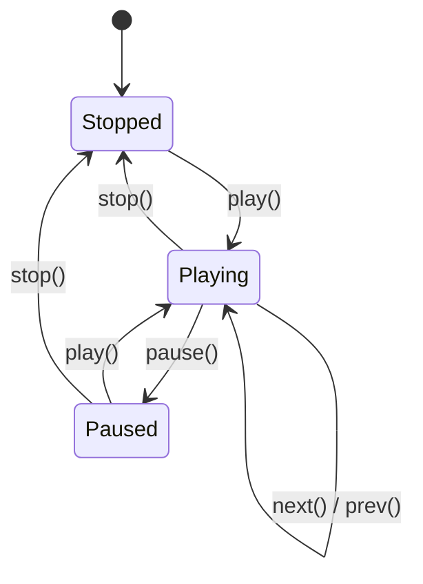
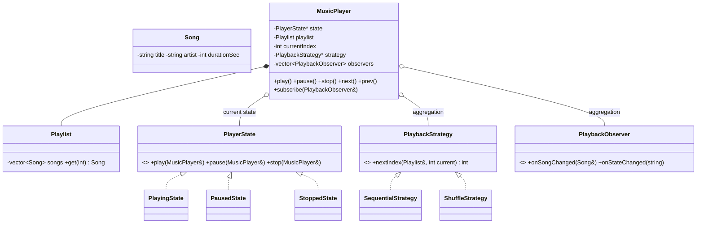

# 29 — Music Player (Spotify-style)

> Difficulty: intermediate. Surfaced by cross-checking this roadmap
> against a popular YouTube LLD course — the teaching angle here is
> **three patterns composed in one small system**: State (what commands
> are even valid right now), Strategy (which song plays next), and
> Observer (who gets told when playback changes) — each solving a
> genuinely different part of the problem, which is exactly the skill a
> "when do these three patterns combine, and where's the line between
> them" follow-up is testing.

## Step 1 — Clarify

Assumed answers:

- A `Playlist` is an ordered list of `Song`s. The player plays one
  `Playlist` at a time, one `Song` at a time.
- Playback has states — playing, paused, stopped — and some commands only
  make sense in some states (`pause()` while already stopped is a no-op,
  not an error).
- "Next song" can follow different rules: sequential, shuffle, repeat-one,
  repeat-all-playlist — pluggable, since this is exactly the kind of
  behavior a real product adds more variants of over time.
- UI components (a "now playing" widget, a scrobbling/history service)
  need to be notified whenever the current song or playback state
  changes, without the player knowing anything about them.
- **Deferred, explicitly**: actual audio decoding/streaming, network
  buffering, cross-device sync (Spotify Connect) — this design is the
  playback *state machine and queue logic* only, not audio I/O.

## Step 2 — Entities

| Entity | Responsibility |
| --- | --- |
| `Song` | Title, artist, duration |
| `Playlist` | An ordered list of `Song`s |
| `PlayerState` (interface) | What `play()`/`pause()`/`stop()` do *in this state* |
| `PlayingState`, `PausedState`, `StoppedState` | Concrete states |
| `PlaybackStrategy` (interface) | Picks the next track index — **growing set**, interface |
| `SequentialStrategy`, `ShuffleStrategy`, `RepeatOneStrategy` | Concrete strategies |
| `PlaybackObserver` (interface) | Notified on song-changed / state-changed |
| `MusicPlayer` | The context: current state, current playlist/index, registered observers |

**Where the three patterns each earn their place, not just "because
they're the popular ones"**: **State** owns *what commands mean right
now* — `PlayingState::pause()` transitions to paused;
`StoppedState::pause()` does nothing, because there's nothing playing to
pause. **Strategy** owns a completely orthogonal decision — *given "go to
the next song," which index is that* — sequential vs. shuffled vs.
repeat-one don't care what playback state you're in. **Observer** owns
*who finds out*, decoupled from both — a UI widget doesn't need to know
whether the state changed because of a user's `pause()` call or because
`ShuffleStrategy` picked a new track. Conflating any two of these into
one class is the wrong design and a common mistake under time pressure —
naming the three as intentionally separate is the actual signal.

## Step 3 — Class diagram





## Step 4-5 — Interfaces and core implementation

```cpp
#include <memory>
#include <random>
#include <string>
#include <vector>

struct Song { std::string title, artist; int durationSec; };

class Playlist {
public:
    void add(Song s) { songs_.push_back(std::move(s)); }
    const Song& get(int index) const { return songs_[index]; }
    int size() const { return static_cast<int>(songs_.size()); }

private:
    std::vector<Song> songs_;
};

class PlaybackObserver {
public:
    virtual void onSongChanged(const Song& song) = 0;
    virtual void onStateChanged(const std::string& state) = 0;
    virtual ~PlaybackObserver() = default;
};

class MusicPlayer;   // forward-declared: PlayerState methods take a MusicPlayer&

class PlayerState {
public:
    virtual void play(MusicPlayer& p) = 0;
    virtual void pause(MusicPlayer& p) = 0;
    virtual void stop(MusicPlayer& p) = 0;
    virtual std::string name() const = 0;
    virtual ~PlayerState() = default;
};

class PlaybackStrategy {
public:
    virtual int nextIndex(const Playlist& playlist, int current) = 0;
    virtual ~PlaybackStrategy() = default;
};
class SequentialStrategy : public PlaybackStrategy {
public:
    int nextIndex(const Playlist& playlist, int current) override {
        return (current + 1) % playlist.size();   // wraps to the start after the last song
    }
};
class ShuffleStrategy : public PlaybackStrategy {
public:
    int nextIndex(const Playlist& playlist, int /*current*/) override {
        std::uniform_int_distribution<int> dist(0, playlist.size() - 1);
        return dist(rng_);
    }
private:
    std::mt19937 rng_{std::random_device{}()};
};
class RepeatOneStrategy : public PlaybackStrategy {
public:
    int nextIndex(const Playlist& /*playlist*/, int current) override { return current; }
};

class MusicPlayer {
public:
    explicit MusicPlayer(std::unique_ptr<PlaybackStrategy> strategy)
        : strategy_(std::move(strategy)) {}

    void loadPlaylist(Playlist playlist) { playlist_ = std::move(playlist); currentIndex_ = 0; }
    void subscribe(PlaybackObserver& obs) { observers_.push_back(&obs); }
    void setStrategy(std::unique_ptr<PlaybackStrategy> s) { strategy_ = std::move(s); }

    void play()  { state_->play(*this); }
    void pause() { state_->pause(*this); }
    void stop()  { state_->stop(*this); }

    void next() {
        currentIndex_ = strategy_->nextIndex(playlist_, currentIndex_);
        notifySongChanged();
    }

    // The following are called BY the PlayerState implementations, not by
    // client code directly -- this is the same "context exposes the moves,
    // states decide when they're legal" split as the Vending Machine and
    // ATM Machine State-pattern solutions elsewhere in this set.
    void setState(std::unique_ptr<PlayerState> s) {
        state_ = std::move(s);
        for (auto* obs : observers_) obs->onStateChanged(state_->name());
    }
    void notifySongChanged() {
        for (auto* obs : observers_) obs->onSongChanged(playlist_.get(currentIndex_));
    }

private:
    std::unique_ptr<PlayerState> state_;
    Playlist playlist_;
    int currentIndex_ = 0;
    std::unique_ptr<PlaybackStrategy> strategy_;
    std::vector<PlaybackObserver*> observers_;
};

class PlayingState : public PlayerState {
public:
    void play(MusicPlayer&) override { /* already playing -- no-op */ }
    void pause(MusicPlayer& p) override { p.setState(std::make_unique<PausedState>()); }
    void stop(MusicPlayer& p) override { p.setState(std::make_unique<StoppedState>()); }
    std::string name() const override { return "PLAYING"; }
};
class PausedState : public PlayerState {
public:
    void play(MusicPlayer& p) override { p.setState(std::make_unique<PlayingState>()); }
    void pause(MusicPlayer&) override { /* already paused -- no-op */ }
    void stop(MusicPlayer& p) override { p.setState(std::make_unique<StoppedState>()); }
    std::string name() const override { return "PAUSED"; }
};
class StoppedState : public PlayerState {
public:
    void play(MusicPlayer& p) override {
        p.setState(std::make_unique<PlayingState>());
        p.notifySongChanged();   // starting fresh from Stopped announces the current song
    }
    void pause(MusicPlayer&) override { /* nothing to pause -- no-op */ }
    void stop(MusicPlayer&) override { /* already stopped -- no-op */ }
    std::string name() const override { return "STOPPED"; }
};
```

**Why `PlayerState` methods take a `MusicPlayer&` and call `setState()`
on it, rather than `MusicPlayer::pause()` containing a big `switch` on
"what state am I in"**: this is the actual State-pattern payoff, the same
one `00_foundations/09_design_patterns_behavioral.md` and
`06_vending_machine.md` make — adding a fourth state (a `BufferingState`,
say, for network stalls) means writing one new class, not finding and
editing every method that currently branches on state. `MusicPlayer`
itself never asks "which state am I in" anywhere.

## Step 6 — Edge cases handled

- `pause()` while `Stopped`, or `play()` while already `Playing` — both
  explicit no-ops in their respective state classes, not silently-wrong
  transitions and not exceptions.
- An empty `Playlist` — `nextIndex()` on a zero-length playlist would
  divide by zero in `SequentialStrategy`; guard `next()`/`play()` in
  `MusicPlayer` to check `playlist_.size() > 0` first and treat an empty
  playlist as a no-op, worth naming explicitly if asked rather than
  leaving as an implicit assumption.

## Extensions (what a live follow-up usually asks)

**"Add a queue the user can manually add songs to, taking priority over
the playlist's own next-track logic."** A small `std::deque<Song>` on
`MusicPlayer`, checked in `next()` before falling through to
`strategy_->nextIndex(...)` — the strategy remains the *fallback* rule,
not the only rule.

**"Notify a 'recently played' history service, separately from the UI's
now-playing widget."** No design change at all — `PlaybackObserver` is
already the extension point; a `HistoryService` implementing it and
calling `subscribe()` is a pure addition, the direct OCP payoff Observer
exists for.

**"Cross-fade between songs."** Name the honest scope line: cross-fading
needs the player to hold *two* actively-playing audio streams briefly,
which this design's single-`Song`-at-a-time state machine doesn't model —
a real answer names this as a genuine extension to the state machine
(an explicit `CrossfadingState`) rather than pretending it fits the
existing `PlayingState` unchanged.

## Interview framing to reuse

"I kept State, Strategy, and Observer strictly separate on purpose, even
though it's tempting to fold 'what happens next' logic into one class —
each answers a different question (what's legal now / which song's next
/ who finds out), and keeping them separate is what let me add a new
`RepeatOneStrategy` or a `HistoryService` observer without touching the
state machine at all."

## Exercises

1. Implement the above from scratch in 40-45 minutes, then write a test
   loading a 3-song playlist, calling `play()`, `next()` twice with
   `SequentialStrategy`, and confirming the index wraps back to 0 on the
   third `next()`.
2. Implement `RepeatOneStrategy` and confirm `next()` returns the same
   song repeatedly.
3. Write a `PlaybackObserver` that just appends every `onSongChanged`
   call's song title to a `std::vector<std::string>` (a fake "history"),
   subscribe it, and confirm it records every song played across several
   `next()` calls.
4. Add the manual queue extension from above (`std::deque<Song>`,
   checked before the strategy in `next()`), and write a test confirming
   a manually queued song plays before the strategy resumes.
