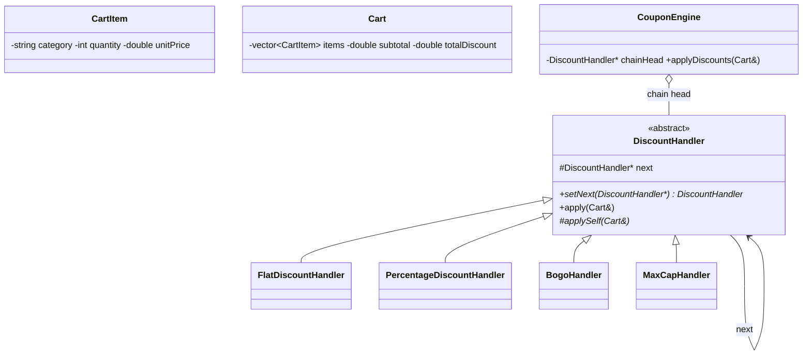

# 31 — Discount Coupon Engine

> Difficulty: intermediate. Surfaced by cross-checking this roadmap
> against a popular YouTube LLD course — this is the problem set's one
> genuine, literal **Chain of Responsibility** implementation.
> `12_logger_framework.md` deliberately talks you *out* of building an
> explicit CoR chain for log-level filtering, because a numeric
> comparison already gets the same effect with no machinery; this problem
> is the contrast case where the machinery earns its keep, because each
> discount type genuinely needs distinct, stateful behavior beyond
> pass/suppress.

## Step 1 — Clarify

Assumed answers:

- A `Cart` has a subtotal and a list of applied coupon codes. Applying
  coupons computes a total discount.
- Multiple discount types exist and **can stack** in a defined order: a
  flat amount off, a percentage off, a buy-one-get-one-free adjustment,
  each potentially changing what the next one computes against.
- A **cap** on total discount (e.g., "no combination of coupons can
  discount more than 50% of the subtotal") must be enforced regardless of
  which individual coupons were applied.
- **Deferred, explicitly**: coupon eligibility rules tied to user
  history/fraud detection, per-category discounts requiring a full
  product catalog — this design is the discount-computation pipeline
  itself, assuming a cart of items with prices is already given.

## Step 2 — Entities

| Entity | Responsibility |
| --- | --- |
| `CartItem` | A product, quantity, unit price |
| `Cart` | Items, subtotal, applied coupon codes, running discount total |
| `DiscountHandler` (abstract) | One link in the chain — decides whether it applies, computes its discount, always passes to the next |
| `FlatDiscountHandler` | "$10 off" |
| `PercentageDiscountHandler` | "15% off" |
| `BogoHandler` | "buy one get one free" on a specific item category |
| `MaxCapHandler` | Caps the *total* discount computed so far — always the last link |
| `CouponEngine` | Builds the chain once, applies it to any `Cart` |

**Why this is Chain of Responsibility, done for real, unlike the logger's
level filter**: each handler here does genuinely different, non-trivial
work (a BOGO handler has to inspect item categories and quantities; a
flat-discount handler just subtracts a constant) — there's real,
distinct behavior per link, which is exactly the condition
`12_logger_framework.md` names as the bar for reaching for this pattern
rather than a simpler ordered check. The other thing that makes this a
*textbook* chain rather than the more common "stop at the first handler
that applies" variant: **every handler runs**, because coupons stack —
`MaxCapHandler` at the end is what keeps the *stacked total* honest, a
distinct role from "cap on one specific handler."

## Step 3 — Class diagram



## Step 4-5 — Interfaces and core implementation

```cpp
#include <algorithm>
#include <memory>
#include <string>
#include <vector>

struct CartItem { std::string category; int quantity; double unitPrice; };

struct Cart {
    std::vector<CartItem> items;
    double subtotal = 0.0;
    double totalDiscount = 0.0;

    void recomputeSubtotal() {
        subtotal = 0.0;
        for (auto& it : items) subtotal += it.quantity * it.unitPrice;
    }
};

class DiscountHandler {
public:
    DiscountHandler* setNext(DiscountHandler* nextHandler) {
        next_ = nextHandler;
        return nextHandler;   // returned so callers can chain setNext() calls fluently
    }

    // The template-method shape: applySelf() is what each concrete
    // handler actually does; apply() is the fixed "do my part, then
    // always pass along" plumbing every handler shares.
    void apply(Cart& cart) {
        applySelf(cart);
        if (next_) next_->apply(cart);
    }

    virtual ~DiscountHandler() = default;

protected:
    virtual void applySelf(Cart& cart) = 0;

private:
    DiscountHandler* next_ = nullptr;
};

class FlatDiscountHandler : public DiscountHandler {
public:
    explicit FlatDiscountHandler(double flatOff) : flatOff_(flatOff) {}
protected:
    void applySelf(Cart& cart) override {
        cart.totalDiscount += std::min(flatOff_, cart.subtotal - cart.totalDiscount);
    }
private:
    double flatOff_;
};

class PercentageDiscountHandler : public DiscountHandler {
public:
    explicit PercentageDiscountHandler(double pct) : pct_(pct) {}
protected:
    void applySelf(Cart& cart) override {
        double remaining = cart.subtotal - cart.totalDiscount;
        cart.totalDiscount += remaining * (pct_ / 100.0);
    }
private:
    double pct_;   // e.g. 15.0 for 15%
};

class BogoHandler : public DiscountHandler {
public:
    explicit BogoHandler(std::string category) : category_(std::move(category)) {}
protected:
    void applySelf(Cart& cart) override {
        for (auto& item : cart.items) {
            if (item.category == category_ && item.quantity >= 2) {
                int freeUnits = item.quantity / 2;   // every 2nd unit is free
                cart.totalDiscount += freeUnits * item.unitPrice;
            }
        }
    }
private:
    std::string category_;
};

class MaxCapHandler : public DiscountHandler {
public:
    explicit MaxCapHandler(double maxFractionOfSubtotal) : maxFraction_(maxFractionOfSubtotal) {}
protected:
    void applySelf(Cart& cart) override {
        double cap = cart.subtotal * maxFraction_;
        if (cart.totalDiscount > cap) cart.totalDiscount = cap;   // clamps whatever
                                                                     // the earlier links
                                                                     // stacked up to
    }
private:
    double maxFraction_;   // e.g. 0.5 for "never more than 50% off"
};

class CouponEngine {
public:
    explicit CouponEngine(std::vector<std::unique_ptr<DiscountHandler>> handlers)
        : handlers_(std::move(handlers)) {
        for (size_t i = 0; i + 1 < handlers_.size(); ++i) {
            handlers_[i]->setNext(handlers_[i + 1].get());
        }
    }

    void applyDiscounts(Cart& cart) {
        cart.recomputeSubtotal();
        cart.totalDiscount = 0.0;
        if (!handlers_.empty()) handlers_.front()->apply(cart);
    }

private:
    std::vector<std::unique_ptr<DiscountHandler>> handlers_;
};
```

**Why `MaxCapHandler` has to be last in the chain, and why that ordering
matters and must be stated explicitly**: it clamps `cart.totalDiscount`
to whatever it's accumulated to *so far* — if it ran first, it would cap
against zero accumulated discount and do nothing. This is a real, easy
mistake under time pressure (assembling the chain in the wrong order
silently produces a wrong-but-plausible-looking result), and naming "the
cap has to observe every other handler's effect, so it's structurally
last" out loud is exactly the kind of design-reasoning an interviewer is
listening for, not just "I put it last because that's how the example
showed it."

**Why `apply()` is non-virtual template-method plumbing and only
`applySelf()` is the customization point** — direct reuse of the Template
Method idea from `00_foundations/09_design_patterns_behavioral.md`:
every handler must always call `next_->apply(...)`, and putting that in
one non-overridable method guarantees no concrete handler can
accidentally forget to pass along the chain (a real bug class — a
subclass that overrides a combined apply-and-forward method and forgets
the forwarding half).

## Step 6 — Edge cases handled

- No coupons applied (`handlers_` empty, or a `Cart` run through with no
  chain configured) → `totalDiscount` stays `0.0`, not an error.
- Stacked discounts exceeding the cap → `MaxCapHandler` clamps
  deterministically, regardless of which combination of earlier handlers
  produced the overage.
- A `BogoHandler` for a category the cart doesn't contain → contributes
  `0` and passes through cleanly, no special-casing needed at the call
  site.

## Extensions (what a live follow-up usually asks)

**"Some coupons shouldn't stack with each other (e.g., BOGO and
percentage-off are mutually exclusive)."** Give `DiscountHandler` a
`bool appliesTo(const Cart&)` check consulted before `applySelf()`, and
have `PercentageDiscountHandler::appliesTo()` check a flag `Cart` sets
once a BOGO discount has already fired — a small addition to the existing
shape, not a redesign.

**"Let an admin reorder or reconfigure which discounts are active,
without redeploying."** The chain is already built from a
`std::vector<std::unique_ptr<DiscountHandler>>` at `CouponEngine`
construction — swap that for reading a configuration (coupon codes ->
handler type + parameters) at startup instead of hardcoding it, zero
change to any handler class.

**"How would you audit which handlers actually contributed how much
discount, for a customer support ticket?"** Have `applySelf()` record
`(handlerName, amountContributed)` into a small log on `Cart` instead of
only mutating `totalDiscount` — a direct, minimal addition that turns the
chain into its own audit trail, similar in spirit to
`28_document_editor.md`'s Command-based edit history doubling as an audit
log.

## Interview framing to reuse

"I used Chain of Responsibility here specifically because each discount
type has real, distinct logic — this is the contrast case to
`12_logger_framework.md`'s log-level filter, where I'd argue *against*
building an explicit chain because a numeric comparison already does the
job. Recognizing which situation you're in is more of the actual skill
than knowing the pattern's UML shape."

## Exercises

1. Implement the above from scratch in 40 minutes, then write a test:
   a cart with a subtotal of 200, chain of `FlatDiscountHandler(20)` ->
   `PercentageDiscountHandler(10)` -> `MaxCapHandler(0.5)`, confirming the
   final `totalDiscount` matches hand-calculated arithmetic (20 flat,
   then 10% of the *remaining* 180 = 18, totaling 38, well under the
   50%-of-200=100 cap).
2. Reorder the chain so `MaxCapHandler` runs *first* instead of last, and
   write a test proving the bug this creates (the cap has no effect
   because nothing has been discounted yet when it runs) — this is the
   ordering mistake named above, made concrete.
3. Implement the `appliesTo()` mutual-exclusion extension for BOGO vs.
   percentage-off, and write a test confirming that when both are in the
   chain and BOGO fires first, the percentage handler contributes `0`.
4. Add the per-handler audit log to `Cart` (a `vector<pair<string,
   double>>`), and write a test asserting the log's total matches
   `cart.totalDiscount` exactly after applying a multi-handler chain.
