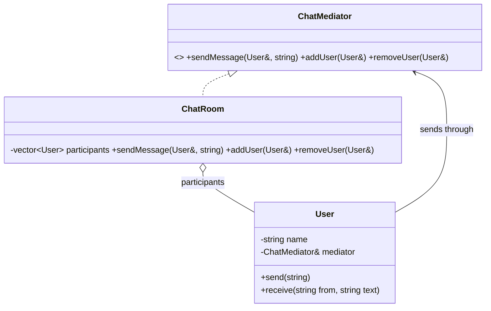

# 32 — Chat Room

> Difficulty: intermediate. Surfaced by cross-checking this roadmap
> against a popular YouTube LLD course — the canonical **Mediator**
> problem, and worth distinguishing carefully from
> `08_message_queue_pubsub.md`: pub/sub is an *infrastructure* shape
> (anonymous publishers, anonymous topic subscribers, no participant ever
> addresses another by name); a chat room is a *social* shape (named
> participants who join/leave a shared room and can address each other),
> and Mediator is what keeps that social structure from becoming an
> `N`-participants-all-know-each-other mess.

## Step 1 — Clarify

Assumed answers:

- A `ChatRoom` has a set of joined `User`s. Any user can broadcast a
  message to everyone else currently in the room.
- Users join and leave dynamically — the design must not require knowing
  the full participant list up front.
- **Deferred, explicitly**: message persistence/history, private
  (1-to-1) messaging, multiple simultaneous rooms per user, delivery
  guarantees over a real network — this design is the in-memory mediator
  structure for one room; `08_message_queue_pubsub.md` is the file to
  reach for if the actual ask turns into "guarantee delivery" or
  "replay history."

## Step 2 — Entities

| Entity | Responsibility |
| --- | --- |
| `ChatMediator` (interface) | `sendMessage(from, text)`, `addUser`, `removeUser` — the one thing every `User` talks to |
| `ChatRoom` | Concrete mediator: holds the participant set, fans a message out to everyone but the sender |
| `User` | A participant — sends via the mediator, receives via a callback the mediator calls |

**Why this is Mediator and not just "a class with a list of
observers"** — worth being precise about, since the two patterns look
similar on a class diagram: **Observer** is one-directional (subjects
notify observers; observers never talk back through the same channel).
**Mediator** is bidirectional and *centralizing* — every `User` both
sends *and* receives exclusively through `ChatRoom`, and `User` objects
never hold references to each other at all. The tell: if you tried to
implement this with Observer alone, every `User` would need to be both a
subject (things it says) and an observer (things it hears) of every
*other* `User` — `N²` pairwise relationships. Mediator collapses that to
`N` relationships, each `User` to the one `ChatRoom`.

## Step 3 — Class diagram



## Step 4-5 — Interfaces and core implementation

```cpp
#include <algorithm>
#include <iostream>
#include <string>
#include <vector>

class User;   // forward-declared: ChatMediator methods take a User&

class ChatMediator {
public:
    virtual void sendMessage(User& from, const std::string& text) = 0;
    virtual void addUser(User& user) = 0;
    virtual void removeUser(User& user) = 0;
    virtual ~ChatMediator() = default;
};

class User {
public:
    User(std::string name, ChatMediator& mediator) : name_(std::move(name)), mediator_(mediator) {}

    void send(const std::string& text) {
        mediator_.sendMessage(*this, text);   // User never talks to other Users directly
    }

    void receive(const std::string& fromName, const std::string& text) {
        std::cout << "[" << name_ << " received] " << fromName << ": " << text << "\n";
    }

    const std::string& name() const { return name_; }

private:
    std::string name_;
    ChatMediator& mediator_;
};

class ChatRoom : public ChatMediator {
public:
    void addUser(User& user) override { participants_.push_back(&user); }

    void removeUser(User& user) override {
        participants_.erase(
            std::remove(participants_.begin(), participants_.end(), &user),
            participants_.end());
    }

    void sendMessage(User& from, const std::string& text) override {
        for (User* user : participants_) {
            if (user != &from) user->receive(from.name(), text);   // fan-out to
                                                                       // everyone
                                                                       // except the
                                                                       // sender
        }
    }

private:
    std::vector<User*> participants_;
};
```

**Why `User::send()` doesn't loop over other users itself** — this is the
whole pattern, made concrete in five lines: `User` knows exactly one
thing, `mediator_`, and nothing about who else is in the room, how many
of them there are, or how the fan-out actually happens. Adding a
`removeUser()` call, changing the fan-out order, or (in the extension
below) filtering out muted users are all changes to `ChatRoom` alone —
`User` is untouched by every one of them.

## Step 6 — Edge cases handled

- A user sends a message while alone in the room (`participants_` has
  just them) → the loop skips the sender, does nothing, no crash — an
  empty broadcast is a valid, unremarkable case, not an error.
- `removeUser()` called for a user not currently in `participants_` → the
  `std::remove`/`erase` idiom is a no-op in that case, not a crash.

## Extensions (what a live follow-up usually asks)

**"Support muting — a user stops receiving messages from one specific
other user, without leaving the room."** A `std::unordered_set<User*>`
of muted senders per `User`, consulted inside `receive()` (or, cleaner,
`ChatRoom::sendMessage()` skips a recipient who has `from` muted) —
either way, a small, local addition; `User`'s core send/receive contract
doesn't change.

**"Private (1-to-1) messages alongside the room broadcast."** Add
`sendPrivate(User& from, User& to, string text)` to `ChatMediator`,
calling `to.receive(...)` directly with no fan-out loop — a second,
narrower method on the same mediator interface, not a redesign; `User`
still only ever talks to `mediator_`.

**"What if this needs to work across multiple server processes (users
connected to different backend instances)?"** Name the honest scaling
answer: `ChatRoom` as written is a single-process in-memory mediator —
scaling it means the fan-out itself needs to go through a shared
message bus (Redis Pub/Sub, Kafka) between server instances, which is
exactly `08_message_queue_pubsub.md`'s shape, one layer further out. A
good answer draws that boundary explicitly: Mediator organizes
*one room's* participant relationships; a message bus is what connects
multiple *processes* hosting pieces of the same room.

## Interview framing to reuse

"Every `User` holds exactly one reference — to the `ChatMediator` — and
never to another `User`. That's the entire design: I'm not routing
messages through a `ChatRoom` because it's convenient, I'm doing it
because without a mediator, every new feature (muting, private messages,
a participant limit) would mean touching every `User`'s pairwise
relationships instead of touching one central class."

## Exercises

1. Implement the above from scratch in 30-35 minutes, then write a test
   with three users in one `ChatRoom`: user A sends a message, confirm B
   and C both receive it (with A's name attached) and A does not receive
   its own message back.
2. Implement `removeUser()`'s effect end-to-end: remove user B mid-test,
   have A send another message, and confirm only C receives it.
3. Implement the muting extension (a `User` maintaining a set of muted
   sender names, checked in `receive()`), and write a test where B mutes
   A, A sends a message, and confirm B's received-messages log stays
   empty while C's does not.
4. Implement `sendPrivate()` and write a test confirming a private
   message reaches only its intended recipient, not the whole room.
