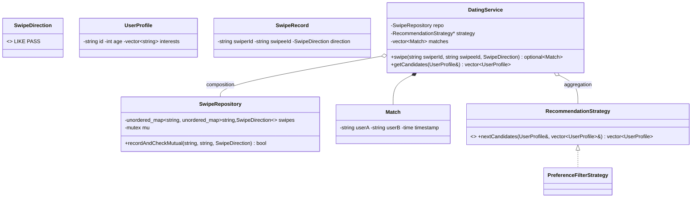

# 33 — Dating App (Tinder-style matching)

> Difficulty: advanced. Surfaced by cross-checking this roadmap against a
> popular YouTube LLD course — superficially close to
> `26_ride_sharing_service.md` ("match two users via a pluggable
> algorithm") but the actual center of gravity is different: ride-sharing
> is **one-sided assignment** (the system picks a driver, the rider
> doesn't separately consent), while this problem is **two-sided,
> asynchronous consent** — a match only exists once *both* people have
> independently said yes, at whatever time each of them happens to swipe.
> That asymmetry is what the design below is actually built around.

## Step 1 — Clarify

Assumed answers:

- A `UserProfile` has basic attributes (age, gender, interests) used for
  candidate recommendation.
- A `swipe` is one user's decision (`LIKE` or `PASS`) on one candidate
  profile, recorded independently of what that candidate later decides.
- A `Match` is created **the moment both sides have swiped `LIKE` on each
  other** — which could happen seconds apart or weeks apart; the system
  has to correctly detect "the second half of this pair just arrived,"
  not just "both halves eventually exist."
- Candidate recommendation (who to show next) is pluggable — an initial
  simple rule (e.g. filter by preferences, exclude already-swiped
  profiles) stands in for what a real system would run as a scored
  recommendation model.
- **Deferred, explicitly**: the actual recommendation *algorithm's*
  quality (ML ranking, collaborative filtering), chat after a match,
  photo verification — this design is the swipe/match state machine and
  the recommendation *interface*, not what makes recommendations good.

## Step 2 — Entities

| Entity | Responsibility |
| --- | --- |
| `UserProfile` | Identity, preferences, attributes used for candidate filtering |
| `SwipeDirection` | `LIKE` / `PASS` |
| `SwipeRecord` | One user's swipe on one candidate |
| `SwipeRepository` | Stores swipes; the one place that can answer "did X already swipe on Y, and how?" |
| `Match` | Two users, created once mutual `LIKE` is detected |
| `RecommendationStrategy` (interface) | Given a user, returns their next candidate queue — **growing set**, interface |
| `DatingService` | Orchestrates: exposes `swipe()`, detects mutual likes, creates `Match`es |

**Why mutual-match detection is the one part of this design that needs
real care, not just "check if the other person also liked me"**: the
naive version — on every `LIKE`, look up whether the other user has
*also* `LIKE`d this user — has the identical check-then-act race already
seen in `26_ride_sharing_service.md` and `30_payment_gateway_system.md`:
two users swiping `LIKE` on each other at nearly the same instant could
both check, both see "not yet matched," and (if match-creation isn't
atomic) either create two `Match` objects or, worse, create none. The fix
is the same shape as those two files: **the record-and-check step for one
swipe happens under one lock**, so the *second* of the two swipes to
arrive — whichever one that is — is the one that atomically observes the
first and creates the `Match`.

## Step 3 — Class diagram



## Step 4-5 — Interfaces and core implementation

```cpp
#include <algorithm>
#include <mutex>
#include <optional>
#include <string>
#include <unordered_map>
#include <vector>

enum class SwipeDirection { LIKE, PASS };

struct UserProfile {
    std::string id;
    int age;
    std::vector<std::string> interests;
};

struct Match {
    std::string userA, userB;
};

class SwipeRepository {
public:
    // Records swiperId's swipe on swipeeId, and returns true if this
    // swipe completes a mutual LIKE (i.e. swipeeId had already LIKEd
    // swiperId). The whole read-then-write happens under one lock --
    // the same atomic-claim discipline as the idempotency check in
    // 30_payment_gateway_system.md and the driver claim in
    // 26_ride_sharing_service.md, applied to "did the other half of
    // this pair already arrive?" instead of a resource assignment.
    bool recordAndCheckMutual(const std::string& swiperId, const std::string& swipeeId,
                                SwipeDirection direction) {
        std::lock_guard<std::mutex> lock(mu_);
        swipes_[swiperId][swipeeId] = direction;
        if (direction != SwipeDirection::LIKE) return false;

        auto it = swipes_.find(swipeeId);
        if (it == swipes_.end()) return false;
        auto reverseIt = it->second.find(swiperId);
        return reverseIt != it->second.end() && reverseIt->second == SwipeDirection::LIKE;
    }

    bool alreadySwiped(const std::string& swiperId, const std::string& candidateId) const {
        auto it = swipes_.find(swiperId);
        if (it == swipes_.end()) return false;
        return it->second.count(candidateId) > 0;
    }

private:
    mutable std::mutex mu_;
    std::unordered_map<std::string, std::unordered_map<std::string, SwipeDirection>> swipes_;
};

class RecommendationStrategy {
public:
    virtual std::vector<UserProfile> nextCandidates(
        const UserProfile& user, const std::vector<UserProfile>& pool) = 0;
    virtual ~RecommendationStrategy() = default;
};

class PreferenceFilterStrategy : public RecommendationStrategy {
public:
    explicit PreferenceFilterStrategy(SwipeRepository& repo) : repo_(repo) {}

    std::vector<UserProfile> nextCandidates(
        const UserProfile& user, const std::vector<UserProfile>& pool) override {
        std::vector<UserProfile> candidates;
        for (auto& candidate : pool) {
            if (candidate.id == user.id) continue;               // never recommend yourself
            if (repo_.alreadySwiped(user.id, candidate.id)) continue;   // never re-show a swiped profile
            candidates.push_back(candidate);
        }
        return candidates;   // a real strategy would also score/sort by
                               // shared interests, proximity, etc. --
                               // deferred per Step 1
    }

private:
    SwipeRepository& repo_;
};

class DatingService {
public:
    DatingService(std::unique_ptr<RecommendationStrategy> strategy)
        : strategy_(std::move(strategy)) {}

    std::optional<Match> swipe(const std::string& swiperId, const std::string& swipeeId,
                                 SwipeDirection direction) {
        bool mutualLike = repo_.recordAndCheckMutual(swiperId, swipeeId, direction);
        if (!mutualLike) return std::nullopt;
        Match match{swiperId, swipeeId};
        matches_.push_back(match);
        return match;
    }

    std::vector<UserProfile> getCandidates(const UserProfile& user,
                                             const std::vector<UserProfile>& pool) {
        return strategy_->nextCandidates(user, pool);
    }

    SwipeRepository& repository() { return repo_; }   // exposed for the exercise below

private:
    SwipeRepository repo_;
    std::unique_ptr<RecommendationStrategy> strategy_;
    std::vector<Match> matches_;
};
```

**Why `recordAndCheckMutual` returns a `bool` computed entirely under the
lock, rather than recording the swipe and then separately querying "are
we matched now?"**: the second form reopens exactly the race described
above — a swipe recorded but not-yet-checked-for-mutuality is a window
where a concurrent swipe from the other side could also compute a
"not matched" result, and neither swipe would ever create the `Match`.
Doing the check as a *return value of the same locked operation* means
whichever swipe is genuinely second, by real wall-clock arrival order
under the lock, is the one — and only one — that returns `true`.

## Step 6 — Edge cases handled

- A `PASS` never triggers a match check — even if the other side already
  `LIKE`d you, passing is final for this design (a real product might
  allow "undo," explicitly out of scope here).
- Swiping on the same candidate twice — `swipes_[swiperId][swipeeId] =
  direction` overwrites the previous entry; whether a changed mind should
  be allowed to *retroactively* trigger a match is a real product
  decision worth naming explicitly rather than leaving implicit (this
  design's `recordAndCheckMutual` does allow it, since it re-checks
  mutuality on every call).
- `getCandidates()` for a user who's swiped on everyone in the pool →
  returns an empty vector, not an error — an exhausted candidate pool is
  an expected outcome.

## Extensions (what a live follow-up usually asks)

**"Add a 'super like' that notifies the other user immediately, before
they'd otherwise see the profile."** A third `SwipeDirection` value plus
an `Observer`-shaped notification hook on `DatingService::swipe()` — a
small addition to the existing enum and orchestration method, not a
redesign.

**"Rank candidates by compatibility score instead of just filtering out
already-swiped profiles."** Exactly what `RecommendationStrategy` is the
extension point for — a `ScoredCompatibilityStrategy` computing a
weighted score from shared interests/age-range/distance and sorting by
it, swapped in at `DatingService` construction with zero change to
`DatingService` itself, same OCP payoff as `26_ride_sharing_service.md`'s
`MatchingStrategy`.

**"How would this scale to millions of users, where scanning the whole
pool per recommendation call doesn't work?"** Name the honest answer:
`PreferenceFilterStrategy` scanning a full `pool` vector is the
LLD-round-appropriate simplification; a real system precomputes candidate
shortlists (geo-sharded, indexed by preference attributes) well before a
user opens the app, so `nextCandidates()` reads from a pre-filtered
shortlist rather than scanning everyone — the *interface* stays
identical, only the implementation behind it changes, which is itself
worth stating as the point of having the interface at all.

## Interview framing to reuse

"The part of this design I spent the most care on wasn't the matching
algorithm, it's the mutual-match *detection* — two independent, possibly
concurrent one-sided actions need to correctly produce exactly one
`Match`, exactly once, regardless of timing. That's the same
find-then-claim race I'd flag in a payment-idempotency or a
resource-assignment problem; recognizing it here, in a problem that
doesn't look like either of those on the surface, is the actual
transferable skill."

## Exercises

1. Implement the above from scratch in 45 minutes, then write a test:
   user A swipes `LIKE` on B (expect no match yet), then B swipes `LIKE`
   on A (expect a `Match` returned this time, with both IDs correct
   either order).
2. Write a concurrency stress test: two threads, one performing A's swipe
   and the other performing B's swipe on each other at roughly the same
   time (use a barrier or a brief synchronized start), asserting exactly
   one of the two `swipe()` calls returns a non-empty `Match` and the
   other returns `std::nullopt`.
3. Implement `PreferenceFilterStrategy`'s `alreadySwiped` exclusion end
   to end: swipe `PASS` on a candidate, call `getCandidates()` again, and
   confirm that candidate no longer appears.
4. Sketch (pseudocode, not full implementation) a
   `ScoredCompatibilityStrategy` that sorts candidates by shared-interest
   count, and identify exactly which method signature changes (if any)
   versus `PreferenceFilterStrategy`.
