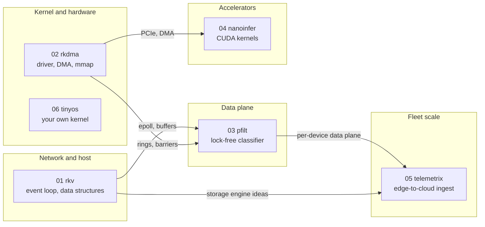

# Projects: Portfolio Plan

> **Track code:** PRJ · **Weeks:** 12–23 (Project 06 is stretch) · **Budget:** ~90 hours, about 20 of them shared with track labs (~70 net) · **Prerequisites:** listed per project

Six projects, each one a real system that you build, measure and can defend line by line. Together they form one arc, from silicon to fleet: a network server, a kernel driver, a lock-free data plane, GPU kernels, a fleet-scale design, and (as stretch) an operating system kernel of your own. Each project is chosen for three things at once: it teaches a track deeply, it produces a number you measured, and it gives you a story that a specific set of interviewers wants to hear.

A project is **done** when a stranger can clone the repository, run one command, and reproduce your numbers on their own machine.

---

## 1. The portfolio

| # | Project | What you build | Proves | Weeks |
|---|---|---|---|---|
| 01 | [`rkv`](01_rkv_redis_compatible_server/SPEC.md) | A Redis-compatible in-memory data server in C: your own event loop, hash table with incremental rehashing, skip-list sorted sets, TTLs and an append-only log. The real `redis-cli` and `redis-benchmark` work against it. | Sockets and `epoll`, data structures under latency constraints, durability trade-offs | 12–15 |
| 02 | [`rkdma`](02_rkdma_dma_driver/SPEC.md) | A Linux driver that streams packets from a virtual device into a user-space-mapped ring with zero copies, on a kernel you built, in QEMU | Kernel modules, DMA, interrupts, `mmap`, memory ordering | 15–19 |
| 03 | [`pfilt`](03_pfilt_packet_classifier/SPEC.md) | A lock-free, multi-core packet classifier that survives a hash-flooding adversary | Lock-free C++, cache-aware design, epoch reclamation, security thinking | 20–22 |
| 04 | [`nanoinfer`](04_nanoinfer_cuda_kernels/SPEC.md) | The CUDA kernels a transformer needs (GEMM, softmax, layernorm, attention), each optimised step by step against cuBLAS and placed on a roofline | GPU memory hierarchy, coalescing, tiling, profiling | 21–22 |
| 05 | [`telemetrix`](05_telemetrix_fleet_telemetry/SPEC.md) | A design document and working ingest prototype for telemetry from 50,000 access points | Scale reasoning, backpressure, idempotency, cost models | 23 |
| 06 | [`tinyos`](06_tinyos_teaching_kernel/SPEC.md) | A small Unix-like kernel for RISC-V that boots in QEMU: traps, page tables, processes, a scheduler, system calls, a file system and a shell | Operating systems from the inside | Stretch |

---

## 2. Rules every project follows

1. **Public GitHub repository**, one per project, linked from your resume.
2. **One command to reproduce.** `make bench` (or the documented equivalent) builds, runs the tests and prints the headline numbers.
3. **A `RESULTS.md`** with every number beside the machine it was measured on (CPU model, core count, memory, kernel version, compiler and flags). A number without its machine is worthless.
4. **Percentiles, not averages.** Latency is reported as p50, p99 and p99.9 from a histogram.
5. **A baseline.** Every number is compared with something: the real Redis, cuBLAS, a naive version, the kernel's own path. "Fast" means faster than something specific.
6. **Tests and sanitizers in CI.** GitHub Actions runs the tests under ASan and UBSan (and TSan for concurrent code) on every push.
7. **A design document** (`docs/DESIGN.md`) written before the code and updated after: the problem, the constraints, the decisions and the alternatives you rejected.
8. **A section titled "What I tried that did not work".** It is the highest-signal part of the repository: it shows the search, not just the answer. Candidates who include it read as more senior than those who show only the clean result.

---

## 3. Every spec has the same shape

Each `SPEC.md` contains: the pitch; why the project matters and for whom; what you will learn, mapped to tutorials; the architecture; milestones with acceptance criteria and the week each one lands; the measurements to produce; the testing strategy; stretch goals; the repository layout; and the interview story it gives you.

---

## 4. Schedule

| Week | Project work (about 4–6 hours a week, more in weeks 15–22) |
|---|---|
| 12 | `rkv` M1: protocol parser and a blocking server |
| 13 | `rkv` M2–M3: event loop, own hash table, TTLs |
| 14 | `rkv` M4: lists and sorted sets |
| 15 | `rkv` M5: persistence (alongside `rkdma` M1) |
| 15–19 | `rkdma` M1–M5, one milestone a week, alongside the kernel and driver tracks |
| 20–22 | `pfilt` M1–M4 |
| 21–22 | `nanoinfer` M1–M3 on Colab |
| 23 | `telemetrix` design document and ingest prototype |
| After 26 | `tinyos`, the stretch goals of any project, or a project a target team asks about |

When a project week overflows, cut a stretch goal, never the measurement or the "What I tried that did not work" section.

---

## 5. How to talk about a project in an interview

Prepare each project as a five-minute story and a thirty-minute deep dive.

**The five-minute story:**

1. **The problem**, in one sentence, and why it is hard.
2. **The key design decision**, the alternatives, and why you chose this one.
3. **The number**, with its baseline and machine.
4. **The surprise**: something that did not work, or a measurement that contradicted your expectation, and what you learned.
5. **What you would do next** with more time.

**The deep dive:** be ready to draw the architecture from memory, open any file and explain it, and defend every number. The interview questions each spec lists are the ones to rehearse.

**Resume bullet template:** *Built X (what) in Y (language/stack) achieving Z (number) vs W (baseline), by doing V (key technique).* For example: "Built a Redis-compatible key-value server in C reaching N% of Redis's GET throughput on the same machine, using an `epoll` event loop and incremental rehashing that kept p99.9 latency under M µs during table growth."

---

## 6. Progress

| # | Project | Status |
|---|---|---|
| 01 | `rkv` | Spec written; starts week 12 |
| 02 | `rkdma` | Spec written; starts week 15 |
| 03 | `pfilt` | Spec written; starts week 20 |
| 04 | `nanoinfer` | Spec written; starts week 21 |
| 05 | `telemetrix` | Spec written; week 23 |
| 06 | `tinyos` | Spec written; stretch |

Cross-track view: [`../00_MASTER_PLAN.md`](../00_MASTER_PLAN.md).
