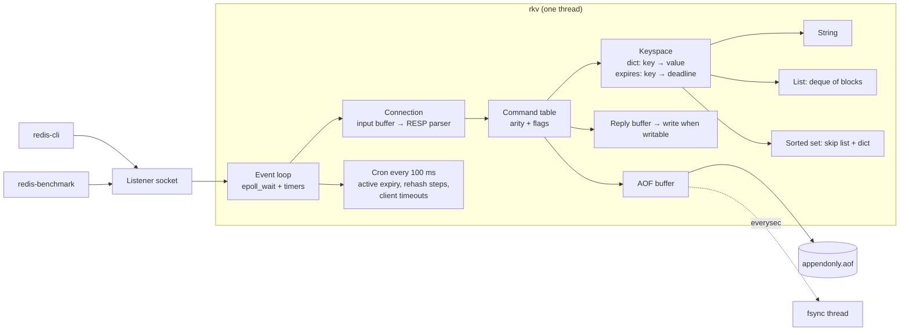

# Project 01 — `rkv`: a Redis-compatible in-memory data server in C

> **Weeks:** 12–15 · **Effort:** ~22 hours · **Language:** C11 on Linux · **Prerequisites:** NET 04 (sockets) for M1, NET 05 (`epoll`) for M2, DSA 02 (hashing), DSA linked lists 07 (skip lists), OS 12 (`fsync`)

## 1. The pitch

Build a single-threaded, event-driven key-value server in C that speaks Redis's wire protocol, so that the real `redis-cli` and `redis-benchmark` work against it unchanged. Everything inside is yours: the event loop, the protocol parser, a hash table that grows without latency spikes, a skip list for sorted sets, key expiry, and an append-only log with configurable durability. Then put it next to the real Redis on the same machine and measure how close you got, and why.

It is the most useful kind of project: a real protocol, real clients, a world-class baseline to compare against, and every hard part (partial I/O, incremental rehashing, durability) is a classic interview question.

---

## 2. Why this project

| For | What it proves |
|---|---|
| **Palo Alto Networks** | The online assessment's socket-server task, done properly: non-blocking I/O, partial reads and writes, slow clients, thousands of connections. |
| **Google, Meta** | You can build a key-value store and explain its internals, which is HLD problems 03 and 04 and LLD problem 19 from the inside. |
| **Cisco, Nvidia** | Fluent, careful C with measured performance. |
| **Everyone** | A strong answer to "tell me about something you built", with numbers and a baseline. |

---

## 3. What you will learn

| Part of `rkv` | What it teaches | Tutorials |
|---|---|---|
| RESP parser that handles input arriving in arbitrary pieces | Stream framing, state machines, defensive parsing | NET 04 |
| `epoll` event loop with per-client buffers | Readiness I/O, level- vs edge-triggered, backpressure | NET 05, OS 15 |
| Hash table with incremental rehashing and keyed hashing | Amortised vs worst-case latency, hash-flooding defence | DSA 02, C 03 |
| `SCAN` that stays correct while the table resizes | Reverse-binary cursor iteration, a beautiful trick | DSA 02, DSA 11 (bits) |
| Skip list with spans for sorted sets | Probabilistic balancing, rank queries in O(log n) | DSA linked lists 07, trees 30 |
| Lazy and active expiry | Sampling algorithms, time budgets in a single-threaded server | DSA 11 (randomisation) |
| Append-only file with three `fsync` policies | The page cache, what durability really costs, crash testing | OS 12, OS 15 |
| Benchmarking against Redis | Throughput vs latency, percentiles, `perf` and flame graphs | LX 05, CO 28 |

---

## 4. Architecture



The server is single-threaded on purpose, as Redis is: one thread owns all data, so no locks are needed, and performance comes from never blocking that thread. The only other thread performs `fsync` in the `everysec` policy, because `fsync` can block for tens of milliseconds.

---

## 5. Milestones

Each milestone ends with its tests passing under ASan and UBSan, and with its numbers recorded in `RESULTS.md`.

### M1 — Protocol and a blocking server (week 12, ~4 h)

- A RESP2 parser that accepts arrays of bulk strings (what clients send) and inline commands (`PING\r\n` typed into `telnet`). It must work when input arrives one byte at a time, or many commands in one read.
- A reply writer for simple strings, errors, integers, bulk strings, null bulk strings and arrays.
- A blocking, one-client-at-a-time server with `PING`, `ECHO`, `SET`, `GET`, `DEL`, `EXISTS`.
- Answer `COMMAND` and `COMMAND DOCS` with an empty array, so that `redis-cli` starts cleanly; answer unknown commands with `-ERR unknown command`.

**Acceptance:** `redis-cli -p 7379 PING` prints `PONG`; a test feeds every valid command split at **every possible byte boundary** and gets identical results; a fuzz run of 10 minutes over random bytes finds no crash under ASan.

### M2 — The event loop (week 13, ~5 h)

- Non-blocking sockets and an `epoll` loop (level-triggered; write down why, then try edge-triggered and record what changed).
- Per-client input and output buffers; register for `EPOLLOUT` only while there is pending output.
- Pipelining: process every complete command in the input buffer before returning to `epoll_wait`.
- Backpressure: stop reading from a client whose output buffer exceeds a limit; disconnect clients that exceed a hard limit.
- Idle-client timeouts and a maximum client count, enforced from a timer.
- `redis-benchmark` sends `CONFIG GET` at start-up; an empty-array reply is enough for it to run.

**Acceptance:** `redis-benchmark -p 7379 -t set,get -n 1000000 -c 50 -P 16` completes without errors; 10,000 idle connections are held with flat CPU; a test client that never reads its replies cannot slow down other clients (measure their latency while it runs).

### M3 — Your own hash table, expiry and `SCAN` (week 13, ~5 h)

- A chained hash table with power-of-two sizing and **incremental rehashing**: keep two tables during a resize, move one bucket per operation plus a time-boxed batch from the cron, look up in both while rehashing.
- Keyed hashing with SipHash and a random key at start-up (Redis uses SipHash-1-2), so an attacker cannot choose keys that collide.
- `EXPIRE`, `PEXPIRE`, `TTL`, `PERSIST`, `SET ... EX`; lazy expiry on access plus active expiry in the cron (the classic algorithm: sample 20 keys that have a TTL, delete the expired ones, repeat while more than a quarter were expired, within a time budget).
- `INCR`, `INCRBY`, `MGET`, `MSET`, `DBSIZE`, `FLUSHALL`.
- `SCAN` with a cursor that increments in **reversed bit order**, which guarantees that every key present for the whole scan is returned at least once even if the table grows or shrinks mid-scan.

**Acceptance:** while loading 10 million keys, the worst single-request latency (`redis-cli --latency` running alongside) stays below a bound you state; repeat with incremental rehashing disabled and record the spike. A test proves the `SCAN` guarantee under resizes in both directions.

### M4 — Lists and sorted sets (week 14, ~4 h)

- Lists: `LPUSH`, `RPUSH`, `LPOP`, `RPOP`, `LLEN`, `LRANGE`, as a deque of fixed-size blocks (a simplified version of Redis's quicklist).
- Sorted sets: `ZADD`, `ZREM`, `ZSCORE`, `ZRANK`, `ZRANGE` (with `WITHSCORES`), `ZRANGEBYSCORE`, implemented as a skip list (maximum level 32, promotion probability 1/4, as Redis does) with **spans** for O(log n) rank, plus a hash table from member to score.
- `TYPE` and `WRONGTYPE` errors.

**Acceptance:** a **differential test** in Python sends the same random stream of 1 million commands to `rkv` and to a real Redis, and compares every reply: zero mismatches.

### M5 — Persistence (week 15, ~4 h)

- An append-only file of write commands in RESP, with `appendfsync always | everysec | no`; `everysec` hands `fsync` to a background thread.
- Replay the AOF on start-up; tolerate a truncated last command.
- AOF rewrite: write a compact file from the current dataset, then swap it in atomically with `rename`.

**Acceptance:** throughput and p99 latency for each policy, measured. A crash test proves durability: under `always`, no acknowledged write is lost; under `everysec`, the loss window is about one second.

> **The subtle part:** `kill -9` only tests a *process* crash, and data already passed to `write()` survives it in the page cache, even with `fsync` disabled. To test `fsync`, simulate *power loss*: run the server inside a QEMU VM and kill QEMU, or put the AOF on a file system that drops unsynced data on command (for example LazyFS, built for Jepsen tests). Explaining this difference is worth more in an interview than the feature itself.

---

## 6. Measurements for `RESULTS.md`

| Measurement | How | Compared with |
|---|---|---|
| GET and SET throughput at pipeline depths 1 and 16 | `redis-benchmark`, 50 clients | Real Redis on the same machine, same flags |
| p50, p99, p99.9 latency | `redis-benchmark --precision 3` or a custom HdrHistogram client | Real Redis |
| Memory per key for 1 million small keys | RSS from `/proc/<pid>/status` before and after | Real Redis |
| Worst-case latency during table growth | `redis-cli --latency` while loading | `rkv` with incremental rehashing disabled |
| Cost of each `appendfsync` policy | Throughput and p99 | `appendfsync no` |
| Where the time goes | `perf record` and a flame graph at peak load | — |

Being within 50–80% of Redis's throughput is a strong result for a first implementation; the interesting part of `RESULTS.md` is explaining the gap.

---

## 7. Testing strategy

1. **Unit tests in C** for the parser, the hash table (including during rehash), the skip list (invariants checked after every operation) and the expiry logic.
2. **Byte-boundary tests** for the parser (M1).
3. **Differential tests** against real Redis (M4).
4. **Crash tests** for durability (M5).
5. **Sanitizers in CI**: every test runs under ASan and UBSan; the `fsync` thread code also runs under TSan.

---

## 8. Stretch goals

| Stretch | What it teaches |
|---|---|
| Snapshot with `fork()` and copy-on-write: the child writes the dataset while the parent keeps serving; measure fork latency and memory growth against write rate | OS 02 and 09 in one experiment; a favourite interview story |
| Replication: a replica does a full sync, then streams the command log with offsets | HLD 10 from the inside |
| `maxmemory` with approximate LRU by sampling (Redis samples 5 keys by default) | Why exact LRU is too expensive at scale |
| Pub/Sub (`SUBSCRIBE`, `PUBLISH`) | Fan-out inside an event loop |
| An `io_uring` backend beside `epoll`, compared | NET 05's readiness vs completion question, measured |
| Threaded I/O: helper threads read and write sockets while one thread executes commands (as Redis 6 does) | Where single-threaded designs actually bottleneck |
| A `kqueue` backend so `rkv` runs natively on macOS | Portability behind an event-loop interface |
| Cluster mode: 16,384 hash slots with CRC16 and `MOVED` redirects | HLD 11 (partitioning) from the inside |

---

## 9. Repository layout

```text
rkv/
├── Makefile                  make, make test, make bench, make asan
├── README.md                 what it is, how to run, headline numbers
├── RESULTS.md                every number with its machine
├── docs/
│   ├── DESIGN.md             decisions and rejected alternatives
│   └── WHAT_DID_NOT_WORK.md
├── src/
│   ├── main.c                start-up, configuration
│   ├── event_loop.c/.h       epoll wrapper and timers
│   ├── net.c/.h              listener, accept, non-blocking I/O
│   ├── buffer.c/.h           growable byte buffers
│   ├── resp.c/.h             RESP parser and reply writer
│   ├── commands.c/.h         command table and handlers
│   ├── dict.c/.h             hash table with incremental rehashing
│   ├── siphash.c             keyed hash
│   ├── skiplist.c/.h         sorted-set skip list with spans
│   ├── list.c/.h             block deque for lists
│   ├── expire.c/.h           lazy and active expiry
│   └── aof.c/.h              append-only file and rewrite
├── tests/
│   ├── unit/                 C unit tests
│   ├── differential/         Python: rkv vs real Redis
│   └── crash/                durability tests
└── bench/                    benchmark scripts and raw output
```

---

## 10. The interview story

*"I built a Redis-compatible server in C to understand what makes Redis fast. The real `redis-benchmark` runs against it, and it reaches N% of Redis's throughput on my machine. The most interesting part was latency during growth: with a normal hash table, resizing 10 million keys froze the server for M ms; with incremental rehashing the worst request stayed under K µs. The surprise was durability testing: `kill -9` never lost data even with `fsync` off, because the page cache survives a process crash, so I had to simulate power loss to test `fsync` at all."*

Questions this project prepares you for:

1. Why is Redis single-threaded, and how is it still fast? Where does that design stop scaling?
2. How do you resize a hash table without a latency spike?
3. How can `SCAN` be correct while the table is resizing?
4. Level-triggered vs edge-triggered `epoll`: which did you use and why?
5. How do you stop one slow client from hurting everyone else?
6. What exactly does `appendfsync everysec` guarantee? What does `fsync` cost?
7. Why a skip list for sorted sets rather than a balanced tree?
8. How would you add replication? Sharding?

---

## 11. Resources

- The Redis source on GitHub (`src/dict.c`, `src/t_zset.c`, `src/ae.c`, `src/aof.c`): read each file after writing your own version, not before.
- Redis documentation: the RESP protocol specification, persistence, and the `SCAN` guarantees.
- "Build Your Own Redis" (build-your-own.org) and the CodeCrafters Redis challenge, if you want a second guided path.
