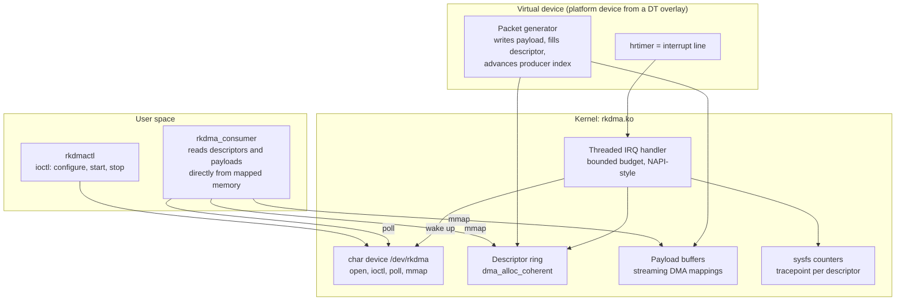

# Project 02 — `rkdma`: a zero-copy DMA ring driver

> **Weeks:** 15–19, one milestone a week · **Effort:** ~25 hours · **Language:** C (kernel), C (user space) · **Prerequisites:** K 01 (your kernel in QEMU), then the driver topics as listed per milestone

## 1. The pitch

A character driver that streams a packet flow from a device into a ring that user space reads directly through `mmap`, with **zero copies** on the data path. You are not writing a driver for real silicon: you write every mechanism a real NIC or GPU driver uses, against a virtual device you also write, so that you can inject faults a real device would never give you on demand. Everything runs on a kernel you configured, built and booted yourself in QEMU.

It turns the hardest driver questions ("why did I read stale data after DMA?", "which barrier goes where?", "what can I do in an interrupt handler?") from quiz answers into things you have debugged.

---

## 2. Why this project

| For | What it proves |
|---|---|
| **Nvidia** | The user/kernel boundary, DMA mapping, `mmap` of device memory, interrupt handling and memory ordering: the daily work of GPU driver teams. The highest-signal artefact for Nvidia system-software loops. |
| **Cisco** | Platform-driver fluency: device tree, platform drivers, NAPI-style budgets, sysfs and tracepoints, the way production drivers are reviewed. |
| **Palo Alto Networks** | The mechanism underneath every zero-copy data plane (`AF_XDP`, DPDK, packet-mmap rings). |

---

## 3. What you will learn

| Part of `rkdma` | Tutorials |
|---|---|
| Building and booting your own kernel, debugging it with `gdb` | K 01, K 08 |
| Module lifetime, reference counting, clean unload under KASAN | DRV 01, DRV 02 |
| Character device with `ioctl`, `poll` and `mmap` | DRV 03 |
| sysfs counters and a tracepoint per descriptor | DRV 04 |
| hrtimer as an interrupt source, threaded IRQ with a budget | DRV 05, K 06 |
| Platform driver bound through a device-tree overlay | DRV 06 |
| Coherent and streaming DMA, sync calls, the IOMMU | DRV 07 |
| Producer/consumer indices with the right barriers | OS 07, K 04 |
| Measuring with `perf` and bpftrace | LX 10, LX 11 |

---

## 4. Architecture



The virtual device writes payloads into buffers, fills a descriptor, advances its producer index, and "raises an interrupt" by firing an hrtimer. The threaded handler processes up to a budget of descriptors, updates counters and wakes readers. User space reads descriptors and payloads directly from the mapped ring and advances the consumer index. No byte of payload is ever copied.

---

## 5. Hard requirements

1. An out-of-tree module against a 6.x kernel **you built from source and booted in QEMU**.
2. The virtual device bound as a `platform_driver` through a device-tree overlay, with an `hrtimer` standing in for the hardware interrupt.
3. Both DMA flavours, deliberately: a `dma_alloc_coherent` descriptor ring and `dma_map_sg` streaming payload buffers. You must be able to defend why each one is where it is.
4. The RX ring exposed to user space via `mmap` using `vm_insert_page`, with `dma_sync_single_for_cpu` and `dma_sync_single_for_device` in the correct places.
5. A threaded IRQ with a bounded budget loop, NAPI-style.
6. `ioctl` for configuration, sysfs attributes for counters, and a tracepoint on every descriptor.

---

## 6. Milestones

### M1 — Your kernel and a well-behaved module (week 15, ~5 h)

Kernel from K 01 with KASAN, `CONFIG_DEBUG_KOBJECT` and lockdep enabled. The module registers `/dev/rkdma` and an `ioctl` to set ring size and packet rate. A script loads and unloads it 1,000 times.

**Acceptance:** 1,000 `insmod`/`rmmod` cycles with zero KASAN reports, zero leaks in `kmemleak`, zero warnings.

### M2 — The mapped ring (week 16, ~5 h)

A ring of ordinary kernel pages, mapped into user space with `vm_insert_page`, with producer and consumer indices on separate cache lines. A kernel thread produces test descriptors; the user-space consumer reads them and blocks in `poll` when the ring is empty. sysfs exposes produced, consumed and dropped counters.

**Acceptance:** the consumer verifies a sequence number and checksum in every descriptor for 100 million descriptors with zero errors; the overflow counter increments exactly when the consumer is paused.

### M3 — Interrupts and budgets (week 17, ~5 h)

Replace the kernel thread with the virtual device: an hrtimer fires at a configurable rate, and a threaded IRQ handler processes up to a budget of descriptors per invocation, re-arming when work remains. Add a tracepoint per descriptor.

**Acceptance:** under a rate higher than the consumer can drain, the system stays responsive (measure with `cyclictest` or by timing a shell command); bpftrace on the tracepoint shows the budget being respected.

### M4 — Real DMA API, platform device, device tree (week 18, ~6 h)

Bind through a device-tree overlay as a platform device. Move the descriptor ring to `dma_alloc_coherent` and the payloads to streaming mappings with `dma_map_sg`, with the sync calls in the right places. Write `docs/MEMORY_ORDERING.md`: the exact barriers on the producer and consumer indices, and why a weaker one is wrong on ARM64.

**Acceptance:** works on both x86-64 and arm64 QEMU machines; a deliberate fault (remove one sync call) produces detectable corruption under the checksum test on at least one configuration, and you can explain why.

### M5 — Measure, harden, write up (week 19, ~4 h)

**Acceptance:**

- A `memcpy` count of **zero** on the data path, proven with a tracepoint or bpftrace probe, not by inspection.
- Sustained descriptor rate recorded with `perf stat`, plus a cycles-per-descriptor breakdown.
- Fault injection: dropped interrupts, a stalled consumer, a corrupted descriptor; the driver counts each, recovers, and never crashes.
- `README.md`, `RESULTS.md`, and "What I tried that did not work".

---

## 7. Measurements

| Measurement | Tool |
|---|---|
| Descriptors per second, sustained, with core count and packet size | `perf stat`, sysfs counters |
| Cycles per descriptor, split between producer, handler and consumer | `perf stat`, bpftrace |
| Wake-up latency from "interrupt" to consumer | Tracepoint timestamps |
| Copies on the data path | bpftrace probe on copy functions |
| Cost of the IOMMU (stretch) | Same tests with the IOMMU enabled |

---

## 8. Stretch goals

| Stretch | What it teaches |
|---|---|
| Enable a virtual IOMMU in QEMU and measure the translation cost | DRV 07's IOMMU section, with numbers |
| Add a second consumer and define the ring's multi-reader semantics | Ownership and memory ordering with more than two parties |
| Write the device side as a real QEMU PCIe device model (C, in the QEMU source), so DMA actually crosses the emulated bus, and convert the driver to a `pci_driver` with MSI-X | DRV 09 end to end; how hardware models are built for driver bring-up |
| Expose the ring through `io_uring` or as an `AF_XDP`-style UMEM | How production zero-copy interfaces are shaped |

---

## 9. Repository layout

```text
rkdma/
├── Makefile                    builds module and tools against KDIR
├── README.md
├── RESULTS.md
├── docs/
│   ├── DESIGN.md
│   ├── MEMORY_ORDERING.md      the barrier argument
│   └── WHAT_DID_NOT_WORK.md
├── driver/
│   ├── rkdma_main.c            module init/exit, platform driver
│   ├── rkdma_cdev.c            open, ioctl, poll, mmap
│   ├── rkdma_ring.c/.h         descriptor ring and DMA mappings
│   ├── rkdma_dev.c             virtual device: generator and hrtimer
│   ├── rkdma_irq.c             threaded handler with budget
│   ├── rkdma_sysfs.c
│   ├── rkdma_trace.h           tracepoint definitions
│   └── rkdma_uapi.h            shared with user space
├── dts/rkdma-overlay.dts
├── tools/
│   ├── rkdma_consumer.c
│   └── rkdmactl.c
├── scripts/
│   ├── build_kernel.sh         from 99_toolchain
│   ├── run_qemu.sh
│   └── insmod_loop.sh
└── tests/                      checksum test, fault injection
```

---

## 10. The interview story

*"I wrote a driver that streams packets from a device into a ring that user space reads with zero copies, on a kernel I built and ran in QEMU. The descriptor ring uses coherent DMA and the payloads use streaming mappings; I can show you exactly where each sync call goes and what breaks without it. A bpftrace probe proves there are no copies on the data path, and it sustains N descriptors a second at K cycles each. The hardest bug was a barrier on the consumer index that was fine on x86 and failed on ARM64."*

Questions this project prepares you for:

1. Coherent vs streaming DMA: when each, and what the sync calls do on a non-coherent platform.
2. A DMA transfer completes, but the CPU reads stale data. List the causes.
3. What can you do in hard IRQ context, and how do you hand off the rest?
4. How do you expose device memory to user space safely?
5. Which barriers does a single-producer, single-consumer ring need, on x86 and on ARM?
6. How do you prove a module unloads cleanly?
7. What does an IOMMU protect against, and what does it cost?

---

## 11. Resources

- `Documentation/core-api/dma-api.rst` and `dma-api-howto.rst` in the kernel source.
- Bootlin's kernel and driver training labs (device tree, platform drivers, DMA).
- The `AF_XDP` and packet-mmap documentation in `Documentation/networking/`, for how production rings are shaped.
- QEMU's `docs/specs/edu.rst` and `hw/misc/edu.c`, for the PCIe stretch goal.
