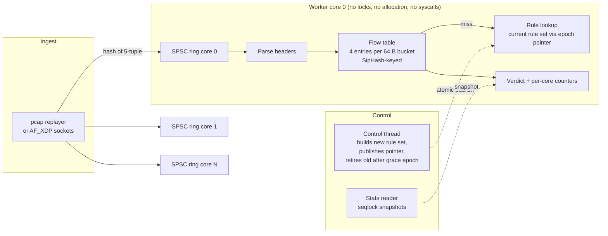

# Project 03 — `pfilt`: a lock-free packet classifier that survives an adversary

> **Weeks:** 20–22 · **Effort:** ~20 hours · **Language:** C++20 on Linux · **Prerequisites:** LLD-S 02–04 (memory model, thread-safe primitives, lock-free structures with epoch reclamation); CO 13–14 and 19 (caches, coherence); NET 06–07 and 09 (Linux stack, zero-copy, firewalls)

## 1. The pitch

The heart of every firewall is a classifier: for each packet, find its flow and the rule that applies, millions of times a second, on every core, while an operator updates the rules and an attacker crafts traffic to make you slow. `pfilt` is that classifier in user space. Packets arrive on per-core rings; a flow table sized to cache lines finds the flow in one cache miss; a keyed hash stops collision attacks; rule updates arrive from a control thread with **no lock on the packet path, ever**; and per-core counters are read without disturbing the cores that write them.

You finish with a packets-per-second number for your machine, a latency histogram, and proof (not claims) that false sharing is gone and that a hash-flooding attack no longer works.

---

## 2. Why this project

| For | What it proves |
|---|---|
| **Palo Alto Networks** | Nearly a take-home for their data plane: session tables at line rate, adversarial traffic, rule updates without stalls. |
| **Meta, Google** | The epoch-reclamation and memory-ordering work answers a large share of their concurrency questions, with evidence. |
| **Cisco, Nvidia (networking)** | Cache-aware design measured with hardware counters. |

---

## 3. What you will learn

| Part of `pfilt` | Tutorials |
|---|---|
| SPSC rings with head and tail on separate cache lines | LLD-S 03, OS 08, CO 19 |
| Open-addressed flow table, one bucket of four entries per 64-byte line | CO 13–14, DSA 02 |
| Keyed hashing against collision attacks | DSA 02, NET 09 |
| Rule updates with epoch-based reclamation | LLD-S 04 |
| Per-core counters read through seqlock snapshots | K 05, LLD-S 03 |
| False sharing found and fixed with `perf c2c` | CO 19, LX 10 |
| Rule matching on prefixes and port ranges | DSA trees 18 (longest-prefix match), NET 02 |

---

## 4. Architecture



---

## 5. Hard requirements

1. Ingest from `AF_XDP`, or from a pcap replayer that presents the same API, into one SPSC ring per worker with head and tail on separate cache lines.
2. An open-addressed flow table keyed on the 5-tuple, with **a bucket of four entries in one 64-byte line**, so a lookup is one cache miss, not three.
3. Keyed hashing (SipHash class). An attacker who controls source addresses must not be able to construct your collision chain.
4. Rule updates from a control thread using epoch-based reclamation. **No lock on the packet path, ever.**
5. Per-core counters read through a seqlock snapshot. No exceptions, no allocation and no system calls in the hot loop.

---

## 6. Milestones

### M1 — One core, done right (week 20, ~5 h)

pcap replayer, SPSC ring, header parser, flow table with 4-way buckets, SipHash, first-match rule list. A synthetic traffic generator with configurable flow counts and distributions (uniform and Zipf).

**Acceptance:** packets per second on one core for 1,000, 100,000 and 10 million flows; the drop when the table outgrows L2 and L3 is visible and explained with cache-miss counters from `perf stat`.

### M2 — Many cores, no sharing (week 21, ~5 h)

Dispatch by flow hash to per-core rings, per-core flow tables and counters, a stats thread reading seqlock snapshots.

**Acceptance:** scaling curve from 1 to N cores; `perf c2c` output **before** (with counters deliberately packed together) and **after** (padded), showing the false sharing gone.

### M3 — Rules that change under load (week 21, ~5 h)

Rules with prefixes and port ranges, compiled by the control thread into a lookup structure; published by atomic pointer swap; old rule sets retired with epoch-based reclamation. A stress mode updates rules 1,000 times a second during full load.

**Acceptance:** zero lock acquisitions on the packet path (verify with `perf` lock events or by inspection of the hot loop's assembly); a stated bound, in epochs, on how long an update takes to reach every worker, and a test that measures it.

### M4 — The adversary, and the proof (week 22, ~5 h)

An attack generator that crafts colliding 5-tuples against an **unkeyed** hash. Show the throughput collapse, then switch to the keyed hash and show it gone. Run a multi-hour randomised stress test under TSan, then ASan and UBSan.

**Acceptance:** p50, p99 and p99.9 per-packet latency from a histogram, before and during the attack; clean sanitizer runs; `README.md`, `RESULTS.md` and "What I tried that did not work".

---

## 7. Measurements

| Measurement | Tool |
|---|---|
| Packets per second **on your machine**, with core count, packet size and `perf stat` output beside it. A borrowed number is worse than none. | Built-in counters, `perf stat` |
| Per-packet latency p50 / p99 / p99.9 | HdrHistogram per worker, merged |
| Cache misses per packet as the flow count grows | `perf stat -e cache-misses,LLC-load-misses` |
| False sharing before and after | `perf c2c` |
| Rule-update propagation bound | Epoch counters and timestamps |
| Throughput under hash-flooding, keyed vs unkeyed | Attack generator |

---

## 8. Stretch goals

| Stretch | What it teaches |
|---|---|
| Port the classifier to an XDP program and compare in-kernel against user space on identical traffic. The crossover point is an excellent interview anecdote. | NET 07, eBPF verifier constraints |
| Replace the first-match rule list with **tuple space search** (the approach Open vSwitch uses) or a decision-tree classifier (HiCuts/HyperCuts), and measure rule-set scaling | Packet classification algorithms, a real research area |
| Connection tracking: TCP state per flow, timeouts with a timer wheel | NET 03 and 09, LLD-S 03 (timer wheels) |
| Live migration of flows between cores when a core is overloaded | Load balancing inside a data plane |

---

## 9. Repository layout

```text
pfilt/
├── CMakeLists.txt
├── README.md
├── RESULTS.md
├── docs/
│   ├── DESIGN.md
│   ├── MEMORY_ORDERING.md      every atomic, its order, and why
│   └── WHAT_DID_NOT_WORK.md
├── include/pfilt/
│   ├── spsc_ring.hpp
│   ├── flow_table.hpp
│   ├── siphash.hpp
│   ├── rules.hpp
│   ├── epoch.hpp
│   └── seqlock.hpp
├── src/
│   ├── main.cpp                worker and control-thread setup, CPU pinning
│   ├── ingest_pcap.cpp
│   ├── ingest_afxdp.cpp        stretch
│   └── stats.cpp
├── tools/
│   ├── trafficgen.cpp          uniform, Zipf, and attack modes
│   └── histogram_merge.cpp
└── tests/                      unit, stress, sanitizer runs
```

---

## 10. The interview story

*"I built the core of a firewall data plane: a lock-free, multi-core packet classifier. A lookup is one cache miss because each bucket holds four entries in one cache line, and rule updates use epoch-based reclamation, so the packet path never takes a lock. It reaches N million packets a second on K cores of my machine. I attacked it with crafted collisions: with an unkeyed hash, throughput fell by X times; with SipHash, the attack does nothing. And `perf c2c` showed false sharing I had not expected, between two counters I thought were on different lines."*

Questions this project prepares you for:

1. Design a session table for a firewall that handles 10 million flows at line rate.
2. How do you update rules without stopping packet processing?
3. Explain epoch-based reclamation. How does it compare with hazard pointers and RCU?
4. What is false sharing and how did you prove it was gone?
5. How does an attacker exploit a hash table, and how do you defend against it?
6. Why are averages misleading for latency?
7. When would you move this classifier into the kernel with XDP?

---

## 11. Resources

- *Is Parallel Programming Hard, And, If So, What Can You Do About It?*, Paul McKenney (free): RCU and epochs.
- Keir Fraser's PhD thesis, "Practical lock-freedom", for epoch-based reclamation.
- The Open vSwitch and DPDK documentation on flow classification and `rte_hash`.
- Crosby and Wallach, "Denial of Service via Algorithmic Complexity Attacks" (USENIX Security 2003).
- Joe Mario, "C2C: False Sharing Detection in Linux Perf", and the `perf-c2c` man page.
