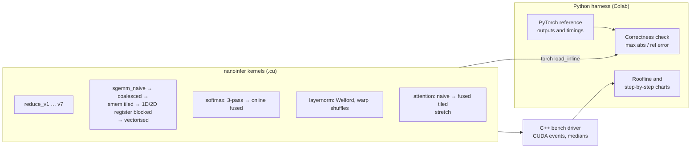

# Project 04 — `nanoinfer`: the CUDA kernels behind a transformer, built and measured

> **Weeks:** 21–22 · **Effort:** ~13 hours core · **Language:** CUDA C++, with Python for checking against PyTorch · **Platform:** Google Colab or a cloud GPU (your Mac has no NVIDIA GPU) · **Prerequisites:** GPU 01–02 for M1–M2, GPU 03 for profiling

## 1. The pitch

Every large language model spends its time in a handful of kernels: matrix multiply, softmax, layer normalisation and attention. `nanoinfer` builds each one from a naive version to a fast one, one optimisation at a time, measuring every step against cuBLAS or PyTorch and placing it on a roofline. The stretch goal assembles them into a real forward pass of a small transformer that generates text with your kernels.

You finish able to say exactly why each optimisation helped, by how much, and what limits the kernel now, which is precisely what Nvidia interviewers probe.

---

## 2. Why this project

| For | What it proves |
|---|---|
| **Nvidia (CUDA libraries, deep learning, inference)** | You can write and optimise kernels, not just describe them: coalescing, tiling, warp-level primitives, occupancy, the roofline. |
| **Nvidia (system software)** | GPU 03 measurements: transfers, pinned memory, streams, the launch path. |
| **ML-infrastructure teams at Google, Meta, Microsoft** | Understanding of where inference time goes, from the kernel up. |

---

## 3. What you will learn

| Part of `nanoinfer` | Tutorials |
|---|---|
| Timing harness with CUDA events, warm-up and medians | GPU 02, CO 28 |
| Bandwidth tests and parallel reduction | GPU 01–02 |
| GEMM from naive to register-blocked | GPU 02, CO 14 (cache blocking on CPU, same idea) |
| Softmax and layernorm with warp shuffles | GPU 02 |
| Roofline analysis and Nsight Compute | GPU 01, GPU 03 |
| Fused attention with online softmax (stretch) | GPU 04 |

---

## 4. Architecture



Kernels live in `.cu` files. A C++ driver times them with CUDA events; a Python harness loads the same kernels into PyTorch with `torch.utils.cpp_extension.load_inline` to check results against PyTorch and to draw the charts.

---

## 5. Milestones

### M1 — Harness, bandwidth and reduction (week 21, ~4 h)

- A timing harness: warm-up runs, then the median of N timed runs with CUDA events; correctness checked against PyTorch on random inputs, including awkward sizes (not multiples of the block size).
- Device-to-device bandwidth with a vector copy, compared with your GPU's peak (look it up; a T4 is about 320 GB/s).
- Host-to-device bandwidth from pageable and from pinned memory.
- Parallel sum reduction through the classic sequence: interleaved addressing, sequential addressing, first add during load, unrolling the last warp, warp shuffles, multiple elements per thread.

**Acceptance:** a table and chart of bandwidth achieved at each reduction step; the final version above 80% of peak device bandwidth.

### M2 — The GEMM ladder (week 21, ~5 h)

FP32 matrix multiply at 4096 × 4096, step by step:

1. Naive, one thread per output element.
2. Coalesced global-memory access.
3. Shared-memory tiling.
4. 1D register blocking (each thread computes several outputs).
5. 2D register blocking.
6. Vectorised (`float4`) loads.

**Acceptance:** GFLOP/s and percentage of cuBLAS at each step; every step placed on a roofline for your GPU, with its arithmetic intensity computed by hand and checked against Nsight Compute.

### M3 — Softmax and layernorm (week 22, ~4 h)

- Softmax over rows: naive three-pass (max, sum, normalise) against a fused **online softmax** that computes max and sum in one pass, one warp or block per row, with warp shuffles. Numerically stable.
- Layernorm with Welford's algorithm in one pass.

**Acceptance:** both are memory-bound, so report achieved GB/s against peak; match PyTorch to within 1e-5 relative error; explain why the fused versions win.

---

## 6. Measurements

| Kernel | Report | Baseline |
|---|---|---|
| Reduction steps | GB/s, % of peak bandwidth | Peak device bandwidth |
| GEMM steps | GFLOP/s, % of cuBLAS, position on the roofline | cuBLAS `sgemm` |
| Softmax, layernorm | GB/s, % of peak; time | PyTorch `softmax`, `layer_norm` |
| Transfers | GB/s pageable vs pinned | PCIe theoretical bandwidth |
| Attention (stretch) | Time and memory traffic vs sequence length | Naive three-kernel attention; PyTorch `scaled_dot_product_attention` |

Every result states the GPU model, driver and CUDA version, because Colab hands out different GPUs.

---

## 7. Stretch goals

| Stretch | What it teaches |
|---|---|
| **Fused attention:** naive attention materialises the full N × N score matrix; a FlashAttention-style kernel tiles Q, K and V through shared memory with online softmax and never writes it. Measure memory traffic and time from N = 512 to 8,192 | Why IO-awareness matters more than FLOPs |
| **A real forward pass:** load GPT-2 small (124M parameters) weights and run its forward pass with your kernels, generate text, and compare logits with PyTorch to a tolerance | How the kernels compose into a model; inspired by Andrej Karpathy's `llm.c` |
| **Tensor cores:** an FP16 GEMM with WMMA, compared with your FP32 ladder | Mixed precision and the hardware behind modern AI throughput |
| **Streams:** overlap weight transfers and compute for a batch of inputs, shown on an Nsight Systems timeline | GPU 03 in practice |
| **Quantised GEMM:** INT8 with per-channel scales, and the accuracy it costs | Inference optimisation, EMB 02 |

---

## 8. Repository layout

```text
nanoinfer/
├── CMakeLists.txt                 or a Makefile calling nvcc
├── README.md
├── RESULTS.md                     tables, charts, GPU and CUDA versions
├── docs/
│   ├── DESIGN.md
│   ├── ROOFLINE.md                the hand calculations
│   └── WHAT_DID_NOT_WORK.md
├── kernels/
│   ├── reduce.cu
│   ├── sgemm.cu                   one function per step
│   ├── softmax.cu
│   ├── layernorm.cu
│   └── attention.cu               stretch
├── bench/bench.cpp                CUDA-event timing driver
├── python/
│   ├── check.py                   correctness against PyTorch
│   └── plots.py                   roofline and step charts
└── notebooks/nanoinfer.ipynb      runs everything on Colab
```

---

## 9. The interview story

*"I wrote the kernels a transformer needs and optimised each one step by step against cuBLAS and PyTorch. My matrix multiply went from N GFLOP/s to M, about X% of cuBLAS, and I can show you on the roofline why each step helped: coalescing fixed the access pattern, shared-memory tiling cut global traffic by the tile width, and register blocking raised arithmetic intensity until the kernel stopped being memory-bound. Softmax was the opposite lesson: it is memory-bound, so fusing three passes into one mattered more than anything inside the loop."*

Questions this project prepares you for:

1. Write a parallel reduction on the whiteboard and explain each optimisation.
2. Explain shared-memory tiling for GEMM and compute the traffic reduction.
3. How do you know whether a kernel is memory-bound or compute-bound?
4. What limits occupancy, and why did more occupancy not always help?
5. Why is softmax hard to make fast, and what does online softmax change?
6. Why does FlashAttention help, given it does the same number of FLOPs?
7. How would you hide host-to-device transfer time?

---

## 10. Resources

- Mark Harris, "Optimizing Parallel Reduction in CUDA" (NVIDIA): the reduction sequence in M1.
- Simon Boehm, "How to Optimize a CUDA Matmul Kernel for cuBLAS-like Performance": the GEMM ladder in M2.
- Milakov and Gimelshein, "Online normalizer calculation for softmax" (2018).
- Dao et al., "FlashAttention" (2022), for the attention stretch.
- Andrej Karpathy's `llm.c` repository, for the forward-pass stretch.
- *Programming Massively Parallel Processors* (4th ed.), chapters on tiling, reduction and performance.
