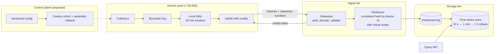

# Project 05 — `telemetrix`: edge-to-cloud telemetry for a fleet of 50,000 access points

> **Week:** 23 for the design document and ingest prototype; the full build is stretch · **Effort:** ~10 hours core · **Language:** C++20 for the agent and gateway (Go is a reasonable alternative); Python for load generation · **Prerequisites:** HLD 10–15 (replication through rate limiting); HLD-D 02 (telemetry pipelines) and HLD-D 03 (fleet management)

## 1. The pitch

Design, and partly build, the system that collects metrics from a fleet the size of the one you already work with: 50,000 access points, each reporting 200 time series every 10 seconds, over links that drop for minutes or hours. The design must lose nothing during a 30-minute disconnect, degrade predictably during an 8-hour one, tell the edge to slow down when the store is slow, survive twice the expected load by shedding the right data, and cost a number of dollars per day you can state.

This is the project that moves you from implementer to architect in a Google, Meta or Cisco design loop, because it is your own domain at a scale you can defend from experience.

---

## 2. Why this project

| For | What it proves |
|---|---|
| **Google, Meta** | You reason past one box: sizing, partitioning, backpressure, idempotency, failure modes and cost, in one coherent design. |
| **Cisco** | The design they will use to level you *up*: fleet scale, blast radius and cost, not only protocol detail. |
| **Palo Alto Networks, Nvidia** | The same shape as firewall log pipelines and GPU-fleet telemetry. |

---

## 3. The sizing, done once, out loud

```text
50,000 APs × 200 series / 10 s interval  = 1.0 M samples/s
× ~16 B per encoded sample               = 16 MB/s ≈ 1.4 TB/day raw
delta-of-delta timestamps + XOR floats
(Gorilla-style) + zstd                   ≈ 100–150 GB/day stored
```

Do this arithmetic in the first three minutes of any telemetry design question. It reframes the conversation around the numbers that drive every later decision.

---

## 4. Architecture



The full diagram source is in [`../../11_hld/diagrams/telemetrix_hld.mmd`](../../11_hld/diagrams/telemetrix_hld.mmd), and the rollout state machine for the control plane in [`../../11_hld/diagrams/rollout_state_machine.mmd`](../../11_hld/diagrams/rollout_state_machine.mmd).

---

## 5. Hard requirements

1. A device agent with a bounded local ring plus a write-ahead log, so that a 30-minute disconnect loses nothing and an 8-hour one degrades predictably.
2. Credit-based backpressure end to end. When the store is slow, the **edge** must know.
3. Consistent hashing by device ID with virtual nodes, and a documented rebalance that does not stop ingest.
4. Idempotent writes keyed on (device, series, timestamp): at-least-once transport, effectively-once storage.
5. Rollup tiers 10 s → 1 min → 1 h, with retention per tier.
6. A control plane strictly separate from the data plane: versioned configuration, a canary cohort, automatic rollback.

---

## 6. Milestones

### M1 — The design document (week 23, ~4 h)

Written in the HLD design-problem template: requirements, the sizing above, API (agent-to-gateway protocol, query API), data model (series identity, sample encoding, partition key), architecture, deep dives (backpressure, rebalancing, idempotency, rollups), failure modes, and a one-page cost model.

**Acceptance:** a reviewer can find, for every requirement in section 5, the mechanism that meets it and the failure it guards against.

### M2 — The ingest prototype (week 23, ~6 h)

- An agent simulator that runs thousands of simulated access points in one process, each with its ring and WAL.
- A gateway that accepts batches with sequence numbers, grants credits, and writes to partitioned append-only segment files.
- Deduplication on (device, series, timestamp) at the write path.
- A load generator and a partition simulator (block a set of devices for N minutes, then release).

**Acceptance:**

- Sustained samples per second measured on a stated core count, with the bottleneck resource named.
- Zero loss and a bounded duplicate rate after a simulated 30-minute partition.

### Full build (stretch)

- Documented behaviour at **2× overload**: exactly which data is shed first, and the argument for why that is the right data to lose.
- p99 ingest-to-queryable latency under 5 s, measured.
- Rollups and retention; a rebalance that adds a partition under load without stopping ingest.
- The control plane: a config change rolled to a canary cohort, a health regression detected, and an automatic rollback.

---

## 7. Measurements

| Measurement | Target |
|---|---|
| Sustained samples/s per gateway core | Stated, with the bottleneck named |
| Loss and duplicates after a 30-minute partition | Zero loss; duplicates bounded and stated |
| Behaviour at 2× overload | Shed order documented and demonstrated (stretch) |
| Ingest-to-queryable p99 | Under 5 s (stretch) |
| Cost model | Dollars per day, with the three inputs it is most sensitive to |

---

## 8. Repository layout

```text
telemetrix/
├── README.md
├── RESULTS.md
├── docs/
│   ├── DESIGN.md                 the design document (M1)
│   ├── COST_MODEL.md
│   └── WHAT_DID_NOT_WORK.md
├── agent/                        ring, WAL, uplink with credits
├── gateway/                      decode, dedupe, partition, segment writer
├── common/                       wire format, encoding, consistent hashing
├── tools/
│   ├── fleet_sim/                thousands of simulated APs
│   ├── loadgen/
│   └── partition_sim/
└── tests/
```

---

## 9. The interview story

*"I designed telemetry ingest for 50,000 access points: about a million samples a second, 1.4 TB a day raw and around 120 GB stored after compression. The parts I would want to discuss are backpressure, because the edge has to learn the store is slow before its buffers overflow, and idempotency, because at-least-once delivery from devices that reconnect after a partition creates duplicates that storage has to absorb. I built the ingest path and showed zero loss after a 30-minute partition, with N% duplicates removed at write time."*

Questions this project prepares you for:

1. Design a metrics and logging platform (HLD problem 15).
2. Design configuration push to a device fleet (HLD problem 19).
3. How do you apply backpressure across a network to devices you do not control?
4. At-least-once vs exactly-once: what can you actually guarantee, and where?
5. How do you rebalance partitions without stopping writes?
6. What do you drop first when you are overloaded, and why?
7. What does this system cost to run, and which input matters most?

---

## 10. Resources

- Pelkonen et al., "Gorilla: A Fast, Scalable, In-Memory Time Series Database" (VLDB 2015), for timestamp and value compression.
- *Designing Data-Intensive Applications*, chapters on partitioning, replication and stream processing.
- The Prometheus TSDB and VictoriaMetrics design write-ups.
- Your own notes: [`../../11_hld/03_systems_domain/02_telemetry_pipelines.md`](../../11_hld/03_systems_domain/02_telemetry_pipelines.md) and [`../../11_hld/03_systems_domain/03_edge_to_cloud_fleet_management.md`](../../11_hld/03_systems_domain/03_edge_to_cloud_fleet_management.md).
