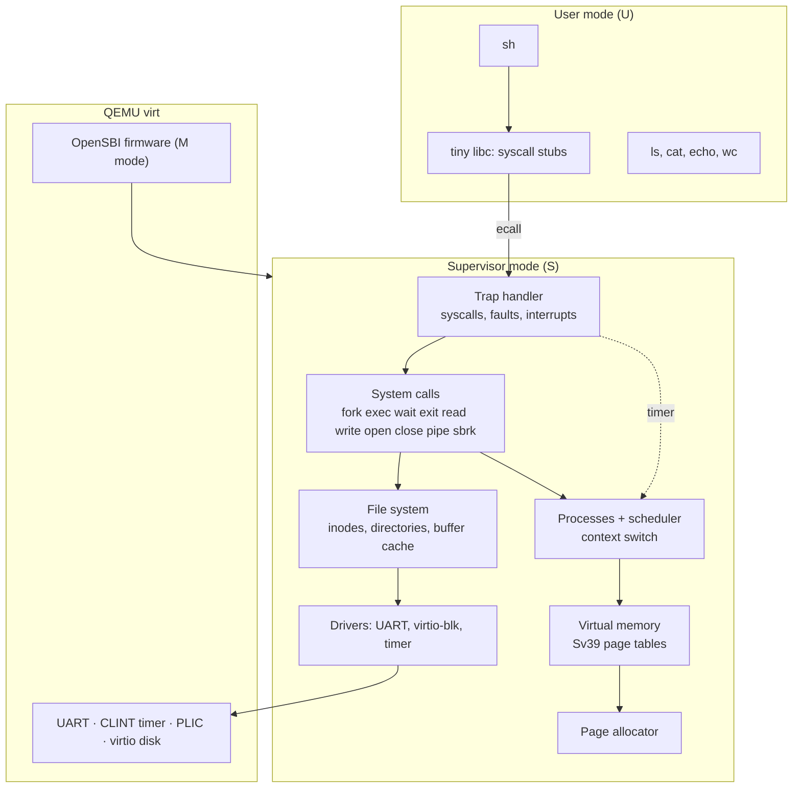

# Project 06 — `tinyos`: your own Unix-like kernel on RISC-V

> **When:** stretch, after week 26 or in place of another project's stretch goals · **Effort:** ~40 hours · **Language:** C and a little RISC-V assembly · **Platform:** QEMU `virt` machine, `riscv64` · **Prerequisites:** the whole `05_operating_systems` track; CO 06–07 (ISA and assembly); K 01 (QEMU and `gdb`)

## 1. The pitch

Write a small Unix-like operating system kernel from the first instruction after reset to a shell prompt: boot on a RISC-V machine in QEMU, print to a serial console, handle traps and timer interrupts, build page tables, run processes in user mode with `fork`, `exec` and `wait`, schedule them, give them system calls, read files from a virtual disk, and type commands into your own shell.

MIT's teaching kernel xv6 does all of this in about 10,000 lines. You write your own, using xv6 as the reference when you are stuck, not as the starting point. Every OS interview question becomes something you have implemented: "what happens on a context switch" is a function you wrote.

---

## 2. Why this project

| For | What it proves |
|---|---|
| **Nvidia system software, kernel teams anywhere** | Operating systems from the inside: traps, page tables, context switches, drivers, with no framework underneath you. |
| **Google, Meta, Microsoft** | Depth that makes every OS answer concrete. |
| **You** | The most complete way to learn the `05_operating_systems` track, and a project very few candidates have. |

RISC-V is used instead of x86 because its privileged architecture is small and clean enough to learn in a week, and QEMU's `virt` machine provides a UART, a timer and a virtio disk with no legacy hardware.

---

## 3. What you will learn

| Part of `tinyos` | Tutorials |
|---|---|
| Boot, linker script, stack set-up, SBI calls | CO 06–07, OS 01 |
| Trap vector, saving registers, `ecall` from user mode | OS 01, OS 19 |
| Timer interrupts and preemption | OS 04, CO 26 |
| Physical page allocator, Sv39 three-level page tables | OS 10, OS 12 |
| Processes, context switch, `fork`/`exec`/`wait` | OS 02, OS 03 |
| Round-robin then MLFQ scheduling | OS 04, OS 05 |
| Spinlocks and sleep/wakeup | OS 06, K 04 |
| virtio-blk driver, buffer cache, a simple file system | OS 14, OS 15, DRV 07 |
| Pipes and a shell | OS 17 |

---

## 4. Architecture



---

## 5. Milestones

| # | Milestone | Acceptance |
|---|---|---|
| M1 | **Boot and print.** Linker script, entry in assembly, stack, BSS clearing, UART driver, `printf` | `Hello from tinyos` on QEMU's serial console; `gdb` stops at your entry point |
| M2 | **Traps and timer.** Trap vector, register save and restore, timer interrupts via SBI, a tick counter, a panic with a register dump | Ticks print once a second; a deliberate illegal instruction produces a clean panic message |
| M3 | **Memory.** Free-list page allocator, Sv39 page tables, kernel mapped and paging enabled | All tests of the allocator pass; the kernel runs with paging on; a guard page catches a stack overflow |
| M4 | **Processes.** Process table, kernel stacks, context switch, a round-robin scheduler, two kernel threads interleaving | Two threads print interleaved output driven by the timer, with no shared-state corruption |
| M5 | **User mode and system calls.** A first user program, `ecall` path, `write`, `exit`, `fork`, `exec` (from an embedded image), `wait`, `sbrk` | A user program forks children that print and exit; the parent waits for all; no leaked pages after 1,000 forks |
| M6 | **Disk and files.** virtio-blk driver with interrupts, buffer cache, a simple inode-based file system built by a host tool, `open`, `read`, `close`, directories | `cat` prints a file from the disk image |
| M7 | **The shell.** Pipes, a shell with redirection and `|`, a few user programs (`ls`, `cat`, `echo`, `wc`) | `ls \| wc` works at your own prompt |

---

## 6. Stretch goals

| Stretch | What it teaches |
|---|---|
| Copy-on-write `fork`, with reference-counted pages and a page-fault handler | OS 11; how Linux's `fork` is cheap |
| Multicore boot with per-CPU scheduler loops and spinlocks | OS 06, K 04; the bugs that only appear with two CPUs |
| MLFQ scheduler, measured against round robin on mixed workloads | OS 04 |
| Lazy allocation and demand paging from the file system | OS 11 |
| A crash-consistent file system with a write-ahead log | OS 16 |
| Port the boot path to AArch64 on QEMU `virt` | CO 31, ARM exception levels |

---

## 7. Repository layout

```text
tinyos/
├── Makefile                 make qemu, make qemu-gdb, make test
├── README.md
├── docs/
│   ├── DESIGN.md
│   ├── BOOT.md              what happens from reset to the shell prompt
│   └── WHAT_DID_NOT_WORK.md
├── kernel/
│   ├── entry.S, kernel.ld
│   ├── main.c, printf.c, uart.c
│   ├── trap.c, trampoline.S, plic.c
│   ├── kalloc.c, vm.c
│   ├── proc.c, swtch.S, sched.c
│   ├── syscall.c, sysproc.c, sysfile.c
│   ├── virtio_disk.c, bio.c, fs.c, file.c, pipe.c
│   └── spinlock.c, sleeplock.c
├── user/                    sh.c, ls.c, cat.c, echo.c, wc.c, ulib.c, usys.S
├── mkfs/mkfs.c              host tool that builds the disk image
└── tests/                   user-space test programs run at boot
```

---

## 8. The interview story

*"To really understand operating systems, I wrote a small Unix-like kernel for RISC-V that boots in QEMU to a shell. I can walk you through a context switch in my `swtch.S`, the trap path from `ecall` to the system-call table, and the three-level page table I build for each process. The hardest bug was a timer interrupt arriving while a lock was held, which deadlocked the scheduler; it taught me exactly why kernels disable interrupts when they take a spinlock."*

Questions this project prepares you for: every question in [`../../05_operating_systems/00_plan.md`](../../05_operating_systems/00_plan.md), answered from your own code.

---

## 9. Resources

- MIT 6.1810 (formerly 6.S081) course materials and the xv6-riscv source and book (free): the reference when you are stuck.
- *The RISC-V Reader*, Patterson & Waterman: the ISA in a short book.
- The RISC-V Privileged Architecture specification: traps, CSRs and Sv39.
- The OSDev wiki and Stephen Marz's "Making a RISC-V operating system using Rust" blog series (the concepts carry over to C).
- QEMU documentation for the `virt` machine and virtio.
