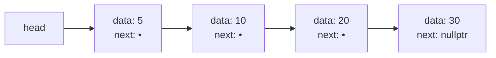
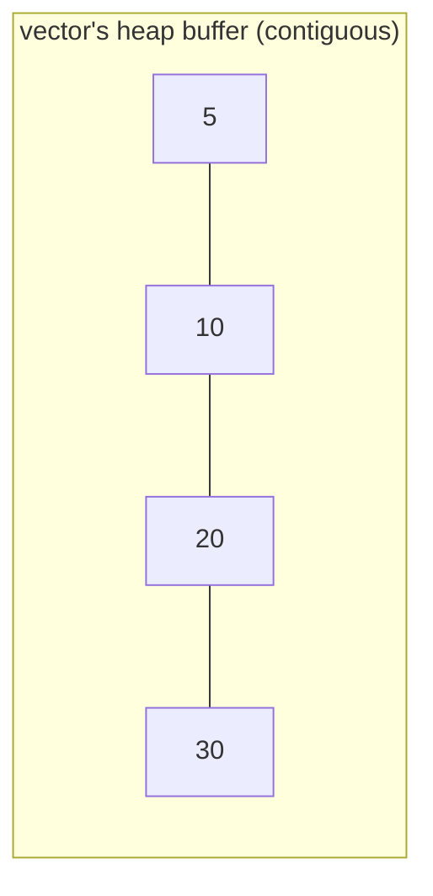
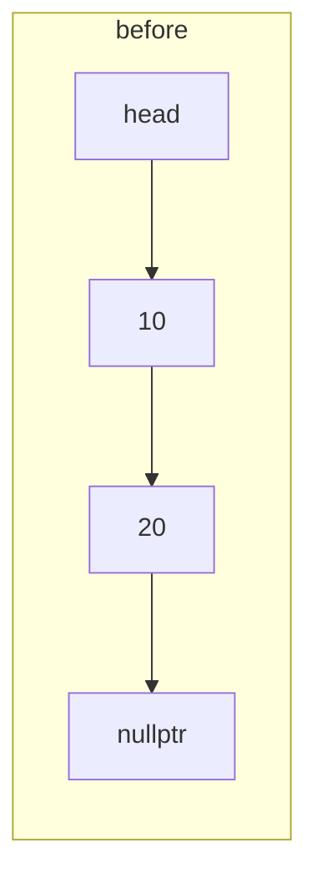
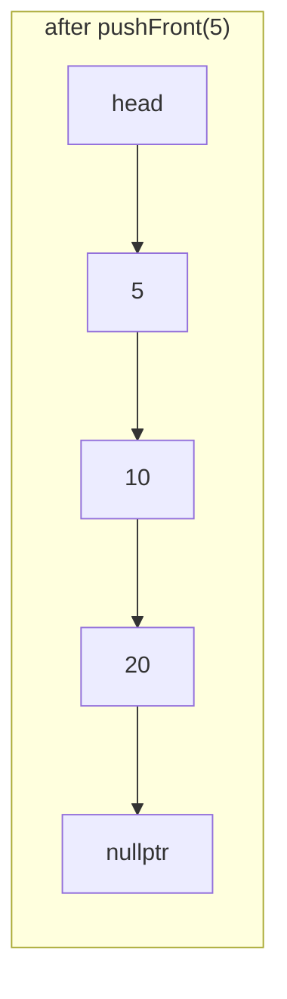
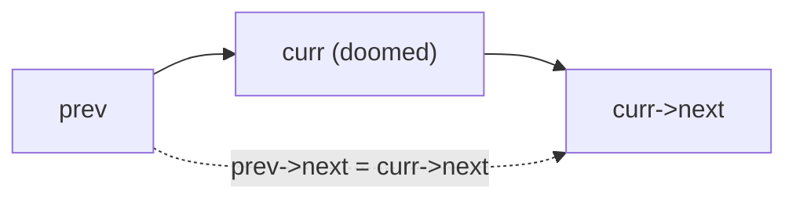

# Topic 1: Foundations of Singly Linked Lists (C++)

*Part of the [Linked List Study Plan](./00-linked-list-study-plan.md) — Phase 1*

---

## 1. What Is a Linked List, Really?

A linked list is a **chain of independently heap-allocated nodes**, where each node stores a value and a pointer to the next node. There is no requirement that the nodes sit anywhere near each other in memory — the *only* thing holding the sequence together is the chain of pointers.



Compare that to a `std::vector<int>` holding the same values — one contiguous block:



That structural difference — **scattered + pointer-linked** vs **contiguous** — is the root cause of every tradeoff you'll see below. It's not a detail, it's *the* concept for this whole topic.

---

## 2. Why Use a Linked List at All?

| Aspect | Array / `std::vector` | Singly Linked List |
|---|---|---|
| Memory layout | Contiguous | Scattered, heap-allocated nodes |
| Random access `a[i]` | O(1) | O(n) — must walk from head |
| Insert/delete at **front** | O(n) — must shift everything | O(1) |
| Insert/delete at **back** | O(1) amortized | O(1) with a `tail` pointer, O(n) to pop without one |
| Insert/delete in the **middle** | O(n) to shift | O(n) to *find* the spot, O(1) to link once you're there |
| Cache locality | Excellent (sequential prefetch) | Poor — every `->next` can be a cache miss (this comes back hard in Phase 6) |
| Extra memory per element | None | One pointer per node (8 bytes on 64-bit, per link) |
| Iterator/reference stability | Insertion can invalidate all existing iterators/pointers (reallocation) | Pointers to *other* nodes stay valid after you insert/delete elsewhere |

**The honest takeaway, since you already know `std::vector` is usually faster in practice:** you reach for a linked list when you need O(1) insertion/deletion *at a known location* without invalidating other references to the structure, not because it's "the better data structure." Real uses you'll hit later in this plan: LRU cache internals, adjacency lists for sparse graphs, free lists inside memory allocators, and intrusive lists in kernel code (Phase 6) where the node is embedded *inside* another struct.

---

## 3. Node Design in C++

The minimal, idiomatic node:

```cpp
template <typename T>
struct Node {
    T data;
    Node* next;

    explicit Node(const T& value, Node* nextNode = nullptr)
        : data(value), next(nextNode) {}

    explicit Node(T&& value, Node* nextNode = nullptr)
        : data(std::move(value)), next(nextNode) {}
};
```

Why `struct`, not `class`? By convention, a node is a plain aggregate of data with no invariants to protect — everything is public. Reach for `class` when the type has behavior and invariants to enforce (that's exactly what the list wrapper below is). Why two constructors? So `pushBack(std::move(bigObject))` moves instead of copies — this matters once `T` is expensive to copy (a `std::string`, a big struct), and it costs nothing when `T` is cheap (an `int`).

---

## 4. The List Class — Design Decisions

Three decisions shape everything that follows:

1. **Keep a `tail` pointer.** Without one, `pushBack` is O(n) because you have to walk the whole list to find the last node. This is the single most common beginner mistake — writing a linked list that's "correct" but silently O(n) on an operation everyone assumes is cheap.
2. **Keep a `count`.** `size()` becoming O(n) (by walking and counting) is avoidable for one `size_t` of bookkeeping.
3. **Define the Rule of 5.** If you don't write a copy constructor, C++ generates one that does a **shallow copy** — it copies the `head` pointer's *value*, not the chain. Two `SinglyLinkedList` objects then both believe they own the same nodes. The first one destroyed frees them; the second one's destructor then double-frees — undefined behavior, and a classic C++ interview gotcha in its own right.

---

## 5. Core Operations

### 5.1 `pushFront` — O(1)




```cpp
void pushFront(const T& value) {
    Node<T>* node = new Node<T>(value, head);
    head = node;
    if (tail == nullptr) tail = head;   // list was empty — head and tail are now the same node
    ++count;
}
```

The new node's `next` is set to the *old* `head` in the constructor, before `head` itself is reassigned — order matters here, but the constructor argument makes it safe by construction.

### 5.2 `pushBack` — O(1) (because we kept `tail`)

```cpp
void pushBack(const T& value) {
    Node<T>* node = new Node<T>(value);
    if (tail == nullptr) {
        head = tail = node;             // list was empty
    } else {
        tail->next = node;
        tail = node;
    }
    ++count;
}
```

### 5.3 `insertAt(pos, value)` — O(pos)

Insert so the new node becomes the element at index `pos` (0-indexed). `insertAt(0, v)` is `pushFront`; `insertAt(size(), v)` is `pushBack`.

```cpp
void insertAt(size_t pos, const T& value) {
    if (pos > count) throw std::out_of_range("insertAt: position out of range");
    if (pos == 0) { pushFront(value); return; }
    if (pos == count) { pushBack(value); return; }

    Node<T>* prev = head;
    for (size_t i = 0; i + 1 < pos; ++i) prev = prev->next;
    Node<T>* node = new Node<T>(value, prev->next);
    prev->next = node;
    ++count;
}
```

### 5.4 `popFront` — O(1)

```cpp
void popFront() {
    if (head == nullptr) throw std::out_of_range("popFront: list is empty");
    Node<T>* doomed = head;
    head = head->next;
    if (head == nullptr) tail = nullptr;   // list just became empty — don't leave tail dangling
    delete doomed;
    --count;
}
```

### 5.5 `popBack` — O(n), and this is the honest tradeoff of a *singly* linked list

To remove the tail you need the node *before* it, and a singly linked list gives you no way to go backward — so you must walk from `head`. (This single operation is the main reason Phase 3 introduces the doubly linked list, where `popBack` is O(1).)

```cpp
void popBack() {
    if (head == nullptr) throw std::out_of_range("popBack: list is empty");
    if (head == tail) {
        delete head;
        head = tail = nullptr;
    } else {
        Node<T>* prev = head;
        while (prev->next != tail) prev = prev->next;   // the O(n) cost
        delete tail;
        tail = prev;
        tail->next = nullptr;
    }
    --count;
}
```

### 5.6 `removeValue(value)` — O(n)



```cpp
bool removeValue(const T& value) {
    Node<T>* curr = head;
    Node<T>* prev = nullptr;
    while (curr != nullptr && curr->data != value) {
        prev = curr;
        curr = curr->next;
    }
    if (curr == nullptr) return false;        // not found

    if (prev == nullptr) head = curr->next;    // removing the head node
    else prev->next = curr->next;

    if (curr == tail) tail = prev;             // removing the tail node
    delete curr;
    --count;
    return true;
}
```

Note both edge cases handled explicitly: removing the head (`prev == nullptr`) and removing the tail (`curr == tail`). Skipping either is the #1 source of bugs in hand-rolled linked list code.

### 5.7 `contains` / search — O(n)

```cpp
bool contains(const T& value) const {
    for (Node<T>* curr = head; curr != nullptr; curr = curr->next)
        if (curr->data == value) return true;
    return false;
}
```

---

## 6. Complexity Summary

| Operation | Time | Why |
|---|---|---|
| `pushFront` | O(1) | just relink `head` |
| `pushBack` | O(1) | *only* because we track `tail` — O(n) otherwise |
| `insertAt(pos)` | O(pos) | must walk to the position first |
| `popFront` | O(1) | just relink `head` |
| `popBack` | O(n) | must find the node *before* `tail` — no backward pointer |
| `removeValue` | O(n) | search + unlink |
| `contains` / search | O(n) | no way to skip nodes |
| access by index | O(n) | no random access — the key difference from `std::vector` |

---

## 7. Common Pitfalls (worth memorizing, not just reading)

**Pitfall 1 — deleting before reading `next`:**
```cpp
// WRONG: undefined behavior
while (head != nullptr) {
    delete head;
    head = head->next;   // reading through a freed pointer
}
```
```cpp
// CORRECT
while (head != nullptr) {
    Node<T>* next = head->next;   // save it first
    delete head;
    head = next;
}
```

**Pitfall 2 — forgetting to null out `tail` when the list becomes empty.** After the last `popFront`/`popBack`, if you don't reset `tail`, it's left pointing at freed memory. The very next `pushBack` will then write through a dangling pointer.

**Pitfall 3 — shallow copies.** Without the Rule of 5 (copy ctor, copy assignment, destructor — plus move ctor/assignment for completeness), copying a list copies the `head` pointer's value, not the nodes. Two objects now "own" the same chain → double free on destruction.

**Pitfall 4 — empty-list edge cases.** Every operation that touches `head` or `tail` needs an explicit check for the empty list, or you dereference `nullptr`.

**Pitfall 5 — comparing pointers instead of values.** `curr == value` is a type error waiting to happen if `T` is convertible from a pointer; the intended check is always `curr->data == value`.

---

## 8. Full, Compilable Reference Implementation

```cpp
#pragma once
#include <iostream>
#include <stdexcept>
#include <utility>

template <typename T>
struct Node {
    T data;
    Node* next;

    explicit Node(const T& value, Node* nextNode = nullptr)
        : data(value), next(nextNode) {}
    explicit Node(T&& value, Node* nextNode = nullptr)
        : data(std::move(value)), next(nextNode) {}
};

template <typename T>
class SinglyLinkedList {
private:
    Node<T>* head;
    Node<T>* tail;
    size_t   count;

    void clear() {
        Node<T>* curr = head;
        while (curr != nullptr) {
            Node<T>* next = curr->next;
            delete curr;
            curr = next;
        }
        head = tail = nullptr;
        count = 0;
    }

    void copyFrom(const SinglyLinkedList& other) {
        for (Node<T>* curr = other.head; curr != nullptr; curr = curr->next)
            pushBack(curr->data);
    }

public:
    SinglyLinkedList() : head(nullptr), tail(nullptr), count(0) {}
    ~SinglyLinkedList() { clear(); }

    SinglyLinkedList(const SinglyLinkedList& other) : head(nullptr), tail(nullptr), count(0) {
        copyFrom(other);
    }

    SinglyLinkedList& operator=(const SinglyLinkedList& other) {
        if (this != &other) { clear(); copyFrom(other); }
        return *this;
    }

    SinglyLinkedList(SinglyLinkedList&& other) noexcept
        : head(other.head), tail(other.tail), count(other.count) {
        other.head = other.tail = nullptr;
        other.count = 0;
    }

    SinglyLinkedList& operator=(SinglyLinkedList&& other) noexcept {
        if (this != &other) {
            clear();
            head = other.head; tail = other.tail; count = other.count;
            other.head = other.tail = nullptr;
            other.count = 0;
        }
        return *this;
    }

    size_t size() const { return count; }
    bool empty() const { return count == 0; }

    void pushFront(const T& value) {
        Node<T>* node = new Node<T>(value, head);
        head = node;
        if (tail == nullptr) tail = head;
        ++count;
    }

    void pushBack(const T& value) {
        Node<T>* node = new Node<T>(value);
        if (tail == nullptr) head = tail = node;
        else { tail->next = node; tail = node; }
        ++count;
    }

    void insertAt(size_t pos, const T& value) {
        if (pos > count) throw std::out_of_range("insertAt: position out of range");
        if (pos == 0) { pushFront(value); return; }
        if (pos == count) { pushBack(value); return; }
        Node<T>* prev = head;
        for (size_t i = 0; i + 1 < pos; ++i) prev = prev->next;
        Node<T>* node = new Node<T>(value, prev->next);
        prev->next = node;
        ++count;
    }

    void popFront() {
        if (head == nullptr) throw std::out_of_range("popFront: list is empty");
        Node<T>* doomed = head;
        head = head->next;
        if (head == nullptr) tail = nullptr;
        delete doomed;
        --count;
    }

    void popBack() {
        if (head == nullptr) throw std::out_of_range("popBack: list is empty");
        if (head == tail) { delete head; head = tail = nullptr; }
        else {
            Node<T>* prev = head;
            while (prev->next != tail) prev = prev->next;
            delete tail;
            tail = prev;
            tail->next = nullptr;
        }
        --count;
    }

    bool removeValue(const T& value) {
        Node<T>* curr = head;
        Node<T>* prev = nullptr;
        while (curr != nullptr && curr->data != value) { prev = curr; curr = curr->next; }
        if (curr == nullptr) return false;
        if (prev == nullptr) head = curr->next;
        else prev->next = curr->next;
        if (curr == tail) tail = prev;
        delete curr;
        --count;
        return true;
    }

    bool contains(const T& value) const {
        for (Node<T>* curr = head; curr != nullptr; curr = curr->next)
            if (curr->data == value) return true;
        return false;
    }

    void print(std::ostream& os = std::cout) const {
        if (head == nullptr) { os << "(empty)\n"; return; }
        for (Node<T>* curr = head; curr != nullptr; curr = curr->next)
            os << curr->data << (curr->next ? " -> " : "\n");
    }
};

int main() {
    SinglyLinkedList<int> list;
    list.pushBack(10);
    list.pushBack(20);
    list.pushBack(30);
    list.pushFront(5);
    list.print();                       // 5 -> 10 -> 20 -> 30

    list.insertAt(2, 15);
    list.print();                       // 5 -> 10 -> 15 -> 20 -> 30

    list.removeValue(15);
    list.print();                       // 5 -> 10 -> 20 -> 30

    list.popFront();
    list.popBack();
    list.print();                       // 10 -> 20

    std::cout << "size = " << list.size()
              << ", contains(20) = " << std::boolalpha << list.contains(20) << "\n";
    return 0;
}
```

Build and run it as-is: `g++ -std=c++17 -Wall -Wextra list.cpp -o list && ./list`.

---

## 9. Practice for This Topic

Do these *after* you've implemented the class above yourself, from memory, once — that's what actually cements it:

- LeetCode 707 — Design Linked List (forces you to hit every edge case above)
- LeetCode 203 — Remove Linked List Elements
- LeetCode 237 — Delete Node in a Linked List (a fun trick: no access to the previous node)
- LeetCode 876 — Middle of the Linked List (a preview of Phase 2's two-pointer technique)

---

## What's Next

Phase 2 builds directly on this class: the two-pointer (fast/slow) technique, Floyd's cycle detection, and reversing a list in place — all of which reuse this exact `Node`/list shape.

Study this, ask whatever doubts come up, and say "next" when you're ready for Topic 2.
