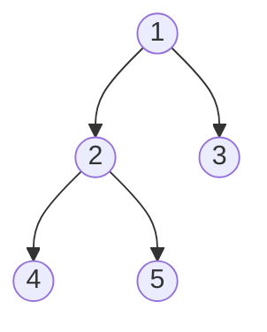
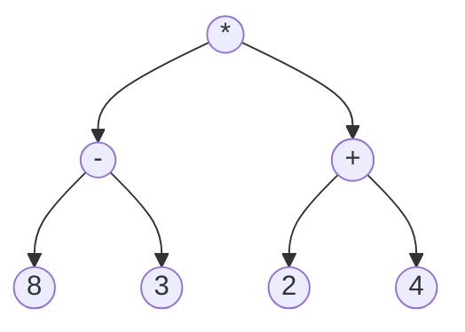

# Topic 01: Binary Tree Fundamentals (C++)

*Part of the [Trees Study Plan](./00-trees-study-plan.md), Phase 1. Companion code: [`01-binary-tree-fundamentals-demo.cpp`](./01-binary-tree-fundamentals-demo.cpp), 56 checks, clean under `-fsanitize=address,undefined` with GCC and warning-free with Clang. Every code block below is taken verbatim from that file unless it is marked as illustrative.*

---

## 0. The whole topic in one paragraph

A binary tree is a set of nodes where each node has at most two children, labeled left and right, and every node except the root has exactly one parent. Two numbers drive almost every cost in this topic: **n**, the number of nodes, and **h**, the height. Depth-first algorithms use O(h) stack, breadth-first algorithms use O(w) queue (w = the widest level), and h can be anything from ⌊log₂ n⌋ to n − 1. Most of the bugs in this topic come from one of three places: the height convention, recursion depth on deep trees, and ownership of the nodes.

---

## 1. What a tree is, and how it relates to a linked list

Formally, a **tree** is a connected graph with no cycles. Three facts follow and are worth knowing as one package:

- A tree with n nodes has exactly **n − 1 edges**.
- There is **exactly one path** between any two nodes.
- Removing any edge disconnects it; adding any edge creates a cycle.

A **rooted tree** picks one node as the root, which gives every edge a direction (parent → child). A **binary tree** is a rooted tree where each node has at most two children, and the children are **labeled**: a node with only a left child is a different tree from a node with only a right child. That labeling is why "left" and "right" are separate fields and not a list of children.

**The bridge from the linked list track:** a singly linked list is a binary tree in which every node only ever uses one child pointer. That is the *worst* binary tree you can build: height n − 1. So every "O(h)" bound in this file quietly becomes O(n) on a list-shaped tree. Phase 4 (balanced trees) exists to rule that shape out.

Where you will meet trees in this plan, all of them real systems:

| Structure | Tree inside | Where in this plan |
|---|---|---|
| `std::map`, `std::set` | Red-black tree | Topics 09–12 |
| `std::priority_queue` | Binary heap stored in an array | Topic 15 |
| Linux fair scheduler (EEVDF, 6.6+) | Augmented red-black tree | Topic 13 |
| Linux process address space (VMAs, 6.1+) | Maple tree, a range B-tree | Topic 31 |
| Linux IPv4 routing table | Level-compressed trie (`fib_trie`) | Topic 18 |
| SQLite and InnoDB indexes | B+ trees | Topic 29 |
| Compilers | Abstract syntax trees | Section 10 below |

---

## 2. Terminology, on one running example

We will use this tree all the way through. In LeetCode's level-order notation it is `[1, 2, 3, 4, 5]`.



| Term | Meaning | In the example |
|---|---|---|
| Root | The only node with no parent | 1 |
| Parent / child | Directly connected by an edge, parent above | 2 is the parent of 4 and 5 |
| Siblings | Nodes with the same parent | 4 and 5; 2 and 3 |
| Leaf (external node) | Node with no children | 4, 5, 3 |
| Internal node | Node with at least one child | 1, 2 |
| Ancestor / descendant | Anything on the path to the root / anything below | Ancestors of 5: 2, 1 |
| Subtree rooted at x | x and all its descendants | Subtree at 2 = {2, 4, 5} |
| Degree of a node | Number of children | deg(2) = 2, deg(3) = 0 |
| Depth of a node | Edges from the root down to it | depth(1) = 0, depth(4) = 2 |
| Level | All nodes with the same depth | Level 1 = {2, 3} |
| Height of a node | Edges on the longest path from it down to a leaf | height(2) = 1, height(3) = 0 |
| Height of the tree | Height of the root | 2 |
| Size | Number of nodes | 5 |
| Width of a level | Number of nodes on it | width(level 2) = 2 |
| Forest | A set of disjoint trees | Delete the root: {subtree 2, subtree 3} |

> **The convention trap.** This file uses the CLRS convention: depth and height count **edges**, a single node has height 0, and the empty tree has height −1. LeetCode's "maximum depth" (problem 104) and "minimum depth" (111) count **nodes** instead, so their answer is height + 1. Some textbooks number levels from 1. None of these is wrong, but mixing them is the most common off-by-one in tree code. In an interview, say which convention you are using before you write `height`.

---

## 3. Shapes of binary trees

These words get used loosely, so here are precise definitions. Drawn as ASCII so left and right stay unambiguous.

```text
 FULL (not complete)     COMPLETE (not full)     PERFECT                  DEGENERATE (a list)
 every node has 0 or 2   all levels full except  every level full         every node has
 children                the last, which fills                            at most one child
                         from the left
        1                        1                        1                 1
       / \                      / \                     /   \                \
      2   3                    2   3                   2     3                2
         / \                  /                       / \   / \                \
        4   5                4                       4   5 6   7                3
```

| Shape | Definition | Why it matters |
|---|---|---|
| Full (also "proper" or "strict") | Every node has 0 or 2 children | Leaves = internal nodes + 1 (Section 4.3). Expression trees are full. |
| Complete | Every level is full except possibly the last, which is filled left to right | Fits in an array with no gaps (Section 5.3). Heaps are complete. |
| Perfect | Every internal node has 2 children and all leaves are at the same depth | Exactly 2^(h+1) − 1 nodes. The best case for height. |
| Height-balanced | At every node, the heights of the two subtrees differ by at most 1 | Height stays O(log n). This is the AVL condition (Topic 10). |
| Degenerate (skewed) | Every node has at most one child | Height n − 1. A linked list in disguise. |

A tree can be balanced without being complete:

```text
        1          node 2: left height -1, right height 0  -> differ by 1, fine
       / \         node 1: left height  1, right height 0  -> differ by 1, fine
      2   3        so: height-balanced, but not complete (2 has a right child and no left child)
       \
        4
```

> **Naming conflict to know about.** CLRS uses "complete binary tree" to mean what this file calls *perfect*. Most other sources (and every interview) use the definitions in the table above. If a definition seems off in a book, check which convention it uses.

---

## 4. Properties worth knowing cold

Each comes with a short proof, because interviewers ask "why", and because the proofs explain later topics.

### 4.1 Level d holds at most 2^d nodes

Level 0 has one node (the root). Each node on level d contributes at most two nodes to level d + 1, so the maximum doubles every level: 1, 2, 4, 8, ..., 2^d.

### 4.2 A tree of height h holds at most 2^(h+1) − 1 nodes, so ⌊log₂ n⌋ ≤ h ≤ n − 1

Sum the per-level maximums: 1 + 2 + 4 + ... + 2^h = 2^(h+1) − 1. A perfect tree reaches it exactly.

Turn it around: if n ≤ 2^(h+1) − 1, then h ≥ log₂(n + 1) − 1, which for integers is h ≥ ⌊log₂ n⌋. The upper bound h ≤ n − 1 is the list-shaped tree: each level holds one node.

This range, **log n to n**, is the single most important fact about trees. Every BST operation, every recursive traversal's stack, and every balanced-tree scheme in Phase 4 is about which end of this range you are on.

### 4.3 In a full binary tree, leaves = internal nodes + 1

Let I be the number of internal nodes and L the number of leaves, so n = I + L. Every internal node has exactly 2 children, so there are 2I edges. Every tree has n − 1 edges. So 2I = I + L − 1, which gives **L = I + 1**.

Check on the example (it is full): internal {1, 2}, leaves {3, 4, 5}. 3 = 2 + 1.

### 4.4 A linked binary tree with n nodes has n + 1 null child pointers

There are 2n child pointer slots and only n − 1 edges, so 2n − (n − 1) = **n + 1** slots hold `nullptr`. More than half the pointer storage of a linked tree points at nothing. Threaded trees and **Morris traversal** (Topic 02) put those slots to work to traverse in O(1) extra space.

### 4.5 A complete tree with n nodes has height exactly ⌊log₂ n⌋, and fits an array with no gaps

All levels but the last are full and the last fills from the left, so storing nodes level by level leaves no holes. That is why heaps (Topic 15) and segment trees (Topic 21) never allocate nodes: the shape is implied by the array index (Section 5.3).

### 4.6 There are Catalan-many shapes with n nodes

The number of distinct binary tree shapes with n nodes is C_n = (2n)! / ((n + 1)! · n!): 1, 1, 2, 5, 14, 42, ... For n = 3 there are 5 shapes, and you can label the nodes of every one of them so that its inorder sequence reads `1 2 3`. So an inorder sequence alone cannot tell you which of the 5 trees you have. That is why reconstruction (Topic 03) needs two traversals.

---

## 5. Representations

The same abstract tree can live in memory in very different ways. For a systems role, knowing the cost of each one is half the topic.

### 5.1 Linked nodes (the default)

Each node is a separate heap allocation with `left` and `right` pointers. It handles any shape and makes insertion and deletion local. The costs: one allocation per node, and nodes scattered across the heap, so every `->left` can be a cache miss. Same tradeoff as the linked list, now with two pointers per node.

Measured on a 64-bit build: `sizeof(TreeNode<int>)` is **24 bytes** (4 bytes of `int`, 4 bytes of padding, two 8-byte pointers). The allocator rounds that up to a 32-byte heap chunk on both glibc and macOS. So each `int` costs about 32 bytes of memory: 8x its own size.

### 5.2 Linked nodes with a parent pointer

Add `TreeNode* parent`. It costs 8 more bytes per node and in exchange lets you walk *up* in O(1). That makes in-order iterators (successor without a stack) and bottom-up rebalancing possible. Both `std::map`'s nodes and the Linux kernel's `rb_node` carry a parent pointer. The kernel even packs the node's red/black color into the low bit of that pointer, since node alignment guarantees the bit is always zero. Topic 13 takes that apart.

### 5.3 Implicit array layout

For a complete tree, store the nodes level by level in an array and compute the relationships instead of storing them:

```cpp
// Implicit (array) layout, 0-indexed: the shape is in the index arithmetic, not in pointers.
constexpr std::size_t leftChild(std::size_t i) { return 2 * i + 1; }
constexpr std::size_t rightChild(std::size_t i) { return 2 * i + 2; }
constexpr std::size_t parentOf(std::size_t i) { return (i - 1) / 2; }   // only for i > 0
```

Our example tree is complete, so it is just the array `{1, 2, 3, 4, 5}`:

| Index | 0 | 1 | 2 | 3 | 4 |
|---|---|---|---|---|---|
| Value | 1 | 2 | 3 | 4 | 5 |
| Children | 1, 2 | 3, 4 | 5, 6 (out of range: leaf) | leaf | leaf |

No pointers, no per-node allocation, perfectly sequential memory. With 1-indexing the formulas become `2i`, `2i + 1` and `i / 2`, which is why many heap and segment tree implementations waste index 0 on purpose. The catch: a tree that is not complete leaves holes. A right-skewed chain of height h needs 2^(h+1) − 1 slots for h + 1 nodes, so 20 nodes would need about a million slots.

### 5.4 Index pool

Keep all nodes in one `std::vector` and store children as 32-bit indices, with −1 for "no child":

```cpp
// Index pool: all nodes in one vector, children are 32-bit indices, -1 means "no child".
struct IndexTree {
    static constexpr std::int32_t kNull = -1;
    struct Node {
        int val;
        std::int32_t left = kNull;
        std::int32_t right = kNull;
    };
    std::vector<Node> nodes;   // nodes[0] is the root when the tree is non-empty

    std::int32_t add(int val) {
        nodes.push_back(Node{val});
        return static_cast<std::int32_t>(nodes.size() - 1);
    }
};

void inorderIndexed(const IndexTree& t, std::int32_t i, std::vector<int>& out) {
    if (i == IndexTree::kNull) return;
    inorderIndexed(t, t.nodes[i].left, out);
    out.push_back(t.nodes[i].val);
    inorderIndexed(t, t.nodes[i].right, out);
}
```

`sizeof(IndexTree::Node)` is **12 bytes**, with no per-node allocation and no allocator header, so it is roughly 2.7x denser than the linked version and contiguous in memory. It also serializes trivially (write the vector to disk) and has a hard memory bound. That last property is why fixed-capacity index pools are common in firmware that forbids heap allocation after initialization.

The pitfall is the one from the linked list track's iterator-stability row: `nodes.push_back` can reallocate, so a `Node&` or `Node*` held across an `add()` call may dangle. Indices stay valid; references and pointers do not. Deleting nodes also needs a free list, which is Topic 33's subject.

### 5.5 Two more you will see later

- **Parent array:** each node stores only its parent's index. You can only walk up, but that is all union-find needs (Topic 28).
- **Left-child, right-sibling:** any N-ary tree can be stored as a binary tree by making `left` point to the first child and `right` to the next sibling. Two pointers per node regardless of how many children a node has.

### 5.6 Side by side

| Representation | Cost per node (`int` payload, 64-bit) | Strengths | Weaknesses |
|---|---|---|---|
| Linked nodes | 24 B node, ~32 B of heap | Any shape; local insert and delete | One allocation per node; poor locality |
| + parent pointer | 32 B node | O(1) upward moves, stackless iterators | 8 more bytes per node; one more link to maintain |
| Implicit array | Just the payload | No pointers, sequential memory | Complete trees only; holes otherwise |
| Index pool | 12 B, no per-node allocation | Locality, bounded memory, trivial serialization | References invalidated on growth; deletion needs a free list |
| Parent array | One index | Union-find, upward-only queries | No access to children |
| Left-child right-sibling | Two pointers at any degree | N-ary trees with unbounded degree | Reaching the k-th child is O(k) |

---

## 6. Node design and ownership

### 6.1 The node

```cpp
template <typename T>
struct TreeNode {
    T val;
    TreeNode* left = nullptr;
    TreeNode* right = nullptr;

    explicit TreeNode(const T& v) : val(v) {}
    explicit TreeNode(T&& v) : val(std::move(v)) {}
};
```

Same design as the linked list `Node<T>`: a `struct` because a node has no invariants of its own to protect, and two constructors so a `T&&` argument is moved instead of copied. Two differences:

- The child pointers are initialized where they are declared (`= nullptr`), so every constructor gets null children without repeating it.
- The value field is named `val`, matching LeetCode's `TreeNode`, so the code here transfers directly to practice problems.

### 6.2 Who frees the nodes?

There are three options. The obvious one has a trap.

**Option A: `std::unique_ptr` children.** *(Illustrative, not used in the companion.)*

<!-- not-in-demo -->
```cpp
template <typename T>
struct OwningNode {
    T val;
    std::unique_ptr<OwningNode> left;
    std::unique_ptr<OwningNode> right;
};
```

It looks perfect: no destructor to write, no leaks. But destroying a node destroys its `right` member, which destroys *that* node's `right` member, and so on. The destructor recursion is as deep as the tree is tall. On a list-shaped tree that is n nested calls.

I measured it with the struct above on Linux with GCC 13 and the default 8 MB stack, building a right-leaning chain and destroying the root:

| Chain length | `-O0` | `-O2` |
|---|---|---|
| 10,000 | OK | OK |
| 100,000 | **Segmentation fault** | OK |
| 1,000,000 | **Segmentation fault** | **Segmentation fault** |

So whether 100,000 nodes crash depends on the optimization level, which is exactly the kind of bug that passes in a release build and crashes in a debug one, or the other way round on a thread with a smaller stack. The linked list track flagged this same gotcha for `unique_ptr` lists; trees inherit it.

**Option B: raw pointers owned by one class, freed without recursion.** This is what we build below. All the risky code (destruction and copying) lives in two functions that use no recursion at all, so tree depth cannot crash them.

**Option C: an arena or node pool** that frees all nodes in one shot. Fastest of all, covered in Topic 33.

### 6.3 Destroying a tree in O(1) extra space

```cpp
// Frees every node in O(n) time and O(1) extra space, with no recursion.
// While the current node has a left child, rotate right so that child moves up.
// Once there is no left child, delete the node and continue with its right subtree.
template <typename T>
void destroyTree(TreeNode<T>* node) noexcept {
    while (node != nullptr) {
        if (node->left != nullptr) {
            TreeNode<T>* l = node->left;
            node->left = l->right;   // l's right subtree becomes node's left subtree
            l->right = node;         // node hangs off l's right
            node = l;                // l is the new top
        } else {
            TreeNode<T>* next = node->right;
            delete node;
            node = next;
        }
    }
}
```

The idea: a node with no left child is easy, because you can delete it and move on to its right child, exactly like freeing a linked list. So whenever the current node *does* have a left child, rearrange the tree until it does not. One **right rotation** does that: the left child moves up and the current node becomes its right child.

Trace on the worst case for this loop, a left-leaning chain `3 → 2 → 1`:

```text
 start           rotate at 3        rotate at 2        no left child: delete 1, then 2, then 3
   3                 2                  1
  /                 / \                  \
 2                 1   3                  2
/                                          \
1                                           3
```

**Why it is O(n):** look at the chain of right pointers that starts at the current node. A rotation adds the left child to that chain, and a node only ever leaves the chain by being deleted. So each node joins the chain at most once, which means at most n rotations, plus exactly n deletions. No stack, no recursion, nothing allocated.

It is `noexcept` because it only relinks pointers and calls `delete`, and destructors must not throw.

### 6.4 Deep copy without recursion

```cpp
// Deep copy without recursion. Every new node is linked into the copy the moment
// it is created, so if anything throws, destroyTree(copy) frees exactly what was built.
template <typename T>
TreeNode<T>* cloneTree(const TreeNode<T>* src) {
    if (src == nullptr) return nullptr;
    TreeNode<T>* copy = new TreeNode<T>(src->val);
    try {
        std::vector<std::pair<const TreeNode<T>*, TreeNode<T>*>> stack;
        stack.emplace_back(src, copy);
        while (!stack.empty()) {
            auto [s, d] = stack.back();
            stack.pop_back();
            if (s->left != nullptr) {
                d->left = new TreeNode<T>(s->left->val);
                stack.emplace_back(s->left, d->left);
            }
            if (s->right != nullptr) {
                d->right = new TreeNode<T>(s->right->val);
                stack.emplace_back(s->right, d->right);
            }
        }
    } catch (...) {
        destroyTree(copy);
        throw;
    }
    return copy;
}
```

How to read it:

- The stack holds **pairs**: a node in the source tree and its already-created twin in the copy. Popping a pair means "give this twin its children".
- Each new child is **attached to its parent immediately**, before anything else can throw. So at every moment the copy is a valid, well-formed (partial) tree.
- That is what makes the error handling one line. If `new` throws `std::bad_alloc`, or `T`'s copy constructor throws, or `emplace_back` cannot grow the stack, the `catch (...)` frees the partial copy with `destroyTree` and rethrows. Nothing leaks. The companion proves it with a `Bomb` type whose copy constructor throws on the 8th copy and counts live objects.
- `auto [s, d] = stack.back();` is a C++17 structured binding: it unpacks the pair into two named variables.

The explicit stack never holds more than about one pending node per level, so it uses O(h) memory, but on the heap, which grows to gigabytes, not on the call stack, which stops at 8 MB.

### 6.5 The owning class: Rule of 5 with copy-and-swap

```cpp
template <typename T>
class BinaryTree {
public:
    using Node = TreeNode<T>;

    BinaryTree() noexcept = default;
    ~BinaryTree() { destroyTree(root_); }

    BinaryTree(const BinaryTree& other) : root_(cloneTree(other.root_)) {}

    BinaryTree& operator=(const BinaryTree& other) {
        if (this != &other) {
            BinaryTree tmp(other);   // may throw: *this is untouched if it does
            swap(tmp);               // cannot throw
        }                            // tmp's destructor frees our old nodes
        return *this;
    }

    BinaryTree(BinaryTree&& other) noexcept : root_(std::exchange(other.root_, nullptr)) {}

    BinaryTree& operator=(BinaryTree&& other) noexcept {
        if (this != &other) {
            destroyTree(root_);
            root_ = std::exchange(other.root_, nullptr);
        }
        return *this;
    }

    void swap(BinaryTree& other) noexcept { std::swap(root_, other.root_); }

    // LeetCode-style level order with gaps, e.g. {1, 2, 3, nullopt, 4}.
    static BinaryTree fromLevelOrder(const std::vector<std::optional<T>>& values) {
        BinaryTree tree;
        if (values.empty() || !values[0].has_value()) return tree;

        tree.root_ = new Node(*values[0]);   // owned by `tree` from here on
        std::queue<Node*> parents;
        parents.push(tree.root_);
        std::size_t i = 1;
        while (i < values.size() && !parents.empty()) {
            Node* parent = parents.front();
            parents.pop();
            if (values[i].has_value()) {
                parent->left = new Node(*values[i]);
                parents.push(parent->left);
            }
            ++i;
            if (i < values.size() && values[i].has_value()) {
                parent->right = new Node(*values[i]);
                parents.push(parent->right);
            }
            ++i;
        }
        for (; i < values.size(); ++i) {
            if (values[i].has_value())
                throw std::invalid_argument("fromLevelOrder: value has no parent slot");
        }
        return tree;
    }

    std::vector<std::optional<T>> toLevelOrder() const {
        std::vector<std::optional<T>> out;
        if (root_ == nullptr) return out;
        std::queue<const Node*> q;
        q.push(root_);
        while (!q.empty()) {
            const Node* node = q.front();
            q.pop();
            if (node == nullptr) {
                out.emplace_back(std::nullopt);
                continue;
            }
            out.emplace_back(node->val);
            q.push(node->left);    // nulls are queued too: they become the gaps
            q.push(node->right);
        }
        while (!out.empty() && !out.back().has_value()) out.pop_back();   // trim trailing gaps
        return out;
    }

    const Node* root() const noexcept { return root_; }
    Node* root() noexcept { return root_; }
    bool empty() const noexcept { return root_ == nullptr; }

private:
    Node* root_ = nullptr;
};
```

Most of this mirrors the linked list class you already worked through. Here is what is new.

**Copy assignment uses copy-and-swap.** The linked list version did `clear(); copyFrom(other);`. If `copyFrom` throws halfway, the list is left half-filled: no leak, but its old contents are gone. Copy-and-swap reorders the work:

1. Build the complete copy in a temporary `tmp`. If this throws, `*this` has not been touched yet.
2. Swap root pointers with `tmp`. Swapping two pointers cannot fail.
3. When `tmp` goes out of scope, its destructor frees what used to be *our* tree.

The three exception-safety levels this illustrates:

| Guarantee | Promise if an exception is thrown | Example |
|---|---|---|
| Basic | No leaks, object still usable, but its value may have changed | Linked list `clear(); copyFrom(other);` |
| Strong | Commit or roll back: the object is exactly as before | `BinaryTree` copy assignment |
| No-throw | Never throws at all | `swap`, the move operations, the destructor |

The companion checks the strong guarantee directly: it makes a copy assignment fail halfway and verifies the target tree is unchanged and no object leaked.

**`std::exchange(other.root_, nullptr)`** sets `other.root_` to `nullptr` and returns its *old* value. It is the "steal the pointer, then null out the source" pair of lines from the linked list move constructor, written as one expression.

**`BinaryTree() noexcept = default;`** works because `root_` already has a default value (`= nullptr`) at its declaration.

**`fromLevelOrder` reads LeetCode's format.** The values are the tree in BFS order, with `nullopt` for a missing child. Each node that exists takes the next two values as its children; a missing child takes none. That makes it different from the array layout in Section 5.3:

```text
 [1, null, 2, 3]            LeetCode level order        implicit array layout (5.3)
                            (nulls take no slots         (every position reserved)
       1                     for children)
        \                    index: 0    1    2  3       index: 0  1  2  3  4  5
         2                   value: 1  null   2  3       value: 1  -  2  -  -  3
        /
       3
```

Two production details in it:

- **Each new node is owned the moment it exists.** `tree.root_` is set right after the first `new`, and every later node is linked to its parent immediately. If any allocation or copy throws, `tree`'s destructor runs during stack unwinding and frees the partial tree.
- **Malformed input is rejected, not ignored.** `{1, null, null, 5}` has a value with no parent to attach to (both children of 1 are null). The loop stops when the parent queue runs out, and the trailing check throws `std::invalid_argument` if a real value is left over. Trailing `null`s are accepted.

**`toLevelOrder` is the inverse:** a BFS that also queues null children so they show up as gaps, then trims trailing gaps. For any canonical input `v` (no trailing nulls), `fromLevelOrder(v).toLevelOrder() == v`. The companion checks that round trip on eight trees and on million-node chains.

---

## 7. Depth-first traversals

### 7.1 The three orders

```cpp
template <typename T>
void preorder(const TreeNode<T>* node, std::vector<T>& out) {
    if (node == nullptr) return;
    out.push_back(node->val);       // visit
    preorder(node->left, out);
    preorder(node->right, out);
}

template <typename T>
void inorder(const TreeNode<T>* node, std::vector<T>& out) {
    if (node == nullptr) return;
    inorder(node->left, out);
    out.push_back(node->val);       // visit
    inorder(node->right, out);
}

template <typename T>
void postorder(const TreeNode<T>* node, std::vector<T>& out) {
    if (node == nullptr) return;
    postorder(node->left, out);
    postorder(node->right, out);
    out.push_back(node->val);       // visit
}
```

On the example tree:

| Order | Rule | Result |
|---|---|---|
| Preorder | node, left, right | 1 2 4 5 3 |
| Inorder | left, node, right | 4 2 5 1 3 |
| Postorder | left, right, node | 4 5 2 3 1 |

The parameter is `const TreeNode<T>*`: these functions promise not to modify the tree, and a non-const `TreeNode<int>*` converts to it automatically, so you can pass either.

### 7.2 Tracing the call stack (inorder)

Each row is one moment in time. The stack grows to the right.

| Step | Call stack | What happens | Output so far |
|---|---|---|---|
| 1 | in(1) | go left first | |
| 2 | in(1) in(2) | go left first | |
| 3 | in(1) in(2) in(4) | left is null, returns at once | |
| 4 | in(1) in(2) in(4) | visit 4, right is null | 4 |
| 5 | in(1) in(2) | in(4) returned; visit 2 | 4 2 |
| 6 | in(1) in(2) in(5) | left null, visit 5, right null | 4 2 5 |
| 7 | in(1) | in(2) returned; visit 1 | 4 2 5 1 |
| 8 | in(1) in(3) | left null, visit 3, right null | 4 2 5 1 3 |

The stack never holds more than one frame per level on the current path (plus one for a null child), so its peak depth is about h + 2. That is the **O(h) space** of recursive traversal: about log n frames on a balanced tree, n on a list-shaped one.

### 7.3 One function, three visit positions

The three functions above are identical except for *where* the visit line sits relative to the two recursive calls. Making that explicit:

```cpp
enum class Order { Pre, In, Post };

// One traversal, three visit positions.
template <typename T, typename Visit>
void dfs(const TreeNode<T>* node, Order order, Visit&& visit) {
    if (node == nullptr) return;
    if (order == Order::Pre) visit(node->val);
    dfs(node->left, order, visit);
    if (order == Order::In) visit(node->val);
    dfs(node->right, order, visit);
    if (order == Order::Post) visit(node->val);
}
```

`visit` can be any callable: a lambda, a function pointer, an object with `operator()`. Calling it as `dfs(root, Order::In, [&out](const int& v) { out.push_back(v); });` collects the inorder sequence. `Visit&&` here is a *forwarding reference*: because `Visit` is a template parameter, it binds to temporaries and named callables alike, with no `std::function` indirection. The visitor form is also more useful in production than the vector form: it allocates nothing, and it can count, sum or print without building a container.

### 7.4 A picture that makes the three orders obvious

Walk around the outside of the tree counter-clockwise, starting just left of the root and keeping the tree on your right hand. You pass every node three times: on its left side (on the way down), underneath it (between its two subtrees), and on its right side (on the way back up).

```text
   start here
       |
       v
       1            pass 1 = left side   (L)
      / \           pass 2 = underneath  (U)
     2   3          pass 3 = right side  (R)
    / \
   4   5

 the walk:  1L 2L 4L 4U 4R 2U 5L 5U 5R 2R 1U 3L 3U 3R 1R

 keep only the L passes:  1 2 4 5 3   = preorder
 keep only the U passes:  4 2 5 1 3   = inorder
 keep only the R passes:  4 5 2 3 1   = postorder
```

(A null child is "passed" instantly, which is why a leaf's three passes come back to back.)

This walk is called the **Euler tour** of the tree. It comes back in Topic 02 (Morris traversal) and Topic 24 (turning subtree queries into range queries).

### 7.5 Which order for which job

| Order | Natural use | Why |
|---|---|---|
| Preorder | Copying or serializing a tree; printing a directory listing | A node is emitted before its children, so the reader can rebuild top-down |
| Inorder | Sorted output from a BST; infix expressions | Left values come before the node, right values after |
| Postorder | Freeing a tree; computing size or height; evaluating expressions; `du`-style disk usage | A node's answer depends on its children's answers, which are ready first |
| Level order | Shortest path in edges; per-level statistics; LeetCode serialization | Nodes come out in increasing depth |

### 7.6 Cost

Every node is visited once and does O(1) work, so all three traversals take **O(n) time** and **O(h) stack**. That stack is the reason Topic 02 exists: with explicit stacks and with Morris traversal you can traverse a million-deep tree that would crash these recursive versions.

---

## 8. Breadth-first traversal (level order)

```cpp
template <typename T>
std::vector<std::vector<T>> levelOrder(const TreeNode<T>* root) {
    std::vector<std::vector<T>> levels;
    if (root == nullptr) return levels;

    std::queue<const TreeNode<T>*> q;
    q.push(root);
    while (!q.empty()) {
        const std::size_t width = q.size();   // snapshot: exactly the nodes of this level
        std::vector<T> level;
        level.reserve(width);
        for (std::size_t i = 0; i < width; ++i) {
            const TreeNode<T>* node = q.front();
            q.pop();
            level.push_back(node->val);
            if (node->left != nullptr) q.push(node->left);
            if (node->right != nullptr) q.push(node->right);
        }
        levels.push_back(std::move(level));
    }
    return levels;
}
```

The key line is the **width snapshot**. At the top of each outer iteration the queue holds exactly one level. Taking its size *before* the inner loop means the inner loop processes that level and nothing else, even though it pushes the next level onto the same queue as it goes.

| Outer iteration | Queue at start | `width` | Level produced | Queue at end |
|---|---|---|---|---|
| 1 | [1] | 1 | [1] | [2, 3] |
| 2 | [2, 3] | 2 | [2, 3] | [4, 5] |
| 3 | [4, 5] | 2 | [4, 5] | [] |

**Memory: O(w), not O(h).** The queue holds at most one level plus part of the next. That flips the depth-first picture:

| Tree shape | Height h | Max width w | DFS stack O(h) | BFS queue O(w) |
|---|---|---|---|---|
| Perfect, n nodes | log₂ n | about n/2 (the last level) | small | large |
| List-shaped, n nodes | n − 1 | 1 | large | small |

Neither is "the memory-efficient one". It depends on the shape, and saying so in an interview is a good signal.

---

## 9. Recursive metrics: the "combine children" pattern

Most simple tree questions fit one template:

```text
f(null) = a base value
f(node) = combine(node, f(node->left), f(node->right))
```

Compute the children's answers first, then this node's. That is postorder thinking, even when the code does not look like a traversal.

```cpp
template <typename T>
std::size_t countNodes(const TreeNode<T>* node) {
    if (node == nullptr) return 0;
    return 1 + countNodes(node->left) + countNodes(node->right);
}

// Height in EDGES: empty tree = -1, single node = 0.
template <typename T>
int height(const TreeNode<T>* node) {
    if (node == nullptr) return -1;
    return 1 + std::max(height(node->left), height(node->right));
}

// LeetCode 104 "maximum depth" counts NODES on the longest root-to-leaf path: height + 1.
template <typename T>
int maxDepth(const TreeNode<T>* node) {
    if (node == nullptr) return 0;
    return 1 + std::max(maxDepth(node->left), maxDepth(node->right));
}

template <typename T>
std::size_t countLeaves(const TreeNode<T>* node) {
    if (node == nullptr) return 0;
    if (node->left == nullptr && node->right == nullptr) return 1;
    return countLeaves(node->left) + countLeaves(node->right);
}

template <typename T>
bool contains(const TreeNode<T>* node, const T& target) {
    if (node == nullptr) return false;
    return node->val == target || contains(node->left, target) || contains(node->right, target);
}
```

Notes:

- `height` and `maxDepth` differ only in the base case (−1 vs 0). That one line *is* the convention from Section 2.
- `contains` has no BST ordering to use, so it may have to look at every node: O(n). The `||` short-circuits, so it stops as soon as one side finds the value. Topic 07 brings this down to O(h) for a BST.
- All of these recurse to depth h, so they share the O(h) stack cost from Section 7.6.

### 9.1 The minimum-depth trap

`minDepth` (LeetCode 111) asks for the number of nodes on the path to the **nearest leaf**. The tempting version, `min` instead of `max`, is wrong:

```cpp
// The bug from the pitfalls section: a missing child is treated as a leaf at depth 0.
template <typename T>
int minDepthBuggy(const TreeNode<T>* node) {
    if (node == nullptr) return 0;
    return 1 + std::min(minDepthBuggy(node->left), minDepthBuggy(node->right));
}
```

On the tree `[1, null, 2]` (root 1 with only a right child 2) it returns 1, as if the root were a leaf. The null left child returns 0 and wins the `min`. But a null child is not a leaf, it is the absence of a path. The only leaf is 2, at depth 2. The fix: when one child is missing, the answer must come from the other side.

```cpp
// LeetCode 111: number of nodes on the path to the SHALLOWEST LEAF.
template <typename T>
int minDepth(const TreeNode<T>* node) {
    if (node == nullptr) return 0;
    if (node->left == nullptr) return 1 + minDepth(node->right);   // not a leaf: must go right
    if (node->right == nullptr) return 1 + minDepth(node->left);   // not a leaf: must go left
    return 1 + std::min(minDepth(node->left), minDepth(node->right));
}
```

`max` never had this problem because a null child (0) can never beat a real path in a `max`. Whenever you swap `max` for `min` in tree code, check what the base case means.

A design note: this DFS always visits the whole tree. A BFS version can stop at the **first leaf it dequeues**, which is the shallowest one. On a tree with a shallow leaf on one side and a huge subtree on the other, that is much faster. A good thing to mention when asked about this problem.

---

## 10. Worked example: expression trees

An arithmetic expression is a full binary tree: operators are internal nodes, numbers are leaves. Here is `(8 − 3) * (2 + 4)`:



The three traversals give the three classic notations:

| Order | Sequence | Notation |
|---|---|---|
| Preorder | `* - 8 3 + 2 4` | Prefix (Polish): unambiguous without parentheses |
| Inorder | `8 - 3 * 2 + 4` | Infix: **ambiguous** without parentheses. Read naively it means 8 − 6 + 4 = 6, not 30 |
| Postorder | `8 3 - 2 4 + *` | Postfix (reverse Polish): what stack machines and RPN calculators consume |

Evaluating the tree is a postorder computation: you need both operands before you can apply the operator.

```cpp
// Leaves hold integers; internal nodes hold one of + - * /.
long long evaluate(const TreeNode<std::string>* node) {
    if (node == nullptr) throw std::invalid_argument("evaluate: empty expression");
    if (node->left == nullptr && node->right == nullptr) return std::stoll(node->val);
    if (node->left == nullptr || node->right == nullptr)
        throw std::invalid_argument("evaluate: operator needs two operands");

    const long long a = evaluate(node->left);    // left subtree first,
    const long long b = evaluate(node->right);   // then right subtree,
    const std::string& op = node->val;           // then this node: postorder
    if (op == "+") return a + b;
    if (op == "-") return a - b;
    if (op == "*") return a * b;
    if (op == "/") {
        if (b == 0) throw std::domain_error("evaluate: division by zero");
        return a / b;
    }
    throw std::invalid_argument("evaluate: unknown operator " + op);
}
```

This is the same `TreeNode<T>` with `T = std::string`, which is the point of templating the node. Compilers do exactly this over abstract syntax trees, with many more node types.

### 10.1 Seeing a tree in the terminal

A tiny printer is worth having while you study. It prints the tree rotated 90°: root on the left, right subtree on top. It is a *reverse* inorder traversal (right, node, left) with indentation by depth.

```cpp
template <typename T>
void printSideways(const TreeNode<T>* node, std::ostream& os, int depth = 0) {
    if (node == nullptr) return;
    printSideways(node->right, os, depth + 1);
    os << std::string(static_cast<std::size_t>(depth) * 4, ' ') << node->val << '\n';
    printSideways(node->left, os, depth + 1);
}
```

Output for the running example and the expression tree (tilt your head to the left):

```text
    3                           4
1                           +
        5                       2
    2                   *
        4                       3
                            -
                                8
```

---

## 11. Complexity summary

| Operation | Time | Extra space |
|---|---|---|
| Preorder / inorder / postorder (recursive) | O(n) | O(h) call stack |
| Level order | O(n) | O(w) queue, w ≤ ⌈n/2⌉ |
| `countNodes`, `height`, `countLeaves` | O(n) | O(h) |
| `contains` (no ordering) | O(n) | O(h) |
| `minDepth` (DFS) | O(n) | O(h); a BFS version stops at the first leaf |
| `destroyTree` | O(n) | **O(1)** |
| `cloneTree` | O(n) | O(h) on the heap, none on the call stack |
| `fromLevelOrder` / `toLevelOrder` | O(n) | O(w) |
| Implicit-array child or parent lookup | O(1) | none |

With ⌊log₂ n⌋ ≤ h ≤ n − 1 throughout.

---

## 12. Pitfalls

1. **Mixing height conventions.** Edges vs nodes, −1 vs 0 for the empty tree. Decide once, write it in a comment above the function, and say it out loud in interviews.
2. **Using `min` where a null child is not a leaf.** See Section 9.1. The bug passes every test where all internal nodes have two children.
3. **Re-reading `q.size()` inside the level loop.** Writing `for (std::size_t i = 0; i < q.size(); ++i)` instead of snapshotting the width corrupts the levels, because the size changes as you pop and push. On our example tree it returns `[[1, 2, 3], [4], [5]]` instead of `[[1], [2, 3], [4, 5]]`: level 0 swallows nodes from level 1 while the queue grows, then the shrinking queue cuts later levels short. The companion keeps this buggy version and checks that exact wrong output.
4. **Recursion on untrusted or skewed input.** Any recursive function in this file can overflow the stack on a deep enough tree. Inputs built from sorted data are list-shaped. Know your maximum depth, and reach for iterative versions (Topic 02) when you do not.
5. **`unique_ptr` children.** Recursive destruction; crashes at a depth that depends on the optimization level (Section 6.2).
6. **Shallow copies.** The compiler-generated copy of a class holding a raw `root_` copies the pointer, not the tree, and two destructors then free the same nodes. Same double-free as the linked list; the Rule of 5 is not optional.
7. **Holding references into an index pool across `add()`.** `push_back` may reallocate. Keep indices, not `Node&`.
8. **Confusing LeetCode's level-order format with the implicit array layout.** In LeetCode's format null children take no slots; in the array layout every position is reserved (Section 6.5).
9. **Treating a leaf check as one null test.** A leaf has *both* children null. `node->left == nullptr` alone only means "no left child".

---

## 13. Interview notes

Before writing code on any tree question, it is worth asking or stating:

- **Is it a BST, or an arbitrary binary tree?** It changes the complexity of search from O(n) to O(h).
- **How deep can it be? Is it balanced?** This decides whether recursion is safe.
- **Can values repeat? Can they be negative?** It matters for path sums, BST validation and sentinel values.
- **Which height convention?** State yours.

And when you give the complexity, give both numbers: "O(n) time, O(h) space, which is O(log n) if the tree is balanced and O(n) if it is skewed."

---

## 14. Practice for this topic

Do these after implementing `BinaryTree` and the traversals yourself once, from memory. Recursive solutions are fine for now; Topic 02 revisits the first three iteratively.

1. LeetCode 144: Binary Tree Preorder Traversal
2. LeetCode 94: Binary Tree Inorder Traversal
3. LeetCode 145: Binary Tree Postorder Traversal
4. LeetCode 102: Binary Tree Level Order Traversal (the width snapshot)
5. LeetCode 107: Binary Tree Level Order Traversal II
6. LeetCode 637: Average of Levels in Binary Tree
7. LeetCode 515: Find Largest Value in Each Tree Row
8. LeetCode 104: Maximum Depth of Binary Tree (note which convention it uses)
9. LeetCode 111: Minimum Depth of Binary Tree (write the DFS and the early-exit BFS)
10. LeetCode 1302: Deepest Leaves Sum
11. LeetCode 589 and 590: N-ary Tree Preorder and Postorder Traversal (the same idea with a child list)
12. LeetCode 559: Maximum Depth of N-ary Tree
13. LeetCode 150: Evaluate Reverse Polish Notation (postfix from Section 10, evaluated with a stack instead of a tree)

---

## 15. Run the companion

```text
g++ -std=c++17 -Wall -Wextra -fsanitize=address,undefined 01-binary-tree-fundamentals-demo.cpp -o demo && ./demo
```

It prints the sideways trees from Section 10.1, the two `sizeof` values from Section 5, and ends with `56/56 checks passed`. The checks cover all traversals, both buggy versions and their exact wrong outputs, the level-order round trips, every Rule-of-5 operation including self-assignment, the strong exception guarantee with a throwing copy constructor, and million-node left and right chains that are built, cloned, assigned and destroyed without recursion.

---

## What's next

Topic 02 removes the last recursion: iterative preorder, inorder and postorder with an explicit stack, all three in one pass, and Morris traversal, which uses the n + 1 null links from Section 4.4 to traverse in O(1) extra space.

Study this, ask whatever doubts come up, and say "next" when you are ready.
