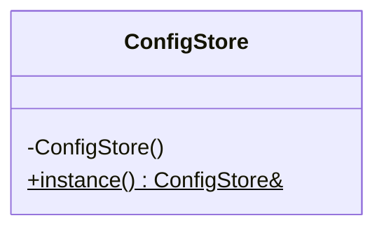
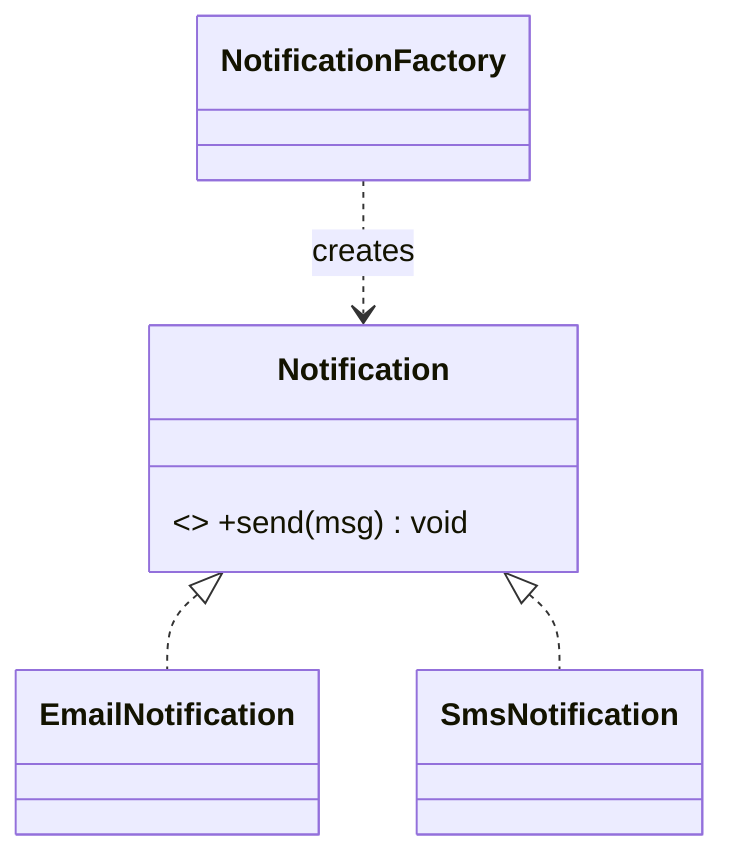

# 07 — Creational patterns

> Prerequisite: `03`-`04`. Creational patterns solve one problem family:
> **object creation is getting complicated or inflexible, and you want to
> decouple "what gets created" from "who uses it."**

Five patterns. For each: the problem it solves, the shape of the solution,
working C++, when to actually reach for it, and the pitfall that costs
points if you miss it.

## Singleton

**Problem**: exactly one instance of a class should exist, and it needs a
single well-known global access point (a config store, a logger, a hardware
resource manager for a single physical device).

```cpp
class ConfigStore {
public:
    static ConfigStore& instance() {
        static ConfigStore inst;      // C++11 magic statics: thread-safe init,
        return inst;                  // constructed on first call, destroyed at exit
    }
    ConfigStore(const ConfigStore&) = delete;
    ConfigStore& operator=(const ConfigStore&) = delete;

    std::string get(const std::string& key) const;
private:
    ConfigStore() = default;
};
```



**This is called the Meyers' Singleton** (after Scott Meyers, who
popularised it) — the name to use when discussing it, since "Singleton"
alone is ambiguous between this form and the broken pre-C++11 forms below.
**Why the magic-static form and not a raw global pointer with manual
locking**: the C++11 standard guarantees the initialization of a function-
local `static` is thread-safe (compiler inserts the locking for you), so this
is both simpler and correct where a naive double-checked-locking
implementation from pre-C++11 code is a classic, easy-to-get-wrong interview
trap. If asked to explain the old broken pattern, know that the bug was
reordering: a thread could observe a non-null pointer to a not-yet-fully-
constructed object without a memory barrier.

**Pitfall, and it's a big one**: Singleton is the most *overused* pattern in
junior-to-mid designs, and interviewers actively watch for misuse. It
introduces **global mutable state** (hard to reason about, hard to test —
you can't inject a mock in its place without extra machinery) and hides a
dependency (a class that calls `ConfigStore::instance()` internally doesn't
declare that dependency in its constructor, so you can't see it from the
type signature). Default stance for this track: **prefer passing a
dependency explicitly (constructor injection) over Singleton**, and reach for
Singleton only when there is a genuine single-physical-resource constraint
(one hardware register bank, one connection to a physical device) — which,
notably, is a scenario you actually hit often in embedded/driver work, so
you have real examples to cite here that most candidates don't.

## Factory Method

**Problem**: a class needs to create objects, but the exact concrete type to
create should be decided by subclasses (or a parameter), not hardcoded.

```cpp
class Notification { public: virtual void send(const std::string& msg) = 0; virtual ~Notification()=default; };
class EmailNotification : public Notification { void send(const std::string&) override; };
class SmsNotification   : public Notification { void send(const std::string&) override; };

class NotificationFactory {
public:
    static std::unique_ptr<Notification> create(const std::string& type) {
        if (type == "email") return std::make_unique<EmailNotification>();
        if (type == "sms")   return std::make_unique<SmsNotification>();
        throw std::invalid_argument("unknown notification type: " + type);
    }
};
```



**When to reach for it**: the moment client code would otherwise need a
`switch`/`if-chain` on a type tag to decide what to construct — Factory
Method centralises that decision in one place (satisfying OCP: adding
`PushNotification` means adding a case here and a new class, not touching
every call site that creates notifications).

**Pitfall**: this simple static-method form still has an `if`-chain inside
the factory itself — that's fine and normal (the decision has to live
*somewhere*); the OCP win is that it lives in exactly one place instead of
scattered across callers. Don't over-engineer a "Factory Method must use
inheritance with a `createProduct()` virtual method on an abstract creator"
textbook form unless the problem genuinely calls for *different factories*
producing *different families* per subclass — that's actually Abstract
Factory, next.

## Abstract Factory

**Problem**: you need to create **families of related objects** that must be
used together, and you want to swap the whole family at once. Classic
example: a cross-platform UI kit where `Button`, `Checkbox`, and `Menu` must
all be either "Windows-style" or "Mac-style" — never mixed.

```cpp
class Button   { public: virtual void render() = 0; virtual ~Button()=default; };
class Checkbox { public: virtual void render() = 0; virtual ~Checkbox()=default; };

class WinButton   : public Button   { void render() override; };
class WinCheckbox : public Checkbox { void render() override; };
class MacButton   : public Button   { void render() override; };
class MacCheckbox : public Checkbox { void render() override; };

class UIFactory {
public:
    virtual std::unique_ptr<Button>   createButton()   = 0;
    virtual std::unique_ptr<Checkbox> createCheckbox() = 0;
    virtual ~UIFactory() = default;
};
class WinFactory : public UIFactory {
    std::unique_ptr<Button>   createButton()   override { return std::make_unique<WinButton>(); }
    std::unique_ptr<Checkbox> createCheckbox() override { return std::make_unique<WinCheckbox>(); }
};
class MacFactory : public UIFactory {
    std::unique_ptr<Button>   createButton()   override { return std::make_unique<MacButton>(); }
    std::unique_ptr<Checkbox> createCheckbox() override { return std::make_unique<MacCheckbox>(); }
};
```

**The distinction from Factory Method that interviewers actually probe**:
Factory Method creates **one product**; Abstract Factory creates a
**consistent family of products**, and the whole point is that swapping
`WinFactory` for `MacFactory` is the *only* change needed to switch every
product in the family consistently — client code that holds a `UIFactory&`
never mixes a `WinButton` with a `MacCheckbox` by construction.

**Embedded-relevant framing that plays well in Nvidia/Cisco-style loops**: a
`HalFactory` that produces a consistent family of peripheral drivers
(`Uart`, `Spi`, `Gpio`) per chip variant is a real Abstract Factory — this is
covered in depth in `lld/notes/05_hal_architecture.md`, which this pattern
directly sets up.

## Builder

**Problem**: constructing an object needs many optional parameters, or
needs to happen in a specific multi-step sequence, and a constructor with
ten parameters (or ten overloads) is unreadable and error-prone.

```cpp
class HttpRequest {
public:
    class Builder {
    public:
        Builder& url(std::string u)      { url_ = std::move(u); return *this; }
        Builder& method(std::string m)   { method_ = std::move(m); return *this; }
        Builder& header(std::string k, std::string v) { headers_[k] = v; return *this; }
        Builder& body(std::string b)     { body_ = std::move(b); return *this; }
        HttpRequest build() const { return HttpRequest(*this); }
    private:
        friend class HttpRequest;
        std::string url_, method_ = "GET", body_;
        std::map<std::string, std::string> headers_;
    };
private:
    explicit HttpRequest(const Builder& b)
        : url_(b.url_), method_(b.method_), headers_(b.headers_), body_(b.body_) {}
    std::string url_, method_, body_;
    std::map<std::string, std::string> headers_;
};

// usage
auto req = HttpRequest::Builder()
               .url("https://api.example.com")
               .method("POST")
               .header("Content-Type", "application/json")
               .body(R"({"k":"v"})")
               .build();
```

This **fluent builder** (each setter returns `*this`, chained) is the form
that comes up constantly in interviews — know it cold, it's a five-minute
implementation once memorised. The classic GoF form additionally has a
separate `Director` class that encodes a fixed *construction sequence*
(useful when the steps must happen in a specific order and you want that
order reusable, e.g. `buildMinimal()` vs `buildFull()`); mention it exists,
but the fluent form above is what you'll actually be asked to write.

**When to reach for it**: an object has ≥4 constructor parameters, several
optional, or requires validation that only makes sense once all fields are
set (validate once in `build()`, not scattered across setters).

## Prototype

**Problem**: creating a new object is expensive (deep object graph, or
requires an expensive computation/IO to initialize), but you already have a
similar object — clone it and tweak, instead of building from scratch.

```cpp
class Shape {
public:
    virtual std::unique_ptr<Shape> clone() const = 0;
    virtual ~Shape() = default;
};
class Circle : public Shape {
public:
    Circle(double r, Color c) : r_(r), color_(c) {}
    std::unique_ptr<Shape> clone() const override {
        return std::make_unique<Circle>(*this);   // copy ctor does the work
    }
private:
    double r_; Color color_;
};
```

**When it actually earns its place**: prototypes matter most when the
concrete type isn't known at the call site — you have a `Shape*` (could be
any subtype) and want a copy without a `switch` on type, or a giant
constructor-argument list to re-derive. If you know the concrete type
locally, `auto copy = original;` (the ordinary copy constructor) already
does this — don't introduce a `clone()` virtual method for a problem the
language solves for free. This is the pattern most likely to be pure
overengineering if reached for reflexively; know it, use it rarely.

## Object Pool

**Problem**: object construction/destruction is expensive relative to how
often instances turn over — not because building one instance is complex
(that's Builder's problem) but because the raw cost of allocation
(`new`/`delete`) itself is too slow for the workload's latency budget, or
because allocation-triggered garbage/fragmentation is unacceptable in a
hard-real-time or low-latency path. Pre-allocate a fixed pool up front,
hand out and reclaim instances instead of constructing/destroying them per
use.

```cpp
template <typename T>
class ObjectPool {
public:
    explicit ObjectPool(size_t size) {
        pool_.reserve(size);
        for (size_t i = 0; i < size; ++i) pool_.push_back(std::make_unique<T>());
    }

    std::unique_ptr<T> acquire() {
        if (pool_.empty()) return std::make_unique<T>();   // pool exhausted: fall back
        auto obj = std::move(pool_.back());
        pool_.pop_back();
        return obj;
    }
    void release(std::unique_ptr<T> obj) {
        obj->reset();                    // caller-defined: clear state before reuse
        pool_.push_back(std::move(obj));
    }

private:
    std::vector<std::unique_ptr<T>> pool_;
};
```

**Not a GoF pattern** (it postdates the original 23), but ubiquitous in
practice and worth knowing by name — you already have real examples from
your own domain (a pool of pre-allocated packet buffers, a pool of DMA
descriptors). A tested, more complete implementation — including the
thread-safety question this simplified sketch ignores — already exists in
`lld/notes/03_thread_safe_primitives.md`; read it there for the production
version rather than re-deriving it. **When to reach for it**: a hot path
allocating/freeing the same object type at high frequency (a per-request
handler object, a per-packet buffer) where profiling has shown allocator
overhead is real — not speculatively, the same discipline `07_design_patterns_creational.md`
already applies to Prototype: measure before reaching for this.

## Quick reference

| Pattern | One creator, one product | One creator, product family | Complex construction sequence | Clone existing object | Reuse pre-built instances |
| --- | --- | --- | --- | --- | --- |
| Factory Method | ✓ | | | | |
| Abstract Factory | | ✓ | | | |
| Builder | | | ✓ | | |
| Prototype | | | | ✓ | |
| Object Pool | | | | | ✓ |
| Singleton | orthogonal — about instance *count*, not creation *process* | | | | |

## Interview angles

**"How would you avoid this giant constructor / this switch statement when
creating objects?"** Map the actual shape of the problem to the table above
before naming a pattern — this is the question where naming the *wrong*
pattern (Builder when they wanted Factory Method) reads as pattern-matching
without understanding.

**"What's wrong with Singleton?"** Global mutable state, hidden dependency,
hard to test, thread-safety must be deliberately reasoned about even in the
"safe" magic-static form (the constructor itself running under contention on
first use). Know the criticism as well as the pattern.

## Exercises

1. Implement the `NotificationFactory` above, then extend it with
   `PushNotification` — time yourself; this exact addition is a common
   live follow-up.
2. Build a fluent `Builder` for a `PizzaOrder` (size, crust type, up to N
   toppings, delivery vs pickup) with validation in `build()` (e.g. delivery
   requires an address) that throws if violated.
3. Take the `UIFactory` example and add a `LinuxFactory` family — confirm
   you didn't have to touch `WinFactory`, `MacFactory`, or client code that
   holds a `UIFactory&`. That's OCP, demonstrated.
4. Write one sentence from memory distinguishing Factory Method from
   Abstract Factory that you'd be comfortable saying out loud under time
   pressure.
5. Implement `ObjectPool<T>` above, then benchmark 100,000 acquire/release
   cycles against 100,000 raw `new T()`/`delete` cycles for a small `T` —
   confirm there's a real, measurable difference before ever citing this
   pattern as a performance justification in an interview.
