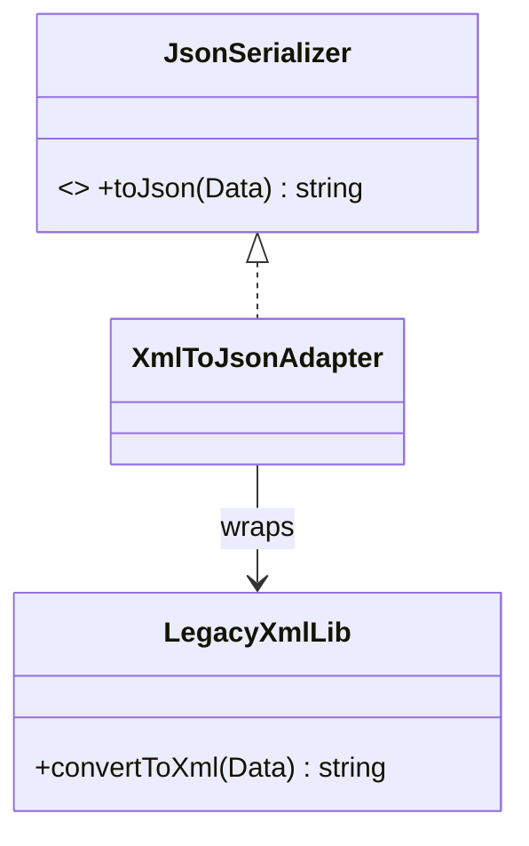
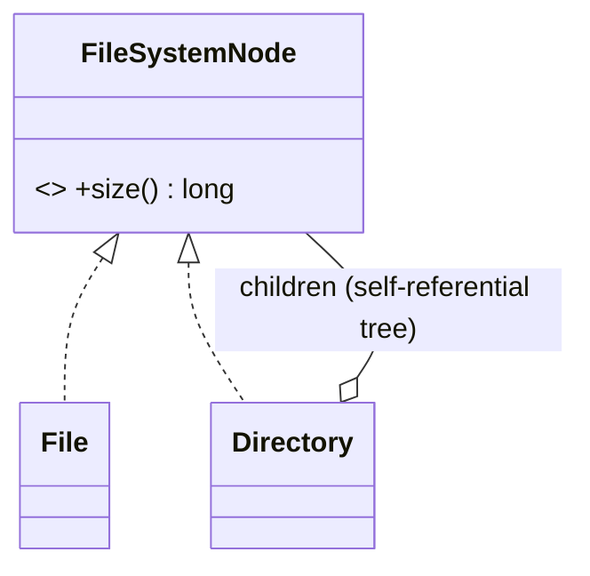

# 08 — Structural patterns

> Prerequisite: `03`-`07`. Structural patterns solve one problem family: **how
> to compose classes/objects into larger structures while keeping them
> loosely coupled** — usually because an existing interface doesn't quite fit
> what you need, or an object graph is getting too large/rigid.

Seven patterns, same format as `07`: problem, solution, C++, when to reach
for it, pitfall.

## Adapter

**Problem**: you have an existing class with an incompatible interface (often
third-party or legacy code you can't modify) and you need it to conform to an
interface your code expects.

```cpp
// Interface your code expects
class JsonSerializer { public: virtual std::string toJson(const Data&) = 0; virtual ~JsonSerializer()=default; };

// Existing, unrelated third-party class you can't change
class LegacyXmlLib { public: std::string convertToXml(const Data&); };

// Adapter makes LegacyXmlLib conform to JsonSerializer's *call site*,
// even though it still produces XML under the hood — a more realistic
// adapter converts XML->JSON; shown simplified to isolate the pattern shape.
class XmlToJsonAdapter : public JsonSerializer {
public:
    explicit XmlToJsonAdapter(LegacyXmlLib& legacy) : legacy_(legacy) {}
    std::string toJson(const Data& d) override {
        std::string xml = legacy_.convertToXml(d);
        return convertXmlStringToJson(xml);
    }
private:
    LegacyXmlLib& legacy_;
};
```



**When to reach for it**: integrating a library or legacy component you
cannot modify into a codebase with its own established interfaces —
extremely common in embedded/driver work when wrapping a vendor SDK behind
your own HAL interface (direct link to `lld/notes/05_hal_architecture.md`).

**Pitfall**: an Adapter that itself contains real business logic (not just
translation) is a smell — it means the "adaptation" grew into a second
responsibility (SRP violation). Keep it a thin translation layer.

## Bridge

**Problem**: you have two dimensions of variation that would otherwise
multiply into a class explosion — e.g. shape type (Circle, Square) ×
renderer (Vector, Raster) would need `VectorCircle`, `RasterCircle`,
`VectorSquare`, `RasterSquare`... Bridge decouples the two so each varies
independently.

```cpp
class Renderer { public: virtual void renderCircle(double r) = 0; virtual ~Renderer()=default; };
class VectorRenderer : public Renderer { void renderCircle(double r) override; };
class RasterRenderer  : public Renderer { void renderCircle(double r) override; };

class Shape {
public:
    explicit Shape(std::shared_ptr<Renderer> r) : renderer_(std::move(r)) {}
    virtual void draw() = 0;
    virtual ~Shape() = default;
protected:
    std::shared_ptr<Renderer> renderer_;
};
class Circle : public Shape {
public:
    Circle(std::shared_ptr<Renderer> r, double radius) : Shape(std::move(r)), radius_(radius) {}
    void draw() override { renderer_->renderCircle(radius_); }
private:
    double radius_;
};
```

Now `Circle` × `{Vector, Raster}` and any future `Square` × any future
renderer are all handled by composition — `N + M` classes instead of `N ×
M`. **This is Bridge vs Adapter, the distinction interviewers ask for
directly**: Adapter is retrofitted to make two *existing* incompatible
interfaces work together; Bridge is designed in *up front* specifically to
let an abstraction and its implementation vary independently.

## Composite

**Problem**: you need to treat individual objects and groups of objects
**uniformly** through the same interface — classic case: a filesystem where
a `File` and a `Directory` (which contains `File`s and other `Directory`s)
should both respond to `getSize()`.

```cpp
class FileSystemNode { public: virtual long size() const = 0; virtual ~FileSystemNode()=default; };

class File : public FileSystemNode {
public:
    explicit File(long size) : size_(size) {}
    long size() const override { return size_; }
private:
    long size_;
};

class Directory : public FileSystemNode {
public:
    void add(std::shared_ptr<FileSystemNode> child) { children_.push_back(std::move(child)); }
    long size() const override {
        long total = 0;
        for (auto& c : children_) total += c->size();   // recurses through the tree uniformly
        return total;
    }
private:
    std::vector<std::shared_ptr<FileSystemNode>> children_;
};
```



**When to reach for it**: any tree-shaped domain — UI widget hierarchies,
org charts, a menu system with submenus, expression trees. The tell in a
problem statement is "some things contain other things of the same kind,
and I want to operate on either without knowing which."

## Decorator

**Problem**: you need to add responsibilities to an individual object
dynamically, without subclassing (which would explode combinatorially if
responsibilities can stack — a `Coffee` with any subset of
`{Milk, Sugar, Caramel}` needs 8 subclasses if done by inheritance).

```cpp
class Beverage { public: virtual double cost() const = 0; virtual std::string desc() const = 0; virtual ~Beverage()=default; };
class Espresso : public Beverage {
public:
    double cost() const override { return 2.0; }
    std::string desc() const override { return "Espresso"; }
};

class Decorator : public Beverage {     // also a Beverage: this is the key trick
public:
    explicit Decorator(std::unique_ptr<Beverage> inner) : inner_(std::move(inner)) {}
protected:
    std::unique_ptr<Beverage> inner_;
};
class Milk : public Decorator {
public:
    using Decorator::Decorator;
    double cost() const override { return inner_->cost() + 0.5; }
    std::string desc() const override { return inner_->desc() + " + Milk"; }
};
class Caramel : public Decorator {
public:
    using Decorator::Decorator;
    double cost() const override { return inner_->cost() + 0.7; }
    std::string desc() const override { return inner_->desc() + " + Caramel"; }
};

// usage — stack any combination at runtime, no class explosion
auto order = std::make_unique<Caramel>(std::make_unique<Milk>(std::make_unique<Espresso>()));
```

**The mechanism to state explicitly**: a `Decorator` *is-a* `Beverage` and
*has-a* `Beverage` at the same time — that's what lets you wrap
indefinitely and still satisfy the same interface every caller expects.
This is the single most-asked Structural pattern in interviews because the
"class explosion from combinatorial subclassing" problem is intuitive and
the fix is elegant. Know it cold, including that the wrapping order changes
behaviour if operations aren't commutative (adding `Caramel` then `Milk`
vs. the reverse could matter for, say, a discount-percentage decorator vs a
flat-fee decorator — worth a one-line caveat if asked).

## Facade

**Problem**: a subsystem has many classes with complex interactions, and
most callers only need a small, simple slice of that complexity.

```cpp
// Subsystem: CPU, Memory, HardDrive each with their own complex APIs
class Computer {
public:
    void start() {           // the facade
        cpu_.freeze();
        memory_.load(BOOT_ADDRESS, hardDrive_.read(BOOT_SECTOR, SECTOR_SIZE));
        cpu_.jump(BOOT_ADDRESS);
        cpu_.execute();
    }
private:
    CPU cpu_; Memory memory_; HardDrive hardDrive_;
};
```

Callers just call `computer.start()`. This is the simplest pattern in the
catalog and the one most likely to already be present, unnamed, in code
you've written — the value here is purely having the vocabulary: "I added a
Facade over the three-step setup so callers don't need to know the
subsystem's internal ordering" is a precise, confident sentence.

**Distinction from Adapter**: Adapter changes an interface to match what's
expected (still roughly 1:1 in scope). Facade simplifies access to a whole
*subsystem* of multiple classes — it doesn't change any individual
interface, it hides the need to orchestrate several of them.

## Flyweight

**Problem**: you need to instantiate a very large number of similar
objects, and the memory cost of duplicating their shared state per instance
is prohibitive. Split each object's state into **intrinsic** (shared,
immutable, stored once) and **extrinsic** (unique per instance, passed in at
use time).

```cpp
// Intrinsic state: glyph bitmap data for a character, shared across every
// occurrence of that character in a document.
class GlyphFlyweight {
public:
    explicit GlyphFlyweight(char c) : bitmap_(renderGlyphBitmap(c)) {}
    void draw(int x, int y, int fontSize) const;   // x, y, fontSize: extrinsic, passed in
private:
    Bitmap bitmap_;    // expensive, shared
};

class GlyphFactory {
public:
    std::shared_ptr<GlyphFlyweight> get(char c) {
        auto it = cache_.find(c);
        if (it != cache_.end()) return it->second;
        auto fw = std::make_shared<GlyphFlyweight>(c);
        cache_[c] = fw;
        return fw;
    }
private:
    std::unordered_map<char, std::shared_ptr<GlyphFlyweight>> cache_;
};
```

A million-character document needs one `GlyphFlyweight` per **distinct**
character (a few dozen for ASCII text), not one per occurrence — each
occurrence stores only its extrinsic `(x, y, fontSize)`.

**This is a systems-relevant pattern worth flagging**: it's the OOP-formalised
version of an interning/object-pool technique you've likely used
instinctively in memory-constrained embedded work — naming it as Flyweight
in an interview signals you know the vocabulary, not just the instinct.

## Proxy

**Problem**: you want to control access to an object — lazily create it
(Virtual Proxy), check permissions before forwarding a call (Protection
Proxy), or add caching/logging transparently (Remote/Caching Proxy) —
without the caller knowing it isn't talking to the real object directly.

```cpp
class Image { public: virtual void display() = 0; virtual ~Image()=default; };

class RealImage : public Image {     // expensive to construct (loads from disk)
public:
    explicit RealImage(std::string path) : path_(std::move(path)) { loadFromDisk(); }
    void display() override { renderToScreen(); }
private:
    std::string path_;
    void loadFromDisk();
};

class ImageProxy : public Image {    // Virtual Proxy: defers the expensive load
public:
    explicit ImageProxy(std::string path) : path_(std::move(path)) {}
    void display() override {
        if (!real_) real_ = std::make_unique<RealImage>(path_);   // created on first use
        real_->display();
    }
private:
    std::string path_;
    std::unique_ptr<RealImage> real_;
};
```

**Distinction from Decorator that's worth having ready**: both wrap an
object behind the same interface. Decorator's *purpose* is to **add
behaviour**; Proxy's purpose is to **control access** to the same behaviour
(lazily, remotely, with permission checks). Structurally near-identical;
intent differs.

## Quick reference

| Pattern | Fixes | Tell in the problem statement |
| --- | --- | --- |
| Adapter | Incompatible existing interface | "integrate this third-party/legacy thing" |
| Bridge | Two independent dimensions of variation | "N types × M implementations, avoid class explosion" |
| Composite | Tree of uniform part/whole objects | "some things contain other things of the same kind" |
| Decorator | Combinatorial optional responsibilities | "any subset of add-ons, at runtime" |
| Facade | Complex subsystem, simple common case | "orchestrate several classes in the right order" |
| Flyweight | Huge object count, shared immutable state | "millions of small similar objects" |
| Proxy | Control access (lazy/remote/permission) to an object | "defer expensive construction" / "check access first" |

## Interview angles

**"How is Decorator different from Proxy? From Bridge?"** Structure vs
intent, exactly as stated above — memorize both one-liners.

**"How would you avoid a class explosion here?"** Identify whether it's
combinatorial *optional add-ons on one object* (Decorator) or *two
independent axes of variation across a type hierarchy* (Bridge) — this
distinction is the actual test.

## Exercises

1. Implement the `Beverage`/`Decorator` example, then add a `Discount`
   decorator that takes a percentage off the *current* total — verify
   ordering changes the result, and be ready to explain why in one sentence.
2. Implement `Composite` for a simple menu system (`MenuItem` leaf,
   `Menu` composite that can contain both) with a `totalPrice()` that
   recurses.
3. Write a `Proxy` that adds access logging in front of a `Database`
   interface, without modifying the real `Database` implementation at all.
4. From memory: write the one-sentence distinction for Adapter vs Facade,
   and for Decorator vs Proxy.
