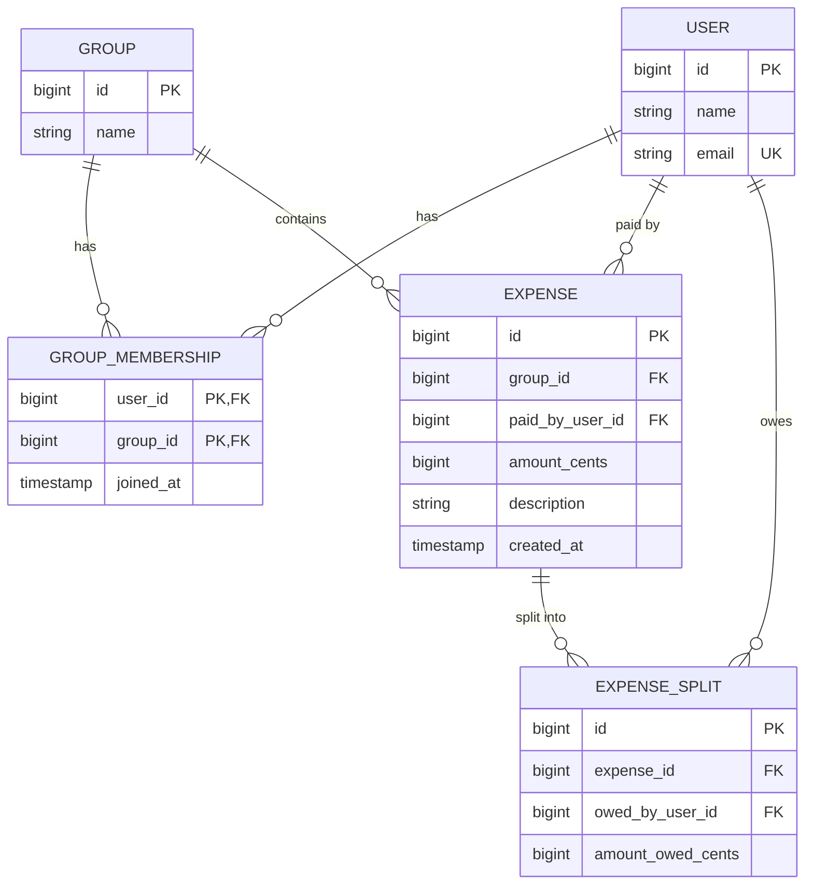

# 21 — Schema design interviews

> Prerequisite: `16` (for the five-LLD-interview-types taxonomy this file
> is the dedicated treatment of type 5), and helpful but not required:
> `01_machine_coding_problems/04_splitwise_expense_sharing.md` and
> `11_library_management_system.md`, whose class designs this file reuses
> for its worked example. A genuinely distinct interview format from
> everything else in this track: no classes, no inheritance, no
> polymorphism — the deliverable is a set of tables, their keys, and the
> relationships between them, defended against a normalization and a
> scale follow-up.

## What's actually being graded, and why it's a different skill than OOD

"Design the schema for X" and "design the classes for X" sound like the
same request pointed at the same problem, but they test different muscles.
Object design asks "what behavior does each responsibility need, and how
do objects collaborate at runtime?" Schema design asks a narrower, more
mechanical question: **given this domain's entities and relationships, what
tables, columns, keys, and constraints represent that data with no
redundancy, no ambiguity, and no way to store contradictory facts?**
There's no `virtual`, no `Strategy`, no live requirement change to absorb
gracefully — the whole round is graded on whether your tables could
actually hold real data correctly under concurrent writes, and whether you
can defend *why* a column lives on one table and not another.

## Step 1 — from a requirements paragraph to entities and attributes

The same noun-extraction instinct `16_machine_coding_framework.md` teaches
for class design applies here, aimed at a different output: nouns become
**tables**, not classes; a noun's properties become **columns**, not
member variables; and — the genuinely new skill — you now have to decide
**where a fact belongs when two entities are both plausible owners of it**.

> "Users can be members of multiple groups. Each group has a list of
> expenses. Each expense is paid by one user and split among some subset
> of the group's members, either equally or by exact amounts."

Entities jump out the same way they did for the OOD version of this exact
problem (`01_machine_coding_problems/04_splitwise_expense_sharing.md`):
**User**, **Group**, **Expense**. The new question a schema round asks
that an OOD round doesn't: *"split among some subset of the group's
members, either equally or by exact amounts"* — that's not an attribute of
`Expense` (which user, how much, is a fact about the *pairing* of an
expense and a user, not about the expense alone) and it's not an attribute
of `User` either (the same is true from that side). It needs its own
table. Recognizing "this is a fact about a *relationship*, not about
either entity alone" — and giving it a table — is the single most
important instinct in this whole file.

## Step 2 — relationships and cardinality

Every pair of entities relates one of three ways, and naming which one
determines your table shape:

- **One-to-one (1:1)** — rare, but real: a `User` and a `UserProfile`
  holding optional, large, rarely-queried fields (bio, avatar URL) you
  don't want on every query that touches `User`. Usually modeled as two
  tables sharing a primary key, split apart purely for a *reason*
  (access-pattern separation, not because "it felt cleaner") — a 1:1 with
  no such reason should usually just be one table.
- **One-to-many (1:N)** — the most common shape. One `Group` has many
  `Expense`s; one `Expense` belongs to exactly one `Group`. Modeled by
  putting the foreign key on the *many* side: `Expense.group_id`
  references `Group.id`, never the other way around.
- **Many-to-many (N:N)** — needs a third table (a **junction** /
  **bridge** / **associative** table) because neither side can hold a
  single foreign key for "many" rows on the other side. `User` and
  `Group`: a user belongs to many groups, a group has many users — neither
  `User` nor `Group` gets a `group_id`/`user_id` column; instead a
  `GroupMembership(user_id, group_id)` table holds one row per
  membership, with a composite primary key `(user_id, group_id)`.



Mermaid's crow's-foot-style notation above (`||--o{`) reads as "exactly
one, to zero-or-many" — the same cardinality vocabulary
`00_foundations/04_uml_and_modeling.md` teaches for UML association
multiplicities (`1`, `0..*`), applied to tables instead of classes. `PK`
marks a primary key, `FK` a foreign key, `UK` a unique constraint — read
`EXPENSE_SPLIT`'s `expense_id FK` and `owed_by_user_id FK` together as
"this row is a fact about one specific (expense, user) pairing," exactly
the relationship-needs-its-own-table instinct from Step 1.

**A self-referencing relationship, worth knowing the term for even though
it isn't in the diagram above**: a table with a foreign key pointing back
at its own primary key — an `Employee(id, manager_id)` where `manager_id`
references `Employee.id`, modeling "who reports to whom" without a
separate table, because the relationship is between two rows of the
*same* entity.

## Step 3 — keys

- **Primary key (PK)** — uniquely identifies a row. Prefer a **surrogate
  key** (an auto-incrementing `id`, meaningless on its own) over a
  **natural key** (a real-world value like `email`, used as the PK
  directly) almost always: natural keys can change (a user changes their
  email) and a PK should never need to change, since every foreign key
  referencing it would have to change too.
- **Foreign key (FK)** — a column whose value must match a primary key in
  another table (or be `NULL`, if the relationship is optional). This is
  the mechanism that makes a 1:N relationship real and enforceable — the
  database itself rejects an `Expense.group_id` that doesn't correspond to
  an actual `Group.id`, the schema-level equivalent of a class invariant
  enforced in a constructor.
- **Composite primary key** — a primary key made of more than one column
  together, exactly `GROUP_MEMBERSHIP(user_id, group_id)` above: neither
  column alone is unique (a user has many memberships, a group has many
  members), but the *pair* is.
- **Unique constraint (UK)**, distinct from a primary key — `User.email`
  should be unique (no two users share an email) but isn't *the* row
  identifier; you can have several unique constraints on one table, but
  only one primary key.

## Step 4 — normalization: 1NF through BCNF, each with a violation and a fix

Same "vocabulary as a compressed argument for a design decision" idea
`05_solid_principles.md` teaches for SOLID, applied to schema design — a
normal form isn't a rule to recite, it's a named argument for why a
particular table shape is wrong and what to do about it.

**First Normal Form (1NF) — every column holds one atomic value, no
repeating groups.**

```
Violates 1NF:                          Fixed (1NF):
Expense(id, description, payers)       Expense(id, description)
  payers = "1:500,2:300"  <- multiple  ExpensePayer(expense_id, user_id, amount)
  values crammed into one column         <- one row per (expense, payer) fact
```

The tell: if you ever find yourself parsing a delimiter out of a column's
value to get at "the real" data, that column is holding more than one
fact and needs its own table — exactly the `EXPENSE_SPLIT` table from
Step 2, arrived at from a different angle.

**Second Normal Form (2NF) — every non-key column depends on the *whole*
primary key, not just part of it (only relevant when the PK is
composite).**

```
Violates 2NF:                              Fixed (2NF):
OrderItem(order_id, product_id,            OrderItem(order_id, product_id, quantity)
          quantity, product_name)          Product(product_id, product_name)
  PK = (order_id, product_id)                <- product_name depends only on
  but product_name depends only on              product_id, half the PK -- it
  product_id, not on order_id too               belongs on Product, not here
```

If `product_name` stays on `OrderItem`, it's duplicated on every order
containing that product — rename the product once, and now you have to
find and update every `OrderItem` row that copied the old name, or your
data silently disagrees with itself.

**Third Normal Form (3NF) — no non-key column depends on *another
non-key column* (no "transitive" dependency).**

```
Violates 3NF:                          Fixed (3NF):
Employee(id, dept_id, dept_name)       Employee(id, dept_id)
  dept_name depends on dept_id,        Department(dept_id, dept_name)
  not on Employee's own id               <- dept_name lives where it's
                                            actually determined
```

Same duplication argument as 2NF, one level removed: `dept_name` isn't a
fact about the *employee*, it's a fact about the *department* the
employee happens to belong to — storing it on `Employee` duplicates it
once per employee in that department.

**Boyce-Codd Normal Form (BCNF) — a stricter version of 3NF: every
determinant (a column or set of columns that determines another column's
value) must itself be a candidate key.** Rare to hit in an interview
directly, but worth naming if a table has *two* plausible unique columns
where one determines the other (a classic textbook case: a
`(student, subject) -> teacher` table where each subject is actually
taught by exactly one teacher regardless of student, making `subject` on
its own a stricter determinant than the stated composite key). Naming BCNF
correctly, even briefly, signals you know normalization is a ladder past
3NF, not just three named rules.

**The practical rule for the round**: default to 3NF for anything you
design live — it eliminates the update-anomaly bugs above without
requiring you to reason about BCNF's edge cases under time pressure.
State it as your default explicitly ("I'll normalize to 3NF unless there's
a specific reason not to") the same way you'd state a default
error-handling contract in an API-design round.

## Step 5 — denormalization: knowing when to deliberately break the rules

The follow-up question every schema round eventually asks: **"this design
needs a join across three tables just to show an expense with the payer's
name — is that going to be fast enough at scale?"** Normalization
optimizes for *write correctness* (no duplicated, contradictable data);
**denormalization** trades some of that back for *read speed*, by
deliberately duplicating a value to avoid a join on a hot read path — e.g.
storing `payer_name` directly on `Expense` alongside `paid_by_user_id`,
accepting that a username change now requires an explicit update
(or a background job) to every `Expense` row that copied it, in exchange
for never joining `User` just to render an expense list.

**How to talk about this live**: never denormalize as a first move —
propose the normalized design first, name it as your default, and then
name denormalization as a *specific, justified* response to a *specific,
named* read pattern the interviewer describes ("if expense history is read
far more often than usernames change, duplicating `payer_name` is a
reasonable tradeoff") — exactly the same "name the actual scale where it
matters" instinct `03_oop_fundamentals.md` teaches for the virtual-dispatch
cost question, applied to schema design's version of the same tradeoff.

## Step 6 — indexing, briefly

A **primary key is automatically indexed** — that's what makes "find the
row with this id" fast. Beyond that:

- **Index the columns you filter or join on**, not the columns you merely
  display. `Expense.group_id` (used in "every expense in this group")
  is an obvious index candidate; `Expense.description` (displayed, rarely
  filtered) usually isn't.
- **A composite index** (one index across multiple columns, e.g.
  `(group_id, created_at)`) speeds up queries that filter on the first
  column and sort or range-filter on the second — "expenses in this group,
  newest first" — but doesn't help a query that filters on the second
  column alone.
- **The tradeoff, always worth stating**: every index speeds up reads that
  use it but slows down every write to that table (the index itself has
  to be updated too) and costs storage. "Index everything" is not a free
  answer — naming *which specific query pattern* justifies each index you
  add is the actual signal, the schema-design equivalent of not reaching
  for a pattern "because you just learned it" (`00_how_to_study_this_track.md`'s
  closing warning, restated for this format).

## Relational vs NoSQL — scoping the question correctly

If an interviewer asks "would you use SQL or NoSQL here," the LLD-round
answer is shorter than the HLD one: name that a relational schema fits
when relationships and cross-entity consistency matter (exactly this
Splitwise example — an expense split has to add up correctly across
multiple rows) and a document/key-value store fits when data is naturally
self-contained per record with few cross-record joins (a session cache, an
event log). **The deep version of this tradeoff** — consistency models,
sharding, replication, when a document store's flexibility outweighs a
relational schema's integrity guarantees at real scale — belongs to
`hld/notes/05_storage_engines.md`, not here; in an LLD-scoped schema round,
naming the criterion and picking one is enough, without a full storage-
engine defense.

## Interview angles

**"Design the schema for X" vs. "design the classes for X"** — the
prompt-reading skill from `20_api_design_interviews.md`, applied here:
tables and columns are the deliverable, not `class` declarations. If your
whiteboard has `private:` on it, you've drifted into the wrong format.

**"Walk me through why you split this into two tables instead of one."**
— answer in normalization vocabulary, not vibes: name the specific
anomaly (update/insert/delete) the split prevents, using the 1NF/2NF/3NF
violation-and-fix pattern above as your template.

**"What would you index, and why?"** — name the specific query pattern
each index serves; never answer "everything," for the write-cost reason in
Step 6.

**"How would this schema handle [a new requirement]?"** — the schema-round
version of the live-extension test every machine-coding round also runs.
For Splitwise: "what if an expense needs to be split unevenly by
percentage instead of exact amounts?" — a good answer adds a
`split_type` column to `Expense` (`EQUAL` / `EXACT` / `PERCENTAGE`, an
`enum class` at the application layer per `cpp_primer/04_classes_and_objects.md`)
and lets `EXPENSE_SPLIT.amount_owed_cents` keep meaning "the resolved
amount" regardless of how it was computed — extending without breaking
existing rows, the schema-design version of OCP.

## Exercises

1. Design the schema (tables, columns, keys, cardinalities) for
   `01_machine_coding_problems/11_library_management_system.md` — at
   minimum `Book`, `Member`, and a loan/checkout relationship. Decide,
   and justify in one sentence each: is `Book`-to-`Member` 1:N or N:N once
   you account for a book having multiple physical copies? Does a
   `BookCopy` entity change your answer?
2. Take the `Expense`/`EXPENSE_SPLIT` design above and deliberately
   violate 1NF by cramming `owed_by_user_id:amount_owed_cents` pairs into
   a single delimited string column on `Expense`. Write out, in one
   paragraph, the specific bug this creates the first time two users owe
   different amounts on the same expense and the application needs to
   update just one of them.
3. For the `GROUP_MEMBERSHIP(user_id, group_id)` junction table, name one
   read pattern where you'd add an index on `group_id` alone (beyond the
   composite primary key), and explain why the composite PK
   `(user_id, group_id)` doesn't already make that query fast — composite
   indexes only accelerate lookups that use their *leftmost* column(s).
