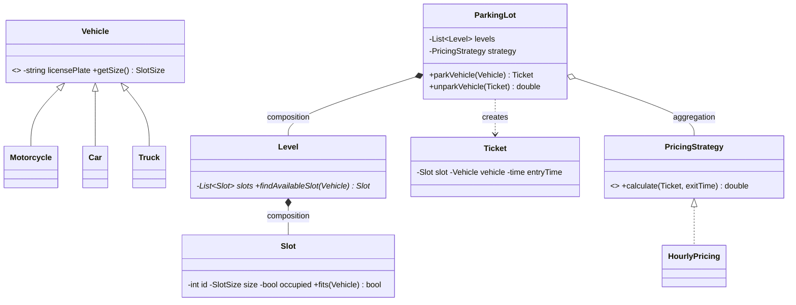

# 02 — Parking Lot

> Difficulty: foundational, and the single most-asked LLD problem across
> every company in this program. Expect it, or a thin reskin of it
> ("design a bicycle rack," "design a valet system"), in a real loop.

## Step 1 — Clarify

Assumed answers (state these in a real round):

- Multi-level lot. Each level has slots of different sizes
  (motorcycle/compact/large).
- Vehicles: Motorcycle, Car, Truck/Bus — a set that's realistically closed
  for this exercise but should still not require editing `ParkingLot` if it
  grows (that's the OCP test baked into this problem).
- Entry: a vehicle arrives, gets assigned the smallest slot it fits in,
  receives a ticket. Exit: pay based on duration, ticket is closed, slot
  freed.
- **Deferred, stated explicitly**: multiple entry/exit gates and the
  concurrency that implies — covered in "Extensions," not built into the
  base solution, to keep the core path implementable in the time budget.

## Step 2 — Entities

| Entity | Responsibility |
| --- | --- |
| `Vehicle` (abstract) → `Motorcycle`, `Car`, `Truck` | Identity + size requirement |
| `Slot` | One physical space; size, occupied state |
| `Level` | Owns a set of slots, finds an available slot for a vehicle |
| `ParkingLot` | Owns levels, orchestrates park/unpark, owns the pricing strategy |
| `Ticket` | Entry record: vehicle, slot, entry time |
| `PricingStrategy` | Computes cost from a ticket + exit time — **growing set**, interface |

`Vehicle` is a genuine is-a hierarchy (inheritance, per `03_oop_fundamentals`'s
rule: model inheritance only against a stable abstract interface) because
every vehicle type shares the same contract (`getSize()`) with no behavioural
divergence beyond that — a clean case for it, unlike the `Rectangle`/`Square`
trap from `05_solid_principles.md`.

## Step 3 — Class diagram



## Step 4-5 — Interfaces and core implementation

```cpp
#include <vector>
#include <memory>
#include <chrono>
#include <optional>
#include <algorithm>
#include <stdexcept>

enum class SlotSize { MOTORCYCLE, COMPACT, LARGE };

class Vehicle {
public:
    Vehicle(std::string plate) : plate_(std::move(plate)) {}
    virtual SlotSize requiredSize() const = 0;
    const std::string& plate() const { return plate_; }
    virtual ~Vehicle() = default;
private:
    std::string plate_;
};
class Motorcycle : public Vehicle { public: using Vehicle::Vehicle; SlotSize requiredSize() const override { return SlotSize::MOTORCYCLE; } };
class Car        : public Vehicle { public: using Vehicle::Vehicle; SlotSize requiredSize() const override { return SlotSize::COMPACT; } };
class Truck       : public Vehicle { public: using Vehicle::Vehicle; SlotSize requiredSize() const override { return SlotSize::LARGE; } };

class Slot {
public:
    Slot(int id, SlotSize size) : id_(id), size_(size) {}
    bool fits(const Vehicle& v) const { return !occupied_ && static_cast<int>(size_) >= static_cast<int>(v.requiredSize()); }
    void occupy()  { occupied_ = true; }
    void vacate()  { occupied_ = false; }
    int id() const { return id_; }
private:
    int id_;
    SlotSize size_;
    bool occupied_ = false;
};

class Level {
public:
    Level(int id, std::vector<Slot> slots) : id_(id), slots_(std::move(slots)) {}

    Slot* findAvailableSlot(const Vehicle& v) {
        // smallest fitting slot first, to leave large slots free for large vehicles
        Slot* best = nullptr;
        for (auto& s : slots_) {
            if (s.fits(v) && (!best || s.id() < best->id())) best = &s;
        }
        return best;
    }
private:
    int id_;
    std::vector<Slot> slots_;
};

using Clock = std::chrono::steady_clock;

struct Ticket {
    int id;
    std::string plate;
    Slot* slot;
    Clock::time_point entryTime;
};

class PricingStrategy {
public:
    virtual double calculate(const Ticket& t, Clock::time_point exitTime) const = 0;
    virtual ~PricingStrategy() = default;
};
class HourlyPricing : public PricingStrategy {
public:
    double calculate(const Ticket& t, Clock::time_point exitTime) const override {
        auto hours = std::chrono::duration_cast<std::chrono::minutes>(exitTime - t.entryTime).count() / 60.0;
        return std::max(1.0, std::ceil(hours)) * 10.0;   // minimum 1 hour charge
    }
};

class ParkingLot {
public:
    ParkingLot(std::vector<Level> levels, std::unique_ptr<PricingStrategy> pricing)
        : levels_(std::move(levels)), pricing_(std::move(pricing)) {}

    std::optional<Ticket> parkVehicle(const Vehicle& v) {
        for (auto& level : levels_) {
            if (Slot* slot = level.findAvailableSlot(v)) {
                slot->occupy();
                Ticket t{nextTicketId_++, v.plate(), slot, Clock::now()};
                return t;
            }
        }
        return std::nullopt;   // lot full
    }

    double unparkVehicle(const Ticket& t) {
        double cost = pricing_->calculate(t, Clock::now());
        t.slot->vacate();
        return cost;
    }

private:
    std::vector<Level> levels_;
    std::unique_ptr<PricingStrategy> pricing_;
    int nextTicketId_ = 1;
};
```

**Why `optional<Ticket>` from `parkVehicle` instead of throwing**: "lot
full" is an expected, common outcome, not an exceptional one — reserve
exceptions for genuinely invalid input (a null vehicle pointer), and use the
return type to express an expected failure. This distinction (expected
failure vs. exceptional error) is a good one-liner to have ready if asked
why you chose `optional` over an exception here.

## Step 6 — Edge cases handled

- Lot completely full → `parkVehicle` returns `nullopt`, caller decides
  (queue the vehicle? reject? — say this is a product decision you'd ask
  about, not a technical one).
- Smallest-fitting-slot assignment, so a motorcycle doesn't waste a large
  slot — implemented via the size comparison in `Slot::fits`, worth pointing
  out unprompted as a resource-utilization decision.
- Minimum one-hour charge in pricing, a common real-world requirement worth
  anticipating even if not stated.

## Extensions (what a live follow-up usually asks)

**"Multiple entry gates, cars arriving simultaneously — what breaks?"** Two
threads calling `parkVehicle` concurrently can race on `findAvailableSlot`
then `occupy()` — both could find the same free slot before either marks it
occupied (check-then-act race). Fix: a mutex per `Level` (not a single lock
across `ParkingLot`, which would serialize unrelated levels unnecessarily —
naming this scoping choice is the Staff-level answer flagged in
`00_foundations/16`), or `std::atomic<bool>` on `Slot::occupied_` with a
compare-and-swap in `occupy()` so the race resolves without a lock at all.
Cross-reference `lld/notes/03_thread_safe_primitives.md` for the primitives.

**"Add electric vehicle charging slots."** A `SlotFeature` flag/enum on
`Slot` (or a small set of slot subtypes) plus a filter in
`findAvailableSlot` — doesn't require touching `Vehicle` or `PricingStrategy`
at all, a good example of an extension that's cheap specifically because
`Slot` and `Vehicle` were kept decoupled from each other (`Slot` doesn't
know vehicle types, `Vehicle` doesn't know slot layout).

**"Add a per-vehicle-type pricing tier."** `HourlyPricing` becomes
`HourlyPricing` keyed by `SlotSize`, or you add `PricingStrategy`
implementations per vehicle type selected by a small `PricingStrategyFactory`
— this is Factory Method (`00_foundations/07`) composed with the existing
Strategy, a realistic combination to expect.

**"Support reservations ahead of time."** A `ReservationService` collaborator
issuing holds on specific slots before the vehicle arrives — new class,
`Level::findAvailableSlot` gains a "skip reserved" check. Worth noting this
is additive, not a rewrite, because slot state (`occupied_`) was already
centralized in `Slot` rather than duplicated.

## Exercises

1. Implement the above from scratch in 35-40 minutes, then add the
   concurrency fix from "Extensions" and write a small test that spawns two
   threads racing for the last slot, asserting exactly one succeeds.
2. Add `Truck` requiring two adjacent `LARGE` slots — this breaks the
   one-vehicle-one-slot assumption baked into the current `Slot`/`Level`
   design; identify exactly which method's contract has to change and why.
3. Add a `SlotPricingFactory` producing a `PricingStrategy` per `SlotSize`.
   Confirm `ParkingLot`'s orchestration method needs zero changes.
