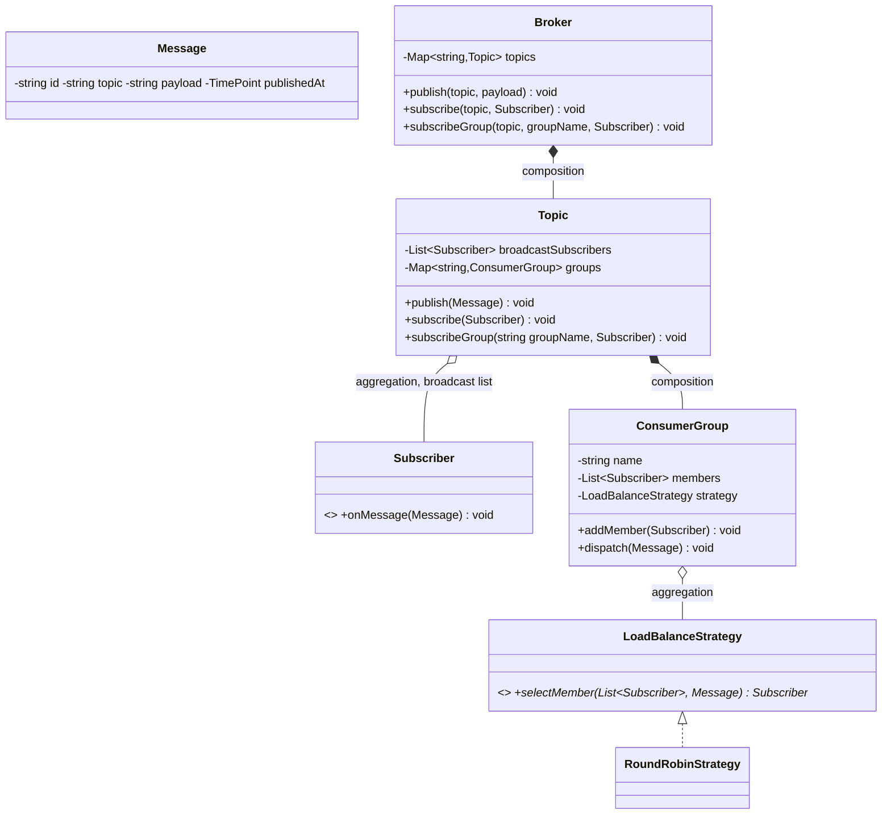

# 08 — In-Memory Message Queue / Pub-Sub System

> Difficulty: advanced. This is the machine-coding-scale version of the
> topic `hld/notes/06_telemetry_pipelines.md` treats at fleet scale — here
> the interesting design is a single-process pub/sub broker with topics,
> multiple subscribers, and **consumer groups** (a Kafka-style concept:
> each message within a group is delivered to exactly one member of that
> group, but broadcast to every group independently). Prerequisite:
> `00_foundations/10_concurrency_for_lld.md`,
> `00_foundations/11_threads_futures_and_concurrency_patterns.md`.

## Step 1 — Clarify

Assumed answers:

- Producers publish messages to a **topic** (a named channel).
- **Plain pub/sub**: every subscriber to a topic gets every message
  (broadcast).
- **Consumer groups**: subscribers can join a named group on a topic; a
  message is delivered to exactly **one** member per group (load-balanced
  within the group), but every group subscribed to the topic gets its own
  copy — the two delivery semantics coexist per topic.
- In-memory only, single process, bounded per-topic queues (producers block
  or are rejected when a queue is full — pick one and state it: this
  design blocks, matching the `BoundedBlockingQueue` semantics already
  built in `00_foundations/10`).
- **Deferred, explicitly**: persistence/durability across restarts,
  cross-process delivery, exactly-once semantics (a genuinely hard
  distributed-systems problem, out of scope for an in-memory LLD version —
  say this boundary explicitly, it's a strong signal to name the harder
  problem without overclaiming a solution to it).

## Step 2 — Entities

| Entity | Responsibility |
| --- | --- |
| `Message` | Payload + metadata (topic, timestamp, id) |
| `Topic` | Owns the set of plain subscribers and the set of consumer groups for one channel |
| `ConsumerGroup` | Owns its members and load-balances delivery among them |
| `Subscriber` (interface) | `onMessage(Message)` — **growing set** (different subscriber behaviours), interface |
| `Broker` | The entry point: `publish`, `subscribe`, `subscribeGroup` |

This problem composes three patterns already in the catalog rather than
introducing a new one: **Observer** (`09`) for plain broadcast subscribers,
the **Producer-Consumer** pattern (`10`/`11`) for each consumer group's
internal work queue, and the **Strategy** shape for load-balancing *within*
a group (round-robin today, could be least-loaded later — interface it).

## Step 3 — Class diagram



## Step 4-5 — Interfaces and core implementation

```cpp
#include <unordered_map>
#include <vector>
#include <memory>
#include <mutex>
#include <atomic>
#include <chrono>
#include <string>

struct Message {
    std::string id;
    std::string topic;
    std::string payload;
    std::chrono::steady_clock::time_point publishedAt;
};

class Subscriber {
public:
    virtual void onMessage(const Message&) = 0;
    virtual ~Subscriber() = default;
};

class LoadBalanceStrategy {
public:
    virtual Subscriber* selectMember(std::vector<Subscriber*>& members) = 0;
    virtual ~LoadBalanceStrategy() = default;
};
class RoundRobinStrategy : public LoadBalanceStrategy {
public:
    Subscriber* selectMember(std::vector<Subscriber*>& members) override {
        if (members.empty()) return nullptr;
        Subscriber* chosen = members[idx_ % members.size()];
        ++idx_;
        return chosen;
    }
private:
    size_t idx_ = 0;
};

class ConsumerGroup {
public:
    ConsumerGroup(std::string name, std::unique_ptr<LoadBalanceStrategy> strategy)
        : name_(std::move(name)), strategy_(std::move(strategy)) {}

    void addMember(Subscriber* s) {
        std::lock_guard<std::mutex> lock(mu_);
        members_.push_back(s);
    }
    void dispatch(const Message& msg) {
        std::lock_guard<std::mutex> lock(mu_);
        if (Subscriber* target = strategy_->selectMember(members_)) target->onMessage(msg);
        // group with zero members: message is dropped for this group —
        // a real broker would buffer it; see Extensions.
    }

private:
    std::string name_;
    std::mutex mu_;
    std::vector<Subscriber*> members_;
    std::unique_ptr<LoadBalanceStrategy> strategy_;
};

class Topic {
public:
    void subscribe(Subscriber* s) {
        std::lock_guard<std::mutex> lock(mu_);
        broadcastSubscribers_.push_back(s);
    }
    void subscribeGroup(const std::string& groupName, Subscriber* s) {
        std::lock_guard<std::mutex> lock(mu_);
        auto it = groups_.find(groupName);
        if (it == groups_.end()) {
            it = groups_.emplace(groupName,
                std::make_unique<ConsumerGroup>(groupName, std::make_unique<RoundRobinStrategy>())).first;
        }
        it->second->addMember(s);
    }
    void publish(const Message& msg) {
        std::vector<Subscriber*> broadcastCopy;
        std::vector<ConsumerGroup*> groupCopies;
        {
            std::lock_guard<std::mutex> lock(mu_);
            broadcastCopy = broadcastSubscribers_;
            for (auto& [name, group] : groups_) groupCopies.push_back(group.get());
        }
        // Dispatch OUTSIDE the lock: onMessage() is caller code we don't
        // control — holding a lock while calling into it risks deadlock if
        // that code re-enters the Topic (e.g. subscribing from within a
        // handler) and blocks throughput for unrelated topics in the
        // meantime. Copying the subscriber list under the lock, then
        // dispatching without it, is the standard fix.
        for (auto* s : broadcastCopy) s->onMessage(msg);
        for (auto* g : groupCopies) g->dispatch(msg);
    }

private:
    std::mutex mu_;
    std::vector<Subscriber*> broadcastSubscribers_;
    std::unordered_map<std::string, std::unique_ptr<ConsumerGroup>> groups_;
};

class Broker {
public:
    void publish(const std::string& topicName, const std::string& payload) {
        Message msg{generateId(), topicName, payload, std::chrono::steady_clock::now()};
        getOrCreateTopic(topicName).publish(msg);
    }
    void subscribe(const std::string& topicName, Subscriber* s) {
        getOrCreateTopic(topicName).subscribe(s);
    }
    void subscribeGroup(const std::string& topicName, const std::string& groupName, Subscriber* s) {
        getOrCreateTopic(topicName).subscribeGroup(groupName, s);
    }

private:
    Topic& getOrCreateTopic(const std::string& name) {
        std::lock_guard<std::mutex> lock(topicsMu_);
        return *topics_.try_emplace(name, std::make_unique<Topic>()).first->second;
    }
    std::string generateId() { return "msg-" + std::to_string(counter_++); }

    std::mutex topicsMu_;
    std::unordered_map<std::string, std::unique_ptr<Topic>> topics_;
    std::atomic<uint64_t> counter_{0};
};
```

**The "copy the subscriber list, dispatch outside the lock" pattern is the
one detail in this file worth memorising over everything else** — it's a
real, common bug class (calling untrusted/unknown code while holding your
own lock) and a strong, specific thing to say unprompted while narrating
your `publish` implementation.

## Step 6 — Edge cases handled

- Publishing to a topic with no subscribers → no-op, not an error (a
  reasonable, statable assumption — pub/sub systems don't usually require a
  subscriber to exist before a producer can publish).
- A consumer group with zero members → message dropped for that group in
  this simplified version, explicitly flagged as a simplification (a real
  broker buffers undelivered messages — see Extensions).
- Dispatch happens outside the topic's lock, so a slow or misbehaving
  subscriber's `onMessage` cannot block `publish` calls to *other* topics,
  and cannot deadlock against a subscriber that re-enters the broker.

## Extensions (what a live follow-up usually asks)

**"What if a subscriber in a group is offline / not ready to receive?"**
This is exactly the case the simplified `ConsumerGroup::dispatch` drops
silently — a real fix gives each group member (or each consumer) its own
bounded queue (`BoundedBlockingQueue` from `00_foundations/10`) that
`dispatch` pushes into, decoupling "message arrived" from "consumer is
ready to process it," with the consumer pulling from its own queue on its
own thread. This turns the whole system into a two-level Producer-Consumer:
producers → topic → (per-member queue → consumer).

**"How do you guarantee at-least-once delivery?"** Requires
acknowledgement: the consumer explicitly acks after successfully
processing, and undelivered/unacked messages are redelivered after a
timeout — this needs a persistent (or at least redelivery-aware) store per
message, a materially bigger design than the in-memory version above.
Naming what's missing precisely (ack tracking, redelivery timer) is the
right-sized answer; don't attempt a full implementation unless explicitly
asked to extend into it.

**"Make `publish` non-blocking for the producer even under load."** Push
onto an internal bounded queue per topic and dispatch from a dedicated
worker thread or Thread Pool (`00_foundations/11`) rather than dispatching
synchronously inline inside `publish` — the producer only blocks on the
(fast) enqueue, not on however long every subscriber's `onMessage` takes.

**"Compare this to Kafka in one sentence."** This is single-process,
in-memory, no persistence, no partitioning, no replication — genuinely a
toy version of the same *conceptual* model (topics, consumer groups,
broadcast-per-group/load-balance-within-group). Kafka's actual complexity
is almost entirely in the distributed, durable, partitioned parts this
design explicitly deferred — say that boundary precisely rather than
implying this is "basically Kafka."

## Interview framing to reuse

"I copy the subscriber and group list under the lock, then dispatch outside
it — calling into subscriber code while holding the topic's lock risks
deadlock if a handler re-enters the broker, and it would serialize every
topic's throughput behind however slow the current subscriber's handler
is." Precise, and it's the single highest-value sentence in this whole
problem.

## Exercises

1. Implement the above from scratch in 45-50 minutes, then write a test:
   three plain subscribers and two consumer groups (three members each) on
   one topic; publish 10 messages; assert every plain subscriber saw all 10
   and each group's messages were spread across its members via round-robin.
2. Add per-member bounded queues (the "offline consumer" extension) using
   `00_foundations/10`'s `BoundedBlockingQueue`, with each member consuming
   on its own thread — confirm a slow consumer no longer blocks `publish`.
3. Deliberately dispatch *inside* the topic's lock (remove the copy-then-
   release pattern), have a test subscriber's `onMessage` call back into
   `broker.subscribe()` on the same topic, and reproduce the deadlock —
   then revert and confirm the fix resolves it. This is the single most
   convincing way to internalise why the pattern matters.
