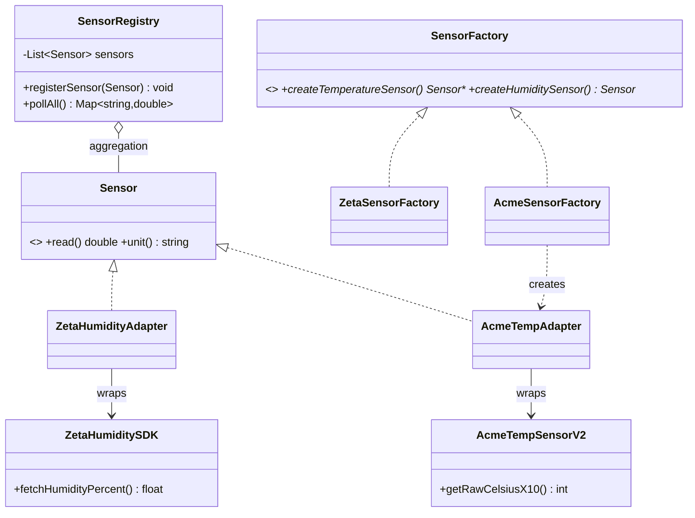

# 23 — Pluggable Sensor / HAL Framework

> Difficulty: advanced. Tier 4 — the most direct interview-round version
> of `lld/notes/05_hal_architecture.md`'s Staff-level material, scoped
> to a 45-60 minute machine-coding round. This is the problem to have
> ready when a Cisco/Nvidia/Palo Alto Networks-style loop asks "design a
> pluggable driver framework" instead of a generic software LLD prompt —
> same underlying skills (Adapter, Abstract Factory, Bridge), embedded
> skin.

## Step 1 — Clarify

Assumed answers:

- A system must read from multiple sensor types (temperature, humidity,
  pressure) across multiple **vendors**, each with an incompatible native
  SDK/register interface, behind one uniform application-facing API.
- Sensors are read on a polling loop; a new vendor's sensor must be
  addable **without recompiling or modifying application code** that
  consumes readings — the actual requirement this whole design serves.
- Each vendor SDK is a black box you can't modify (simulated here as a
  small "legacy" class with its own quirky method names/units).
- **Deferred, explicitly**: interrupt-driven (vs. polled) sensors, DMA-based
  bulk reads, hot-plug detection — realistic embedded extensions, not the
  base design.

## Step 2 — Entities

| Entity | Responsibility |
| --- | --- |
| `Sensor` (interface) | Uniform app-facing contract: `read()` returns a normalized value | 
| Vendor SDK classes (`AcmeTempSensorV2`, `ZetaHumiditySDK`) | The incompatible, unmodifiable "legacy" APIs |
| `SensorAdapter` implementations | One per vendor, translates the vendor SDK into `Sensor` — **Adapter** |
| `SensorFactory` (interface) → per-vendor factories | Creates the right adapter for a given config entry — **Abstract Factory** |
| `SensorRegistry` | Owns all active sensors, polls them uniformly |

**Why this is Adapter, not a from-scratch reimplementation of each
vendor's protocol**: the vendor SDKs are given, black-box, and
individually already correct at talking to their own hardware — the
problem is only that their *interfaces* don't match each other or the
application's needs. This is precisely Adapter's stated purpose in
`00_foundations/08_design_patterns_structural.md`: wrap, don't
reimplement.

**Why the factory layer is Abstract Factory rather than a single Factory
Method**: if a vendor's sensor line has *multiple related products* that
must be configured consistently (e.g. Acme's temperature AND humidity
sensors share a connection/init sequence), a single `AcmeSensorFactory`
producing both, versus a generic factory needing a type tag per call,
mirrors `00_foundations/07_design_patterns_creational.md`'s Abstract
Factory distinction directly — say this explicitly if the interviewer
asks "why not just Factory Method."

## Step 3 — Class diagram



## Step 4-5 — Interfaces and core implementation

```cpp
#include <map>
#include <memory>
#include <string>
#include <vector>

// The uniform, application-facing contract -- this is the only interface
// the rest of the system (SensorRegistry, and anything consuming
// readings) ever depends on. DIP in action.
class Sensor {
public:
    virtual double read() = 0;          // always normalized to a standard unit
    virtual std::string unit() const = 0;
    virtual ~Sensor() = default;
};

// --- Vendor SDKs: given, unmodifiable, each with its own quirks ---
class AcmeTempSensorV2 {
public:
    int getRawCelsiusX10() { return 235; }   // returns celsius * 10, vendor's own encoding
};
class ZetaHumiditySDK {
public:
    float fetchHumidityPercent() { return 0.612f; }   // returns a 0.0-1.0 fraction, not a percent despite the name
};

// --- Adapters: one per vendor, each does ONLY translation, no business logic ---
class AcmeTempAdapter : public Sensor {
public:
    explicit AcmeTempAdapter(std::unique_ptr<AcmeTempSensorV2> sdk) : sdk_(std::move(sdk)) {}
    double read() override { return sdk_->getRawCelsiusX10() / 10.0; }   // normalize to real Celsius
    std::string unit() const override { return "C"; }
private:
    std::unique_ptr<AcmeTempSensorV2> sdk_;
};
class ZetaHumidityAdapter : public Sensor {
public:
    explicit ZetaHumidityAdapter(std::unique_ptr<ZetaHumiditySDK> sdk) : sdk_(std::move(sdk)) {}
    double read() override { return sdk_->fetchHumidityPercent() * 100.0; }   // normalize to a real percent
    std::string unit() const override { return "%RH"; }
private:
    std::unique_ptr<ZetaHumiditySDK> sdk_;
};

// --- Abstract Factory: one implementation per vendor, produces a
// consistent family of that vendor's sensors ---
class SensorFactory {
public:
    virtual std::unique_ptr<Sensor> createTemperatureSensor() = 0;
    virtual std::unique_ptr<Sensor> createHumiditySensor() = 0;
    virtual ~SensorFactory() = default;
};
class AcmeSensorFactory : public SensorFactory {
public:
    std::unique_ptr<Sensor> createTemperatureSensor() override {
        return std::make_unique<AcmeTempAdapter>(std::make_unique<AcmeTempSensorV2>());
    }
    std::unique_ptr<Sensor> createHumiditySensor() override { return nullptr; }   // Acme doesn't make a humidity sensor
};
class ZetaSensorFactory : public SensorFactory {
public:
    std::unique_ptr<Sensor> createTemperatureSensor() override { return nullptr; }
    std::unique_ptr<Sensor> createHumiditySensor() override {
        return std::make_unique<ZetaHumidityAdapter>(std::make_unique<ZetaHumiditySDK>());
    }
};

class SensorRegistry {
public:
    void registerSensor(std::string name, std::unique_ptr<Sensor> sensor) {
        sensors_[std::move(name)] = std::move(sensor);
    }
    std::map<std::string, double> pollAll() {
        std::map<std::string, double> readings;
        for (auto& [name, sensor] : sensors_) readings[name] = sensor->read();
        return readings;
    }

private:
    std::map<std::string, std::unique_ptr<Sensor>> sensors_;
};
```

**Why `AcmeTempAdapter::read()` does the unit conversion and nothing
else**: this is the Adapter-scope discipline from
`00_foundations/08_design_patterns_structural.md` stated for a concrete
case — if `read()` also validated ranges, logged, or retried on failure,
that would be business logic leaking into a translation layer, an SRP
violation worth catching yourself on. A `RetryingSensor` decorator
(`00_foundations/08`'s Decorator) wrapping any `Sensor` is the right home
for retry behaviour, kept separate from adaptation.

## Step 6 — Edge cases handled

- `AcmeSensorFactory::createHumiditySensor()` returns `nullptr` for a
  product line that vendor doesn't make — `SensorRegistry` (or whoever
  wires up factories) must check for null before registering, an explicit
  contract worth stating rather than leaving implicit.
- Unit normalization happens **inside** each adapter, at the vendor
  boundary — `SensorRegistry` and everything above it only ever sees
  standard units, never vendor-specific encodings.

## Extensions (what a live follow-up usually asks)

**"Add a third vendor at runtime, from a config file, without
recompiling."** This is where the design earns its complexity: a
`std::map<std::string, std::unique_ptr<SensorFactory>>` keyed by vendor
name, populated at startup by whatever factories are linked in, selected
by a config string — the *code* for a new vendor still needs to be
compiled in (C++ has no reflection-based dynamic loading without extra
machinery like `dlopen`), but *application logic* needs zero changes,
which is the realistic scope of "pluggable" in a statically-compiled
embedded system. Naming this precise boundary (compile-time extensible
vs. true runtime plugin loading, which needs `dlopen`/shared libraries
and a stable C ABI) is a strong, honest answer.

**"Add a decorator that retries a flaky sensor read up to N times before
failing."** Direct application of Decorator
(`00_foundations/08_design_patterns_structural.md`) — a
`RetryingSensor : public Sensor` wrapping any other `Sensor`, transparent
to `SensorRegistry`.

**"Wire polling into the scheduler from `10_task_scheduler_cron.md`."**
`scheduler.scheduleRecurring([&registry] { registry.pollAll(); },
std::chrono::seconds(1))` — the same composition move as
`22_traffic_light_controller.md`'s extension, worth naming as a pattern
you'd reach for again.

## Interview framing to reuse

"Each adapter does exactly one thing — translate the vendor's native
encoding into a normalized value in the uniform interface — and nothing
else; retry logic, validation, or logging belong in decorators around
`Sensor`, not inside the adapters, so the adaptation layer stays a thin,
reviewable seam." A precise statement of scope discipline, which is
exactly what a HAL-style review actually checks for.

## Exercises

1. Implement the above from scratch in 45-50 minutes, including a third
   vendor end to end (SDK stub, adapter, factory) to prove the "add a
   vendor without touching existing code" claim concretely.
2. Implement `RetryingSensor` as a Decorator and confirm it can wrap any
   `Sensor` (including an adapter) transparently, with `SensorRegistry`
   needing zero changes.
3. Write a test with a deliberately-failing vendor SDK stub (throws on
   read) and confirm `SensorRegistry::pollAll()` either skips it
   gracefully or propagates the failure per an explicit, stated policy —
   pick one and defend it.
