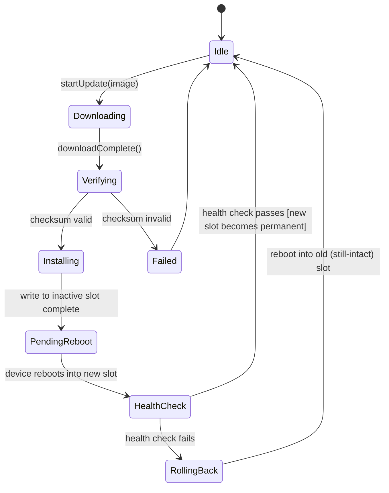
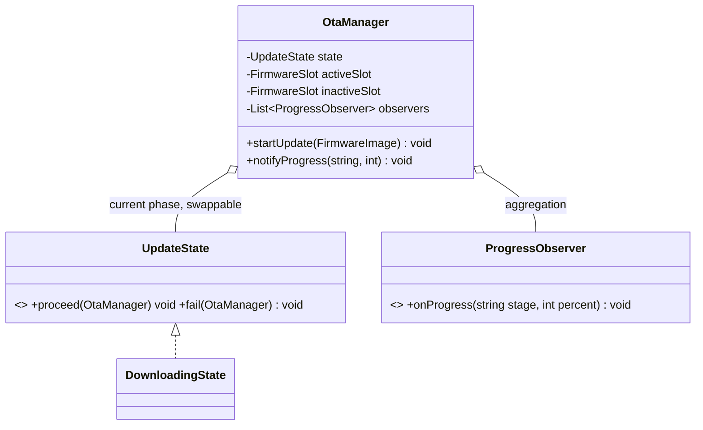

# 24 — Device Firmware Update (OTA) Manager

> Difficulty: advanced. Tier 4, and the capstone of the embedded-flavoured
> track — a single-device LLD version of the fleet-scale problem in
> `hld/notes/07_edge_to_cloud_fleet_management.md`. This is the problem
> to have ready when asked "design the on-device piece of an OTA system"
> — State for the update lifecycle, Command for rollback, Observer for
> progress reporting, all composing around one hard safety requirement:
> **a failed update must never leave the device unbootable.**

## Step 1 — Clarify

Assumed answers:

- A single device receives a firmware image, verifies it, applies it,
  and can **roll back** to the previous working version if the new one
  fails to boot or fails a post-install health check.
- **A/B (dual-bank) update scheme**: two firmware slots (A and B); the
  device always boots from the *active* slot, updates are written to the
  *inactive* one, and the active slot only switches after the new image
  is verified — this is the real-world mechanism that makes "never
  unbootable" achievable at all, and naming it by name is a strong signal.
- Integrity check (checksum/signature) before ever marking an image
  bootable.
- **Deferred, explicitly**: delta/differential updates (bandwidth
  optimization, a real but separate problem), the actual download/
  transport layer (assume the image bytes are already local) — the state
  machine and the A/B safety mechanism are the design target.

## Step 2 — Entities

| Entity | Responsibility |
| --- | --- |
| `FirmwareSlot` (enum) | A / B |
| `FirmwareImage` | Version, checksum, raw bytes (or a path to them) |
| `UpdateState` (interface) | What happens at each stage of the update — **State pattern** |
| `UpdateCommand` | The whole update-attempt, with an explicit rollback path — **Command** |
| `ProgressObserver` (interface) | Reports progress/status upward — **Observer** |
| `OtaManager` | Owns current state, both slots, drives the state machine |

**Why A/B slots are the load-bearing design decision, more than any GoF
pattern**: without a second slot, "install failed, roll back" requires
either keeping a full backup of the old image somewhere (extra storage,
same net effect as a second slot) or, worse, has no safe rollback path at
all if the write itself is interrupted mid-flash. The state machine and
patterns below all exist in service of this one mechanism — say this
explicitly before drawing any diagram; it's the actual engineering
content an interviewer wants to hear on this problem, more than pattern
names.

## Step 3 — Class diagram





## Step 4-5 — Interfaces and core implementation

```cpp
#include <memory>
#include <string>
#include <vector>

enum class FirmwareSlot { A, B };

struct FirmwareImage {
    std::string version;
    std::string checksum;
    std::vector<uint8_t> data;
};

class ProgressObserver {
public:
    virtual void onProgress(const std::string& stage, int percent) = 0;
    virtual ~ProgressObserver() = default;
};

class OtaManager;   // fwd decl

class UpdateState {
public:
    virtual void proceed(OtaManager&) = 0;   // advance on success
    virtual void fail(OtaManager&) = 0;      // handle failure from THIS stage
    virtual std::string name() const = 0;
    virtual ~UpdateState() = default;
};

class VerifyingState : public UpdateState {
public:
    void proceed(OtaManager& mgr) override;   // checksum matched -> InstallingState
    void fail(OtaManager& mgr) override;      // checksum mismatch -> FailedState
                                                 // (note: NOT RollingBackState -- nothing
                                                 // was written to the inactive slot yet,
                                                 // there's nothing to roll back)
    std::string name() const override { return "VERIFYING"; }
};

class HealthCheckState : public UpdateState {
public:
    void proceed(OtaManager& mgr) override;   // health check passed -> commit the new
                                                 // slot as permanent, -> IdleState
    void fail(OtaManager& mgr) override;       // health check FAILED -> RollingBackState,
                                                 // the one state transition where safety
                                                 // actually depends on the OLD slot still
                                                 // being fully intact (it was never touched)
    std::string name() const override { return "HEALTH_CHECK"; }
};
// DownloadingState, InstallingState, PendingRebootState, RollingBackState,
// FailedState, IdleState follow the same shape -- each decides its own
// success- and failure-transitions, exactly like every State example
// earlier in this problem set.

class OtaManager {
public:
    OtaManager(FirmwareSlot active) : activeSlot_(active),
        inactiveSlot_(active == FirmwareSlot::A ? FirmwareSlot::B : FirmwareSlot::A) {}

    void startUpdate(FirmwareImage image) {
        pendingImage_ = std::move(image);
        setState(std::make_unique<class DownloadingState>());
    }
    void setState(std::unique_ptr<UpdateState> s) { state_ = std::move(s); }
    void subscribe(ProgressObserver* obs) { observers_.push_back(obs); }
    void notifyProgress(const std::string& stage, int percent) {
        for (auto* obs : observers_) obs->onProgress(stage, percent);
    }

    // Called only by HealthCheckState::proceed -- the ONE place the
    // active/inactive slots actually swap. Keeping the swap in exactly
    // one place, gated by exactly one transition, is what makes "never
    // unbootable" a checkable property rather than a hope.
    void commitInactiveSlotAsActive() { std::swap(activeSlot_, inactiveSlot_); }

    FirmwareSlot activeSlot_, inactiveSlot_;
    FirmwareImage pendingImage_;

private:
    std::unique_ptr<UpdateState> state_;
    std::vector<ProgressObserver*> observers_;
};
```

**Why `commitInactiveSlotAsActive` is called from exactly one place
(`HealthCheckState::proceed`), and why that's the actual safety
argument**: the device's bootloader (outside this class's scope, but
worth naming) reads "which slot is active" from a fixed location before
this call ever happens on a *successful* update — until health check
passes, the bootloader still points at the old, untouched, known-good
slot. If the health check fails, `RollingBackState` doesn't need to
"restore" anything, because nothing was ever committed — it only needs to
ensure the device reboots into the slot the bootloader already considers
active. **This is the actual insight interviewers are listening for**:
rollback safety comes from *never committing until verified*, not from a
recovery mechanism bolted on after the fact.

## Step 6 — Edge cases handled

- Checksum failure during `VerifyingState` → transitions to `FailedState`
  directly, **not** `RollingBackState` — correctly recognising that
  nothing was written to the inactive slot yet, so there's nothing to
  roll back from; conflating these two failure paths is a common mistake
  on this problem worth explicitly avoiding.
- Health check failure after a successful install → `RollingBackState`,
  which works precisely because the active slot was never touched during
  install (writes only ever targeted the *inactive* slot).
- Progress observers are notified via a copied/dispatched-outside-lock
  pattern in a concurrent version of this (see Extensions) — in this
  single-threaded sketch, direct iteration is fine.

## Extensions (what a live follow-up usually asks)

**"What if power is lost mid-install (mid-write to the inactive slot)?"**
The bootloader is still pointed at the untouched active slot (the commit
never happened), so the device boots normally into the old firmware on
next power-up — the *only* case requiring special handling is power loss
during the swap itself, which is why real systems make that swap a single
atomic operation (writing one bit/byte in a fixed location, not a
multi-step process) — naming this atomicity requirement explicitly is a
strong, precise answer.

**"Add a maximum retry count before giving up and alerting."** A counter
on `OtaManager`, checked in `FailedState`/`RollingBackState` before
deciding to retry `startUpdate` automatically vs. surfacing to
`ProgressObserver`s as a terminal failure — additive, doesn't touch the
core state machine shape.

**"Connect this to the fleet-scale rollout system."** Direct
cross-reference to `hld/notes/07_edge_to_cloud_fleet_management.md` —
this file is the single-device mechanism; that file is the canary/
staged-rollout/fleet-wide orchestration built on top of many devices each
running something like this `OtaManager`. Naming the connection precisely
(this is the unit the fleet system schedules across thousands of, not a
competing design) is the right-sized answer.

## Interview framing to reuse

"Rollback safety here doesn't come from a recovery step — it comes from
never committing the new slot as active until the health check passes,
so a failure at any point before that leaves the bootloader still
pointed at an untouched, known-good slot. That's why checksum failure
goes to `FailedState`, not `RollingBackState` — there's nothing to roll
back from if nothing was ever committed." This is the sentence this whole
problem exists to produce.

## Exercises

1. Implement the full state machine (all eight states) in 45-55 minutes
   (budget real time — this is one of the larger problems in the set),
   then write a test confirming a checksum failure in `VerifyingState`
   transitions to `FailedState` and never touches `activeSlot_`/
   `inactiveSlot_` at all.
2. Write a test simulating a health-check failure after a successful
   install, confirming `RollingBackState` is reached and
   `commitInactiveSlotAsActive` was never called during that attempt.
3. Sketch (pseudocode) how you'd make the active/inactive slot swap a
   single atomic operation at the storage layer, and identify what
   specifically could go wrong if it were instead a multi-step write.
